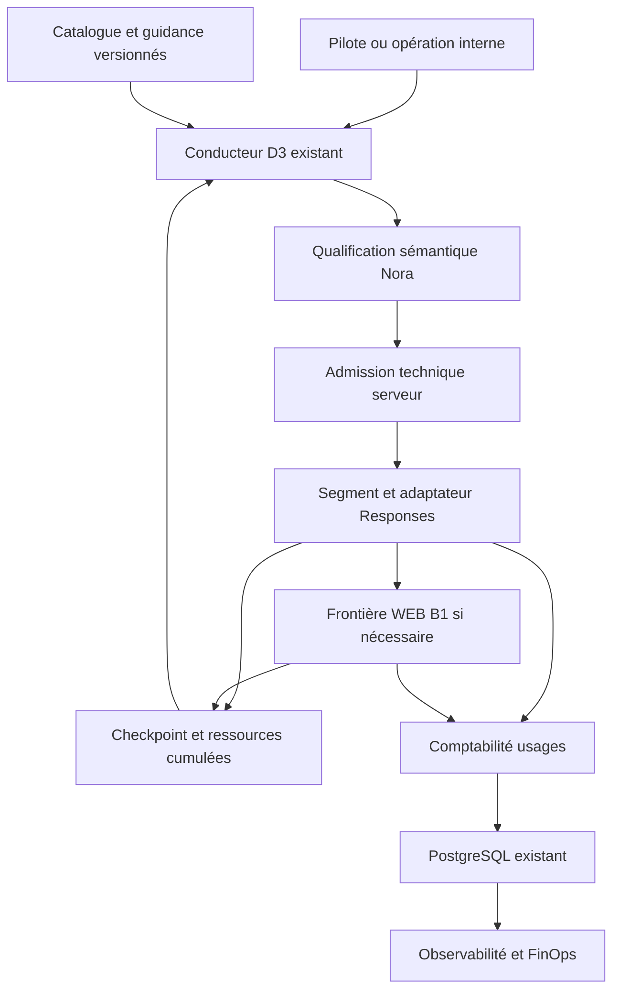

# SFIA Studio Next — Contrat technique intégré : allocation cognitive, WEB sécurisé et FinOps

| Champ | Valeur |
|---|---|
| Version | 0.1 — 26 novembre 2026 |
| Statut | **DOCUMENTED — orientations techniques validées par Morris ; spécification détaillée candidate pour construction gouvernée** |
| Autorité | Contrat fonctionnel intégralement validé par Morris le 26/11 ; architecture proposée et trois arbitrages (référentiels Git, persistance PostgreSQL additive, calibration comparative) validés le 26/11 ; GO explicite de création/publication de ce document |
| Mandat Git | Création de ce seul fichier, branche `docs/next-ml5-uat-consolidation-20261124`, base `b66b4c47fe83c54508ae2aa66f71be16479eca8b` ; pas de main, PR, merge, code, modification de configuration ou activation |
| Contrat fonctionnel | [Allocation cognitive, WEB et FinOps](../conception-fonctionnelle/allocation-cognitive-recherche-web-et-finops.md), [version validée immuable](https://github.com/mcleland147/sfia-workspace/blob/b66b4c47fe83c54508ae2aa66f71be16479eca8b/projects/sfia-studio-next/conception-fonctionnelle/allocation-cognitive-recherche-web-et-finops.md), blob `d47565df805805a65e2af00c8383306e94c4645c` |
| Préflight technique | [P1–P9](https://github.com/mcleland147/sfia-workspace/blob/67ce2a6ebd1e68466bda8dd5b9108812125f153b/sfia-review-handoff/latest-chatgpt-review.md), blob `ced607b3df1ca0ec1417b8c76bd86cd03c442e66` |
| Figma | [Page 13 validée visuellement](https://www.figma.com/design/itgvCulInEnFY6DvgIegvP?node-id=1332-2305) |
| État produit | R5 IN PROGRESS / ML5 OPEN / R6 NOT STARTED / NO RELEASE / NOT ADOPTED |

Les choix structurants déjà validés sont tracés ici. Les interfaces logiques, mécanismes de contrôle détaillés et propositions physiques ci-dessous doivent être vérifiés contre le code réel avant modification. Ils ne constituent pas des faits as-built ni une approbation d'une migration, d'un essai facturable, d'une modification de permissions ou de WEB LIVE. Si un choix détaillé sort du contrat validé, STOP et arbitrage Morris. Publication documentaire distincte du GO de construction et des gates de qualification.

## 1. Périmètre, sources et état d'entrée

Résultat : dans un même travail cognitif, Nora mobilise des ressources adaptées et qualifiées, peut rechercher/lire/citer le WEB admis, et rend tous ses usages IA attribuables et mesurables. Le Pilote consulte la consommation dans ses paramètres ; le constructeur utilise la même comptabilité pour calibrer. Ce lot transverse interne à ML5 précède la reprise de la livraison 2 (réalisation Cursor, preuves, restitution). Il n'est ni un nouveau macro-jalon ni une refonte de D3.

Sources applicables, à relire à la ref réelle par Cursor :
- [SEF](../governance/SEF.md) §4, §6, §10 ; [Roadmap](../governance/roadmap.md) ; [convention de nommage](../governance/product-naming-conventions.md).
- [Décisions R4](../governance/decisions/2026-11-04-r4-architecture-exit.md) R4-01..04, DATA-01 ; [SEM](../governance/decisions/2026-11-12-qualification-semantique-nora-mobilisation-capacites.md) SEM-01..08.
- [Contrat fonctionnel ML5](../conception-fonctionnelle/preparation-cognitive-et-realisation-technique-gouvernee.md) §22 ; [conducteur Nora](conducteur-cognitif-et-production-nora.md) §§6–9 ; [écarts architecture](qualification-ecarts-cognition-transverse-et-execution-cursor-ml5.md) ; [observabilité](contrat-observabilite-transverse.md).
- [Orientation allocation/FinOps](../construction/allocation-cognitive-adaptative-et-finops.md), [revue post-C14](../construction/ml5-revue-approfondie-conformite-post-c14.md), [registre couverture](../construction/ml5-registre-couverture-et-revue-developpement.md), [acceptation](../construction/contrat-acceptation-cognition-et-realisation-gouvernee.md).
- [UAT RoomBooking](../construction/recette-utilisateur-ml5-roombooking-20261125.md), [UAT InterventionTrack/StockTrack](../construction/recette-utilisateur-ml5-interventiontrack-20261125.md), [méthode Figma–Cursor](../ux-ui/methodologie-contrat-figma-cursor.md).

Git distant vérifié : main `997897fd7cf914771e7d08e8030dc7123fab7d25`, branche documentaire `b66b4c47`, dernier handoff `77ee051d57fc68b930c274ec2547b791044f7887` (blob `54e37022b43fa63ce50135539173c047db9b64da`). Préflight : code `1633c86b`, tree web `e972dc04`, HEAD local rapporté `e3f5bde2` docs-only après code. Handoff récent : RECETTE `8db4074c`, tree web `0d2c1053d2eeaa6be457084e16e2f27284af6633`, BUILD_ID `IiUs8iS6i7UR-1y3wwC6W`, correctif typographique conversation ciblé ; DEV rapporté `qWUDds50AUSup8n2GqNTC` inchangé. Aucun état local directement observé par ChatGPT ; vérifier branche, HEAD, base, diff, worktrees, correctifs non intégrés, lane/build/DB, dépendances, docs candidates avant écriture. Ne jamais prendre le SHA RECETTE pour HEAD DEV par présomption.

IN : catalogue, guidance, tarifs, allocation D3, continuité et usages, persistance additive, projections FinOps, frontière B1 et restitution sources, UX validée, calibration/qualification et synchronisation documentaire. OUT : plafonds financiers, administration/billing API OpenAI, autre fournisseur, Astra, fine-tuning des poids, nouveau conducteur, stockage séparé, refonte UX, nouvelles intégrations, D7/D8 livraison 2, promotion, réécriture des données historiques. La décision du 23/11 Git direct/auto-session reste à réconcilier sans modification de son contenu. Le périmètre et l'état de la Roadmap candidate sont stale par rapport aux arbitrages du 26/11 ; synchronisation bornée après validation et dans le lot autorisé, pas dans ce commit.

## 2. Prérequis OpenAI : accès, configuration de projet et secrets

### 2.1 Permissions constatées et besoin minimal

Capture fournie par Morris le 26/11 : clé projet DEV active, propriétaire de type User ; secret masqué ; scopes visibles `api.responses.write`, `api.responses.read`, `api.model.read`, `model.read`. Aucune copie de secret, identifiant personnel, tracking ID ou project ID dans ce document. Permissions RECETTE non inspectées. Les scopes sont **suffisants en principe** pour l'intégration actuelle Responses et lecture des modèles ; accès effectif au compte et restrictions organisation/projet restent NON OBSERVÉS.

| Usage | Endpoint / capacité | Action |
|---|---|---|
| Génération, raisonnement, function tools, structured outputs | POST /v1/responses | Conserver Responses write |
| Lecture/réconciliation d'une réponse lorsque applicable | GET /v1/responses/{response_id} | Conserver Responses read ; disponibilité dépend du stockage réel |
| Inventaire des modèles | GET /v1/models, retrieve si utile | Conserver List models |
| WEB hébergé | Outil déclaré dans Responses, worker isolé | Aucune permission dédiée supplémentaire identifiée ; compatibilité et politiques projet à vérifier |
| FinOps Studio | Usage de chaque réponse, événements SDK, frais connus et catalogue tarifaire | Aucun nouveau scope |
| Administration, usage/costs organisation, facturation | Administration API / clé admin distincte | OUT ; ne pas demander, stocker ou déployer une admin key |

Ne pas passer en All, ne pas activer Files/Assistants/fine-tuning/Chat Completions/Conversations ou autres scopes par précaution. Aucun changement de clé requis par le multi-modèles ou l'effort. Si un endpoint inattendu s'avère nécessaire, identifier sa responsabilité et demander arbitrage plutôt qu'élargir les droits. Conserver les secrets côté serveur, hors Git, logs, client, captures et prompts. Une clé par projet/lane réelle ; ne jamais utiliser DEV pour contourner une restriction RECETTE. Un compte de service projet est une option d'exploitation future pertinente pour découpler runtime et compte personnel, non un prérequis à ce lot ni une rotation imposée.

Sources officielles consultées le 26/11/2026 : [projets et permissions](https://help.openai.com/en/articles/9186755-managing-projects-in-the-api-platform), [RBAC](https://developers.openai.com/api/docs/guides/rbac), [API keys/service accounts](https://developers.openai.com/api/docs/guides/api-keys), [Responses create](https://developers.openai.com/api/reference/resources/responses/methods/create), [List models](https://developers.openai.com/api/reference/typescript/resources/models/methods/list), [WEB search](https://developers.openai.com/api/docs/guides/tools-web-search), [Admin APIs](https://developers.openai.com/api/docs/guides/admin-apis), [usage/costs](https://help.openai.com/en/articles/10478918-reviewing-api-usage-and-costs), [data controls](https://developers.openai.com/api/docs/guides/your-data).

### 2.2 Accès effectif aux modèles par projet

Distinguer quatre niveaux : autorisation de l'endpoint par la clé ; droits du propriétaire/organisation ; modèles et rate limits du projet OpenAI ; admission applicative Studio. Modifier un seul niveau ne garantit pas les autres.

Morris vérifie, pour DEV d'abord, OpenAI Platform → Settings → Projects → SFIA Studio Next — DEV → Limits / Model usage : autorisation des identifiants `gpt-6-luna`, `gpt-6.1-terra`, `gpt-6.2-sol`, quotas/rate limits (requêtes/tokens selon fournisseur) et disponibilité réelle. Les modèles supplémentaires ne deviennent pas admissibles dans Studio par leur présence dans le compte. Même contrôle RECETTE au gate dédié ; aucun élargissement automatique de projet ou permission par Cursor.

Avec mandat réseau read-only spécifique, `models.list()` via la clé DEV existante peut inventorier les références exposées, sans générer de réponse IA. Ce résultat ne prouve ni les efforts ni le tool calling, ni tous les droits effectifs ; une absence doit être diagnostiquée, pas contournée. Tests Responses courts, au coût mesuré, uniquement sous GO facturable DEV distinct. Classer : modèle indisponible, accès refusé, paramètre invalide, quota/rate limit, solde ou dépendance indisponible selon réponse réelle ; ne pas relancer sur erreur permanente. Ne pas révéler l'en-tête Authorization, les clés ou réponses d'erreur brutes sensibles. Ne pas effectuer ces appels dans le présent mandat documentaire.

### 2.2.1 Observation complémentaire — Project Settings / Limits, DEV, 26/11/2026

Source : capture d'écran fournie par Morris lors de la revue du contrat technique. Transcription factuelle minimisée ; aucune copie de capture, clé, identifiant personnel ou identifiant fournisseur dans Git.

| Rubrique | Observation directe | Portée |
|---|---|---|
| Projet | SFIA Studio Next — DEV ; Project Settings / Limits | DEV uniquement, pas RECETTE |
| Spend | `No spend limit set` ; bouton Set spend limit | Aucun plafond de dépenses propre au projet affiché ; limites éventuelles d'organisation et solde non observés |
| Model usage / Allow or block models | Bouton `Select models` ; aucune restriction spécifique affichée sur la vue fermée | Contenu du sélecteur non observé : ne pas conclure à une allowlist vide ni à un accès effectif aux trois modèles |
| Rate limits | L'interface indique que les limites sont héritées de l'organisation sauf surcharge ; bouton `Select models` | Valeurs et surcharges détaillées non observées ; pas de quota illimité présumé |

Cette observation complète §2.1 (permissions Responses read/write et List models suffisantes en principe). Aucune modification préventive de clé, de plafond, de rate limit ou de restriction projet n'est recommandée. Le contrôle du sélecteur est possible sans sauvegarde. Au pré-check Cursor, si le mandat autorise explicitement le réseau read-only vers OpenAI, inventorier via `GET /v1/models` avec la clé DEV existante les trois identifiants attendus. Un inventaire positif ne prouve pas un appel Responses réussi ni l'effort, les outils ou la disponibilité effective à la génération : les essais courts facturables restent soumis au gate DEV de §8. Si un modèle est indisponible ou bloqué, produire le diagnostic et demander uniquement la modification minimale nécessaire à Morris. Ne pas modifier le projet fournisseur de sa propre initiative. RECETTE sera contrôlé au gate dédié.

Référence fournisseur vérifiée le 26/11 : [Gestion des projets API — configuration des accès aux modèles, limites de débit et dépenses](https://help.openai.com/en/articles/9186755-managing-projects-in-the-api-platform). L'absence de plafond DEV affiché ne prouve ni l'absence de limite d'organisation ni la capacité de dépenser sans limite. L'administration financière demeure côté OpenAI ; aucun plafond monétaire à ajouter dans Studio.

Traçabilité : complément factuel autorisé par Morris sur ce seul contrat, branche documentaire `docs/next-ml5-uat-consolidation-20261124`, base `67d06e55f1899d5ef99d3ee03034dbc9cce99e5f`. Aucune modification de conception, de permission, de configuration locale ou distante, ni appel fournisseur.

### 2.3 Données, tracing et contrôles de rétention

Vérifier la configuration réelle Responses : `store`, éventuelle stateful continuation, IDs de réponses, tracing SDK, export et contenu sensible. Ne pas présumer que `store:false` exclut toutes les formes de rétention fournisseur. Maintenir DATA-01, minimisation et restrictions de contexte ; aucune nouvelle persistance fournisseur ni export de traces privées sans arbitrage. Réutiliser les checkpoints D3 comme continuité contrôlée, et non une conversation fournisseur partagée entre modèles/lane. WEB B1 reste soumis à ses propres restrictions indépendamment des garanties de l'API cognitive.

## 3. Configuration Studio — inventaire, évolution et garde-fous

Préflight : modèle demandé fixé par `NORA_STUDY_MODEL = "gpt-6.2-sol"` dans `cognitive-policy.ts`, efforts actuels `low|medium|high`, `qualifyCognitiveProfile` défaut analyse/medium ; `resolvePolicy` permet déjà adaptation profil/effort. Le fichier exact de configuration et la chaîne de priorité complète du candidat local ne sont pas observés directement. Ne pas inventer de noms de variables ni présumer qu'un fichier .env est l'unique cause.

### 3.1 Inventaire obligatoire avant code

Cursor inventorie les références (sans afficher valeurs secrètes) dans code, schémas runtime, unions TypeScript/Zod, configuration versionnée et exemples env, scripts start/build/cutover, CI, tests/fixtures, UI/projections, observabilité, docs ; rechercher identifiant Sol, `NORA_STUDY_MODEL`, `reasoning.effort`, modèles/efforts, `profileHint`, `effortHint`, `modelApplied`, défauts, allowlists et surcharges SDK. Vérifier package.json, lockfile et dépendances résolues ; retrouver tous les points d'appel IA internes et WEB, y compris les chemins qui ne passent pas par le tour conversationnel. Tracer fichier/symbole, propriétaire, valeur non sensible, ordre de priorité, lane, impact, action KEEP/ADAPT/RETIRE. Ne pas ouvrir de secrets ni copier des .env réels dans les preuves.

### 3.2 Référentiels versionnés (choix validé)

Trois responsabilités distinctes, configurations structurées côté serveur dans Git, sans écran d'administration et sans seconde source de vérité :
- **Catalogue de ressources** : identifiant exact, provider/API, efforts supportés et qualifiés, outils/capacités, limites contexte/sortie, statut de qualification par lane, référence/version, restrictions. Validation de schéma au chargement. Les candidats non qualifiés restent non admis en exploitation normale.
- **Référentiel cognitif** : 51 typologies du contrat fonctionnel §4, version et qualité attendue, préférences et signaux d'escalade. Guidance, jamais mapping exécutable par type de tâche ni score. Une synthèse compacte est fournie à Nora ; consultation de détails à la demande via mécanisme D3 existant ou minimal. Ne pas imposer 51 lignes à chaque appel.
- **Référentiel tarifaire** : entrées/cache/sortie, outil, unité, devise, palier, tier, région, durée/écriture cache, date d'effet ou inconnue, source et version. Version immuable de calcul ; évolutions sans réécriture silencieuse des estimations historiques.

Les trois peuvent évoluer indépendamment, mais la politique active référence leurs versions. Aucune auto-modification par Nora. Emplacements/noms physiques exacts à déterminer selon conventions du dépôt après inventaire ; pas de framework de configuration supplémentaire.

Matrice initiale de compatibilité documentaire (contrat fonctionnel §3) : Luna et Terra `none, low, medium, high, xhigh, max` ; Sol `low, medium, high, xhigh, max`. Ne pas ajouter `minimal` ou `none` à Sol par simple union SDK. Les efforts non qualifiés restent refusés en exploitation. Conserver API Responses, et non Chat Completions par fallback. Le choix initial de Sol medium reste référence historique jusqu'à sélection démontrée ; Terra medium hypothèse de calibration, pas défaut imposé avant preuve.

### 3.3 Paramètres et activation par lane

| Élément | État rapporté / traitement |
|---|---|
| Modèle fixe Sol | Remplacer le verrou de modèle unique par résolution à partir du catalogue et de la politique admissible ; préserver Sol comme référence |
| Efforts limités low/medium/high | Étendre types, parsing, validations et adaptateur pour couples réels, pas d'autorisation globale de toutes combinaisons |
| Ressource initiale | Politique versionnée, sélection après calibration ; pas de valeur choisie implicitement par le fournisseur |
| Profil opérationnel | OPERATIONAL_PROVISIONAL et TEST_BOUNDARY : conserver distinctions et vérifier leur application ; pas de test boundary déguisé en exploitation |
| `SFIA_COGNITIVE_MAX_TOKENS` | 2 000 000 rapporté, conserver |
| `SFIA_COGNITIVE_REEVAL_TOKENS` | 1 000 000 rapporté, conserver |
| `SFIA_COGNITIVE_MAX_SEGMENTS` | 120 rapporté, conserver |
| `SFIA_WEB_SEARCH_ENABLED`, `SFIA_WEB_SEARCH_LIVE`, `SFIA_WEB_SEARCH_TEST` | Préserver gates ; LIVE=0 durant construction et tests déterministes |
| `SFIA_WEB_SEARCH_ISOLATION_PROVEN` | Vérifier existence/usage courant ; aucun booléen ne vaut preuve ; pas d'activation par modification de flag seule |

Noms de paramètres nouveaux à stabiliser selon conventions existantes, pas inventés ici. Préférer config versionnée et petit sélecteur de politique/lane à une multiplication d'env vars par modèle. Ordre de résolution : contraintes hard fournisseur et scope/lane → politique versionnée admise → proposition Nora validée → paramètres finaux adaptateur. Tout override (y compris providerData) doit être validé au dernier point d'envoi ; pas d'override silencieux. Configuration invalide = refus explicite ou non-disponibilité de la capacité affectée, jamais choix arbitraire d'un modèle plus coûteux. Ne pas provoquer d'indisponibilité globale inutile. Au boot, journaliser identités de versions et statut de qualification sans secret, ni payload, ni contenu projet. DEV/RECETTE/STABLE isolés par ENV-01 ; aucun changement RECETTE avant GO.

## 4. Architecture D3 — interfaces et flux

Conserver monolithe modulaire, PostgreSQL, conducteur D3, propriétaire des effets D1–D9. Ancrages préflight sous `web/src/domains/conversation/` : `run-nora-cognitive-turn.ts`, `cognitive-conductor.ts`, `cognitive-policy.ts`, `nora-adapter.ts`, `cognitive-work.ts`, `provider-usage.ts` ; chemin/symbole réel à confirmer. Aucun nouveau moteur ni workflow métier secondaire.

### 4.1 Contrats logiques (noms illustratifs, pas types imposés)

| Contrat | Données minimales / responsabilité |
|---|---|
| Ressource candidate | modèle exact, effort, capacités requises, politique/version, motif fonctionnel |
| Décision d'admission | proposé/admis/refusé, modèle/effort résolus, raison technique, version catalogue, scope/lane ; aucune autorité métier |
| Qualification | objectif, contraintes, ambiguïtés, stratégie, acquis/références, besoin du segment suivant |
| Continuation | workId, turn si applicable, révision checkpoint, segment suivant, proposition maintenir/escalader/désescalader, dépendances et limites |
| Génération | generationId, attempt IDs, paramètres réellement envoyés, modèle/effort appliqués si observables, outcome, observations d'usage |

Le modèle est choisi avant le premier segment par politique de référence calibrée. Pas de probe de classification obligatoire ; une réponse simple peut être achevée immédiatement. La qualification enrichie doit utiliser le schéma structuré existant, compatible avec absence de champ (non réévalué) vs valeur explicitement vide. Nora propose une ressource à partir du sens et du contexte, y compris absence de besoin d'approfondir ; pas de moteur de mots-clés, score, longueur, sélection automatique basée sur type de document. Les fonctions déterministes ne deviennent pas des appels IA.

Au terme d'un segment, le conducteur évalue l'état et la proposition sémantique ; vérifie droits, capacités et limites ; conserve checkpoint versionné ; puis applique la ressource admissible au segment suivant, sans changer workId, scope, production ni compteurs. Un segment peut comporter plusieurs requêtes SDK ; modèle/effort stables dans ce segment, aucune modification d'une requête en vol. Une réallocation peut monter ou descendre directement sans passage obligatoire par les intermédiaires. Une proposition non admissible est tracée et retournée à la conduite pour alternative déjà qualifiée ou suspension ; pas de fallback lexical, ni nouvel appel systématique de classification, ni retry aveugle. Ne pas confondre identité Nora, modèle et génération.

### 4.2 Continuité et non-régression

Checkpoint : acquis référencés, source/commit/plage/couverture, questions et contradictions, restrictions, autorité, production partielle/version, travail restant, compteurs, décision d'allocation et version de politique. Reprendre les acquis utiles plutôt que tous les résultats d'outils ; aucun transfert supposé des chaînes de raisonnement privées ou état opaque fournisseur entre modèles. Revalider les droits et références au changement ou à la reprise. Préserver fencing, CAS, propriétaire unique, lease, traitement des générations tardives, idempotence et erreurs. Un changement de modèle ne recrée ni tour, ni document, ni mandat. D4 : APPEND intra-production, SUPERSEDE inter-productions, candidat unique et conservation explicite, V1 conservée et V2 courant après accord. D5/D6 et aval restent propriétaires des effets. Vérifier chemin sans conversation (opérations internes) et éviter d'inventer des identités.

Limites : ne pas reset au changement, ne pas additionner cache/raisonnement déjà inclus. Le gap « cache hors enveloppe » du préflight doit être vérifié et corrigé si le volume d'entrée total est sous-compté ; distinguer charge de contexte et prix réduit. Préserver arrêt/réévaluation/reprise/stagnation. Aucun plafond financier ajouté.

### 4.3 SDK et paramètres réels

Lock rapporté : `@openai/agents@0.21.0`, `@openai/agents-openai@0.21.0`, `openai@7.50.0`. Étude amont [model.ts](https://github.com/openai/openai-agents-js/blob/304e436/packages/agents-core/src/model.ts), [Responses adapter](https://github.com/openai/openai-agents-js/blob/304e436/packages/agents-openai/src/openaiResponsesModel.ts), [usage.ts](https://github.com/openai/openai-agents-js/blob/304e436/packages/agents-core/src/usage.ts) (cf. contrat fonctionnel §3.3). Types xhigh/max et pass-through présents statiquement, `providerData.reasoning` peut surcharger `modelSettings.reasoning` ; inspecter paramètres finaux, verrouiller la résolution, ne pas déduire effort appliqué de la demande seule. Vérifier génération, tool calls, structured outputs, streaming, abort/timeout, compaction, retours d'usage bruts et identifiants réponse. Vérifier tool schema et compatibilité des modèles, en particulier hosted WEB dans le worker seulement. Pas d'upgrade par principe ; si indispensable, STOP pour changement de dépendance à blast radius non qualifié.

## 5. WEB B1 — contrat de sécurité à prouver

### 5.1 Admission publique et egress

Maintenir `public_web_search`, `public_web_open_page`, registre et worker query-only, gate serveur. Ne jamais attacher le hosted WEB à Nora privée. La proposition libre de Nora ne doit pas se transformer en autorisation par simple sanitize. L'admission exacte doit être une vérité serveur indépendante du texte produit par Nora.

Mécanisme candidat minimal :
1. Sources de données publiquement admissibles : références publiques explicitement enregistrées avec preuve d'origine et périmètre d'utilisation, entrées publiques approuvées, catalogue de requêtes publiques exactes ou transformations bornées d'éléments admis. Un texte libre issu du contexte mixte n'est pas une provenance.
2. Nora propose une intention de recherche et une requête ; la frontière résout les références admises et vérifie **le payload complet**, y compris association de faits, URL, paramètres et métadonnées. Des fragments individuellement publics ne garantissent pas que leur combinaison ni leur sélection contextuelle soient divulguables. Les transformations déterministes ou templates approuvés ne doivent pas être une voie de contournement.
3. Si une demande sort du périmètre admis, reformulation bornée ; sinon revue exceptionnelle du Pilote habilité sur destination, payload exact, finalité et scope, via mécanisme d'autorité existant si applicable. Pas de nouvelle autorité concurrente ; aucune approbation implicite ni dérogation aux interdictions de secrets/données privées non divulgables. Si provenance/sûreté non établies, refus.
4. L'autorisation lie le payload canonique exact à l'opération, scope, destination et version de politique ; vérifier juste avant envoi, invalider si mutation, expiration ou changement de scope/autorité. Ne pas envoyer le payload refusé au worker, au fournisseur ou aux logs. Ne pas accepter une URL externe fournie par contenu non fiable sans admission open.
5. Worker reçoit uniquement le payload admis et les paramètres techniques publics nécessaires ; aucun accès au checkpoint, projet, prompts privés, Git, effets métier ou secrets non requis. Les réponses sont données non fiables et réintégrées dans D3 sous provenance.

Ce mécanisme est une proposition détaillée à vérifier au contrat existant. Une recherche entièrement libre depuis contexte privé avec garantie absolue de non-divulgation ne peut être prouvée par classification seule. Même la sélection d'une requête peut révéler une information ; documenter menace, hypothèses et périmètre d'autorisation. Si le compromis autonomie/sûreté ne peut satisfaire le contrat, STOP sur la frontière plutôt qu'activation. L'admission humaine reste exceptionnelle sur périmètre public qualifié ; aucune validation de chaque recherche publique nominale.

### 5.2 Protection réseau et fournisseur

Open direct : conserver HTTPS, refus credentials/protocoles/ports non admis, DNS et pinning de la connexion réellement utilisée, refus IP privées/locales/link-local/métadonnées (IPv4/IPv6 et représentations ambiguës), non-suivi des redirects ; vérifier qu'aucun proxy/retry/résolution secondaire ne contourne le pin. Timeout sur la totalité du corps et limite d'octets effective en streaming, type de contenu et erreurs ; pas de téléchargement illimité avant troncature. Qualifier PDF/find-in-page utiles et non disponibles explicitement. Les liens cités et ouvertures progressives passent la même frontière.

Search hébergé : les destinations internes relèvent du fournisseur, non du pin Studio. La documentation Responses WEB décrit les outils, filtres, contrôle d'accès externe et sources, mais ne démontre pas à elle seule un contrôle DNS/IP équivalent à Studio. Vérifier type réel `web_search` vs `web_search_preview`, compatibilité SDK, limites de durée et fonctionnalités ; prévoir timeout et annulation côté Studio, sans prétendre interrompre un effet distant si non confirmé. Ne pas substituer un proxy HTTP local à une garantie réseau du fournisseur. Documenter garanties effectives et risque résiduel ; décision Morris si déviation du contrat, sinon bloquer le chemin. Aucun nouveau fournisseur par inertie.

### 5.3 Sources et restitution

Préserver journal sources et projections d'activité. États découverte, ouverture, lecture partielle/utile avec plage et couverture, fait vérifié distincts ; consultation de plusieurs pages d'une source ≠ plusieurs sources uniques. Mettre en œuvre citations cliquables rattachées aux résultats réellement utilisés, avec URL/source/version/date disponibles. Confrontation sémantique dans D3 ; analyser `confrontWebSources` avant raccordement, éviter une décision lexicale de fond. Contenu WEB non fiable, aucune instruction récupérée n'a d'autorité. Pas d'exécution d'action provenant de la page, pas de passage automatique de contenus privés vers recherche, logs ou citations. Respecter les exigences d'affichage des citations du fournisseur. Qualifier B01–B09, P0-03, CA-02/T11/Q19–23 ; maintenir LIVE=0 en développement déterministe.

## 6. Comptabilité des usages — persistance additive PostgreSQL

### 6.1 Responsabilités et schéma logique

Choix validé : une persistance granulaire dédiée **dans PostgreSQL existant**, sans seconde base et sans substitution de l'état D3. `cognitive_works.resources_json` + checkpoints restent état opérationnel et compteurs de sécurité ; observations d'usage durables = base unique des projections FinOps ; OBS/trace = diagnostics auxiliaires. Les agrégats financiers sont calculés, pas écrits comme deuxième vérité concurrente. Examiner schéma et contraintes avant nommage, migration et index. Proposition physique : une relation d'observations d'usage fournisseur, avec état d'attempt, granularité et versions, reliée aux identités existantes et un référentiel tarifaire versionné Git ; ne multiplier tables que si intégrité/volume le justifient.

| Groupe | Champs logiques |
|---|---|
| Identité | clé locale stable d'observation/attempt, provider_request_id/response_id si réel, version d'observation, granularité REQUEST ou GENERATION_AGGREGATE, source |
| Attribution | lane, scope/Pilote, projet/préparation facultatifs selon réalité, conversation/tour facultatifs, work, segment, generation, operation, parent operation, attempt |
| Paramètres | modèle/effort demandés et appliqués (distincts, UNKNOWN/UNVERIFIED si non exposés), provider, tier, politique/version, type d'opération qualifié |
| Usage | input total, cache read/write si exposés, output, reasoning si exposé, total, requests, hosted tool calls réellement facturables, durée, timestamps |
| Finance | version tarifaire, date/régime/palier applicable, devise, postes estimés, couverture et états de connaissance |
| État | tentative initiée, réponse/échec/interruption/inconnue, provenance de chaque mesure, erreur catégorisée redacted |

Relations nullable pour opérations non conversationnelles ; pas de faux projet ou tour. Clés d'idempotence locales, références fournisseur facultatives ; même observation rejouée une fois, retry réellement distinct compté une fois. Si un agrégat de génération et des requêtes détaillées se recouvrent, la projection utilise une granularité non chevauchante ; réconcilier les différences sans compter deux fois ni perdre l'historique. Index et filtres par scope/lane, temps, projet, modèle, travail selon besoins réels. Montants décimaux précision suffisante, pas de float monétaire accumulé. DATA-01 : données d'usage minimisées, rétention/effacement et sauvegarde cohérentes ; ne pas confondre comptabilité durable et logs 14 jours, arbitrer nouvelle durée si nécessaire.

### 6.2 Collecte et durabilité

Instrumenter la frontière commune des appels fournisseur, pas seulement la projection conversationnelle. Inventorier `generateNoraReply`, probes éventuels, consolidation/reprise, opérations internes trajectoire/avis, worker WEB et tout appel contournant l'adaptateur principal. Réutiliser `provider-usage.ts` ; examiner `requestUsageEntries`, `preserveRawUsage` et présence réelle de usage. Le SDK peut normaliser une absence en zéro ; conserver distinction UNKNOWN vs zéro réellement observé. Ne pas stocker réponses/prompts intégraux pour mesurer des tokens.

Corrélation serveur avant appel ; trace durable de tentative lorsque nécessaire pour ne pas perdre la connaissance d'un appel potentiellement facturé ; enregistrer usage après réponse/échec, sans garder transaction ouverte pendant le réseau. Crash après contact mais avant mesure = état incertain, pas de relance aveugle, réconciliation si autorisée. Les écritures d'usage ne doivent pas contourner le fencing des effets métier ; génération tardive peut être comptabilisée comme consommation réelle sans écraser checkpoint ni publier résultat. Persistance indisponible : signaler perte/indétermination et appliquer politique de reprise existante ; ne pas fabriquer un PASS FinOps. Éviter l'ajout de retries facturables pour la télémétrie. Pas de backfill financier inventé des historiques.

### 6.3 Tarification et projections

Utiliser le catalogue fonctionnel §3.2 et les sources officielles [pricing](https://developers.openai.com/api/docs/pricing) et fiches modèles. Vérifier chaque tarif avant activation de la version, notamment écritures cache, tier/zone et palier par requête ; valeur non vérifiée = inconnue, pas de zéro. Calcul lorsque cache read sous-ensemble de input : entrée non cachée = input total - cache read, puis tarifer chaque poste et éventuelle écriture cache conformément au fournisseur ; sortie totale inclut reasoning si tel est le contrat. Ne pas doubler tokens de contenu WEB ni assimiler source ouverte à appel de recherche facturable. Unité million de tokens, frais par appel selon tarification, palier calculé pour chaque requête et non cumul travail. Historiser version tarifaire ; aucun recalcul silencieux rétroactif. Estimation != facture. Pas de récupération Admin API ni de réconciliation de facture automatique dans ce lot ; comparaison manuelle au tableau OpenAI possible par Morris.

Les projections renvoient coût connu, inconnues et couverture, agrégats par période/projet/modèle, nombre de travaux aboutis, tokens, chronologie travail/segment. Le KPI coût global/travaux aboutis utilise un périmètre identique et inclut tentatives non abouties, dénominateur zéro -> indisponible. Pas de mesure de couverture inventée si total des tentatives inconnu. Les opérations internes sans workId existant doivent néanmoins être observables par leur operation/attempt ; ne pas fabriquer workId. Contrôle des droits serveur à chaque lecture de liste/détail/agrégat, aucun accès croisé scope/lane par ID fourni au client. Aucun secret dans API ni traces.

### 6.4 Migration et réversibilité

Additive, non destructive, dans base DEV existante ; pas de changement de base, ni mutation historique d'objet métier. Vérifier migrations numérotées actuelles, snapshot/sauvegarde et rollback, contraintes/relations, index et compatibilité avec le code précédent. Aucun DROP, purge ou reset. Prévoir déploiement compatible avant activation ; rollback applicatif sans perte d'usages acquis, ne pas supprimer la table pour revenir au code précédent. Qualification migration sur base DEV sous GO adapté, essais PG transactionnels et restauration. Aucun changement RECETTE/STABLE dans ce mandat.

## 7. UX/API FinOps et intégration Figma

Page 13 validée : [13.01](https://www.figma.com/design/itgvCulInEnFY6DvgIegvP?node-id=1334-158), [13.02](https://www.figma.com/design/itgvCulInEnFY6DvgIegvP?node-id=1334-232), [13.03](https://www.figma.com/design/itgvCulInEnFY6DvgIegvP?node-id=1334-321), [13.04](https://www.figma.com/design/itgvCulInEnFY6DvgIegvP?node-id=1334-507), [13.05](https://www.figma.com/design/itgvCulInEnFY6DvgIegvP?node-id=1334-706), [13.06](https://www.figma.com/design/itgvCulInEnFY6DvgIegvP?node-id=1334-810). Contrat : rail personnel 246px, engrenage, menu compact deux icônes, infobulle ~1 s, focus accessible, fermer sélection/clic extérieur/Echap, état actif, suppression doublon Intégrations dans rail personnel, préserver route et logique GitHub. Autres variants de rail inchangés. Pas d'écran supplémentaire ni d'administration financière.

API lecture seule : utiliser les conventions route/service/repository/auth existantes ; requête de synthèse filtrée période/projet/modèle, liste de travaux, détail autorisé d'un travail et ses segments, erreurs et états partiels. Noms/routes physiques à déterminer sur code ; validation des filtres, bornes et pagination nécessaires sans enrichissement visuel arbitraire. Filtrage cohérent des agrégats et du détail ; timestamps UTC et conventions d'affichage existantes, devise explicite. Les valeurs inconnues, chargement, erreur, absence, accès refusé restent visibles sans chiffres fictifs. Données de test exclusivement dans fixtures isolées, jamais affichées comme mesures réelles. Préserver fidélité des six frames et DA, ne pas ajouter de dashboard technique ; observabilité technique exploite les mêmes données.

Avant code UX : extraction Figma MCP G2 L0/L1/L2 exhaustive, nœuds/parents/instances/overrides/tokens/icônes, Auto Layout, PNG natif avec SHA-256, manifeste nœud→DOM→test, états overlay déclarés. Contrôles F1/F2 : objectif 0, borne ≤2 CSS px pour rectangles stables contractés dans conditions identiques, pas de tolérance universelle inventée ; captures runtime, interactions et accessibilité, six frames. Réutiliser composants réels, pas image aplatie ni clone de rail. Échec d'extraction = FIGMA CONTRACT INCOMPLETE, bloquer transposition concernée.

## 8. Calibration, tests et critères de sortie

Mesure disponible **avant** essais facturables. Protocole : (1) compatibilité statique SDK/config et déterministe ; (2) après GO spécifique, inventaire modèle et smoke tests DEV bornés (tool calls, structured output, streaming, effort, usage/erreur/reprise) ; (3) qualification initiale Luna M/Terra M/Sol M sur mêmes situations et critères ; (4) comparaison ciblée couples difficiles, Luna H/XH vs Terra M, Terra H vs Sol M si utile, pas grille exhaustive ; (5) parcours intégrés référence Sol fixe + effort adaptatif vs multi-modèles, mêmes versions/corpus/oracles, mesurer coût complet/temps/qualité et tentatives. Sol référence, non oracle. Définir cas, seuils critiques et enveloppe d'essais avant GO facturable ; aucun coût ou taux d'économie garanti. Ressource initiale retenue seulement si qualité démontrée, privilégier Sol si besoin. Pas de test d'accès répété à chaque démarrage ni de classifieur supplémentaire.

| Preuve | Attendu |
|---|---|
| Config | Tests parsing/catalogue/version, couple interdit, override final, modèle non autorisé, isolation lane |
| Qualification | Paraphrases, négation, ambiguïté, court complexe / long simple, multi-intentions, limites reconnues ; aucun routage lexical |
| Continuité | Plusieurs segments et au moins parcours où changement de modèle réellement nécessaire observé ; identité/compteurs/permissions, reprise et absence de duplication |
| D4 | StockTrack IT-06 (diff ciblé, candidat unique, V1/V2, conservation explicite) ; préserver D5/D6 |
| Usages | Requête/agrégat, cache/raisonnement, paliers, outils, retries, UNKNOWN/zero, crash et idempotence, opérations internes, isolation scope/lane |
| WEB | Négatifs provenance non marquée, combinaison, altération payload, URL/redirect/DNS/SSRF, limite streaming/timeout, injection ; positifs publics DEV sous gate, citation et lecture utile, worker attribué |
| UI | Six frames, F1/F2, menu/hover/focus/fermeture, filtres et détail cohérents, absence/erreur, non-régression Intégrations |
| Runtime | tsc/lint/build, unit/PG/API, browser sur vrai candidat, tests existants selon blast radius, ENV-01 et non-régression, aucune preuve inventée |

Réutiliser corpus RoomBooking, StockTrack, investigations Git historiques lorsque comparables ; ne pas rejouer par défaut les 50 sources. Toute preuve liée SHA/build/lane, policy/model/effort réellement observables, sources et oracles indépendants. Aucune donnée privée réelle pour essai d'exfiltration ; tests négatifs d'abord déterministes et données synthétiques. WEB LIVE public DEV nécessite GO distinct ; usage mixte après frontière qualifiée, garanties et décision Morris. P0 ouvert tant que ces conditions manquent. Déterministe ≠ BROWSER ≠ LIVE ≠ REAL ; CA-01/02/03/10, B01–B09, T11/Q19–23 et registre ML5 existant, pas de référentiel de recette parallèle.

## 9. Séquencement, blast radius, gates et sortie

Un seul macro-lot intégré, un intégrateur et un candidat. Ordre : vérité locale et contrats interfaces → catalogue/guidance/mesure et migration additive autorisée → allocation D3 et frontière WEB (travaux indépendants seulement sous interfaces stabilisées) → UX Figma et projections → intégration/tests déterministes → GO essais facturables et WEB approprié → calibration et sélection de politique → revue technique/qualification → GO RECETTE distinct et UAT → réconciliation Roadmap et sortie du lot → reprise livraison 2. Pas d'activation WEB par simple validation documentaire.

| Zone | Risque / contrôle |
|---|---|
| Config et SDK | modèle/effort non compatible, permissions, fallback, coûts ; admission stricte et test de paramètres finaux |
| D3/checkpoints | perte acquis, reset enveloppe, double production ; CAS, versions, reprise et IT-06 |
| PostgreSQL | migration, perte ou doublons ; additive, idempotence, rollback, droits |
| WEB | exfiltration, SSRF, injection, fournisseur search ; fail-closed et gate P0 |
| API/UI | fuite agrégats, faux zéro, navigation ; auth, projections et Figma |
| D5/D6/D7/D8/D9 | effet induit ou autorité concurrente ; non-régression, livraison 2 OUT |

Synchronisation au futur mandat : contrat fonctionnel validé (tracer statut sans altérer substance), ce contrat technique, document d'orientation allocation/FinOps, Roadmap (périmètre et état réellement prouvé seulement), architecture D3 et observabilité, as-built, registre et tests ; toute modification normative/chemin protégé sous GO correspondant. Aucune promotion anticipée, aucun commit/push produit, PR, merge, cutover ou modification de clé/projet OpenAI autorisé par la présente publication. Handoff L3 uniquement selon futur contrat SFIA v2.6. Pré-check routing et template canoniques depuis Git avant mandat Cursor.

Réserves d'exit : disponibilité compte/efforts et SDK réel NON OBSERVÉS ; configuration locale exacte et inventaire des chemins appels à réaliser ; détail physique migration/relations à vérifier ; tarifs et modalités réelles de facturation à qualifier ; admission WEB et garanties fournisseur non prouvées ; UAT résiduelle non prononcée ; Figma validée visuellement, runtime non prouvé. Les décisions validées n'effacent pas les réserves. Aucune nouvelle clé ni permission n'a été créée ou modifiée ; aucune demande API, migration, exécution Cursor ou activation WEB dans ce cycle documentaire.

**Verdict : TECHNICAL DESIGN DOCUMENTED — CORE OPTIONS VALIDATED — READY FOR BOUNDED DELIVERY CONTRACT PREPARATION — NO RUNTIME EFFECT.**
