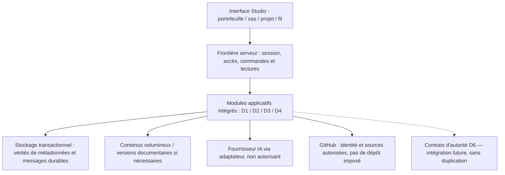

# SFIA Studio Next — R4 · Cadrage de la conception d’architecture

| Métadonnée | Valeur |
| --- | --- |
| Nature | **Document de cadrage vivant** du jalon R4 ; support de travail et de synthèse, sans création d'une seconde autorité normative |
| Version | **v0.7 — macro-lots A/B et stratégie QA R4–R6**, 2026-11-03 ; candidate documentaire publiée sur branche R4 |
| Statut | **A — ORIENTATION PRODUIT REVUE / TECHNIQUE CANDIDATE ; B — REVUE MORRIS SANS OBJECTION, DESIGN CANDIDATE ; QA A–D — STRATÉGIE CANDIDATE AUTORISÉE À LA SYNCHRONISATION**. C à concevoir ; aucun ADR, stack, runtime ou ADOPTED |
| Responsable des arbitrages | Morris |
| Rédaction / analyse | ChatGPT, sous contrôle des sources Git et des décisions Morris |
| Référentiel observé | `mcleland147/sfia-workspace`, branche distante `main@7067c846ce7c57825dd31c532433d809e1a01216` et candidate `sfia/next-r4-architecture-scoping@9898aa6965f10d3fcadd6958f6eacd1d9657450e` (contrôle Git 2026-11-03 ; 1 commit devant, 0 derrière, un seul fichier ajouté) |
| Situation technique | **Next : N/A — NON IMPLÉMENTÉ**. Aucun code ni schéma de données cible adopté ; branche locale / index / worktree **NON OBSERVÉS** |
| Emplacement Git candidat | `projects/sfia-studio-next/architecture-technique/cadrage-r4.md` sur `sfia/next-r4-architecture-scoping`, issue de `cf3f14dc33b642f7e96e5aa12f66074ffa112eeb` ; mise à jour B + QA mandatée par Morris, sans PR/merge |

## 1. Finalité et position de départ

Ce document cadre la **conception de l'architecture du nouveau produit SFIA Studio**, indépendamment de son implémentation historique. Il conserve la compréhension des acquis, des hypothèses, des options et des réserves durant R4, et guide la préparation de R5. Il n'autorise aucun choix technique, aucune écriture Git, aucun lot Cursor ni aucune adoption de runtime.

**Position de travail confirmée :** notre trajectoire de quatre macro-lots R4 reste pertinente après lecture de l'architecture historique. Aucun composant, nom, schéma de base, moteur ou principe d'implémentation de l'ancien Studio n'est repris par défaut. **Les exigences et invariants validés pour Next priment sur toute capitalisation historique.** Reconstruire intégralement est une option normale, pas un scénario de dernier recours.

La qualité de R4 sera mesurée par la **simplicité explicable des responsabilités**, la cohérence des parcours utilisateur, la maîtrise des droits et des effets, la fiabilité de la continuité, l'observabilité et la capacité à construire/tester des incréments verticaux. La quantité de composants réutilisés n'est pas un indicateur de succès.

## 2. Fondations acquises et hiérarchie des sources

### 2.1. Décisions et validations acquises — Next

- **SEF v0.2 validé par Morris :** construction par macro-lots cohérents, gates explicites, code + tests + documentation groupés en Delivery, qualification des preuves, pas de micro-cycles documentaires ; rôles D0/D1/D2/D3 distincts.
- **R1 — CLOSED BY MORRIS WITH CARRIED RESERVES :** vision Pilote–Nora, neuf domaines D1–D9, sept scénarios end-to-end, frontières IN/OUT et séparation autorité/cognition/preuve.
- **R2 — CLOSED BY MORRIS WITH CARRIED RESERVES :** neuf spécifications fonctionnelles et compléments approuvés, 15 CKI validés en contenu et 50 relations non contraignantes ; les CKI ne sont ni des autorisations ni un moteur métier autonome. Les 66 réserves initiales restent tracées dans leurs sources propriétaires.
- **R3 — CLOSED BY MORRIS WITH CARRIED RESERVES :** parcours Pilote–Nora, couverture de conception des neuf domaines et sept E2E, prototype Figma (223 frames), contrat de transposition, clarification de la visibilité cognitive / outil / Cursor, STOP et reprise. **Conception et navigabilité Figma ≠ fonctionnement navigateur ni E2E REAL.**
- **Nommage Next validé :** nommer les composants par responsabilité durable ; un concept = un nom ; pas de `F2`, `P6`, `OPS1`, `pre-m6`, `legacy` ou noms de chantier dans l'architecture permanente.
- **Gouvernance Git :** les anciennes décisions H7/H8 et G0-A/B restent des faits historiques ; elles ne constituent pas une architecture imposée à Next.

**Vérité des sources :** code/preuves Git Next, lorsqu'ils existeront, puis décisions Morris, spécifications et documents, enfin hypothèses. Un constat historique ne remplace pas un arbitrage R4. En cas de contradiction entre code futur et documents Next, qualifier **KNOWN GAP** et instruire sa correction dans le macro-lot concerné.

### 2.2. Sources canoniques à consulter, sans les dupliquer

| Source | Autorité / rôle |
| --- | --- |
| `governance/SEF.md` | Méthode et gates de construction Next |
| `governance/roadmap.md` | **État vivant** et dépendances R0–R6 ; ce document ne tient pas une deuxième roadmap |
| `governance/decisions/` | Arbitrages explicites Morris ; aucune décision induite par une proposition |
| `governance/product-naming-conventions.md` | Règles de nommage **VALIDATED** |
| `cadrage/vision-produit.md` et `cadrage/vision-cible/README.md` | Vision, neuf domaines, E2E et schémas fondateurs ; schémas ≠ architecture adoptée |
| `conception-fonctionnelle/README.md` et spécifications D1–D9 | Contrats fonctionnels, états, exigences et réserves propriétaires |
| `cki/README.md` | CKI et relations **validés en contenu**, non prouvés en fonctionnement |
| `ux-ui/` (revue R3, contrats, Figma) | Parcours, états, géométrie de référence, responsive/accessibilité, pas de preuve runtime |
| `projects/sfia-studio/production-runtime-reference/` | PRR de l'ancien produit : **retour d'expérience non prescriptif** |
| `projects/sfia-studio/convergence/architectural-knowledge-governance/m4-rationalization/` | Audit historique AS-IS/TO-BE, options et risques de rationalisation ; décisions spécifiques à l'ancien Studio |

Référence Git : `https://github.com/mcleland147/sfia-workspace/tree/main/projects/sfia-studio-next`.

## 3. Résultat produit que l'architecture doit rendre possible

**Chaîne cible intégrée :** le Pilote accède à ses projets ; Nora l'accompagne dans un sas conversationnel ; le projet n'est créé que sur décision explicite ; la conversation et les acquis se poursuivent ; la trajectoire et les cycles restent légers et facultatifs selon la situation ; Nora explore, conseille et produit dans ses droits ; le Pilote gouverne les décisions et mandats ; l'exécution externe part d'un contrat réellement inspecté et autorisé ; les résultats et preuves sont confrontés ; le travail peut être arrêté, repris ou requalifié sans duplication ni autorité inventée.

### 3.1. Neuf domaines à couvrir

| Domaine | Capacité retenue en R1/R2 | Conséquence architecturale à concevoir en R4 |
| --- | --- | --- |
| D1 | Accès individuel et portefeuille | Identité, sessions, isolation entre Pilotes et projets, accès non conversationnel |
| D2 | Sas Nora et création explicite | Continuité pré-/post-projet, état durable, création idempotente et cohérence des documents |
| D3 | Conduite Pilote–Nora | Frontières cognition/orchestration/outils, contexte sourcé, contrôle des effets et activités réellement visibles |
| D4 | Mémoire, documents, sujets, décisions | Identités documentaires, versions, provenance, récupération, visibilité et accès |
| D5 | Trajectoire, cycles, CKI | État métier cohérent, cycles non obligatoires, méthode/guidance versionnée, pas de moteur CKI concurrent |
| D6 | Décisions et gouvernance | Autorité humaine durable, mandats/suspensions, portée temporelle et vérification effective |
| D7 | Réalisation opérationnelle | Contrat unique inspectable, identité/version, instruction technique reliée, GO Exécuter, Tentative/STOP/reprise |
| D8 | Résultats et preuves | Attribution, observation, conformité, incertitude, acceptation humaine et reconstitution |
| D9 | Git facultatif et gouverné | Accès individuel, ressources/références, permissions, conflits, collaboration sur dépôt partagé sans fusion de projets Studio |

### 3.2. Sept E2E de référence

1. Sas conversationnel → création explicite → même fil et contexte dans le projet.
2. Trajectoire et cycles → guidance méthodologique sans verrou artificiel.
3. Investigation multi-sources et production cognitive → restitution adaptée et sourcée.
4. Connaissance vivante, sujets, décisions → continuité et reprise du contexte.
5. Décision / mandat → contrat inspecté → autorisation → réalisation technique gouvernée.
6. Résultat, preuve, réserve, correction → acceptation humaine distincte.
7. Git individuel facultatif → accès et partage de dépôts sans confusion des identités et autorités.

Les compléments R1/R2 du 2026-11-03 concernant **production/révision de documents, consultation des sources et inspection intégrale du contrat** s'appliquent également ; ils ne créent pas une nouvelle architecture déjà décidée.

## 4. Capitalisation critique de l'ancien Studio — sans présomption de réutilisation

### 4.1. Ce qui a été effectivement constaté

Le Product Studio historique repose sur Next.js/React, une UI `/studio`, `Project Assistant` (F2/W2), un runtime cognitif Nora (OpenAI Agents), des agrégats métier OA (Project/Cycle/HumanDecision/ExecutionContract/ExecutionAttempt/Evidence/ReviewBundle), SQLite produit et SQLite session Nora, certains supports process-local et des adaptateurs Git/Cursor. D1, OPS1 et P0 ont conservé des parcours ou stockages historiques adjacents. La **PRR** documente 20 flux F01–F20, des invariants et tests, mais son manifeste et ses volumes sont partiellement issus de baselines antérieures au HEAD courant : les affirmations significatives doivent être rapprochées du code.

Le parcours **Single Human Execute** est intégré à l'ancien produit au périmètre déterministe testé ; il n'établit pas une preuve globale Cursor REAL. Les propositions et offres process-local, la dérive potentielle de chemins SQLite, la duplication de voies d'orchestration et la coexistence de surfaces historiques ont été identifiées comme risques. Certains résultats de reprise sont prouvés à un niveau déterministe borné, non au niveau navigateur/REAL universel.

L'étude historique AKG-M4 a proposé de consolider l'ancien OA et d'étudier une reconstruction ciblée de l'orchestration, pour limiter le risque de migration de **cet ancien produit**. Les décisions H7/H8 y sont **des décisions historiques**, non des instructions de conservation pour Next.

### 4.2. Qualification provisoire pour Next

| Élément historique | Enseignement utile | Décision Next |
| --- | --- | --- |
| Cognition ≠ autorité ≠ preuve | Frontières cohérentes avec les contrats R1/R2 | **Exigence produit acquise** ; composants d'implémentation ouverts |
| Décision, contrat, tentative, preuve distincts | Traçabilité et contrôle des effets | **Responsabilités à satisfaire**, nombre de tables/agrégats à concevoir |
| OA Product Runtime | Solution historique substantielle mais complexe | **Aucune adoption** du code, de l'ORM ou des modèles |
| Nora Session séparée du métier | Séparation conceptuelle utile | **Aucune décision** de deux bases physiques ou de leur technologie |
| Project Assistant / F2 / W2 | Capacité d'orchestration réalisée, avec chemins parallèles | **Aucune reprise par défaut** ; rechercher une orchestration explicable et non concurrente |
| Single Human Execute | Parcours UX pertinent déjà demandé pour Next | **Contrat fonctionnel R2/R3**, pas reproduction des transitions techniques historiques |
| D1 / OPS1 / P0 | REX sur identités, exécution, écrans et corrections | **Aucune migration ni duplication** présumée |
| PRR, cartographie de tests et invariants | Bonne pratique de preuve/impact | Capitaliser **la méthode**, pas créer une deuxième PRR Next |

**Principe anti-biais :** une conception historique n'obtient aucun avantage dans l'évaluation du seul fait de son existence, de son niveau d'investissement ou de sa maturité documentaire. Les éventuels actifs réutilisables doivent prouver un bénéfice net par rapport au code neuf, après prise en compte des dépendances et de la dette qu'ils transporteraient.

## 5. Options architecturales à étudier, sans préjuger du verdict

| Option | Hypothèse de conception | Avantages possibles | Coûts/risques à objectiver |
| --- | --- | --- | --- |
| **N1 — Architecture Next neuve et sobre** | Définir de zéro les responsabilités, états et interfaces strictement nécessaires à R1–R3 | Cohérence, faible dette de compatibilité, liberté de conception | Conception des invariants et preuves à reconstruire |
| **N2 — Architecture Next neuve, structurée autour de frontières métier éprouvées** | Partir des contrats Next mais comparer certaines frontières conceptuelles mises en évidence par l'ancien OA/Nora | Sûreté et traçabilité potentiellement facilitées | Risque d'importer une granularité ou une complexité excessive |
| **N3 — Réutilisation technique très sélective** | Réutiliser un composant historique précis seulement si l'évaluation l'emporte sur une nouvelle implantation | Gain ponctuel de délai et de tests existants | Couplages, dépendances cachées, compatibilité et coût de maintenance |

Ces options **ne sont pas des décisions d'architecture** ; elles pourront être combinées au niveau des responsabilités si cela ne crée pas de moteurs parallèles.

**Critères de comparaison :** couverture des E2E, lisibilité de l'autorité, simplicité des contrats, coût de construction/exploitation, isolation, persistance, concurrence, reprise, sécurité, observabilité, évolutivité, tests, coût de migration et dette avec exit. Les coûts et capacités réels devront être étayés ; aucune supériorité de stack ne peut être déduite de l'étude historique seule.

### 5.1. Première étude R4 — parcours sas → création → continuité (D0 ; direction V-A acceptée, mécanismes ouverts)

**Base fonctionnelle vérifiée sur `main@7067c846` :** [D1 — accès](../conception-fonctionnelle/acces-et-portefeuille.md) `RG-ACC-001/002/005/009/017–018`, [D2 — sas et création](../conception-fonctionnelle/creation-de-projet-et-continuite-du-sas.md) `RG-CRE-001/008/010/011/014/017/019/020/023/024/027`, [D4 — connaissance](../conception-fonctionnelle/connaissance-sujets-et-continuite-du-projet.md) `RG-KNOW-016..020` et [revue R3](../ux-ui/revue-formelle-sortie-r3.md). **Exigences acquises :** identité GitHub personnelle et isolement ; sas sans projet ; création uniquement par acte explicite ; existence vérifiée avant succès ; fil visuellement continu ; documents produits avant le projet puis rattachables sans doublon ; ni Git, ni cycle, ni méthode, ni contrat Cursor implicites. Aucun modèle physique ou schéma de table n'est adopté par ces sources.

**Question de conception unique :** comment établir un passage fiable et intelligible entre un contexte de préparation personnel et un projet persistant, tout en gardant les identités conversationnelles et documentaires, les provenance/versions et une récupération sans doublon ?

#### Variantes de transition (indépendantes des options générales N1–N3)

| Variante de conception | Mécanisme candidat | Atout principal | Dette / risque à maîtriser | Appréciation D0 |
| --- | --- | --- | --- | --- |
| **V-A — Préparation durable et rattachement transactionnel** | Un contexte de préparation indépendant existe avant projet ; fil et documents ont des identités stables ; l'acte de création enregistre le projet et son rattachement au contexte dans une frontière de cohérence transactionnelle. | Pas de copie du fil ; idempotence et reprise explicables ; mêmes références avant/après. | Cycle de vie du sas, références/permissions, transaction autour de métadonnées et éventuels objets externes à traiter. | **Direction d’étude acceptée par Morris**, mécanisme technique NON VALIDÉ. |
| **V-B — Stockages ou services distincts avec liaison durable** | Le sas et le projet ont leurs propres persistances ; l'acte crée un lien explicite, éventuellement par événements durables et réconciliation. | Évolution séparée possible des sous-systèmes. | Cohérence inter-stockages, succès partiel, réplication, déduplication, reprise et observabilité plus complexes. | À conserver comme contre-option si une contrainte réelle l'exige. |
| **V-C — Migration ou duplication du contenu lors de la création** | Copie/transfert des messages, documents et références du sas vers le projet ; l'UI reconstruit un fil continu. | Séparation simple des espaces de stockage si deux systèmes préexistants. | Risque de perte, double écriture, divergence des versions et identités, faille de coupure au milieu du transfert. | **Non recommandée par défaut**, sauf preuve d'un avantage décisif. |

**Challenge important :** la continuité *visuelle* du même fil est validée en R1/R2 ; une identité technique `conversationId` strictement inchangée est une **solution candidate**, pas une obligation R2. V-A devra prouver qu'elle simplifie effectivement le modèle de données et les droits. De même, une **frontière transactionnelle de création/rattachement** n'implique pas que les octets documentaires, les sorties de modèle et tous les journaux résident dans une seule base physique.

#### Responsabilités logiques candidates (aucun nom de classe, table ni service adopté)

| Responsabilité | Propriétaire fonctionnel | Contrat attendu |
| --- | --- | --- |
| Identité et session | D1 | Identité GitHub du Pilote effectivement applicable ; isolation et refus à chaque lecture/mutation ; accès Git restant D9. |
| Préparation du sas et acte de création | D2 | Préparation personnelle avant projet ; acte « Créer le projet » avec idempotence ; existence et propriété vérifiées ; lien durable vers fil et acquis. |
| Conversation, interprétation et restitution Nora | D3 | Production cognitive et contexte sélectionné ; aucun message ni outil Nora ne crée seul le projet ou un mandat. |
| Documents, références, connaissances, provenance | D4 | Identités et versions stables ; document d'abord rattaché à la préparation, puis associable au projet après création confirmée ; aucune promotion de statut épistémique. |
| Décisions opposables | D6 | Aucune décision métier inventée par l'association ; auteur/portée/temps conservés si une décision explicite existe. |
| Présentation / réhydratation | UX | Même fil lisible ; point de création visible après succès seulement ; écran d'erreur et retour cohérents ; aucune seconde machine d'autorité dans le front. |

#### Séquence de référence candidate V-A (illustrative, à challenger)

1. Le Pilote s'authentifie ; Studio ouvre ou retrouve **sa** préparation identifiable, sans projet durable. Les tours conversationnels et les documents sont conservés avec provenance et état réel selon les politiques à concevoir.
2. Nora restitue un aperçu évolutif sans présumer de décision, de méthode, de cycle ni d'accès Git. Les questions bloquantes sont limitées à l'identité, à l'objet à créer et aux contraintes réellement déterminantes.
3. Au clic **« Créer le projet »**, le serveur vérifie l'identité/session, le propriétaire de la préparation, les préconditions, la version utile et une **clé stable d'opération** (choix exact à définir). Aucun effet n'est accordé au seul modèle cognitif.
4. Une commande contrôlée crée **un seul** projet et établit son association à la préparation, au fil et aux métadonnées documentaires durables ; toutes les écritures qui doivent être indivisibles partagent une transaction effective **si la technologie choisie le permet**. Un mécanisme de réconciliation explicite est requis pour toute ressource extérieure à cette transaction.
5. Le serveur recharge l'état persistant ; seulement après succès vérifié, il confirme le projet et projette le marqueur « Projet créé » dans le même fil. Le portefeuille lit le propriétaire de projet effectif, non une projection optimiste de Nora.
6. Le Pilote et Nora poursuivent sans cycle/CKI/méthode ni dépôt obligatoire. Le moteur de contexte charge des **références choisies et autorisées**, pas l'intégralité du transcript à chaque tour.

#### Défaillances discriminantes à traiter dans les contrats R4

| Incident | Comportement impératif | Décision de conception encore ouverte |
| --- | --- | --- |
| Double clic, retry HTTP, réponse perdue | Le même acte retrouve le même projet ou reste `UNKNOWN` pendant la vérification ; jamais un second projet silencieux. | Portée/expiration de la clé d'idempotence, unicité et restitution. |
| Crash après commit, avant réponse UI | Une reconnexion retrouve le projet et l'association au fil sans reproduire l'effet. | Lecture de réconciliation par clé d'opération / préparation. |
| Session révoquée au moment de créer | Refus des nouveaux effets protégés ; aucun contenu d'un autre Pilote divulgué. | Contrôle de l'identité à la frontière transactionnelle ; politique de session expirée. |
| Document du sas dont les octets ne sont pas durablement enregistrés | Ne pas annoncer qu'il a été transféré ; montrer `PENDING`, `FAILED` ou `UNKNOWN` selon preuve. | Métadonnées, stockage objet, opération de finalisation et recovery. |
| Source externe devenue inaccessible | La référence et la limite de validité sont conservées ; pas de réutilisation non autorisée ni d'autorité attribuée à la source. | Politique de provenance/currentness et lecture autorisée. |
| Deux onglets modifient la même préparation | Pas d'écrasement silencieux du fil, des références ou du projet créé. | Versions, ordre des tours, contrôle de concurrence et conflits. |
| Abandon du sas | Aucun projet fictif ; préparer une éventuelle reprise du sas selon droits et conservation. | Rétention, suppression, confidentialité, récupération. |

#### Confrontation des grandes options N1–N3 sur ce seul E2E

- **N1 — Next neuf et sobre :** compatible avec V-A, un modèle applicatif réduit et une frontière transactionnelle cohérente. **Hypothèse de travail privilégiée**, à démontrer contre les risques de croissance et les E2E futurs ; ne prescrit pas Next.js, PostgreSQL, SQLite, ORM ou moteur d'événements.
- **N2 — Next neuf à frontières métier fortes :** compatible avec V-A si les responsabilités sont explicitement séparées **logiquement**, même si elles partagent une transaction au point de création. À éviter si elle produit une cascade de services, états ou agrégats sans nouvelle garantie.
- **N3 — Réutilisation ponctuelle historique :** aucun composant ancien n'a, à ce stade, une justification objectivée de reprise pour le passage sas→projet. Les invariants historiques peuvent servir d'oracle critique, pas de schéma par défaut.

**Direction d’étude V-A acceptée par Morris le 2026-11-03 (conception uniquement) :** approfondir V-A + N1 sobre, tout en conservant les frontières D1/D2/D3/D4/D6 et une possibilité d'évolution N2. V-B reste une alternative à défendre par des besoins d'échelle, d'isolation ou d'intégration concrets ; V-C est défavorable par défaut. Ne pas demander d'ADR ou choisir une base avant de préciser la vérité durable des documents, le modèle d'association, la concurrence et la récupération après incident.

**Gate envisagé à la fin de cette première étude (supersédé par le mandat de revue globale §5.3) :** revue Morris du modèle de responsabilité, du lien durable et de la frontière transactionnelle ; le choix de direction V-A est déjà acquis en conversation, sans ADR ni choix de stack. Les preuves R5/R6 requises incluront tests transactions/retry/restart, isolement deux comptes, source inaccessible, projet sans Git ni cycle, continuité visuelle navigateur et document du sas repris sans duplication. État courant : **DOCUMENTED / CANDIDATE D0**, `N/A — NON IMPLÉMENTÉ`.

### 5.2. V-A — modèle de responsabilités et transaction de création (D0, NON VALIDÉ TECHNIQUEMENT)

**Mandat de progression (conversation Morris, 2026-11-03) :** « ok V-A on peut continuer ». Cela sélectionne **V-A pour approfondissement** et ne valide ni schéma, ni composant, ni stockage, ni ADR. Les propositions ci-dessous sont des **candidats d'architecture**, conditionnés à la revue des interfaces D1/D2/D3/D4/D6 et à l'absence de second moteur d'état. Le dépôt `main` affiche toujours R4 `NOT STARTED` dans sa Roadmap ; l'étude a été engagée en conversation sur branche candidate, sans mise à jour normative de ce statut.

#### 5.2.1. Découpage minimal de vérité — ne pas confondre propriétaires métier et services physiques

| Concept logique candidat | Responsabilité | Identité et durée | Invariant déterminant |
| --- | --- | --- | --- |
| **Préparation** (sas) | D2 possède le contexte personnel avant projet et le passage de frontière | Identifiant durable propre, propriétaire Pilote, état `OPEN`, `ATTACHED` ou `ABANDONED` proposés ; la rétention reste ouverte | Une préparation non créée n'est pas un projet ; au plus **un projet issu de cette préparation** par acte valable |
| **Projet** | D2 crée, D1 expose au portefeuille, D6 contrôle la portée des actes et des décisions selon leurs propriétaires | Identité permanente distincte du nom, propriétaire Pilote | Existence et propriété établies avant confirmation/navigation ; aucune création automatique de cycle, méthode, CKI ou dépôt |
| **Association préparation → projet** | D2, vérité durable de création et liaison | Relation unique, vérifiable par identifiant de préparation, d'opération et de projet | Aucune double association, relecture possible après perte de réponse ou redémarrage |
| **Fil de conversation** | D3 orchestre la conversation et la projection UX ; les messages relèvent du contexte autorisé | Identité de fil indépendante de l'identité projet ; même fil visible après passage | Aucun transcript recopié/reconstruit pour simuler la continuité ; l'historique ne change pas de portée sans vérification des droits |
| **Ressource documentaire / version** | D4 pour identité, conservation, provenance et états de sauvegarde | Identifiant stable, version courante et historique ; contenu éventuellement dans un stockage distinct | L'association au projet ne vaut pas confirmation de la sauvegarde des octets ; aucune duplication ou réécriture silencieuse |
| **Connaissance / acquis** | D4 organise les éléments récupérables, avec leur source et qualification épistémique ; D3 sélectionne le contexte | Rattachement au sas avant projet puis au projet par relation vérifiée | Une hypothèse ne devient pas un fait, et une source ne devient pas un ordre ou un mandat |
| **Décision opposable, si elle existe** | D6, indépendant du mécanisme de création | Auteur, portée, état, version et temporalité | Le clic « Créer le projet » est l'acte D2 dédié ; il ne crée pas automatiquement une HumanDecision générique ni un mandat Cursor |

**Hypothèse de simplicité :** ces éléments sont des frontières conceptuelles et non sept microservices ou sept bases. La co-localisation transactionnelle des **métadonnées essentielles** de la préparation, du projet et de leur association peut simplifier fortement la cohérence, sans confondre les responsabilités D2/D3/D4/D6.

#### 5.2.2. Cycle de vie logique et contrôle d'unicité

- `OPEN` : préparation personnelle réutilisable, création non constatée. Les messages et documents préparatoires sont conservés selon un contrat réel de durabilité et de rétention.
- `ATTACHED` : un projet unique, effectivement persisté, lui est associé ; les références de conversation et de documents demeurent stables. L'état de préparation et le projet sont liés par une relation durable.
- `ABANDONED` : aucune création implicite ; politique de réouverture, rétention, purge, restauration et confidentialité **à arbitrer**. L'état n'efface pas silencieusement les traces utiles ou soumises à obligations.
- `VERIFYING` / `UNKNOWN` / `FAILED` : états de **résultat d'opération ou de présentation**, **pas** de nouveaux états durables obligatoires de la préparation. Ils doivent pouvoir être requalifiés à partir des faits persistés.

**Recommandation candidate :** le service de création garantit `at-most-one project per preparation` via une **contrainte effective d'unicité**, sans dépendre de l'état UI ou du processus Nora. Le renouvellement d'une intention pour fonder un **autre** projet passe par une nouvelle préparation explicite ; ce comportement reste à confronter aux scénarios utilisateur.

#### 5.2.3. Contrats d'opération candidats (conceptuels ; pas d'API, nom de classe ou technologie adoptés)

| Opération conceptuelle | Entrée essentielle | Résultat attendu / erreurs |
| --- | --- | --- |
| **Lire/reprendre une préparation** | Identité/session courante et référence de préparation | Retour autorisé d'état/fil/documents ; `NOT_FOUND` ou `FORBIDDEN` sans divulgation croisée |
| **Créer explicitement un projet** | Identité D1 courante, préparation identifiée, acte « Créer le projet », identifiant d'opération stable, version des champs réellement approuvés | Projet et association **atomiquement confirmés** ; `ALREADY_CREATED` retourne le projet existant au même Pilote ; `CONFLICT`, `FORBIDDEN`, `UNKNOWN` selon faits observés |
| **Vérifier une création après incertitude** | Identité/session vérifiée et référence d'opération ou de préparation | Relecture du projet/association et état réel ; jamais nouvelle création par simple vérification |
| **Poursuivre le fil / retrouver les acquis** | Fil et contexte autorisé effectivement résolus, permissions et versions applicables | Conversation continue, contexte D4 sélectionné ; accès refusé ou limites de source indiquées honnêtement |
| **Lire un document lié** | Ressource/version et identité autorisée, état de sauvegarde | Version accessible si durable ; sinon `PENDING`, `FAILED` ou `UNKNOWN` explicites, sans faux contenu disponible |

**Idempotence :** la clé d'opération est conservée au-delà de la requête et réutilisée lors d'un retry ; l'unicité de la préparation protège aussi contre deux clés différentes issues de deux onglets. Une clé réutilisée avec un contenu matériellement différent doit être rejetée, non interprétée comme une nouvelle création. La durée de conservation de la clé et la forme de son empreinte restent à décider.

**Concurrence :** l'éventuel contrôle de version porte sur les **champs de création réellement inspectés et confirmés**, et non nécessairement sur chaque message de Nora, pour ne pas bloquer artificiellement le Pilote. Deux propositions incompatibles doivent provoquer un conflit explicite/requalification avant effet. Le propriétaire de l'autorité ne passe jamais au client seul.

#### 5.2.4. Point de cohérence et scénario de crash

**Frontière transactionnelle candidate dans un magasin apte aux transactions :**

1. Vérifier l'identité/session et l'accès à la préparation **au point d'effet**, et requalifier l'état de préparation ainsi que la version de création approuvée.
2. Chercher toute association/projet déjà enregistré pour cette préparation ou cet acte. S'il existe et appartient au bon Pilote, retourner **la même identité de projet**, sans nouvel effet.
3. Dans **une même transaction pour la vérité essentielle**, enregistrer le projet, sa propriété, l'association unique à la préparation, l'issue durable de l'acte et l'état `ATTACHED`. L'unicité et les contrôles de concurrence doivent résister aux requêtes simultanées.
4. Après confirmation du commit, recharger l'état durable, puis autoriser l'affichage « Projet créé », le portefeuille et le marqueur de transition du fil. Si la réponse HTTP disparaît, une **lecture de réconciliation** retrouve les mêmes références ; aucune seconde création automatique.
5. Les métadonnées documentaires et messages qui ne participent pas à la transaction conservent leurs **références immuables** ; leur disponibilité est vérifiée par leur propre responsable. Les effets hors transaction (objets, recherche, index, notifications) sont **reconciliables** et **ne deviennent pas nécessaires à la confirmation d'une création minimale**, sauf exigence explicitement établie.

**Point critique :** « même transaction » n'autorise pas à prétendre que fichiers externes, générations IA ou journaux distants sont atomiques avec la création. La solution doit choisir une frontière de vérité **réelle** ; si ces données ne sont pas dans le même magasin, leur réconciliation se fait par références/états vérifiables, sans transaction distribuée fictive ni double écriture non gouvernée.

**Exemple d'interruption :** l'opération crée et commit le projet, mais le navigateur reçoit un timeout. La reprise consulte la préparation et l'identifiant d'opération sous la session courante, retrouve `ATTACHED` et le projet unique, puis affiche le succès vérifié. Un clic supplémentaire ne re-joue pas la création.

#### 5.2.5. Faits du sas et documents encore incomplets

- Un document préparé garde une **identité durable propre**, un état de sauvegarde et des versions, même si sa création a démarré avant le projet ; l'association au projet ne force pas un renommage ou un nouveau `documentId` par principe.
- **Recommandation à valider :** ne pas bloquer la création du projet pour un document facultatif `PENDING` si les métadonnées nécessaires sont conservées et l'UI décrit le fait ; la ressource reste `PENDING` jusqu'à confirmation réelle. Si la ressource est déterminante à l'identification du projet ou à un effet explicitement requis, appliquer une précondition proportionnée.
- Les références des sources Git, web ou interprojets conservent auteur, origine, version/ref, fraîcheur et **droits recontrôlés à la lecture**. Une référence historique ne garantit ni accès futur ni pouvoir d'action.
- La mémoire de Nora est un **mécanisme de sélection/composition** à partir de ressources D4 et des décisions applicables D6 ; elle ne duplique pas la vérité métier ni ne résume l'histoire en remplaçant les sources.

#### 5.2.6. Scénarios discriminants et preuves à préparer pour R5/R6

| ID d'étude | Situation | Garantie architecturale attendue | Niveau à prouver plus tard |
| --- | --- | --- | --- |
| A-01 | Sas exploré puis abandonné | Aucun projet ; conservation/reprise selon politique explicite | Test serveur + navigateur |
| A-02 | Clic explicite et succès nominal | Un seul projet, même fil visible, portefeuille cohérent, aucun cycle ni Git auto | Transaction + E2E navigateur |
| A-03 | Double clic et deux clés d'opération | Un seul projet associé ; réponse réconciliée | Test concurrence déterministe |
| A-04 | Commit suivi d'un timeout et d'un redémarrage | L'effet est retrouvé sans rejouer la création | Test de redémarrage avec stockage réel |
| A-05 | Deux onglets, changements concurrents du résumé de création | Refus/conflit explicable, pas d'écrasement du contenu approuvé | Test de version/transaction |
| A-06 | Session expirée ou compte B accédant au sas A | Aucun accès ni effet, aucune fuite d'existence/sources privées | Tests de sécurité négatifs |
| A-07 | Document de sas `PENDING` au clic | Lien durable conservé ; état vrai et reprise, aucune sauvegarde fictive | Test stockage objet/réconciliation |
| A-08 | Source externe révoquée après création | Provenance connue, accès refusé, contexte Nora non autorisant | Test D4/D3 de currentness/droits |
| A-09 | Réponse Nora reçue pendant le passage | Message attribuable au bon fil/contexte/version, sans création ni décision indirecte | Test des races asynchrones |
| A-10 | Nouvelle conversation dans le même projet | Documents, acquis et décisions applicables retrouvables sans transcript complet | Test continuité D3/D4/D6 |

**Blast radius conditionnel :** D1 (identité/isolation), D2 (acte et identité projet), D3 (fil/agent), D4 (documents et connaissance), D6 (références d'autorité), UX R3 (marqueur/continuité/erreurs), futurs D5/D7/D8/D9 (projet existant ne confère ni cycle, exécution, preuve ou accès Git). Les changements de contrats publics ou schéma devront documenter leur impact en R4 et être testés transversalement en R5.

#### 5.2.7. Alternatives ouvertes dans la première itération — remplacées par la synthèse §5.3

- **Modèle minimal recommandé pour comparaison :** un **noyau transactionnel unique pour la vérité de création/association**, des responsabilités métier distinctes D1/D2/D3/D4/D6, et des ressources référencées sans transfert massif. Cela ne signifie ni monolithe d'application obligatoire, ni base unique pour tous les octets, ni stockage SQL déjà adopté.
- **Contre-option :** métadonnées de préparation/projet physiquement séparées. À envisager seulement si exigences de sécurité, volumétrie, isolation ou disponibilité l'exigent ; elle appelle alors un contrat explicite de cohérence partielle et de réconciliation au lieu de prétendre à une atomicité distribuée.
- **Dans cette itération initiale**, le noyau transactionnel et les références durables étaient encore à préciser ; leur analyse est maintenant consolidée au §5.3. La revue Morris sera **globale**, pas un gate séparé sur chaque mécanisme.

**Verdict de cette itération : `V-A — DIRECTION D'ÉTUDE APPROUVÉE / MODÈLE 5.2 CANDIDAT, NON VALIDÉ / N/A — NON IMPLÉMENTÉ`.** Le niveau de preuve est une confrontation documentaire et un raisonnement architectural ; aucun test runtime Next n'a été exécuté.

### 5.3. Macro-lot A — architecture de conception consolidée (orientation produit revue ; technique candidate)

**Mandat de méthode (Morris, 2026-11-03) :** ChatGPT instruit et synthétise **tout le macro-lot A** sans gate de micro-arbitrage technique, puis soumet en une fois la solution, ses alternatives, ses réserves et les arbitrages d'orientation à Morris. Le mandat ne transforme ni les recommandations en ADR approuvés, ni le document en baseline `main`, ni R4 en jalon clos. Les autres macro-lots R4 B–D restent à concevoir. Aucun code Next n'existe à cette date.

#### 5.3.1. Décision de conception recommandée — architecture minimale cohérente

**Recommandation technique à discuter globalement :** une **application web modulaire** avec **un noyau transactionnel relationnel unique pour les métadonnées métier du parcours A**, une conservation durable des messages et documents via des contrats explicites, et **des adaptateurs externes isolés** pour GitHub, les modèles IA et l'éventuel stockage d'objets. Aucun moteur d'orchestration métier indépendant ni microservice n'est requis pour ce parcours.

Le qualificatif « modulaire » décrit ici des **frontières de responsabilité et des interfaces internes**, pas un découpage en déploiements. D1, D2, D3, D4 et D6 ne doivent pas devenir, par réflexe, cinq services, cinq états de session ou cinq bases de données. La topologie d'hébergement, le framework et les packages ne sont pas décidés par cette proposition.

**Ce diagramme représente une option logique, pas le nombre de processus ni les instances de stockage.** Le serveur fait respecter les contrôles ; la base garantit les invariants transactionnels ; l'interface affiche seulement des états relus. Il n'existe pas de deuxième journal autorisant dans l'interface, le transcript ou le fournisseur IA.

**Choix de déploiement candidat :** une base relationnelle **PostgreSQL managée** est préférable pour un produit web multi-Pilotes avec écritures simultanées, contraintes d'unicité, transactions, sauvegardes et redémarrages multi-instances. Ce choix reste **à confirmer** avec l'environnement réel, le coût, les contraintes d'hébergement et l'exploitation de R4-D. Une base SQL embarquée ne serait acceptable que si un déploiement réellement mono-instance et une stratégie de sauvegarde/concurrence adaptés sont démontrés. Le SQL est ici une **famille technologique proposée**, pas un ADR adopté. Le stockage objet n'est nécessaire que lorsque la taille et la nature des contenus le justifient ; il ne remplace pas la vérité des métadonnées.

**Alternatives écartées pour A à ce stade :** copie massive au passage sas→projet, moteur d'événements global, orchestration multi-services, deux magasins transactionnels pour la création, état essentiel en mémoire de processus, réplication du transcript comme vérité métier, adoption de l'ancien OA/Nora/F2. Elles ne sont pas impossibles ; aucune exigence R1–R3 vérifiée n'en justifie le coût initial.

#### 5.3.2. Carte des propriétaires et contrats de frontière

| Responsabilité | Propriétaire logique et frontière | Vérité détenue ou consommée | Effet permis / explicitement exclu |
| --- | --- | --- | --- |
| Identité et sessions | **D1** : point d'entrée Studio, principal authentifié, validité de session | Identité Studio dérivée d'une authentification GitHub vérifiée, session courante ; ne vaut pas permission Git/Cursor | Autoriser ou refuser l'accès au bon contexte ; jamais créer le projet ni attribuer un mandat |
| Préparation et passage | **D2** : préparation, version de création, commande explicite, création, association | Préparation, projet individuel, association, résultat idempotent de commande | Créer le projet sous acte explicite ; jamais créer cycle, CKI, dépôt ou contrat technique |
| Conversation avec Nora | **D3** : fil, échanges, activité et sélection du contexte | Messages durables et états de production réels ; utilise D2 pour résoudre le contexte | Produire/consulter/restituer ; **jamais inférer** un acte `Créer le projet` d'un simple texte |
| Documents et connaissance | **D4** : identité de ressource, versions, provenance, acquis et limites d'accès | Métadonnées durables, état des octets, références de source et de connaissance | Rendre retrouvable ; ne transforme ni source en autorisation ni hypothèse en décision |
| Autorité métier opposable | **D6** : décisions, restrictions, mandats si applicables | Registre canonique D6, **non copié dans D2 ou Nora** | Les futures décisions D6 ont leurs propres règles ; le clic de création reste un acte dédié D2 |
| UX / rendu | Interface web, sous contrat des domaines | Projection dérivée de D1–D4/D6 | Afficher et guider ; aucun succès ou état métier seulement local n'est opposable |

**Économie de responsabilité :** un seul propriétaire de chaque fait et de chaque effet, sans imposer une classe, un repository ou un service par ligne. Les composants ne sont justifiés qu'en R5 au moment du code, selon leur charge et leurs frontières réelles.

#### 5.3.3. Modèle logique minimal et garanties de stockage

Le modèle ci-dessous est un **contrat de données**, non un schéma SQL approuvé. Les noms sont illustratifs et devront suivre la convention de nommage Next lors de la construction.

| Famille logique | Attributs/relations déterminants | Garantie proposée |
| --- | --- | --- |
| **Pilote Studio** | Identité interne stable ; référence externe GitHub vérifiée ; session/révocation | Un compte ne peut résoudre les objets d'un autre ; le compte externe n'est pas un droit de dépôt |
| **Préparation** | `preparationId`, `ownerId`, statut courant, version de cadrage validable, horodatages | Existe **sans Project** ; relecture autorisée après interruption ; association unique après création |
| **Projet** | `projectId`, `ownerId`, métadonnées minimales et date de création | Création confirmée uniquement si durable ; nom non unique autorisé ; projet privé au bon Pilote |
| **Lien de création** | `preparationId → projectId`, auteur, opération et date de commit | **Unicité effective sur `preparationId`**, relation non ambiguë et retrouvable ; aucune création en double après retry |
| **Résultat de commande** | `ownerId`, clé idempotente, empreinte de la demande approuvée, résultat/référence, instant | Même commande + même empreinte → même résultat ; autre empreinte → conflit ; durée de rétention à aligner sur la garantie de non-doublon |
| **Conversation** | `conversationId`, référence initiale à la préparation, propriétaire, dates | Identité technique stable **candidate** pour le fil d'origine ; contexte projet résolu depuis le lien réel, pas en recopie |
| **Message** | `messageId`, fil, auteur/type, statut d'enregistrement, ordre/version, source de génération | Messages durables ordonnés ; productions partielles jamais présentées comme un message achevé ; refus des duplications de requête |
| **Document / version** | `documentId`, `revisionId`, préparation d'origine, blob optionnel, statut, empreinte, provenance | Identité continue ; version conservée, contenu accessible seulement s'il a réellement été sauvegardé ; pas de duplication au passage |
| **Source et acquis** | référence, origine, version/date, portée de lecture, qualification, lien vers conversation/document | Source citée ≠ accès toujours applicable ; distinction faits/hypothèses/décisions ; index et résumés reconstructibles |

**Invariants minimaux à démontrer :**

1. `preparation.ownerId == authenticatedStudioPilot.id` au point de chaque lecture et commande ; jamais simple confiance dans un identifiant envoyé par le navigateur.
2. La création relit les droits et le statut de la préparation dans la transaction ; le résultat est **0 ou 1 projet lié à une préparation**, jamais deux.
3. La vérité `Project + ownership + preparation link + command result` partage **un même commit durable** ; une réponse HTTP ou une projection UI ne crée pas cette vérité.
4. La création conserve la portée et les références des messages/documents antérieurs ; aucune promotion automatique de leurs contenus en faits vérifiés ou décisions.
5. Le projet n'induit aucun cycle, CKI, méthode, dépôt Git, exécution Cursor ou autre autorité, même si l'aperçu en suggère.
6. Tout accès à un document, sujet, fil, lien de source ou projet vérifie les **droits actuels**, y compris après création et reconnexion.
7. Une décision future D6 est consultée auprès de D6, jamais déduite de la connaissance D4 ou de la réponse Nora.

**Finesse de la frontière transactionnelle :** les métadonnées essentielles de création sont atomiques. Les octets d'un document stockés hors base, un appel de modèle, une indexation ou une observation Git ne sont **pas** dans cette transaction. Ils possèdent un statut et un mécanisme de réconciliation propres. Ne pas inventer une transaction distribuée, un rollback de fournisseur externe ou une sauvegarde automatique non prouvée.

#### 5.3.4. Contrat de commande : créer et vérifier sans doublon

**Préparer :** le client relit une `Preparation` accessible et la version de **l'aperçu effectivement approuvé** (nom/objet minimal). Les messages Nora plus récents ne rendent pas automatiquement cette version périmée : la version doit suivre les champs de création qui influencent l'acte, pas tous les tokens de la conversation.

**Commander `CreateProject` (exemple conceptuel, non nom d'API adopté) :**

- Entrée : session authentifiée, `preparationId`, `expectedCreationRevision`, données minimales explicitement inspectées, `idempotencyKey` stable générée pour l'acte du Pilote.
- Préconditions : identité et propriété vérifiées ; préparation existante et autorisée ; demande issue **de l'action dédiée** ; champs déterminants assez clairs ; version d'aperçu correspondante ; absence d'interdiction applicable. Une phrase de Nora n'est pas le déclencheur de cette commande.
- Transaction : verrouillage/concurrence de la préparation ; comparaison de version et recherche d'une association déjà committée ; validation du couple clé/empreinte ; insertion du projet et de sa propriété, du lien unique et du résultat durable ; commit. Les contraintes SQL sont **la dernière barrière** même face aux requêtes simultanées.
- Réponse : `CREATED` ou `EXISTING` avec **le même `projectId` vérifié** pour le même acte ou une préparation déjà liée ; `CONFLICT` si contenu approuvé ou clé contradictoire ; `FORBIDDEN`/`NOT_FOUND` sans fuite de contenu ; `INDETERMINATE` uniquement tant que l'existence durable ne peut être vérifiée.
- Réconciliation `ResolveCreation` : lecture autorisée et **sans effet** depuis `preparationId` / clé de commande ; permet de retrouver le projet créé en cas de timeout, crash ou reconnexion. Ne doit jamais effectuer un `CreateProject` par inadvertance.

**Propriété importante :** `at-most-once durable creation per preparation`, et non garantie générale « exactly once » de tous les effets et services. L'unicité dans la base est indépendante des délais réseau et de la mémoire de processus. Deux demandes distinctes à partir d'une même préparation doivent conduire au même projet si déjà créé et autorisé, ou au conflit explicable si leurs contenus/autorités diffèrent — jamais à une seconde création.

**Évolution concurrente :** au moment de la création, le contexte approuvé est figé par sa version ; si Nora rédige un message ou termine un document simultanément, le fil reste attribué à la même préparation et se résout ensuite par le lien de création. Un document `SAVING` n'est pas déclaré `AVAILABLE` pour accompagner la création. Une écriture refusée doit être enregistrée honnêtement ou rejouée sous un acte explicite approprié, pas migrée silencieusement vers un autre projet.

#### 5.3.5. Continuité du fil, des documents et de Nora

**Fil visuel :** proposer une identité stable de fil pour la conversation déjà présente dans le sas, réutilisée dans l'espace projet. Le marqueur « Projet créé » doit dériver de **l'événement durable de création** ou du lien avec date/auteur ; il n'est pas une réponse générée par Nora ou un indicateur purement optimiste. Des conversations supplémentaires du même projet restent possibles : « même fil » porte sur **la transition initiale**, pas sur un unique transcript éternel par projet.

**Historique :** conservation des messages durables et de leur ordre. Les fragments de streaming peuvent être affichés comme provisoires, mais seule une écriture réellement confirmée est revendiquée comme récupérable. Une génération IA interrompue est signalée comme partielle avec ses acquis observés, jamais complétée a posteriori par imagination.

**Contexte Nora :** le modèle n'est pas rechargé avec tout le transcript à chaque tour. Une composition contrôlée rassemble : la demande courante ; le contexte sas/projet réellement résolu ; un historique ciblé ; les connaissances D4 pertinentes et leurs sources ; les restrictions/décisions D6 applicables lorsqu'elles existent. Le contexte explicite **provenance, confiance et limite temporelle** des informations ; la recherche vectorielle ou les résumés éventuels sont des **vues dérivées**, jamais une deuxième vérité métier. Les résultats externes et instructions trouvées dans les sources sont traités comme **données non autorisantes**.

**Documents :** une ressource créée dans le sas garde son identifiant, ses révisions et son origine après rattachement du projet. Une version n'est `AVAILABLE` que si son contenu exact est effectivement récupérable et si sa métadonnée est cohérente ; une écriture d'octets échouée reste `FAILED`/`UNKNOWN`/`SAVING` suivant l'état observable. L'association ne déclenche ni recopie des octets, ni écrasement de version, ni « promotion » d'un brouillon en document validé. Le projet peut être créé si un document facultatif est toujours en enregistrement ; une ressource **indispensable** à l'acte doit, en revanche, satisfaire sa précondition explicite.

**Lecture et reprise :** le portefeuille lit la vérité du projet existant, non un index de recherche ou un signal UI. À l'ouverture, le serveur vérifie le bon Pilote, résout le fil associé, permet de reprendre les documents/sujets et relit les décisions applicables chez D6. Sources devenues indisponibles : ne montrer que leurs références et limites permises, sans prétendre pouvoir relire le contenu.

**Point UX à vérifier en R5/R6 :** l'interface peut conserver le même composant fil et une navigation réversible, mais ne doit pas confondre « affichage du même fil » avec « le modèle dispose de tous les messages ». Les brouillons non envoyés relèvent d'un contrat séparé de navigation/session ; ne pas promettre leur survie après crash si la sauvegarde n'est pas effectivement implémentée.

#### 5.3.6. Échecs, reprise et isolation : comportement de référence candidat

| Incident / conflit | Vérité à établir | Comportement proposé, sans effet indu |
| --- | --- | --- |
| Double clic ou deux onglets sur même préparation | Contrainte d'unicité et clé de commande persistées | Un projet, même réponse canonique ou conflit explicite ; pas de double insert |
| Crash **avant** commit de création | Aucun lien durable | Sas conservé ; création non confirmée ; nouveau clic explicite possible après vérification |
| Crash **après** commit mais avant réponse | Projet + lien + résultat durable | Relecture autorisée et navigation vers le projet existant ; aucun nouveau commit de création |
| Perte de DB ou indisponibilité lors de la vérification | Existence **inconnue** | Afficher « vérification nécessaire » ; bloquer la relance implicite ; reprendre quand la base est accessible |
| Mise à jour de l'aperçu dans un autre onglet | Version réellement inspectée ne correspond plus | Demander une revue ciblée du champ changé ; ne pas écraser le nouvel état |
| Session expirée, révoquée ou changement de compte | Identité et droits au moment de la commande | Refus ou réauthentification ; ne divulguer ni nom, ni contenu, ni existence privée à un tiers |
| Document en sauvegarde / contenu inaccessible | Métadonnées, état d'octets, révision | Afficher un état de sauvegarde vrai ; ne pas certifier disponibilité ni inventer une révision |
| Message Nora terminé autour du commit | Fil/source et écriture durable | Attacher à la préparation stable ; résolution via lien du projet ; gérer écriture et affichage partiels |
| Source Git/autre projet révoquée depuis sa lecture | Droits au moment de réutiliser la source | Référence et limite, pas de contenu désormais interdit, pas d'autorité héritée |
| Plusieurs projets du même nom | `projectId` et titulaire | Projets indépendants ; noms ne servent ni de clés ni de filtres de sécurité |
| Modification de projet après transition | Contexte projet actuel et version | Actions nouvelles dans la portée du projet ; pas de réouverture artificielle du sas ou de mutation rétroactive du passé |

**Modèle d'échec minimal :** domaine métier renvoie `NOT_FOUND/ACCESS_DENIED`, `CONFLICT`, `NOT_READY`, `UNAVAILABLE`, `INDETERMINATE` suivant l'origine réelle ; l'UX traduit sans révéler des données sensibles. Les réponses HTTP, traces applicatives et libellés exacts ne sont pas figés. La « vérification » doit être une opération en lecture, distincte d'une commande qui effectue une mutation.

**Traçabilité minimale :** identifiants stables de l'acte, de la préparation, du projet et de la version inspectée ; auteur, horodatage, issue persistée ; journal technique redigé, sans secrets. Une timeline utilisateur n'est pas un registre d'autorisation et les logs opérationnels ne remplacent pas les objets de vérité.

#### 5.3.7. Sécurité, protection des données et exploitation

- **Authentification :** fournisseur GitHub comme identité d'entrée validée dans D1, mais validation de session côté serveur à chaque commande sensible ; pas de confiance dans un `ownerId` fourni par le navigateur. Le protocole concret (OAuth/OIDC/Better Auth/autre) relève du choix stack ultérieur.
- **Autorisation :** accès explicite au Pilote et à son contexte ; aucune autorisation Git/Cursor déduite de la connexion, du projet ou de l'association sas. Les références d'un projet B trouvées via une source consultable par A restent soumises aux droits actuels de lecture et ne deviennent jamais une propriété de A.
- **Protection transport et stockage :** HTTPS, sessions protégées, contrôles anti-CSRF selon mode d'authentification, secrets hors messages/documents, contrôle de taille/type des pièces, accès aux blobs via autorisation serveur et URL temporaire si retenue, suppression/revocation vérifiable. Ce sont des exigences de sécurité candidates, à concrétiser selon l'hébergement.
- **Rétention :** distinguer préparation active, abandonnée, messages conservés, documents/version et éventuelles obligations de suppression. Ne pas imposer ici une durée chiffrée sans besoin, coût et règles d'usage. **Proposition par défaut :** préparation abandonnée non promue ; purge gouvernée/réversible si possible et sans effacer les traces nécessaires, avec décision produit finale Morris.
- **Sauvegarde et restauration :** stratégie cohérente entre base et stockage de contenus ; tester l'absence de références orphelines ou d'octets accessibles sans droits après restauration. Les objets externes doivent pouvoir être vérifiés/réconciliés ; les index et résumés sont reconstructibles.
- **Disponibilité :** dégradation honnête si fournisseur IA ou stockage documentaire indisponible. Un problème de génération IA ne doit pas rendre inaccessible le portefeuille ni convertir la création en échec quand sa transaction métier a réellement réussi.
- **Observabilité :** audit de commandes, conflits et erreurs avec corrélation, sans exposer prompts sensibles, tokens privés, documents ou instructions d'exécution dans les logs. Le fonctionnement LIVE et les performances restent à mesurer en R5/R6.

#### 5.3.8. Interfaces futures et dépendances maîtrisées

**D5 / méthode et cycles :** `projectId` durable et propriétaire courant sont disponibles pour y rattacher, plus tard et seulement après les actes gouvernés applicables, une trajectoire, un cycle ou une association CKI. A ne crée aucun cycle à l'inscription.

**D6 / décisions :** les actes d'autorité structurés et révocations auront une table/agrégat propriétaire et des vérifications au point d'effet ; le clic « Créer le projet » n'est pas une « décision générique » qu'il faut artificiellement faire passer par tout le processus D6. L'identité et l'auteur de création restent audités.

**D7 / Cursor :** une identité Studio et un projet ne sont ni un mandat d'exécution ni une preuve de permission sur la machine / le dépôt. Les contrats d'exécution versionnés et contrôles d'effets seront conçus dans C, pas simulés ici.

**D8 / preuves :** le statut « projet créé » est une vérité transactionnelle propre à D2, **pas** un verdict de conformité technique général, une acceptation ou un état `ADOPTED`.

**D9 / Git :** une source Git peut être consultée pendant le sas sous droits actuels, mais le projet ne reçoit pas automatiquement de dépôt. Le lien Git devient une référence facultative propre à D9. Source lue et droits Git sont deux faits distincts.

**UI / Figma :** les surfaces portefeuille, sas, fil projet et inspection s'assemblent avec des composants réutilisables et des contrats de lecture ; mêmes données propriétaires pour desktop/mobile. La divergence rail 240/246 px reste une réserve de fondation transversale à trancher avant tokens communs, pas une raison de bloquer le modèle transactionnel A. Le navigateur prouvera la continuité réelle et les interactions.

**Blast radius d'un futur changement du noyau A :** identités/permissions (D1), commandes/contraintes (D2), fil/contexte (D3), documents/sources (D4), autorité (D6), projections UX, puis données et contrats D5/D7/D8/D9. Toute migration du schéma futur doit prévoir la préservation des identités/références et un test de reprise ; aucun schéma SQL effectif n'est encore à migrer.

#### 5.3.9. Matrice de vérification R5/R6 — contrat de preuve, non preuve disponible

| Contrôle | Sources fonctionnelles | Test / observable requis | Gate de qualification |
| --- | --- | --- | --- |
| A01 — Entrée sas sans projet et sans Git | D1 `RG-ACC-017/018`, D2 `CRE-001/006` | Browser et lecture DB : aucune fiche projet | R5 E2E, R6 navigateur |
| A02 — Nora utile avant projet, sans cycle | D2 `CRE-002/004/014` | Contrôle UI + persistance ; aucun cycle ni méthode | R5 E2E |
| A03 — Projet seulement sur clic dédié | D2 `CRE-008/010`, `PF-CRE-07/08` | Cas texte ambigu vs bouton ; commande auditée | R5 négatif, R6 navigateur |
| A04 — Deux clics simultanés | D2 `CRE-011`, `PF-CRE-10` | Test concurrence avec vraies transactions, contrainte unique | R5 intégration stockage |
| A05 — Timeout après commit / relance | D2 `CRE-010/024`, `PF-CRE-11/16` | Injection de panne après commit, nouvelle session, relecture du même projet | R5 restart/DB réel |
| A06 — Version de création obsolète | D2 `CRE-003/016/026` | Conflit ciblé sans effacer le texte/contexte | R5 transaction + navigateur |
| A07 — Même fil et marqueur vrai | D2 `CRE-017/018/020/023`, UX P5 | Navigation/reload ; mêmes messages ordonnés et point de passage non fictif | R5/R6 navigateur |
| A08 — Document du sas avant/après | D2 `CRE-027`, `PF-CRE-27`, D4 `KNOW-016..020` | Identité/version conservées, aucun contenu fantôme | R5 stockage + navigateur |
| A09 — Document `SAVING` / échec | D4 `KNOW-018`, D2 `CRE-027` | Injection d'échec d'octets et reprise sans mensonge | R5 négatif |
| A10 — Identités séparées A/B | D1 `ACC-001/005/006`, D2 `CRE-009` | Deux comptes, références croisées, refus et aucune fuite d'existence | R5 sécurité, R6 browser |
| A11 — Source révoquée | D2 `CRE-022/026`, D4 `KNOW-006/014` | Source interdite non réinjectée dans Nora | R5 D3/D4, R6 LIVE ciblé |
| A12 — Plusieurs projets homonymes | D2 `CRE-012`, `PF-CRE-14` | IDs distincts, portefeuille non fusionné | R5 transaction/UI |
| A13 — Reprise après nouvelle conversation | D2 `CRE-019/023`, D4 `KNOW-011/015/019` | Connaissances et docs pertinents récupérés sans transcript exhaustif | R5 ciblé, R6 LIVE |
| A14 — Navigation cockpit/projet | D1 `ACC-009/010/014/016`, UX P5 | Pas de Nora globale, contexte exact et retour après reload | R5/R6 navigateur |
| A15 — Aucun effet dérivé | D2 `CRE-014/021`, D5–D9 | Absence prouvée de cycle, CKI, Git, Cursor ou mandat induit | R5 non-régression |
| A16 — Restaurer/redémarrer | D2 `CRE-024`, D4 `KNOW-015/018` | Coupure serveur / restauration et réconciliation de métadonnées/objets | R5/R6 restart réel |

**Preuve actuelle : `DESIGN ONLY`** — aucun de ces tests n'est exécuté sur un runtime Next. La preuve d'un prototype Figma ou d'une transaction hypothétique ne suffit pas. Il faudra distinguer tests unitaires déterministes, transactions sur DB réelle, E2E navigateur authentifié, tests d'interruptions/restore et éventuellement comportements IA LIVE avec provenance.

#### 5.3.10. Comparatif final et décisions candidates pour la revue globale

| Choix | Solution recommandée | Alternative écartée ou réservée | Justification / condition de réexamen |
| --- | --- | --- | --- |
| Conception | **N1 neuf, modularité logique N2** | Réutilisation OA/F2/Nora historique N3 | Contrats R1–R3 prioritaires ; aucune justification de couplage/réemploi démontrée |
| Transition sas → projet | **V-A : rattachement, sans copie** | V-B magasins séparés, V-C migration | Même fil et documents à identités durables, moins de points de défaillance |
| Frontière d'écriture | **Transaction unique projet + propriétaire + lien + résultat** | Saga distribuée / effet UI seul | At-most-one durable, reprise après commit et timeout |
| Concurrence | **Unicité DB + idempotence + version de l'aperçu approuvé** | Verrou navigateur, simple anti-double-clic | Les clients/onglets et serveurs sont concurrents |
| Topologie | **Application modulaire au déploiement simple** | Microservices / event bus dès R5 | Aucun besoin de déploiement indépendant prouvé |
| Métadonnées | **Base relationnelle transactionnelle ; PostgreSQL candidat premier** | Plusieurs bases d'emblée, SQLite par héritage | Concurrence multi-Pilotes ; confirmer coût/hébergement et migrations avant choix ratifié |
| Documents | **Identité/version/état en métadonnées ; octets séparés selon taille** | Copie lors de création, blob « disponible » fictif | Continuité d'identité, stockage adapté et état observable |
| Messages | **Historique durable unique, contexte Nora composé à la demande** | Transcript et base « mémoire Nora » autorisante | D3/D4 propriétaires, reprise et isolation sans double vérité |
| Recherche/mémoire | **Vues dérivées et reconstructibles, si nécessité prouvée** | Index/moteur de mémoire supplémentaire d'emblée | Ne pas anticiper complexité et cohérence sans mesure |
| Confirmation utilisateur | **Clic D2 + effet vérifié, non HumanDecision universelle** | Deux gates rituels ou création conversationnelle implicite | Contrat fonctionnel explicite et distinct de D6/D7 |

**Verdict proposé pour le macro-lot A :** `DESIGN CANDIDATE COMPLETE — READY FOR MORRIS GLOBAL REVIEW`, **sans** `VALIDATED SPEC`, `IMPLEMENTED`, `COVERAGE VERIFIED`, `BEHAVIOR PROVEN` ni `ADOPTED`. Les sections 5.1–5.3 forment **une seule conception cohérente**, pas une collection de micro-arbitrages. Aucun besoin de faire valider chaque clé, classe ou état séparément ; Morris reçoit une **synthèse intégrée** et tranche les questions structurantes.

**Questions réellement structurantes à remonter en revue globale (et non à poser au fil de l'eau) :**

1. **Approche V-A + noyau transactionnel relationnel** : cohérente avec la vision produit ; l'adopter ou la modifier comme orientation de construction.
2. **Topologie web / exploitation** : confirmer le périmètre initial du service (multi-Pilotes distants, hébergement attendu, volumétrie/coût/SLA), qui conditionnera le choix final de stockage et de gestion des sessions ; aucune métrique n'a été fournie pour valider une stack déterminée.
3. **Politique du sas non créé et des documents** : permanence/rétention/suppression, vie des brouillons, restauration et provenance ; nécessite une décision produit proportionnée avant R5, pas un choix inventé par le développeur.

**Risques résiduels et sorties :** (R-A1) confidentialité/rétention des préparations → politique produit validée avant R5 ; (R-A2) service d'identité/session et isolation multi-Pilotes → design de sécurité R4-D, tests négatifs R5 ; (R-A3) sauvegarde de fichiers hors transaction → intégrité/réconciliation vérifiées R5 ; (R-A4) activité IA async pendant création → tests de races/stream/restart R5–R6 ; (R-A5) coût et topologie Postgres/objets → choix d'exploitation R4-D, mesure en R5 ; (R-A6) fidélité Figma, rail 240/246 et mobile → fondations UX R4-D puis captures navigateur R5–R6. Tous ces risques sont **ouverts et assortis d'une condition de sortie**, non des exceptions permanentes.

**Trajectoire R5 proposée après validation de R4 :** construire **un incrément vertical unique** « se connecter → engager/reprendre un sas → converser/produire un document → créer explicitement → continuer et retrouver le projet », avec transaction et idempotence, sécurité, erreurs, tests et documentation dans le **même macro-lot Delivery**, pas en couches techniques isolées. Les dépendances de D5–D9 restent des interfaces garanties sans implémenter leurs capacités prématurément.

### 5.4. Revue de convergence A — arbitrages produit Morris (2026-11-03)

**Origine et portée :** Morris a examiné la synthèse fonctionnelle du macro-lot A et confirmé deux orientations de produit. L'avis de conception de ChatGPT est retenu comme base de la suite R4 ; la validation de ces comportements ne vaut **pas** adoption de la stack, des tables, des services ou des protocoles recommandés au §5.3.

| Sujet | Décision produit de Morris | Conséquence architecturale et condition de sortie |
| --- | --- | --- |
| **Préparation jamais transformée en projet** | **OUI : le Pilote doit pouvoir retrouver sa préparation plusieurs jours ou plusieurs semaines plus tard**, même sans projet créé | Préparation durable et retrouvable sous les droits du Pilote ; parcours de liste/reprise distinct du portefeuille des projets. Définir la conservation exacte, la suppression et les limites de sauvegarde avant R5, sans inventer une durée ou une purge automatique. |
| **Document en cours d'enregistrement** | **NE PAS BLOQUER** la création pour un document non indispensable ; **bloquer ou différer uniquement** lorsque le document est réellement indispensable à la création | États d'enregistrement authentiques, liaison stable des versions et récupération indépendante de l'acte de création. Une précondition documentaire essentielle est contrôlée à son état réel ; aucun document non sauvegardé n'est déclaré disponible. |

**Qualification du macro-lot A :** la conception couvre le parcours A et ses contrats D1–D4, interfaces D6/UX, les scénarios de concurrence, d'idempotence et de reprise. **A — DESIGN CANDIDATE COMPLETE / PRODUCT REVIEW HELD**, avec réserves techniques explicites au §5.3.10. La solution V-A reste la **direction retenue par Morris** ; le modèle transactionnel relationnel, le déploiement modulaire et PostgreSQL sont des **recommandations techniques à ratifier au gate d'architecture**, non des décisions adoptées.

**Dépendances conservées :** politique de conservation/effacement du sas, confidentialité/accès courant, fiabilité des documents externes à une transaction, choix d'infrastructure et preuve des 16 scénarios A en R5/R6. Les règles métier R2 ne sont pas modifiées ; leur propriétaire reste la spécification canonique.

**Gate de poursuite :** Morris autorise ChatGPT à engager **la conception intégrale du macro-lot B** sans micro-arbitrages techniques. Aucune clôture formelle de R4, aucun changement de Roadmap main, PR/merge ou exécution Cursor n'est impliqué.

### 5.5. Macro-lot B — pilotage, méthode et autorité : conception intégrée (D0, CANDIDATE, non validée)

**Mandat :** Morris a demandé de poursuivre après la revue produit A, en confiant à ChatGPT la conception technique d'un macro-lot cohérent avant revue globale. La présente section est une **proposition D0**, sans décision d'architecture adoptée, sans autorisation de modifier les spécifications R2 et sans implémentation. Sources examinées sur `main@7067c846ce7c57825dd31c532433d809e1a01216` : D3, D4, D5, D6, corpus CKI v0.2, vision R1, UX R3, SEF et Roadmap ; Next reste non implémenté.

#### 5.5.1. Résultat Pilote, IN/OUT et principe architectural

**Résultat attendu :** après avoir créé son projet, le Pilote travaille librement avec Nora, peut consulter ou modifier une trajectoire prévisionnelle, ouvrir et fermer un cycle lorsqu'il le décide, profiter d'une spécialisation CKI pertinente, choisir éventuellement une méthode de projet, retrouver les décisions et suspensions applicables et reprendre sans perte ni création d'autorité fictive.

**IN :** identité et état durables de trajectoire, version des orientations retenues, cycles effectifs, unicité du cycle actif, catalogue/type/CKI et référence de contenu, méthode applicable et historique, décisions compétentes, restrictions, suspensions, levées, conflits d'autorité, reprise et continuité D3/D4, interfaces UX B2/V3, concurrence et idempotence. **OUT :** exécution Cursor/Git et effet externe (C/D), gestion des preuves et acceptation de conformité (C), tout moteur CKI prescriptif, workflow obligatoire ou décision métier autonome de Nora.

**Architecture candidate :** **le même produit web modulaire et le même socle de cohérence transactionnelle que A**, avec des modules métier D5 et D6 séparés par leur responsabilité, et **un seul propriétaire des écritures opposables** pour chaque effet. Un module n'implique pas son propre microservice ou sa propre base. La cognition, le fil et l'UX ne détiennent pas d'état d'autorité concurrent.

#### 5.5.2. Responsabilités et règles de propriété

| Propriétaire | État détenu | Ce qu'il ne fait jamais |
| --- | --- | --- |
| **D1 / A** | Pilote authentifié et accès au projet personnel | Ne décide ni ne change de cycle, méthode ou mandat |
| **D3 / Nora** | Dialogue, analyse, proposition de plan, jugement de maturité, restitution et contexte utile | Ne commet jamais une décision, transition, levée ou autorisation d'effet à partir de sa seule interprétation |
| **D4 / Connaissance** | Sujets, questions, acquisitions, documents, références de sources et journal **Sujets** ; accès aux décisions par références D6 | N'entretient aucun deuxième registre de décisions, d'état de cycle ou de preuve |
| **D5 / Pilotage** | Trajectoire prévisionnelle et retenue, cycles réels, type de cycle, association CKI, méthode applicable et historique | N'émet pas de GO et ne fabrique ni décision, ni acceptation, ni contrat Cursor |
| **D6 / Gouvernance** | Actes humains opposables, auteur/source/portée/validité, mandats, suspensions, révocations, levées, résultat de vérification de l'autorité | Ne stocke pas une seconde vérité de cycle, n'exécute pas Cursor et n'invente pas les faits D8 |
| **CKI — contenu spécialisation** | Version de contenu spécialisée, guide qualitatif ; informations et références gérées sous D5 et chargées pour D3 | Ne devient jamais un moteur de workflow, un gate, une permission ou une seconde méthode opposable |
| **UX** | Vues du projet, de la trajectoire, des cycles, du journal et d'inspection, alimentées par des lectures propriétaires | N'infère aucun état réel depuis une animation, un libellé ou une proposition non confirmée |

L'absence de cycle ou de méthode est un **état normal**. Une technique locale employée par Nora n'est pas un changement du cadre méthodologique retenu. Un cycle clôturé n'est pas un résultat automatiquement prouvé ou accepté.

#### 5.5.3. Modèle logique minimal, sans multiplication de moteurs

| Famille logique proposée (noms non figés) | Informations durables nécessaires | Garanties |
| --- | --- | --- |
| **Trajectoire** | Projet propriétaire, version, orientations et étapes prévisionnelles, liens vers objectifs/contraintes, source des propositions et choix retenus | Proposé ≠ retenu ≠ réellement exécuté ; évolution sans réécrire les cycles passés |
| **Cycle** | Identité, projet, type reconnu, but, état effectif, révision, date d'ouverture/clôture, références de transition, CKI principal résolu | **Au plus un ACTIVE par projet**, y compris sous deux commandes simultanées ; clos ≠ effacé |
| **Transition métier** | Acte visé, auteur/identité, état et version attendus, clé de commande, décision compétente, résultat effectif | Rejeu et incident après commit se réconcilient ; demandes et effets distincts |
| **Méthode applicable** | Projet, référence/version/portée/provenance/condition d'effet, lien vers décision D6, historique des versions et remplacements | Peut être ABSENTE ; nouvelle version publiée ≠ version automatiquement retenue ; sans rétroactivité |
| **Catalogue type/CKI** | Identité de type et de CKI, version/empreinte éditoriale, état de disponibilité et provenance | Correspondance 1 type → 1 CKI principal ; catalogue extensible, sans activation secondaire |
| **Décision / autorisation D6** | Identité propriétaire, auteur, source humaine, objet et portée, effet temporel, version visée, statut, restrictions, relation de remplacement/levée | L'acte est distinct de l'effet ; ancienne décision et sa provenance restent auditables |
| **Suspension / restriction** | Cible, catégorie et étendue, auteur/source, validité, statut courant et éventuelle levée compétente | Persistante après changement de conversation/cycle/session ; applicable au point d'effet |
| **Lectures dérivées** | Contexte courant, vue de parcours, journal Décisions, résumé Nora, suggestion de maturité | Reconstruites depuis D4/D5/D6 ; ne peuvent arbitrer ni écrire seules |

**Recommandation :** relationnel transactionnel commun pour les écritures internes D5/D6 et A, avec contraintes d'intégrité et versionnement optimiste, sans event sourcing global, base de connaissances autorisante, bus de commandes transversal ni moteur de workflow imposé. Les audits des décisions/transitions restent durables, mais un journal d'audit n'est pas le seul état métier. Les choix SQL exacts et la topologie restent des sujets de R4-D.

#### 5.5.4. Scénarios de commande et frontières d'autorité

**1. Proposer une trajectoire.** Nora formule des étapes et dépendances *candidates* en citant la connaissance D4, les contraintes et, si pertinent, la méthode actuelle. L'aperçu reste une proposition. Une acceptation du Pilote suffisamment claire et contextualisée peut devenir un arbitrage D6 ; D5 enregistre alors la version retenue, sans ouvrir les cycles prévus. La replanification ne change pas les faits des cycles antérieurs.

**2. Ouvrir un cycle.** Une expression du Pilote peut constituer le GO naturel si l'objet, la cible et la portée sont suffisamment clairs : inutile de lui imposer un formulaire ou un clic de confirmation systématique. Studio authentifie l'auteur, établit la **source réellement humaine** et la décision applicable D6, contrôle la version de l'état D5, les restrictions, le type reconnu et l'absence de cycle actif concurrent, puis persiste l'ouverture **effectivement committée**. Nora et l'écran ne déclarent l'ouverture qu'après lecture vérifiée. Une mention du cycle par Nora ou par une source Git n'est pas un GO.

**3. Concurrence et cohérence.** Pour une transition purement interne à Studio, privilégier une **transaction commune** entre l'acte D6 reconnu, son résultat appliqué et le changement d'état D5, avec vérification de révision, clé idempotente et garantie structurelle d'un cycle ACTIVE maximum par projet. Si la commande intervient après une décision déjà persistée, sa référence est réutilisée, pas recréée. Une impossibilité technique de transaction commune déclencherait une architecture de réconciliation **explicitement conçue**, jamais une assertion de succès. Le texte humain originel peut rester dans D3 même si la transaction métier échoue ; il ne devient pas une transition accomplie.

**4. Clore / passer au cycle suivant.** Nora peut recommander une clôture à partir de la finalité, des acquis, dépendances et réserves : **pas de score universel ni de clôture automatique**. Le Pilote autorise la transition dans sa portée. Pour un GO combiné clôture+ouverture dont les deux effets sont exclusivement internes, privilégier un commit atomique afin d'éviter un état de « deux cycles actifs » ou une clôture réussie avec ouverture fictive. Lorsque les effets doivent réellement être séparés, les résultats partiels restent identifiés et la reprise doit les réconcilier sans rejouer automatiquement. La clôture conserve les travaux, décisions et réserves ; elle ne vaut pas conformité D8, acceptation D6 ou adoption.

**5. Choisir ou modifier une méthode.** Aucun choix préalable n'est exigé. Si le Pilote retient durablement une méthode, D6 reconnaît sa décision dans sa portée ; D5 conserve référence, version, provenance, début d'applicabilité et historique. Une nouvelle version disponible n'écrase pas la méthode appliquée. Nora peut employer une technique locale différente si elle ne contourne aucune prescription ; cela ne modifie pas D5. Un changement matériel impose analyse d'impact proportionnée et requalification des travaux effectivement concernés, sans rouvrir tous les cycles ni réécrire les preuves.

**6. Suspendre, révoquer, lever.** D6 conserve une restriction durable sur une cible assez précise. Les nouveaux effets concernés sont bloqués immédiatement au point de contrôle ; les activités cognitives indépendantes peuvent continuer. Une levée n'est effective qu'après acte compétent et n'accorde pas de nouvelles permissions Git ou Cursor. Pour une activité externe déjà engagée, D6 conserve l'ordre humain, tandis que D7 devra distinguer demande d'arrêt, transmission et arrêt réellement observé : cette interface relève de C. Une nouvelle session, une synthèse Nora ou un changement de cycle n'efface pas la suspension.

**7. Conflits et ambiguïtés.** Une source externe, un document CKI ou une citation qui contient « GO » ne crée aucune décision. En cas d'ambiguïté déterminante sur auteur/objet/portée, Nora demande **une clarification ciblée** ; le travail cognitif sûr se poursuit. Deux décisions incompatibles sont évaluées selon auteur, portée, conditions d'effet, révocation et règles non dérogeables ; **la plus récente n'est pas automatiquement prioritaire**. Tant que le conflit reste déterminant, l'effet ciblé est refusé et la raison est restituée.

**8. Résoudre l'état courant.** Au retour du Pilote, le serveur charge le projet A autorisé, puis les états effectifs D5 et les restrictions/actes applicables D6. D4 fournit sujets et acquis, et D3 compose son contexte avec provenance et limites. L'UX « Journal — Décisions » est une **projection de D6**, pas un autre propriétaire. La reprise des informations ne provoque aucun GO, aucun changement de méthode, aucune activation d'un cycle ni aucun effet Cursor.

#### 5.5.5. CKI : spécialisation sans prescription ni dépendance cachée

- **Condition d'activation :** un cycle effectivement ACTIVE et de type reconnu désigne **un seul CKI principal** ; sans cycle, Nora reste générale ; un sujet connexe ou la matrice des 50 relations ne sélectionne jamais un deuxième CKI.
- **Identité et version :** la résolution de CKI est fondée sur un catalogue versionné avec provenance/empreinte. Pour une analyse déterminante, la référence effectivement disponible est traçable ; ne jamais inventer que la dernière version est celle utilisée. **Proposition technique :** épingler la version de CKI lors de l'ouverture du cycle ; une mise à jour explicite en cours de cycle reste étudiable après contrôle de compatibilité, sans modification silencieuse des analyses passées.
- **Chargement :** le contrat de contexte D3 consomme la guidance spécialisée pertinente, sans transformer le contenu CKI en instruction de sécurité, en liste obligatoire de livrables ou en moteur de décision. Le contenu chargé est traité comme une source à niveau de confiance qualifié ; une consigne injectée ou malveillante n'est pas élevée au-dessus des règles produit.
- **Indisponibilité :** absence de CKI, de version ou de lien non essentiel → Nora peut poursuivre son travail cognitif général en exposant la limite. Si l'information manquante est déterminante pour un acte de cycle ou une conclusion particulière, suspendre **cet effet ou verdict**, pas le projet entier. Ne pas substituer un CKI historique ni une « méthode par défaut » inventée.
- **Matrice relationnelle :** les relations T/A/R/E aident à explorer ; elles ne représentent ni obligation, ni précédent de cycle, ni autorisation, ni graphe d'exécution. Les quinze spécialisations validées sont une première famille, non un plafond de types ou un carcan pour des projets non logiciels.

#### 5.5.6. Lecture applicative et observabilité de l'autorité

**Contrat conceptuel de lecture, pas d'API adoptée :** requérir un contexte projet autorisé ; lire la trajectoire et son état « proposé/retenu/effectif » ; charger le cycle courant et sa version ; résoudre la méthode retenue, le CKI réel et ses limites ; qualifier auprès de D6 les décisions/restrictions **dans leur portée** ; demander les connaissances/sources D4 ; composer seulement ensuite le contexte Nora. À chaque effet nouveau, ces informations sont **recontrôlées** côté serveur ; une vue précédemment ouverte peut être périmée.

**Contrat d'écriture, pas de moteur générique :** une commande métier D5 explicite le projet, la cible, la version attendue, la référence de l'acte humain D6, la clé de répétition et le résultat relu ; D6 possède la validation de compétence, de portée et de restrictions. Les commandes refusées ne créent pas un cycle fictif ou une méthode implicitement adoptée. Les traces d'audit relient source humaine, décision, transition et version, sans exposer de secrets ni de chain-of-thought de Nora.

**UX :** les écrans R3 doivent rendre lisibles, sans jargon imposé : « proposé » vs « retenu », « cycle actif » vs « à venir », méthode retenue ou absente, provenance de la décision, restriction actuelle, raison du blocage, prochaine action possible. L'inspection et le retour au fil ne mutent aucun état. Le journal **Sujets** reste D4 ; **Décisions** relit D6. Le Pilote peut toujours discuter avec Nora quand aucun cycle n'est actif.

#### 5.5.7. Cas négatifs et preuves R5/R6

| ID | Situation discriminante | Comportement à démontrer | Sources propriétaires |
| --- | --- | --- | --- |
| B01 | Projet neuf sans cycle ni méthode | Nora aide normalement, aucun état/CKI imposé | D3 METH-009, D5 TRJ-001 |
| B02 | Trajectoire proposée, non retenue | Aucune ouverture ni adoption de fait | D5 TRJ-002/003, D6 GOV-023 |
| B03 | GO naturel clair pour un cycle | Acte humain qualifié puis cycle effectivement ouvert et traçable, sans confirmation rituelle | D5 TRJ-009/015, D6 GOV-002/029 |
| B04 | « Ce serait bien » ou texte cité | Aucune transition déduite d'une phrase équivoque ou d'une source externe | D6 GOV-004/005/006 |
| B05 | Deux ouvertures concurrentes | Au plus un cycle ACTIVE ; la seconde est refusée/requalifiée | D5 TRJ-008/011/016 |
| B06 | Double commande ou réponse perdue | Même résultat retrouvé ou état indéterminé explicite, jamais deux cycles | D5 TRJ-015/016 |
| B07 | Clôture + ouverture combinées | Effets réellement appliqués identifiables ; aucun faux succès partiel ou double actif | D5 TRJ-012/014/016 |
| B08 | Maturité jugée insuffisante par Nora | Recommandation étayée ; Pilote reste décideur, aucune clôture automatique | D5 TRJ-012/013, D6 GOV-008 |
| B09 | Choix de méthode durable | Source D6 + version D5 concordantes et rechargées après restart | D3 METH-010/012, D5 TRJ-état méthode, D6 GOV-035 |
| B10 | Nouvelle version méthode disponible | Pas de remplacement implicite ni réécriture historique | D3 METH-013/015, D6 GOV-035 |
| B11 | Digression dans un cycle | Même cycle/CKI principal, réponse adaptée hors spécialité | D5 TRJ-018, CKI README §7 |
| B12 | CKI indisponible ou hostile | Pas de fallback autorisant ni second CKI ; activité cognitive sûre maintenue | D5 TRJ-019/020, D3 APP-004/008 |
| B13 | Deux décisions contradictoires | Scope/validité examinés, effet concerné bloqué jusqu'à résolution | D6 GOV-012/013/015 |
| B14 | STOP après lequel le Pilote se reconnecte | Suspension toujours opposable, pas de levée par résumé ou changement de cycle | D6 GOV-017/018/020 |
| B15 | Sources d'un autre projet sur Git partagé | Aucun import de mandat, cycle ou décision dans le projet courant | D1 ACC-005, D6 GOV-014 |
| B16 | Décision ou méthode révoquée en cours de travail | Relecture avant effet, requalification ciblée, pas de replay autonome | D6 GOV-016/021/022/027 |
| B17 | Journal Décisions vs historique | Une seule référence propriétaire D6, révision non rétroactive | D4 KNOW-003, D6 GOV-009/010 |
| B18 | Interface retourne au fil depuis inspection | Aucun GO ni changement de cycle par navigation | UX R3, D5 TRJ-009, D6 GOV-005 |

**Niveaux de preuve exigés :** tests déterministes des décisions et refus, intégration transactionnelle avec DB et concurrence réelle, redémarrage/reprise, scénarios navigateur sous authentification, puis études ciblées de Nora avec et sans CKI ainsi que sources malveillantes et contradictoires. La conformité ne peut pas être conclue d'un prototype UX ni d'une simple réponse de modèle IA. **État actuel : DESIGN ONLY ; tous ces tests restent à réaliser.**

#### 5.5.8. Alternatives, impacts, risques et conditions de sortie

**Comparaison intégrée des approches :**

| Approche | Intérêt | Verdict candidat |
| --- | --- | --- |
| **M1 — Modules D5/D6 avec transaction commune et historique explicite** | Responsabilités lisibles, autorité opposable et un cycle actif garanti, sans infrastructure additionnelle | **Recommandée** ; cohérente avec le socle A |
| **M2 — Workflow/automate global universel** | Modèle formel potentiel pour de nombreuses étapes obligatoires | **Non justifié** : contredit le cycle léger, surcharge les situations sans méthode/cycle |
| **M3 — Event sourcing et moteur de projection généralisés** | Audit et reconstruction approfondis si échelle ou exigences spécifiques | **Reportée** ; coût de double lecture, maintenance et cohérence sans besoin démontré |
| **M4 — Reprise du moteur OA/CKC/Workflow historique** | Certains concepts métier et tests existent | **Écartée par défaut** : couplage, héritage et terminologie sans gain net démontré pour Next |

**Blast radius contrôlé :** la création de projet A fournit le contexte stable ; D5/D6 écrivent les états de cycle/méthode/autorité ; D3 consomme les décisions et contenus de manière qualifiée ; D4 conserve les références ; D7 devra vérifier la gouvernance au point d'effet et la transmission des suspensions ; D8 qualifiera les preuves, D9 les accès Git. Un nouveau type de cycle ou changement de méthode ne doit pas requérir des modifications non justifiées de tous les domaines.

**Risques à préserver jusqu'aux gates :** (B-R1) erreurs de reconnaissance d'un acte en langage naturel → contrôle de source/auteur/objet, cas ambigus et refus ciblé ; (B-R2) concurrence de transitions / décisions → contrainte DB, version, idempotence et tests ; (B-R3) CKI mal adapté, version introuvable ou injection → version/provenance, tests adversariaux ; (B-R4) restriction humaine vs effet externe déjà lancé → frontière D6→D7 de C, aucune promesse de STOP exécuté ; (B-R5) changement de méthode au mauvais périmètre → version, décision et impact sur travaux ; (B-R6) dérive UI/journal vers une deuxième vérité → lecture propriétaire et tests de cohérence ; (B-R7) limite de conservation des décisions/mandats et confidentialité → politique sécurité/exploitation R4-D puis tests.

**Critères de revue B (proposés, non prononcés) :** les parcours sans cycle, cycle unique, CKI versionné, méthode facultative, décision naturelle, suspension durable, conflit et reprise sont expliqués par **une seule architecture cohérente** ; leurs propriétaires et effets sont identifiables, leurs erreurs et tests connus, et les interfaces C/D explicites. Le choix d'une application modulaire et d'une transaction commune reste **candidat**, sans ADR approuvé. Aucun code, test NEXT LIVE/REAL ou statut ADOPTED n'en résulte.

**Suite si revue B favorable :** C — contrat d'exécution inspectable, contrôle au point d'effet, tentative Cursor, STOP réellement observé et preuves D8, sans dupliquer l'autorité D6. Ne pas anticiper le choix des infrastructures ou le statut de sortie R4 global.

## 6. Questions structurantes ouvertes pour R4

| ID de suivi interne à ce cadrage | Question à instruire | Livrable/gate attendu |
| --- | --- | --- |
| Q1 | Où réside chaque vérité durable : projet, sas, conversation, connaissance, méthode, décisions, contrats, tentatives et preuves ? | Carte des propriétaires, données, transactions et lectures ; **pas** une technologie présumée |
| Q2 | Comment Nora compose-t-elle son contexte (sources, versions, confiance, confidentialité, limites) sans devenir autorité ? | Contrat de composition, ingestion et restitution ; garde-fous contre les sources non fiables |
| Q3 | Comment séparer identité Studio, accès Git, identité de l'exécutant, secrets et périmètres ? | Modèle d'identité, de session, d'isolation et de délégation avec tests négatifs |
| Q4 | Comment gérer concurrence, idempotence, doublons, changement de version, crash et réconciliation ? | Machines d'état minimales, règles de reprise, invariants transactionnels et de non-rejeu |
| Q5 | Qui orchestre la progression métier, la cognition, les appels d'outils et les effets externes ? | Responsabilités explicites, une voie propriétaire par effet, absence de moteur concurrent |
| Q6 | Quel contrat de STOP couvre demande, transmission, observation et effets indéterminés ? | API/événements/erreurs et preuve des capacités réelles, sans promettre un arrêt non contrôlé |
| Q7 | Comment relier contrat inspecté, instruction exacte, tentative, rapport, observation et décision d'acceptation ? | Références/version/empreintes, chaîne de provenance et politiques de vérification |
| Q8 | Comment l'UX reflète-t-elle les états réels sans produire une seconde vérité ? | Modèle de lecture/événements, fraîcheur, erreurs, rechargement, accessibilité |
| Q9 | Quelle architecture d'intégration Git/Cursor, quels environnements, quels secrets et quels gates de déploiement sont nécessaires ? | Interfaces et modes dégradés, isolation des effets, stratégie de tests/CI |
| Q10 | Quels fondements techniques rendent fidèles les parcours Figma (desktop/mobile) sans recopier des pixels rigides ? | Contrat UI partagé ; arbitrage du rail **240 vs 246 px**, responsive et composants |

**Aucune réponse à Q1–Q10 n'est considérée adoptée par sa présence dans ce tableau.** Les réserves R2/R3 continuent d'appartenir à leurs documents propriétaires ; Q1–Q10 sont des axes de conception, pas un registre normatif concurrent.

## 7. Trajectoire R4 — quatre macro-lots candidats

### A. Fondations et continuité du projet

**Résultat utilisateur visé :** un Pilote peut entrer, discuter avec Nora avant création, créer explicitement un projet, retrouver le fil, les documents et le contexte de manière cohérente.

**IN :** comparaison N1–N3 et première architecture de responsabilité ; identité et isolation ; sas, projet, conversation et documents ; état durable, réhydratation, idempotence ; premières interfaces UX et sécurité. **OUT :** implémentation, exécution Cursor, Git obligatoire, ouverture automatique de cycle.

**Preuves de conception :** diagrammes de responsabilités, contrats de création/reprise et de données, invariants, scénarios nominaux et négatifs (double création, crash, changement d'utilisateur, donnée inaccessible). **Gate Morris :** arbitrer le modèle de responsabilité et les principaux choix de continuité/persistance avant d'étendre les dépendances.

### B. Pilotage, méthode et autorité

**Résultat visé :** trajectoire, cycles, guidance CKI, mémoire et décisions fonctionnent sans transformer une recommandation Nora en autorisation.

**IN :** méthode et CKI versionnés, trajectoire/cycle, décisions, mandats, suspensions, contexte, accès concurrent et transitions ; clarification du propriétaire métier. **OUT :** nouveau moteur CKI prescriptif, décisions automatiques, workflows parallèles.

**Preuves de conception :** contrats d'état et de décision, autorité applicable selon projet/version/temps, erreurs/refus, continuité entre conversations. **Gate Morris :** valider les frontières d'autorité et les dépendances du modèle métier.

### C. Réalisation gouvernée et preuves

**Résultat visé :** le Pilote inspecte ce qui sera réellement exécuté, autorise l'effet, puis retrouve un résultat fiable, vérifiable et reprenable.

**IN :** contrat métier unique inspectable (quatre engagements et six volets fonctionnels R2/R3), lien exact à l'instruction technique, capacité/permissions, tentative, STOP/FAIL, effets partiels, Evidence, analyse Nora, réception humaine, interfaces Git/Cursor nécessaires à ce flux. **OUT :** auto-réexécution ou auto-acceptation, prétention au sandbox/no-write sans preuve, adoption implicite.

**Preuves de conception :** scénarios nominaux/erreurs, contrôles au point d'effet, provenance, reprise sans effet dupliqué, isolation du runner. **Gate Morris :** valider les décisions d'exécution, de sécurité et de preuve avant R5 technique.

### D. Intégrations et consolidation de l'architecture

**Résultat visé :** tous les E2E peuvent être construits et testés sur un ensemble d'interfaces stable, évolutif et gouverné.

**IN :** Git facultatif/multi-Pilotes, permissions, concurrence, observabilité, erreurs, contrat UX responsive/accessibilité, conventions de nommage et interfaces, stratégie CI et tests, revue de cohérence A–C, préparation des macro-capacités R5. **OUT :** nouvelle fonctionnalité métier non demandée, activation LIVE, migration historique par défaut.

**Preuves de conception :** carte d'impacts, cohérence inter-domaines D1–D9, validation des sept E2E sur les contrats, ADR structurants validés, risques/dettes et exits, stratégie de construction/qualification. **Gate Morris :** revue de sortie R4 et décision séparée d'entrée R5.

**Règle de cohérence :** l'identité, la sécurité, les interfaces UX et l'isolation des outils ne sont **pas différées jusqu'à D** ; elles sont traitées dès qu'elles conditionnent A, B ou C, puis consolidées en D. Ces lots ne valent pas quatre cycles Cursor ni quatre PR automatiques.

## 8. Livrables et critères de sortie R4 proposés

R4 doit aboutir à une **architecture compréhensible et testable sur le papier**, non à une quantité de documents :

1. Une vue globale des responsabilités, des interfaces et des frontières de sécurité, avec propriétaire unique par vérité et par effet.
2. Les contrats de données, états, versions, transactions, erreurs, reprise, concurrence et idempotence nécessaires.
3. Les contrats d'identité, d'autorisation, Git/Cursor, STOP, observabilité, provenance et résultats, avec capacités réelles **à vérifier**.
4. L'architecture de l'expérience : états UX, sources affichables, tokens et composants, stratégie responsive/accessibilité et contraintes Figma.
5. La comparaison argumentée des options N1–N3, les **ADR de choix structurants** signés/validés par Morris, les alternatives écartées et les critères de réexamen.
6. Une matrice de conformité aux neuf domaines, sept E2E et réserves R2/R3 ; les exceptions explicitement reportées à R5/R6.
7. Une trajectoire de construction R5 par macro-capacités verticales, avec critères d'acceptation, preuves, gates, dépendances et dette/exit.

**Gates non négociables :** un design ne vaut ni implémentation ni preuve runtime ; tests déterministes ≠ browser ≠ LIVE/REAL ; merge documentaire ≠ validation architecture ; GO R4 ≠ GO Git ≠ GO Cursor ≠ GO R5 ; aucun `ADOPTED` anticipé.

**Verdict de sortie candidat, non prononcé :** `R4 — VALIDATED SPEC WITH GOVERNED RESERVES` uniquement si Morris valide la conception, ses risques/ADR et sa préparation R5. La Roadmap sera alors synchronisée selon le gate documentaire autorisé.

## 8.1. Stratégie qualité et vérification R4 → R5 → R6 (2026-11-03, MANDAT MORRIS)

**Origine du mandat :** Morris autorise la préparation et la synchronisation de la stratégie QA dans ce document vivant, puis la conception du macro-lot C. **État : stratégie candidate de construction, pas campagne exécutée.** Le SEF v0.2 §§4–6 impose les preuves graduées, les tests intégrés au même macro-lot de delivery et l'interdiction de repousser toute la qualité à R6.

### 8.1.1. Responsabilités par jalon

| Jalon | Responsabilité QA réelle | Gate / non-claim |
| --- | --- | --- |
| **R2 — fonctionnel, déjà validé en contenu** | Règles canoniques `RG-*`, scénarios `PF-*`, exigences de retour, réserves et 7 E2E R1 avec compléments R1–R3 | Les PF sont des **scénarios fonctionnels**, pas des tests exécutés |
| **R3 — UX, conception close avec réserves** | États, parcours, visibilité, inspection, cas erreurs, accessibilité à transposer | Prototype Figma ≠ comportement navigateur |
| **R4 — architecture** | Définir pour chaque macro-capacité les **oracles** (état vrai et propriétaire), invariants, scénarios discriminants, refus, conditions d'observation, mécanismes de test, niveaux de preuve, risques, environnements et critères d'arrêt | Conception testable ≠ couverture vérifiée |
| **R5 — delivery par capacité verticale** | Construire **en même temps** code, tests unitaires/intégration/contrats, scénarios d'auth/concurrence/DB, navigateur si requis, données de test, instrumentation, documentation et preuves ; rejouer impacts croisés avant revue | Un test vert déterministe n'établit pas un E2E REAL |
| **R6 — qualification de bout en bout** | Qualifier les 7 E2E et compléments selon la preuve requise, LIVE/REAL ciblé sous mandats et droits réels, sécurité, reprises, accessibilité, non-régression, exploitation et réserves ; consolidation des conclusions et gate Morris | Ni QA PASS, ni merge, ni conformité locale ne valent adoption automatique |

**Principe :** R6 n'est pas le début des tests. Le harnais et les scénarios bloquants sont préparés en R4, exécutés progressivement en R5, puis traversés et qualifiés en R6. Une campagne globale exclusivement finale est exclue.

### 8.1.2. Une traçabilité légère, pas un deuxième corpus de règles

**Ligne de traçabilité par scénario à risque :** `source RG/PF/E2E et version → invariant/contrat architecturé → risque et condition observable de réussite/refus → niveau de test et environnement → preuve accessible/ID → verdict borné/réserve → propriétaire et gate`. Le **référentiel R2 demeure canonique** ; les identifiants `A01`, `B01`, etc. dans ce cadrage sont des **repères d'étude non normatifs**, pas de nouvelles RG/PF.

**Couverture raisonnée :** ne pas exiger un pourcentage universel, un cas par phrase ni une traduction mécanique de toutes les 300 RG en scripts. Tout invariant structurant et toute frontière d'autorité/effet doivent posséder au moins un scénario nominal et un ou plusieurs scénarios négatifs pertinents. Justifier les exceptions, les données de test et les obligations LIVE/REAL. Les scénarios QA R5 ont des données/étapes/assertions concrètes **une fois l'interface et l'environnement figés**, jamais inventés en R4.

**Étiquettes de preuve :** `DESIGN ONLY`, `DETERMINISTIC`, `INTEGRATION`, `BROWSER`, `LIVE`, `REAL` et limites associées. L'emploi de `COVERAGE VERIFIED` exige les exécutions et traces correspondantes ; `BEHAVIOR PROVEN` demande l'observation du comportement ciblé, pas un dossier de tests prévu. Aucune preuve Next exécutée à ce jour.

### 8.1.3. Déclinaison par macro-lot d'architecture

| Macro-lot | Invariants/scénarios discriminants à couvrir | Mécanismes préparés en R4 | Exécution attendue |
| --- | --- | --- | --- |
| **A — entrée, sas, continuité** | Projet seulement après acte, reprise de préparation des jours/semaines plus tard, unicité création même en double clic/timeout, fil visible, document en sauvegarde, isolation utilisateurs, récupération sans fiction | Identifiants durables, cohérence transactionnelle candidate, révision/idempotence, tests auth négatifs, crash/reconnexion, observation de sauvegarde et rendu UX | R5 : unit/intégration DB/concurrence/navigation ; R6 : parcours navigateur multi-session et sécurité |
| **B — pilotage, méthode, autorité** | Au plus un cycle actif, GO naturel distingué de la recommandation, méthode facultative et versionnée, CKI principal unique, suspensions durables, conflits, non-rétroactivité, refus sous mauvais compte | Contraintes de version et d'unicité, décisions D6 sourcées, checks avant effet, lecture de contexte et CKI non autorisant, tests adversariaux | R5 : transitions réelles et tests négatifs ; R6 : E2E Nora avec/sans cycle, reconnexion et autorité |
| **C — exécution gouvernée, preuve** | Version inspectée identique à l'instruction envoyée, mandat D6 et droits D9 au point d'effet, pas de second lancement sur rejouement, STOP demandé ≠ observé, rapport ≠ preuve, correctif non automatique, conformité ≠ acceptation | Identifiants contrat/mandat/tentative, contrôles d'intégrité, protocole dispatch et réconciliation, provenance D8, adaptateur avec capacité d'arrêt attestable, harnais de fausses réponses et incidents | R5 : contrats/échecs/stubs + intégration bornée ; R6 : scénarios navigateur et REAL effectif **si autorisé et disponible**, sans claim autrement |
| **D — Git et consolidation** | Git facultatif, séparation des identités, ref/base et droits contrôlés, collision sur dépôt partagé, candidate ≠ main, mutation Git ≠ merge/adoption, reflow/focus/zoom, récupération après perte de session | Adaptateurs, matrice de permissions, tests de concurrence/ref, environnement de validation, audit d'accès, assertions UX transverses | R5 : intégration Git sous identité de test, tests UI ; R6 : traversée des 7 E2E, droits, REAL borné et non-régression |

**Contrôles déjà identifiés :** le §5.3 possède 16 cas A ; le §5.5 possède 18 cas B. Ce sont des **candidats de couverture**, non 34 tests passés ni une preuve exhaustive. Les scénarios C/D seront enrichis dans leur conception, puis reliés aux PF canoniques et aux réserves R2/R3.

### 8.1.4. Conditions opérationnelles de préparation R5/R6

- **Environnements :** définir comptes de test isolés, dépôt(s) de test non sensibles, fixtures minimales d'erreur/reprise, scénario sans Git et capacité LIVE/REAL réellement accessible ; aucun effet sur `main` ni environnement productif déduit du dispositif QA.
- **Oracles :** examiner l'état chez son propriétaire réel (D2 projet ; D5 cycle ; D6 décision/mandat ; D7 tentative ; D8 qualification ; D9 état Git). Les libellés UI et les messages Nora ne sont pas des oracles suffisants.
- **Incident injection/réseau :** simuler ou provoquer à périmètre sûr double requête, ACK perdu, redémarrage, retrait de droits, suspension, événement tardif et preuve contradictoire. Un stub teste les transitions déterministes, **pas** la capacité Cursor REAL.
- **Interface :** tests clavier, focus, zoom, reflow, longues réponses, états UNKNOWN, absence de clic déclencheur par navigation et transposition Figma selon les contrats R3 réellement applicables.
- **Rapports et gates :** conserver les sorties d'exécution et preuves dans le macro-lot R5 propriétaire, puis agréger les manques pour R6. Toute limite est `KNOWN GAP` ou réserve avec impact, propriétaire et exit ; éviter un backlog de tests sans responsabilité.
- **Blast radius :** toute évolution d'une interface D1–D9 reroule ses tests propriétaires et les consommateurs affectés ; préparer des contrats consommateurs plutôt que dupliquer les suites.

**Condition de sortie R4 QA :** les quatre macro-lots ont les invariants, scénarios critiques, niveaux de preuve et interfaces de test spécifiés ; les contraintes de sécurité/exécution et l'environnement REAL éventuel sont qualifiés honnêtement. Les scripts, suites intégrales et résultats runtime ne sont pas requis pour la seule conception R4.

## 9. Gouvernance du document vivant

Ce document **ne remplace pas** la Roadmap, les Decision Records, les spécifications D1–D9, le référentiel CKI, les décisions UX ni le futur `architecture-technique/current-reference.md` prévu par le SEF pour l'architecture effectivement implémentée.

À chaque évolution **significative de R4**, mettre à jour ce document **dans le même ensemble de travaux**, sans micro-cycle documentaire dédié :

- Indiquer date, ref/HEAD Git observés et sources réellement consultées ; état local non vérifiable = **NON OBSERVÉ**.
- Classer chaque point comme **FAIT OBSERVÉ**, **VALIDATION R1–R3**, **HYPOTHÈSE**, **OPTION CANDIDATE**, **DÉCISION MORRIS** ou **RÉSERVE**.
- Tenir une synthèse des options, des impacts, des questions ouvertes, des dépendances et de la capacité suivante ; conserver la décision dans son **Decision Record propriétaire**, avec simple renvoi ici.
- Signaler toute contradiction code/document par **KNOWN GAP** et une condition de correction ; ne jamais « synchroniser » une hypothèse en vérité de fait.
- Préserver les exigences fonctionnelles et UX propriétaires par références, sans recopier un second catalogue RG/PF, CKI ou réserves.
- Documenter la dette seulement avec propriétaire, impact, échéance/condition de sortie et gate.

### Journal synthétique de cadrage — sans valeur de décision

| Date / source | Apport | Classe | Suite |
| --- | --- | --- | --- |
| 2026-11-03 / Git `main@7067c846` | R1, R2, R3 clos en conception avec réserves ; aucun runtime Next | **FAIT OBSERVÉ / DÉCISIONS ANTÉRIEURES** | Cadrer R4 sous GO distinct |
| 2026-11-03 / PRR et code ancien Studio | Architecture historique et risques de fragmentation/persistance/REAL étudiés | **CAPITALISATION, NON PRESCRIPTIVE** | Ne pas importer les implémentations |
| 2026-11-03 / analyse R4 | Quatre macro-lots A–D et comparaison initiale N1–N3 pertinents | **RECOMMANDATION CHATGPT** | Soumettre les choix structurants à Morris |
| 2026-11-03 / GO Morris conversation | V-A retenue comme direction d’étude, sans adoption de schéma/stack | **ARBITRAGE D’ORIENTATION D’ÉTUDE** | Examiner frontières et transaction candidate au §5.2 |
| 2026-11-03 / Git main et branche R4 | `main@7067c846`, branche candidate `9898aa69`, diff 1 fichier, 0 behind ; Next sans code | **FAIT DISTANT OBSERVÉ** | R4 documentaire seulement, aucune promotion |
| 2026-11-03 / mandat Morris de conception autonome A | ChatGPT prépare le macro-lot A complet avant une seule revue Morris ; V-A reste la direction d’étude | **MANDAT DE CONCEPTION D0, PAS ADOPTION** | Revue du paquet A §5.3 et décisions structurantes |
| 2026-11-03 / revue Morris A et commit `cf3f14dc` | Préparations durables retrouvables et création possible pendant sauvegarde non indispensable ; version v0.5 publiée sur branche R4 | **ARBITRAGES PRODUIT ACQUIS / GIT CANDIDATE, NON MAIN** | Politiques de conservation et preuves techniques R5/R6 |
| 2026-11-03 / revue Morris B | Conception B examinée sans objection produit ; ses choix techniques restent candidats, non adoptés | **REVUE FAVORABLE / PAS VALIDATION D'ADR** | Synchroniser la candidate et poursuivre vers C |
| 2026-11-03 / mandat Morris QA | Stratégie QA transverse A–D avec niveaux de preuve par jalon R4/R5/R6 | **MANDAT DOCUMENTAIRE / STRATÉGIE CANDIDATE** | Préparer les oracles en R4, tester avec R5, qualifier en R6 |

## 10. Situation actuelle et prochaine étape

**Constat Git :** `main@7067c846ce7c57825dd31c532433d809e1a01216` ; source documentaire Next intégrée ; **R4 NOT STARTED** ; code, architecture cible et preuves runtime Next **N/A — NON IMPLÉMENTÉ**. Aucune branche R4 locale, fichier staged/untracked, environnement d'exécution ou activation n'a été vérifié.

**Prochaine capacité :** concevoir intégralement le macro-lot C — exécution gouvernée D7, preuve D8, autorité D6 et interfaces D9 — en exploitant les choix de A/B et la stratégie QA §8.1, puis présenter une synthèse produit et les risques bloquants à Morris. La QA se construit dès R5, R6 la qualifie transversement.

**Autorisation actuelle :** Morris a confirmé que la revue B ne soulevait pas d'objection produit et autorisé la synchronisation documentaire de la stratégie QA R4–R6 sur la branche R4, ainsi que l'étude complète de C. Le contenu technique B demeure **candidat**, pas validé en tant qu'ADR. Les PR, merge, modifications normatives, code, prompt Cursor, adoption et choix structurants exigent des gates distincts.

---

**État du document au 2026-11-03 : `R4-A — ORIENTATION REVIEWED / DESIGN CANDIDATE ; R4-B — REVIEWED WITHOUT PRODUCT OBJECTION / DESIGN CANDIDATE ; QA A–D — DESIGN STRATEGY CANDIDATE ; R4-C — TO BE DESIGNED`. Aucun mécanisme technique Next ni architecture ADOPTED.**