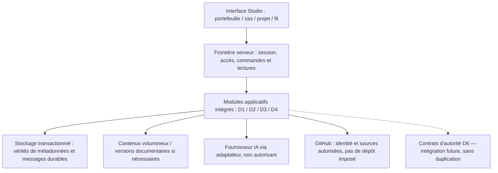
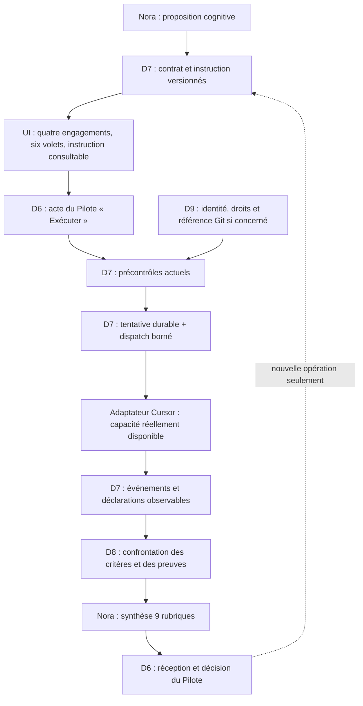
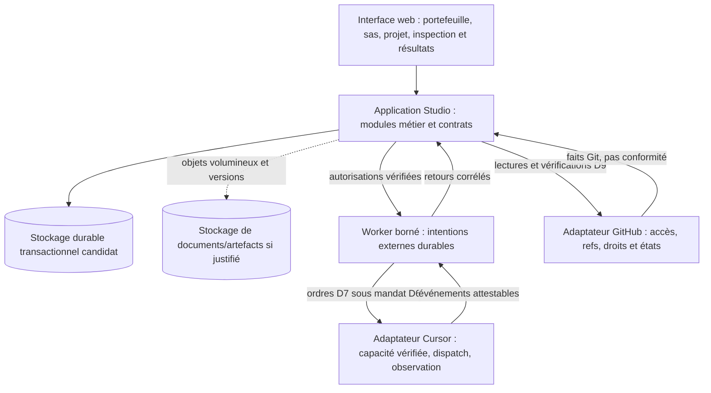

# SFIA Studio Next — R4 · Cadrage de la conception d’architecture

| Métadonnée | Valeur |
| --- | --- |
| Nature | **Document de cadrage vivant** du jalon R4 ; support de travail et de synthèse, sans création d'une seconde autorité normative |
| Version | **v1.0 — architecture R4 A/B/C/D validée en contenu avec réserves**, 2026-11-04 ; contribution documentaire sur branche R4, non mergée |
| Statut | **R4 ARCHITECTURE DESIGN VALIDATED BY MORRIS — WITH CARRIED RESERVES ; ADR R4-01..04 + DATA-01 APPROUVÉS ; ENV-01 D2 VALIDÉ ET ROUTÉ SUR BRANCHE ; QA A–D DOCUMENTÉE**. Intégration `main` et démarrage R5 sous gates distincts ; aucun code, runtime, LIVE/REAL ou `ADOPTED` |
| Responsable des arbitrages | Morris |
| Rédaction / analyse | ChatGPT, sous contrôle des sources Git et des décisions Morris |
| Référentiel vérifié à l'entrée de l'intégration D | `mcleland147/sfia-workspace`, `main@7067c846ce7c57825dd31c532433d809e1a01216` ; branche candidate `sfia/next-r4-architecture-scoping`, cadrage A/B/C blob `67d838963c44505e908a0f95bfc548a90e363042` ; ENV-01 blob `26fa518ca6fc710a5978cf3b32dfa2fc8d558de8` et routage partagé publiés sur la branche avant intégration D. Worktree local **NON OBSERVÉ**. |
| Situation technique | **Next : N/A — NON IMPLÉMENTÉ**. Aucun code ni schéma de données cible adopté ; branche locale / index / worktree **NON OBSERVÉS** |
| Emplacement Git candidat | `projects/sfia-studio-next/architecture-technique/cadrage-r4.md` sur `sfia/next-r4-architecture-scoping` ; A/B/C/D intégrés avec QA et raccord ENV-01, sans PR/merge |

## 1. Finalité et position de départ

Ce document cadre la **conception de l'architecture du nouveau produit SFIA Studio**, indépendamment de son implémentation historique. Il conserve la compréhension des acquis, des hypothèses, des options et des réserves durant R4, et guide la préparation de R5. Il n'autorise aucun choix technique, aucune écriture Git, aucun lot Cursor ni aucune adoption de runtime.

**Position de travail confirmée :** notre trajectoire de quatre macro-lots R4 reste pertinente après lecture de l'architecture historique. Aucun composant, nom, schéma de base, moteur ou principe d'implémentation de l'ancien Studio n'est repris par défaut. **Les exigences et invariants validés pour Next priment sur toute capitalisation historique.** Reconstruire intégralement est une option normale, pas un scénario de dernier recours.

La qualité de R4 sera mesurée par la **simplicité explicable des responsabilités**, la cohérence des parcours utilisateur, la maîtrise des droits et des effets, la fiabilité de la continuité, l'observabilité et la capacité à construire/tester des incréments verticaux. La quantité de composants réutilisés n'est pas un indicateur de succès.

## 2. Fondations acquises et hiérarchie des sources

### 2.1. Décisions et validations acquises — Next

- **SEF v0.2 validé par Morris :** construction par macro-lots cohérents, gates explicites, code + tests + documentation groupés en Delivery, qualification des preuves, pas de micro-cycles documentaires ; rôles D0/D1/D2/D3 distincts.
- **R1 — CLOSED BY MORRIS WITH CARRIED RESERVES :** vision Pilote–Nora, neuf domaines D1–D9, sept scénarios end-to-end, frontières IN/OUT et séparation autorité/cognition/preuve.
- **R2 — CLOSED BY MORRIS WITH CARRIED RESERVES :** neuf spécifications fonctionnelles et compléments approuvés, 15 CKI validés en contenu et 50 relations non contraignantes ; les CKI ne sont ni des autorisations ni un moteur métier autonome. Les 66 réserves initiales restent tracées dans leurs sources propriétaires.
- **R3 — CLOSED BY MORRIS WITH CARRIED RESERVES :** parcours Pilote–Nora, couverture de conception des neuf domaines et sept E2E, prototype Figma (223 frames), contrat de transposition, clarification de la visibilité cognitive / outil / Cursor, STOP et reprise. **Conception et navigabilité Figma ≠ fonctionnement navigateur ni E2E REAL.**
- **Nommage Next validé :** nommer les composants par responsabilité durable ; un concept = un nom ; pas de `F2`, `P6`, `OPS1`, `pre-m6`, `legacy` ou noms de chantier dans l'architecture permanente.
- **Gouvernance Git :** les anciennes décisions H7/H8 et G0-A/B restent des faits historiques ; elles ne constituent pas une architecture imposée à Next.

**Vérité des sources :** code/preuves Git Next, lorsqu'ils existeront, puis décisions Morris, spécifications et documents, enfin hypothèses. Un constat historique ne remplace pas un arbitrage R4. En cas de contradiction entre code futur et documents Next, qualifier **KNOWN GAP** et instruire sa correction dans le macro-lot concerné.

### 2.2. Sources canoniques à consulter, sans les dupliquer

| Source | Autorité / rôle |
| --- | --- |
| `governance/SEF.md` | Méthode et gates de construction Next |
| `governance/roadmap.md` | **État vivant** et dépendances R0–R6 ; ce document ne tient pas une deuxième roadmap |
| `governance/decisions/` | Arbitrages explicites Morris ; aucune décision induite par une proposition |
| `governance/product-naming-conventions.md` | Règles de nommage **VALIDATED** |
| `cadrage/vision-produit.md` et `cadrage/vision-cible/README.md` | Vision, neuf domaines, E2E et schémas fondateurs ; schémas ≠ architecture adoptée |
| `conception-fonctionnelle/README.md` et spécifications D1–D9 | Contrats fonctionnels, états, exigences et réserves propriétaires |
| `cki/README.md` | CKI et relations **validés en contenu**, non prouvés en fonctionnement |
| `ux-ui/` (revue R3, contrats, Figma) | Parcours, états, géométrie de référence, responsive/accessibilité, pas de preuve runtime |
| `projects/sfia-studio/production-runtime-reference/` | PRR de l'ancien produit : **retour d'expérience non prescriptif** |
| `projects/sfia-studio/convergence/architectural-knowledge-governance/m4-rationalization/` | Audit historique AS-IS/TO-BE, options et risques de rationalisation ; décisions spécifiques à l'ancien Studio |

Référence Git : `https://github.com/mcleland147/sfia-workspace/tree/main/projects/sfia-studio-next`.

## 3. Résultat produit que l'architecture doit rendre possible

**Chaîne cible intégrée :** le Pilote accède à ses projets ; Nora l'accompagne dans un sas conversationnel ; le projet n'est créé que sur décision explicite ; la conversation et les acquis se poursuivent ; la trajectoire et les cycles restent légers et facultatifs selon la situation ; Nora explore, conseille et produit dans ses droits ; le Pilote gouverne les décisions et mandats ; l'exécution externe part d'un contrat réellement inspecté et autorisé ; les résultats et preuves sont confrontés ; le travail peut être arrêté, repris ou requalifié sans duplication ni autorité inventée.

### 3.1. Neuf domaines à couvrir

| Domaine | Capacité retenue en R1/R2 | Conséquence architecturale à concevoir en R4 |
| --- | --- | --- |
| D1 | Accès individuel et portefeuille | Identité, sessions, isolation entre Pilotes et projets, accès non conversationnel |
| D2 | Sas Nora et création explicite | Continuité pré-/post-projet, état durable, création idempotente et cohérence des documents |
| D3 | Conduite Pilote–Nora | Frontières cognition/orchestration/outils, contexte sourcé, contrôle des effets et activités réellement visibles |
| D4 | Mémoire, documents, sujets, décisions | Identités documentaires, versions, provenance, récupération, visibilité et accès |
| D5 | Trajectoire, cycles, CKI | État métier cohérent, cycles non obligatoires, méthode/guidance versionnée, pas de moteur CKI concurrent |
| D6 | Décisions et gouvernance | Autorité humaine durable, mandats/suspensions, portée temporelle et vérification effective |
| D7 | Réalisation opérationnelle | Contrat unique inspectable, identité/version, instruction technique reliée, GO Exécuter, Tentative/STOP/reprise |
| D8 | Résultats et preuves | Attribution, observation, conformité, incertitude, acceptation humaine et reconstitution |
| D9 | Git facultatif et gouverné | Accès individuel, ressources/références, permissions, conflits, collaboration sur dépôt partagé sans fusion de projets Studio |

### 3.2. Sept E2E de référence

1. Sas conversationnel → création explicite → même fil et contexte dans le projet.
2. Trajectoire et cycles → guidance méthodologique sans verrou artificiel.
3. Investigation multi-sources et production cognitive → restitution adaptée et sourcée.
4. Connaissance vivante, sujets, décisions → continuité et reprise du contexte.
5. Décision / mandat → contrat inspecté → autorisation → réalisation technique gouvernée.
6. Résultat, preuve, réserve, correction → acceptation humaine distincte.
7. Git individuel facultatif → accès et partage de dépôts sans confusion des identités et autorités.

Les compléments R1/R2 du 2026-11-03 concernant **production/révision de documents, consultation des sources et inspection intégrale du contrat** s'appliquent également ; ils ne créent pas une nouvelle architecture déjà décidée.

## 4. Capitalisation critique de l'ancien Studio — sans présomption de réutilisation

### 4.1. Ce qui a été effectivement constaté

Le Product Studio historique repose sur Next.js/React, une UI `/studio`, `Project Assistant` (F2/W2), un runtime cognitif Nora (OpenAI Agents), des agrégats métier OA (Project/Cycle/HumanDecision/ExecutionContract/ExecutionAttempt/Evidence/ReviewBundle), SQLite produit et SQLite session Nora, certains supports process-local et des adaptateurs Git/Cursor. D1, OPS1 et P0 ont conservé des parcours ou stockages historiques adjacents. La **PRR** documente 20 flux F01–F20, des invariants et tests, mais son manifeste et ses volumes sont partiellement issus de baselines antérieures au HEAD courant : les affirmations significatives doivent être rapprochées du code.

Le parcours **Single Human Execute** est intégré à l'ancien produit au périmètre déterministe testé ; il n'établit pas une preuve globale Cursor REAL. Les propositions et offres process-local, la dérive potentielle de chemins SQLite, la duplication de voies d'orchestration et la coexistence de surfaces historiques ont été identifiées comme risques. Certains résultats de reprise sont prouvés à un niveau déterministe borné, non au niveau navigateur/REAL universel.

L'étude historique AKG-M4 a proposé de consolider l'ancien OA et d'étudier une reconstruction ciblée de l'orchestration, pour limiter le risque de migration de **cet ancien produit**. Les décisions H7/H8 y sont **des décisions historiques**, non des instructions de conservation pour Next.

### 4.2. Qualification provisoire pour Next

| Élément historique | Enseignement utile | Décision Next |
| --- | --- | --- |
| Cognition ≠ autorité ≠ preuve | Frontières cohérentes avec les contrats R1/R2 | **Exigence produit acquise** ; composants d'implémentation ouverts |
| Décision, contrat, tentative, preuve distincts | Traçabilité et contrôle des effets | **Responsabilités à satisfaire**, nombre de tables/agrégats à concevoir |
| OA Product Runtime | Solution historique substantielle mais complexe | **Aucune adoption** du code, de l'ORM ou des modèles |
| Nora Session séparée du métier | Séparation conceptuelle utile | **Aucune décision** de deux bases physiques ou de leur technologie |
| Project Assistant / F2 / W2 | Capacité d'orchestration réalisée, avec chemins parallèles | **Aucune reprise par défaut** ; rechercher une orchestration explicable et non concurrente |
| Single Human Execute | Parcours UX pertinent déjà demandé pour Next | **Contrat fonctionnel R2/R3**, pas reproduction des transitions techniques historiques |
| D1 / OPS1 / P0 | REX sur identités, exécution, écrans et corrections | **Aucune migration ni duplication** présumée |
| PRR, cartographie de tests et invariants | Bonne pratique de preuve/impact | Capitaliser **la méthode**, pas créer une deuxième PRR Next |

**Principe anti-biais :** une conception historique n'obtient aucun avantage dans l'évaluation du seul fait de son existence, de son niveau d'investissement ou de sa maturité documentaire. Les éventuels actifs réutilisables doivent prouver un bénéfice net par rapport au code neuf, après prise en compte des dépendances et de la dette qu'ils transporteraient.

## 5. Options architecturales à étudier, sans préjuger du verdict

| Option | Hypothèse de conception | Avantages possibles | Coûts/risques à objectiver |
| --- | --- | --- | --- |
| **N1 — Architecture Next neuve et sobre** | Définir de zéro les responsabilités, états et interfaces strictement nécessaires à R1–R3 | Cohérence, faible dette de compatibilité, liberté de conception | Conception des invariants et preuves à reconstruire |
| **N2 — Architecture Next neuve, structurée autour de frontières métier éprouvées** | Partir des contrats Next mais comparer certaines frontières conceptuelles mises en évidence par l'ancien OA/Nora | Sûreté et traçabilité potentiellement facilitées | Risque d'importer une granularité ou une complexité excessive |
| **N3 — Réutilisation technique très sélective** | Réutiliser un composant historique précis seulement si l'évaluation l'emporte sur une nouvelle implantation | Gain ponctuel de délai et de tests existants | Couplages, dépendances cachées, compatibilité et coût de maintenance |

Ces options **ne sont pas des décisions d'architecture** ; elles pourront être combinées au niveau des responsabilités si cela ne crée pas de moteurs parallèles.

**Critères de comparaison :** couverture des E2E, lisibilité de l'autorité, simplicité des contrats, coût de construction/exploitation, isolation, persistance, concurrence, reprise, sécurité, observabilité, évolutivité, tests, coût de migration et dette avec exit. Les coûts et capacités réels devront être étayés ; aucune supériorité de stack ne peut être déduite de l'étude historique seule.

### 5.1. Première étude R4 — parcours sas → création → continuité (D0 ; direction V-A acceptée, mécanismes ouverts)

**Base fonctionnelle vérifiée sur `main@7067c846` :** [D1 — accès](../conception-fonctionnelle/acces-et-portefeuille.md) `RG-ACC-001/002/005/009/017–018`, [D2 — sas et création](../conception-fonctionnelle/creation-de-projet-et-continuite-du-sas.md) `RG-CRE-001/008/010/011/014/017/019/020/023/024/027`, [D4 — connaissance](../conception-fonctionnelle/connaissance-sujets-et-continuite-du-projet.md) `RG-KNOW-016..020` et [revue R3](../ux-ui/revue-formelle-sortie-r3.md). **Exigences acquises :** identité GitHub personnelle et isolement ; sas sans projet ; création uniquement par acte explicite ; existence vérifiée avant succès ; fil visuellement continu ; documents produits avant le projet puis rattachables sans doublon ; ni Git, ni cycle, ni méthode, ni contrat Cursor implicites. Aucun modèle physique ou schéma de table n'est adopté par ces sources.

**Question de conception unique :** comment établir un passage fiable et intelligible entre un contexte de préparation personnel et un projet persistant, tout en gardant les identités conversationnelles et documentaires, les provenance/versions et une récupération sans doublon ?

#### Variantes de transition (indépendantes des options générales N1–N3)

| Variante de conception | Mécanisme candidat | Atout principal | Dette / risque à maîtriser | Appréciation D0 |
| --- | --- | --- | --- | --- |
| **V-A — Préparation durable et rattachement transactionnel** | Un contexte de préparation indépendant existe avant projet ; fil et documents ont des identités stables ; l'acte de création enregistre le projet et son rattachement au contexte dans une frontière de cohérence transactionnelle. | Pas de copie du fil ; idempotence et reprise explicables ; mêmes références avant/après. | Cycle de vie du sas, références/permissions, transaction autour de métadonnées et éventuels objets externes à traiter. | **Direction d’étude acceptée par Morris**, mécanisme technique NON VALIDÉ. |
| **V-B — Stockages ou services distincts avec liaison durable** | Le sas et le projet ont leurs propres persistances ; l'acte crée un lien explicite, éventuellement par événements durables et réconciliation. | Évolution séparée possible des sous-systèmes. | Cohérence inter-stockages, succès partiel, réplication, déduplication, reprise et observabilité plus complexes. | À conserver comme contre-option si une contrainte réelle l'exige. |
| **V-C — Migration ou duplication du contenu lors de la création** | Copie/transfert des messages, documents et références du sas vers le projet ; l'UI reconstruit un fil continu. | Séparation simple des espaces de stockage si deux systèmes préexistants. | Risque de perte, double écriture, divergence des versions et identités, faille de coupure au milieu du transfert. | **Non recommandée par défaut**, sauf preuve d'un avantage décisif. |

**Challenge important :** la continuité *visuelle* du même fil est validée en R1/R2 ; une identité technique `conversationId` strictement inchangée est une **solution candidate**, pas une obligation R2. V-A devra prouver qu'elle simplifie effectivement le modèle de données et les droits. De même, une **frontière transactionnelle de création/rattachement** n'implique pas que les octets documentaires, les sorties de modèle et tous les journaux résident dans une seule base physique.

#### Responsabilités logiques candidates (aucun nom de classe, table ni service adopté)

| Responsabilité | Propriétaire fonctionnel | Contrat attendu |
| --- | --- | --- |
| Identité et session | D1 | Identité GitHub du Pilote effectivement applicable ; isolation et refus à chaque lecture/mutation ; accès Git restant D9. |
| Préparation du sas et acte de création | D2 | Préparation personnelle avant projet ; acte « Créer le projet » avec idempotence ; existence et propriété vérifiées ; lien durable vers fil et acquis. |
| Conversation, interprétation et restitution Nora | D3 | Production cognitive et contexte sélectionné ; aucun message ni outil Nora ne crée seul le projet ou un mandat. |
| Documents, références, connaissances, provenance | D4 | Identités et versions stables ; document d'abord rattaché à la préparation, puis associable au projet après création confirmée ; aucune promotion de statut épistémique. |
| Décisions opposables | D6 | Aucune décision métier inventée par l'association ; auteur/portée/temps conservés si une décision explicite existe. |
| Présentation / réhydratation | UX | Même fil lisible ; point de création visible après succès seulement ; écran d'erreur et retour cohérents ; aucune seconde machine d'autorité dans le front. |

#### Séquence de référence candidate V-A (illustrative, à challenger)

1. Le Pilote s'authentifie ; Studio ouvre ou retrouve **sa** préparation identifiable, sans projet durable. Les tours conversationnels et les documents sont conservés avec provenance et état réel selon les politiques à concevoir.
2. Nora restitue un aperçu évolutif sans présumer de décision, de méthode, de cycle ni d'accès Git. Les questions bloquantes sont limitées à l'identité, à l'objet à créer et aux contraintes réellement déterminantes.
3. Au clic **« Créer le projet »**, le serveur vérifie l'identité/session, le propriétaire de la préparation, les préconditions, la version utile et une **clé stable d'opération** (choix exact à définir). Aucun effet n'est accordé au seul modèle cognitif.
4. Une commande contrôlée crée **un seul** projet et établit son association à la préparation, au fil et aux métadonnées documentaires durables ; toutes les écritures qui doivent être indivisibles partagent une transaction effective **si la technologie choisie le permet**. Un mécanisme de réconciliation explicite est requis pour toute ressource extérieure à cette transaction.
5. Le serveur recharge l'état persistant ; seulement après succès vérifié, il confirme le projet et projette le marqueur « Projet créé » dans le même fil. Le portefeuille lit le propriétaire de projet effectif, non une projection optimiste de Nora.
6. Le Pilote et Nora poursuivent sans cycle/CKI/méthode ni dépôt obligatoire. Le moteur de contexte charge des **références choisies et autorisées**, pas l'intégralité du transcript à chaque tour.

#### Défaillances discriminantes à traiter dans les contrats R4

| Incident | Comportement impératif | Décision de conception encore ouverte |
| --- | --- | --- |
| Double clic, retry HTTP, réponse perdue | Le même acte retrouve le même projet ou reste `UNKNOWN` pendant la vérification ; jamais un second projet silencieux. | Portée/expiration de la clé d'idempotence, unicité et restitution. |
| Crash après commit, avant réponse UI | Une reconnexion retrouve le projet et l'association au fil sans reproduire l'effet. | Lecture de réconciliation par clé d'opération / préparation. |
| Session révoquée au moment de créer | Refus des nouveaux effets protégés ; aucun contenu d'un autre Pilote divulgué. | Contrôle de l'identité à la frontière transactionnelle ; politique de session expirée. |
| Document du sas dont les octets ne sont pas durablement enregistrés | Ne pas annoncer qu'il a été transféré ; montrer `PENDING`, `FAILED` ou `UNKNOWN` selon preuve. | Métadonnées, stockage objet, opération de finalisation et recovery. |
| Source externe devenue inaccessible | La référence et la limite de validité sont conservées ; pas de réutilisation non autorisée ni d'autorité attribuée à la source. | Politique de provenance/currentness et lecture autorisée. |
| Deux onglets modifient la même préparation | Pas d'écrasement silencieux du fil, des références ou du projet créé. | Versions, ordre des tours, contrôle de concurrence et conflits. |
| Abandon du sas | Aucun projet fictif ; préparer une éventuelle reprise du sas selon droits et conservation. | Rétention, suppression, confidentialité, récupération. |

#### Confrontation des grandes options N1–N3 sur ce seul E2E

- **N1 — Next neuf et sobre :** compatible avec V-A, un modèle applicatif réduit et une frontière transactionnelle cohérente. **Hypothèse de travail privilégiée**, à démontrer contre les risques de croissance et les E2E futurs ; ne prescrit pas Next.js, PostgreSQL, SQLite, ORM ou moteur d'événements.
- **N2 — Next neuf à frontières métier fortes :** compatible avec V-A si les responsabilités sont explicitement séparées **logiquement**, même si elles partagent une transaction au point de création. À éviter si elle produit une cascade de services, états ou agrégats sans nouvelle garantie.
- **N3 — Réutilisation ponctuelle historique :** aucun composant ancien n'a, à ce stade, une justification objectivée de reprise pour le passage sas→projet. Les invariants historiques peuvent servir d'oracle critique, pas de schéma par défaut.

**Direction d’étude V-A acceptée par Morris le 2026-11-03 (conception uniquement) :** approfondir V-A + N1 sobre, tout en conservant les frontières D1/D2/D3/D4/D6 et une possibilité d'évolution N2. V-B reste une alternative à défendre par des besoins d'échelle, d'isolation ou d'intégration concrets ; V-C est défavorable par défaut. Ne pas demander d'ADR ou choisir une base avant de préciser la vérité durable des documents, le modèle d'association, la concurrence et la récupération après incident.

**Gate envisagé à la fin de cette première étude (supersédé par le mandat de revue globale §5.3) :** revue Morris du modèle de responsabilité, du lien durable et de la frontière transactionnelle ; le choix de direction V-A est déjà acquis en conversation, sans ADR ni choix de stack. Les preuves R5/R6 requises incluront tests transactions/retry/restart, isolement deux comptes, source inaccessible, projet sans Git ni cycle, continuité visuelle navigateur et document du sas repris sans duplication. État courant : **DOCUMENTED / CANDIDATE D0**, `N/A — NON IMPLÉMENTÉ`.

### 5.2. V-A — modèle de responsabilités et transaction de création (D0, NON VALIDÉ TECHNIQUEMENT)

**Mandat de progression (conversation Morris, 2026-11-03) :** « ok V-A on peut continuer ». Cela sélectionne **V-A pour approfondissement** et ne valide ni schéma, ni composant, ni stockage, ni ADR. Les propositions ci-dessous sont des **candidats d'architecture**, conditionnés à la revue des interfaces D1/D2/D3/D4/D6 et à l'absence de second moteur d'état. Le dépôt `main` affiche toujours R4 `NOT STARTED` dans sa Roadmap ; l'étude a été engagée en conversation sur branche candidate, sans mise à jour normative de ce statut.

#### 5.2.1. Découpage minimal de vérité — ne pas confondre propriétaires métier et services physiques

| Concept logique candidat | Responsabilité | Identité et durée | Invariant déterminant |
| --- | --- | --- | --- |
| **Préparation** (sas) | D2 possède le contexte personnel avant projet et le passage de frontière | Identifiant durable propre, propriétaire Pilote, état `OPEN`, `ATTACHED` ou `ABANDONED` proposés ; la rétention reste ouverte | Une préparation non créée n'est pas un projet ; au plus **un projet issu de cette préparation** par acte valable |
| **Projet** | D2 crée, D1 expose au portefeuille, D6 contrôle la portée des actes et des décisions selon leurs propriétaires | Identité permanente distincte du nom, propriétaire Pilote | Existence et propriété établies avant confirmation/navigation ; aucune création automatique de cycle, méthode, CKI ou dépôt |
| **Association préparation → projet** | D2, vérité durable de création et liaison | Relation unique, vérifiable par identifiant de préparation, d'opération et de projet | Aucune double association, relecture possible après perte de réponse ou redémarrage |
| **Fil de conversation** | D3 orchestre la conversation et la projection UX ; les messages relèvent du contexte autorisé | Identité de fil indépendante de l'identité projet ; même fil visible après passage | Aucun transcript recopié/reconstruit pour simuler la continuité ; l'historique ne change pas de portée sans vérification des droits |
| **Ressource documentaire / version** | D4 pour identité, conservation, provenance et états de sauvegarde | Identifiant stable, version courante et historique ; contenu éventuellement dans un stockage distinct | L'association au projet ne vaut pas confirmation de la sauvegarde des octets ; aucune duplication ou réécriture silencieuse |
| **Connaissance / acquis** | D4 organise les éléments récupérables, avec leur source et qualification épistémique ; D3 sélectionne le contexte | Rattachement au sas avant projet puis au projet par relation vérifiée | Une hypothèse ne devient pas un fait, et une source ne devient pas un ordre ou un mandat |
| **Décision opposable, si elle existe** | D6, indépendant du mécanisme de création | Auteur, portée, état, version et temporalité | Le clic « Créer le projet » est l'acte D2 dédié ; il ne crée pas automatiquement une HumanDecision générique ni un mandat Cursor |

**Hypothèse de simplicité :** ces éléments sont des frontières conceptuelles et non sept microservices ou sept bases. La co-localisation transactionnelle des **métadonnées essentielles** de la préparation, du projet et de leur association peut simplifier fortement la cohérence, sans confondre les responsabilités D2/D3/D4/D6.

#### 5.2.2. Cycle de vie logique et contrôle d'unicité

- `OPEN` : préparation personnelle réutilisable, création non constatée. Les messages et documents préparatoires sont conservés selon un contrat réel de durabilité et de rétention.
- `ATTACHED` : un projet unique, effectivement persisté, lui est associé ; les références de conversation et de documents demeurent stables. L'état de préparation et le projet sont liés par une relation durable.
- `ABANDONED` : aucune création implicite ; politique de réouverture, rétention, purge, restauration et confidentialité **à arbitrer**. L'état n'efface pas silencieusement les traces utiles ou soumises à obligations.
- `VERIFYING` / `UNKNOWN` / `FAILED` : états de **résultat d'opération ou de présentation**, **pas** de nouveaux états durables obligatoires de la préparation. Ils doivent pouvoir être requalifiés à partir des faits persistés.

**Recommandation candidate :** le service de création garantit `at-most-one project per preparation` via une **contrainte effective d'unicité**, sans dépendre de l'état UI ou du processus Nora. Le renouvellement d'une intention pour fonder un **autre** projet passe par une nouvelle préparation explicite ; ce comportement reste à confronter aux scénarios utilisateur.

#### 5.2.3. Contrats d'opération candidats (conceptuels ; pas d'API, nom de classe ou technologie adoptés)

| Opération conceptuelle | Entrée essentielle | Résultat attendu / erreurs |
| --- | --- | --- |
| **Lire/reprendre une préparation** | Identité/session courante et référence de préparation | Retour autorisé d'état/fil/documents ; `NOT_FOUND` ou `FORBIDDEN` sans divulgation croisée |
| **Créer explicitement un projet** | Identité D1 courante, préparation identifiée, acte « Créer le projet », identifiant d'opération stable, version des champs réellement approuvés | Projet et association **atomiquement confirmés** ; `ALREADY_CREATED` retourne le projet existant au même Pilote ; `CONFLICT`, `FORBIDDEN`, `UNKNOWN` selon faits observés |
| **Vérifier une création après incertitude** | Identité/session vérifiée et référence d'opération ou de préparation | Relecture du projet/association et état réel ; jamais nouvelle création par simple vérification |
| **Poursuivre le fil / retrouver les acquis** | Fil et contexte autorisé effectivement résolus, permissions et versions applicables | Conversation continue, contexte D4 sélectionné ; accès refusé ou limites de source indiquées honnêtement |
| **Lire un document lié** | Ressource/version et identité autorisée, état de sauvegarde | Version accessible si durable ; sinon `PENDING`, `FAILED` ou `UNKNOWN` explicites, sans faux contenu disponible |

**Idempotence :** la clé d'opération est conservée au-delà de la requête et réutilisée lors d'un retry ; l'unicité de la préparation protège aussi contre deux clés différentes issues de deux onglets. Une clé réutilisée avec un contenu matériellement différent doit être rejetée, non interprétée comme une nouvelle création. La durée de conservation de la clé et la forme de son empreinte restent à décider.

**Concurrence :** l'éventuel contrôle de version porte sur les **champs de création réellement inspectés et confirmés**, et non nécessairement sur chaque message de Nora, pour ne pas bloquer artificiellement le Pilote. Deux propositions incompatibles doivent provoquer un conflit explicite/requalification avant effet. Le propriétaire de l'autorité ne passe jamais au client seul.

#### 5.2.4. Point de cohérence et scénario de crash

**Frontière transactionnelle candidate dans un magasin apte aux transactions :**

1. Vérifier l'identité/session et l'accès à la préparation **au point d'effet**, et requalifier l'état de préparation ainsi que la version de création approuvée.
2. Chercher toute association/projet déjà enregistré pour cette préparation ou cet acte. S'il existe et appartient au bon Pilote, retourner **la même identité de projet**, sans nouvel effet.
3. Dans **une même transaction pour la vérité essentielle**, enregistrer le projet, sa propriété, l'association unique à la préparation, l'issue durable de l'acte et l'état `ATTACHED`. L'unicité et les contrôles de concurrence doivent résister aux requêtes simultanées.
4. Après confirmation du commit, recharger l'état durable, puis autoriser l'affichage « Projet créé », le portefeuille et le marqueur de transition du fil. Si la réponse HTTP disparaît, une **lecture de réconciliation** retrouve les mêmes références ; aucune seconde création automatique.
5. Les métadonnées documentaires et messages qui ne participent pas à la transaction conservent leurs **références immuables** ; leur disponibilité est vérifiée par leur propre responsable. Les effets hors transaction (objets, recherche, index, notifications) sont **reconciliables** et **ne deviennent pas nécessaires à la confirmation d'une création minimale**, sauf exigence explicitement établie.

**Point critique :** « même transaction » n'autorise pas à prétendre que fichiers externes, générations IA ou journaux distants sont atomiques avec la création. La solution doit choisir une frontière de vérité **réelle** ; si ces données ne sont pas dans le même magasin, leur réconciliation se fait par références/états vérifiables, sans transaction distribuée fictive ni double écriture non gouvernée.

**Exemple d'interruption :** l'opération crée et commit le projet, mais le navigateur reçoit un timeout. La reprise consulte la préparation et l'identifiant d'opération sous la session courante, retrouve `ATTACHED` et le projet unique, puis affiche le succès vérifié. Un clic supplémentaire ne re-joue pas la création.

#### 5.2.5. Faits du sas et documents encore incomplets

- Un document préparé garde une **identité durable propre**, un état de sauvegarde et des versions, même si sa création a démarré avant le projet ; l'association au projet ne force pas un renommage ou un nouveau `documentId` par principe.
- **Recommandation à valider :** ne pas bloquer la création du projet pour un document facultatif `PENDING` si les métadonnées nécessaires sont conservées et l'UI décrit le fait ; la ressource reste `PENDING` jusqu'à confirmation réelle. Si la ressource est déterminante à l'identification du projet ou à un effet explicitement requis, appliquer une précondition proportionnée.
- Les références des sources Git, web ou interprojets conservent auteur, origine, version/ref, fraîcheur et **droits recontrôlés à la lecture**. Une référence historique ne garantit ni accès futur ni pouvoir d'action.
- La mémoire de Nora est un **mécanisme de sélection/composition** à partir de ressources D4 et des décisions applicables D6 ; elle ne duplique pas la vérité métier ni ne résume l'histoire en remplaçant les sources.

#### 5.2.6. Scénarios discriminants et preuves à préparer pour R5/R6

| ID d'étude | Situation | Garantie architecturale attendue | Niveau à prouver plus tard |
| --- | --- | --- | --- |
| A-01 | Sas exploré puis abandonné | Aucun projet ; conservation/reprise selon politique explicite | Test serveur + navigateur |
| A-02 | Clic explicite et succès nominal | Un seul projet, même fil visible, portefeuille cohérent, aucun cycle ni Git auto | Transaction + E2E navigateur |
| A-03 | Double clic et deux clés d'opération | Un seul projet associé ; réponse réconciliée | Test concurrence déterministe |
| A-04 | Commit suivi d'un timeout et d'un redémarrage | L'effet est retrouvé sans rejouer la création | Test de redémarrage avec stockage réel |
| A-05 | Deux onglets, changements concurrents du résumé de création | Refus/conflit explicable, pas d'écrasement du contenu approuvé | Test de version/transaction |
| A-06 | Session expirée ou compte B accédant au sas A | Aucun accès ni effet, aucune fuite d'existence/sources privées | Tests de sécurité négatifs |
| A-07 | Document de sas `PENDING` au clic | Lien durable conservé ; état vrai et reprise, aucune sauvegarde fictive | Test stockage objet/réconciliation |
| A-08 | Source externe révoquée après création | Provenance connue, accès refusé, contexte Nora non autorisant | Test D4/D3 de currentness/droits |
| A-09 | Réponse Nora reçue pendant le passage | Message attribuable au bon fil/contexte/version, sans création ni décision indirecte | Test des races asynchrones |
| A-10 | Nouvelle conversation dans le même projet | Documents, acquis et décisions applicables retrouvables sans transcript complet | Test continuité D3/D4/D6 |

**Blast radius conditionnel :** D1 (identité/isolation), D2 (acte et identité projet), D3 (fil/agent), D4 (documents et connaissance), D6 (références d'autorité), UX R3 (marqueur/continuité/erreurs), futurs D5/D7/D8/D9 (projet existant ne confère ni cycle, exécution, preuve ou accès Git). Les changements de contrats publics ou schéma devront documenter leur impact en R4 et être testés transversalement en R5.

#### 5.2.7. Alternatives ouvertes dans la première itération — remplacées par la synthèse §5.3

- **Modèle minimal recommandé pour comparaison :** un **noyau transactionnel unique pour la vérité de création/association**, des responsabilités métier distinctes D1/D2/D3/D4/D6, et des ressources référencées sans transfert massif. Cela ne signifie ni monolithe d'application obligatoire, ni base unique pour tous les octets, ni stockage SQL déjà adopté.
- **Contre-option :** métadonnées de préparation/projet physiquement séparées. À envisager seulement si exigences de sécurité, volumétrie, isolation ou disponibilité l'exigent ; elle appelle alors un contrat explicite de cohérence partielle et de réconciliation au lieu de prétendre à une atomicité distribuée.
- **Dans cette itération initiale**, le noyau transactionnel et les références durables étaient encore à préciser ; leur analyse est maintenant consolidée au §5.3. La revue Morris sera **globale**, pas un gate séparé sur chaque mécanisme.

**Verdict de cette itération : `V-A — DIRECTION D'ÉTUDE APPROUVÉE / MODÈLE 5.2 CANDIDAT, NON VALIDÉ / N/A — NON IMPLÉMENTÉ`.** Le niveau de preuve est une confrontation documentaire et un raisonnement architectural ; aucun test runtime Next n'a été exécuté.

### 5.3. Macro-lot A — architecture de conception consolidée (orientation produit revue ; technique candidate)

**Mandat de méthode (Morris, 2026-11-03) :** ChatGPT instruit et synthétise **tout le macro-lot A** sans gate de micro-arbitrage technique, puis soumet en une fois la solution, ses alternatives, ses réserves et les arbitrages d'orientation à Morris. Le mandat ne transforme ni les recommandations en ADR approuvés, ni le document en baseline `main`, ni R4 en jalon clos. Les autres macro-lots R4 B–D restent à concevoir. Aucun code Next n'existe à cette date.

#### 5.3.1. Décision de conception recommandée — architecture minimale cohérente

**Recommandation technique à discuter globalement :** une **application web modulaire** avec **un noyau transactionnel relationnel unique pour les métadonnées métier du parcours A**, une conservation durable des messages et documents via des contrats explicites, et **des adaptateurs externes isolés** pour GitHub, les modèles IA et l'éventuel stockage d'objets. Aucun moteur d'orchestration métier indépendant ni microservice n'est requis pour ce parcours.

Le qualificatif « modulaire » décrit ici des **frontières de responsabilité et des interfaces internes**, pas un découpage en déploiements. D1, D2, D3, D4 et D6 ne doivent pas devenir, par réflexe, cinq services, cinq états de session ou cinq bases de données. La topologie d'hébergement, le framework et les packages ne sont pas décidés par cette proposition.

**Ce diagramme représente une option logique, pas le nombre de processus ni les instances de stockage.** Le serveur fait respecter les contrôles ; la base garantit les invariants transactionnels ; l'interface affiche seulement des états relus. Il n'existe pas de deuxième journal autorisant dans l'interface, le transcript ou le fournisseur IA.

**Choix de déploiement candidat :** une base relationnelle **PostgreSQL managée** est préférable pour un produit web multi-Pilotes avec écritures simultanées, contraintes d'unicité, transactions, sauvegardes et redémarrages multi-instances. Ce choix reste **à confirmer** avec l'environnement réel, le coût, les contraintes d'hébergement et l'exploitation de R4-D. Une base SQL embarquée ne serait acceptable que si un déploiement réellement mono-instance et une stratégie de sauvegarde/concurrence adaptés sont démontrés. Le SQL est ici une **famille technologique proposée**, pas un ADR adopté. Le stockage objet n'est nécessaire que lorsque la taille et la nature des contenus le justifient ; il ne remplace pas la vérité des métadonnées.

**Alternatives écartées pour A à ce stade :** copie massive au passage sas→projet, moteur d'événements global, orchestration multi-services, deux magasins transactionnels pour la création, état essentiel en mémoire de processus, réplication du transcript comme vérité métier, adoption de l'ancien OA/Nora/F2. Elles ne sont pas impossibles ; aucune exigence R1–R3 vérifiée n'en justifie le coût initial.

#### 5.3.2. Carte des propriétaires et contrats de frontière

| Responsabilité | Propriétaire logique et frontière | Vérité détenue ou consommée | Effet permis / explicitement exclu |
| --- | --- | --- | --- |
| Identité et sessions | **D1** : point d'entrée Studio, principal authentifié, validité de session | Identité Studio dérivée d'une authentification GitHub vérifiée, session courante ; ne vaut pas permission Git/Cursor | Autoriser ou refuser l'accès au bon contexte ; jamais créer le projet ni attribuer un mandat |
| Préparation et passage | **D2** : préparation, version de création, commande explicite, création, association | Préparation, projet individuel, association, résultat idempotent de commande | Créer le projet sous acte explicite ; jamais créer cycle, CKI, dépôt ou contrat technique |
| Conversation avec Nora | **D3** : fil, échanges, activité et sélection du contexte | Messages durables et états de production réels ; utilise D2 pour résoudre le contexte | Produire/consulter/restituer ; **jamais inférer** un acte `Créer le projet` d'un simple texte |
| Documents et connaissance | **D4** : identité de ressource, versions, provenance, acquis et limites d'accès | Métadonnées durables, état des octets, références de source et de connaissance | Rendre retrouvable ; ne transforme ni source en autorisation ni hypothèse en décision |
| Autorité métier opposable | **D6** : décisions, restrictions, mandats si applicables | Registre canonique D6, **non copié dans D2 ou Nora** | Les futures décisions D6 ont leurs propres règles ; le clic de création reste un acte dédié D2 |
| UX / rendu | Interface web, sous contrat des domaines | Projection dérivée de D1–D4/D6 | Afficher et guider ; aucun succès ou état métier seulement local n'est opposable |

**Économie de responsabilité :** un seul propriétaire de chaque fait et de chaque effet, sans imposer une classe, un repository ou un service par ligne. Les composants ne sont justifiés qu'en R5 au moment du code, selon leur charge et leurs frontières réelles.

#### 5.3.3. Modèle logique minimal et garanties de stockage

Le modèle ci-dessous est un **contrat de données**, non un schéma SQL approuvé. Les noms sont illustratifs et devront suivre la convention de nommage Next lors de la construction.

| Famille logique | Attributs/relations déterminants | Garantie proposée |
| --- | --- | --- |
| **Pilote Studio** | Identité interne stable ; référence externe GitHub vérifiée ; session/révocation | Un compte ne peut résoudre les objets d'un autre ; le compte externe n'est pas un droit de dépôt |
| **Préparation** | `preparationId`, `ownerId`, statut courant, version de cadrage validable, horodatages | Existe **sans Project** ; relecture autorisée après interruption ; association unique après création |
| **Projet** | `projectId`, `ownerId`, métadonnées minimales et date de création | Création confirmée uniquement si durable ; nom non unique autorisé ; projet privé au bon Pilote |
| **Lien de création** | `preparationId → projectId`, auteur, opération et date de commit | **Unicité effective sur `preparationId`**, relation non ambiguë et retrouvable ; aucune création en double après retry |
| **Résultat de commande** | `ownerId`, clé idempotente, empreinte de la demande approuvée, résultat/référence, instant | Même commande + même empreinte → même résultat ; autre empreinte → conflit ; durée de rétention à aligner sur la garantie de non-doublon |
| **Conversation** | `conversationId`, référence initiale à la préparation, propriétaire, dates | Identité technique stable **candidate** pour le fil d'origine ; contexte projet résolu depuis le lien réel, pas en recopie |
| **Message** | `messageId`, fil, auteur/type, statut d'enregistrement, ordre/version, source de génération | Messages durables ordonnés ; productions partielles jamais présentées comme un message achevé ; refus des duplications de requête |
| **Document / version** | `documentId`, `revisionId`, préparation d'origine, blob optionnel, statut, empreinte, provenance | Identité continue ; version conservée, contenu accessible seulement s'il a réellement été sauvegardé ; pas de duplication au passage |
| **Source et acquis** | référence, origine, version/date, portée de lecture, qualification, lien vers conversation/document | Source citée ≠ accès toujours applicable ; distinction faits/hypothèses/décisions ; index et résumés reconstructibles |

**Invariants minimaux à démontrer :**

1. `preparation.ownerId == authenticatedStudioPilot.id` au point de chaque lecture et commande ; jamais simple confiance dans un identifiant envoyé par le navigateur.
2. La création relit les droits et le statut de la préparation dans la transaction ; le résultat est **0 ou 1 projet lié à une préparation**, jamais deux.
3. La vérité `Project + ownership + preparation link + command result` partage **un même commit durable** ; une réponse HTTP ou une projection UI ne crée pas cette vérité.
4. La création conserve la portée et les références des messages/documents antérieurs ; aucune promotion automatique de leurs contenus en faits vérifiés ou décisions.
5. Le projet n'induit aucun cycle, CKI, méthode, dépôt Git, exécution Cursor ou autre autorité, même si l'aperçu en suggère.
6. Tout accès à un document, sujet, fil, lien de source ou projet vérifie les **droits actuels**, y compris après création et reconnexion.
7. Une décision future D6 est consultée auprès de D6, jamais déduite de la connaissance D4 ou de la réponse Nora.

**Finesse de la frontière transactionnelle :** les métadonnées essentielles de création sont atomiques. Les octets d'un document stockés hors base, un appel de modèle, une indexation ou une observation Git ne sont **pas** dans cette transaction. Ils possèdent un statut et un mécanisme de réconciliation propres. Ne pas inventer une transaction distribuée, un rollback de fournisseur externe ou une sauvegarde automatique non prouvée.

#### 5.3.4. Contrat de commande : créer et vérifier sans doublon

**Préparer :** le client relit une `Preparation` accessible et la version de **l'aperçu effectivement approuvé** (nom/objet minimal). Les messages Nora plus récents ne rendent pas automatiquement cette version périmée : la version doit suivre les champs de création qui influencent l'acte, pas tous les tokens de la conversation.

**Commander `CreateProject` (exemple conceptuel, non nom d'API adopté) :**

- Entrée : session authentifiée, `preparationId`, `expectedCreationRevision`, données minimales explicitement inspectées, `idempotencyKey` stable générée pour l'acte du Pilote.
- Préconditions : identité et propriété vérifiées ; préparation existante et autorisée ; demande issue **de l'action dédiée** ; champs déterminants assez clairs ; version d'aperçu correspondante ; absence d'interdiction applicable. Une phrase de Nora n'est pas le déclencheur de cette commande.
- Transaction : verrouillage/concurrence de la préparation ; comparaison de version et recherche d'une association déjà committée ; validation du couple clé/empreinte ; insertion du projet et de sa propriété, du lien unique et du résultat durable ; commit. Les contraintes SQL sont **la dernière barrière** même face aux requêtes simultanées.
- Réponse : `CREATED` ou `EXISTING` avec **le même `projectId` vérifié** pour le même acte ou une préparation déjà liée ; `CONFLICT` si contenu approuvé ou clé contradictoire ; `FORBIDDEN`/`NOT_FOUND` sans fuite de contenu ; `INDETERMINATE` uniquement tant que l'existence durable ne peut être vérifiée.
- Réconciliation `ResolveCreation` : lecture autorisée et **sans effet** depuis `preparationId` / clé de commande ; permet de retrouver le projet créé en cas de timeout, crash ou reconnexion. Ne doit jamais effectuer un `CreateProject` par inadvertance.

**Propriété importante :** `at-most-once durable creation per preparation`, et non garantie générale « exactly once » de tous les effets et services. L'unicité dans la base est indépendante des délais réseau et de la mémoire de processus. Deux demandes distinctes à partir d'une même préparation doivent conduire au même projet si déjà créé et autorisé, ou au conflit explicable si leurs contenus/autorités diffèrent — jamais à une seconde création.

**Évolution concurrente :** au moment de la création, le contexte approuvé est figé par sa version ; si Nora rédige un message ou termine un document simultanément, le fil reste attribué à la même préparation et se résout ensuite par le lien de création. Un document `SAVING` n'est pas déclaré `AVAILABLE` pour accompagner la création. Une écriture refusée doit être enregistrée honnêtement ou rejouée sous un acte explicite approprié, pas migrée silencieusement vers un autre projet.

#### 5.3.5. Continuité du fil, des documents et de Nora

**Fil visuel :** proposer une identité stable de fil pour la conversation déjà présente dans le sas, réutilisée dans l'espace projet. Le marqueur « Projet créé » doit dériver de **l'événement durable de création** ou du lien avec date/auteur ; il n'est pas une réponse générée par Nora ou un indicateur purement optimiste. Des conversations supplémentaires du même projet restent possibles : « même fil » porte sur **la transition initiale**, pas sur un unique transcript éternel par projet.

**Historique :** conservation des messages durables et de leur ordre. Les fragments de streaming peuvent être affichés comme provisoires, mais seule une écriture réellement confirmée est revendiquée comme récupérable. Une génération IA interrompue est signalée comme partielle avec ses acquis observés, jamais complétée a posteriori par imagination.

**Contexte Nora :** le modèle n'est pas rechargé avec tout le transcript à chaque tour. Une composition contrôlée rassemble : la demande courante ; le contexte sas/projet réellement résolu ; un historique ciblé ; les connaissances D4 pertinentes et leurs sources ; les restrictions/décisions D6 applicables lorsqu'elles existent. Le contexte explicite **provenance, confiance et limite temporelle** des informations ; la recherche vectorielle ou les résumés éventuels sont des **vues dérivées**, jamais une deuxième vérité métier. Les résultats externes et instructions trouvées dans les sources sont traités comme **données non autorisantes**.

**Documents :** une ressource créée dans le sas garde son identifiant, ses révisions et son origine après rattachement du projet. Une version n'est `AVAILABLE` que si son contenu exact est effectivement récupérable et si sa métadonnée est cohérente ; une écriture d'octets échouée reste `FAILED`/`UNKNOWN`/`SAVING` suivant l'état observable. L'association ne déclenche ni recopie des octets, ni écrasement de version, ni « promotion » d'un brouillon en document validé. Le projet peut être créé si un document facultatif est toujours en enregistrement ; une ressource **indispensable** à l'acte doit, en revanche, satisfaire sa précondition explicite.

**Lecture et reprise :** le portefeuille lit la vérité du projet existant, non un index de recherche ou un signal UI. À l'ouverture, le serveur vérifie le bon Pilote, résout le fil associé, permet de reprendre les documents/sujets et relit les décisions applicables chez D6. Sources devenues indisponibles : ne montrer que leurs références et limites permises, sans prétendre pouvoir relire le contenu.

**Point UX à vérifier en R5/R6 :** l'interface peut conserver le même composant fil et une navigation réversible, mais ne doit pas confondre « affichage du même fil » avec « le modèle dispose de tous les messages ». Les brouillons non envoyés relèvent d'un contrat séparé de navigation/session ; ne pas promettre leur survie après crash si la sauvegarde n'est pas effectivement implémentée.

#### 5.3.6. Échecs, reprise et isolation : comportement de référence candidat

| Incident / conflit | Vérité à établir | Comportement proposé, sans effet indu |
| --- | --- | --- |
| Double clic ou deux onglets sur même préparation | Contrainte d'unicité et clé de commande persistées | Un projet, même réponse canonique ou conflit explicite ; pas de double insert |
| Crash **avant** commit de création | Aucun lien durable | Sas conservé ; création non confirmée ; nouveau clic explicite possible après vérification |
| Crash **après** commit mais avant réponse | Projet + lien + résultat durable | Relecture autorisée et navigation vers le projet existant ; aucun nouveau commit de création |
| Perte de DB ou indisponibilité lors de la vérification | Existence **inconnue** | Afficher « vérification nécessaire » ; bloquer la relance implicite ; reprendre quand la base est accessible |
| Mise à jour de l'aperçu dans un autre onglet | Version réellement inspectée ne correspond plus | Demander une revue ciblée du champ changé ; ne pas écraser le nouvel état |
| Session expirée, révoquée ou changement de compte | Identité et droits au moment de la commande | Refus ou réauthentification ; ne divulguer ni nom, ni contenu, ni existence privée à un tiers |
| Document en sauvegarde / contenu inaccessible | Métadonnées, état d'octets, révision | Afficher un état de sauvegarde vrai ; ne pas certifier disponibilité ni inventer une révision |
| Message Nora terminé autour du commit | Fil/source et écriture durable | Attacher à la préparation stable ; résolution via lien du projet ; gérer écriture et affichage partiels |
| Source Git/autre projet révoquée depuis sa lecture | Droits au moment de réutiliser la source | Référence et limite, pas de contenu désormais interdit, pas d'autorité héritée |
| Plusieurs projets du même nom | `projectId` et titulaire | Projets indépendants ; noms ne servent ni de clés ni de filtres de sécurité |
| Modification de projet après transition | Contexte projet actuel et version | Actions nouvelles dans la portée du projet ; pas de réouverture artificielle du sas ou de mutation rétroactive du passé |

**Modèle d'échec minimal :** domaine métier renvoie `NOT_FOUND/ACCESS_DENIED`, `CONFLICT`, `NOT_READY`, `UNAVAILABLE`, `INDETERMINATE` suivant l'origine réelle ; l'UX traduit sans révéler des données sensibles. Les réponses HTTP, traces applicatives et libellés exacts ne sont pas figés. La « vérification » doit être une opération en lecture, distincte d'une commande qui effectue une mutation.

**Traçabilité minimale :** identifiants stables de l'acte, de la préparation, du projet et de la version inspectée ; auteur, horodatage, issue persistée ; journal technique redigé, sans secrets. Une timeline utilisateur n'est pas un registre d'autorisation et les logs opérationnels ne remplacent pas les objets de vérité.

#### 5.3.7. Sécurité, protection des données et exploitation

- **Authentification :** fournisseur GitHub comme identité d'entrée validée dans D1, mais validation de session côté serveur à chaque commande sensible ; pas de confiance dans un `ownerId` fourni par le navigateur. Le protocole concret (OAuth/OIDC/Better Auth/autre) relève du choix stack ultérieur.
- **Autorisation :** accès explicite au Pilote et à son contexte ; aucune autorisation Git/Cursor déduite de la connexion, du projet ou de l'association sas. Les références d'un projet B trouvées via une source consultable par A restent soumises aux droits actuels de lecture et ne deviennent jamais une propriété de A.
- **Protection transport et stockage :** HTTPS, sessions protégées, contrôles anti-CSRF selon mode d'authentification, secrets hors messages/documents, contrôle de taille/type des pièces, accès aux blobs via autorisation serveur et URL temporaire si retenue, suppression/revocation vérifiable. Ce sont des exigences de sécurité candidates, à concrétiser selon l'hébergement.
- **Rétention :** distinguer préparation active, abandonnée, messages conservés, documents/version et éventuelles obligations de suppression. Ne pas imposer ici une durée chiffrée sans besoin, coût et règles d'usage. **Proposition par défaut :** préparation abandonnée non promue ; purge gouvernée/réversible si possible et sans effacer les traces nécessaires, avec décision produit finale Morris.
- **Sauvegarde et restauration :** stratégie cohérente entre base et stockage de contenus ; tester l'absence de références orphelines ou d'octets accessibles sans droits après restauration. Les objets externes doivent pouvoir être vérifiés/réconciliés ; les index et résumés sont reconstructibles.
- **Disponibilité :** dégradation honnête si fournisseur IA ou stockage documentaire indisponible. Un problème de génération IA ne doit pas rendre inaccessible le portefeuille ni convertir la création en échec quand sa transaction métier a réellement réussi.
- **Observabilité :** audit de commandes, conflits et erreurs avec corrélation, sans exposer prompts sensibles, tokens privés, documents ou instructions d'exécution dans les logs. Le fonctionnement LIVE et les performances restent à mesurer en R5/R6.

#### 5.3.8. Interfaces futures et dépendances maîtrisées

**D5 / méthode et cycles :** `projectId` durable et propriétaire courant sont disponibles pour y rattacher, plus tard et seulement après les actes gouvernés applicables, une trajectoire, un cycle ou une association CKI. A ne crée aucun cycle à l'inscription.

**D6 / décisions :** les actes d'autorité structurés et révocations auront une table/agrégat propriétaire et des vérifications au point d'effet ; le clic « Créer le projet » n'est pas une « décision générique » qu'il faut artificiellement faire passer par tout le processus D6. L'identité et l'auteur de création restent audités.

**D7 / Cursor :** une identité Studio et un projet ne sont ni un mandat d'exécution ni une preuve de permission sur la machine / le dépôt. Les contrats d'exécution versionnés et contrôles d'effets seront conçus dans C, pas simulés ici.

**D8 / preuves :** le statut « projet créé » est une vérité transactionnelle propre à D2, **pas** un verdict de conformité technique général, une acceptation ou un état `ADOPTED`.

**D9 / Git :** une source Git peut être consultée pendant le sas sous droits actuels, mais le projet ne reçoit pas automatiquement de dépôt. Le lien Git devient une référence facultative propre à D9. Source lue et droits Git sont deux faits distincts.

**UI / Figma :** les surfaces portefeuille, sas, fil projet et inspection s'assemblent avec des composants réutilisables et des contrats de lecture ; mêmes données propriétaires pour desktop/mobile. La divergence rail 240/246 px reste une réserve de fondation transversale à trancher avant tokens communs, pas une raison de bloquer le modèle transactionnel A. Le navigateur prouvera la continuité réelle et les interactions.

**Blast radius d'un futur changement du noyau A :** identités/permissions (D1), commandes/contraintes (D2), fil/contexte (D3), documents/sources (D4), autorité (D6), projections UX, puis données et contrats D5/D7/D8/D9. Toute migration du schéma futur doit prévoir la préservation des identités/références et un test de reprise ; aucun schéma SQL effectif n'est encore à migrer.

#### 5.3.9. Matrice de vérification R5/R6 — contrat de preuve, non preuve disponible

| Contrôle | Sources fonctionnelles | Test / observable requis | Gate de qualification |
| --- | --- | --- | --- |
| A01 — Entrée sas sans projet et sans Git | D1 `RG-ACC-017/018`, D2 `CRE-001/006` | Browser et lecture DB : aucune fiche projet | R5 E2E, R6 navigateur |
| A02 — Nora utile avant projet, sans cycle | D2 `CRE-002/004/014` | Contrôle UI + persistance ; aucun cycle ni méthode | R5 E2E |
| A03 — Projet seulement sur clic dédié | D2 `CRE-008/010`, `PF-CRE-07/08` | Cas texte ambigu vs bouton ; commande auditée | R5 négatif, R6 navigateur |
| A04 — Deux clics simultanés | D2 `CRE-011`, `PF-CRE-10` | Test concurrence avec vraies transactions, contrainte unique | R5 intégration stockage |
| A05 — Timeout après commit / relance | D2 `CRE-010/024`, `PF-CRE-11/16` | Injection de panne après commit, nouvelle session, relecture du même projet | R5 restart/DB réel |
| A06 — Version de création obsolète | D2 `CRE-003/016/026` | Conflit ciblé sans effacer le texte/contexte | R5 transaction + navigateur |
| A07 — Même fil et marqueur vrai | D2 `CRE-017/018/020/023`, UX P5 | Navigation/reload ; mêmes messages ordonnés et point de passage non fictif | R5/R6 navigateur |
| A08 — Document du sas avant/après | D2 `CRE-027`, `PF-CRE-27`, D4 `KNOW-016..020` | Identité/version conservées, aucun contenu fantôme | R5 stockage + navigateur |
| A09 — Document `SAVING` / échec | D4 `KNOW-018`, D2 `CRE-027` | Injection d'échec d'octets et reprise sans mensonge | R5 négatif |
| A10 — Identités séparées A/B | D1 `ACC-001/005/006`, D2 `CRE-009` | Deux comptes, références croisées, refus et aucune fuite d'existence | R5 sécurité, R6 browser |
| A11 — Source révoquée | D2 `CRE-022/026`, D4 `KNOW-006/014` | Source interdite non réinjectée dans Nora | R5 D3/D4, R6 LIVE ciblé |
| A12 — Plusieurs projets homonymes | D2 `CRE-012`, `PF-CRE-14` | IDs distincts, portefeuille non fusionné | R5 transaction/UI |
| A13 — Reprise après nouvelle conversation | D2 `CRE-019/023`, D4 `KNOW-011/015/019` | Connaissances et docs pertinents récupérés sans transcript exhaustif | R5 ciblé, R6 LIVE |
| A14 — Navigation cockpit/projet | D1 `ACC-009/010/014/016`, UX P5 | Pas de Nora globale, contexte exact et retour après reload | R5/R6 navigateur |
| A15 — Aucun effet dérivé | D2 `CRE-014/021`, D5–D9 | Absence prouvée de cycle, CKI, Git, Cursor ou mandat induit | R5 non-régression |
| A16 — Restaurer/redémarrer | D2 `CRE-024`, D4 `KNOW-015/018` | Coupure serveur / restauration et réconciliation de métadonnées/objets | R5/R6 restart réel |

**Preuve actuelle : `DESIGN ONLY`** — aucun de ces tests n'est exécuté sur un runtime Next. La preuve d'un prototype Figma ou d'une transaction hypothétique ne suffit pas. Il faudra distinguer tests unitaires déterministes, transactions sur DB réelle, E2E navigateur authentifié, tests d'interruptions/restore et éventuellement comportements IA LIVE avec provenance.

#### 5.3.10. Comparatif final et décisions candidates pour la revue globale

| Choix | Solution recommandée | Alternative écartée ou réservée | Justification / condition de réexamen |
| --- | --- | --- | --- |
| Conception | **N1 neuf, modularité logique N2** | Réutilisation OA/F2/Nora historique N3 | Contrats R1–R3 prioritaires ; aucune justification de couplage/réemploi démontrée |
| Transition sas → projet | **V-A : rattachement, sans copie** | V-B magasins séparés, V-C migration | Même fil et documents à identités durables, moins de points de défaillance |
| Frontière d'écriture | **Transaction unique projet + propriétaire + lien + résultat** | Saga distribuée / effet UI seul | At-most-one durable, reprise après commit et timeout |
| Concurrence | **Unicité DB + idempotence + version de l'aperçu approuvé** | Verrou navigateur, simple anti-double-clic | Les clients/onglets et serveurs sont concurrents |
| Topologie | **Application modulaire au déploiement simple** | Microservices / event bus dès R5 | Aucun besoin de déploiement indépendant prouvé |
| Métadonnées | **Base relationnelle transactionnelle ; PostgreSQL candidat premier** | Plusieurs bases d'emblée, SQLite par héritage | Concurrence multi-Pilotes ; confirmer coût/hébergement et migrations avant choix ratifié |
| Documents | **Identité/version/état en métadonnées ; octets séparés selon taille** | Copie lors de création, blob « disponible » fictif | Continuité d'identité, stockage adapté et état observable |
| Messages | **Historique durable unique, contexte Nora composé à la demande** | Transcript et base « mémoire Nora » autorisante | D3/D4 propriétaires, reprise et isolation sans double vérité |
| Recherche/mémoire | **Vues dérivées et reconstructibles, si nécessité prouvée** | Index/moteur de mémoire supplémentaire d'emblée | Ne pas anticiper complexité et cohérence sans mesure |
| Confirmation utilisateur | **Clic D2 + effet vérifié, non HumanDecision universelle** | Deux gates rituels ou création conversationnelle implicite | Contrat fonctionnel explicite et distinct de D6/D7 |

**Verdict proposé pour le macro-lot A :** `DESIGN CANDIDATE COMPLETE — READY FOR MORRIS GLOBAL REVIEW`, **sans** `VALIDATED SPEC`, `IMPLEMENTED`, `COVERAGE VERIFIED`, `BEHAVIOR PROVEN` ni `ADOPTED`. Les sections 5.1–5.3 forment **une seule conception cohérente**, pas une collection de micro-arbitrages. Aucun besoin de faire valider chaque clé, classe ou état séparément ; Morris reçoit une **synthèse intégrée** et tranche les questions structurantes.

**Questions réellement structurantes à remonter en revue globale (et non à poser au fil de l'eau) :**

1. **Approche V-A + noyau transactionnel relationnel** : cohérente avec la vision produit ; l'adopter ou la modifier comme orientation de construction.
2. **Topologie web / exploitation** : confirmer le périmètre initial du service (multi-Pilotes distants, hébergement attendu, volumétrie/coût/SLA), qui conditionnera le choix final de stockage et de gestion des sessions ; aucune métrique n'a été fournie pour valider une stack déterminée.
3. **Politique du sas non créé et des documents** : permanence/rétention/suppression, vie des brouillons, restauration et provenance ; nécessite une décision produit proportionnée avant R5, pas un choix inventé par le développeur.

**Risques résiduels et sorties :** (R-A1) confidentialité/rétention des préparations → politique produit validée avant R5 ; (R-A2) service d'identité/session et isolation multi-Pilotes → design de sécurité R4-D, tests négatifs R5 ; (R-A3) sauvegarde de fichiers hors transaction → intégrité/réconciliation vérifiées R5 ; (R-A4) activité IA async pendant création → tests de races/stream/restart R5–R6 ; (R-A5) coût et topologie Postgres/objets → choix d'exploitation R4-D, mesure en R5 ; (R-A6) fidélité Figma, rail 240/246 et mobile → fondations UX R4-D puis captures navigateur R5–R6. Tous ces risques sont **ouverts et assortis d'une condition de sortie**, non des exceptions permanentes.

**Trajectoire R5 proposée après validation de R4 :** construire **un incrément vertical unique** « se connecter → engager/reprendre un sas → converser/produire un document → créer explicitement → continuer et retrouver le projet », avec transaction et idempotence, sécurité, erreurs, tests et documentation dans le **même macro-lot Delivery**, pas en couches techniques isolées. Les dépendances de D5–D9 restent des interfaces garanties sans implémenter leurs capacités prématurément.

### 5.4. Revue de convergence A — arbitrages produit Morris (2026-11-03)

**Origine et portée :** Morris a examiné la synthèse fonctionnelle du macro-lot A et confirmé deux orientations de produit. L'avis de conception de ChatGPT est retenu comme base de la suite R4 ; la validation de ces comportements ne vaut **pas** adoption de la stack, des tables, des services ou des protocoles recommandés au §5.3.

| Sujet | Décision produit de Morris | Conséquence architecturale et condition de sortie |
| --- | --- | --- |
| **Préparation jamais transformée en projet** | **OUI : le Pilote doit pouvoir retrouver sa préparation plusieurs jours ou plusieurs semaines plus tard**, même sans projet créé | Préparation durable et retrouvable sous les droits du Pilote ; parcours de liste/reprise distinct du portefeuille des projets. Définir la conservation exacte, la suppression et les limites de sauvegarde avant R5, sans inventer une durée ou une purge automatique. |
| **Document en cours d'enregistrement** | **NE PAS BLOQUER** la création pour un document non indispensable ; **bloquer ou différer uniquement** lorsque le document est réellement indispensable à la création | États d'enregistrement authentiques, liaison stable des versions et récupération indépendante de l'acte de création. Une précondition documentaire essentielle est contrôlée à son état réel ; aucun document non sauvegardé n'est déclaré disponible. |

**Qualification du macro-lot A :** la conception couvre le parcours A et ses contrats D1–D4, interfaces D6/UX, les scénarios de concurrence, d'idempotence et de reprise. **A — DESIGN CANDIDATE COMPLETE / PRODUCT REVIEW HELD**, avec réserves techniques explicites au §5.3.10. La solution V-A reste la **direction retenue par Morris** ; le modèle transactionnel relationnel, le déploiement modulaire et PostgreSQL sont des **recommandations techniques à ratifier au gate d'architecture**, non des décisions adoptées.

**Dépendances conservées :** politique de conservation/effacement du sas, confidentialité/accès courant, fiabilité des documents externes à une transaction, choix d'infrastructure et preuve des 16 scénarios A en R5/R6. Les règles métier R2 ne sont pas modifiées ; leur propriétaire reste la spécification canonique.

**Gate de poursuite :** Morris autorise ChatGPT à engager **la conception intégrale du macro-lot B** sans micro-arbitrages techniques. Aucune clôture formelle de R4, aucun changement de Roadmap main, PR/merge ou exécution Cursor n'est impliqué.

### 5.5. Macro-lot B — pilotage, méthode et autorité : conception intégrée (D0, CANDIDATE, non validée)

**Mandat :** Morris a demandé de poursuivre après la revue produit A, en confiant à ChatGPT la conception technique d'un macro-lot cohérent avant revue globale. La présente section est une **proposition D0**, sans décision d'architecture adoptée, sans autorisation de modifier les spécifications R2 et sans implémentation. Sources examinées sur `main@7067c846ce7c57825dd31c532433d809e1a01216` : D3, D4, D5, D6, corpus CKI v0.2, vision R1, UX R3, SEF et Roadmap ; Next reste non implémenté.

#### 5.5.1. Résultat Pilote, IN/OUT et principe architectural

**Résultat attendu :** après avoir créé son projet, le Pilote travaille librement avec Nora, peut consulter ou modifier une trajectoire prévisionnelle, ouvrir et fermer un cycle lorsqu'il le décide, profiter d'une spécialisation CKI pertinente, choisir éventuellement une méthode de projet, retrouver les décisions et suspensions applicables et reprendre sans perte ni création d'autorité fictive.

**IN :** identité et état durables de trajectoire, version des orientations retenues, cycles effectifs, unicité du cycle actif, catalogue/type/CKI et référence de contenu, méthode applicable et historique, décisions compétentes, restrictions, suspensions, levées, conflits d'autorité, reprise et continuité D3/D4, interfaces UX B2/V3, concurrence et idempotence. **OUT :** exécution Cursor/Git et effet externe (C/D), gestion des preuves et acceptation de conformité (C), tout moteur CKI prescriptif, workflow obligatoire ou décision métier autonome de Nora.

**Architecture candidate :** **le même produit web modulaire et le même socle de cohérence transactionnelle que A**, avec des modules métier D5 et D6 séparés par leur responsabilité, et **un seul propriétaire des écritures opposables** pour chaque effet. Un module n'implique pas son propre microservice ou sa propre base. La cognition, le fil et l'UX ne détiennent pas d'état d'autorité concurrent.

#### 5.5.2. Responsabilités et règles de propriété

| Propriétaire | État détenu | Ce qu'il ne fait jamais |
| --- | --- | --- |
| **D1 / A** | Pilote authentifié et accès au projet personnel | Ne décide ni ne change de cycle, méthode ou mandat |
| **D3 / Nora** | Dialogue, analyse, proposition de plan, jugement de maturité, restitution et contexte utile | Ne commet jamais une décision, transition, levée ou autorisation d'effet à partir de sa seule interprétation |
| **D4 / Connaissance** | Sujets, questions, acquisitions, documents, références de sources et journal **Sujets** ; accès aux décisions par références D6 | N'entretient aucun deuxième registre de décisions, d'état de cycle ou de preuve |
| **D5 / Pilotage** | Trajectoire prévisionnelle et retenue, cycles réels, type de cycle, association CKI, méthode applicable et historique | N'émet pas de GO et ne fabrique ni décision, ni acceptation, ni contrat Cursor |
| **D6 / Gouvernance** | Actes humains opposables, auteur/source/portée/validité, mandats, suspensions, révocations, levées, résultat de vérification de l'autorité | Ne stocke pas une seconde vérité de cycle, n'exécute pas Cursor et n'invente pas les faits D8 |
| **CKI — contenu spécialisation** | Version de contenu spécialisée, guide qualitatif ; informations et références gérées sous D5 et chargées pour D3 | Ne devient jamais un moteur de workflow, un gate, une permission ou une seconde méthode opposable |
| **UX** | Vues du projet, de la trajectoire, des cycles, du journal et d'inspection, alimentées par des lectures propriétaires | N'infère aucun état réel depuis une animation, un libellé ou une proposition non confirmée |

L'absence de cycle ou de méthode est un **état normal**. Une technique locale employée par Nora n'est pas un changement du cadre méthodologique retenu. Un cycle clôturé n'est pas un résultat automatiquement prouvé ou accepté.

#### 5.5.3. Modèle logique minimal, sans multiplication de moteurs

| Famille logique proposée (noms non figés) | Informations durables nécessaires | Garanties |
| --- | --- | --- |
| **Trajectoire** | Projet propriétaire, version, orientations et étapes prévisionnelles, liens vers objectifs/contraintes, source des propositions et choix retenus | Proposé ≠ retenu ≠ réellement exécuté ; évolution sans réécrire les cycles passés |
| **Cycle** | Identité, projet, type reconnu, but, état effectif, révision, date d'ouverture/clôture, références de transition, CKI principal résolu | **Au plus un ACTIVE par projet**, y compris sous deux commandes simultanées ; clos ≠ effacé |
| **Transition métier** | Acte visé, auteur/identité, état et version attendus, clé de commande, décision compétente, résultat effectif | Rejeu et incident après commit se réconcilient ; demandes et effets distincts |
| **Méthode applicable** | Projet, référence/version/portée/provenance/condition d'effet, lien vers décision D6, historique des versions et remplacements | Peut être ABSENTE ; nouvelle version publiée ≠ version automatiquement retenue ; sans rétroactivité |
| **Catalogue type/CKI** | Identité de type et de CKI, version/empreinte éditoriale, état de disponibilité et provenance | Correspondance 1 type → 1 CKI principal ; catalogue extensible, sans activation secondaire |
| **Décision / autorisation D6** | Identité propriétaire, auteur, source humaine, objet et portée, effet temporel, version visée, statut, restrictions, relation de remplacement/levée | L'acte est distinct de l'effet ; ancienne décision et sa provenance restent auditables |
| **Suspension / restriction** | Cible, catégorie et étendue, auteur/source, validité, statut courant et éventuelle levée compétente | Persistante après changement de conversation/cycle/session ; applicable au point d'effet |
| **Lectures dérivées** | Contexte courant, vue de parcours, journal Décisions, résumé Nora, suggestion de maturité | Reconstruites depuis D4/D5/D6 ; ne peuvent arbitrer ni écrire seules |

**Recommandation :** relationnel transactionnel commun pour les écritures internes D5/D6 et A, avec contraintes d'intégrité et versionnement optimiste, sans event sourcing global, base de connaissances autorisante, bus de commandes transversal ni moteur de workflow imposé. Les audits des décisions/transitions restent durables, mais un journal d'audit n'est pas le seul état métier. Les choix SQL exacts et la topologie restent des sujets de R4-D.

#### 5.5.4. Scénarios de commande et frontières d'autorité

**1. Proposer une trajectoire.** Nora formule des étapes et dépendances *candidates* en citant la connaissance D4, les contraintes et, si pertinent, la méthode actuelle. L'aperçu reste une proposition. Une acceptation du Pilote suffisamment claire et contextualisée peut devenir un arbitrage D6 ; D5 enregistre alors la version retenue, sans ouvrir les cycles prévus. La replanification ne change pas les faits des cycles antérieurs.

**2. Ouvrir un cycle.** Une expression du Pilote peut constituer le GO naturel si l'objet, la cible et la portée sont suffisamment clairs : inutile de lui imposer un formulaire ou un clic de confirmation systématique. Studio authentifie l'auteur, établit la **source réellement humaine** et la décision applicable D6, contrôle la version de l'état D5, les restrictions, le type reconnu et l'absence de cycle actif concurrent, puis persiste l'ouverture **effectivement committée**. Nora et l'écran ne déclarent l'ouverture qu'après lecture vérifiée. Une mention du cycle par Nora ou par une source Git n'est pas un GO.

**3. Concurrence et cohérence.** Pour une transition purement interne à Studio, privilégier une **transaction commune** entre l'acte D6 reconnu, son résultat appliqué et le changement d'état D5, avec vérification de révision, clé idempotente et garantie structurelle d'un cycle ACTIVE maximum par projet. Si la commande intervient après une décision déjà persistée, sa référence est réutilisée, pas recréée. Une impossibilité technique de transaction commune déclencherait une architecture de réconciliation **explicitement conçue**, jamais une assertion de succès. Le texte humain originel peut rester dans D3 même si la transaction métier échoue ; il ne devient pas une transition accomplie.

**4. Clore / passer au cycle suivant.** Nora peut recommander une clôture à partir de la finalité, des acquis, dépendances et réserves : **pas de score universel ni de clôture automatique**. Le Pilote autorise la transition dans sa portée. Pour un GO combiné clôture+ouverture dont les deux effets sont exclusivement internes, privilégier un commit atomique afin d'éviter un état de « deux cycles actifs » ou une clôture réussie avec ouverture fictive. Lorsque les effets doivent réellement être séparés, les résultats partiels restent identifiés et la reprise doit les réconcilier sans rejouer automatiquement. La clôture conserve les travaux, décisions et réserves ; elle ne vaut pas conformité D8, acceptation D6 ou adoption.

**5. Choisir ou modifier une méthode.** Aucun choix préalable n'est exigé. Si le Pilote retient durablement une méthode, D6 reconnaît sa décision dans sa portée ; D5 conserve référence, version, provenance, début d'applicabilité et historique. Une nouvelle version disponible n'écrase pas la méthode appliquée. Nora peut employer une technique locale différente si elle ne contourne aucune prescription ; cela ne modifie pas D5. Un changement matériel impose analyse d'impact proportionnée et requalification des travaux effectivement concernés, sans rouvrir tous les cycles ni réécrire les preuves.

**6. Suspendre, révoquer, lever.** D6 conserve une restriction durable sur une cible assez précise. Les nouveaux effets concernés sont bloqués immédiatement au point de contrôle ; les activités cognitives indépendantes peuvent continuer. Une levée n'est effective qu'après acte compétent et n'accorde pas de nouvelles permissions Git ou Cursor. Pour une activité externe déjà engagée, D6 conserve l'ordre humain, tandis que D7 devra distinguer demande d'arrêt, transmission et arrêt réellement observé : cette interface relève de C. Une nouvelle session, une synthèse Nora ou un changement de cycle n'efface pas la suspension.

**7. Conflits et ambiguïtés.** Une source externe, un document CKI ou une citation qui contient « GO » ne crée aucune décision. En cas d'ambiguïté déterminante sur auteur/objet/portée, Nora demande **une clarification ciblée** ; le travail cognitif sûr se poursuit. Deux décisions incompatibles sont évaluées selon auteur, portée, conditions d'effet, révocation et règles non dérogeables ; **la plus récente n'est pas automatiquement prioritaire**. Tant que le conflit reste déterminant, l'effet ciblé est refusé et la raison est restituée.

**8. Résoudre l'état courant.** Au retour du Pilote, le serveur charge le projet A autorisé, puis les états effectifs D5 et les restrictions/actes applicables D6. D4 fournit sujets et acquis, et D3 compose son contexte avec provenance et limites. L'UX « Journal — Décisions » est une **projection de D6**, pas un autre propriétaire. La reprise des informations ne provoque aucun GO, aucun changement de méthode, aucune activation d'un cycle ni aucun effet Cursor.

#### 5.5.5. CKI : spécialisation sans prescription ni dépendance cachée

- **Condition d'activation :** un cycle effectivement ACTIVE et de type reconnu désigne **un seul CKI principal** ; sans cycle, Nora reste générale ; un sujet connexe ou la matrice des 50 relations ne sélectionne jamais un deuxième CKI.
- **Identité et version :** la résolution de CKI est fondée sur un catalogue versionné avec provenance/empreinte. Pour une analyse déterminante, la référence effectivement disponible est traçable ; ne jamais inventer que la dernière version est celle utilisée. **Proposition technique :** épingler la version de CKI lors de l'ouverture du cycle ; une mise à jour explicite en cours de cycle reste étudiable après contrôle de compatibilité, sans modification silencieuse des analyses passées.
- **Chargement :** le contrat de contexte D3 consomme la guidance spécialisée pertinente, sans transformer le contenu CKI en instruction de sécurité, en liste obligatoire de livrables ou en moteur de décision. Le contenu chargé est traité comme une source à niveau de confiance qualifié ; une consigne injectée ou malveillante n'est pas élevée au-dessus des règles produit.
- **Indisponibilité :** absence de CKI, de version ou de lien non essentiel → Nora peut poursuivre son travail cognitif général en exposant la limite. Si l'information manquante est déterminante pour un acte de cycle ou une conclusion particulière, suspendre **cet effet ou verdict**, pas le projet entier. Ne pas substituer un CKI historique ni une « méthode par défaut » inventée.
- **Matrice relationnelle :** les relations T/A/R/E aident à explorer ; elles ne représentent ni obligation, ni précédent de cycle, ni autorisation, ni graphe d'exécution. Les quinze spécialisations validées sont une première famille, non un plafond de types ou un carcan pour des projets non logiciels.

#### 5.5.6. Lecture applicative et observabilité de l'autorité

**Contrat conceptuel de lecture, pas d'API adoptée :** requérir un contexte projet autorisé ; lire la trajectoire et son état « proposé/retenu/effectif » ; charger le cycle courant et sa version ; résoudre la méthode retenue, le CKI réel et ses limites ; qualifier auprès de D6 les décisions/restrictions **dans leur portée** ; demander les connaissances/sources D4 ; composer seulement ensuite le contexte Nora. À chaque effet nouveau, ces informations sont **recontrôlées** côté serveur ; une vue précédemment ouverte peut être périmée.

**Contrat d'écriture, pas de moteur générique :** une commande métier D5 explicite le projet, la cible, la version attendue, la référence de l'acte humain D6, la clé de répétition et le résultat relu ; D6 possède la validation de compétence, de portée et de restrictions. Les commandes refusées ne créent pas un cycle fictif ou une méthode implicitement adoptée. Les traces d'audit relient source humaine, décision, transition et version, sans exposer de secrets ni de chain-of-thought de Nora.

**UX :** les écrans R3 doivent rendre lisibles, sans jargon imposé : « proposé » vs « retenu », « cycle actif » vs « à venir », méthode retenue ou absente, provenance de la décision, restriction actuelle, raison du blocage, prochaine action possible. L'inspection et le retour au fil ne mutent aucun état. Le journal **Sujets** reste D4 ; **Décisions** relit D6. Le Pilote peut toujours discuter avec Nora quand aucun cycle n'est actif.

#### 5.5.7. Cas négatifs et preuves R5/R6

| ID | Situation discriminante | Comportement à démontrer | Sources propriétaires |
| --- | --- | --- | --- |
| B01 | Projet neuf sans cycle ni méthode | Nora aide normalement, aucun état/CKI imposé | D3 METH-009, D5 TRJ-001 |
| B02 | Trajectoire proposée, non retenue | Aucune ouverture ni adoption de fait | D5 TRJ-002/003, D6 GOV-023 |
| B03 | GO naturel clair pour un cycle | Acte humain qualifié puis cycle effectivement ouvert et traçable, sans confirmation rituelle | D5 TRJ-009/015, D6 GOV-002/029 |
| B04 | « Ce serait bien » ou texte cité | Aucune transition déduite d'une phrase équivoque ou d'une source externe | D6 GOV-004/005/006 |
| B05 | Deux ouvertures concurrentes | Au plus un cycle ACTIVE ; la seconde est refusée/requalifiée | D5 TRJ-008/011/016 |
| B06 | Double commande ou réponse perdue | Même résultat retrouvé ou état indéterminé explicite, jamais deux cycles | D5 TRJ-015/016 |
| B07 | Clôture + ouverture combinées | Effets réellement appliqués identifiables ; aucun faux succès partiel ou double actif | D5 TRJ-012/014/016 |
| B08 | Maturité jugée insuffisante par Nora | Recommandation étayée ; Pilote reste décideur, aucune clôture automatique | D5 TRJ-012/013, D6 GOV-008 |
| B09 | Choix de méthode durable | Source D6 + version D5 concordantes et rechargées après restart | D3 METH-010/012, D5 TRJ-état méthode, D6 GOV-035 |
| B10 | Nouvelle version méthode disponible | Pas de remplacement implicite ni réécriture historique | D3 METH-013/015, D6 GOV-035 |
| B11 | Digression dans un cycle | Même cycle/CKI principal, réponse adaptée hors spécialité | D5 TRJ-018, CKI README §7 |
| B12 | CKI indisponible ou hostile | Pas de fallback autorisant ni second CKI ; activité cognitive sûre maintenue | D5 TRJ-019/020, D3 APP-004/008 |
| B13 | Deux décisions contradictoires | Scope/validité examinés, effet concerné bloqué jusqu'à résolution | D6 GOV-012/013/015 |
| B14 | STOP après lequel le Pilote se reconnecte | Suspension toujours opposable, pas de levée par résumé ou changement de cycle | D6 GOV-017/018/020 |
| B15 | Sources d'un autre projet sur Git partagé | Aucun import de mandat, cycle ou décision dans le projet courant | D1 ACC-005, D6 GOV-014 |
| B16 | Décision ou méthode révoquée en cours de travail | Relecture avant effet, requalification ciblée, pas de replay autonome | D6 GOV-016/021/022/027 |
| B17 | Journal Décisions vs historique | Une seule référence propriétaire D6, révision non rétroactive | D4 KNOW-003, D6 GOV-009/010 |
| B18 | Interface retourne au fil depuis inspection | Aucun GO ni changement de cycle par navigation | UX R3, D5 TRJ-009, D6 GOV-005 |

**Niveaux de preuve exigés :** tests déterministes des décisions et refus, intégration transactionnelle avec DB et concurrence réelle, redémarrage/reprise, scénarios navigateur sous authentification, puis études ciblées de Nora avec et sans CKI ainsi que sources malveillantes et contradictoires. La conformité ne peut pas être conclue d'un prototype UX ni d'une simple réponse de modèle IA. **État actuel : DESIGN ONLY ; tous ces tests restent à réaliser.**

#### 5.5.8. Alternatives, impacts, risques et conditions de sortie

**Comparaison intégrée des approches :**

| Approche | Intérêt | Verdict candidat |
| --- | --- | --- |
| **M1 — Modules D5/D6 avec transaction commune et historique explicite** | Responsabilités lisibles, autorité opposable et un cycle actif garanti, sans infrastructure additionnelle | **Recommandée** ; cohérente avec le socle A |
| **M2 — Workflow/automate global universel** | Modèle formel potentiel pour de nombreuses étapes obligatoires | **Non justifié** : contredit le cycle léger, surcharge les situations sans méthode/cycle |
| **M3 — Event sourcing et moteur de projection généralisés** | Audit et reconstruction approfondis si échelle ou exigences spécifiques | **Reportée** ; coût de double lecture, maintenance et cohérence sans besoin démontré |
| **M4 — Reprise du moteur OA/CKC/Workflow historique** | Certains concepts métier et tests existent | **Écartée par défaut** : couplage, héritage et terminologie sans gain net démontré pour Next |

**Blast radius contrôlé :** la création de projet A fournit le contexte stable ; D5/D6 écrivent les états de cycle/méthode/autorité ; D3 consomme les décisions et contenus de manière qualifiée ; D4 conserve les références ; D7 devra vérifier la gouvernance au point d'effet et la transmission des suspensions ; D8 qualifiera les preuves, D9 les accès Git. Un nouveau type de cycle ou changement de méthode ne doit pas requérir des modifications non justifiées de tous les domaines.

**Risques à préserver jusqu'aux gates :** (B-R1) erreurs de reconnaissance d'un acte en langage naturel → contrôle de source/auteur/objet, cas ambigus et refus ciblé ; (B-R2) concurrence de transitions / décisions → contrainte DB, version, idempotence et tests ; (B-R3) CKI mal adapté, version introuvable ou injection → version/provenance, tests adversariaux ; (B-R4) restriction humaine vs effet externe déjà lancé → frontière D6→D7 de C, aucune promesse de STOP exécuté ; (B-R5) changement de méthode au mauvais périmètre → version, décision et impact sur travaux ; (B-R6) dérive UI/journal vers une deuxième vérité → lecture propriétaire et tests de cohérence ; (B-R7) limite de conservation des décisions/mandats et confidentialité → politique sécurité/exploitation R4-D puis tests.

**Critères de revue B (proposés, non prononcés) :** les parcours sans cycle, cycle unique, CKI versionné, méthode facultative, décision naturelle, suspension durable, conflit et reprise sont expliqués par **une seule architecture cohérente** ; leurs propriétaires et effets sont identifiables, leurs erreurs et tests connus, et les interfaces C/D explicites. Le choix d'une application modulaire et d'une transaction commune reste **candidat**, sans ADR approuvé. Aucun code, test NEXT LIVE/REAL ou statut ADOPTED n'en résulte.

**Suite si revue B favorable :** C — contrat d'exécution inspectable, contrôle au point d'effet, tentative Cursor, STOP réellement observé et preuves D8, sans dupliquer l'autorité D6. Ne pas anticiper le choix des infrastructures ou le statut de sortie R4 global.

### 5.6. Macro-lot C — réalisation gouvernée et preuves (conception candidate revue pour intégration)

**Source :** [D6](../conception-fonctionnelle/decisions-et-gouvernance-du-pilote.md), [D7](../conception-fonctionnelle/realisation-operationnelle-gouvernee.md), [D8](../conception-fonctionnelle/resultats-et-preuves.md), [D9](../conception-fonctionnelle/integration-git-gouvernee.md), UX R3 et stratégie QA §8.1. **GO Morris du 2026-11-03 :** intégration du contenu candidate C au document vivant sur la branche R4, puis poursuite de la consolidation D ; aucune validation d'ADR, de fournisseur Cursor, de modèle de persistance, de preuve LIVE/REAL ou d'adoption.

**Contrat de sortie C :** préparation intellectuelle sans effet → contrat versionné inspectable → acte D6 « Exécuter » → précontrôles sur droits/contrat/risque → tentative D7 corrélée et observations réelles → qualification D8 par critère → synthèse Nora → acceptation/refus D6 distincts. Le scénario de réponse perdue reste **UNKNOWN**, sans retry automatique à risque. Les 24 scénarios ci-dessous sont des **candidats QA**, non des tests exécutés.

#### 5.6.1. Résultat produit, frontière et décision de conception recommandée

**Résultat Pilote :** Nora peut investiguer et préparer un travail. Lorsque la réalisation exige un effet externe, le Pilote inspecte un contrat dont l'instruction exacte est accessible, autorise explicitement *Exécuter*, suit seulement l'activité observable, peut demander un arrêt si la capacité existe, puis reçoit une synthèse fidèle distinguant résultat déclaré, fait constaté, conformité évaluée et réception humaine. Une correction ultérieure est un nouveau contrat gouverné ; une correction interne déjà comprise dans la tentative autorisée reste permise sous ses limites.

**IN :** frontière cognitive/exécution, contrat versionné et inspectable, identité des cibles et engagements, mandat D6, capacités D9 et exécutant réel, contrôle au point d'effet, tentative et dispatch fiable, contrôle de doublon, corrélation et reprise, état observable, STOP, effets partiels, provenance des résultats, évaluation D8 par critère, synthèse Nora, réception D6, erreurs/permissions/confidentialité et niveaux de preuve QA.

**OUT :** implémentation Next, promesse de capacité Cursor non vérifiée, supervision continue du raisonnement/commande par Nora, moteur universel multi-agents, Git imposé à tout projet, nouveau moteur de gouvernance, plan de migration de l'ancien OA, contrôle global R4/R5/R6, adoption automatique.

**Recommandation C1 :** poursuivre l'**application modulaire neuve** proposée pour A/B avec des responsabilités **D6 autorité / D7 réalisation / D8 qualification / D9 Git effectif**. La mise en file des effets externes peut nécessiter une **intention durable de dispatch** et un adaptateur d'exécution borné, mais ne justifie pas un moteur autonome général ni un second orchestrateur Nora. Le serveur produit possède les contrôles opposables ; Nora prépare et interprète, jamais le mandat ni le fait technique. *Choix candidat, non adopté.*

#### 5.6.2. Responsabilités et architecture logique

| Propriétaire | État détenu / interface | Interdiction structurante |
| --- | --- | --- |
| **D1/D2** | Pilote et projet personnel effectivement autorisés, contexte de sas/projet | Un mandat ne peut traverser implicitement les projets ou les utilisateurs |
| **D3 Nora** | Rédaction du contenu cognitif, préparation intellectuelle du travail, lecture et synthèse du bilan | Aucune création de mandat, dispatch, acceptation ou preuve autonome par prompt |
| **D4 Connaissance** | Sujets, sources et documents, références d'acquis et points ouverts | Ni registre de tentatives, ni journal D6 ou verdict D8 parallèles |
| **D5 Pilotage** | Contexte cycle/méthode/CKI quand existant | Un cycle n'est pas requis pour exécuter ; clôture de cycle ≠ acceptation |
| **D6 Gouvernance** | Décision humaine opposable, validité de *Exécuter*, suspensions, restrictions, levées et réception | Aucun état technique Cursor inventé ; aucun droit Git déduit d'un GO |
| **D7 Réalisation** | Contrat de réalisation, instruction associée, intention de lancement, tentative, corrélation, événements, observations disponibles, ordre STOP | N'émet pas de conformité ni d'acceptation ; ne rejoue pas aveuglément |
| **Adaptateur d'exécution** (sous D7) | Capacité réellement attestée, vérification de l'identité et des paramètres, dispatch/lookup/STOP si disponibles, observations d'exécution | Aucune expansion de cible, permission ou contrat, aucune certification de résultat |
| **D8 Résultats et preuves** | Éléments probatoires typés, vérification par critère, réserves et bilan daté révisable | Un rapport Cursor ne se certifie pas lui-même ; aucune réception D6 |
| **D9 Git gouverné** | Dépôt, ref/base, identité et permissions, mutations et observations Git réelles | La connexion Studio ne vaut pas droit Git ni résultat conforme |
| **UI** | Projections lisibles du contrat, de l'activité et des preuves depuis leurs propriétaires | Un bouton, une animation ou une navigation ne confirment aucun effet |

**Vue des frontières (logique, non déploiement) :**

**Non-linéarité :** le contrôle avant effet peut refuser ; le dispatch peut rester incertain ; un STOP peut être indisponible ; des observations peuvent arriver après une coupure ; le Pilote peut continuer avec Nora sans attendre une tâche indépendante. La réception peut rester ouverte.

#### 5.6.3. Contrat unique : aperçu, inspection et identité

**Invariant :** il existe **un seul contrat métier versionné et immuable à l'instant de l'autorisation**, avec plusieurs vues et un rendu technique lié, pas trois mandats divergents. Les révisions créent une nouvelle version ; le snapshot autorisé demeure retraçable. Une demande cognitive, un brouillon et un contrat non autorisé ne sont pas des tentatives.

**Présentation Pilot-first validée R2/R3 :** quatre engagements visibles : **Ce qui sera fait ; Ce qui ne sera pas fait ; Résultat attendu ; Votre contrôle**. Six volets consultables indépendamment, initialement repliés : (1) mission/résultats, (2) périmètre/effets, (3) exécutant/capacités/autorité, (4) limites/STOP/réversibilité, (5) validation/preuves/sources, (6) identité/intégrité. En détail distinct, l'**instruction technique exacte** destinée à Cursor est inspectable avant exécution avec secrets protégés.

**Métadonnées minimales candidates (pas schéma adopté) :** `projectRef`, `pilotRef`, `contractId`, `contractRevision`, `businessSnapshot`, `instructionSnapshot`, `instructionFingerprint`, `targetBindings`, `resourceRefsWithVersions`, `effectClass`, `requiredPermissions`, `riskAndStops`, `testAndProofCriteria`, `createdBy`, `createdAt`, `supersedesRevision`, `currentValidity`. Une empreinte aide à contrôler l'intégrité mais **n'établit ni autorité ni permission**. Son format/canonisation et la signature éventuelle ne sont pas décidés.

**Concordance bidirectionnelle :** pour chaque effet/cible/exclusion/risque important dans l'instruction, une information intelligible doit exister dans le contrat ; chaque engagement métier déterminant est présent dans l'instruction ou dans une précondition effectivement imposée par Studio. Le rendu « brut » ne peut masquer une action nouvelle derrière un placeholder ou une variable. Les secrets sont fournis sous contrôle au point d'effet, sans figurer dans la vue du Pilote, les logs ou la mémoire Nora. Un changement de cible, instruction, risque, version ou critère matériel invalide l'ancienne inspection et impose requalification D6.

**Lecture UX sans effet :** ouvrir les volets, lire l'instruction, retourner au fil, inspecter le journal ou consulter une preuve ne crée aucune tentative. L'interface n'affiche « prêt » qu'au niveau des informations réellement vérifiées et recontrôle les capacités avant départ : « vérifiable au lancement » ne veut pas dire « autorisé durablement ».

#### 5.6.4. Frontière d'autorisation et précontrôles : le seul point de lancement

**Séquence candidate pour « Exécuter » :**

1. **Identifier** le Pilote et le projet autorisés, la référence/version réellement affichée et l'acte de l'utilisateur ; les mots dans une source ou la proposition Nora ne font pas autorité.
2. **Qualifier D6** : mandat sur **ce contrat, cette version et cette cible**, actif à cet instant, aucune suspension/révocation/contrainte prioritaire compatible avec un refus.
3. **Requalifier D7** : contrat et instruction identiques au snapshot autorisé, périmètre, environnement, effets, STOP, risques irréversibles, capacité d'exécution supportée, version/base connue.
4. **Interroger D9 si Git impliqué** : dépôt/ref/base, droits effectifs de l'identité exécutante au **point d'effet**, conflictualité et ressources réellement visées ; ne pas confondre lecture et écriture.
5. **Créer/réutiliser** l'identité de commande idempotente et l'intention durable de lancement, selon un point de cohérence interne. Un double clic ne fabrique pas deux mandats.
6. **Faire appliquer au dispatcher/adaptateur** les restrictions avant contact avec l'exécuteur. Les exigences qui ne peuvent pas être garanties par le fournisseur sont exposées comme limites **avant** tout lancement à risque.
7. **Rattacher le résultat observable** : commande enregistrée, dispatch tenté, accusé corrélé, activité constatée, effet possible ou inconnu ; ne jamais passer directement de « clic » à « mission réussie ».

**Éviter un TOCTOU trompeur :** une vérification faite lors de l'affichage ne suffit pas. Les décisions, droits, version, base Git et ressources sont recontrôlés aussi près que possible du point d'effet par la responsabilité réellement capable de les imposer. Une permission expirée entre deux contrôles impose le refus ou l'incertitude bornée ; elle ne doit pas être masquée par une UI optimiste.

**Si le risque ou la réversibilité d'un effet déterminant sont inconnus :** pas de permission présumée par l'absence d'interdiction ; clarification ciblée ou retrait de l'effet concerné. Le risque acceptable ne dispense jamais d'une interdiction non dérogeable.

#### 5.6.5. Tentative, dispatch, panne réseau et idempotence

##### 5.6.5.1. La transaction interne n'englobe pas l'effet externe

**Décision technique recommandée :** une **intention de dispatch durable et corrélée** à une tentative est enregistrée avant la transmission à Cursor (pattern de type *transactional outbox* si un bus local ou worker s'avère nécessaire). Cette intention est cohérente avec le mandat D6 et la version D7, mais **l'appel au fournisseur externe ne participe pas à la transaction SQL interne**. Ne jamais promettre une exécution « exactement une fois » sans support vérifiable du fournisseur ou mécanisme de réconciliation fiable.

**Identités distinctes :** contrat/version, acte `Exécuter` D6, commande idempotente, tentative D7, corrélation externe, événements et artefacts. Une tentative ne se confond pas avec l'autorisation ; un contrat peut faire l'objet d'une nouvelle tentative **seulement sous un nouvel acte et une nouvelle identité applicables**, conformément à D6/D7.

##### 5.6.5.2. Stratégie de non-rejeu et réconciliation

| Situation | Traitement recommandé | Interdit |
| --- | --- | --- |
| Double clic avant dispatch | Même commande idempotente / même tentative retrouvée | Créer deux mandats ou deux exécutions |
| Crash avant envoi **prouvé** | Reprendre après vérification des préconditions et de l'intention durable | Supposer un mandat encore valable sans contrôle |
| Envoi potentiellement effectué, accusé perdu | **UNKNOWN / RECONCILIATION REQUIRED** ; rechercher corrélation chez l'exécuteur si l'API le permet | Réessayer aveuglément un effet possiblement produit |
| Exécutant supporte idempotence démontrée | Réutiliser la même clé/corrélation dans sa portée documentée après recontrôles | Étendre cette garantie à Git ou à d'autres adaptateurs par analogie |
| Aucune lecture distante ni idempotence disponible | Ne pas relancer automatiquement ; inspection/suite humaine et nouvelle commande si nécessaire | Déclarer « pas lancé » ou « relancé sans risque » |
| Événement tardif ou dupliqué | Conserver provenance/ordre, reconnaître la tentative, dédupliquer les événements techniques déterministes | Écraser une contradiction ou remplacer l'histoire |
| Redémarrage Studio | Recharger intentions/tentatives incomplètes, requalifier autorité et capacité, retrouver les acquis réels | Transformer un état incomplet en échec terminal fictif |

**Garanties observables visées :** *au plus un nouveau dispatch injustifié par acte* **dans les capacités réelles de l'adaptateur** ; lorsqu'il n'est pas possible de le garantir, **pas de retry automatique à risque** et état explicitement incertain. Les opérations externes Git de D9 suivent leurs propres préconditions de ref et de non-écrasement.

##### 5.6.5.3. Modèle d'observation multi-axes, sans machine d'état concurrente

Pour l'affichage et l'audit, distinguer au minimum :

- **Commande D7 :** proposition / autorisée / refusée / intention durable / envoi tenté / accusé ou inconnu ; ce sont des **états de contrôle**, non une confirmation du travail.
- **Tentative externe :** disponibilité, activité reçue, issue déclarée, erreur, interruption demandée/transmise/observée ou état inconnu ; les événements sont attribués à leur source.
- **Effets :** pas observés / partiels / observés par objet, avec provenance, environnement et version lorsque disponible.
- **Qualification D8 :** déclaré, observé, critère étayé, non démontré, non conforme, contradictoire, daté et révisable.
- **Réception D6 :** non décidée / acceptation / réserves / refus / report, selon l'acte compétent.

Ces dimensions ne doivent **pas** être compressées en un unique champ universel `SUCCESS` qui masquerait les divergences. Les labels ci-dessus décrivent des faits interprétables, **pas des enums techniques adoptés**. Un statut technique déclaré terminé ne fait ni conformité D8 ni réception D6.

#### 5.6.6. STOP, suspension et effets partiels

**Contrat de commande :** une demande de STOP porte sur une **tentative/cible autorisée**, avec acteur, portée et motif utiles ; D6 conserve la restriction humaine, D7 transmet si le fournisseur supporte effectivement l'arrêt et journalise ce qu'il a observé. La reprise ne peut pas lever une suspension humaine.

| Fait à distinguer | Sens admissible |
| --- | --- |
| STOP demandé | Le Pilote a exprimé l'intention ; les nouveaux effets concernés doivent être inhibés dans la portée contrôlable |
| Ordre envoyé | L'intégration a transmis une commande ; cela **ne démontre pas** sa réception ou la cessation du travail |
| STOP non supporté | Pas de capacité réelle disponible ; la limite est annoncée et les effets encore contrôlables sont bornés |
| STOP observé | Une preuve suffisante établit que la tentative s'est arrêtée sur le périmètre observé |
| STOP inconnu | Absence d'observation suffisante, avec risques et effets possibles conservés |
| Effet produit avant/après demande | Retenu avec son horodatage/provenance ; aucune prétention d'annulation automatique |

**Protocole de reprise :** relire contrat/version, décision et suspensions D6, état D7, droits/cible D9 si concerné, preuves et effets D8 ; exposer *réalisé / reste à faire / à vérifier*. Si l'opération externe est inconnue, ne pas fabriquer une relance sous l'ancien GO. La préparation d'un correctif est permise cognitivement ; son exécution nécessite **nouveau contrat + nouvel Exécuter**, même si elle paraît simple. Les ajustements au sein d'une tentative non terminée peuvent être réalisés seulement dans le mandat borné initial, sans élargissement.

#### 5.6.7. Preuve et restitution : une conclusion révisable, pas un certificat automatique

##### 5.6.7.1. Modèle probatoire proposé

**D8 conserve la qualification**, reliée à la tentative D7 et à ses critères, avec : `claimId/criterion`, objet, version/portée, nature de pièce (déclaration Cursor, événement, diff, test, capture navigateur, inspection Git, observation indépendante), source, date/état, droits actuels, méthode de contrôle, limites, contradictions et résultat de qualification. Les pièces restent chez leur propriétaire lorsque possible, avec référence fiable ; les preuves déterminantes ne sont pas recopiées dans le Journal D4 comme vérités indépendantes. Les bilans datés demeurent consultables lorsqu'une observation ultérieure modifie la conclusion actuelle.

**Exemples de verdicts admissibles :** `CURSOR DECLARES TESTS PASS` sans log → **tests déclarés, non vérifiés** ; commit réellement observé par D9 avec tests absents → **commit observé, qualité globale non démontrée** ; STOP confirmé après deux effets → **arrêt observé, deux effets déjà produits à qualifier**, sans rollback ; capture d'une autre branche → **preuve hors portée / non démontré**. Une information absente n'est pas automatiquement un échec prouvé.

**Source hostile et confidentialité :** rapport, fichier Git ou résultat d'outil = **donnée**, jamais instruction normative pour Nora, D6 ou l'adaptateur. Les secrets sont occultés ; les sources inaccessibles ne sont pas récupérées hors droits. Un lien produit par Cursor n'est pas automatiquement une preuve accessible.

##### 5.6.7.2. Neuf rubriques Pilot-first obligatoirement accessibles

1. **Résumé** — objectif et situation réellement connue.
2. **Ce qui était prévu** — contrat/version et critères applicables.
3. **Ce qui a été réalisé** — déclaré vs constaté par objet.
4. **Évaluation du résultat** — chaque critère couvert/non couvert et sa portée.
5. **Écarts, réserves et blocages** — y compris les inconnus déterminants.
6. **Impact sur le projet** — état D4/D5 réellement établi, sans cycle promu automatiquement.
7. **Verdict de conformité D8** — conclusion bornée et révisable avec provenance.
8. **Recommandation / prochaine étape** — Nora conseille ; aucune correction relancée implicitement.
9. **Éléments vérifiés et sources** — origine, branche/ref, environnement, date/version et limites.

Une **synthèse courte** et une **vue détaillée** exposent le même état et les mêmes réserves ; leur longueur varie selon le risque, pas leur véracité. **Réception du Pilote** : acte D6 distinct, éventuellement accepté avec réserves, qui ne change pas rétroactivement une observation D8 et ne vaut ni merge ni ADOPTED.

#### 5.6.8. Choix comparés et exclusion du surdesign

| Option | Avantage potentiel | Coût/risque | Position proposée |
| --- | --- | --- | --- |
| **C1 — D6/D7/D8/D9 propriétaires distincts, application modulaire, intention durable de dispatch + adaptateur borné** | Lisibilité de l'autorité et de la provenance, reprise ciblée, congruence A/B | Concevoir réellement la frontière SQL ↔ exécuteur et l'incertitude | **Recommandée pour approfondissement** |
| C2 — Appel Cursor synchrone directement depuis l'écran ou Nora | Moins de code nominal | Perte des accusés, doublons, session liée au travail et bypass d'autorité | Écartée pour les effets gouvernés |
| C3 — Orchestration universelle multi-exécuteurs avec état générique | Extensions futures possibles | Trop de moteurs/gates, risque de second propriétaire et explosion des transitions | Non justifiée pour le premier E2E |
| C4 — Réutilisation technique de l'ancien OA/F2/W2 | Actifs existants | Dette/couplage et garanties LIVE non transférées à Next | Écartée par défaut, sauf preuve positive comparée |

**Point d'architecture à ne pas trancher prématurément :** mode réel d'accès Cursor (CLI, service ou autre), sa capacité d'identité/corrélation/STOP, le degré de confinement de l'exécutant, le stockage des rapports volumineux, les secrets, et l'observabilité du push/PR/merge. Choix à vérifier en R4-D et à éprouver en R5/R6. Un adaptateur ne transforme pas une API inexistante en fonctionnalité réelle.

#### 5.6.9. Matrice QA C : scénarios discriminants et oracles

*Ces codes C01–C24 sont des repères de conception, **pas des IDs de tests exécutés**. Les RG/PF R2 restent canoniques ; chaque exécution R5 utilisera des données, assertions et versions réelles. Les niveaux de preuve R5/R6 sont précisés dans la stratégie QA du cadrage R4 §8.1.*

| Cas | Situation | Oracle et conclusion attendue | Source principale |
| --- | --- | --- | --- |
| **C01** | Nora rédige une solution sans effet externe | Aucun contrat/tentative D7 créé artificiellement | D7 REAL-001/004 |
| **C02** | Contrat complet consulté sans exécution | Quatre engagements, six volets et instruction exacte ; aucun effet/permission | D7 REAL-007/008/012, UX R3 |
| **C03** | Risque/effet déterminant absent | Pas d'état « lançable » trompeur, clarification ciblée | D7 REAL-003/007/009 |
| **C04** | Instruction et aperçu discordent sur une cible | Refus ou requalification, nouvelle version inspectable | D7 REAL-008/010/011 |
| **C05** | Secret dans les paramètres techniques | Action/cible visibles, secret protégé, non journalisé | D7 REAL-010, D8 PRV-008 |
| **C06** | Aucun cycle et aucun Git rattaché | Mission externe autorisable si capacités applicables, sans CKI/Git imposé | D7 REAL-002, D9 GIT-001 |
| **C07** | « Fais-le » hors contrat inspecté | Aucune tentative déclenchée | D6 GOV-024, D7 REAL-013 |
| **C08** | Contrat modifié après inspection | Ancien mandat insuffisant, vérification d'identité/version | D6 GOV-026, D7 REAL-011 |
| **C09** | Droit Git révoqué juste avant effet | Refus de mutation, aucune extension de mandat | D6 GOV-027, D7 REAL-014/030 |
| **C10** | Identité Cursor ou compte projet erronés | Aucune transmission d'instruction secrète ni lancement | D7 REAL-018, D9 permissions |
| **C11** | Double clic « Exécuter » | Une seule commande/tentative, non-duplication au point contrôlable | D7 REAL-017, D6 GOV-028 |
| **C12** | Perte ACK après dispatch possiblement effectué | UNKNOWN et réconciliation, **aucun retry aveugle** | D7 REAL-017/020/029 |
| **C13** | Crash avant dispatch prouvé | Relecture de l'intention durable, droits et mandat avant relance contrôlée | D7 REAL-014/029 |
| **C14** | Événement externe tardif ou dupliqué | Corrélation fiable, historique conservé, pas de double effet inféré | D7 REAL-019/021 |
| **C15** | Rapport Cursor « tests OK », aucune trace | Tests déclarés non vérifiés, conformité non démontrée | D8 PRV-010/011/012 |
| **C16** | Diff Git observé, tests absents | Diff établi par D9, conformité complète non démontrée | D8 PRV-009/010, D9 |
| **C17** | Deux preuves contradictoires | Versions/branches explicites, conclusion bornée et révisable | D8 PRV-007/009 |
| **C18** | Clic STOP avec support non vérifié | Demande conservée, arrêt non promis ni confirmé | D7 REAL-026, D6 GOV-020 |
| **C19** | Arrêt observé après effets partiels | Effets maintenus, aucun rollback inventé, bilan réalisé/reste/à vérifier | D7 REAL-026/029, D8 §9 |
| **C20** | Interruption non supportée | Limite technique affichée et nouveaux effets interdits où contrôlables | D7 §9, D6 GOV-022 |
| **C21** | Reconnexion avec suspension humaine | Suspension toujours applicable, pas de reprise automatique | D6 GOV-017/018, D7 REAL-027 |
| **C22** | Nora propose un correctif après bilan | Nouveau contrat et nouveau « Exécuter », pas d'auto-retry | D7 REAL-032/033, D6 GOV-033 |
| **C23** | Résultat conforme mais pas reçu humainement | Verdict D8 possible, acceptation D6 absente, aucun ADOPTED | D8 PRV-021, D6 GOV-031 |
| **C24** | Même dépôt partagé entre Pilotes | Aucune confusion de projets, jetons, mandats, rapports ou preuves | D6 GOV-014, D7 REAL-018, D9 |

**R5 :** tests de contrats, identités, transitions, persistance, concurrence et injection d'échecs ; harnais adaptateur simulé pour les refus et ACK perdus ; tests navigateur UX des surfaces 06/07/08 ; intégration externe seulement dans un environnement réellement disponible et autorisé. **R6 :** E2E 05/06 + dépendances des sept E2E, tests réels ciblés sur l'exécuteur et Git sous droits, STOP si effectivement supporté, reprise sur pannes, non-régression, accessibilité et preuve de conformité. Aucune simulation ne vaut résultat REAL.

**Critères d'arrêt QA :** mauvais compte, version d'instruction incertaine, droit manquant, mandat expiré, état d'effet inconnu non réconciliable, exclusion/réversibilité déterminante inconnue, branche concurrente non maîtrisée, source trompeuse donnant autorité. Ne pas lancer en vue d'obtenir des preuves à tout prix.

#### 5.6.10. Blast radius, dépendances, dette et sorties

| Interface affectée | Risque | Condition d'acceptation de la conception / exit |
| --- | --- | --- |
| **A ↔ C** | Projet et Pilote mal liés à la tentative | Isolation et propriétaire du projet requalifiés avant effet ; règles d'accès testables |
| **B ↔ C** | Ancien GO, suspension ou méthode périmée consommée | D6 contrôle au point d'effet et sous reprise ; travaux indépendants non artificiellement bloqués |
| **D3/D4 ↔ C** | Une proposition ou un document hostile devient mandat ou preuve | Qualifier la provenance ; séparation cognitive, connaissance, autorité, preuves |
| **D7 ↔ D9** | Branches partagées, rights et HEAD périmés entre vue et exécution | Interface explicite pour ressource/ref/base/permissions et mutation ; contrôle d'intégrité proche de l'effet |
| **D7 ↔ D8** | Rapport traité comme succès, preuves dupliquées | D8 lit déclarations D7 et observations effectives ; références, non copie d'une seconde vérité |
| **D8 ↔ D6** | Conformité présentée comme acceptation, merge ou ADOPTED | Réception humaine identifiée, liée au résultat/version, sans promotion automatique |
| **UX R3 ↔ C** | Les maquettes simulent un état/STOP/risque non réel | Contrat de projection, états inconnus, capture navigateur, reflow et inspection accessible |
| **Exploitation** | Outbox ou worker bloqué, secrets fuités, traces manquantes | Observabilité des tentatives sans prétendre superviser toutes les commandes ; rotation/secret-store et réconciliation conçus |

**Réserves/exit à instruire avant clôture R4 globale :** (C-R1) cartographie réelle des capacités Cursor et du STOP, avec déclaration des modes indisponibles ; (C-R2) garanties d'identité et isolation du runner et des secrets ; (C-R3) contrat d'idempotence externe et stratégie de non-rejeu lorsqu'aucun lookup n'existe ; (C-R4) relation immuable contrat ↔ instruction ↔ autorisation ↔ tentative ; (C-R5) coûts et conservation des artefacts/rapports ; (C-R6) critères de preuves indépendantes par nature d'effet ; (C-R7) intégration Git D9 (base/ref/droits et collisions) ; (C-R8) UX accessible du contrat/STOP/synthèse ; (C-R9) vérification R6 de la non-expansion des mandats et de la séparation des résultats. Les propriétaires R4-C/D, R5 et R6 sont indiqués dans leurs périmètres respectifs ; aucun exit n'est revendiqué exécuté.

**Réserve de portée :** l'intégration Git est facultative ; un contrat peut viser d'autres effets externes vérifiables. Aucun modèle d'orchestrateur universel ni catalogue de plugins de capacité n'est adopté sous C. La preuve d'effet, de STOP ou d'identité ne peut être présumée d'un prototype ou de la documentation d'un fournisseur.

#### 5.6.11. Revue macro-lot C et trajectoire suivante

**Revue de cohérence documentaire proposée :** les fonctions D6/D7/D8/D9, les engagements des six volets, les quatre cartes, l'instruction exacte, la tentative et les neuf rubriques sont couverts sans second propriétaire ni double moteur. Les interdictions, états inconnus et scénarios négatifs disposent d'oracles de test. A/B restent des interfaces candidates, non des implémentations. **Niveau atteint : DOCUMENTED / DESIGN CANDIDATE.** Aucune preuve d'API Cursor, de comportement navigateur, d'effet Git, de STOP réel, de suite QA exécutée ou d'adoption n'est disponible.

**Recommandation à la revue Morris :** retenir le modèle C1 comme base de conception sous trois conditions de validation R4-D : capacités réelles de l'exécuteur (y compris corrélation et STOP), identité/secrets/permissions et stratégie de réconciliation des effets dont l'issue n'est pas observable. Si une capacité manque, **réduire honnêtement la portée de la première construction R5** plutôt que simuler une garantie de lancement/arrêt. Les choix d'outbox, de technologie SQL et de déploiement restent candidats jusqu'à arbitrage technique R4 consolidé.

**Suite réalisée :** D et sa consolidation A–D sont intégrés au §5.7. Les capacités et garanties détaillées restent à prouver en R5/R6 ; la décision Morris du 2026-11-04 approuve l'architecture au niveau conception, sans inférer de tests ni de déploiement.

---

**Historique du 2026-11-03 : C était une conception candidate. Statut actuel : intégré au R4 consolidé, orientations validées par Morris le 2026-11-04 avec les ADR. `NO RUNTIME / NO QA EXECUTION EVIDENCE` reste vrai.**

### 5.7. Macro-lot D — intégrations Git, exploitation et consolidation A–D (conception candidate intégrée)

**Source intégrée :** étude D v0.4 (2026-11-03), puis décision Morris du 2026-11-04. **Contenu publié sur branche R4 ; ADR R4-01..04 et DATA-01 validés en conception**, avec mécanismes et preuves à produire en R5/R6. **ENV-01 gouvernance de delivery validée par Morris (D2) et publiée avec son routage Next-only SFIA v2.6 sur la même branche**, sous `projects/sfia-studio-next/governance/environnements-recette-et-promotions.md`. La source ENV-01 est **la référence normative unique** ; les développements ci-dessous l'illustrent au titre de R4, sans l'étendre ni la dupliquer.

**Contrat de capacité :** Git facultatif, identités et permissions séparées, provenance/ref et état Git réellement observés, aucune mutation ni promotion implicite ; intégration Cursor évaluée selon garanties effectives ; trajectoire locale PostgreSQL → serveur ; DEV/RECETTE/STABLE isolées et recette sur SHA figé avant merge autorisé ; preuves R5/R6 sans antériorité fictive. Les §5.7.1–5.7.16 ci-dessous restent des **orientations de conception**, sauf les décisions Morris explicitement identifiées.

#### 5.7.1. Résultat pour le Pilote et frontière du macro-lot

**Résultat attendu :** le Pilote peut travailler avec Nora **sans Git**, ou, s'il le souhaite, choisir des dépôts et des ressources réels pour consulter, raisonner et préparer des opérations ; l'exécution éventuellement autorisée demeure bornée à une identité, une cible, une base et un contrat vérifiables. Le Pilote comprend exactement ce qui est accessible, observé, incertain, bloqué ou modifié. Les résultats nourrissent le même projet et la même conversation sans dupliquer gouvernance, mémoire, preuves ni moteurs.

**IN :** Git facultatif, identité Studio et habilitations distinctes, connexion et accès progressif aux dépôts, sélection des sources, provenance SHA/ref, lecture à version déterminée, inspection de sources, droit de mutation de l'exécuteur distinct, précontrôles avant effet, concurrence, dépôts partagés et identité individuelle, révocation, Git comme fait D9 et non verdict D8, adaptateurs Cursor/ressources, sécurité des secrets, événements d'intégration, récupération, cohérence UI/Figma, observation et QA transverses, intégration des contrats A/B/C, exigences de déploiement et d'exploitation candidates, trajectoire R5/R6.

**OUT :** création automatique de dépôt à la création du projet, Git imposé, collaboration native multi-Pilotes dans un projet, merge ou release implicite, substitution d'une méthode/CKI par Git, exécution autonome sans « Exécuter », infrastructure Kubernetes présumée, intégration universelle de tous les éditeurs, adoption d'une stack ou d'un protocole sans gate Morris, code Next, preuve de fonctionnement, **ADOPTED**.

**Recommandation D-A :** prolonger l'architecture **neuve, modulaire et sobre** A–C, avec une seule autorité par objet métier, des ports/adaptateurs limités aux capacités démontrées et des mécanismes d'identité Git séparés de l'identité Studio et de celle de Cursor. Préférer un accès GitHub **à permissions et dépôts délimités** compatible GitHub App **avec identité utilisateur** pour les actions demandées par le Pilote, sous réserve de faisabilité, plutôt qu'un PAT général réutilisé partout. Pour Cursor, **ne fixer le fournisseur/transport qu'après revue de capacité bornée** ; ne pas multiplier CLI+Cloud en deux moteurs d'exécution indépendants. Cette direction est technique **candidate**, non adoptée.

#### 5.7.2. Une seule architecture logique pour les neuf domaines

**Il s'agit d'un découpage de responsabilités, pas d'un schéma de déploiement décidé.** Les neuf domaines correspondent à des modules métier, **pas** à neuf microservices. La séparation logique garantit la vérifiabilité sans imposer neuf bases. Les consultations et projections UI ne fabriquent pas un deuxième état propriétaire.

| Contrat canonique | Propriétaire | Interface avec D et invariant |
| --- | --- | --- |
| Session, Pilote, sélection du projet | **D1** | Session actuelle et périmètre vérifiés ; GitHub login ≠ permission dépôt |
| Préparation / création | **D2** | Projet existe réellement ; pas de dépôt/branche par création |
| Conversation / restitution cognitive | **D3** | Nora exploite les sources sélectionnées comme données, jamais des instructions autorisantes |
| Documents, sujets, acquis | **D4** | Références de source versionnées et privées, conservation/reprise sans duplicata Git |
| Cycles / trajectoire / CKI / méthode | **D5** | Aucun lien Git n'ouvre de cycle, active de CKI ou change de méthode |
| Actes du Pilote / restrictions | **D6** | Autorisation distincte de la disponibilité effective d'un token ou d'un outil |
| Contrat, instruction, tentative et STOP | **D7** | Le moteur d'effet reste **unique**, même si plusieurs adaptateurs existent |
| Qualification et preuves | **D8** | Diff ou SHA D9 = fait vérifié ; qualité/conformité/acceptation non induites |
| Référence et accès Git, conflits, effets observés | **D9** | Lecture, cible d'écriture, droit, commit, push, PR et merge **distincts** |

**Oracles :** D1 pour l'identité ; D2 pour l'existence du projet ; D5 pour l'état du cycle ; D6 pour l'autorité ; D7 pour la tentative ; D8 pour l'évaluation ; D9 pour l'état Git. Un message de Nora ou une animation ne remplace aucun oracle.

#### 5.7.3. Identités, contrôle d'accès et secrets — proposition de sécurité

##### 5.7.3.1. Trois périmètres indépendants, et non une « connexion globale »

1. **Connexion Studio — D1** : compte individuel GitHub reconnu pour identifier le Pilote ; session produit valide et isolée. Ce lien permet d'entrer dans Studio, **pas de lire automatiquement tous les dépôts ni de commander Cursor**.
2. **Lecture GitHub par Studio/Nora — D9** : sélection explicite de ressources ; autorisations de lecture limitées aux dépôts et opérations concernés ; la source retournée est versionnée et attribuable. Une source publique ne transfère pas d'autorité.
3. **Exécution Cursor et opérations Git — D7/D9** : capacité et compte/service réellement visés, environnement isolé et permissions bornées ; distinguer la possibilité d'exécuter un agent de son droit d'écrire, pousser ou ouvrir une PR. **Aucun transfert tacite des jetons de la session Studio**.

**Sélection technique à étudier en priorité : GitHub App, jeton utilisateur si action au nom du Pilote.** La documentation GitHub distingue les jetons d'installation (pouvoirs de l'application) des jetons d'accès utilisateur (intersection des droits application/utilisateur). **Pour agir au nom d'un utilisateur, privilégier ces derniers**, sous minimum de permissions ; une installation ne doit pas contourner l'accès du Pilote. Alternative : OAuth restreint démontrable si le produit/organisation ne peut pas utiliser une App, mais **jamais** un PAT personnel global stocké en clair ou partagé entre projets. Ce n'est pas un choix de fournisseur d'identité ou de bibliothèque déjà ratifié.

**Contrôles d'implémentation attendus :** protection CSRF/state et session, secret coffre/chiffrement selon hébergement, jetons non diffusés à D3 ni au navigateur, minimisation des scopes, rotation/révocation, expiration détectée au point d'usage, compte de test isolé, journaux sans jetons/PII, permissions serveur vérifiées par chaque entrée, retrait effectif des nouveaux accès, politique de rétention/effacement portée en D1/D4. Les modèles exacts de token, consentement et stockage doivent être décidés avec un environnement concret avant R5.

##### 5.7.3.2. La source est une donnée, même si elle contient une instruction

Une phrase dans un README, commentaire de PR ou document tiers ne peut pas créer de HumanDecision, modifier le contrat d'exécution, supprimer une restriction ni injecter une cible Git. L'entrée source est encadrée par **provenance et confiance** ; Nora peut la citer ou l'analyser, jamais l'élever en autorité de session. Même principe pour une sortie d'outil, un webhook et un compte-rendu Cursor.

**Blast radius sécurité :** injection de prompt, jetons exposés, confusion d'identité, permissions héritées, SSRF ou URL externe, dépôt privé, sortie trop verbeuse, pièces jointes, suppression et publication. La conception devra empêcher une capacité de « lire un lien » de devenir un accès réseau illimité ou une mutation d'infrastructure.

#### 5.7.4. Git facultatif, liens, provenance et fraîcheur — modèle logique candidat

##### 5.7.4.1. Liaison à une ressource sans fusion de projets

**D9 conserve une association bornée** `projectRef / pilotRef / provider / repositoryRef / selectedScope / attachmentState / accessState / lastCheck` ; ce modèle est une illustration conceptuelle, **pas un schéma de table**. Plusieurs dépôts/refs peuvent être consultés, aucun n'est universellement « dépôt principal ». Une cible d'écriture explicitement choisie est un **autre contrat** que la ressource de lecture. Retirer une association invalide les nouveaux accès qui en dépendent, sans effacer les références et observations historiques conservables sous les droits applicables.

La disponibilité et la sélection d'un dépôt ne deviennent pas des variables de méthode, CKI, cycle ou autorité. Deux Pilotes peuvent consulter le même dépôt sous droits distincts **sans partager** mémoire, journal, conversations, GO, tentatives et acceptation de leurs projets.

##### 5.7.4.2. Lecture de référence et inspection

**Entrée conceptuelle :** Pilote courant, projet, ressource demandée (dépôt/fichier/PR/commit), ref explicitement visée, portée de lecture, identité d'accès D9. **Sortie :** ressource réellement récupérée, dépôt, ref demandée, commit/SHA effectivement observé si fourni, date et contexte d'accès, type de donnée, lien original réel, restrictions et limites. D9 ne déclare pas la HEAD de `main` si la source lue est une branche candidate.

**Source snapshot / référence de provenance :** conserver l'identité de la lecture déterminante et éventuellement un extrait autorisé/stocké si la politique de conservation le permet ; ne pas dépendre d'un URL mutable comme identifiant probatoire unique. La relecture ultérieure peut établir que la source a changé ; elle ne remplace pas silencieusement la vérité historique. Une URL GitHub reconnue ne signifie pas que le contenu est actuellement accessible ou validé.

**Inspection R3 :** ouverture dans l'espace du projet, résumé Pilot-first, bouton/lien vers l'original réel en nouvel onglet, retour à la conversation, mention des limites et distinction branche candidate / `main`. Il n'y a ni navigateur embarqué imposé ni prise de décision par clic de consultation.

##### 5.7.4.3. Concurrence, mutations et preuves Git

Avant une mutation D7 impliquant Git, D9 requalifie **dépôt, compte exécuteur, écriture autorisée, branche, commit de base, HEAD courante, chemins/effets et éventuelles restrictions de branche**. La détection de changement de base exige conflit explicite ou nouveau contrat si le changement est matériel ; **pas de force push ou de suppression silencieuse**. Le verrou éventuel est local à la ressource/commande ; pas de verrou global de tout le dépôt, car des travaux réellement disjoints peuvent continuer.

**Faits séparés :** fichier modifié localement ; commit local ; ref distante mise à jour ; PR créée ; PR mergée ; release publiée ; capacité utilisateur exposée ; **ADOPTED**. Chacun exige sa preuve et, pour les mutations protégées, un contrat et un acte D6 distincts. Un commit sur une branche candidate **n'est pas** la baseline `main` ; une PR non mergée n'est pas une intégration.

En cas de timeout Git, **relire l'état distant avant tout retry** : ref/commit/diff PR réellement existants, base changée, autre mutation concurrente. Si l'incertitude est matériellement irréductible, garder `UNKNOWN` et protéger l'effet à risque. D9 n'atteste pas qu'un commit apporte une conformité de test ; cette question relève de D8.

#### 5.7.5. Port Cursor et capacités réelles — choix comparés

Le macro-lot C définit un unique responsable D7 et un adaptateur d'exécution. Le macro-lot D précise comment **prouver** que l'adaptateur connaît l'identité, la cible, le contrat, le retour, la tentative et sa capacité éventuelle de STOP.

| Voie externe étudiée | Éléments documentés au 2026-11-03 | Avantages pour Studio | Risque / réserve R4 | Orientation |
| --- | --- | --- | --- | --- |
| **Cursor Cloud Agents API v1** | API officielle en **bêta publique** : agents/runs persistants, consultation des runs, streaming SSE ; la documentation décrit le risque de rediffusion d'un prompt après erreur réseau, et un comportement de PR à contrôler. Les webhooks v1 sont annoncés à venir dans la doc consultée. | Intégration web/service potentiellement plus directe ; observabilité de runs identifiables | Bêta, droits/capacités par compte, politiques de publication, arrêt et reprise à éprouver ; ne présumer **aucune** idempotence/STOP universelle | **Alternative conditionnelle**, après preuve de contrôle des effets hors mandat (dont PR automatique) et isolation conforme |
| **Cursor CLI non interactive, runner maîtrisé** | CLI officielle documentée avec mode `agent -p`, authentification par clé ou login, possibilité d'opérer en environnement scripté ; le mode non interactif dispose d'outils d'écriture et de commandes. | Contrôle de l'environnement d'exécution côté Studio/runner, choix explicite des ressources et tests locaux | Exploitation et confinement du runner, jetons, accès Git, processus orphelin, disponibilité réelle du STOP et identité par Pilote ; pas de CLI partagée non isolée | **Candidat prioritaire pour la phase locale**, après preuve du confinement et des interdictions techniques ; pas de second moteur simultané |
| **Réutiliser l'adaptateur de l'ancien Studio tel quel** | Aucun contrat Next prouvant compatibilité ni isolation ; historique de frontières et de persistance à simplifier | Éventuel gain ponctuel | Risque de reprendre les dépendances historiques et de masquer les gaps LIVE/REAL | **Écartée par défaut** sauf évaluation positive ciblée |

**Décision recommandée :** **un seul port `ExecutionProvider` (nom illustratif)** sous le contrôle D7, avec capacités explicitement déclarées/vérifiées : démarrage borné, corrélation, lookup de statut, résultat exploitable, interruption disponible ou non, liste des actions Git possibles, identités, politiques d'effets et version d'API. Sélectionner **un** transport opérationnel pour la première capacité verticale R5, après un **test de capacité borné inclus dans le macro-lot de construction**, non un POC autonome ni deux systèmes concurrents. Échec du contrôle bloquant → pas de lancement, mais le reste du projet fonctionne.

**Garde-fou critique :** si un API/runner peut créer automatiquement une PR, publier une branche ou déclencher d'autres effets sans que Studio puisse l'interdire et l'observer, ce mode **n'est pas admissible** pour un contrat dont le mandat les exclut. Un texte « ne crée pas de PR » dans le prompt ne remplace pas un contrôle techniquement opposable. Les scopes, l'identité effective et les possibilités de STOP doivent être démontrés dans l'environnement cible.

**Observabilité non-fictionnelle :** un flux SSE ou un indicateur `RUNNING` n'atteste pas qu'une modification Git a été effectuée ni qu'un arrêt a été observé. D7 trace uniquement les événements authentifiés/reçus ; D9 constate les mutations ; D8 évalue les assertions. Les événements peuvent être retardés, dupliqués, absents ou avoir expiré. La relecture du run et des faits Git prime sur une animation.

**Documentation officielle vérifiée :** Cursor CLI [vue d'ensemble](https://cursor.com/docs/cli/overview), [authentification](https://prod.cursor.com/docs/cli/reference/authentication), [Cloud Agents API v1](https://prod.cursor.com/docs/cloud-agent/api/endpoints). Ces pages décrivent des possibilités fournisseur, non une preuve d'accès effectif au compte ou au contexte Studio Next.

#### 5.7.6. Contrats de frontière candidats pour les intégrations

| Capacité / interface logique | Entrée qualifiée | Retour et cas d'échec | Autorité/propriétaire |
| --- | --- | --- | --- |
| `ListReadableRepositories` | Session D1, identité de connexion D9, périmètre demandé | Liste autorisée ou manque d'accès/connexion ; **jamais** dépôt non autorisé | D9 fournit, D1 vérifie session |
| `AttachRepositorySource` | Projet, Pilote, ressource choisie, référence et portée | Association persistée et vérifiée, ou refus/unknown ; aucun dépôt créé | D9 rattachement ; D2 projet existant |
| `ReadGitSource` | Dépôt, ref/commit, chemin, droit courant | Objet/ref réellement lus, contenu et provenance bornés ou accès refusé/périmé | D9 ; D3/D4 consommateurs |
| `InspectGitTarget` | Contrat D7, effet et cible, identité exécuteur, HEAD/base demandées | Droits/capacité, ref observée, conflit, limitations et fraîcheur ; pas de mandat | D9 ; D6 autorise, D7 décide le dispatch admissible |
| `ObserveGitEffect` | Tentative D7, commande/ressource, ref cible | Faits Git réels (commit local/distante/PR/merge), provenance ou incertitude | D9 ; D8 évalue la preuve |
| `ProbeExecutionCapability` | Fournisseur, compte/installation, environnement, cible et type d'opération | Capacités documentées **et** observées, limitations, politique STOP/publication | D7 adaptateur, D9 permissions Git ; aucun autorisateur alternatif |
| `DispatchExecution` | Contrat/version, mandat D6 actuel, précontrôles D7/D9, clé de commande | Tentative identifiée, état observé/unknown, pas de replay aveugle | **D7 exclusivement** |
| `ReconcileExternalAttempt` | Tentative + corrélation et refs disponibles | État réconcilié, effets connus/possibles, réponse incomplète, besoin de contrôle humain | D7/D9 ; D8 qualifie ; D6 conserve autorité |

**Important :** ces noms sont de la documentation architecturale candidate et **ne doivent pas** devenir des API, classes ou endpoints imposés sans décision R4. Ils désignent les responsabilités et les assertions à prouver, pas un nouvel orchestrateur. Le format et l'emplacement des tokens et informations sensibles ne transitent pas dans les objets cognitifs de Nora.

#### 5.7.7. Données, exploitation, événements et sécurité transverses

##### 5.7.7.1. Cohérence, persistance et reprise

**Noyau transactionnel candidat A/B/C :** une persistance relationnelle solide est recommandée pour les identités de projet/préparation, liens conversation/documents, décisions D6, cycles D5, contrats D7, intentions/tentatives et références probatoires. **PostgreSQL** demeure le premier candidat pour cette cohérence et les besoins de concurrence, sans choix d'hébergeur, schéma physique ni contrat de déploiement adopté. La même base logique **n'implique pas** d'emboîter tous les modules dans la même table ou le même propriétaire.

**Artefacts volumineux** (documents, captures, rapports, journaux, sources) : stockage objet seulement si justifié par volume/taille/accès ; identités et métadonnées dans la vérité relationnelle ; transitions de sauvegarde honnêtes, références stables et réconciliation en cas de stockage partiellement disponible. Une solution dédiée de recherche/embedding n'est pas décidée par défaut et ne devient jamais un registre de décisions ou une preuve.

**Worker** : utiliser, si nécessaire, une intention durable pour les effets externes. La transaction interne ne s'étend pas au réseau ni au Git distant ; au réveil, réconcilier avant envoi répété. Un redémarrage, une perte de webhook ou une session déconnectée ne fabriquent aucun état terminal.

**Garantie par propriétaire :** la vérité des permissions vient du fournisseur courant ; une attestation mise en cache ne vaut pas droit à vie. Les droits et la base Git doivent être recontrôlés au point d'effet, y compris après la validation du Pilote.

##### 5.7.7.2. Événements et affichage honnête

- Événements fournisseur de provenance déterminée : ID, ressource/tentative, source, état, date et ordre connu ; déduplication technique des livraisons ; anomalie conservée ; réconciliation de l'état courant avant verdict.
- Webhooks GitHub : **vérifier signature HMAC-SHA256**, gérer retard, duplication, désordre et perte ; une livraison d'événement n'accorde aucun droit. Prévoir relecture/polling borné lorsque l'absence d'événement est déterminante. Source officielle : [GitHub webhooks signatures](https://docs.github.com/en/webhooks/using-webhooks/validating-webhook-deliveries), [livraisons manquées](https://docs.github.com/en/webhooks/using-webhooks/handling-failed-webhook-deliveries).
- Activité Nora cognitive : constat disponible sur l'état du traitement sans exposer de raisonnement interne. Activité outil : invocation, réponse et erreur effectivement observées. Activité Cursor : statuts/run réels **lorsque l'adaptateur les donne** ; sinon « état non confirmé ».
- UI : ne jamais afficher un pourcentage inventé, un STOP confirmé sans retour, une PR mergée si elle est seulement ouverte, ni « conforme » sur la base d'un rapport. Un état d'infrastructure indisponible n'efface pas la conversation ou les acquis déjà persistés.

##### 5.7.7.3. Contrats d'exploitation à qualifier avant R5

| Domaine non-fonctionnel | Orientation technique candidate | Exit mesurable attendu |
| --- | --- | --- |
| Sessions et isolation | Auth robuste, lecture et mutation server-side vérifiées, sessions expirées refusées | Deux comptes de test disjoints ; aucun accès par ID deviné, token révoqué sans fuite |
| Durabilité et backup | Sauvegardes/restauration de la vérité durable ; objets corrélés, chiffrement selon contexte | Exercice de reprise avec préparation, décision, tentative, preuve et version retrouvables |
| Secrets et accès Git | Coffre ou mécanisme de secrets adapté ; tokens à durée bornée, moindre privilège, rotation et révocation | Pas de jeton dans fil, logs, dump navigateur ou contrat d'inspection ; effet interdit sous droit retiré |
| Disponibilité fournisseur | Statut courant, timeouts, limite de débit, erreurs explicites ; travail indépendant maintenu | Reprise sûre, sans duplicate dispatch ni retour fictif après indisponibilité |
| Exploitabilité | Corrélations projet/contrat/tentative/source sans PII ni secrets, métriques d'erreurs | Diagnostic d'un incident par observations réelles et identité de version ; pas de tracing sensible |
| Coûts et performances | Budget de requêtes, streaming proportionné, pagination et caches bornés/non autorisants | Mesures R5 sur cas représentatifs, budget/coût et seuils à décider avant exploitation |
| Conservation / suppression | Préparations retrouvables jours/semaines (arbitrage A), documents/provenances protégés, durées précises ouvertes | Politique écrite, effets d'effacement/révocation testés ; pas de période inventée |
| Accessibilité | R3 contrat Figma : navigation clavier, focus, zoom, reflow, réduction du mouvement | Comparaison navigateur 1680/1280/390/320, zoom 200 %, lecteur écran et erreurs/reprise |

**Éviter le surdesign :** pas de bus d'événements global, pas de moteur BPMN, pas de base par module, pas de cluster Kubernetes, pas de système générique de plugins exécutants sans une capacité démontrée. Ces éléments peuvent être étudiés plus tard si une limite mesurée les justifie, avec exit clair.

#### 5.7.8. Transposition UX R3 — contrat de composants et états

**Structure :** une interface de projet cohérente avec Nora en surface primaire, un portefeuille sans conversation globale, inspection et retour préservés, et un même contrat métier projeté en cartes/volets et vue détaillée. D9 apparaît dans ce contexte quand utile, **pas comme un portail Git obligatoire**.

**Familles de composants réutilisables candidates :** contexte de projet/rail, message et activité Nora, aperçu/inspection de source, sélection de dépôt/ref, résumé des droits/effects, aperçu de contrat et six volets, instruction brute consultable, contrôle d'exécution et STOP, état de tentative, synthèse D8 à neuf rubriques, référence de décision D6, point de retour vers activité d'origine. **Un composant = une responsabilité de rendu**, pas une page par erreur ni un état d'autorité local à l'UI.

**Source visuelle R3 :** [Figma Next — parcours produit](https://www.figma.com/design/itgvCulInEnFY6DvgIegvP), index et contrat de transposition du dépôt. La référence R3 inclut les variantes Git 171–205 et activité Nora 206–217 ; les frames sont des exemples d'états, pas autant de routes techniques. Source mesurée à recontrôler au moment du code ; rail 240 vs 246 px, tokens de fondation, tolérances et reflow **restent des décisions R4/R5 à qualifier**.

**Priorités de comportement :** (a) aucun changement de droit/cible par inspection ; (b) lisibilité des sources/ref et candidate/main ; (c) états de non-prêt, unknown et STOP distincts ; (d) accès rapide à preuve et à l'original ; (e) brouillon et position de retour conservés si possible ; (f) accessibilité clavier/focus/restauration ; (g) réponses longues et écrans 320/390 px sans masquage des risques. Les comparaisons Figma n'établissent pas de résultat runtime.

#### 5.7.9. Matrice QA D — scénarios discriminants, sources et oracles (R4 → R5 → R6)

Les identifiants `D-01..D-26` sont **repères de conception**, pas des règles fonctionnelles nouvelles. Se référer aux **41 règles `RG-GIT-001..041` et 36 `PF-GIT-01..36`**, et aux scénarios canoniques D1/D6/D7/D8. Les essais d'intégration à effet réel n'ont lieu que sous environnement borné, contrat et GO pertinents ; l'absence de capacité LIVE/REAL demeure une réserve, pas un test passé.

| ID | Situation discriminante | Oracle / observation requise | Source R2/R3 ; cible de preuve |
| --- | --- | --- | --- |
| D-01 | Projet nouveau sans Git | Projet D2 existe, Nora D3 utilisable, D9 n'a créé aucune ressource | GIT-001/002 ; R5 intégration + R6 navigateur |
| D-02 | Connexion GitHub à Studio sans autorisation dépôt | Session D1 seule, aucune lecture/mutation par ce simple fait | GIT-008/010 ; R5 sécurité |
| D-03 | Rattachement d'un dépôt demandé | Lien D9 porté sur bon projet/ressource, zéro création de repo | GIT-002..004 ; R5 intégration |
| D-04 | Lecture d'un fichier sur une branche candidate | Origine/ref/SHA vérifiés, `main` non affirmée | GIT-017..024, PF-GIT-35 ; R5 + R6 navigateur |
| D-05 | Source privée inaccessible | D9 refuse, D3/D4 ne divulguent aucun contenu caché | GIT-009/012/014 ; R5 sécurité |
| D-06 | Lecture possible, écriture Cursor impossible | Lecture maintenue ; précontrôle D7 interdit mutation | GIT-008/013/027 ; R5 + R6 REAL borné si disponible |
| D-07 | Deux Pilotes sur même dépôt avec projets séparés | Projets, mémoire, mandats et jetons isolés | GIT-016/033/036 ; R5 multi-compte |
| D-08 | Un Pilote tente de lire décision privée de l'autre | D1/D4/D6 refusent même si dépôt commun | GIT-016/033 ; R5 sécurité |
| D-09 | Source README donnant un faux GO | Aucun HumanDecision/autorisation inféré | GIT-015, GOV-005/006 ; R5 adversarial |
| D-10 | Droits de lecture révoqués en cours de session | Accès nouveau refusé ; provenance antérieure qualifiée périmée | GIT-012/019 ; R5 + R6 |
| D-11 | Base Git diffère de la HEAD courante | Conflit/impact visibles ; aucune écriture sur ancienne base sans requalification | GIT-023/028 ; R5 intégration |
| D-12 | Deux écritures sur mêmes chemins | Détecter collision ; pas d'écrasement silencieux | GIT-028/035 ; R5 concurrence |
| D-13 | Écritures réellement indépendantes | Peuvent progresser sous leurs contrats et refs propres, sans fusion de droits | GIT-034 ; R5 concurrence |
| D-14 | L'exécuteur vient d'un autre compte | Pas de dispatch Git ; aucune réutilisation de token tiers | GIT-008/027, REAL-018 ; R5 sécurité |
| D-15 | Tentative Cursor en CLI a un outil d'écriture | Confinement démontré, sorties et effets hors mandat interdits ou mode non éligible | GIT-025/026 ; R5 capability test |
| D-16 | Fournisseur Cloud propose création PR automatique | Autopublication techniquement neutralisée ou mode refusé ; prompt seul insuffisant | GIT-025/030 ; R5 capability test |
| D-17 | Contrat inspecté pour dépôt A, cible réelle B | Précontrôle D6/D7/D9 refuse le départ | GOV-025..027, GIT-026/027 ; R5 sécurité |
| D-18 | Double clic « Exécuter » | Une commande/tentative cohérentes, aucune duplication injustifiée | REAL-017, GIT-032 ; R5 concurrence |
| D-19 | ACK perdu après push éventuel | Lookup refs et attempt ; pas de retry aveugle, `UNKNOWN` si non résolu | GIT-031/032, REAL-020/029 ; R5 + R6 |
| D-20 | Commit local sans ref distante | D9 distingue local/distant ; D8 borne les conclusions | GIT-017/021/031 ; R5 intégration |
| D-21 | PR ouverte, merge non autorisé | PR réellement vérifiée ; merge interdit sans acte distinct | GIT-021/030 ; R5 + R6 |
| D-22 | Git indisponible pendant conversation Nora | Travaux indépendants continuent ; état source non confirmé | GIT-040 ; R5 navigateur |
| D-23 | Webhook dupliqué, hors ordre ou invalide | Signature vérifiée, corrélation/déduplication, état final relu si important | GIT-019/032 ; R5 intégration |
| D-24 | Rapport Cursor annonce tests OK sans logs | D8 « tests non vérifiés », aucun statut conforme automatique | PRV-010/012 ; R5 qualification + R6 E2E |
| D-25 | Navigation mobile/zoom/clavier avec source et contrat | Original, risques, STOP et retour accessibles ; focus et reflow corrects | UX R3, contrat Figma ; R5 navigateur puis R6 a11y |
| D-26 | Déconnexion, reconnexion, tentative et source périmée | Références récupérées sous droits actuels, aucun mandat relancé ; acquis et inconnues distingués | GIT-037/040, REAL-029 ; R5 reprise + R6 E2E |

**Critère de preuve :** une exécution R5/R6 identifie contexte/identité, version/ref/branche, données et environnement, action ou absence d'effet, observation originale, verdict limité. Un mock ne peut pas servir de preuve LIVE/REAL ; une capture Figma ne prouve aucune permission, mutation Git ou capacité d'arrêt.

#### 5.7.10. Consolidation A–D : architecture de référence candidate globale

##### 5.7.10.1. Contrat end-to-end de la vision produit

| Parcours R1 | Contrats de macro-lot mobilisés | Invariant d'acceptation à préserver en R5/R6 |
| --- | --- | --- |
| **E2E 01 — création et fil continu** | A + D identité | Sas durable ; action « Créer le projet » explicite ; fil/documents retrouvés ; aucun Git imposé |
| **E2E 02 — trajectoire et cycles** | B + A persistance | Trajectoire souple ; au plus un cycle actif ; GO D6 applicable ; un CKI principal par cycle |
| **E2E 03 — investigation, production Nora** | A + B contexte + D outils/UX | Travail cognitif sans cycle ; source autorisée, provenance ; pas d'outil ou d'autorité inventés |
| **E2E 04 — mémoire et décisions** | A + B + D isolation | Sujet/document/decision propriétaires distincts ; continuité inter-conversations ; aucun partage implicite |
| **E2E 05 — décision, mandat, exécution** | B D6 + C D7 + D D9 | Contrat/version/instruction identiques ; « Exécuter » distinct ; droits au point d'effet ; tentative observable |
| **E2E 06 — résultat, preuve, acceptation** | C D7/D8 + B D6 + D Git | Déclaré ≠ observé ≠ conforme ≠ accepté ; réserve persistante ; correction sous nouveau mandat |
| **E2E 07 — Git personnel / dépôt partagé** | D D9 + A isolation + B autorité + C effets | Git facultatif ; deux Pilotes sur dépôt commun sans fusion des projets ; conflits et états Git réels |

**Démonstration actuelle :** couverture **DOCUMENTAIRE candidate** de la chaîne R1–R3. Aucun E2E Next navigateur, LIVE ou REAL observé. Cette matrice permet de contrôler la cohérence, **pas de prononcer ADOPTED**.

##### 5.7.10.2. Synthèse des décisions techniques recommandées — non adoptées

| Sujet | Recommandation ChatGPT | Pourquoi | Gate / preuve / alternative |
| --- | --- | --- | --- |
| Architecture de déploiement | Application web et serveur **modulaires**, éventuellement worker d'effets, pas microservices par domaine | Une vérité métier, parcours continu et exploitation sobre | Vérification de performance et blast radius en R5 ; services distribués uniquement pour contrainte avérée |
| Persistance | **PostgreSQL candidat** pour les objets transactionnels ; stockage objet conditionnel pour gros artefacts | Transactions, unicité, concurrence, reprise et traçabilité | Hébergement, backup, politique des données et migration à décider avant R5 |
| Nora | Un contexte construit depuis les sources propriétaires, pas de deuxième base d'autorité | Réduction de dérive et connaissance contextualisée | Tests cognitifs et injection en R5/R6 |
| Autorité / effet | D6 décisions, D7 contrats/tentatives, D8 preuves, D9 Git : propriétés distinctes | Empêcher double registre et fausse autorisation | Contrats négatifs + intégration réelle des droits |
| Intégration GitHub | App et permissions délimitées, **identité utilisateur si acte au nom du Pilote** | Limiter privilèges et confusions d'identité | Test de compte, scopes, révocation ; OAuth restreint en alternative si nécessaire |
| Cursor | Un adaptateur D7 ; **CLI isolée privilégiée en local**, Cloud API v1 en comparaison | Éviter deux moteurs et conserver observabilité/contrôle | Capabilities & actions non autorisées démontrées ; fournisseur retenu sous gate Morris |
| Événements et reprise | Intentions durables, réconciliation et états inconnus visibles | Aucun effet externe dans la transaction locale ; éviter doubles mutations | Tests réseau/crash et API réelles, aucun retry risqué par défaut |
| UX / restitution | Réutiliser les composants R3/Figma ; accès progressif aux détails | Pilote-first sans masquer l'incertitude ni les STOP | Revue tokens et tolérances ; captures navigateur et tests a11y en R5/R6 |
| QA | Scénarios à risque R4, suites avec code R5, qualification transverse R6 | Tests dès la construction, pas après | Plans d'oracles et niveaux de preuve par macro-capacité |

##### 5.7.10.3. Impacts et conditions d'évolution

- **Changement du modèle d'identité :** requalifier accès D1, préparations A, projets, confidentialité D4, autorité D6, providers D7/D9, preuves D8 et UX. Changer d'auth n'est pas une adaptation invisible.
- **Ajout d'un deuxième exécutant :** conserver D7/D6/D8, spécifier ses capacités/STOP/droits et effets ; ne pas ouvrir un second moteur de mandat. L'extension ne doit pas produire un code de gouvernance parallèle.
- **Projet sans Git → avec Git :** rattachement D9 à la demande ; pas de migration de conversation ou de trajectoire. Recontrôler les droits actuels.
- **Nouvelle spécialité CKI :** version du catalogue D5 et guidance D3, sans modifier D6/D7/D9 ni imposer un workflow.
- **Collaboration plus riche souhaitée :** nouvelle décision produit préalable ; le partage d'un dépôt ne justifie pas une mémoire ou une autorité native multi-projets.
- **Scalabilité :** mesurer d'abord latence, taille des rapports, concurrence et coûts ; extraire worker/service seulement lorsque les contraintes le justifient, avec contrat, observabilité et exit.

##### 5.7.10.4. Réserves ouvertes et dette avec sortie explicite

| Réserve | Risque utilisateur / technique | Propriétaire et exit |
| --- | --- | --- |
| **AUTH — identité et connexions** | Dépôts privés/le mauvais compte exposés, droits présumés | D1/D9 ; valider méthode d'auth/consentement, isolation, refus et révocation en environnement R5 |
| **DATA — rétention et restauration** | Préparation perdue, documents/origines non retrouvables | A/D ; politique conservation/suppression et test backup/reprise, bonne articulation DB/artefacts avant R5 |
| **CAPI — fournisseur Cursor** | Lancement ou PR hors mandat, statut/STOP fictif, erreur réseau rejouée | C/D ; démonstration bornée des capacités d'auth, publication, lookup, cancel/STOP et idempotence ; sinon pas de claim REAL |
| **GIT — base et concurrence** | Écrasement de travaux, droits d'un autre Pilote, faux merge | D9/D7 ; scenario R5 multi-compte/conflict/timeout, preuve distante |
| **UX — transposition** | Risques cachés, actions inaccessibles, rendu différent de R3 | R3/R4/R5 ; tokens et source calibrés, tests 320/390/1280/1680, zoom 200 %, focus/clavier |
| **OBS — événements et preuves** | « Terminé »/« arrêté » affiché sans observation, conformité inventée | C/D ; matrices D7/D8, simulation incidents + observation API bornée, contradiction explicite |
| **HOST — hébergement/exploitation** | Solution non exploitable en conditions réelles | R4 gate avant R5 ; sélectionner environnement, secrets, backup, coûts, capacité et sécurité ; tests de récupération |
| **QA — couverture réellement réalisée** | Contrats testables mais non vérifiés | R5/R6 ; tests exécutés, preuves et réserves reliées aux RG/PF/E2E, gate Morris |

**Dette contrôlée :** aucune réserve ne devient une « dette acceptable indéfiniment ». Les risques critiques d'autorité, secret, double effet et publication non autorisée doivent être traités **avant** l'effet externe REAL du périmètre visé.

#### 5.7.11. Proposition de séquencement R5 en macro-capacités verticales

| Regroupement de capacité, non micro-cycle | Résultat utilisateur livrable | Contrats/qualité intégrés dans le même travail | Dépendances / gate |
| --- | --- | --- | --- |
| **A — entrée et continuité** | Connexion, portefeuille, sas, projet créé explicitement, fil et document réellement durables | D1/D2/D3/D4, DB, erreurs, crash, sécurité, UX et tests | Choix hébergement/persistance ; premier parcours navigateur démontrable |
| **B — gouvernance et pilotage** | Décisions durables, suspensions, trajectoire, cycle unique et CKI applicable | D3/D4/D5/D6, versions, permissions, scénarios adversariaux, tests UI | A durable ; preuve des invariants D5/D6 avant ouverture de cycles réels |
| **C+D — réalisation gouvernée et Git en tranche verticale** | Contrat inspecté, vrai « Exécuter » borné, tentative, Git facultatif et résultat D8 compréhensible | D6/D7/D8/D9, source/ref/base, fournisseur effectivement éligible, QA négative, UI et preuve bornée | Réduire à un périmètre externe testable ; gate technique et humain pour REAL, aucune PR/merge automatique |
| **Consolidation par capacités et R6** | Les sept E2E fonctionnent ensemble, sur les droits/environnements réellement qualifiés | Sécurité, visuel, navigation, connaissances, événements, non-régression et preuves E2E | R6 ne compense pas une absence de tests de lot en R5 ; adoption Morris après preuve et décision distincte |

**Challenge de la trajectoire :** ne pas forcer des macro-lots d'implémentation « D9 seul », « base seule », « tests seuls », « UI seule ». Le premier effet externe R5 doit unir contrat D7, autorité D6, capacité D9, tentative, preuve D8 et UX pour produire **un résultat Pilote de bout en bout**, même si limité à une ressource sans risque. Une réalisation **sans Git** reste possible si une autre capacité exécutante réellement prouvée le justifie ; Git ne devient pas prérequis global.

#### 5.7.12. Revue R4 globale à présenter à Morris — points d'arbitrage utiles

##### 5.7.12.1. Ce qui paraît cohérent avec la vision et les règles acquises

- **Entrée et continuité :** préparation durable, création volontaire et fil préservé ; pas de dépôt ni méthode imposés.
- **Nora :** un partenaire cognitif capable d'explorer, produire et proposer sans appropriation de l'autorité ou des preuves.
- **Pilotage :** projet individuel, trajectoire adaptable, un seul cycle actif, CKI spécialisé non contraignant, GO humains durables.
- **Exécution :** contrat/version/instruction inspectables, « Exécuter », contrôles actuels, tentative observée et non rejouée aveuglément.
- **Résultats :** déclaration/observation/conformité/acceptation distinctes, preuves et limitations accessibles.
- **Git :** facultatif, accès progressif, provenance, dépôt partagé sans fusion de projets, mutation séparée du merge.
- **UX :** principes R3 respectés, contrat Figma exploitable comme cible de comparaison future.

**Qualification :** aucune contradiction majeure **de conception** identifiée dans les interfaces R1–R3 examinées. Cette revue **n'est pas une preuve de couverture exhaustive des 9 domaines ni de toutes les règles** ; la traçabilité détaillée est portée par les specs R2, matrices d'acceptation et futures preuves R5/R6. Les réserves existantes demeurent ouvertes.

##### 5.7.12.2. Arbitrages Morris à soumettre en revue R4, et non avant

1. **Architecture générale :** approuver ou réorienter la direction **application modulaire neuve / vérité transactionnelle cohérente**. Compromis : simplicité et maîtrise des effets plutôt qu'une constellation de services.
2. **Hébergement et responsabilités d'exploitation :** la trajectoire **local PC puis serveur distant avec domaine** est décidée par Morris ; VPS/DB managée, budget, maintenance et secrets restent à dimensionner.
3. **Modalité d'intégration Cursor :** **CLI privilégiée**, Cloud API en comparaison ; décider du transport après preuve des restrictions effectives sur push/PR, de l'isolation et des états STOP/reprise. Si garanties absentes, limiter les effets externes.
4. **Politique de conservation des préparations/documents :** DATA-01 §5.7.14.3–14.4 est **validée en contenu par Morris le 2026-11-04** (reprise 15+ jours, archivage J+90, corbeille J+30, sauvegardes). Le mécanisme d'effacement, les exceptions légales et les preuves de sauvegarde/restauration restent à implémenter et tester en R5/R6.
5. **Gate R4 → R5 et Git :** après revue des écarts, Morris décide la validation d'architecture, les ADR effectivement nécessaires, la publication PR/merge et l'ouverture de R5 ; ce document ne franchit aucun de ces gates par lui-même.

**Ce qui n'appelle pas de micro-arbitrage Morris :** noms de tables, verrou exact, middleware, pagination, format de logs, bibliothèques, affichage d'une erreur technique. ChatGPT prépare les recommandations correspondantes et Cursor les implémente seulement sous contrat SFIA v2.6 lorsque le gate est ouvert.

##### 5.7.12.3. Verdict et suite

**D — DESIGN CANDIDATE COMPLETE.** La combinaison A–D offre une architecture explicable et testable **au niveau conception** : modules propriétaires uniques, intégration facultative, autorité humaine, anti-duplication, sécurité des frontières et stratégie de preuve R4/R5/R6. **N/A — NON IMPLÉMENTÉ** pour Next ; aucune preuve navigateur/REAL, aucune architecture validée/adoptée.

**Suite depuis le 2026-11-04 :** D est intégré, la revue globale et l'approbation des quatre ADR et de DATA-01 ont été prononcées par Morris. La contribution Git, la PR et le merge conservent leurs gates ; R5 exige un GO technique distinct. Aucune implémentation Next ni preuve de runtime n'est affirmée.

---

#### 5.7.13. Références vérifiées

**Git Next (pré-check, 2026-11-03) :**

- `projects/sfia-studio-next/governance/SEF.md` v0.2, `governance/roadmap.md`, `governance/product-naming-conventions.md`, `governance/decisions/2026-11-03-r3-ux-formal-exit.md` ; `main@7067c846ce7c57825dd31c532433d809e1a01216`.
- `cadrage/vision-produit.md`, `conception-fonctionnelle/README.md`, `conception-fonctionnelle/acces-et-portefeuille.md`, `conception-fonctionnelle/integration-git-gouvernee.md` (RG-GIT-001..041 ; PF-GIT-01..36), `conception-fonctionnelle/decisions-et-gouvernance-du-pilote.md`, `conception-fonctionnelle/realisation-operationnelle-gouvernee.md`, `conception-fonctionnelle/resultats-et-preuves.md`, `ux-ui/espace-projet-interaction-pilote-nora.md` et `ux-ui/contrat-transposition-figma-code.md`.
- Branche R4 `sfia/next-r4-architecture-scoping@9b169dcbb3c7e9a5d997662594c2d35c164a9c9c`, cadrage A/B/C + QA, **document publié sur branche candidate, pas `main`**.

**Documentation technique externe (recherche et lecture publiques du 2026-11-03 ; ne prouve aucune installation Next) :**

- GitHub, [Best practices for creating a GitHub App](https://docs.github.com/en/apps/creating-github-apps/about-creating-github-apps/best-practices-for-creating-a-github-app) et [choix des permissions](https://docs.github.com/en/apps/creating-github-apps/registering-a-github-app/choosing-permissions-for-a-github-app).
- GitHub, [Valider les signatures de webhook](https://docs.github.com/en/webhooks/using-webhooks/validating-webhook-deliveries), [gestion des livraisons échouées](https://docs.github.com/en/webhooks/using-webhooks/handling-failed-webhook-deliveries).
- Cursor, [CLI](https://cursor.com/docs/cli/overview), [authentification CLI](https://prod.cursor.com/docs/cli/reference/authentication), [Cloud Agents API v1 — bêta publique](https://prod.cursor.com/docs/cloud-agent/api/endpoints).

*Fin du premier état d'étude D — les compléments de revue Morris et ENV-01 sont intégrés aux sous-sections suivantes ; le présent document reste une candidate R4 non mergée.*

#### 5.7.14. Revue produit Morris et proposition de politiques de données — 2026-11-03

##### 5.7.14.1. Décisions d'orientation acquises versus questions non tranchées

| Sujet | Portée du propos de Morris (orientation produit) | Ce qui reste une proposition et non un ADR adopté |
| --- | --- | --- |
| Déploiement | **Phase 1 : application sur son PC ; phase 2 : serveur distant, OVH possible, accès par nom de domaine.** | Mode exact de packaging, système hôte, capacité VPS/managed DB, PRA et coût |
| Données | **PostgreSQL accepté**, avec recommandation technique de ChatGPT | Version, exploitation, schéma, stratégie de stockage binaire, migration et réplication |
| Git | **GitHub App à droits limités** et séparation de l'identité Pilote, des lectures Studio/Nora et des privilèges de Cursor | Modèle d'authentification, catégorie de jetons, consentement et permissions effectives par opération |
| Cursor | **CLI privilégiée** pour l'amorçage, Cloud Agents API admise en comparaison ; interdiction d'une publication/push/PR hors contrat | Sélection du mode et capacités d'isolation, STOP, consultation, idempotence/ACK et observabilité à prouver |
| Préparations | Retrouvabilité après **quinze jours** explicitement souhaitée ; bonne politique de suppression et de backup déléguée à la proposition ChatGPT | Durée complète, archivage, corbeille, purge, sauvegarde et restitution ci-dessous soumis à une décision de contenu |

**Statut actuel :** orientations produit et politique DATA-01 **approuvées par Morris le 2026-11-04 dans le Decision Record R4**. Les règles fonctionnelles R2 D2/D4/D6/D7/D8 conservent leur autorité ; les durées sont des valeurs de politique approuvées à implémenter, pas des garanties opérationnelles déjà démontrées ni des exceptions aux obligations légales.

##### 5.7.14.2. Déploiement identique local → serveur, sans migration applicative de doctrine

**Architecture recommandée :** un produit web et backend modulaire, une base PostgreSQL dès la phase locale, mêmes schémas/migrations/test de reprise pour les deux environnements ; base indépendante du code source ; fichiers/artefacts et secret store hors dépôt. Les composants logiques D1–D9, décisions, contrats et tentatives conservent les mêmes identités au passage sur serveur. L'application locale est accessible depuis le navigateur du PC (`localhost`) ; cette adresse n'est pas un serveur public.

| Phase | Forme opérationnelle candidate | Garde-fous et preuve attendue |
| --- | --- | --- |
| **1 — locale** | Application web locale + PostgreSQL sur le PC, configurations/volumes persistants séparés, profil d'exécution unique ou équivalent | Relance après reboot sans perdre préparation, décision, document, contrat ou tentative ; comptes secrets non stockés dans repo ; test de restauration hors base courante |
| **2 — distante** | Serveur Linux (VPS OVH ou équivalent), domaine/DNS, terminaison HTTPS, backend et worker borné ; PostgreSQL sur même VPS **possible au départ** si ressources, isolation et backups hors serveur le permettent, sinon PostgreSQL managé | Accès HTTPS, accès DB non public, secrets protégés, journaux sans jetons, backups chiffrés hors machine et restauration exercée ; pas de Kubernetes ni cluster imposés |
| **Migration** | **Migration gouvernée ponctuelle**, pas une synchronisation local ↔ distant implicite : geler les mutations et tentatives externes, sauvegarder, exporter de manière cohérente PostgreSQL et artefacts, transférer de façon protégée, restaurer puis vérifier intégrité/versions/ACL, reconfigurer secrets et callbacks, tester les 7 E2E critiques, basculer l'URL | Une **source de vérité active** après bascule ; preuve du nombre de projets/préparations, documents et révisions, décisions/suspensions, contrats/tentatives/états inconnus, références Git ; rollback par procédure explicite et sans double écriture |

**Non-décisions :** OVH n'est pas retenu comme fournisseur ; une machine unique n'est pas affirmée suffisante sans dimensionnement ; PostgreSQL distant n'est pas supposé managé. Local et distant ne sont **pas deux registres actifs à réconcilier**. En cas de double activité après migration, refuser ou geler les effets externes tant que l'autorité de la base active n'est pas connue.

##### 5.7.14.3. DATA-01 validée — conservation, archivage, suppression

**Objectif produit :** protéger les acquis du Pilote sans imposer Git ni projet, empêcher les disparitions silencieuses, et limiter les données temporaires et les secrets.

| Donnée / situation | Politique candidate recommandée | Contrôle vérifiable R5/R6 |
| --- | --- | --- |
| **Préparation sauvegardée non convertie** | **Pas de suppression automatique.** Visible/retrouvable bien au-delà de 15 jours. Après **90 jours d'inactivité**, déplacement dans une vue **Archives**, **sans destruction** et réouverture possible. | Reprise après 15/30/90+ jours simulée par horloge de test ; même fil et mêmes pièces, droits et état réels |
| **Projet et préparation rattachée** | Conservation tant que le projet existe, sans durée fixe basée sur l'inactivité ; documents/versionnement sous l'autorité de D4. | Réouverture, historique, lien sas/projet, version et preuve accessibles selon droits |
| **Suppression volontaire** | Action du Pilote sur la cible accessible ; passage en **corbeille pendant 30 jours**, restauration possible. Puis purge du stockage actif et des blobs concernés ; présenter clairement la date/portée de suppression. Traitement plus rapide d'une demande d'effacement explicite quand les contraintes applicables l'exigent. | Suppression/restauration refusées hors droits ; date et contenu de purge vérifiables ; aucun document orphelin libre d'accès |
| **Historique d'autorité/preuve** | Ne pas masquer une décision/historique nécessaire sous une suppression superficielle. Politique de minimisation, dissociation des données personnelles et conservation justifiée par obligation/risque à arbitrer ; suppression projet ≠ effacement silencieux de faits soumis à rétention applicable. | Reprise et piste d'audit non falsifiée ; pas de conservation illimitée de données personnelles sans justification |
| **Documents en cours d'enregistrement** | États réels `PENDING / AVAILABLE / FAILED / UNKNOWN` ; la création de projet n'attend pas un document non essentiel ; un document nécessaire à l'acte constitue une précondition explicite. | Crash, échec d'upload, documents volumineux, reprise de sauvegarde sans prétendre que des octets sont durables |
| **Données techniques temporaires / logs** | Éviter le contenu brut des conversations, clés et jetons dans les logs ; proposition **14 jours** de conservation des journaux techniques non critiques, ajustable selon risque, plus longue uniquement si preuve/incident justifie. Les garanties d'idempotence conservent leurs propres identifiants au moins aussi longtemps que la période réelle de rejeu possible. | Inspection des logs, absence de secrets, nettoyage sans autoriser un replay à effet doublé |

**Pourquoi ne pas supprimer à J+15 ou J+90 ?** Les 15 jours expriment un **minimum d'usage**. Effacer automatiquement une préparation contredirait la continuité. L'archivage conserve un portefeuille lisible sans perte d'acquis. Les durées 90/30/14 jours ont été **validées en contenu par Morris le 2026-11-04**, sous les limites légales et les vérifications d'implémentation explicitées dans le Decision Record.

##### 5.7.14.4. Sauvegardes, récupération et suppression différée dans les copies

- **Snapshot logique cohérent :** PostgreSQL + inventaire des documents/artefacts correspondant aux révisions réellement durables ; manifestes datés et vérifiables. Une copie de DB seule n'atteste pas la récupération d'un fichier stocké ailleurs. Vérifier la procédure de sauvegarde compatible avec les écritures concurrentes et les états `PENDING/UNKNOWN`.
- **Phase locale :** sauvegarde chiffrée **chaque jour où la machine est active**, contrôle d'une sauvegarde manquée au redémarrage, une copie **hors du disque/PC** ou moyen de sauvegarde séparé ; conservation candidate de **7 quotidiennes + 4 hebdomadaires**, plus sauvegarde avant migration/mise à jour structurante. Un job qui ne tourne pas pendant la veille du PC ne doit pas être réputé exécuté.
- **Phase serveur :** sauvegarde chiffrée et automatique au moins **quotidienne** vers un stockage **hors de la machine serveur**, proposition **30 jours glissants**, surveillance des échecs et exercice de restauration au moins à chaque changement sensible puis périodiquement. Des sauvegardes sur le même VPS seulement ne protègent pas d'une perte du VPS.
- **Objectifs candidats :** perte de données depuis la dernière sauvegarde réussie **ciblée à ≤24 h si la fréquence est effectivement tenue**, récupération testée sur environnement isolé ; ne pas promettre de RTO contractuel avant mesure de restauration et choix d'hébergement. Pour une continuité plus stricte, requalifier la fréquence/PITR selon les risques et coûts.
- **Suppression vs backups :** suppression visible des données actives après la corbeille, copies chiffrées inaccessibles en utilisation normale jusqu'à expiration de leur rotation ; en cas de restauration d'une ancienne copie, **rejouer le registre des suppressions** avant remise en service pour éviter leur réapparition. Les délais d'effacement total et obligations légales sont à confirmer avant hébergement public.
- **Preuves de restauration :** reproduire à partir d'une copie la même préparation (après 15 jours), le même fil, document/version, décision/suspension et tentative externe non terminée avec statut honnête ; tester absence de doublon après restauration.

##### 5.7.14.5. GitHub et Cursor : séparation mise en œuvre au point d'effet

**GitHub App recommandée :** connexion Studio du Pilote distincte de la permission de consulter un dépôt ; accès limité aux ressources et actions nécessaires. Une GitHub App peut être installée sur des dépôts sélectionnés et employer des jetons aux permissions bornées ; un jeton utilisateur n'a que l'intersection des droits de l'utilisateur et de l'application. Les tokens/sessions GitHub ne sont pas automatiquement transmis au runner Cursor. Références : [permissions/installation GitHub App](https://docs.github.com/en/apps/using-github-apps/installing-a-github-app-from-a-third-party), [user access token et intersection des droits](https://docs.github.com/en/apps/creating-github-apps/authenticating-with-a-github-app/generating-a-user-access-token-for-a-github-app), [tokens installation à permissions réduites](https://docs.github.com/en/apps/creating-github-apps/authenticating-with-a-github-app/generating-an-installation-access-token-for-a-github-app).

**Cursor CLI privilégiée, mais non présumée sûre :** la CLI en mode non interactif peut écrire des fichiers et lancer des commandes. Une phrase dans l'instruction « ne pas push / PR » ne peut donc constituer la seule barrière. **Exiger un runner ou environnement effectivement isolé**, répertoire de travail borné, credentials Git absents si non autorisés, session/identité non mutualisée, contrôle de sortie et des mutations, processus suivi et capacité réelle d'arrêt vérifiée. Sans preuve d'isolation du CLI sur le PC de Morris, **aucun lancement automatique d'effet sensible**. Référence : [Cursor CLI](https://cursor.com/docs/cli/overview).

**Cloud Agents API :** évaluer sur le même contrat et les mêmes tests : capacité à conserver contrat/version/cible, à contrôler la création de branche/push/PR, à récupérer l'identité du run après perte d'ACK, à arrêter une action, à isoler droits/secrets, coûts et disponibilité ; ne présumer ni absence de PR automatique ni STOP certain. Si l'API dépasse la CLI sur ces obligations et passe un gate réel, elle pourra la remplacer **derrière le même port D7**. Aucun double moteur.

##### 5.7.14.6. Contrat de vérification et condition de passage à R5

| Contrôle discriminant | Proof attendue au jalon approprié | Condition bloquante |
| --- | --- | --- |
| Démarrage local PostgreSQL | Reboot + reprise de 15 jours, documents, projets et décisions | Aucune perte silencieuse ; base/repo séparés |
| Migration local → serveur | Export + import dans environnement de test, même IDs, ACL et documents, un seul état actif | Pas de divergence, pas de double dispatch externe |
| Effacement/restauration | Corbeille 30j, purge, rotation backup, replay des suppressions | Aucune fuite hors droit ni réapparition après restore |
| Identités GitHub | Deux Pilotes/dépôts et permissions asymétriques, droits révoqués | Pas d'élargissement par installation/connexion |
| Cursor CLI/Cloud | Même contrat avec tentative de push/PR interdit, double appel, stop demandé et ACK perdu | Interdiction **technique** des effets interdits, pas simple consigne |
| QA transverse | Oracles propriétaire, tests R5 avec code ; E2E/REAL borné R6 | Pas de claim BEHAVIOR PROVEN/ADOPTED sur une maquette ou un test local seul |

**Avis de conception (2026-11-03) :** ces réponses lèvent l'ambiguïté majeure **local vs serveur**, confirment PostgreSQL comme choix de direction et encadrent GitHub/Cursor. **Depuis le 2026-11-04 :** les ADR et DATA-01 sont validés en contenu ; packaging, séparation des secrets et capacités réelles restent à implémenter/vérifier. Aucune mise à jour Git/PR/merge, aucune clôture R4 et aucun lancement R5 ne sont inférés de la présente section.

#### 5.7.15. Politique candidate ENV-01 — environnements locaux, recette avant merge et promotion gouvernée (2026-11-03)

**Origine du besoin produit :** Morris demande une application disponible sur `localhost` dès R5, un espace stable pour son usage, une version candidate testable intégrant les changements de branche *avant toute fusion*, un cycle diagnostic→correction→retest→recette, des secrets hors Git, puis une transposition contrôlée en environnement serveur et production. **Ceci demeure une conception architecturale R4 candidate ; la politique ENV-01 et ses seules insertions Next-only ont été validées et publiées sur la branche R4, sans code, déploiement ni PR/merge.**

##### 5.7.15.1. Résultat, IN/OUT et règle de vérité

**Résultat utilisateur :** le Pilote accède à un point d'entrée constant pour tester le produit stable et à une URL distincte pour la recette d'une évolution, sans que les modifications en cours de Cursor changent la version qu'il teste. Chaque rapport de recette, anomalie et contrôle désigne un **commit SHA effectivement servi**, un environnement, une version des données, des paramètres de test pertinents et les observations. **Un poste local éteint ou en veille ne peut garantir la disponibilité 24/7 ; l'exigence locale est « disponible pendant les sessions de travail, avec démarrage/reprise contrôlés ».** Le futur hébergement distant pourra fournir une disponibilité continue selon son contrat d'exploitation.

**IN :** lanes DEV/RECETTE/STABLE, isolation de code/processus/build, base et volumes, gestion des ports, secrets/configuration, gel du candidat, construction/CI, recette humaine, anomalies, retest, promotion et vérification post-merge, lancement/restauration, sécurité des effets externes, préfiguration de la production. **OUT :** déploiement public dès R5, merge sans GO Morris, environnements pour chaque micro-tâche, synchronisation récurrente de données sensibles entre lanes, secrets partagés par défaut, exécution externe réelle en recette sans mandat et identités bornées.

##### 5.7.15.2. Trois lanes locales distinctes, sans trois architectures métier

| Lane (nom d'exploitation, non module métier) | Référence / point d'entrée local candidat | Données et contrôle | Autorité et usage |
| --- | --- | --- | --- |
| **DEV — développement** | Worktree de la branche de travail ; `http://localhost:3100` | Build/dev server, base `studio_dev`, volume docs DEV, config DEV ; Cursor peut écrire **seulement** dans son périmètre autorisé | Expérimentation/diagnostic/itérations ; **jamais une preuve de recette figée** |
| **RECETTE — candidat immuable** | Worktree dédié en **HEAD détachée au SHA approuvé pour le test** ; `http://localhost:3200` | Build isolé depuis SHA exact, base `studio_review`, jeu de données connu/restaurable, volumes REVIEW, comptes/jetons à droits limités | Morris vérifie scénarios, constate anomalies et rend son verdict sur **cette version précise**. Pas de hot reload ni modification de sources pendant session |
| **STABLE — version intégrée qualifiée** | Worktree/artefact d'une version `main` **épinglée et vérifiée**, `http://localhost:3000` | Build, DB `studio_stable`, volumes STABLE et secrets distincts | Reprise et utilisation normale locale du Pilote ; une fusion sur `main` ne modifie pas automatiquement la version exposée avant contrôle post-merge |
| **PRODUCTION future** | Serveur HTTPS sous nom de domaine, configuration propre | DB, artefacts, sauvegardes et secrets **production exclusivement** | Promotion contrôlée de la même version qualifiée ; pas de production R5 présumée ni d'accès externe implicite |

**Note de rationalisation :** il s'agit du **même code applicatif et des mêmes contrats métiers**, déployés trois fois avec isolation d'exécution. Trois processus web, trois DB/roles PostgreSQL, trois volumes documentaires et trois configurations d'authentification adaptés ; **pas trois systèmes décisionnels différents**. Pour garder un coût local faible, DEV peut n'être lancé qu'en cours de travail, et RECETTE uniquement lors de la validation ; STABLE reste démarrable indépendamment et peut être maintenu actif pendant la session. Les ports proposés sont configurables mais **stables par lane** ; si occupés, le lancement doit échouer explicitement ou demander un reparamétrage tracé, jamais annoncer `3000` puis démarrer silencieusement sur `3021`.

**Isolation Git conseillée :** worktrees séparés du dépôt `sfia-workspace` plutôt qu'un seul dossier dont on change constamment la branche. Le candidat RECETTE peut être checkout en detached HEAD pour éviter de modifier la branche utilisée par DEV ; un seul propriétaire d'écriture pour chaque worktree. Aucun contrôle ne prétend connaître les `staged/untracked` locaux avant exécution effective d'un pré-check par Cursor. Le travail candidat peut combiner `main` + le diff de branche ; le **SHA réellement lancé** doit être celui du résultat testé. Sur avancée de `main`, refaire le contrôle de compatibilité/merge prospective et les tests ciblés.

##### 5.7.15.3. Contrat de configuration : secrets et services

**Règle de sécurité :** les valeurs sensibles demeurent dans des fichiers hors versionnement (`.env.local`/fichiers propres aux lanes) ou un secret store local sécurisé. **Git ne contient que les noms/explications des variables** (`.env.example` sans secrets), des règles `.gitignore`, et les contrôles d'absence de secret. Ne pas exposer de clés côté navigateur, dans les captures, dans les logs ni dans les bundles : les variables marquées comme publiques par le framework ne contiennent **aucun secret**.

**Familles à prévoir (noms indicatifs, non contrat de variables adopté) :** identité de la lane/port/URL de base ; URL, utilisateur et mot de passe de la base propre à la lane ; répertoire ou stockage des documents et clé de chiffrement si retenue ; session et cookies/signatures ; OpenAI API et budget/quotas ; GitHub App client/installation et clés privées ou mécanisme d'authentification adapté, callbacks par origine ; capacité Cursor CLI/Cloud et credentials propres à son environnement **seulement si réellement nécessaires** ; URL et contrôle d'origine des webhooks ; journalisation/observabilité expurgée. Toute variable manquante indispensable doit provoquer un refus de démarrage ou rendre **seulement la capacité correspondante** non disponible, avec cause explicable. Les autres fonctions cognitives non dépendantes doivent continuer.

**Séparation forte :** un token de production n'est pas réutilisé dans DEV/RECETTE ; la recette ne cible pas des dépôts de production en écriture. Les clés GitHub App et les callbacks OAuth doivent correspondre au hostname/port réellement desservis, selon les possibilités et contraintes vérifiées du fournisseur. Le runtime stable a ses propres paramètres d'isolation et ses secrets de session ; aucun runner Cursor non maîtrisé ne reçoit l'environnement complet de Studio ni ses droits d'écriture distants. Pour tester une mutation, utiliser un dépôt Git de test contrôlé, une identité de test et un mandat borné ; la simple possession d'une clé ne confère pas autorité produit.

**Gestion opérationnelle simple attendue R5 :** commandes de type `dev:start`, `review:deploy <sha>`, `stable:start`, `review:reset`, `status`, `logs` et `backup:verify` **comme capacités d'exploitation à spécifier**, pas comme scripts déjà créés. Démarrage idempotent, état des ports/services/DB, migrations contrôlées, erreurs d'auth et de connexion exposées, stop propre. Packaging par conteneurs compose ou équivalent candidat ; le moteur de conteneurs, le format du CLI et les noms exacts restent à décider avec la stack avant construction.

##### 5.7.15.4. Cycle nominal d'intégration et gates

1. **Qualification du macro-lot R5 :** besoin, RG/PF, UX, impacts, contrat, STOP, scénarios nominaux/négatifs et preuves ; création d'une branche de travail sous les droits et mandats applicables.
2. **Construction DEV :** Cursor modifie la branche autorisée ; tests ciblés + intégration + sécurité + documents + lint/build, sans modifier la STABLE. Dev peut évoluer librement, mais les effets externes restent gouvernés D6/D7.
3. **Gel du candidat de recette :** commit et SHA identifiés, base Git et diff requalifiés, état local propre ou réserves tracées ; build reproductible issu de ce SHA, CI applicable et migrations/fixtures qualifiées. La version publiée en RECETTE est **immuable pendant le test**.
4. **Mise à disposition :** déployer vers RECETTE les code/build/config et DB/volumes propres, avec résultat de migration et données de test connues. Fiche de session : SHA, base, date, URL/port, schéma/jeu de données, capacités Git/OpenAI/Cursor réellement disponibles, erreurs/risques connus et scénario à vérifier.
5. **Recette Morris :** parcours de réussite/refus/reprise, observation navigateur et preuves selon le risque ; décision `accepté pour intégration`, `accepté avec réserves admissibles`, `refusé` ou `reporté`. Le verdict utilisateur n'invente pas une preuve D8 ni une conformité technique.
6. **Anomalie :** reproduire sur SHA et données connus ; sévérité, attendu/observé, captures/logs sans secrets, propriétaire et blast radius ; diagnostic/correction sur branche DEV. **Nouveau commit = nouvelle version RECETTE** avec tests de non-régression et re-validation des assertions impactées. Aucune correction silencieuse directement dans RECETTE.
7. **Gate PR/merge :** la PR peut être ouverte **avant** le verdict de recette si elle sert à la revue/CI, uniquement sous GO applicable ; **le merge reste interdit** avant revue/tests/recette et GO Morris distinct. Vérifier `main`/base à jour et intégration prospective ; requalifier tout changement de contenu survenant depuis la recette.
8. **Post-merge et promotion STABLE :** sur le commit effectivement intégré dans `main`, refaire au minimum build, tests de contrat et smoke navigateur + DB/permissions/absence de régression adaptés. Si le merge a créé un arbre différent de celui testé, étendre les tests selon le diff ; **ne pas annoncer la version stable tant que la vérification n'est pas passée**. Le nouvel artefact validé est ensuite promu, avec sauvegarde et plan de retour à la version antérieure (rollback code **≠** rollback automatique de schéma/données).
9. **Qualification R6 / publication future :** campagnes multi-capacités et E2E/REAL bornés, sécurité, accessibilité, migration et reprise ; release distante uniquement après autorisation, sauvegarde, revue de migration et GO Morris dédié. Une validation locale ou un merge ne constitue pas `ADOPTED`.

**Exemple vérifiable :** `main` intègre le sas actuel (stable SHA S), Cursor prépare l'ajout de documents sur branche B. Morris teste la **combinaison S + B**, figée au SHA C, sur `localhost:3200` avec `studio_review`. Une anomalie de sauvegarde génère un nouveau SHA C2 après correction, une recette C2 et des preuves nouvelles. Après GO et merge M, contrôles sur M avant de promouvoir STABLE de S à M. Pendant tout le processus, `localhost:3000` reste sur S et ses données ne sont pas réinitialisées.

##### 5.7.15.5. QA, sûreté des données et erreurs attendues

| Cas discriminant | Oracle vérifiable et condition d'acceptation | Porteur |
| --- | --- | --- |
| DEV modifié pendant une session RECETTE | SHA/artefact et comportement de RECETTE **inchangés** ; aucun hot reload distant | R4 environnement ; R5 test d'isolation |
| Commit correctif pendant recette | Ancien verdict attaché à ancien SHA ; nouvelle recette C2 avec contrôles impactés | R5 QA et gate Morris |
| Port 3000/3100/3200 pris | Refus explicite ou configuration traçable ; **pas** de fallback invisible | R5 exploitation |
| Base DEV reset / migration | Données STABLE et RECETTE inchangées ; rôle et volume isolés | R5 DB/contrôles |
| Déclenchement réel Cursor/Git en RECETTE | Bloqué par défaut ou autorisé **dans un bac à sable borné**, sous mandat applicable, sans secret production ni dépôt projet partagé non autorisé | R5 sécurité D6–D9 ; R6 REAL borné |
| Mauvais fichier `.env` / variable manquante | Démarrage/refus de capacité explicitement qualifié ; aucune clé dans client/log/screenshot | R5 sécurité |
| Migration non compatible retour arrière | Backup et plan de migration/roll-forward/repli documentés ; aucune promesse de rollback DB spontané | R5 exploitation |
| PR basée sur ancien `main` | Base prospective vérifiée ; changement d'arbre → tests et revue réévalués avant merge | Git/CI gate |
| Fusion effectuée malgré échec de recette | **Interdite par la politique** ; contrôle de branche et protection de merge à prouver | Gouvernance Morris/CI |
| Régression après merge | STABLE reste sur ancienne version tant que post-merge ne passe pas ; incident et plan correctif/retour tracés | R5 release interne |
| Redémarrage du poste | Sessions/processus relançables ; données persistantes restaurables ; environnement hors ligne si PC éteint explicité | R5 exploitation |
| Recette et STABLE avec même document/compte | Isolation des données démontrée ; aucune mutation vers l'autre DB | R5 QA / sécurité |

**Niveaux de preuve :** vérification Git/CI `≠` fonctionnement navigateur `≠` exécution externe REAL. Le rapport de recette relie scénarios R2/UX, conditions, environnement, SHA, erreurs et preuves ; le rapport de qualification R6 rejoue les traversées multi-capacités. Les preuves et tests appartiennent aux macro-lots de construction concernés, sans duplication d'un registre normatif QA.

##### 5.7.15.6. Décisions de R4 et trajectoire de livraison

**Recommandation technique à approuver au gate R4 :** ENV-01 devient un contrat de construction transverse **avec trois lanes locales logiquement isolées** (simultanéité au besoin, pas obligation de garder trois serveurs actifs en permanence), recette sur un SHA figé, non-fusion avant qualification et GO Morris, contrôles après intégration, secrets séparés, PostgreSQL par lane et futures procédures `staging → production` sans réécriture de la doctrine. Le runtime local et ses trois profils sont une seule application avec des données et des processus distincts, pas trois versions concurrentes de la vérité du projet.

**Capacité suivante R5 :** livrer dès le premier macro-lot vertical **l'infrastructure minimale de testabilité** : démarrage DEV/RECETTE/STABLE, ports déclarés, bases/volumes isolés, fichiers exemple sans secrets, recette par SHA et fiche de déploiement ; puis ajouter CI, automatisation et scénarios pertinents dans le même lot qui produit la capacité. **Pas de macro-cycle infra théorique déconnecté d'un parcours utilisateur**. La future mise en production demandera un gate supplémentaire sur DNS/TLS, sauvegardes distantes, sécurité et coûts.

**Questions encore ouvertes, sans bloquer la revue de cette proposition :** capacités matérielles effectives du PC, choix de packaging, solution de lancement automatique des services, intégration locale GitHub OAuth/callbacks, identité des dépôts de tests, seuil d'inactivité de recette et conventions exactes de versions/artefacts. Le premier pré-check R5 doit les mesurer, pas les inventer. La politique ENV-01 est **VALIDATED CONTENT BY MORRIS — ON R4 CANDIDATE BRANCH**, avec routage documentaire Git vérifiable ; ses mécanismes DEV/RECETTE/STABLE sont **NON IMPLÉMENTÉS**. Aucun PR, merge, code ni clôture formelle de R4 ne découle de cette publication.

#### 5.7.16. Gouvernance ENV-01 et routage obligatoire à la construction — proposition de clôture R4 D (2026-11-03)

**Clarification Morris :** la séparation DEV/RECETTE/STABLE et la qualification avant merge doivent être une **gouvernance durable de Next**, consultée à chaque nouveau cycle Cursor pertinent. Une phrase dans un ancien prompt ou une instruction locale non référencée ne suffit pas.

**Source canonique D2 validée par Morris et publiée sur branche R4, unique :** `projects/sfia-studio-next/governance/environnements-recette-et-promotions.md` — document de gouvernance v0.1 préparé séparément, avec contrat des trois lanes, commit SHA de recette figé, DB PostgreSQL par lane, fichiers de secrets exclus de Git, préparation et retest des anomalies, autorité de PR/merge/promotion, contrôles post-merge et extension vers serveur/staging/production. La politique DATA-01 (§14) reste une proposition distincte de conservation et de sauvegardes ; elle ne doit pas être recopiée intégralement dans la politique ENV-01.

**Routage Next-only intégré dans les sources SFIA v2.6 de la branche R4 (sans second template) :**

1. `method/sfia-fast-track/core/sfia-cycle-routing-guide.md` **§4.3.0b** : déclencher la lecture du document d'environnement pour toute construction, QA, recette, correctif, migration, PR readiness, post-merge ou release de Next ; laisser l'ancien Studio §4.3.0a intact.
2. `prompts/templates/sfia-cycle-execution-template.md` **§2.0.H, mini-fiche §2.0.D, fiche §3 et squelette §5** : exiger une ref Git réellement consultée, un statut `REQUIRED / N/A`, les lanes/versions/DB/ports/secrets, le SHA candidat, les tests et gates, avec bloc concret dans chaque prompt Cursor applicable.
3. **STOP ChatGPT** `PROMPT NOT GENERATED — NEXT ENVIRONMENT CONTRACT INCOMPLETE` si politique active non consultée ou contrat d'environnement non qualifié ; **STOP Cursor** `STOP — NEXT ENVIRONMENT GATE FAILED` en cas de mauvaise lane, pollution des données, secrets croisés, candidat RECETTE mutable ou effet sans autorisation.
4. **Gate D2 Morris satisfait pour cette contribution documentaire :** contenu ENV-01 validé, écritures sur branche R4 autorisées pour `governance/` et les deux fichiers partagés `method/`/`prompts/`. **PR, merge, `main`, code et promotion restent sous GO distincts.** Le **push L3 de review-handoff v2.6**, mono-fichier, reste distinct de tout push projet.

**Contractualisation R5 :** au premier macro-lot vertical, Cursor doit livrer les lanes techniquement fonctionnelles, les tests d'isolement, la recette par commit figé et les opérateurs de diagnostic nécessaires, en même temps que la première capacité utilisateur. **R6** reprend les E2E et l'extension de qualification. Cette exigence vaut **sur le périmètre des futurs prompts après activation Git du routage**, pas comme une capacité d'environnement déjà implémentée.

**Statut : `R4-D DESIGN CANDIDATE ON BRANCH ; ENV-01 VALIDATED CONTENT + NEXT ROUTING ON BRANCH`.** Le guide, le template et la politique de gouvernance sont synchronisés sur la branche R4 uniquement ; aucun environnement, code, PR, merge, fermeture R4, comportement navigateur ni adoption ne sont inférés.

## 6. Questions structurantes ouvertes pour R4

| ID de suivi interne à ce cadrage | Question à instruire | Livrable/gate attendu |
| --- | --- | --- |
| Q1 | Où réside chaque vérité durable : projet, sas, conversation, connaissance, méthode, décisions, contrats, tentatives et preuves ? | Carte des propriétaires, données, transactions et lectures ; **pas** une technologie présumée |
| Q2 | Comment Nora compose-t-elle son contexte (sources, versions, confiance, confidentialité, limites) sans devenir autorité ? | Contrat de composition, ingestion et restitution ; garde-fous contre les sources non fiables |
| Q3 | Comment séparer identité Studio, accès Git, identité de l'exécutant, secrets et périmètres ? | Modèle d'identité, de session, d'isolation et de délégation avec tests négatifs |
| Q4 | Comment gérer concurrence, idempotence, doublons, changement de version, crash et réconciliation ? | Machines d'état minimales, règles de reprise, invariants transactionnels et de non-rejeu |
| Q5 | Qui orchestre la progression métier, la cognition, les appels d'outils et les effets externes ? | Responsabilités explicites, une voie propriétaire par effet, absence de moteur concurrent |
| Q6 | Quel contrat de STOP couvre demande, transmission, observation et effets indéterminés ? | API/événements/erreurs et preuve des capacités réelles, sans promettre un arrêt non contrôlé |
| Q7 | Comment relier contrat inspecté, instruction exacte, tentative, rapport, observation et décision d'acceptation ? | Références/version/empreintes, chaîne de provenance et politiques de vérification |
| Q8 | Comment l'UX reflète-t-elle les états réels sans produire une seconde vérité ? | Modèle de lecture/événements, fraîcheur, erreurs, rechargement, accessibilité |
| Q9 | Quelle architecture d'intégration Git/Cursor, quels environnements, quels secrets et quels gates de déploiement sont nécessaires ? | Interfaces et modes dégradés, isolation des effets, stratégie de tests/CI |
| Q10 | Quels fondements techniques rendent fidèles les parcours Figma (desktop/mobile) sans recopier des pixels rigides ? | Contrat UI partagé ; arbitrage du rail **240 vs 246 px**, responsive et composants |

**Aucune réponse à Q1–Q10 n'est considérée adoptée par sa présence dans ce tableau.** Les réserves R2/R3 continuent d'appartenir à leurs documents propriétaires ; Q1–Q10 sont des axes de conception, pas un registre normatif concurrent.

## 7. Trajectoire R4 — quatre macro-lots candidats

### A. Fondations et continuité du projet

**Résultat utilisateur visé :** un Pilote peut entrer, discuter avec Nora avant création, créer explicitement un projet, retrouver le fil, les documents et le contexte de manière cohérente.

**IN :** comparaison N1–N3 et première architecture de responsabilité ; identité et isolation ; sas, projet, conversation et documents ; état durable, réhydratation, idempotence ; premières interfaces UX et sécurité. **OUT :** implémentation, exécution Cursor, Git obligatoire, ouverture automatique de cycle.

**Preuves de conception :** diagrammes de responsabilités, contrats de création/reprise et de données, invariants, scénarios nominaux et négatifs (double création, crash, changement d'utilisateur, donnée inaccessible). **Gate Morris :** arbitrer le modèle de responsabilité et les principaux choix de continuité/persistance avant d'étendre les dépendances.

### B. Pilotage, méthode et autorité

**Résultat visé :** trajectoire, cycles, guidance CKI, mémoire et décisions fonctionnent sans transformer une recommandation Nora en autorisation.

**IN :** méthode et CKI versionnés, trajectoire/cycle, décisions, mandats, suspensions, contexte, accès concurrent et transitions ; clarification du propriétaire métier. **OUT :** nouveau moteur CKI prescriptif, décisions automatiques, workflows parallèles.

**Preuves de conception :** contrats d'état et de décision, autorité applicable selon projet/version/temps, erreurs/refus, continuité entre conversations. **Gate Morris :** valider les frontières d'autorité et les dépendances du modèle métier.

### C. Réalisation gouvernée et preuves

**Résultat visé :** le Pilote inspecte ce qui sera réellement exécuté, autorise l'effet, puis retrouve un résultat fiable, vérifiable et reprenable.

**IN :** contrat métier unique inspectable (quatre engagements et six volets fonctionnels R2/R3), lien exact à l'instruction technique, capacité/permissions, tentative, STOP/FAIL, effets partiels, Evidence, analyse Nora, réception humaine, interfaces Git/Cursor nécessaires à ce flux. **OUT :** auto-réexécution ou auto-acceptation, prétention au sandbox/no-write sans preuve, adoption implicite.

**Preuves de conception :** scénarios nominaux/erreurs, contrôles au point d'effet, provenance, reprise sans effet dupliqué, isolation du runner. **Gate Morris :** valider les décisions d'exécution, de sécurité et de preuve avant R5 technique.

### D. Intégrations et consolidation de l'architecture

**Résultat visé :** tous les E2E peuvent être construits et testés sur un ensemble d'interfaces stable, évolutif et gouverné.

**IN :** Git facultatif/multi-Pilotes, permissions, concurrence, observabilité, erreurs, contrat UX responsive/accessibilité, conventions de nommage et interfaces, stratégie CI et tests, revue de cohérence A–C, préparation des macro-capacités R5. **OUT :** nouvelle fonctionnalité métier non demandée, activation LIVE, migration historique par défaut.

**Preuves de conception :** carte d'impacts, cohérence inter-domaines D1–D9, validation des sept E2E sur les contrats, ADR structurants validés, risques/dettes et exits, stratégie de construction/qualification. **Gate Morris :** revue de sortie R4 et décision séparée d'entrée R5.

**Règle de cohérence :** l'identité, la sécurité, les interfaces UX et l'isolation des outils ne sont **pas différées jusqu'à D** ; elles sont traitées dès qu'elles conditionnent A, B ou C, puis consolidées en D. Ces lots ne valent pas quatre cycles Cursor ni quatre PR automatiques.

## 8. Livrables et critères de sortie R4 proposés

R4 doit aboutir à une **architecture compréhensible et testable sur le papier**, non à une quantité de documents :

1. Une vue globale des responsabilités, des interfaces et des frontières de sécurité, avec propriétaire unique par vérité et par effet.
2. Les contrats de données, états, versions, transactions, erreurs, reprise, concurrence et idempotence nécessaires.
3. Les contrats d'identité, d'autorisation, Git/Cursor, STOP, observabilité, provenance et résultats, avec capacités réelles **à vérifier**.
4. L'architecture de l'expérience : états UX, sources affichables, tokens et composants, stratégie responsive/accessibilité et contraintes Figma.
5. La comparaison argumentée des options N1–N3, les **ADR de choix structurants** signés/validés par Morris, les alternatives écartées et les critères de réexamen.
6. Une matrice de conformité aux neuf domaines, sept E2E et réserves R2/R3 ; les exceptions explicitement reportées à R5/R6.
7. Une trajectoire de construction R5 par macro-capacités verticales, avec critères d'acceptation, preuves, gates, dépendances et dette/exit.

**Gates non négociables :** un design ne vaut ni implémentation ni preuve runtime ; tests déterministes ≠ browser ≠ LIVE/REAL ; merge documentaire ≠ validation architecture ; GO R4 ≠ GO Git ≠ GO Cursor ≠ GO R5 ; aucun `ADOPTED` anticipé.

**Verdict de sortie candidat, non prononcé :** `R4 — VALIDATED SPEC WITH GOVERNED RESERVES` uniquement si Morris valide la conception, ses risques/ADR et sa préparation R5. La Roadmap sera alors synchronisée selon le gate documentaire autorisé.

## 8.1. Stratégie qualité et vérification R4 → R5 → R6 (2026-11-03, MANDAT MORRIS)

**Origine du mandat :** Morris autorise la préparation et la synchronisation de la stratégie QA dans ce document vivant, puis la conception du macro-lot C. **État : stratégie candidate de construction, pas campagne exécutée.** Le SEF v0.2 §§4–6 impose les preuves graduées, les tests intégrés au même macro-lot de delivery et l'interdiction de repousser toute la qualité à R6.

### 8.1.1. Responsabilités par jalon

| Jalon | Responsabilité QA réelle | Gate / non-claim |
| --- | --- | --- |
| **R2 — fonctionnel, déjà validé en contenu** | Règles canoniques `RG-*`, scénarios `PF-*`, exigences de retour, réserves et 7 E2E R1 avec compléments R1–R3 | Les PF sont des **scénarios fonctionnels**, pas des tests exécutés |
| **R3 — UX, conception close avec réserves** | États, parcours, visibilité, inspection, cas erreurs, accessibilité à transposer | Prototype Figma ≠ comportement navigateur |
| **R4 — architecture** | Définir pour chaque macro-capacité les **oracles** (état vrai et propriétaire), invariants, scénarios discriminants, refus, conditions d'observation, mécanismes de test, niveaux de preuve, risques, environnements et critères d'arrêt | Conception testable ≠ couverture vérifiée |
| **R5 — delivery par capacité verticale** | Construire **en même temps** code, tests unitaires/intégration/contrats, scénarios d'auth/concurrence/DB, navigateur si requis, données de test, instrumentation, documentation et preuves ; rejouer impacts croisés avant revue | Un test vert déterministe n'établit pas un E2E REAL |
| **R6 — qualification de bout en bout** | Qualifier les 7 E2E et compléments selon la preuve requise, LIVE/REAL ciblé sous mandats et droits réels, sécurité, reprises, accessibilité, non-régression, exploitation et réserves ; consolidation des conclusions et gate Morris | Ni QA PASS, ni merge, ni conformité locale ne valent adoption automatique |

**Principe :** R6 n'est pas le début des tests. Le harnais et les scénarios bloquants sont préparés en R4, exécutés progressivement en R5, puis traversés et qualifiés en R6. Une campagne globale exclusivement finale est exclue.

### 8.1.2. Une traçabilité légère, pas un deuxième corpus de règles

**Ligne de traçabilité par scénario à risque :** `source RG/PF/E2E et version → invariant/contrat architecturé → risque et condition observable de réussite/refus → niveau de test et environnement → preuve accessible/ID → verdict borné/réserve → propriétaire et gate`. Le **référentiel R2 demeure canonique** ; les identifiants `A01`, `B01`, etc. dans ce cadrage sont des **repères d'étude non normatifs**, pas de nouvelles RG/PF.

**Couverture raisonnée :** ne pas exiger un pourcentage universel, un cas par phrase ni une traduction mécanique de toutes les 300 RG en scripts. Tout invariant structurant et toute frontière d'autorité/effet doivent posséder au moins un scénario nominal et un ou plusieurs scénarios négatifs pertinents. Justifier les exceptions, les données de test et les obligations LIVE/REAL. Les scénarios QA R5 ont des données/étapes/assertions concrètes **une fois l'interface et l'environnement figés**, jamais inventés en R4.

**Étiquettes de preuve :** `DESIGN ONLY`, `DETERMINISTIC`, `INTEGRATION`, `BROWSER`, `LIVE`, `REAL` et limites associées. L'emploi de `COVERAGE VERIFIED` exige les exécutions et traces correspondantes ; `BEHAVIOR PROVEN` demande l'observation du comportement ciblé, pas un dossier de tests prévu. Aucune preuve Next exécutée à ce jour.

### 8.1.3. Déclinaison par macro-lot d'architecture

| Macro-lot | Invariants/scénarios discriminants à couvrir | Mécanismes préparés en R4 | Exécution attendue |
| --- | --- | --- | --- |
| **A — entrée, sas, continuité** | Projet seulement après acte, reprise de préparation des jours/semaines plus tard, unicité création même en double clic/timeout, fil visible, document en sauvegarde, isolation utilisateurs, récupération sans fiction | Identifiants durables, cohérence transactionnelle candidate, révision/idempotence, tests auth négatifs, crash/reconnexion, observation de sauvegarde et rendu UX | R5 : unit/intégration DB/concurrence/navigation ; R6 : parcours navigateur multi-session et sécurité |
| **B — pilotage, méthode, autorité** | Au plus un cycle actif, GO naturel distingué de la recommandation, méthode facultative et versionnée, CKI principal unique, suspensions durables, conflits, non-rétroactivité, refus sous mauvais compte | Contraintes de version et d'unicité, décisions D6 sourcées, checks avant effet, lecture de contexte et CKI non autorisant, tests adversariaux | R5 : transitions réelles et tests négatifs ; R6 : E2E Nora avec/sans cycle, reconnexion et autorité |
| **C — exécution gouvernée, preuve** | Version inspectée identique à l'instruction envoyée, mandat D6 et droits D9 au point d'effet, pas de second lancement sur rejouement, STOP demandé ≠ observé, rapport ≠ preuve, correctif non automatique, conformité ≠ acceptation | Identifiants contrat/mandat/tentative, contrôles d'intégrité, protocole dispatch et réconciliation, provenance D8, adaptateur avec capacité d'arrêt attestable, harnais de fausses réponses et incidents | R5 : contrats/échecs/stubs + intégration bornée ; R6 : scénarios navigateur et REAL effectif **si autorisé et disponible**, sans claim autrement |
| **D — Git et consolidation** | Git facultatif, séparation des identités, ref/base et droits contrôlés, collision sur dépôt partagé, candidate ≠ main, mutation Git ≠ merge/adoption, reflow/focus/zoom, récupération après perte de session | Adaptateurs, matrice de permissions, tests de concurrence/ref, environnement de validation, audit d'accès, assertions UX transverses | R5 : intégration Git sous identité de test, tests UI ; R6 : traversée des 7 E2E, droits, REAL borné et non-régression |

**Contrôles identifiés en conception :** A 16 (§5.3), B 18 (§5.5), C 24 (§5.6), D 26 (§5.7) — **84 scénarios candidats** au total, non exécutés. Leur lien aux PF canoniques et aux réserves R2/R3 sera concrétisé dans les suites de tests par capacité R5/R6, avec preuves réelles et sans second corpus normatif.

### 8.1.4. Conditions opérationnelles de préparation R5/R6

- **Environnements :** définir comptes de test isolés, dépôt(s) de test non sensibles, fixtures minimales d'erreur/reprise, scénario sans Git et capacité LIVE/REAL réellement accessible ; aucun effet sur `main` ni environnement productif déduit du dispositif QA.
- **Oracles :** examiner l'état chez son propriétaire réel (D2 projet ; D5 cycle ; D6 décision/mandat ; D7 tentative ; D8 qualification ; D9 état Git). Les libellés UI et les messages Nora ne sont pas des oracles suffisants.
- **Incident injection/réseau :** simuler ou provoquer à périmètre sûr double requête, ACK perdu, redémarrage, retrait de droits, suspension, événement tardif et preuve contradictoire. Un stub teste les transitions déterministes, **pas** la capacité Cursor REAL.
- **Interface :** tests clavier, focus, zoom, reflow, longues réponses, états UNKNOWN, absence de clic déclencheur par navigation et transposition Figma selon les contrats R3 réellement applicables.
- **Rapports et gates :** conserver les sorties d'exécution et preuves dans le macro-lot R5 propriétaire, puis agréger les manques pour R6. Toute limite est `KNOWN GAP` ou réserve avec impact, propriétaire et exit ; éviter un backlog de tests sans responsabilité.
- **Blast radius :** toute évolution d'une interface D1–D9 reroule ses tests propriétaires et les consommateurs affectés ; préparer des contrats consommateurs plutôt que dupliquer les suites.

**Condition de sortie R4 QA :** les quatre macro-lots ont les invariants, scénarios critiques, niveaux de preuve et interfaces de test spécifiés ; les contraintes de sécurité/exécution et l'environnement REAL éventuel sont qualifiés honnêtement. Les scripts, suites intégrales et résultats runtime ne sont pas requis pour la seule conception R4.

## 9. Gouvernance du document vivant

Ce document **ne remplace pas** la Roadmap, les Decision Records, les spécifications D1–D9, le référentiel CKI, les décisions UX ni le futur `architecture-technique/current-reference.md` prévu par le SEF pour l'architecture effectivement implémentée.

À chaque évolution **significative de R4**, mettre à jour ce document **dans le même ensemble de travaux**, sans micro-cycle documentaire dédié :

- Indiquer date, ref/HEAD Git observés et sources réellement consultées ; état local non vérifiable = **NON OBSERVÉ**.
- Classer chaque point comme **FAIT OBSERVÉ**, **VALIDATION R1–R3**, **HYPOTHÈSE**, **OPTION CANDIDATE**, **DÉCISION MORRIS** ou **RÉSERVE**.
- Tenir une synthèse des options, des impacts, des questions ouvertes, des dépendances et de la capacité suivante ; conserver la décision dans son **Decision Record propriétaire**, avec simple renvoi ici.
- Signaler toute contradiction code/document par **KNOWN GAP** et une condition de correction ; ne jamais « synchroniser » une hypothèse en vérité de fait.
- Préserver les exigences fonctionnelles et UX propriétaires par références, sans recopier un second catalogue RG/PF, CKI ou réserves.
- Documenter la dette seulement avec propriétaire, impact, échéance/condition de sortie et gate.

### Journal synthétique de cadrage — sans valeur de décision

| Date / source | Apport | Classe | Suite |
| --- | --- | --- | --- |
| 2026-11-03 / Git `main@7067c846` | R1, R2, R3 clos en conception avec réserves ; aucun runtime Next | **FAIT OBSERVÉ / DÉCISIONS ANTÉRIEURES** | Cadrer R4 sous GO distinct |
| 2026-11-03 / PRR et code ancien Studio | Architecture historique et risques de fragmentation/persistance/REAL étudiés | **CAPITALISATION, NON PRESCRIPTIVE** | Ne pas importer les implémentations |
| 2026-11-03 / analyse R4 | Quatre macro-lots A–D et comparaison initiale N1–N3 pertinents | **RECOMMANDATION CHATGPT** | Soumettre les choix structurants à Morris |
| 2026-11-03 / GO Morris conversation | V-A retenue comme direction d’étude, sans adoption de schéma/stack | **ARBITRAGE D’ORIENTATION D’ÉTUDE** | Examiner frontières et transaction candidate au §5.2 |
| 2026-11-03 / Git main et branche R4 | `main@7067c846`, branche candidate `9898aa69`, diff 1 fichier, 0 behind ; Next sans code | **FAIT DISTANT OBSERVÉ** | R4 documentaire seulement, aucune promotion |
| 2026-11-03 / mandat Morris de conception autonome A | ChatGPT prépare le macro-lot A complet avant une seule revue Morris ; V-A reste la direction d’étude | **MANDAT DE CONCEPTION D0, PAS ADOPTION** | Revue du paquet A §5.3 et décisions structurantes |
| 2026-11-03 / revue Morris A et commit `cf3f14dc` | Préparations durables retrouvables et création possible pendant sauvegarde non indispensable ; version v0.5 publiée sur branche R4 | **ARBITRAGES PRODUIT ACQUIS / GIT CANDIDATE, NON MAIN** | Politiques de conservation et preuves techniques R5/R6 |
| 2026-11-03 / revue Morris B | Conception B examinée sans objection produit ; ses choix techniques restent candidats, non adoptés | **REVUE FAVORABLE / PAS VALIDATION D'ADR** | Synchroniser la candidate et poursuivre vers C |
| 2026-11-03 / mandat Morris QA | Stratégie QA transverse A–D avec niveaux de preuve par jalon R4/R5/R6 | **MANDAT DOCUMENTAIRE / STRATÉGIE CANDIDATE** | Préparer les oracles en R4, tester avec R5, qualifier en R6 |
| 2026-11-03 / GO Morris C | Macro-lot C §5.6 intégré, vingt-quatre scénarios candidats QA, frontières D6/D7/D8/D9 | **CONTENU CANDIDAT SUR BRANCHE, NON ADOPTÉ** | Concevoir et confronter D puis revue globale R4 |
| 2026-11-03 / validation Morris ENV-01 et GO Git | Politique de gouvernance de delivery et routage Next-only dans guide/template SFIA v2.6 ; D §5.7 et consolidation A–D sur branche R4 | **D2 CONTENT VALIDATED — BRANCH ONLY ; D ARCHITECTURE CANDIDATE** | Revue globale Morris et gates PR/merge/R4 distincts |
| 2026-11-04 / arbitrage Morris R4 | Quatre ADR R4-01..04, DATA-01 et sortie de conception R4 approuvés avec réserves, [Decision Record](../governance/decisions/2026-11-04-r4-architecture-exit.md) | **ARCHITECTURE DESIGN VALIDATED WITH CARRIED RESERVES / NO RUNTIME** | PR/merge avec gates Git, puis R5 sous GO technique distinct |

## 10. Situation actuelle et prochaine étape

**Constat Git (préparation de sortie, 2026-11-04) :** `main@7067c846ce7c57825dd31c532433d809e1a01216` conserve encore la Roadmap antérieure à la validation R4 ; **R4 est désormais validé en contenu par Morris au niveau conception avec réserves**, selon le [Decision Record R4](../governance/decisions/2026-11-04-r4-architecture-exit.md) sur branche candidate. Ce statut ne prétend ni merge dans `main` ni code, environnement, CI Next ou preuve runtime. Branche locale, fichiers staged/untracked et worktrees **NON OBSERVÉS**.

**Prochaine étape :** préparer et vérifier la PR R4 (architecture validée en contenu, ENV-01 et routage SFIA, DATA-01), contrôles CI/règles de protection et gate de merge distinct. **Après intégration Git vérifiée et autorisation R5**, première macro-capacité locale verticale avec continuité sas/projet et environnements DEV/RECETTE/STABLE gouvernés ; les tests sont réalisés avec R5 puis qualification transverse R6.

**Autorisation actuelle :** ENV-01 et son routage SFIA v2.6 étaient déjà validés et publiés sur branche R4. Morris a **validé les ADR R4-01..04 et DATA-01 le 2026-11-04**, demandé synchronisation documentaire et progression vers la PR/merge. Le contenu architectural est donc approuvé en conception, sans validation de chaque mécanisme ; PR/merge, écriture `main`, code, prompt Cursor, exploitation REAL et adoption restent sous leurs gates applicables.

---

**État du document au 2026-11-04 : `R4 — ARCHITECTURE DESIGN APPROVED BY MORRIS WITH CARRIED RESERVES ; ADR R4-01..04 + DATA-01 — VALIDATED CONTENT ; ENV-01 — VALIDATED & ROUTED ON R4 BRANCH ; QA A–D — DESIGN CONTRACTS ; R5 NOT STARTED`. Aucun mécanisme technique Next, aucune preuve runtime ni produit ADOPTED.**