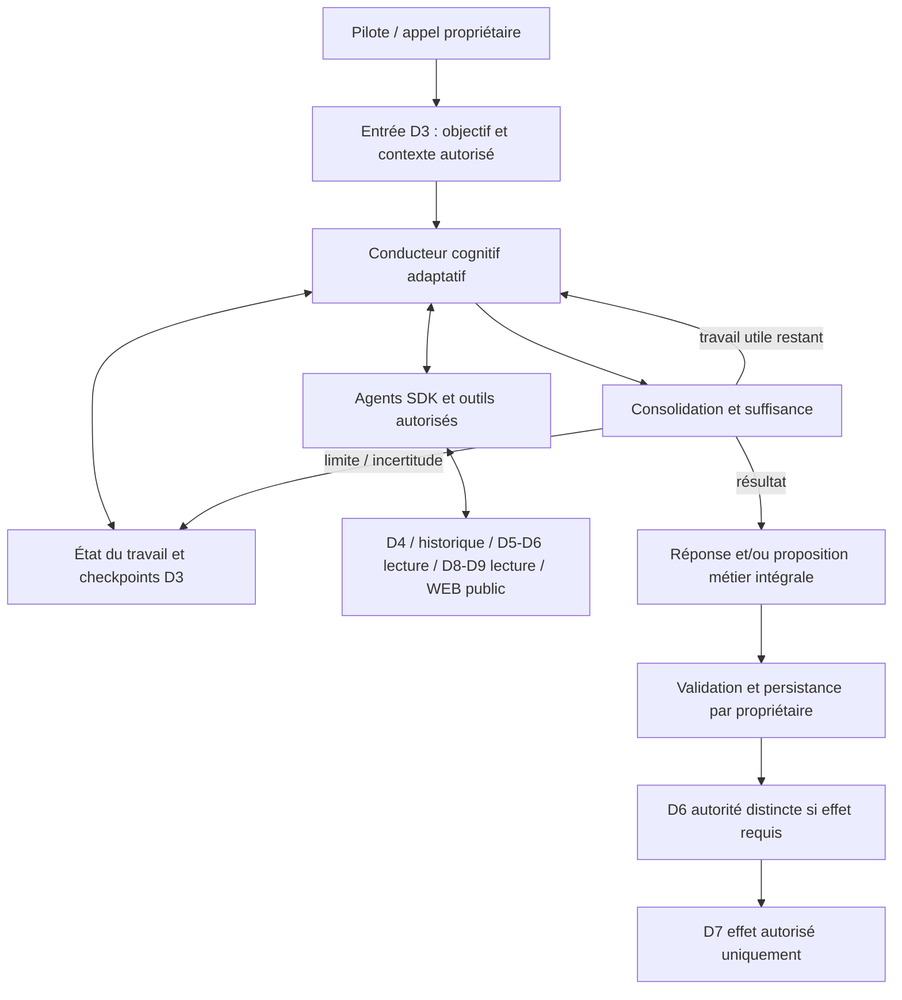

# SFIA Studio Next — ML5 : conception intégrée du conducteur cognitif et de la production Nora

| Champ | Valeur |
|---|---|
| Date | 24 novembre 2026 |
| Périmètre | R5 / ML5 « Réalisation technique gouvernée avec Cursor » — lot de convergence 1 de la revue post-C14 §9 |
| Nature | Complément de conception et contrat de réalisation du périmètre cognitif ; ni nouveau macro-lot, ni nouvelle doctrine, ni registre de couverture concurrent |
| Autorité | Morris : option B (conducteur adaptatif), option C (persistance cognitive D3 dédiée dans PostgreSQL), option C (production adaptative indépendante de la réponse) validées explicitement en conversation ; GO de principe de construction du lot et GO Git pour ce nouveau document |
| Statuts | **VALIDATED IN CONTENT** pour ces trois orientations ; **DOCUMENTED / CANDIDATE** pour la déclinaison ci-dessous ; choix physiques détaillés à qualifier sur le code local ; aucun IMPLEMENTED, COVERAGE VERIFIED, BEHAVIOR PROVEN ou ADOPTED induit |
| Base documentaire | `main@997897fd7cf914771e7d08e8030dc7123fab7d25` ; branche de conception `sfia/next-nora-cognition-cursor-contract-candidate@017a77e9b4cba12ff3cacb41873bbbdf64822d64` ; branche de conformité `sfia/next-ml5-conformity-acceptance-candidate@37edb41329526d07134a802f8f73e7371c941c16` avant création |
| Source technique | Review Handoff `78f60e40f466b520ac0381d5d27e212bd2fa5695`, blob `01961de12b10dc1d8802a2ba24bc5095a51b4949` (237 fichiers, snapshot post-C14). Code local de la branche `sfia/next-ml5-integrated-delivery-20261123`, HEAD rapporté `6cf33e9923796974b9ee540a9c6ff27110342950`, 97 DIRTY rapportés ; worktree **NON OBSERVÉ** par ChatGPT, ref distante non résolue |
| Autorisation | Création de ce fichier seulement, sur branche documentaire de conformité existante ; pas de modification des autres sources, publication de code, PR, merge, cutover, promotion, release ou ADOPTED. Mandat Cursor instancié séparément sous SFIA v2.6 ; aucune opération externe induite |

## 1. Rattachement canonique et continuité ML5

Ce complément **précise la réalisation** des axes A (cognition), B (WEB), C (activité), D (contrat) déjà définis dans ML5. Il ne remplace ni la spécification fonctionnelle, ni l'architecture initiale, ni le registre, ni le contrat d'acceptation. La capacité suivante reste la réalisation et restitution autonomes (lot 2), puis la qualification intégrée (lot 3), **dans le même ML5**. Le but est de finir le produit engagé, pas de démarrer une nouvelle reconstruction.

### Sources opposables et lecture prioritaire

- [SEF v0.2](../governance/SEF.md) §§4–7, 9–10 ; [Roadmap](../governance/roadmap.md) ; [convention de nommage](../governance/product-naming-conventions.md) ; [ADR R4-01..04 et DATA-01](../governance/decisions/2026-11-04-r4-architecture-exit.md). PostgreSQL unique, module D3, propriétaires D1–D9, continuité V-A, intégrité et contrôle humain demeurent.
- [Spécification fonctionnelle ML5 actualisée, §§3–7, 13, 20–22](https://github.com/mcleland147/sfia-workspace/blob/017a77e9b4cba12ff3cacb41873bbbdf64822d64/projects/sfia-studio-next/conception-fonctionnelle/preparation-cognitive-et-realisation-technique-gouvernee.md), blob `fcad5935ab9b30d347b549a79f5a9812dcbd3b13`.
- [Architecture ML5 actualisée, §§15–21](https://github.com/mcleland147/sfia-workspace/blob/017a77e9b4cba12ff3cacb41873bbbdf64822d64/projects/sfia-studio-next/architecture-technique/qualification-ecarts-cognition-transverse-et-execution-cursor-ml5.md), blob `75b2fe926bb9ed39ad14b055aca9d1e1cfbda526`. Le présent complément prolonge spécialement §15 et §21.1–21.5, sans remplacer les contrats B1/C1/D ni les exigences antérieures.
- [Décision Git A / session DEV locale](https://github.com/mcleland147/sfia-workspace/blob/017a77e9b4cba12ff3cacb41873bbbdf64822d64/projects/sfia-studio-next/governance/decisions/2026-11-23-ml5-cursor-git-direct-et-session-dev-automatique.md) ; R-004 (interdiction des déclencheurs lexicaux décisionnels), dans les addenda précités.
- [Revue approfondie post-C14](../construction/ml5-revue-approfondie-conformite-post-c14.md) §§3–10, blob `54a77c4dc61c4a4a886f55b0a93cd51cfba9955e` ; [registre unique des 99 exigences](../construction/ml5-registre-couverture-et-revue-developpement.md), blob `2c2485630332d91863ab7acb9f35e655503a131f` avant contribution ; [contrat d'acceptation](../construction/contrat-acceptation-cognition-et-realisation-gouvernee.md), blob `50d3125a94c0782644d9372a82fa8935285c1b31`, en particulier §8. Les IDs A–I, Q-01…56, T-01…12, CA-01…10 et PF propriétaires restent les références ; aucune nouvelle matrice normative.
- [Snapshot post-C14](https://github.com/mcleland147/sfia-workspace/blob/78f60e40f466b520ac0381d5d27e212bd2fa5695/sfia-review-handoff/latest-chatgpt-review.md). Les constats statiques ne sont pas des observations runtime. Les preuves C1–C14 restent bornées à leurs scénarios.
- R2 propriétaires sur main : [D3](../conception-fonctionnelle/contexte-et-conduite-gouvernee-de-nora.md), [D4](../conception-fonctionnelle/connaissance-sujets-et-continuite-du-projet.md), [D5](../conception-fonctionnelle/trajectoire-cycles-et-guidance-cki.md), [D6](../conception-fonctionnelle/decisions-et-gouvernance-du-pilote.md), [D7](../conception-fonctionnelle/realisation-operationnelle-gouvernee.md), [D8](../conception-fonctionnelle/resultats-et-preuves.md), [D9](../conception-fonctionnelle/integration-git-gouvernee.md). ENV-01, versioning et contrat d'observabilité transverse restent applicables.

**Écart documentaire connu :** les deux branches candidates divergent (ancêtre commun `0f1d37c3b055371c84c1f30e9bebe3d0efee41b2` ; comparaison conception→conformité : +5/−3 commits avant contribution). La branche de conformité contient les versions antérieures de l'architecture et de la spécification, sans leurs derniers addenda ; les liens figés ci-dessus désignent donc les versions applicables. Le présent ajout se place à côté du registre et de la revue consolidée, sans créer une troisième branche, ni merger, ni remplacer des fichiers. Cursor réconcilie les copies locales et les sources approuvées dans le même travail sans écraser les modifications C1–C14 ; intégration distante des branches sous GO séparé. Roadmap main : Gate C OPEN dans son instantané E08 ; registre candidat : Gate C accepté avec réserves et GO ML5 du 23/11. Ce décalage documentaire n'est ni une révocation de la décision ni une autorisation de merge.

## 2. Résultat et périmètre de convergence

**Résultat Pilote :** Nora traite une demande simple directement ; pour un travail complexe, elle comprend, investigue, approfondit, adapte ses moyens, conserve ses acquis et termine un résultat intégral, ou expose une suspension honnête et reprend sans perdre ce qui est établi. Cela fonctionne dans le sas, le projet, la connaissance/documentation, le pilotage/décisions, la préparation technique et le bilan. Le Pilote ne découpe pas une demande selon les limites du fournisseur.

**IN** : conducteur D3 commun (A01–A12), sources D4/historique/Git/D8, frontière WEB B1 (B01–B09), activité existante C1 (C01–C08), production intégrale et contrat/READY (D01–D08 selon impact), non-régression des autres familles et propriétaires, sécurité, tests, documentation et preuve. Prioriser P0 : frontière d'egress et accès, suffisance/READY, identité/version/ownership. Aucun recours à Cursor par Nora pour une tâche intellectuelle qu'elle peut conduire elle-même.

**OUT** : automatisation complète terminal→handoff→D8/D9→avis (lot 2) ; réécriture D7/D8, nouveau publisher Git, gestionnaire MCP, refonte UX F2, nouvelle lane, migration RECETTE/STABLE, publication du code produit, PR/merge, release, adoption. Les risques P0 rencontrés à une interface sont bloquants pour son usage ; les risques hors périmètre sont tracés, non réputés fermés. La qualification de lot 1 ne vaut pas qualification complète ML5.

## 3. Préservation du capital C1–C14

Réutiliser, corriger et éprouver les éléments présents ; ne supprimer ni substituer un mécanisme éprouvé sans motif et preuve de non-régression. Les références de détail et de preuve restent le registre et la revue §8, pas une reclassification nouvelle.

| Capital | Réutilisation et garde-fou |
|---|---|
| C1–C8 : construction progressive des axes A/B/C/D, état d'investigation, outils et provenance, projection d'activité, contrat et contrôles serveur, frontières Git/DEV, handoff initial | Examiner le contenu local et les tests avant changement ; prolonger les responsabilités existantes. Le statut rapporté C6 1/92/6 est historique. Les contrôles partiels ne deviennent pas preuves globales. |
| C9/C10 : qualification SDK sandbox, parcours BROWSER scripted, vue 50/50, inspection, Oui/Non, quatre onglets et retour contextualisé | Préserver l'accès et les interactions minimales. Pas de nouvelle UX concurrente. F2 reste dû selon gate UX, pas revendiqué. |
| C11 : Agents SDK LIVE, D6 refus et autorisation, Cursor SDK LIVE, témoin de fichier, handoff et avis Nora | Conserver adaptateurs, D6, identité et tentative ; intégrer le futur conducteur au point d'entrée avis, sans prétendre automatisation de la chaîne D8. |
| C12 : second module, ACK-first/reconnexion, identité stable, DROP_ACK déterministe, analyse Nora | Pas de redispatch ou de rejeu d'effet en reprise cognitive ; distinguer déterministe et panne réelle. |
| C13 : run long et STOP LIVE sans navigateur, superviseur in-process, confinement statique D8, provenance ; 72 unitaires et 17 PG ciblés rapportés | Ne pas réécrire les mécanismes D7 pour ce lot. Préserver les contrôles, ne pas prétendre reprise boot ou confinement concurrent déjà prouvés. |
| C14 : neutralisation de déclencheurs lexicaux, outil sémantique de préparation, WEB LIVE raccordé, DRAFT et refus sans READY ; 31 tests unitaires rapportés | Étendre la conduite sémantique, le fournisseur public, l'activité et les contrats existants ; ne pas revenir à un détecteur, au fallback lexical ou à un nouveau moteur. |

Références de preuves bornées : [C11](https://github.com/mcleland147/sfia-workspace/blob/f9dfcaaad90470e046d95a9d0a93115341a750d3/sfia-review-handoff/latest-chatgpt-review.md), [C12](https://github.com/mcleland147/sfia-workspace/blob/45311f75dad80e19f76ae09adfb1da387514531f/sfia-review-handoff/latest-chatgpt-review.md), [C13](https://github.com/mcleland147/sfia-workspace/blob/e3ed518b55ecda9430c862cda063052f94da8e7c/sfia-review-handoff/latest-chatgpt-review.md), [C14](https://github.com/mcleland147/sfia-workspace/blob/47a4bdbe2690c09023f130e0b8c1d8c9295d9480/sfia-review-handoff/latest-chatgpt-review.md). Présence post-C14 rapportée 2 IMPLEMENTED / 97 PARTIAL / 0 NOT_IMPL (E13, B09) : ni pourcentage d'avancement, ni couverture de conformité indépendante.

## 4. Arbitrages de conception validés en contenu

| Décision | Retenu | Alternatives écartées pour ce périmètre |
|---|---|---|
| Conduite — B | Un conducteur D3 adaptatif, un ou plusieurs segments techniques Agents SDK pour le même travail logique. | Run unique simplement agrandi ; orchestration multi-agents généralisée. |
| Continuité — C | Persistance dédiée aux travaux cognitifs D3 dans la base PostgreSQL active ; identité distincte du tour, checkpoints versionnés. | Snapshot unique de préparation comme autorité ; stockage de toute la cognition dans les seules commandes de tour. |
| Production — C | Mode de production adaptatif du même conducteur ; résultat métier intégral distinct de la réponse conversationnelle. | Appel unique obligatoire ; découpage systématique section par section. |

Les décisions valident les **responsabilités et invariants**, non un nombre de tables, une queue distribuée, un modèle précis ou un API fournisseur non observé. Le choix physique minimal, le plan de migration et le cycle de vie serveur sont détaillés par Cursor au préflight ; STOP si un pivot, un nouvel environnement, une nouvelle frontière d'autorité ou une politique globale de coûts/sécurité doit être arbitrée. Aucun nom de classe/table illustratif n'est imposé. Convention de nommage validée : responsabilité durable, pas de nom permanent par cycle/chantier historique.

## 5. Architecture logique : un seul conducteur D3

Schéma logique, pas une séquence métier obligatoire. Un traitement simple peut terminer dans le premier segment. Les fonctions de qualification, conduite, continuité, production et restitution sont des responsabilités internes du même D3, non des services autonomes. Le conducteur peut revenir aux sources durant la rédaction.

### Interfaces et raccordement à l'existant

Chemins relatifs à `web/src/domains/` sauf mention. Les noms actuels sont observés dans le snapshot, leur existence/état local sont à confirmer.

- `conversation/nora-adapter.ts` et `cognitive-policy.ts` : adapter SDK, politique et budgets ; remplacer le profil fixe analyse/medium (snapshot L809–818) par allocation sémantique et ressources contrôlées. Préserver fournisseur, classification d'erreur et refus de retry aveugle après contact incertain.
- `conversation/service.ts` (L20121–20272) : entrée principale, réserver/identifier le travail et transmettre le contexte propriétaire ; ne pas limiter la compréhension aux six extraits de 200 caractères et cinq titres ; ne pas masquer un échec de production dans un catch silencieux.
- `conversation/intent-conduction.ts` (L13150+) : continuation sas→projet ; utiliser le même conducteur avec contexte et droits résolus, pas un chemin simplifié sans outils ; préserver corrélation, effet D2 et D4 existants.
- Route `app/api/projects/[projectId]/realization/attempts/[attemptId]/qualification/route.ts` (snapshot L46833+) : avis Nora via même conducteur, contexte exact de tentative/qualification/rapport ; conserver avis consultatif et versionné. L'automatisation terminale relève du lot 2.
- `conversation/semantic-qualification.ts` : conserver qualification structurée et frontières propriétaires ; dissocier contenu long de l'enveloppe conversationnelle. Pas de fallback lexical sur sortie invalide.
- `conversation/investigation-state.ts`, `investigation-persistence.ts`, `tool-source-journal.ts` : compléter l'état, remplacer la persistance générique comme autorité, conserver observations versionnées ; voir §7.
- `conversation/turn-command.ts` : identité de tour, fencing transactionnel, heartbeat et replay ; réutiliser les mécanismes adaptés sans confondre tour et travail. `activity-projection.ts` : conserver projection/polling et événements réels.
- `document/service.ts` : création/révision, corrélation et provenance scellée ; D4 reste propriétaire du document. `knowledge/service.ts` : capitalisation sélective et sujets ; pas de mémoire projet concurrente.
- `conversation/nora-contract-bridge.ts`, `execution/nora-contract-prepare.ts`, `technical-contract-server-ready.ts`, `technical-contract-fingerprint.ts`, `technical-contract.ts` : raccorder le résultat métier spécifique, supprimer assemblage générique substitutif et troncatures, qualifier DRAFT/READY lié au travail et à la version ; préserver structure canonique, D6 et D7.

## 6. Allocation et conduite adaptatives

Le serveur résout d'abord identité, scope, lane, outils réellement accessibles et politique de ressources. Nora qualifie sémantiquement intention, résultat, risques, profondeur et stratégie. La qualification initiale peut être intégrée au premier segment pour une demande simple ; aucun appel de classification obligatoire pour chaque message. La mobilisation effective du modèle/effort et la possibilité de reprendre/changer de paramètres dépendent du SDK installé : vérifier lockfile, API et signaux exposés, ne pas inventer de capacité. Un effort initial révisable n'est pas une règle métier fixe.

Pour une continuation, Nora fournit une synthèse de travail exploitable : objectif, acquis référencés, questions, lacunes, contradictions, restrictions, résultat partiel, besoin et justification de moyens supplémentaires. Le serveur valide forme, périmètre, consommation et possibilité de continuer. La décision cognitive de poursuivre n'est pas une condition regex, nombre de caractères ou quota de critères. Rechercher la valeur informative marginale, éviter la répétition sans progrès ; si aucune continuation utile ou permise, terminer partiellement/suspendre. Une boucle technique déterministe peut garantir la sécurité et la gestion des ressources sans déterminer le sens de la demande.

### 6.1 As-built — finalisation cognitive ciblée (A/B/C/D, ML5)

Mécanismes runtime (pas une refonte du conducteur) :

- **A — Qualification sémantique** : `investigationMode` (`TARGETED`|`EXHAUSTIVE`|`OPEN`) et `investigationSufficiency` (`SUFFICIENT`|`INSUFFICIENT`|`UNKNOWN`) dans la qualification structurée ; profil / largeur / note-from-prior via champs et intents, jamais via mots-clés (« 50 », « exhausti », regex de note).
- **B — Identité et couverture** : clé canonique de chemin complet (`canonicalSourcePathKey`) ; inventaire `inventoryKeys` ; `CONSULTED`/`VERIFIED` ≠ `PARTIAL` ≠ `DENIED` ; périmètre fixé non gonflé par découvertes ; aucune exception « near-complete ≥50 ».
- **C — Capitalisation** : `upsertConclusion` / empreinte normalisée (reformulation ≠ progrès) ; parent d'acquis par pertinence sémantique (pas le seul compteur de révisions) ; `NEW_PRODUCTION_FROM_PRIOR_ACQUIS` sur intents/relation structurés.
- **D — Terminaison** : `COMPLETE`/`AWAIT_PILOT`/`SUSPEND` respectés même si inventaire incomplet ; suffisance Nora déclenche phase de restitution ; réserve de restitution réellement consommable (`RESTITUTION_PHASE`, soft-stop ≠ abandon) ; seuil 1M pose `REEVAL_THRESHOLD_1M` et restreint la stratégie, pas seulement un texte dans `remainingWork`. Calibration nominale inchangée : 2M / 1M / 120.

Distinguer : limite d'un segment, fenêtre de contexte ou limite de sortie fournisseur, validation structurelle, politique financière et de sécurité globale administrable. Le dépassement de segment ne clôt pas un travail ; la limite globale ne se réinitialise pas silencieusement entre générations. Mesurer appels, durée, tokens entrée/sortie/cache/raisonnement si exposés, coût estimé ou observé avec provenance, modèle/effort demandés et appliqués distincts ; indisponibilité explicite. Inclure appels WEB et lectures. Pas de nouveau plafond métier arbitraire ni augmentation aveugle. Tester calibration simple vs complexe avec mesure, pas un benchmark de tokens inventé.

## 7. Continuité et persistance cognitive

### 7.1 Contrats logiques

Un travail possède une identité stable, son Pilote et scope préparation/projet, objectif, références de tours et générations, état consolidé, révision, checkpoints et résultat(s) liés. Un tour identifie une interaction/idempotence ; une génération identifie un appel fournisseur. Un travail peut se poursuivre sans nouveau tour, ou après intervention Pilote ; un nouveau sujet ne doit pas réutiliser l'état d'une autre investigation. Nora propose le rattachement sémantique ; le serveur vérifie propriété, scope et identité. Si ambiguïté déterminante, clarification ciblée. Pas de routage lexical. La continuité sas→projet respecte V-A, sans copie de fil ni changement de propriétaire implicite.

Quatre vérités distinctes : D3 conversation ; D3 état cognitif (temporaire ou durable selon besoin) ; D4 connaissance durable du projet ; D6–D9 autorité, effets et preuves. L'état de travail n'est ni un journal de raisonnement privé ni une preuve ni une décision. Capitaliser D4 selon règles existantes, jamais convertir une hypothèse en fait ou une recommandation en décision.

Checkpoint minimal : identité travail/tour/génération et propriétaire, révision et parent, objectif/résultat, état et cause de limite, questions déterminantes et réponses justifiées, sources effectivement lues (révision/plage/couverture), conclusions et hypothèses, contradictions, restrictions et références d'autorité, travail restant, production partielle/version, usage connu, références nécessaires à la reprise. Persisté à progrès significatif et aux frontières de segments/arrêt maîtrisé. Ne pas stocker des chaînes privées, prompts bruts indiscriminés, secrets ou des copies intégrales de sources privées inutiles ; appliquer DATA-01 et minimisation à tout checkpoint et diagnostic.

### 7.2 Contrôle de concurrence et reprise

Un seul écrivain applicable à un travail/révision ; lease/fence et compare-and-set transactionnel sur la version, transitions atomiques et corrélation de sortie. Réutiliser les principes de `turn-command.ts` (ownerToken, fencing, transaction, heartbeat), en distinguant les propriétaires travail/tour ; préciser ordre de verrouillage et ne pas garder une transaction ouverte pendant l'appel fournisseur. Les générations tardives ne peuvent ni écraser un checkpoint plus récent ni publier un objet après perte d'ownership. Relecture/replay idempotent, effet métier référencé par son identité canonique, pas de duplication.

Un arrêt/restart, une fermeture/reconnexion, un dépassement de segment, une limite globale ou une interruption fournisseur restent distincts. Le produit reprend les travaux éligibles depuis le dernier checkpoint durable après revalidation de scope, droits, restrictions, sources et état réel du fournisseur. Le navigateur n'est pas l'autorité ni l'unique déclencheur de continuité interne ; démontrer reprise serveur. Si contact fournisseur incertain, réconcilier et signaler l'incertitude ; aucune relance aveugle ni rejeu d'effet. Si continuation légitime d'une étape read-only, nouvelle génération corrélée après qualification ; ne pas prétendre disposer d'une réponse perdue. Une demande suspendue pour limite globale/ambiguïté peut nécessiter intervention explicite du Pilote. Ne pas présenter un travail comme actif sans exécuteur observé.

### 7.3 Persistance physique et transition

La décision C autorise une persistance D3 dédiée dans PostgreSQL, pas une seconde base. Cursor identifie le schéma réel, migrations, contraintes et conventions, propose le minimum compatible avec les invariants ; utiliser identités/relations, révision et données structurées avec transactions. Définir plan de migration DEV et restauration avant modification, conservation des commandes, messages, connaissances, contrats et preuves ; pas de suppression de données ni de migration protégée. Les snapshots historiques `preparations.projection_json.ml5InvestigationSnapshot` peuvent être conservés comme traces/import contrôlé si l'identité et provenance sont établies. Si ambiguës, ne pas les rattacher automatiquement ni les utiliser pour READY : requalification. Bascule vers une unique vérité de travail D3, retrait de l'écriture concurrente de l'ancien snapshot ; compatibilité de lecture transitoire seulement avec exit explicite. Pas de double-write durable ni reprise de statut suffisant par défaut. Tester deux travaux dans même préparation, accès croisé refusé, redémarrage, concurrence, perte de lease et migration non destructive. R4-02 et DATA-01 applicables ; durées ou mécanismes nouveaux nécessitant arbitrage ne sont pas décidés ici.

## 8. Contexte, sources, sécurité et activité

**Contexte progressif :** demande et périmètre courant ; état consolidé ; connaissance D4/CKI/décisions pertinentes ; outils de lecture à la demande. Ne pas charger tout le projet par défaut. La présélection existante reste un amorçage, jamais une limite de compréhension. Nora approfondit, suit les renvois, qualifie ce qui reste inconnu. Compaction conserve références, désaccords, restrictions et questions ; ne pas perdre les éléments déterminants lors d'une réduction de contexte.

**Sources :** réutiliser `d4-read-tools.ts`, `history-tools.ts`, `git-read-tools.ts`, lecture D8 et B1. Rendre lecture progressive réelle (sections/plages/pagination, version/commit/révision, contenu utile, complément). Ne pas confondre résultat de recherche, ouverture, extrait, couverture consultée, fait établi, source applicable et vérification. Absence de match lexical n'est pas absence démontrée. Le journal de sources doit conserver observations et révisions, distinguer couverture cumulée et état courant ; une révocation, nouvelle révision ou contradiction peut dégrader une source auparavant consultée. Réouvrir uniquement conclusions dépendantes. Un compteur global d'appels ne prouve pas une pièce. Supprimer le classement monotone qui masque les dégradations, sans inventer lecture ou fait.

**WEB B1 (P0 avant sortie)** : garder le fournisseur raccordé C14. Public/fictif uniquement DEV tant que sécurité et confidentialité ne sont pas qualifiées. Construction des requêtes publiques séparée du contexte privé, contrôle au point d'egress ; ne pas transmettre texte privé, données projet, secrets, historique ou checkpoint au fournisseur public. Contrôle des destinations réellement contactées (HTTP(S), DNS/résolution et connexions, IP privées/locales/métadonnées, redirections contrôlées, accès indirects), délai sur lecture complète et limite effective du flux, pas de téléchargement intégral avant coupe, pagination/lecture utile et provenance. Référence issue de recherche ou URL explicitement autorisée et contrôlée. Sources externes non fiables = données, pas instructions ni autorité. Vérifier injections, accès et minimisation dans logs, événements, traces, diagnostics, prompt Cursor et toutes sorties concernées ; pas d'extension des droits de fournisseur. Confrontation sémantique des versions, dates, périmètres et contradictions ; indices lexicaux possibles comme aide de navigation, jamais comme décision cognitive. Si sécurité non démontrable, bloquer l'usage concerné et conserver résultat honnête.

**Activité C1 :** conserver la projection et le polling existants. Événements corrélés Pilote/conversation/travail/tour/génération et version, ownership obligatoire pour writers applicatifs, ordre, accès, reconnexion ; annoncer vs observer vs terminer vs incertitude. Mettre à jour lors d'une dégradation/requalification source. Ne pas inventer un pourcentage, un progrès, un outil utilisé ou un raisonnement privé ; aucune journalisation brute d'informations sensibles. Un défaut du canal d'activité ne fabrique pas une vérité de travail. En cas de panne, restituer l'état réellement persistant.

## 9. Production adaptative et propriétaire du résultat

D3 produit une réponse conversationnelle et/ou une proposition d'objet métier à partir du même travail. Le format dépend du résultat demandé ; un seul appel si suffisant, plusieurs segments si nécessaire. Un document, contrat ou rapport volumineux ne doit pas transiter obligatoirement par `replyDraft` ou dépendre de la taille d'une sortie structurée unique. Si des parties sont produites séparément, identité et révision de la production, ordre, dépendances, complétude, consolidation et relecture globale ; aucune concaténation mécanique se substituant à la cohérence intellectuelle. Si une information manque durant rédaction, reprendre les sources. Ne pas fabriquer une deuxième vérité de document/contrat : état D3 en cours de travail, résultat canonique dans le domaine propriétaire.

Préserver `NoraTurnQualificationSchema` et l'autorité des propriétaires ; adapter les interfaces de production structurée selon les contraintes réelles du SDK/Zod. Les bornes techniques de validation peuvent subsister sur un segment/objet d'enveloppe, mais ne doivent pas tronquer ni plafonner arbitrairement le résultat métier. Préserver la différence entre champ absent (non réévalué) et liste vide (réévaluée sans élément). Un échec de production est visible, partiel ou suspendu, jamais simple succès conversationnel masquant le défaut.

D4 : sauvegarde/révision explicite selon contrat existant, provenance/corrélation/idempotence et versions ; une proposition D3 n'est pas un document enregistré. D5 : proposition de trajectoire, CKI et autorité inchangées. D6 : HumanDecision uniquement selon acte humain requis. D7 : contrat technique inspectable/versionné. D8 : dossier/qualification propriétaire, avis Nora consultatif. Les autres domaines restent des interfaces ; ne pas construire un nouveau moteur d'écriture.

### 9.1 Contrat technique, intégralité et permissions

Préparer un contrat sur demande sémantique positive, GO de préparation ou mandat correctif existant exact et borné (A03–A05). Une négation, une hypothèse ou une simple explication n'autorise ni production métier mutative ni dispatch. Un brouillon correctif peut être proposé dans un mandat existant réellement vérifié, jamais par marqueur textuel seul ; nouvelle portée, restrictions, échec répété → requalification. Aucun dispatch automatique. Préserver quatre engagements, six volets, instruction intégrale, risques/exclusions, critères spécifiques, preuves attendues, capacité/permissions/STOP/réversibilité, Git/MCP conditionnels. Le contenu est issu des acquis et du résultat utilisateur, non d'une phrase générique ou de la reprise tronquée du texte conversationnel. Supprimer plafonds arbitraires observés (24 000 caractères d'instruction, 8 critères dérivés, mission 800 chars comme limite de contenu) sans supprimer les protections de transport et de sécurité ; produire réellement plus long lorsque requis et vérifier intégralité. Un aperçu UX n'est jamais le corps transmis.

D6/D7 conservent les interfaces propriétaire, mandat exact, point de dispatch et contrôle de permissions. Git option A : Cursor opère les mutations couvertes par son mandat, D9 lit indépendamment ; aucun publisher code Studio ; ML4 publication documentaire inchangée. Les opérations Git/MCP effectives restent conditionnelles à la mission et aux autorisations. Le conducteur ne peut pas contourner cette frontière.

### 9.2 Suffisance positive et contrat READY

DRAFT peut être inspectable avec limitations, questions ouvertes et état partiel explicites ; READY exige une qualification positive, pas l'absence de blocage renseigné. Revoir le chemin actuel qui peut refuser toute création DRAFT si insuffisant : permettre l'inspection honnête sans rendre exécutable. Pour READY : objectif/résultat compris, questions déterminantes résolues avec provenance utile, sources nécessaires/version/couverture établies, restrictions applicables vérifiées, contradictions matérielles traitées, contrat complet et critères spécifiques, droits/permissions pertinents. Une qualification absente, UNKNOWN/BUDGET_EXHAUSTED, état vide, mauvais travail, source critique manquante ou restriction inconnue ne devient pas READY. Pas de checklist lourde pour les conversations simples.

Relier la suffisance à l'identité du travail et à sa révision/checkpoint, au contrat exact (id/version/fingerprint) et aux dépendances matérielles. Le serveur valide positivement cohérence, identité, version, droits et autorité ; un booléen client ou une auto-déclaration Nora ne suffit pas. Réévaluer les dépendances déterminantes à READY, à autorisation et au point d'effet ; pas de retour idempotent READY obsolète. Les lectures et transitions concurrentes doivent être protégées contre un snapshot périmé. Changement matériel → nouvelle qualification et mandat de la nouvelle version si requis. Garder trace de l'ancienne version/autorité sans la réutiliser. Vérifier l'identité exacte des octets UTF-8 de l'instruction inspectée/autorisée/transmise avec empreinte canonique, pas seulement le titre ou un compteur. D6 Oui/Non et D7 dispatch séparés ; Non sans effet. Une panne de vérification signifie non prêt, pas conformité supposée. La qualification cognitive ne vaut pas preuve de réalisation.

## 10. Contrat d'acceptation du lot — références existantes, preuves discriminantes

La matrice suivante **rattache** des scénarios à la couverture existante, elle ne remplace pas les CA/T/Q/PF ni les 99 lignes. Chaque preuve précise ref/worktree/build, scénario, mode, commandes/conditions et résultat/artefact, données fictives/publiques, limites et verdict. Utiliser fixtures uniquement pour propriétés déterministes ; démontrer les comportements cognitifs en DEV LIVE (pas simulateur), et les interactions utiles en BROWSER. Les seuils de reproduction d'un test (ex. >24k chars) éprouvent une limite historique, pas un plafond fonctionnel. Préserver les preuves antérieures tant que la frontière n'a pas changé ; rejouer selon impact.

| Exigences existantes | Scénarios et oracles du lot 1 |
|---|---|
| A01–A02, A12, CA-01 | Demande simple utile, pas de délégation ou recherche artificielle ; demande complexe, paraphrases/négations, allocation réellement différenciée et évolution selon besoin ; usage réel et incertitude explicite. Limite de segment atteinte → continuation automatique du même travail si éligible, sans réinitialiser le budget global. |
| A03–A05, D01–D02 | Préparation positive, hypothèse/négation/explication sans préparation indue ; brouillon correctif uniquement avec mandat vérifié ; changement de portée non couvert → requalification. |
| A06–A10, B01–B05, CA-02/03 selon contrat | Plusieurs sources longues D4/Git/historique et rapport D8 selon scope, questions apparues tardivement, renvois, lecture utile et plages, contradiction et nouvelle version/révocation ; pas de lecture inventée, état de couverture exact, conclusions révisées. |
| A11–A12, C05–C08 | Deux travaux distincts dans une préparation ; même travail sur plusieurs segments/tours ; interruption, fermeture/reconnexion et redémarrage effectif serveur ; perte d'ownership/concurrence, ancienne génération refusée ; reprise sans perte d'acquis ni effet rejoué ; budget global épuisé → suspension explicite. |
| B06–B09 | WEB public LIVE au sein du travail Nora avec recherche et lecture effective ; injection, URL/destination interdite, DNS/redirect, timeout/flux bornés, données privées fictives interdites au point de sortie, aucun secret dans les traces ; pas de validation sur simple appel direct B1. |
| C01–C08 | Événements réels observés pendant travail, nature et source versionnée, dégradation, ordre, reconnect et isolation deux Pilotes ; aucune progression fictive ni trace privée ; réponse simple sans suractivité. |
| D01–D08, CA-04 | Document D4 simple et long ; contrat spécifique >24 000 caractères lorsque scénario le justifie et >8 critères utiles, tous présents ; exactitude inspecté/autorisé/transmis, échec de production visible, reprise et version sans doublon ; DRAFT partiel inspectable, état vide/épuisé/mauvais travail/source critique/révocation/contradiction → READY refusé ; requalification d'un READY matériellement changé. |
| D09–D12, E/G/F selon impact | Préserver Oui/Non (Non sans effet), autorité, refus, isolation et interfaces de dispatch/qualification ; Git A et pas de publication non autorisée ; avis Nora sur dossier exact sans prétendre chaîne terminale autonome. |
| H/I, CA/T/Q/PF applicables | Parcours fonctionnels sas/projet/document/contrat/bilan, accès lecture intégrale, retour conversationnel, usage DEV isolé, tests PG/API concurrence et migration, TypeScript/ESLint/build, suite propriétaire et ML1–ML4 selon blast radius. Pas de revendication F2 ni R6 globale. |

Vérifier les sous-critères et IDs CA/T/Q/PF exacts avec le contrat canonique avant exécution ; les regroupements ci-dessus ne modifient aucun oracle. Inclure le cas de production tardivement contradictoire, permissions retirées avant effet, impossibilité de lire et sécurité de l'auto-session DEV (écoute restreinte effective, auth normale ailleurs). Les tests LIVE en DEV exigent configuration réellement isolée et autorisations techniques explicites en vigueur ; aucune mutation GitHub REAL, MCP mutatif, données privées WEB, dispatch sur dépôt réel ou coût hors mandat induits. Si précondition absente, preuve NOT RUN/BLOCKED honnête et STOP sur effet concerné. Le test ne doit pas injecter manuellement un résultat pour masquer une étape produit manquante.

## 11. Blast radius, dette et conditions de sortie

| Surface | Risque / garde-fou / exit |
|---|---|
| D3 / SDK / API | Multiplication de runs et coûts, modèle non vérifié, attente HTTP, incompatibilité SDK/Zod ; contrôler consommation globale, lifecycle serveur, sortie stable, mesure et test simple/complexe. Vérifier la divergence de type toolAllowlist observée et compiler. |
| D3 / PostgreSQL | Collision, données perdues, snapshots anciens, migration ; version/fencing, sauvegarde/restauration DEV, migration non destructive, tests PG concurrence et reprise. Retirer ancienne autorité, exit de toute compatibilité transitoire. |
| D4/D5 | Contexte tronqué, doublons, mauvais projet, dérive capitalisation/CKI ; garder droits/provenance/corrélation propriétaires et régression. |
| D6/D7 | READY faux, ancienne autorisation, contrat incohérent, effet non permis ; bloquer par défaut si preuve/identité/permission manque, requalifier et vérifier au dispatch ; ne pas élargir permissions. |
| WEB / D8 / D9 / logs | Exfiltration, source hostile, lecture hors scope ; contrôle au point de sortie, confinement et minimisation, droits et actualité vérifiés ; pas de nouvel usage exposé avant preuve P0. |
| UX | Fausses activités ou faux succès, perte de lecture intégrale ; conserver parcours actuels, état honnête et relecture BROWSER. F2 non acquis, reste à sa recette. |
| Docs / Git | Sources candidates divergentes, 97 DIRTY et réserves historiques ; réconciliation ciblée sans écraser, pas de rebase/merge/push projet. As-built, architecture et registre mis à jour dans la même livraison selon faits et preuves. |

Exit du lot : résultat Pilote §2 effectivement éprouvé en DEV LIVE et interfaces BROWSER utiles, sécurité P0 du périmètre, aucune régression bloquante, preuves et réserves renseignées par exigence dans le registre unique, intégrité code/docs, limitation et dette résiduelle avec propriétaire et exit. **Les preuves non disponibles demeurent PARTIAL/NOT RUN/BLOCKED ; pas de promotion de statut par présence de fichiers.** Ne pas prétendre clôture ML5 ou acceptation de l'utilisateur. Le lot 2 consomme le conducteur versionné et la production/qualification fiables ; les preuves et le contrat de sortie restent réutilisables.

## 12. Préparation du prochain mandat Cursor

Morris a donné le GO de principe de construction de ce lot, distinct du mandat technique instancié. Avant changement, Cursor vérifie et restitue repo, branche, HEAD/base, statut local réel, staged/unstaged/untracked, provenance des modifications C1–C14, worktree, lane/DB, lockfile et dépendances SDK, état des migrations et des sources. Si divergence, ne pas reset, stash imposé, checkout destructif, cherry-pick automatique ou nettoyage arbitraire ; STOP pour arbitrage si identité/portée non sûre. Les fichiers de snapshot non couverts (notamment boot, lockfile, UI projet/contrat) sont à lire selon impact. Examiner les protections d'autorité existantes avant modifications.

Le mandat doit être produit depuis le routing guide et le template Git SFIA v2.6 applicables ; aucun template parallèle. Regrouper conception détaillée restante, code, migrations DEV bornées, tests, preuves et synchronisation documentaire de la capacité ; dimensionner selon risques réels, pas de nombre de cycles imposé. Un profil Critical est à justifier par persistance, autorité READY et sécurité egress ; routing final selon guide. Préflight et intégration/validation sont des gates à l'intérieur d'un travail cohérent, pas des microcycles documentaires. STOP si choix physique incompatible avec R4, migration destructive, droits non bornés, conflit de version, nouvelle politique propriétaire ou risque P0 non maîtrisé.

Review Pack complet mono-cycle, contenu créé intégral, modifications par sections/diff, tests et limites, reset du pack temporaire ; Review Handoff L3 selon SFIA v2.6 sur branche et chemin dédiés, SHA et relecture distante, distinct de toute publication du code projet. Synchroniser le registre, l'architecture et la documentation réellement affectés ; ne pas effacer les constats historiques. Aucun GO de PR/merge ou promotion, aucun ADOPTED automatique.

**Verdict de conception : ML5 LOT 1 — DESIGN ORIENTATIONS VALIDATED IN CONTENT / DOCUMENTED CANDIDATE / IMPLEMENTATION AND BEHAVIOR PROOF PENDING.** Les travaux C1–C14 sont la base à compléter. Le résultat de construction et la suite restent soumis à revue et décision Morris.

## As-built C15 (implémentation locale — 2026-11-24)

| Élément | Fait |
|---|---|
| Persistance | Tables `cognitive_works` + `cognitive_work_checkpoints` (mig 020) — vérité D3 active |
| Conducteur | `cognitive-conductor.ts` multi-segments + enveloppe globale |
| READY | Suffisance positive (intention, résultat, sources CONSULTED/VERIFIED, questions déterminantes) |
| Journal sources | Couverture non monotone (dégradation autorisée) |
| Contrat | Suppression plafonds 24k / 8 critères dans `draftBodyFromInvestigation` |
| WEB P0 | `web-egress-guard.ts` DNS + lecture bornée par flux |
| Legacy snapshot | Lecture compat uniquement ; écriture miroir seulement si `SFIA_COGNITIVE_LEGACY_MIRROR=1` |
| Preuves | units C15 + PG CAS/deux travaux ; LIVE complet lot 1 PARTIAL |

## As-built C16 — raccordement fonctionnel

| Champ | Valeur |
|---|---|
| Date | 24 novembre 2026 |
| Cycle | ML5 C16 Critical |
| HEAD baseline | `6cf33e9923796974b9ee540a9c6ff27110342950` DIRTY |
| Entrée produit | `runNoraCognitiveTurn` (service conversation, intent-conduction, qualification D8 avec préparation) |
| Conducteur | `runCognitiveConductor` — multi-segments ; `SEGMENT_INVOCATION_LIMIT` → SUSPENDED (plus de faux COMPLETE) |
| Ownership | claim refuse lease actif ; reclaim après expiry avec bump de révision + checkpoint CLAIM |
| READY | suffisance positive (réponse étayée, sources non dégradées) ; requalification même si statut READY ; legacy snapshot non autoritaire |
| DRAFT | préparable incomplet ; critères sans `slice(0,8)` ; instruction préférentiellement dédiée |
| WEB | DNS + `fetchPublicHttpsPinned` + timeout jusqu'à fin de lecture bornée |
| Preuves | units C16 5 PASS ; PG ownership 5 PASS ; units connexes 33 PASS (bundle ciblé) |
| Réserves | LIVE E2E product path (Next :3100) non rejoué dans C16 ; boot resume serveur non démontré bout-en-bout ; production documentaire multi-segments D4 PARTIAL |

Aucun nouvel arbitrage B/C/C. Aucune release.
