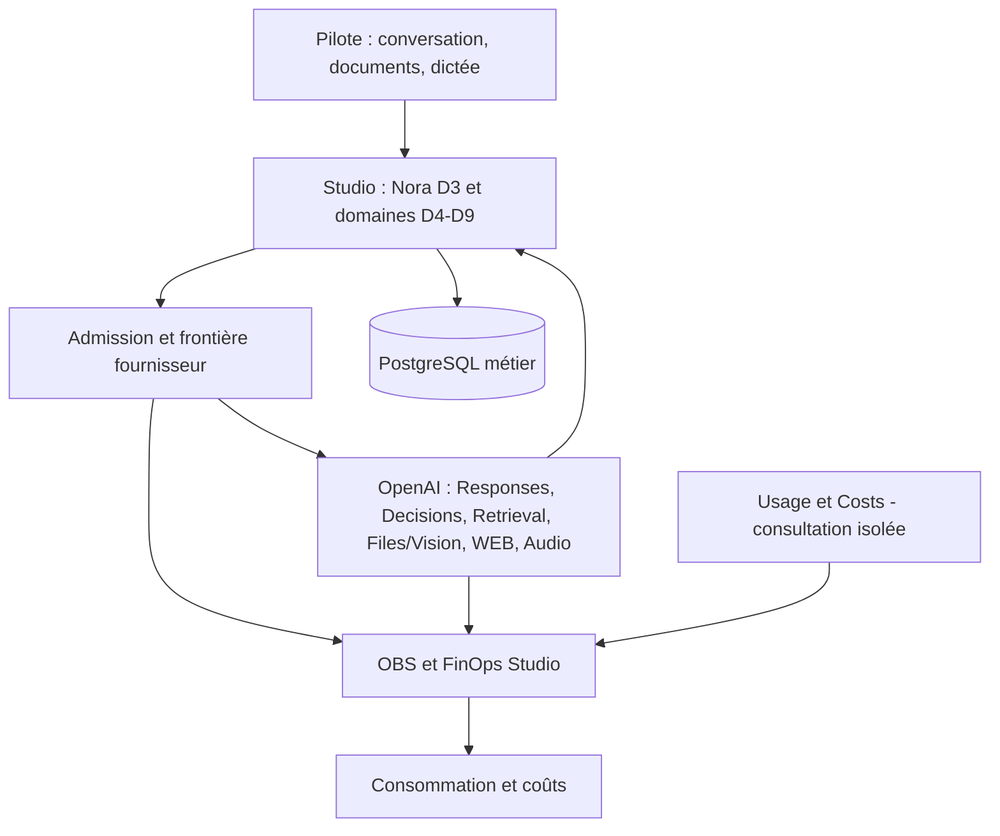

# Convergence OpenAI–Studio Next — Cadrage

> **Suivi 27/11/2026 — macro-lot 1 :** Morris accepte le socle DEV avec les réserves explicites et autorise la préparation du macro-lot 2. Voir le [bilan de clôture et la décision](cloture-macro-lot-1.md), qui distingue construction, preuve et régularisation du Handoff encore due. Le cadrage initial ci-dessous est conservé comme référence historique ; aucune promotion ou adoption.

| Champ | Valeur |
|---|---|
| Version / date | v0.1 — 26 novembre 2026 |
| Statut | DOCUMENTED — orientation produit et trois macro-lots approuvés en conversation par Morris ; dossier candidat pour revue collective |
| Nature | Cadrage de construction transverse R5 / ML5 ; non normatif, non mergé |
| Mandat | Morris autorise la création Git des trois documents de ce dossier avant revue de contenu ; aucun GO technique, changement de doctrine, PR, merge, activation ou cutover |
| Base documentaire | `8b334487597547484c756a135028f192d427fa88` (docs/next-ml5-uat-consolidation-20261124) ; main observé `997897fd7cf914771e7d08e8030dc7123fab7d25` |
| Candidat produit rapporté | `c574d2621a6ce7b5fec3727853185982b23ca3bf` ; web tree `5a1289fcfa26b1963f53ed1364dbd842e771e46c` ; BUILD_ID `Le9pyy4fbPKT_m0YlplAr` |
| Étude | Commit local docs `ae4aff22b023fea00be5ae1ec98c903d5fbbf145`, dossier blob `bb7995457ea3e40faa85968f7726e381878d6e97` ; [handoff complet](https://github.com/mcleland147/sfia-workspace/blob/460a121ff94bdfe08767a9870e7350e13f5d2a59/sfia-review-handoff/latest-chatgpt-review.md) (blob `89d4362cd82f639171220e63a64306f2e2031460`) |

## 1. Intention et résultat utilisateur

Faire évoluer Studio en exploitant les services natifs OpenAI lorsqu'ils couvrent mieux, ou au moins aussi bien, une responsabilité technique aujourd'hui réalisée par Studio. Conserver le fonctionnement nominal et la cohérence du produit ; améliorer l'investigation, la fiabilité, la lisibilité des consommations et l'expérience du Pilote. Éviter la duplication, le code compensatoire inutile, les moteurs parallèles durables et les remplacements par effet de mode.

L'orientation « natif d'abord » est validée par Morris le 26/11 : pour une fonctionnalité existante, choisir le natif si son équivalence ou sa supériorité est démontrée ; pour une fonctionnalité absente, l'intégrer lorsqu'elle apporte une valeur produit. Un service natif ne garantit pas mécaniquement une meilleure fiabilité ni une meilleure couverture. Les preuves, les droits et les conditions réelles d'usage déterminent le remplacement. Le coût par résultat utile compte, mais jamais au détriment de la qualité.

Le Pilote doit continuer à dialoguer avec Nora, investiguer, produire et consulter des documents, décider et suivre ses travaux sans apprendre le fonctionnement interne des API. Le choix technique ne doit pas créer un parcours utilisateur concurrent.

## 2. Situation de départ et limites de connaissance

Le candidat local ML5 a accumulé des preuves d'investigation Git, de production et de consommation, mais sa livraison n'a pas été acceptée. La trajectoire de livraison est suspendue pour cette convergence, selon l'arbitrage conversationnel. R5 IN PROGRESS / ML5 OPEN / R6 NOT STARTED / NO RELEASE / NOT ADOPTED ; RECETTE protégée, WEB LIVE OFF, livraison 2 non engagée. La Roadmap distante main et le suivi candidat du 25/11 ne matérialisent pas encore cette nouvelle orientation : aucune réécriture implicite de ces documents.

Le code local n'est pas accessible directement à ChatGPT. Le handoff de l'étude, publié et relu, fournit un inventaire statique du candidat ; les états runtime et les versions exactes devront être vérifiés par Cursor avant construction. Aucun schéma de vision binaire n'est déclaré inspecté. Les versions SDK rapportées sont openai@7.50.0, @openai/agents et @openai/agents-openai@0.21.0.

| Responsabilité / état rapporté | Existant | Convergence attendue |
|---|---|---|
| Cognition D3 | Conducteur, work, checkpoints, catalogue modèle/effort, Agents SDK + Responses | Enrichir les ressources et simplifier la gestion du contexte sans deuxième conducteur |
| Frontière fournisseur | Contrôle HTTP, admission, count natif, limites, campagnes | Réutiliser et généraliser la frontière aux nouvelles familles d'appels ; ne pas refaire les bornes déjà qualifiées |
| Observabilité | OBS métier, corrélation et instrumentation custom ; tracing SDK désactivé selon étude | Tracing natif filtré, retrait des seules redondances démontrées |
| FinOps | Ledger PostgreSQL, usages, estimations, tarifs, API et interface existante | Ajouter usages/coûts fournisseur réconciliés, étendre les catégories |
| WEB | Worker query-only, contrôle D6/B1, ouvertures directes, hosted bloqué | Mesure native des recherches facturables ; qualification des bornes ; isolation conservée |
| D4/D9 | Journal/recherche lexicale, lecture Git, provenance et droits | Recherche sémantique/hybride, sélection d'un index dérivé, conservation des sources exactes |
| PDF | Extraction pdfjs, visionneuse et droits ; cas scanné sans texte | Compréhension visuelle native en complément ou remplacement ciblé de préparation, jamais de la gouvernance |
| Decisions | Pas d'intégration native rapportée | Jugements bornés à disposition de Nora |
| Audio | NON IMPLÉMENTÉ dans le composer selon étude | Dictée éditable, transcription fichier puis qualification temps réel |
| D7/D8 | Contrats de réalisation et preuves ; livraison 2 non engagée | Évaluer Agents API/Codex face à Cursor avant choix d'exécuteur |
| Images génératives | Hors construction immédiate | Anticipation des dépendances seulement, horizon moyen terme ; Vision reste dans le lot documentaire |

## 3. Vision cible

Studio demeure l'application et le plan de contrôle métier. Nora qualifie les intentions et mobilise les capacités selon le besoin. Les domaines propriétaires conservent leurs objets, droits, effets, preuves et états durables. Les services OpenAI assurent des traitements spécialisés et fournissent leurs mesures natives. PostgreSQL reste la référence transactionnelle métier ; un stockage distant éventuel est une projection gouvernée ou un état technique d'inférence, jamais une seconde vérité sur les décisions, projets, droits, versions ou travaux.

Le diagramme est conceptuel : la consultation administrative est indépendante du chemin cognitif ; la transcription avant envoi ne crée pas de travail D3. Il ne prescrit ni nouveau microservice ni nouveau moteur. D6 demeure l'unique autorité humaine et D7/D8 restent distincts de l'exécuteur fournisseur.

## 4. Périmètre et trajectoire validée

Les trois macro-lots ci-dessous sont validés en orientation et ordre logique par Morris ; leurs noms décrivent une responsabilité et non une phase historique. Les contrats détaillés restent candidats.

| Macro-lot | Résultat et IN | OUT / dépendances | Sortie |
|---|---|---|---|
| 1 — Socle fournisseur natif et observabilité | Tracing, frontière multi-capacités, Usage & Costs isolés, FinOps, WEB, continuité native | Pas de Decisions produit, index documentaire ou audio ; gate WEB séparé | Socle mesurable, diagnostic fiable, rapprochement à périmètre égal, non-régression des travaux |
| 2 — Cognition spécialisée et intelligence documentaire | Decisions, catalogue étendu, sélection Retrieval/Embeddings/Vector Stores/File Search, Files/Vision, PDF | Pas de moteur permanent concurrent, audio hors lot ; dépend des interfaces d'admission/usage du lot 1 | Investigation plus pertinente ou équivalente, provenance, sécurité, preuves comparatives et retrait ciblé du code remplacé |
| 3 — Interaction audio avec Nora | Dictée, transcription, composer, qualification du mode temps réel, FinOps audio | Pas d'agent vocal autonome, génération d'image ou vidéo ; dépend du socle fournisseur | Pilote dicte, relit, corrige, annule et envoie ; texte nominal inchangé |

Le lot 3 peut être parallélisé avec le lot 2 seulement après stabilisation des interfaces communes et décision au moment opportun, pas de GO anticipé. Un intégrateur commun vérifie l'ensemble. Le choix de l'exécuteur technique (Cursor, Agents API ou combinaison justifiée) est instruit avant ML5 livraison 2 ; aucune modification du processus externe ChatGPT/Cursor SFIA v2.6. La génération d'images reste différée ; aucun lot de génération vidéo.

Après les trois lots : qualification intégrée, revue, périmètre et GO RECETTE spécifique, mise à disposition contrôlée, recette utilisateur, puis reprise de la livraison 2 sous arbitrage. R6, release, merge, promotion, adoption restent des gates distincts.

## 5. Règle de transformation de l'existant

Pour chaque responsabilité, inventorier le code effectif et ses consommateurs ; examiner le service natif et ses limites ; choisir KEEP / REUSE NATIVE / ADAPT / REPLACE / RETIRE / BUILD / DEFER / BLOCKED. La matrice du [contrat technique](contrat-technique.md) fixe les candidats, non une liste de suppressions autorisées.

Avant un remplacement : fixer un oracle indépendant du mécanisme, mesurer l'existant sur des parcours représentatifs, évaluer le natif, assurer une transition réversible, vérifier les droits et les cas d'échec. Ne retirer l'ancien chemin qu'après preuve de couverture et migration de ses consommateurs ; les chemins doubles sont temporaires et bornés, pas une architecture cible. Un fallback a une condition explicite de déclenchement et ne recrée pas une seconde autorité. Les preuves historiques restent référencées à leur candidat et sont réutilisables seulement selon analyse d'impact.

## 6. Revue de convergence préalable à la construction

La revue collective se fonde sur les trois documents et le dossier d'étude, puis sur l'inventaire exact du candidat par Cursor. Elle doit rendre une conclusion par capacité :

| Contrôle | Attendu |
|---|---|
| Fonctionnement nominal | parcours conversation, Git, connaissances, décisions, production/révision, PDF, FinOps préservés |
| Responsabilités | un propriétaire, une vérité métier, aucune autorité déléguée à un score IA |
| Compatibilité | versions SDK/REST, permissions, modèles, endpoint, données et schéma réellement compatibles |
| Remplacement | mécanismes, consommateurs, couverture, transition, rollback et exit identifiés |
| Intégrité | continuité, droits, versions, idempotence, annulation et erreurs |
| Données | minimisation, rétention, révocation, isolation, coûts et nouvelles persistances explicités |
| Preuve | niveau réel requis, oracle, preuve de non-régression et gain attendu |
| Séquencement | interfaces stables, dépendances, capacité suivante, réserves bloquantes/isolables |

Résultats possibles : compatible, compatible sous adaptation identifiée, incompatible (motif et alternative), non observé (preuve ou arbitrage requis). Aucun verdict runtime déduit de l'étude. L'intégrateur tient la matrice dans le contrat technique et l'actualise avec les preuves dans le lot concerné ; pas de registre de gouvernance parallèle.

## 7. Gates et pilotage

Le GO documentaire est consommé pour la création de ce dossier candidat ; le GO d'orientation ne vaut pas GO technique, permissions, clés, transfert de corpus, migration, nouvelle politique de sécurité, WEB mixte ou RECETTE. Les choix détaillés, dont l'enveloppe hosted WEB, l'identité administrative, la persistance externe Retrieval et la configuration de la continuité native, sont instruits au moment pertinent ; ne pas solliciter Morris pour un choix d'implémentation réversible non structurant. Les décisions structurelles sont explicites, datées, reportées dans les sources propriétaires après validation.

Statut initial : cadrage DOCUMENTED ; contrat fonctionnel et contrat technique candidats, à revoir collectivement. Aucun ADOPTED. Une fois la revue et les autorisations obtenues, Cursor reçoit un mandat SFIA v2.6 par macro-lot cohérent. Pas de micro-cycles de pure recopie.

## 8. Sources et navigation

- [Contrat fonctionnel candidat](contrat-fonctionnel.md) ; [contrat technique candidat](contrat-technique.md).
- [SEF](../../governance/SEF.md), [Roadmap](../../governance/roadmap.md), [Nommage](../../governance/product-naming-conventions.md), [R4/DATA-01](../../governance/decisions/2026-11-04-r4-architecture-exit.md), [SEM](../../governance/decisions/2026-11-12-qualification-semantique-nora-mobilisation-capacites.md), [ENV-01](../../governance/environnements-recette-et-promotions.md) : versions de la base documentaire, statut propre de chaque source conservé.
- [Vision fondatrice](../../cadrage/vision-cible/README.md), [contrat d'acceptation ML5](../contrat-acceptation-cognition-et-realisation-gouvernee.md), [allocation/WEB/FinOps](../../conception-fonctionnelle/allocation-cognitive-recherche-web-et-finops.md), [architecture allocation](../../architecture-technique/allocation-cognitive-recherche-web-et-finops.md), [conducteur D3](../../architecture-technique/conducteur-cognitif-et-production-nora.md), [OBS](../../architecture-technique/contrat-observabilite-transverse.md).
- Dossier d'étude intégral reproduit dans le [handoff 460a121f, lignes 193–821](https://github.com/mcleland147/sfia-workspace/blob/460a121ff94bdfe08767a9870e7350e13f5d2a59/sfia-review-handoff/latest-chatgpt-review.md#L193-L821). Étude locale et non mergée ; ne pas référencer son chemin comme disponible sur cette branche.
