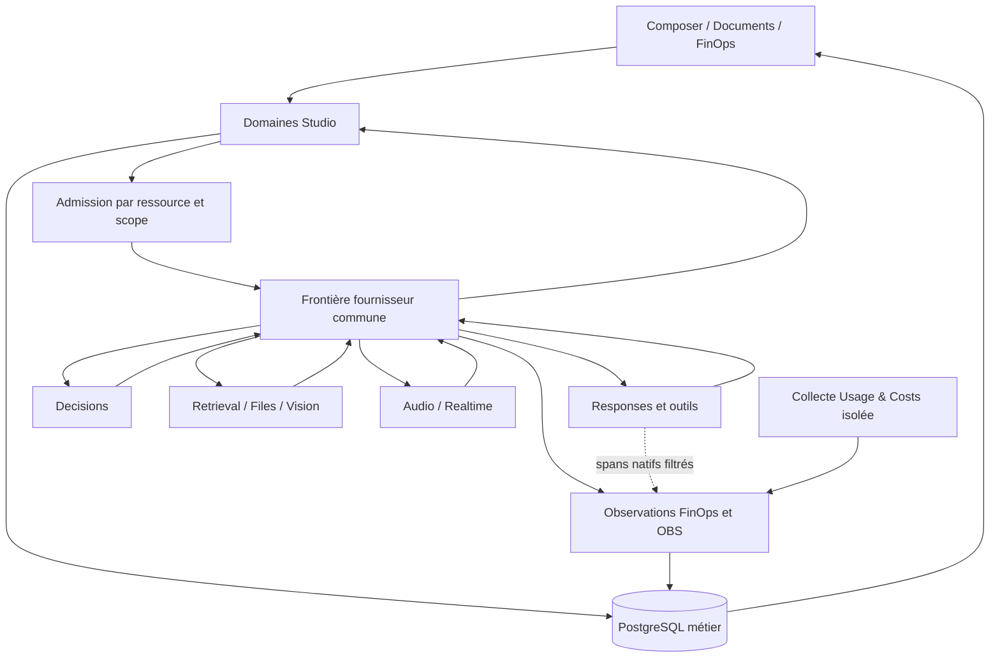
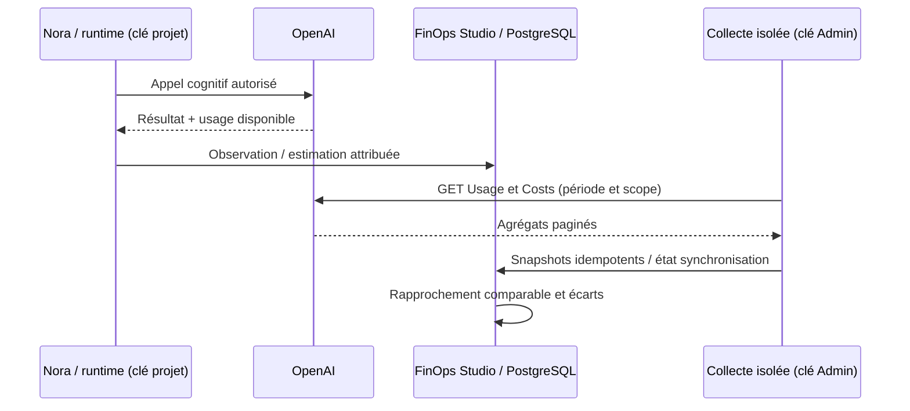

# Convergence OpenAI–Studio Next — Contrat technique candidat

> **Suivi as-built de synthèse 27/11/2026 — macro-lot 1 :** voir le [bilan de clôture et preuves](cloture-macro-lot-1.md) : collecteur Admin dédié, migration 026 rapportée DEV, snapshots LIVE, ledger réel, Frontier cumulative corrigée (tests substitués), tracing local exercé, V1 conservée. Limites et gates maintenus ; aucun nouvel ADR, changement de contrat, activation ou persistance externe. L'architecture candidate initiale ci-dessous reste inchangée.

| Champ | Valeur |
|---|---|
| Version | v0.1 — 26 novembre 2026 |
| Statut | DOCUMENTED / CANDIDATE TECHNICAL CONTRACT — revue collective préalable, aucun ADR nouveau ni GO d'implémentation |
| Références | [Cadrage](cadrage.md), [contrat fonctionnel](contrat-fonctionnel.md), [étude technique 460a121f](https://github.com/mcleland147/sfia-workspace/blob/460a121ff94bdfe08767a9870e7350e13f5d2a59/sfia-review-handoff/latest-chatgpt-review.md) |
| Code | Candidat local `c574d262`, web tree `5a1289fc` rapportés ; NON OBSERVÉ directement par ChatGPT ; inventaire ci-dessous dérivé du handoff, à confirmer au Git Truth Check local |
| Principe | Natif d'abord, un propriétaire par responsabilité, adaptation des mécanismes existants ; aucune architecture concurrente permanente |

## 1. Architecture et frontières candidates

Studio reste une application modulaire. Préserver D3 (travail et conduite), D4 (connaissances), D6 (autorité), D9 (sources Git), D7 (contrat d'exécution), D8 (qualification), OBS (causalité) et FinOps (attribution). Les API OpenAI ne possèdent aucun droit métier. Les traitements natifs deviennent des ressources derrière les frontières existantes, non une deuxième Nora. PostgreSQL unique pour les états métier ; une projection d'index ou un contexte fournisseur éventuel ne devient pas source de vérité.

Les flèches représentent des responsabilités, pas des appels synchrones obligatoires. Les lectures financières administratives et le cycle de vie des ressources externes utilisent des identités distinctes et un contrôle adapté à leur surface ; le runtime Nora n'accède pas à la clé Admin. Les appels Realtime éventuellement directs navigateur exigent admission, jeton temporaire borné, corrélation et contrôle de session ; ils ne sont pas présumés passer par un wrapper HTTP serveur.

## 2. AS-IS et matrice de transformation

Inventaire statique rapporté par l'étude §§1–7 et §§14–16 ; résoudre chemins réels et appels/consommateurs avant mutation. Les classifications sont des cibles candidates.

| Existant / ancrage | Natif / cible | Classe | Responsabilité conservée, impact et exit |
|---|---|---|---|
| nora-adapter.ts, configureSdkTracingSafe, tracing OFF | Agents SDK tracing local filtré | ADAPT | OBS métier et transport ; preuve zéro export et corrélation ; retour tracing OFF |
| lib/observability.ts, logs mid-turn | Spans natifs | REPLACE partiel / RETIRE conditionnel | Retirer seulement événements équivalents, mapping et tests outils/erreurs ; pas de suppression d'événement d'autorité |
| provider-emission-frontier.ts, admission/count/max_* | Contrôles natifs + frontière existante étendue | KEEP / ADAPT | Identité, scope, réservation, retries, annulation, inconnues ; garder contrôle transport et usage distinct |
| usage-accounting.ts, domains/finops/usage-*.ts, tariff-catalog.ts | Usage/Costs, usages natifs par surface | ADAPT / BUILD collecte isolée | Ledger d'attribution unique, projections et tarifs ; snapshot fournisseur distinct d'une charge métier ; réconciliation UI |
| public-web-search-frontier.ts, web-egress-guard.ts, web-public-query-authority.ts, web-search-tools.ts | max_tool_calls, tool_usage.web_search.num_requests | ADAPT / REPLACE compteur supposé | D6/B1 et worker query-only ; gate avant effet ; jamais rollback vers ASSUMED_1 comme garantie |
| cognitive-conductor.ts, cognitive-work.ts, context assembly | previous_response_id, cache, compaction, sessions selon preuve | KEEP / ADAPT | Checkpoints et reprise D3, fencing et acquis ; sortie de contexte fournisseur possible ; pas de stockage distant implicite |
| semantic-qualification.ts (cœur KEEP) | Decisions bornés | ADAPT ciblé + fallback Responses | Module `bounded-judgment.ts` ; incertitude explicite ; **pas** REPLACE du cœur ; OpenAI Decisions ≠ D6 |
| cognitive-policy.ts / cognitive-resources | Catalogue ressources spécialisé | ADAPT | Pas de routeur parallèle, aucune nouvelle politique active sans gate ; version et qualification |
| journal.ts lexical KEEP + `derived-embedding-index.ts` / `hybrid-knowledge-search.ts` | Embeddings locaux ; VS / File Search | ADAPT E=A+B ; DEFER C/D | Index fichier `.sfia-derived/embedding-index` reconstructible ; filtres révocation/droits/version ; **pas** pgvector ; migration 027 candidate non appliquée |
| pdf-extract-server.ts, pdf-viewer KEEP + `document-vision-punctual.ts` | Files / Vision | KEEP extract/viewer ; ADAPT Vision ponctuelle | Bytes locaux `store=false` ; pas de fileId durable ops |
| Composer texte | Audio Transcriptions | BUILD / REUSE NATIVE | Message USER confirmé, pas d'effet avant envoi ; désactivation micro sans perte clavier |
| Realtime non implémenté | Transcription progressive | BUILD conditionnel | Mode fichier repli ; fin de session et quotas vérifiés |
| D7/D8 livraison 2 non engagée | Agents API/Codex | EVALUATION différée | Contrat d'exécution et preuves indépendants du fournisseur ; pas de migration pendant ces trois lots |
| Génération images | Images API | DEFER | Évaluer ultérieurement besoin, permission, coûts et UX |

Chaque REPLACE/RETIRE exige inventaire des consommateurs (routes, outils, tests, données, UI), baseline, parité, stratégie de transition, observabilité, preuve intégrée, rollback et exit daté. Les noms techniques définitifs découlent de la responsabilité, sans noms de chantier. Pas de suppression non autorisée ; aucune bibliothèque ou table nouvelle par défaut.

## 3. Lot 1 — Socle fournisseur

### 3.1 Frontière et contrat commun de ressource

Adapter la frontière existante plutôt que créer un deuxième client incontrôlé. Décrire chaque surface par capacité, type d'opération, destination autorisée, identité fournisseur, lane, modèle/paramètres, politique, scope, sensibilité des données, contraintes, unité d'usage et statut de permission. Ne pas imposer aux nouvelles API des paramètres Responses qui n'ont aucun sens pour elles.

Flux serveur candidat : demande du domaine → admission technique et métier → validation du payload final → réservation lorsque requise → émission réelle → observation de tentative/résultat/erreur → réconciliation → projection. Conserver identifiants operation/work (si applicable), segment, admission, invocation, tentative, IDs natifs, version de politique et preuves ; aucune attribution fictive. Contrôler chaque véritable effet externe, retries inclus, au niveau adapté (HTTP, session Realtime, transfert ou tâche administrative). Séparer tentative, requête logique, usage mesuré, agrégat et estimation. Enregistrer durablement les contacts potentiellement facturables ou inconnus dans la capacité existante, sans transaction ouverte pendant le réseau ; si schéma insuffisant, changement minimal soumis au gate migration.

Pour une campagne à limite stricte, exploiter input_tokens natif sur un payload de comptage équivalent et vérifier l'identité du payload émis ; comptage lui-même instrumenté, sans récursion, timeout et limites. max_output_tokens et paramètres effectivement acceptés contrôlent la sortie. Les estimations restent des estimations. Les apports de contenu hosted et contextes distants doivent être bornés ou la campagne arrêtée. Un redémarrage invalide une enveloppe non reprise de manière sûre. Aucun plafond monétaire global produit.

### 3.2 Tracing natif et OBS

Étude rapporte setTracingDisabled(true) dans nora-adapter.ts. Cible : activer un traitement local des spans de run/generation/tool, vérifier le SDK verrouillé et configurer explicitement la liste des processeurs sans export par défaut (setTraceProcessors si réellement disponible ; ne pas simplement ajouter un processor). Désactiver la capture sensible, filtrer aussi tags/metadata/erreurs, exclure secrets, prompts, extraits et raisonnement privé. Ne jamais utiliser un span comme preuve unique d'effet externe. Export OpenAI non autorisé par cette conception.

Corrélation explicite des traceId/spanId avec operationId, generationId et attemptId lorsqu'ils sont réellement liés ; aucun parent OpenTelemetry supposé. OBS conserve événements métier, droits, effets, état et diagnostic lane. Établir un tableau de correspondance des événements actuels versus spans natifs ; retirer les doublons seulement après preuve de couverture sur parcours nominal, outil, erreur, retry et interruption. Vérifier zéro egress de traces avec transport indépendant. Une panne de diagnostic ne bloque pas Nora sauf contrôle de sécurité obligatoire ; aucun export silencieux.

### 3.3 Usage & Costs — collecte financière indépendante

**Architecture candidate à privilégier :** tâche/worker de synchronisation dédié, exécuté avec une identité administrative séparée du processus Nora, éventuellement même hôte/déploiement mais environnement de secrets distinct. Pas de serveur externe obligatoire, pas de clé Admin dans le runtime, navigateur, traces, Git ou configuration partagée ; stockage via interface interne bornée. Aucun endpoint public permettant de relayer arbitrairement des appels administratifs. Une clé administrative d'organisation est distincte des clés projet DEV/RECETTE ; confirmer droits minimaux réels et règles d'organisation. Ne pas présenter une clé Admin comme techniquement read-only si le fournisseur ne le garantit pas ; limiter le consommateur aux endpoints GET autorisés, durcir accès, rotation et réseau. Création et provisionnement du secret par Morris hors chat/Git, après gate. Un échec du job ne bloque pas l'inférence.

Sources candidates : GET /v1/organization/usage/... (completions, decisions, embeddings, audio, vector stores, file search et autres dimensions effectivement disponibles) ; GET /v1/organization/costs. Vérifier SDK, group_by et filtres propres à chaque endpoint, pages, bornes temporelles, unités, granularité, latence et devise. Costs fournit des agrégats, pas des coûts exacts par workId. Usage et Costs peuvent ne pas exposer les mêmes dimensions. Ne pas sommer plusieurs regroupements recouvrants d'une même consommation.

Contrat de données candidat, à mapper sur le schéma réel :
- Observations de consommation : conserver provider_usage_observations et mécanismes de corrélation existants. Un enregistrement technique ne doit pas ajouter un coût/requête déjà compté. Tarifs versionnés par surface, modèle, unité, devise et date.
- Instantanés fournisseur : représentation logique distincte du ledger, dans la même base. Clé de rapprochement stable = organisation autorisée + endpoint/famille + bucket UTC [début, fin[ + dimensions demandées/retournées et identifiants fournisseur + unité/devise. Stocker valeur, provenance, date de collecte, granularité, version de schéma/filtre, état de complétude ; pas de contenu des prompts ni de secret. Ne pas inventer d'identifiant absent. Une resynchronisation du même bucket remplace la vue courante de façon idempotente et traçable, ne l'additionne pas ; révision tardive qualifiée. Table/colonnes exactes et migration à instruire, pas de deuxième base/ledger.
- Mapping environnement : établir la relation lane Studio ↔ organisation/projet OpenAI ↔ identifiant non secret de clé, période de validité. Une clé différente ne prouve pas une séparation de coûts si les agrégats ne la distinguent pas. Ne jamais déduire un projet métier d'un project_id OpenAI. Si DEV et RECETTE ne sont pas séparables sur une dimension, état NON COMPARABLE ; aucune répartition proportionnelle fictive. Limiter le stockage et la restitution aux scopes autorisés, ne pas ingérer/afficher les autres projets de l'organisation sans mandat.

Collecte : proposer fenêtre UTC périodique (usage horaire, costs quotidien avec revisite des buckets récents, cadences à confirmer) ; pagination complète, gestion 429/backoff borné, verrou/idempotence, contrôle permissions, reprise sur page sans double compte, mise à jour atomique d'un bucket complet ; conserver dernière réussite et horodatage. Agrégat partiel non finalisé explicite, erreur sans effacement des données antérieures. Pas de rafraîchissement réseau à chaque génération.

Rapprochement : comparer uniquement intersections de période, scope, unité, devise et couverture réellement comparables. Sur même périmètre, écart = coût enregistré fournisseur - estimation Studio ; distinguer non attribué, donnée tardive et estimation incomplète. Aucun calcul d'écart final si périmètre insuffisant ; pas d'ajustement arbitraire des travaux. Le coût fournisseur reste agrégé ; USD conservé, conversion éventuelle clairement séparée. Le rapprochement n'est ni facture, ni garantie de causalité d'un écart.

Adapter routes FinOps existantes, droits et UI de consommation : exposition des valeurs mesurées, estimées, fournisseur, couverture, fraîcheur et état de sync ; aucune réécriture des observations historiques. Conserver page 13 comme référence ; préparer le delta UX et le faire valider. Oracle indépendant PostgreSQL/API/DOM sur même fenêtre et scope (y compris retries, compte inconnu, historique, permissions, absence de clé). Tester transport substitué puis lecture fournisseur réelle autorisée, sans secrets publiés. Aucun coût fournisseur exact par travail promis.

### 3.4 WEB hosted et bornes

Préserver worker query-only, D6/RECORD_DECISION, identité/projet/finalité/version/restrictions, revérification avant egress, B1 (HTTPS, DNS pinning, réseaux privés et redirections interdits, limites corps/temps). WEB MIXED fermé. Le web_search tool doit rester isolé de l'agent privé.

Exploiter max_tool_calls comme borne sur appels built-in par Response et num_requests comme observation du nombre de recherches facturables quand fourni ; si absent, UNKNOWN. Réserver les unités effectivement bornables avant effet, compter retries et tentatives d'ouverture directe. Ne pas déduire une recherche facturable de chaque appel tool. return_token_budget documenté mais absent des types SDK inspectés : vérifier compatibilité REST/SDK et garantie sur contenu, sans upgrade implicite.

Option A3 de l'étude (pré-réserve appels intégrés, réconciliation num_requests, suspension à écart) n'est pas une borne stricte préalable sur recherches facturables. Proposer le choix entre enveloppe strictement démontrable ou enveloppe portant sur dimensions contrôlables et mesure a posteriori avec risque résiduel explicite ; arbitrage Morris spécifique avant G-WEB-PUBLIC. Aucun budget monétaire produit. Tant que gate fermé : WEB OFF et aucun effet. Retrait du compteur supposé après preuves ; rollback sûr = fermeture du gate, pas réactivation d'une hypothèse ASSUMED_1 comme garantie.

### 3.5 Continuité native

Comparer reconstruction actuelle, previous_response_id, compaction et cache sur un même travail autorisé : coût cumulé, latence, fidélité des acquis, reprise et qualité. previous_response_id simplifie la chaîne, mais les tokens d'entrée antérieurs restent facturés. Compaction/caching ne remplacent pas le checkpoint D3. Conversations/background/sessions sont candidates seulement si contrôle de cycle de vie, rétention, isolation et fencing démontré ; pas d'état hébergé permanent par défaut. Vérifier compatibilité avec store=false/paramètres de rétention effectivement applicables. Lier référence fournisseur à work/lane/version et rendre indisponible toute chaîne dont droits ou contenu sont devenus incompatibles ; réhydrater uniquement les acquis autorisés. Aucun reset des budgets 2M/1M/120, aucune perte de réserve de restitution ; D3 reste responsable de reprise et état terminal. Ne pas stocker de raisonnement privé.

## 4. Lot 2 — Cognition spécialisée et intelligence documentaire

### 4.1 Decisions et catalogue

L'API /v1/decisions (SDK rapporté présent) propose des jugements bornés (predicate/choice/score). Vérifier modèle exact, contrat d'entrée/sortie, tailles, unités et tarifs au moment du lot. Les fichiers, audio et références d'items ne sont pas supportés directement selon le guide consulté ; fournir seulement les données bornées admissibles. Nora choisit sémantiquement une ressource adaptée, admission déterministe valide capacité/modèle/permission et limites. Catalogue existant étendu par type de ressource (génération, jugement borné, retrieval, vision, etc.) sans dupliquer la politique ni introduire un classifieur systématique. Aucun changement de politique v0.2 DEV/RECETTE implicite. D6 humain exclusif.

Pour un remplacement de tours Responses purement évaluatifs, inventorier les chemins réellement utilisés, définir questions nommées et format attendu, traiter résultat absent/invalide/incertain, comparer qualité/latence/coût à Responses sur oracle indépendant. Une probabilité n'est pas un fait ni une preuve ; pas de seuil universel. Réévaluation par Nora, synthèse Responses ou suspension motivée. Tracer requête/usage/qualité, sans raisonnement privé. FinOps sépare unités et tarification Decisions ; pas de génération fictive. Une bascule réversible sur les chemins prouvés, puis retrait ciblé des helpers redondants.

### 4.2 Recherche : comparer équitablement, sélectionner une seule stratégie

| Option | Mécanisme | Avantage candidat | Risque / responsabilité résiduelle |
|---|---|---|---|
| Existant lexical | Journal D4 et lecture Git | Exactitude termes/identifiants, pas d'index externe | Pertinence paraphrases, relectures |
| Embeddings + index Studio | Vectorisation native, index PostgreSQL candidat | Contrôle stockage, filtres et révocation | Chunking/index/ranking/maintenance à construire ; extension/migration à arbitrer |
| Vector Stores + recherche directe | Files + indexation/recherche/ranking natifs | Moins de moteur custom, filtre avant injection | Persistance externe, cohérence éventuelle, droits/version à recontrôler |
| File Search hébergé | Outil mobilisé dans Responses | Retrieval intégré à la génération | Risque de passage au modèle avant filtre Studio ; admissible seulement si isolation et droit prouvés |
| Hybride | Exact + sémantique dans l'architecture sélectionnée | Complémentarité, identifiants exacts | Ne pas construire deux backends sémantiques permanents |

Hypothèse d'intégration prioritaire à comparer : recherche directe Vector Stores pour éviter de reconstruire index/ranking, sous DATA-01 ; alternative embeddings + index local si droits, rétention, coût ou qualité rendent le natif hébergé inadapté. Aucun choix final avant benchmark et arbitrage de persistance. Ne pas créer un index externe par défaut ni téléverser tout Git. Préparer protocole borné avec corpus autorisés, version figée, oracle de faits/passages, requêtes lexicales/sémantiques, sources contradictoires et absentes, recall@k et précision/citations, coût de stockage/ingestion/requête, latence et effort de maintenance ; inclure baselines qualité. Faire les comparaisons dans le même macro-lot et retirer les artefacts comparatifs inutiles.

Contrat logique D4/D9 : sourceId, projet, identité/version exacte (commit/blob ou version document), scope, état de droits, empreinte contenu, indexRef dérivée, passage/page/plage si disponible, état ingestion et fraîcheur. Dédupliquer par version et scope ; version ancienne invalidée lors de modification ; ingestion/retry/suppression idempotents. Source de vérité = D4/D9, index reconstructible. Avant recherche limiter au scope autorisé ; après recherche vérifier chaque résultat contre version et droits courants avant injection/citation. Pour File Search hosted, démontrer ces garanties avant exposition au modèle, pas seulement après retour. La suppression distante peut être éventuelle ; blocage local immédiat et tâche de suppression/réconciliation ; si impossible, désactiver ce chemin. Revalidation à la consultation originale. Erreurs/absence d'index signalées, fallback lecture exacte autorisée. Pas de résultats inter-projets, pas de réutilisation d'un vecteur révoqué.

### 4.3 Files / Vision / PDF

Séparer lecture et interprétation. Préserver viewer auth, owner/lane/project/work, version, token rotation, pagination, couverture honnête, limites de session. pdfjs reste utile pour texte exact et visualisation ; seules opérations de préparation devenues réellement redondantes sont candidates au retrait. Vision via input_file/input_image de Responses pour analyse de pages, schémas et tableaux ; les PDF peuvent inclure texte et images, les autres formats ne donnent pas nécessairement leurs éléments visuels au modèle. Vérifier compatibilité réelle modèle, detail, taille, pages, tokens, tarification, sécurité. Lecture ponctuelle sans index permanent privilégiée lorsque suffisante ; si Files API nécessaire, gérer fileId, durée de vie, version, expiration/suppression et contrôle d'accès. Aucun URL de fichier externe non vérifié, aucun transfert sans droits et gate DATA-01.

BatiNova scanné : futur oracle humain sur diagramme et zones ambiguës ; ne pas annoncer OCR exhaustif. PDF textuel Git : corpus disponible à confirmer. Maintenir les limites locales de corps, CPU/mémoire/concurrence/rendu, annulation et couverture ; ne pas supposer que le natif sécurise la visionneuse. Les citations ouvrent la source/version/page réellement consultée. FinOps observe coût des inputs multimodaux et frais de stockage/indexation, sans réattribuer un agrégat fournisseur arbitrairement.

## 5. Lot 3 — Audio

Cible retenue (arbitrage Morris) : composer → capture PCM navigateur (AudioWorklet/ScriptProcessor) → session de dictée admise par Studio → WebSocket Realtime transcription serveur (gpt-live-transcribe, turn_detection=null) → fragments SSE → brouillon éditable → envoi USER explicite. Alternative fichier gpt-transcribe uniquement si Realtime indisponible ou garanties insuffisantes. États idle/enregistrement/transcription/terminé/annulé/erreur ; arrêt des pistes micro à l'annulation ou navigation ; conservation du brouillon, aucun auto-envoi. Limiter formats, taille, durée, concurrence et temps selon API ; validation serveur, pas de traitement de données privées au-delà du mandat. Audio temporaire nettoyé, vérifier rétention fournisseur et gérer échec de suppression.

Comparer avec transcription Realtime (WebRTC/WebSocket selon contrat réel, session de transcription seule, jeton éphémère minimal délivré après admission, aucune clé longue navigateur). Contrôler durée, scope, fermeture/expiration, reconnexion, fragments ordonnés et fin de transcription ; ne pas permettre d'outils ou d'effets via session de dictée. Si connexion directe navigateur retenue, contrôle des effets et réconciliation via session/événements réellement disponibles, pas présomption de contrôle HTTP local. Si garanties insuffisantes retenir mode fichier. Modèles et formats exacts à confirmer à la construction. Audio facturable même si texte non envoyé : operationId indépendant, lane et mesure durée/tokens selon surface, aucune génération D3 fictive. UX/accessibilité et tests navigateur réel avec consentement de qualification, oracle de transcription technique française.

## 6. Agents API et images — limites de trajectoire

Agents API hébergée distincte du SDK JS. Évaluer avant livraison 2 les sessions, sandbox hébergée/autogérée, vaults, autorité réseau/Git, arrêt, reprise, artifacts, coûts et provenance. Comparer D7 avec Cursor sur un mandat et un oracle identiques, sans exécuter ici. D8 examine des éléments vérifiables, D6 accepte ; un résultat natif ne vaut pas preuve ni adoption. Aucun transfert de code, secret ou création de session sans gate. Éviter une abstraction multi-exécuteur anticipée. Images API génératives différées ; Vision lot 2 ne requiert pas une permission de génération d'images par principe. Aucun changement des permissions présentes dans ce dossier.

## 7. Permissions et données — proposition progressive

| Lot / surface | Identité et accès candidat | Condition de mise en service |
|---|---|---|
| Lot 1 Responses/count/compaction | Clé projet DEV, destination et capacité autorisées | Confirmer SDK, droits et politique ; stockage/contexte natif selon DATA-01 |
| Lot 1 tracing local | Aucun export externe ; pas de clé additionnelle par principe | Zéro export et filtrage prouvés |
| Lot 1 Usage & Costs | Clé Admin organisation isolée, GET allowlist | Création/provisionnement Morris, scope organisation vérifié, lecture seule côté consommateur, secrets séparés |
| Lot 1 WEB | Clé projet dédiée au scope autorisé | G-WEB-PUBLIC distinct, MIXED fermé |
| Lot 2 Decisions | Permission spécifique projet si requise | Autorisation DEV, modèle disponible et oracle |
| Lot 2 Embeddings, Files, Vector Stores/Retrieval | Permissions minimales de recherche/ingestion/suppression selon backend sélectionné | DATA-01 : corpus, droits, rétention, suppression, coûts de stockage ; GO persistance |
| Lot 2 Vision | Responses et Files si nécessaire | Données autorisées, aucune permission Images génératives implicite |
| Lot 3 Audio, Realtime | Permission audio projet ; jeton éphémère pour session directe | Autorité micro, limites, rétention, FinOps |
| L2 Agents API/Vaults et futur Images | Hors activation actuelle | Arbitrage et GO distincts |

Permissions exactes DEV/RECETTE NON OBSERVÉES actuellement ; aucune permission ALL. Les droits documentés ne prouvent pas l'accès compte. Vérifier la rétention officielle par endpoint, options de l'organisation et région, suppression, état d'indexation, données de diagnostic ; stockage externe ne se confond pas avec politique d'entraînement. Pas de nouvelle persistance de données privées sans gate. Ne pas copier secrets/identifiants sensibles dans preuves. ENV-01 reste applicable aux constructions : DEV et RECETTE isolées (code, build, DB, ports, rôles, sessions, secrets et ressources distantes). RECETTE protégée. Ne pas injecter la clé Admin dans les deux runtimes ni mutualiser un index entre lanes.

## 8. Revue de convergence et plan d'acceptation

Avant chaque mandat : Cursor vérifie localement HEAD/tree, code, lockfile, schéma, interfaces, routes, tests, flags, permissions non secrètes et preuves. Comparer au handoff ; documenter écarts code/doc, blast radius (API, données, UX, autorité, sécurité, tests), responsables, conditions de remplacement. Ne pas déduire la compatibilité effective de la présence d'un type SDK. Le tableau suivant est un état de conception, pas un test.

| Domaine | Compatibilité présumée à instruire | Preuve / sortie |
|---|---|---|
| Tracing / OBS | Adapter instrumentation existante | Spans filtrés, zéro export, causalité et retrait redondances démontrés ; F11 |
| FinOps | Adapter ledger/projections + collecte ; schéma à examiner | Même scope PG/API/DOM/fournisseur ; inconnues et doublons contrôlés ; F13–14 |
| Frontier/WEB | Adapter contrats par surface ; gate hosted non levé | SDK réel, transport oracle, count/limits/retry et D6/B1 ; F11/F15 |
| D3 continuité | Optimisation compatible sous preuve | A/B réel qualité/coût/reprise, checkpoint inchangé, rollback ; F12/F25 |
| Decisions | Nouvelle ressource, couverture à qualifier | Oracles indépendants ; F21/F26 |
| Retrieval | Alternatives non sélectionnées | Benchmark + DATA-01, révocation/version/rebuild ; F22–23 |
| Vision/PDF | Chemins complémentaires | Tests documentaires, rights et browser ; F24 |
| Audio | Nouvelle UX, architecture candidate | Parcours, annulation, coût et qualité ; F31–34 |
| D7/D8 | Étude préalable L2 | Équivalence mandat/preuves, pas d'engagement |

Chaque macro-lot intègre code, tests, documentation as-built et Review Pack. Tests TypeScript/lint/unitaires, PostgreSQL, API, vrai SDK avec transport substitué, navigateur, build/smoke et non-régression selon blast radius. Les oracles portent sur effets réels et population indépendante. LIVE uniquement sous autorisation explicite, identité DEV, corpus et enveloppes opposables ; observation d'un comportement ne démontre pas une sécurité générale. Les preuves historiques ne sont pas rejouées par principe mais leur pertinence est réexaminée si la frontière change.

Transition : activer une capacité seulement après permission et tests ; éventuelle coexistence comparative temporaire sans double effet ni double coût non maîtrisé, rollback sûr, retrait des consommateurs anciens après preuve. Classer défaut de socle bloquant, capacité réellement isolable avec exit, réserve de qualité/UX, amélioration future. Une capacité indisponible doit être signalée ; aucune dégradation silencieuse de la voie nominale. Build final exact et manifeste/rollback avant GO RECETTE séparé. F2 Morris, R6 non démarré. Les arbitrages restant à prendre sont ceux qui engagent données, sécurité, finance administrative, architecture et gates, pas les détails réversibles d'implémentation.

## 9. Sources

Contrats Next à la base documentaire : [R4 et DATA-01](../../governance/decisions/2026-11-04-r4-architecture-exit.md), [ENV-01](../../governance/environnements-recette-et-promotions.md), [SEM](../../governance/decisions/2026-11-12-qualification-semantique-nora-mobilisation-capacites.md), [conducteur D3](../../architecture-technique/conducteur-cognitif-et-production-nora.md), [OBS](../../architecture-technique/contrat-observabilite-transverse.md), [allocation technique](../../architecture-technique/allocation-cognitive-recherche-web-et-finops.md), [acceptation](../contrat-acceptation-cognition-et-realisation-gouvernee.md). Étude Cursor §§1–18 au [handoff immuable](https://github.com/mcleland147/sfia-workspace/blob/460a121ff94bdfe08767a9870e7350e13f5d2a59/sfia-review-handoff/latest-chatgpt-review.md#L193-L821). Les points de code sont rapportés, non inspectés localement par ChatGPT.

Documentation OpenAI consultée le 26/11/2026 (contrats fournisseur à revérifier au moment du lot, pas preuve de disponibilité compte ni d'équivalence) :
- [Tracing Agents SDK](https://openai.github.io/openai-agents-js/guides/tracing/) ; [setTraceProcessors](https://openai.github.io/openai-agents-js/openai/agents-core/functions/settraceprocessors/).
- [Usage](https://developers.openai.com/api/reference/resources/admin/subresources/organization/subresources/usage/methods/completions/) ; [Costs](https://developers.openai.com/api/reference/resources/admin/subresources/organization/subresources/usage/methods/costs) ; [Usage Decisions](https://developers.openai.com/api/reference/resources/admin/subresources/organization/subresources/usage/methods/decisions/) ; [pricing](https://developers.openai.com/api/docs/pricing) à revalider avant LIVE.
- [Token counting](https://developers.openai.com/api/docs/guides/token-counting) ; [Responses](https://developers.openai.com/api/reference/resources/responses/methods/create) ; [WEB](https://developers.openai.com/api/docs/guides/tools-web-search).
- [Conversation state](https://developers.openai.com/api/docs/guides/conversation-state) ; [compaction](https://developers.openai.com/api/docs/guides/compaction) ; [prompt caching](https://developers.openai.com/api/docs/guides/prompt-caching).
- [Decisions](https://developers.openai.com/api/docs/guides/decisions) ; [Retrieval](https://developers.openai.com/api/docs/guides/retrieval) ; [File Search](https://developers.openai.com/api/docs/guides/tools-file-search) ; [File inputs](https://developers.openai.com/api/docs/guides/file-inputs).
- [Transcription](https://developers.openai.com/api/docs/guides/transcription) ; [Realtime transcription](https://developers.openai.com/api/docs/guides/realtime-transcription) ; [Agents API](https://developers.openai.com/api/docs/guides/agents-api/overview) ; [data controls](https://developers.openai.com/api/docs/guides/your-data).

Aucun test authentifié, changement de permission, migration, code ou runtime réalisé par cette conception. Les trois documents sont des candidats de construction, pas des ADR ni une baseline officielle.
