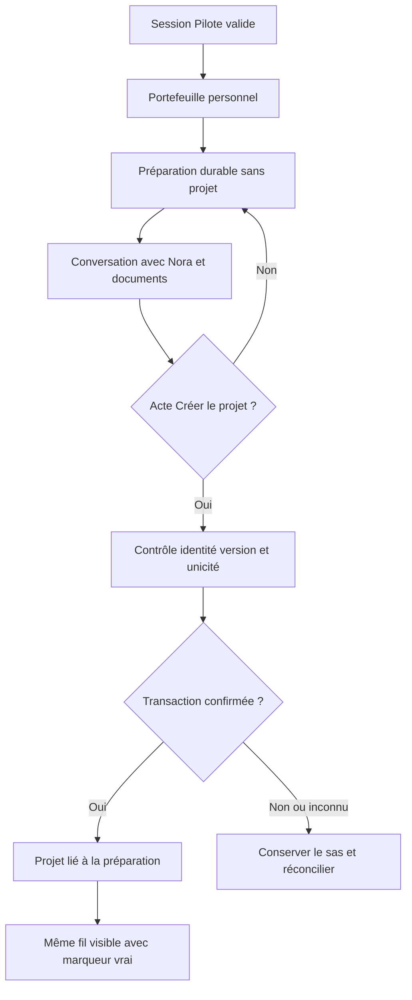

# SFIA Studio Next — R5 / ML1 — Spécification technique candidate

> **État Git au versement (2026-11-04) :** publication documentaire candidate sur `docs/next-r5-delivery-preparation-20261104`, base `main@a0b80b9ecd64149ed51f87235ae246e197e66462`. Ni `VALIDATED SPEC`, ni merge, ni GO Cursor. Les formules `NOT ON GIT` et `NO GIT WRITE` dans les historiques décrivent leur état à la rédaction, pas cette publication.

## Entrer, dialoguer et créer un projet avec continuité

| Champ | Qualification |
|---|---|
| Version | **v0.2 — revue de cohérence du 2026-11-04** |
| Nature | **D0 / conception technique candidate révisée après revue de cohérence R2–R4** ; pas une exécution, pas un prompt Cursor |
| Statut | **DOCUMENTED / REVIEWED CANDIDATE WITH OPEN DECISIONS / NOT VALIDATED SPEC / NOT IMPLEMENTED** |
| GO constaté | Morris autorise la consolidation documentaire R5 et la préparation de la spécification ML1 ; **aucune autorisation de code, PR, merge ou promotion** n'en découle ; la publication documentaire candidate est autorisée séparément le 2026-11-04 |
| Dépôt | `mcleland147/sfia-workspace`, `main@a0b80b9ecd64149ed51f87235ae246e197e66462` ; PR #646 `MERGED` ; local/worktrees **NON OBSERVÉS** |
| Référentiel de delivery | `sfia-next-r5-reference-delivery-proposition-v0.4.md` (brouillon D0 révisé) |
| Traçabilité | `sfia-next-r5-matrice-tracabilite-ml1-v0.3.md` et inventaire `sfia-next-r5-r2-ml1-inventaire-v0.1.csv` |
| Runtime Next | **N/A — NON IMPLÉMENTÉ** ; zéro test Next exécuté, zéro preuve BROWSER/LIVE/REAL |

> **Règle de lecture** — Les sections « **INVARIANT VALIDÉ** » restituent les contraintes des sources R1–R4 et de leurs décisions. Les sections « **PROPOSITION TECHNIQUE R5** » décrivent une solution candidate à discuter au bon niveau avant qu'elle devienne une spécification approuvée. Les **questions ouvertes** ne sont pas des détails autorisés à improviser dans Cursor. Aucun nom d'API, nom de table ou état technique proposé ci-dessous n'est une décision d'implémentation déjà adoptée.

## 1. Résultat utilisateur, frontière et définition de terminé

**Résultat produit attendu** : un Pilote s'authentifie, consulte son portefeuille personnel, ouvre un sas, travaille utilement avec Nora sans projet/cycle/dépôt préexistant, retrouve son travail après interruption, décide explicitement de créer le projet, puis continue le **même fil visible**, avec documents et acquis réellement conservés et sans création ou transfert fictif.

**E2E propriétaire :** [R1 §2.30 — E2E 01 sas→projet](https://github.com/mcleland147/sfia-workspace/blob/main/projects/sfia-studio-next/cadrage/vision-produit.md). Interfaces : E2E 03 (Nora utile), E2E 04 (continuité), E2E 07 (droits sur sources), sans prétendre réaliser entièrement ces trois E2E dans ML1.

**IN ML1** :

- Identité Studio/session et isolation de deux Pilotes ; portefeuille non conversationnel, navigation vers un projet existant et accès au sas ; pas de permission Git déduite de la connexion.
- Préparation persistée et récupérable avant création ; messages utiles, aperçu de projet propositionnel ; acte explicite de création et résultat vérifié.
- Conversation Nora effectivement utilisable sans cycle ni méthode obligatoire ; contexte du bon propriétaire, provenance et limites exposées.
- Création de projet avec unicité, transaction, relecture après perte d'accusé, erreurs/refus, lien durable à la préparation ; transition du fil avec marqueur vrai.
- **Premier document produit dans le sas**, avec identité et état de conservation honnêtes. Le modèle d'identité/version doit permettre ML2, mais **pas** la bibliothèque documentaire et la révision avancée complètes.
- Fondations opérationnelles nécessaires à une première verticale utilisable : PostgreSQL, migrations, secrets et DEV/RECETTE isolés ; STABLE seulement après décision distincte selon ENV-01.
- Tests et preuves de ML1 pendant sa construction, y compris les cas négatifs de R4 QA A01–A16 et la conformité R3 sur les surfaces réellement livrées.

**OUT ML1 — frontières positives à préserver** :

- Gestion détaillée des sujets/connaissances et révision documentaire complète (**ML2**) ; cycle, CKI actif, méthode/trajectoire et décision gouvernée complète (**ML3**) ; intégration Git complète (**ML4**) ; contrat d'exécution/dispatch Cursor, preuves D8 et acceptation finale (**ML5**).
- Suppression/transfert/partage d'un projet : non défini comme fonction de navigation par `RG-ACC-024` ; ne pas créer une capacité implicite.
- Tout effecteur externe initié par du texte Nora ou une simple navigation ; pas d'ouverture automatique de cycle, dépôt ou tentative.

**Condition de complétude ML1** : l'E2E 01 doit être réellement démontré en RECETTE sur un SHA figé avec autorité correcte, DB PostgreSQL, parcours navigateur, reprise après coupure et non-duplication. Le verdict reste borné aux fonctions et dépendances réellement qualifiées ; R6 et ADOPTED restent distincts.

## 2. Références canoniques et couverture

| Axe | Sources propriétaires ; portée concrète |
|---|---|
| R1 | `cadrage/vision-produit.md` §2.30 (E2E 01) + interfaces §§2.32, 2.33, 2.36 et addendum §2.41. |
| R2 D1 | `conception-fonctionnelle/acces-et-portefeuille.md`, **25 `RG-ACC-001..025` et 24 `PF-ACC-01..24`** inventoriés : couverture ML1 ou frontière négative/interface. |
| R2 D2 | `conception-fonctionnelle/creation-de-projet-et-continuite-du-sas.md`, **27 `RG-CRE-001..027` et 27 `PF-CRE-01..27`**, dont le complément documentaire du sas `CRE-027`. |
| R2 D3/D4 | D3 `RG-CONV-001..006`, `RG-CTX-001..008`, `RG-AUTH-001`, `RG-UX-*` pertinents ; D4 `RG-KNOW-002/006/011/014/015/016..020`, PF de reprise. Pas d'appropriation complète de D3/D4 par ML1. |
| R3 | `ux-ui/espace-projet-interaction-pilote-nora.md`, `contrat-transposition-figma-code.md`, manifeste `index-geometrie-frames-r3.json` ; Figma `fileKey=itgvCulInEnFY6DvgIegvP`, page 01 `94:49` ; voir §6. |
| R4 | `architecture-technique/cadrage-r4.md` §§5.3.3–5.3.9 et §8.1 ; décision ADR **R4-01/R4-02**, frontières R4-03/R4-04, politique **DATA-01**, gouvernance **ENV-01**. |
| QA | `A01..A16` du cadrage R4 §5.3.9 ; **oracles candidats non exécutés**, répartis aux fonctionnalités §7. |
| Référentiel | La matrice ML1 v0.3 détaille les liaisons R1/R2/R3/R4/QA ; le CSV vérifie les **103 identifiants D1/D2**, sans garantir 103 comportements déjà couverts. |

**Règle de couverture :** chaque fonctionnalité ci-dessous hérite des exigences identifiées ; les renvois plusieurs-à-plusieurs sont autorisés. Aucun `PF` ne devient un test PASS par la seule présence dans le tableau. Les frontières négatives ou différées sont conservées avec propriétaire et exit.

## 3. Architecture de la capacité — décisions acquises et propositions

### 3.1. Frontières fonctionnelles et propriétaires

**INVARIANTS VALIDÉS R4 :** application neuve **modulaire**, un propriétaire de vérité par objet/effet ; **préparation durable indépendante du projet**, rattachement transactionnel lors de la création explicite ; **PostgreSQL** dès le premier incrément R5 ; pas de base concurrente pour la vérité transactionnelle du produit ; aucun effet externe autorisé par Nora seule ; Git facultatif.

| Responsabilité | Domaine propriétaire | Contrat ML1 | Interdiction |
|---|---|---|---|
| Identité, session et portfolio | D1 | Résoudre un Pilote et une session valides ; lire seulement ses projets et préparations | Pas de token de dépôt ou de HumanDecision déduit de l'authentification |
| Préparation et création | D2 | Accepter, versionner, créer et rattacher une préparation au projet du même Pilote | Pas de projet créé par une réponse Nora, une lecture ou un clic non dédié |
| Conversation, messages, activité cognitive et contexte | **D3** | Produire et conserver durablement les messages et leur statut ; composer le contexte du bon sas/projet avec contrôle d'accès | Pas de délégation de propriété des messages à D4 ni de second moteur d'autorité |
| Documents, connaissance, acquis et provenance | **D4** | Posséder l'identité/version des ressources documentaires et la connaissance durable ; fournir des références/provenances à D3 | Pas de copie de la vérité de conversation ou de déclaration de sauvegarde fictive |
| Décisions humaines et cycles | D6 / D5 | Interfaces de non-effet et refus si action hors ML1 | Aucune création implicite de GO, mandat, cycle ou méthode |
| Git/exécution | D9 / D7 / D8 | Interfaces hors portée, aucune dépendance de démarrage | Pas de création de dépôt, commande Cursor ni preuve d'effet inventée |

**PROPOSITION TECHNIQUE R5** : implémenter ces frontières comme des **modules logiques d'une seule application web**, raccordés à un noyau transactionnel PostgreSQL et à des adaptateurs pour les services externes éventuellement utilisés. Il ne s'agit pas d'un microservice par domaine. La **stack web, l'ORM, la bibliothèque d'authentification, le protocole agent et l'outil de migration ne sont pas choisis par R4** : leur sélection technique est à instruire dans ML1, sans copier ceux de l'ancien Studio par inertie.

### 3.2. Flux nominal et synchronisation



**À garantir** : chaque transition UI repose sur la lecture du propriétaire de l'état, pas sur un message d'IA ou l'optimisme client ; les données et opérations non couvertes par la transaction conservent leurs états réels.

## 4. Spécifications techniques par fonctionnalité

### 4.1. Identité Studio et session — `ML1-IDENTITY`

**R2 :** `RG-ACC-001..007`, `RG-ACC-015/021`, `PF-ACC-01..04`, `PF-ACC-10/13/17/24` et `RG-CRE-009`. **QA :** `A10`, plus sécurité négative dans `A01/A03/A14`.

**Comportement contractuel :** un Pilote connecté a une identité interne stable ; une session expirée/révoquée ne lui permet ni lecture privée ni création ; deux comptes utilisant éventuellement un dépôt commun voient des préparations et projets disjoints. Les droits de dépôt Git ne sont jamais inférés de la simple connexion Studio. Une identité ne devient pas un acte d'autorité D6.

**Proposition technique à évaluer** :

- Utiliser une connexion GitHub personnelle **pour l'identité Studio**, avec un mécanisme de session serveur et une identité interne immuable ; choisir au lot les modalités concrètes de validation, stockage/rotation des sessions et de révocation, sous les garanties R2/ENV-01.
- Associer les ressources persistantes à l'ID interne du Pilote, pas au nom d'affichage ni à un identifiant de dépôt. Toute requête/commande protégée revalide session et propriété côté serveur ; contrôles répétés après changement de session.
- Une session web contient au plus les références nécessaires à la vérification et ne constitue pas le registre de projet ni la vérité du sas. Exclure de la réponse client et des journaux les secrets d'authentification.

**Erreurs / observations** : session invalide → refus et reconnexion ; propriétaire différent → refus sans fuite d'existence ; authentification externe indisponible → impossibilité d'effectuer la commande protégée, sans emprunter des credentials d'une autre lane. **Tests de construction** : deux comptes, session expirée, réutilisation d'URL, requête forgeable, droits retirés, absence d'accès au projet tiers.

**Décision ouverte de lot** : méthode d'identité/session concrète et persistance des sessions. **Aucun changement d'architecture R4 n'est requis tant que l'isolation, la révocation et l'indépendance Git sont démontrées.**

### 4.2. Portefeuille et navigation — `ML1-PORTFOLIO` / `ML1-SAS-ENTRY`

**R2 :** `RG-ACC-008..014/016..018/020/022..025`, `PF-ACC-05/07..09/11..15/20/21`. **QA :** `A01`, `A12`, `A14`, `A15`.

**Contrats de lecture** : l'API de portefeuille — forme à choisir — récupère les **projets effectivement persistés appartenant à la session courante**, leurs statuts s'ils sont connus, et les liens utiles pour retrouver les préparations non créées. Le cockpit ne possède **pas** de Nora globale ni de cycle créé par navigation. Une route périmée ne fabrique ni fiche projet ni réponse rassurante fictive.

**Contrats d'état UI** : connecté/sans projet/plusieurs projets/session expirée/liste indisponible/projet supprimé ou inaccessible ; lorsqu'une donnée de progression n'est pas connue, ne pas produire une valeur de secours. Un titre projet homonyme n'est jamais un identifiant. Toute carte/aperçu respecte le même filtre d'accès que l'ouverture détaillée.

**Hors portée explicite** : supprimer, transférer ou partager un projet. Le contrôle négatif doit vérifier qu'aucune action sensible n'est autorisée par la navigation.

**Proposition technique** : query backend dédiée, pagination/recherche seulement si nécessaire au cas réel ; gestion d'URL/version de route indépendante de la session cognitive ; contrôle de permissions à chaque ouverture. Ne pas installer une couche de recherche ou un cache autorisant si PostgreSQL suffit à la première verticale.

### 4.3. Préparation durable et conversation initiale — `ML1-SAS-DURABLE` / `ML1-NORA-PREVIEW`

**R2 :** `RG-CRE-001..007/015/016/019/022/023/026`, `PF-CRE-01..06/13/17/20/21/23/26`, `RG-CONV-001..006`, `RG-CTX-001..008`, D4 `RG-KNOW-002/006/011/014/015`. **QA :** `A01`, `A02`, `A06`, `A11`, `A13`, `A16`.

**Invariants** :

- Préparation persistée, personnelle, **sans projet obligatoire**. Navigation, abandon ou déconnexion ne convertissent pas la préparation en projet.
- Nora peut investiguer, produire et proposer un aperçu utile **sans** formulaire exhaustif, ouverture de cycle ni méthode imposée. Un nom, une trajectoire ou un résumé proposé restent des propositions non autorisantes.
- **D3 conserve la vérité des conversations/messages** (ordre, statut, corrélation de génération, lien au sas/projet). **D4 conserve la vérité des documents et connaissances** (identité de ressource/version, source, provenance, état des octets). Les deux partagent la transaction PostgreSQL lorsque nécessaire, sans double propriétaire. Le modèle consomme une **sélection** de contexte ; le fil visible n'exige pas la réinjection du transcript entier.
- Source externe non disponible/révoquée : ne pas reconstituer ses données, permissions ou faits ; les métadonnées de provenance restent bornées à ce qui est légitime.

**Proposition technique d'interface** (noms conceptuels uniquement) :

| Opération logique | Entrées minimales | Sortie / garantie | Échecs à prévoir |
|---|---|---|---|
| Ouvrir/reprendre préparation | identité, `preparationId?` | préparation existante ou nouvelle identité durable, aucun Project | `FORBIDDEN`, `NOT_FOUND`, `UNAVAILABLE` |
| Ajouter un message utilisateur | `preparationId`, contenu, version ou clé de requête | message accepté avec identité/ordre/état de persistance | session perdue, collision, rejet, ACK perdu |
| Demander une réponse Nora | conversation courante, contexte autorisé, limites et ressources disponibles | réponse reliée à son message et au bon contexte, événements réellement connus | fournisseur indisponible, interruption, sortie partielle |
| Consulter l'aperçu | préparation et sa version actuelle | représentation propositionnelle et sa provenance | version obsolète, champs manquants |

**Contrat d'intégration cognitive minimal recommandé (candidat R5)** :

1. L'entrée utilisateur obtient une identité et un état de persistance D3 **avant** l'appel au fournisseur ; une clé de requête évite la duplication au renouvellement du transport.
2. Un identifiant de génération corrèle fournisseur, conversation, message produit et éventuelles sorties partielles. Les fragments affichés pendant le streaming sont **provisoires** tant que leur état durable n'est pas confirmé.
3. Une réponse terminée est enregistrée comme telle uniquement après confirmation de sa conservation ; interruption, timeout et sortie perdue restent `PARTIAL`, `FAILED` ou `UNKNOWN` selon observation. **Pas de relance automatique du fournisseur après ACK perdu** sans stratégie vérifiable de déduplication.
4. Une demande suivante récupère une sélection de messages D3 et d'acquis D4 **sous les droits actuels**, sans seconde base propriétaire de mémoire ni transformation d'une citation en autorisation.
5. Aucun outil exposé à Nora dans ML1 ne peut appeler la commande D2 `CréerProjet`, créer un cycle, une ressource Git ou déclencher Cursor.

**À arrêter avant code**, dans le contrat d'exécution du lot : fournisseur/API/SDK, contrat des événements de streaming, stratégie d'annulation effectivement supportée, budgets/erreurs et politique de conservation des sorties. Une vraie conversation Nora devra être observée en RECETTE ; un stub seul ne suffit pas à déclarer E2E 01 complet.

**Reprise réelle** : après reload, nouvelle conversation ou redémarrage serveur, relire la préparation/messages/ressources persistés ; afficher ce qui est sauvé et les limites du reste. L'absence de fournisseur Nora ne doit pas détruire le sas ou la conversation déjà enregistrée.

### 4.4. Création explicite et transactionnelle — `ML1-CREATE`

**R2 :** `RG-CRE-008..014/016/020/024/025`, `PF-CRE-07..12/14/16/24/25`, `RG-ACC-002/005`, ADR R4-02 ; **QA :** `A03`, `A04`, `A05`, `A06`, `A10`, `A12`, `A15`.

**INVARIANTS VALIDÉS** : l'acte « Créer le projet » est dédié, imputable au Pilote et distinct d'un accord conversationnel. Projet et association à la préparation ont un **point de validation transactionnel commun**. Une préparation ne fonde pas deux projets du même acte intentionnel ; un double clic ou une réponse perdue doit retrouver le résultat existant ou exposer une incertitude vraie, jamais fabriquer un doublon ou annoncer un succès sans constat. Pas de cycle, mandat ou dépôt Git créé à cet effet.

**PROPOSITION TECHNIQUE R5 — contrat logique de commande** :

```text
CréerProjet (nom illustratif, API/route NON DÉCIDÉES)
  acteur : identité Studio relue côté serveur
  contexte : preparationId
  contrôle : expectedCreationRevision de l'aperçu inspecté (non la révision de chaque message)
  opération : idempotencyKey stable + empreinte canonique des données approuvées
  données approuvées : informations minimales du projet affichées au Pilote

Résultat logique proposé :
  CREATED(projectRef, preparationRef, committedAt)
  ALREADY_CREATED(projectRef, preparationRef)
  CONFLICT(actualPreparationRevision)
  FORBIDDEN / SESSION_INVALID / INVALID_REQUEST
  NOT_CONFIRMED_OR_UNKNOWN (avant une réconciliation fiable)
```

**Séquence transactionnelle candidate** :

1. Vérifier côté serveur la session, la propriété de la préparation et la provenance de la **commande dédiée** (aucun outil Nora ne possède cette capacité) ; protéger la mutation contre CSRF et rejeu selon le mode de session retenu. Une indication client « bouton cliqué » ne suffit pas comme preuve.
2. Chercher d'abord le **résultat durable de la même clé d'idempotence** dans son contexte : si l'empreinte est identique, retourner le résultat déjà committé ; si elle diffère, répondre `CONFLICT`. Cette recherche précède le refus de version devenue obsolète pour qu'un replay après commit reste idempotent.
3. À défaut d'opération antérieure, vérifier `expectedCreationRevision` contre la version des **champs de création effectivement inspectés** — pas chaque message — et les informations minimales approuvées.
4. Dans **une transaction PostgreSQL**, vérifier l'unicité réelle par préparation, insérer le projet et son owner, enregistrer le lien préparation→projet, la clé/empreinte et le résultat de commande ; assurer les contraintes SQL même face à deux requêtes simultanées.
5. Confirmer puis relire l'état durable pour afficher `CREATED`/`ALREADY_CREATED`. La relecture de réconciliation est **sans effet** ; si l'existence reste invérifiable, conserver `UNKNOWN`, sans seconde création automatique ni faux marqueur.
6. Garantir que l'horizon de conservation de la déduplication couvre effectivement la durée pendant laquelle la même préparation peut être réutilisée : une expiration arbitraire de clé ne doit jamais rouvrir la possibilité d'un deuxième projet.

**Contraintes d'intégrité nécessaires**, à traduire en DDL selon le modèle final : unicité effective de l'association création/préparation ; FK et propriété cohérentes ; clé d'opération dédupliquée dans son contexte ; version de préparation protégée contre écrasement concurrent ; audit expurgé de l'acte. La stratégie précise (`UNIQUE`, isolation, locks, upsert, représentation du résultat) est à choisir et **prouver avec de vraies transactions PostgreSQL**.

**Postconditions** : le projet retrouvé appartient au Pilote, l'association est stable, le portefeuille le retrouve, l'UI passe au contexte projet **uniquement si l'effet est confirmé**, le fil de préparation est toujours accessible. Une transaction ratée ne modifie pas les faits ni la vérité de l'aperçu.

**Erreurs discriminantes** : deux clics simultanés ; timeout **après** commit ; timeout **avant** commit ; version périmée ; changement de compte ; noms identiques ; ressources du sas encore `SAVING` ; suppression de session pendant l'acte.

### 4.5. Continuité du fil et réhydratation — `ML1-CONTINUITY`

**R2 :** `RG-CRE-017..024/026`, `PF-CRE-15..23/25`, D3 `RG-CTX-002/004/006`, D4 `RG-KNOW-006/011/015`. **QA :** `A05`, `A07`, `A11`, `A13`, `A16`.

**Contrat** : après création confirmée, la conversation initiale du sas reste visible et ordonnée dans l'espace projet ; un marqueur explicite précise le passage, fondé sur un fait transactionnel ; les acquis et sources conservent leur qualification, sans transformation des hypothèses en décisions ou faits. En état inconnu, rester dans le sas jusqu'à réconciliation.

**Proposition technique** : les identifiants de préparation et conversation ont une durée indépendante de l'objet Project ; le contexte projet se **résout** depuis un lien transactionnel plutôt que par duplication du transcript. L'identité technique de conversation strictement inchangée est une **solution candidate**, pas une obligation fonctionnelle R2 : c'est la **continuité du même fil visible** qui est validée. Une projection UI peut exploiter les mêmes messages et la date de création, sous contrôle d'accès courant.

**Épreuves pertinentes** : recharge serveur après commit, nouvelle session, message parti avant crash, ressource inaccessible, réouverture depuis portefeuille et ordre des messages. Distinction impérative entre message visible sauvegardé et contexte que le modèle a effectivement rechargé pour générer sa réponse.

### 4.6. Premier document du sas — `ML1-SAS-DOCUMENT`

**R2 :** `RG-CRE-027`, `PF-CRE-27`, D4 `RG-KNOW-016..020`, `RG-KNOW-006/014/015`, addendum R1 §2.41. **QA :** `A08`, `A09`, `A13`, `A16`.

**Contrat** : Nora peut produire un contenu documentaire avant l'existence d'un Project ; l'identité de ressource, son propriétaire, sa version, sa provenance et l'état d'enregistrement sont réels. Au moment de la création, la ressource devient retrouvable depuis le projet **sans** copie ou nouvelle vérité officielle. `SAVING`/`SAVED`/`FAILED`/`UNKNOWN` désignent ici des **catégories conceptuelles de véracité** reprises de R2, pas une table déjà décidée.

**Proposition technique** : métadonnées canoniques/version chez D4 ; **pour le premier document textuel ML1**, privilégier le contenu et son identité/version dans PostgreSQL pour limiter les états distribués. Une sortie vers un stockage de fichiers/objets reste **une option à motiver par volumétrie, nature des pièces et coût**, sans l'introduire seulement par héritage. Le contrat doit garder une abstraction de ressource stable pour ML2 ; confirmer séparément la réussite de chaque stockage réellement utilisé. Une écriture des octets échouée ne devient pas `SAVED` au motif que le texte figure dans Nora. L'association sas→projet ne doit pas dépendre d'une sauvegarde de document non indispensable (arbitrage R4 A et politique DATA-01).

**Ne pas construire ML2 dans ML1** : pas de gestion complète des bibliothèques, de comparaison visuelle avancée des versions ni de moteur de workflow documentaire ; seulement une identité/écriture/lecture minimale saine et extensible.

### 4.7. Obligations transversales de sécurité, données et robustesse

- **Séparation des comptes** : session serveur et vérification de propriété sur requêtes, objets et relations ; pas de fuite dans erreurs, listes, journaux, URL et éventuelle mémoire du fournisseur Nora.
- **Versions et concurrence** : audit des actes, contrôle optimistic/transactionnel approprié, idempotence sur commandes à effet, reprise sur état réellement persisté ; ne pas prétendre qu'une transaction SQL englobe les effets d'un fournisseur externe.
- **Provenance et épistémologie** : source candidate ≠ `main`, réponse Nora ≠ décision, brouillon ≠ document sauvegardé, état client ≠ vérité persistante.
- **DATA-01** : préparations sans purge automatique ; archivage non destructif après **90 jours** d'inactivité ; corbeille après suppression **30 jours** ; logs techniques non critiques **environ 14 jours** ; sauvegardes chiffrées et tests de restauration selon politique de lane. Les détails de minimisation, effacement légal, stockage de preuves et copies de sauvegarde sont des réserves à instruire lors du mécanisme réel. N'inventer ni tâche planifiée ni purge déjà en fonctionnement.
- **ENV-01** : secrets, identités de test et DSN isolés par lane ; refus explicite en cas de configuration incorrecte ; pas d'accès à STABLE par commodité. Fondations opérationnelles intégrées dans ML1, pas micro-projet d'infrastructure.

## 5. Modèle de données conceptuel et contrats d'intégrité

Ce tableau **n'est pas un DDL approuvé**. Il identifie les données dont ML1 doit garantir l'existence et la cohérence ; **noms des tables, colonnes, indices et API seront précisés au sein du lot avant leur création**.

| Concept durable | Identité et portée attendues | Invariant / mécanisme à concevoir | Propriétaire logique |
|---|---|---|---|
| Pilote Studio | ID interne stable + identité externe vérifiée | séparation de comptes, session/révocation vérifiables | D1 |
| Préparation | ID, owner, état, version, dates, données propositionnelles | existe sans projet ; durable ; archive selon DATA-01 | D2 |
| Conversation/message/génération | ID durable, owner, préparation/contexte résolus, ordre, état, corrélation fournisseur | D3 est **propriétaire unique des messages** ; aucun succès affiché depuis un fragment provisoire | **D3** |
| Projet | ID stable, owner, données minimales et dates | projet personnel et réellement enregistré ; homonymie possible | D2 avec lecture D1 |
| Association création | preparationRef↔projectRef + opération de création | transaction et contrainte d'unicité, pas de duplication de fil | D2 |
| Opération à effet | référence stable et issue observable | déduplication, statut connu/inconnu, corrélation avec acte | D2 |
| Ressource documentaire/version | ID ressource, ID version, propriétaire, provenance, état | **D4 est propriétaire** ; pas de sauvegarde fictive ni de doublon après création ; stockage de contenu réellement contrôlé | **D4** |

**Arbitrages techniques ordinaires à documenter dans le lot** : format d'identifiant, clefs étrangères et uniques, contrôle de version, comportement de la session web, protocole des réponses Nora, gestion de fichiers. **Arbitrages Morris nécessaires** si ces choix créent une seconde autorité persistante, changent le parcours fonctionnel, altèrent le modèle V-A ou affaiblissent la sécurité ; ils ne sont pas acquis par cette proposition.

## 6. Contrat UX R3 — source native consommée au moment du développement

**Sources validées** : [Figma Next](https://www.figma.com/design/itgvCulInEnFY6DvgIegvP), page 01 `94:49` ; [contrat de transposition R3](https://github.com/mcleland147/sfia-workspace/blob/main/projects/sfia-studio-next/ux-ui/contrat-transposition-figma-code.md) ; index version v0.3 du 2026-11-03, blob `9d75cba6560896c279712982cd56b41488209685` (**223 frames, 901 blocs de premier niveau**). Les `node-id` ci-dessous sont ceux **du snapshot Git** : les nœuds natifs restent mutables.

| Surface de ML1 | Identifiants Figma précis du snapshot | Contrat de rendu/comportement |
|---|---|---|
| Portefeuille et entrée sas | `94:50` (01), `158:264` (64), `158:336` (65), `158:912` (73) | cockpit sans Nora globale ; vide/liste/retour ; navigation bornée |
| Connexion et session | `158:120` (62), `158:192` (63), `162:241` (121) | connexion, session perdue, état en cours, aucune fuite |
| Sas et aperçu | `94:135` (02), `159:145` (74), `159:217` (75), `159:289` (76) | conversation avant création, reprise, clarification, aperçu propositionnel |
| Création et cas limites | `159:361` (77), `159:433` (78), `159:505` (79), `159:577` (80), `159:649` (81), `159:937` (85), `159:1009` (86) | en cours, effet incertain, échec, déjà créé, homonyme, refus |
| Continuité et conversation | `94:214` (03), `96:262` (13), `96:370` (14), `159:1153` (88), `161:216` (109), `161:288` (110) | même fil visible, marqueur « Projet créé » fondé sur commit, reprise |
| Document du sas | `159:721` (82), `162:457` (124) | document avant création, inspection proportionnée ; sans bibliothèque ML2 complète |
| Variantes et composition | `94:1037` (10, 1280), `238:440` (199, 1280), `238:471` (200, 390), `238:581` (204, 1280) | exemples de contenu long/compact ; variantes applicables à requalifier selon composants |
| Index R3 | `169:275` et `264:401` | **INDEX DE REVUE, PAS ÉCRAN PRODUIT À CODER** |

**Méthode retenue pour le dispositif** : **pas d'extraction préalable de tous les composants Figma**. Au moment de développer la surface concernée, **Cursor** consulte directement Figma et son contrat R3, vérifie l'accès aux propriétés natives, extrait **les seules propriétés utiles** (parenté, géométrie, auto-layout, contraintes, typographie, variables, états, actions), les consigne avec la référence et implémente des composants partagés. Une simple capture ou un nom de frame ne suffit pas à garantir la précision de transposition. **Accès natif impossible → STOP ciblé de l'UX concernée**, sans design improvisé ; les travaux indépendants peuvent continuer.

**Rail 240/246 px — réserve desktop non bloquante pendant la préparation** : frames 01/02 desktop (1680 px) : 246 px ; frame 03 desktop (1680 px) : 240 px. L'écart n'est **pas mobile**. Il est examiné **lors de l'implémentation du composant rail partagé** ; s'il provoque une contradiction contractuelle réelle, la remonter à Morris plutôt que choisir une valeur silencieusement. Le seuil d'écart de boîte `≤2px` décrit dans R3 reste candidat, pas ratifié. Aucune exclusion globale du responsive n'est décidée.

**Contrôle de fidélité** : états/variantes applicables, captures runtime aux viewports de référence, mesures et différences, clavier/focus/zoom, reflow et long contenu selon R3 ; lien à la version de code et à la version Figma consultées. Une capture n'établit **ni** la transaction DB, **ni** la véracité des données, **ni** la qualité cognitive Nora.

## 7. Contrat QA — oracles maintenant, scripts exécutables avec le runtime

Les **16 scénarios QA `A01–A16`** appartiennent au cadrage R4 §5.3.9. Les références détaillées sont dans la **matrice ML1 v0.3** ; ici, la traduction en responsabilités et en **preuves attendues**. Aucun test n'est encore écrit ou exécuté.

| QA | Vérification attendue (oracle) | Fonctionnalités ML1 | Niveau de preuve à préparer **pendant la construction** |
|---|---|---|---|
| A01 | Sas sans projet et sans Git | préparation, portefeuille | DB réelle + BROWSER |
| A02 | Nora utile avant projet sans cycle/méthode | Nora, préparation | BROWSER + **au moins une interaction Nora LIVE réelle pour un verdict ML1 complet** ; sinon réserve explicite |
| A03 | Seul l'acte dédié crée | création | intégration + BROWSER positif/négatif |
| A04 | Deux clics simultanés, un projet | création | concurrence PostgreSQL réelle |
| A05 | ACK perdu après commit : même projet retrouvé | création | injection de panne / restart / DB |
| A06 | Version de préparation obsolète refusée sans perte de contexte | création, aperçu | concurrence + BROWSER |
| A07 | Même fil, marqueur vrai, reload | continuité | BROWSER + DB |
| A08 | Brouillon avant/après création sans copie fictive | document sas, continuité | DB + BROWSER |
| A09 | `SAVING` / échec ne donne pas une fausse sauvegarde | document sas | panne stockage + BROWSER |
| A10 | Deux comptes isolés | identité et toutes lectures | sécurité DB + navigateur deux comptes |
| A11 | Source révoquée non réinjectée | contexte/provenance | **ML1 :** contrôle générique des sources et de non-réutilisation si l'accès est testable ; **ML4 :** effet Git réel sur révocation. Ne pas déclarer `A11 FULL PASS` en ML1 |
| A12 | Projets homonymes restent distincts | création, portefeuille | DB + BROWSER |
| A13 | Reprise d'acquis pertinents en nouvelle conversation | D3/D4, continuité | intégration + BROWSER + LIVE ciblé selon capacité |
| A14 | Cockpit/projet : bon contexte, pas de Nora globale | portefeuille, session | BROWSER + reload |
| A15 | Création sans effet secondaire cycle/CKI/Git/Cursor/mandat | création, frontières | vérifications négatives des propriétaires disponibles |
| A16 | Redémarrage/restauration réconcilie la réalité | préparation, document, projet | redémarrage réel et restauration test d'une sauvegarde cohérente sur lane isolée ; limites DATA-01 tracées |

**Gates probatoires ML1 :** `A01–A10`, `A12–A16` sont à réaliser sur les capacités effectivement couvertes ; `A11` est **scindé** entre non-réutilisation générique démontrable dans ML1 et révocation Git réelle à ML4. Toute réserve sur un autre scénario est signalée par son oracle, sans « PASS » agrégé. Pour le verdict **vertical ML1 complet**, Nora doit être observée en appel réel borné, non seulement mockée ; ce GO ne vaut pas autorisation de REAL Git/Cursor.

**Principe de réalisation des tests** : les cas R2 et R4 donnent dès maintenant le **résultat attendu**. Les données d'essai, comptes, fixtures de panne, scripts, assertions techniques et moteurs de test sont déterminés **quand les APIs, migrations et environnements ont été réellement définis et construits** ; pas d'écriture de tests fictifs contre une interface spéculative. Les tests intègrent le même macro-lot que le code et la documentation. Ajouter les scénarios pertinents découverts par l'implémentation (migration, fuite, timestamp, sauvegarde, streaming) en les reliant à la source R2/R4 ; ne pas créer un catalogue concurrent.

**Niveaux de preuve séparés** : `DESIGN ONLY` aujourd'hui ; ensuite `DETERMINISTIC`, `INTEGRATION`, `BROWSER`, `LIVE` si Nora réellement appelée. **REAL Cursor/Git : N/A pour le nominal ML1**. Un test vert mocké ne prouve pas les performances/live du modèle ; une réponse Nora textuelle n'est pas un oracle d'unicité DB. Un test ne devient `COVERAGE VERIFIED` qu'après exécution et trace rattachée à un SHA/environnement ; `BEHAVIOR PROVEN` exige l'observation demandée ; `ADOPTED` relève d'un gate humain ultérieur.

## 8. ENV-01 / DATA-01 — intégration dans le macro-lot

**DEV** : configuration et DB isolées, liberté de travail et migrations dans la branche autorisée après gate, secrets hors Git, pas d'accès en écriture à RECETTE/STABLE. **RECETTE** : build sans hot reload d'un SHA figé ; DB/comptes de test propres ; schéma et données identifiés ; rapport des A01–A16 applicables avec résultats et écarts. **STABLE** : aucune existence revendiquée avant validation et promotion gouvernées ; la lane ne partage pas de DB ni de clé de session avec les deux autres.

**Ordre de livraison requis** : qualification + mandat → développement/test/documentation en DEV → SHA candidat + manifeste → déploiement RECETTE → recette Morris → corrections en DEV et nouveau SHA si nécessaire → contrôle PR/merge sous GO distinct → post-merge et éventuelle promotion STABLE sous GO distinct. Une correction ne modifie pas silencieusement le candidat figé.

**Dépendance au premier incrément** : PostgreSQL avec droits isolés, stratégie de migration, restauration et démarrage probants. Le plan DATA-01 s'applique au niveau pertinent ; les mécanismes de conservation et suppression devront être implémentés et prouvés selon l'exit du lot, puis repris en R6 pour les garanties transverses. Aucun service d'archivage ou backup n'est présenté comme déjà déployé.

## 9. Arbitrages ouverts, décisions ordinaires et conditions de STOP

| Objet | Qualification aujourd'hui | Traitement proposé |
|---|---|---|
| Framework applicatif, ORM, migrations | **CHOIX TECHNIQUE OUVERT**, R4 n'impose pas de noms | Comparer sobrement en ML1 au regard des contrats D1–D4 et ENV-01 ; justifier la sélection avant implémentation |
| Authentification et sessions | **CHOIX TECHNIQUE OUVERT** avec isolation/révocation validées | Sélection documentée et tests multi-comptes ; pivot de frontière d'autorité → Morris |
| Fournisseur/SDK Nora, streaming, budget, mémoire | **CHOIX TECHNIQUE OUVERT**, comportement R2 validé | Définir une solution minimale live, reprise/contexte véridiques et gestion d'échec ; aucune dépendance Cursor imposée |
| Modèle SQL et stockage de documents | **CHOIX TECHNIQUE OUVERT** sous V-A/PostgreSQL | Décrire tables/contraintes/migrations et référence stable D4 dans ML1 ; changement de V-A → Morris |
| Actions exactes des boutons/routage API | Fonctionnel R2/R3 validé, technique non choisi | Choisir noms/routes/payloads cohérents avec l'implémentation ; pas de navigation autorisante |
| Rail desktop 240/246, tokens, tolérances | **RÉSERVE VISUELLE NON BLOQUANTE EN D0** | Résoudre lors du composant concerné ; arbitrer si variation réelle et structurante, documenter le verdict |
| Figma direct | **Accès Cursor annoncé par Morris, capacités natives non vérifiées dans ce tour** | Contrôler lecture native juste avant UI ; STOP ciblé si nœuds/propriétés indisponibles |
| QA / test harness / jeux de données | **ORACLES DOCUMENTÉS, TESTS NON CODÉS** | Définir les assertions, fixtures et outils avec les APIs/DB/lanes réelles ; pas de test préalable fictif |
| Git/cycle/autorité/effet externe complet | **HORS PÉRIMÈTRE POSITIF** | Tests de non-effet ML1 ; intégration positive chez ML3–ML5 ; ne pas fermer les exigences transverses prématurément |
| Statut R5 | **PRÉPARATION**, code absent | Validation du contrat et GO de construction **séparés** ; aucune approbation déduite du présent brouillon |

**STOP structurant** : contradiction avec R1–R4 validés, deuxième vérité transactionnelle, mutation Git/Cursor induite, tentative de décision automatisée, fuite inter-Pilotes, projet créé sans acte ou sans preuve, incapacité de vérifier l'unicité DB. **STOP ciblé UX** : accès natif Figma nécessaire indisponible ou écart structurel non arbitrable sans toucher le contrat validé. **QA non écrite avant code** n'est pas un STOP à la **préparation documentaire**, mais demeure un STOP pour toute déclaration de couverture vérifiée.

## 10. Gate de revue, entrée en construction et suite

**Pour soumettre ML1 en `VALIDATED SPEC` :**

1. Morris confirme le **périmètre IN/OUT** et le caractère suffisant du premier vertical « portefeuille + sas + Nora + projet + première ressource documentaire ».
2. Les **contrats techniques à effet** sont arrêtés au niveau suffisant : stack web choisie et justifiée, session/révocation, fournisseur et protocole Nora, modèle SQL (unicité, contraintes, migrations et déduplication durable), cycle de vie du document et interfaces d'API. **Aucun choix de package n'est adopté par le présent texte** ; une sélection ordinaire peut être intégrée à la revue du lot, un pivot R4/autorité retourne à Morris.
3. La matrice R1/R2/R3/R4/QA identifie les propriétaires, les gaps réellement bloquants, les interfaces différées et les oracles de sortie ; **aucune extraction exhaustive Figma ni script QA fictif n'est requis à cette étape**.
4. ENV-01, données, droits, sécurité, coûts/risques/failure/restart et preuve cible sont explicites ; aucun GO Git/Cursor n'est confondu avec la validation du document.

**Après validation de la spécification et mandat D3 distinct :** ChatGPT devra alors relire le guide de routage et le template SFIA v2.6 **depuis Git au bon SHA** ; produire un prompt Cursor complet sous contrat, avec vérification du repo/branche/HEAD/base locale par Cursor, sources canoniques, bornage IN/OUT, STOP, tests et Review Pack/handoff. **Ce prompt n'est PAS produit par le présent travail.**

**Suite utilisateur rendue possible** : une fois ML1 réellement qualifié, ML2 pourra enrichir production documentaire et capitalisation **sur les mêmes identités de ressources** ; ML3 développera gouvernance et trajectoire ; ML4 les sources Git facultatives ; ML5 la réalisation/proof sous autorité. Les gates de promotion et l'adoption du runtime restent la responsabilité de Morris.

---

**Verdict v0.2 : `ML1 — TECHNICAL SPEC REVIEWED / CONTRACT GAPS CORRECTED / IMPLEMENTATION SELECTIONS OPEN / NOT VALIDATED SPEC / NO CURSOR PROMPT / NO GIT WRITE / N/A NON IMPLÉMENTÉ`.**


## 11. Annexes de revue D0 — corrections et questions restantes

**Corrections traitées dans cette candidate v0.2 :** D3 propriétaire de conversation/messages, D4 propriétaire des documents/connaissances ; idempotence avec empreinte de requête, vérification de version sur l'aperçu inspecté et relecture avant rejet ; conservation de la garantie d'unicité indépendamment de la durée de clé ; proposition sobre PostgreSQL pour le premier document textuel ; protocole minimal de réponse Nora ; `A11` partiel tant que Git n'est pas implémenté ; LIVE Nora requis pour un verdict de capacité complète ; extraction Figma dans le lot, juste avant la surface UX concernée.

**À spécifier avant mandat D3 :** choix effectif de stack et de migrations ; contrat d'auth GitHub/session/révocation et secrets ; protocole fournisseur Nora/streaming et coût/budget ; DDL et concurrence PostgreSQL ; définition des endpoints et erreurs ; jeux de données et harnais de tests cohérents avec les interfaces choisies. **Ces éléments sont ouverts, et non autorisés implicitement à Cursor par la seule présence de ce brouillon.**

**Gate Morris :** confirmer le périmètre vertical et, lorsque les sélections concrètes seront soumises, accepter la spécification technique complète. La validation de cette candidate, l'autorisation Git, le contrat Cursor, la recette et le merge restent des actes distincts.