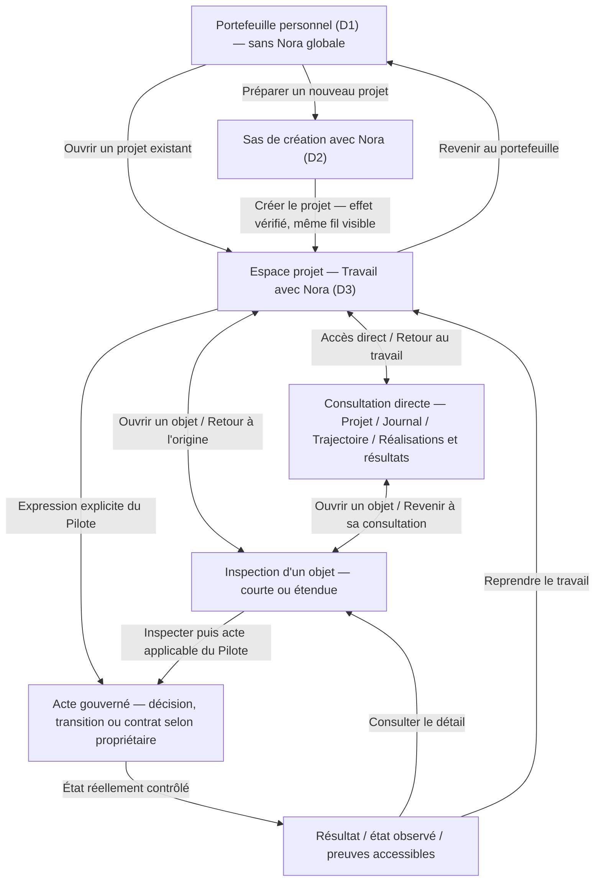

# SFIA Studio Next — Espace projet et interaction Pilote–Nora

**R3 — Conception UX/UI · Document de travail évolutif · v0.21**

| Métadonnée | Valeur |
| --- | --- |
| Date d'initialisation / mise à jour | 2026-11-02 / 2026-11-03 (Europe/Paris) |
| Produit | **SFIA Studio** ; programme de reconstruction **SFIA Studio Next** |
| Macro-lot R3 | Quatre capacités A–D retenues : **A — Entrée/continuité (revue acceptée avec réserves) ; B — Trajectoire/cycles/CKI/décisions (revue acceptée avec réserves) ; C — Réalisation et résultats (revue de cohérence PASS, contenu validé Morris) ; D — Git et qualité transverse (prochaine capacité autorisée)**. Travail séquentiel avec revue Morris par macro-lot. |
| Responsable des arbitrages | **Morris** |
| État du présent document | **DOCUMENTED — FIGMA UX REVIEWED v0.21** ; direction B2/V3, **A/B acceptés avec réserves**, **C validé au niveau du contenu par Morris et contrôlé cohérent au niveau prototype**, D autorisé comme suite conditionnelle ; R3 **ouvert**, aucun comportement runtime prouvé |
| Direction explorée | **B2 — conversation toujours retrouvable, surfaces adaptatives** et **V3 — reprise contextualisée** ; hypothèses privilégiées de Morris, **non validées comme architecture finale** |
| Source Git vérifiée | `mcleland147/sfia-workspace`, `main@139c706e8b3dca6f1db836a14ffd1aafa1c5e990` (2026-11-03) ; branche documentaire candidate `sfia/next-r3-ux-interaction-candidate` |
| État Git Next | R1/R2 clôturés avec réserves ; **Roadmap sur `main` historiquement « R3 NOT STARTED » malgré les travaux Figma/doc candidats — KNOWN GAP documentaire**, à régulariser par GO séparé |
| État technique | **N/A — NON IMPLÉMENTÉ** ; architecture, UX runtime et preuves Next inexistantes à ce stade |
| Chemin Git autorisé pour ce document (GO Morris 2026-11-02) | `projects/sfia-studio-next/ux-ui/espace-projet-interaction-pilote-nora.md` |
| État local du dépôt | **NON OBSERVÉ** ; contributions documentaires sur branche candidate et modifications Figma actives, **sans PR/merge** |

> **Référence de travail actuelle (v0.21) :** les §§1–26 conservent **l'historique d'exploration UX** et certains décomptes datés. Les **§§27–30** sont le contrat UX courant ; le [Guide de couverture UX R3](https://github.com/mcleland147/sfia-workspace/blob/sfia/next-r3-ux-interaction-candidate/projects/sfia-studio-next/ux-ui/audit-couverture-ux-r3.md), en particulier §§7–8 (lot B, 59 scénarios D5/D6), §§9–10 (lot A, 100 scénarios D1–D4) et §11 (contrat de reprise C/D), porte le contrôle de couverture. Les trois pages Figma restantes sont Fondations, Parcours de référence et Contrats visuels. Le prototype UX n'est ni une spécification R4, ni du code, ni une preuve de comportement réel.

> **Archives Figma :** les liens directs anciens des §§1–26 ont été neutralisés après suppression des pages exploratoires. Une description historique n'est **pas** la preuve que sa variante existe encore telle quelle. Les liens actifs et leur contrat de parcours sont ceux des §§27–30 et du Guide §§7–11.

> **Règle de lecture documentaire :** ce document formalise constats, contraintes, hypothèses et contrats UX candidats. Il ne modifie ni la vision R1 ni les neuf spécifications fonctionnelles R2 ; hypothèse et maquette ne valent pas arbitrage Morris ni implémentation. Les essais utilisateurs et la validation de sortie R3 restent à réaliser.

## 1. Finalité et résultat recherché

Concevoir **un espace projet cohérent** dans lequel le Pilote peut :

1. travailler naturellement avec Nora et obtenir des restitutions cognitives riches ;
2. retrouver directement les connaissances et états structurés de son projet sans devoir questionner Nora ;
3. inspecter une proposition, un document, une source, une décision, un contrat ou une preuve avec le niveau de détail approprié ;
4. exercer son autorité au bon moment, sans ritualisation inutile ;
5. revenir à son activité et reprendre après interruption sans confusion de contexte ni affirmation fictive.

**Critère directeur candidat :** Studio doit être perçu comme **un environnement de travail continu**, non comme une juxtaposition de chats, écrans et registres. La simplification doit réduire la charge cognitive, pas dissimuler des informations ou contrôles nécessaires.

### IN — premier macro-lot R3

Architecture d'interaction de l'espace projet ; articulation travail/conversation, consultation autonome et inspection ; navigation et transitions ; continuité, retours, interruptions et états limites ; prise en compte des sept E2E R1 et obligations UX D1–D9 ; comparaison des variantes ; principes testables et préparation de prototypes.

### OUT — à ce stade

Design system et branding définitifs ; palette/thème ; pixels et composants figés ; architecture technique, persistance, API, librairie de rendu, code, intégration Cursor/Git, tests runtime ; modification des règles métier R2 ; validation ou adoption du produit.

## 2. Sources et hiérarchie de lecture

**Sources normatives Next (Git `main` vérifié) :**

- [SEF v0.2](../governance/SEF.md), [Roadmap Next](../governance/roadmap.md), [convention de nommage](../governance/product-naming-conventions.md) ;
- [vision produit R1](../cadrage/vision-produit.md), notamment §§2.11, 2.15–2.21, 2.29–2.36 et sept E2E ;
- [référentiel R2 D1–D9](../conception-fonctionnelle/README.md), ses neuf spécifications et réserves reportées ;
- [décision de sortie R1](../governance/decisions/2026-11-02-r1-cadrage-formal-exit.md) et [décision de sortie R2](../governance/decisions/2026-11-02-r2-functional-exit.md).

**Source comparative, sans autorité Next :** Figma historique P3, « SFIA Studio — P3 Workspace / Interaction Architecture » : https://www.figma.com/design/m4g8j0gNbEzfIuH6S9AZJF/SFIA-Studio-%E2%80%94-P3-Workspace---Interaction-Architecture?node-id=2-6 . L'audit précédent a couvert ses 17 pages, incluant les contenus des pages 01, 02 et 16 : elles ne sont pas vides. Les étiquettes `VALIDATED` de P3 ne constituent pas des décisions Next.

**Ordre de validité :** décision applicable de Morris et sources R1/R2 pour le comportement produit ; ancien Figma pour l'inspiration et la comparaison ; présent document pour les hypothèses R3 à éprouver. Une suggestion UX ne peut pas créer une nouvelle autorité fonctionnelle.

## 3. Invariants fonctionnels non négociables pour l'UX

| Domaine | Contrat validé à préserver | Traduction UX à étudier |
| --- | --- | --- |
| D1 — Accès et portefeuille | Cockpit de consultation sans Nora globale ; contexte projet explicitement identifié (`RG-ACC-009/010/014`). | Navigation claire vers le bon projet ; séparation portefeuille / sas / espace projet. |
| D2 — Création | Sas conversationnel, création explicite et **continuité visuelle du même fil** après création vérifiée (`RG-CRE-008/010/017/020`). | Continuité d'entrée dans l'espace projet ; reprise après interruption du sas. |
| D3 — Nora | Initiative et travaux cognitifs directs, même sans cycle ; restitution **riche et adaptative** (`RG-CONV-002/005/006`, `RG-UX-001..003`). | La conversation accueille des contenus variés ; pas de gabarit ou procédure systématique. |
| D4 — Connaissance | Sujets vivants, vue Décisions comme accès à D6, points ouverts transversaux, reprise contextualisée (`RG-KNOW-003/004/011/015`). | Consultation autonome, historique et liens vers sources, sans second registre. |
| D5 — Trajectoire | Au plus un cycle actif ; aucun cycle requis pour converser ; étapes prévues ≠ cycles ouverts (`RG-TRJ-001/002/008/036`). | Visibilité proportionnée de la trajectoire et de l'état réel du cycle. |
| D6 — Gouvernance | Arbitrage humain naturel lorsque suffisamment clair ; recommandation, décision, GO, exécution et acceptation distincts (`RG-GOV-001/002/008/024`). | Actes d'autorité intelligibles ; confirmation supplémentaire uniquement quand nécessaire. |
| D7 — Réalisation | Contrat borné inspectable, **instruction exacte consultable**, acte distinct « Exécuter », état de tentative honnête (`RG-REAL-007/008/012/013/020`). | Inspection approfondie à la demande ; absence de lancement implicite. |
| D8 — Résultats et preuves | Déclaration ≠ observation ≠ conformité ≠ acceptation (`RG-PRV-010/014/019/021/027`). | Résultats synthétiques, preuves consultables et inconnus visibles. |
| D9 — Git | Facultatif par projet ; identité Studio ≠ droits Git ; états et mutations Git sous leur propre contrat. | Accès aux sources et à leur provenance sans rendre Git préalable à l'usage. |

La conception doit également couvrir les **66 réserves R2 reportées** selon leur pertinence pour les parcours ; aucune couverture exhaustive UX n'est encore démontrée.

## 4. Capitalisation de P3 : acquis et limites

**À préserver :** navigation discrète et hiérarchisée ; conversation avec Nora comme espace majeur ; sas progressif ; propositions, décisions et exécutions inspectables ; attention aux états d'erreur, aux preuves et au responsive ; sobriété de la direction Linear/Attio/Stripe sans reprendre une identité tierce.

**À challenger :** séparation fréquente entre Conversation / Aperçu / Exécution ; panneau contextuel potentiellement permanent ; multiplication des vues Journal/Historique/Synthèses ; place disproportionnée de métadonnées ou bordures ; accès global « Demander à Nora » incompatible avec D1 ; confusion possible entre état déclaré, vérifié et accepté.

**Correction importante :** P3 portait déjà une ambition de continuité et d'interaction contextuelle ; B2 est une **évolution à éprouver**, pas une idée prétendument absente du chantier historique.

## 5. Options étudiées et direction de travail

| Option | Description | Intérêt | Risque / verdict provisoire |
| --- | --- | --- | --- |
| A — P3 rationalisé | Espaces et vues explicites, dont Conversation / Aperçu / Exécution, avec navigation simplifiée. | Prévisibilité des fonctions. | Fragmentation possible du travail ; alternative de comparaison conservée. |
| B1 — Conversation toujours visible | Chat conservé à l'écran même pendant la consultation et l'inspection. | Présence de Nora immédiate. | Compression de l'espace utile et densité accrue ; non privilégiée. |
| **B2 — Conversation toujours retrouvable** | Conversation comme point d'ancrage habituel, pouvant céder temporairement la surface à une consultation ou une inspection approfondie. | Continuité et espace adapté au contenu. | Réussite conditionnée par les règles de retour, d'orientation et de reprise ; **direction privilégiée pour exploration, non validée définitivement**. |

**Expression de Morris (2026-11-02) :** B2 semble cohérente et peut servir d'hypothèse de travail ; Morris ne valide **pas** pour autant toutes les propositions ni l'architecture finale. Les décisions restent ouvertes et révisables.

## 6. Modèle d'interaction B2 — hypothèse actuelle

### 6.1. Quatre fonctions UX, pas quatre écrans

1. **Se repérer :** savoir quel projet est réellement ouvert et accéder à ses fonctions, sans afficher tout l'état métier en permanence.
2. **Travailler :** échanger avec Nora, investiguer, produire, comparer, décider dans la bonne portée et poursuivre son fil.
3. **Consulter :** accéder directement aux informations structurées : projet, Sujets, Décisions, points ouverts, trajectoire, réalisations et résultats ; ne pas demander à Nora de tout réafficher.
4. **Inspecter :** approfondir un contenu ou un effet et éventuellement accomplir l'acte pertinent dans ses conditions de gouvernance.

Ces fonctions ne créent aucun domaine métier supplémentaire et **ne déterminent ni le nombre de pages ni la forme du rail**.

### 6.2. Surfaces candidates et responsabilité d'affichage

| Surface UX candidate | Usage | Comportement souhaité | À ne pas présumer |
| --- | --- | --- | --- |
| Repères d'espace | Identité projet et navigation ; restriction significative. | Continus et discrets ; contexte explicite. | Un tableau de bord obligatoire partout. |
| Travail avec Nora | Fil, composition de réponses, action de réponse adaptée, rédaction. | Point de retour naturel ; contenus riches. | Chat toujours affiché à l'écran ou cycle obligatoire. |
| Consultation du projet | Rechercher/parcourir Sujets, Décisions, points ouverts, trajectoire, résultats. | Accessible indépendamment de Nora, état actuel et historique distingués. | Nouveaux registres de vérité, multiplication des onglets. |
| Inspection courte | Vérifier un sujet, une décision ou une provenance circonscrite. | Temporaire, réversible, retour au point d'origine. | Panneau droit permanent ou largeur fixe. |
| Inspection approfondie | Document dense, comparaison, contrat d'exécution, preuves détaillées. | Peut occuper l'espace principal, avec retour clair. | Mutation ou autorisation implicite par ouverture. |

**Gouverner** est un comportement transversal des interactions et non une vue séparée imposée. Un choix conversationnel n'est pas à lui seul une autorisation technique ; « Exécuter » reste l'acte dédié au contrat concerné.

### 6.3. Règles d'interaction candidates à éprouver

- **UX-H01 — Point d'ancrage retrouvable.** Depuis une consultation/inspection, le Pilote retrouve sans recherche sa conversation d'origine, son projet et l'activité pertinente.
- **UX-H02 — Continuité proportionnée.** Pendant la navigation temporaire, conserver, dans la mesure concevable et testable, le brouillon non envoyé, la position de lecture et l'objet sélectionné. Les garanties de persistance inter-session seront décidées en R4 ; ne jamais prétendre avoir sauvegardé un état inconnu.
- **UX-H03 — Autonomie de consultation.** Les états structurants du projet sont accessibles par navigation et recherche pertinentes sans question préalable à Nora.
- **UX-H04 — Adaptation au contenu.** Une inspection courte et un document volumineux n'imposent pas le même espace ; le petit écran ne doit pas être traité comme un desktop artificiellement comprimé.
- **UX-H05 — Autorité au bon endroit.** Propositions et décisions apparaissent dans le contexte de travail ; les actes protégés disposent du contrôle requis et d'une portée inspectable.
- **UX-H06 — Honnêteté d'état.** Aucune icône ou formulation ne laisse inférer un lancement, arrêt, résultat vérifié ou acceptation non observé.
- **UX-H07 — Absence de duplication métier.** La présentation de données dans plusieurs surfaces renvoie aux propriétaires D4/D5/D6/D7/D8/D9 plutôt que de produire plusieurs versions de vérité.
- **UX-H08 — Retour ancré dans l’origine.** Une inspection ouverte depuis le travail, une consultation ou un lien direct possède une issue de retour intelligible, sans inventer une origine absente.
- **UX-H09 — Navigation sans acte implicite.** Parcourir, agrandir ou fermer un contenu ne crée ni décision, ni cycle, ni contrat autorisé, ni exécution.
- **UX-H10 — Reprise projet et isolation.** Revenir dans un projet ne mélange ni brouillons, ni connaissances, ni mandats d’autres projets ; les données réellement sauvegardées sont distinguées des états uniquement locaux.

Ces formulations sont **des exigences UX candidates**, pas des règles fonctionnelles nouvelles approuvées.

### 6.4. Carte des espaces et transitions — proposition v0.2

Ce diagramme représente **des activités visibles et des possibilités de déplacement**, pas une architecture technique, des routes, des composants, des tables ou un moteur d'états. Les flèches n'accordent aucune autorisation métier. « Travail » désigne l'activité de conversation/production courante, **pas une obligation d'avoir un cycle actif**.

**Lecture :** le Journal et la trajectoire se consultent directement, sans message Nora obligatoire. Une inspection d'objet conserve son origine, qu'elle ait été ouverte depuis une réponse de Nora, la trajectoire ou une vue structurée. Les états d'autorité et d'exécution dépendent exclusivement de D2/D5/D6/D7/D8/D9, pas du choix de surface.

**Limite du diagramme :** « Acte gouverné » rassemble uniquement des *interactions possibles*, et **ne désigne pas un processus universel** : une décision naturelle D6, un GO de cycle D5/D6, la création D2 et l'« Exécuter » D6/D7 ont des règles distinctes. Une analyse cognitive ne traverse pas obligatoirement cette étape.

### 6.5. Carte d'accès : ce qui doit rester trouvable

| Fonction accessible | Point d'entrée candidat depuis l'espace projet | Contenu principal ; limites | Comportement de retour |
| --- | --- | --- | --- |
| **Travail avec Nora** | Accès prioritaire et explicite depuis toute consultation | Fil/activité courante, réponses riches, brouillon et échanges, même sans cycle | Reprise du travail connu ou état de reprise honnête |
| **Contexte du projet** | Accès direct « Projet » ou équivalent à concevoir | Finalité, acquis utiles, informations courantes, liens vers autres vues ; **pas** de registre bis | Retour à la dernière activité récupérable |
| **Journal — Sujets** | Accès direct au Journal ; première vue principale | Organisation vivante des sujets, connaissances et liens ; aucune décision créée par navigation | Retour à la vue ou au travail d'origine |
| **Journal — Décisions** | Seconde vue principale du même Journal | Références aux actes D6, portée, validité actuelle et histoire ; pas d'autorité portée par D4 | Idem ; inspection possible d'un arbitrage |
| **Points ouverts** | Accès transversal depuis Projet, Journal ou contexte pertinent | Questions, dépendances, blocages et réserves, quel que soit leur sujet/cycle | Ne devient pas un troisième registre de gouvernance ni un onglet permanent imposé |
| **Trajectoire et cycles** | Accès direct ou depuis le contexte du projet | Étapes envisagées distinctes des cycles réellement ouverts, cycle actif unique ou absence de cycle, transitions | Aucun changement de cycle par simple consultation |
| **Réalisations / résultats** | Accès explicite depuis Projet ou le contexte d'un travail ; mode de navigation à tester | Tentatives D7, synthèses D8, réserves et preuves référencées ; une seule vérité par propriétaire | Permet de revenir à la conversation ou à l'objet de départ |

**Arbitrage non pris :** les libellés, l'ordre, le niveau exact de navigation (rail, commande, vue, section), la visibilité permanente et le regroupement « Réalisations / résultats ». L'objectif est l'**accessibilité**, pas la multiplication des entrées de menu. Git facultatif ne constitue pas une rubrique obligatoire dans un projet non connecté.

### 6.6. Contrat de transition : entrer, parcourir, revenir

| Transition | Déclencheur utilisateur | Effet UX proposé | Données / frontières à respecter |
| --- | --- | --- | --- |
| **Portefeuille → Projet** | Ouvrir explicitement un projet accessible | Afficher son identité réelle et retrouver une activité pertinente, avec accès au contexte du projet | D1 vérifie le bon projet ; pas de récupération du contenu d'un autre projet |
| **Portefeuille → Sas** | Préparer un nouveau projet | Ouvrir un travail avec Nora sous une identité **sas**, distincte du projet | D2 : aucune création implicite ni cycle/Git imposé |
| **Sas → Projet** | Acte « Créer le projet » et effet établi | Continuer **visuellement le même fil**, avec point de passage explicite « Projet créé » | D2 `RG-CRE-017/018/020` ; si l'effet n'est pas connu, rester dans le sas |
| **Travail → Consultation** | Chercher un sujet, une décision ou l'état du projet | Donner priorité à la consultation demandée, sans conversation obligatoirement affichée | Travail d'origine identifiable ; brouillon et position préservés dans la mesure prouvable |
| **Travail → Inspection** | Ouvrir source, document, recommandation ou résultat lié à Nora | Inspection courte ou approfondie, selon complexité et risque | Référence et version de l'objet ; ouverture ≠ consentement ≠ décision |
| **Consultation → Inspection** | Sélectionner un objet dans Journal, Trajectoire ou Résultats | Examiner l'objet ; garder le chemin de retour vers la consultation d'origine | Les données sont lues chez leur propriétaire canonique |
| **Inspection → Origine** | Retour / fermer / Escape selon le modèle d'interface | Retrouver la consultation ou la position de travail *qui a ouvert l'inspection* | Si ouverture par lien direct, retour explicite vers le parent pertinent ; jamais une fausse origine |
| **Consultation → Travail** | « Revenir au travail » ou poursuivre avec Nora sur un élément | Reprendre une activité identifiable ; éventuellement référencer explicitement l'objet sélectionné | Ne pas injecter silencieusement un message dans le fil ni modifier les décisions |
| **Proposition → Décision** | Arbitrage explicite et suffisamment qualifié | Restituer l'acte et sa portée, sans double confirmation rituelle | D6 possède l'autorité et son état ; recommandation ≠ décision |
| **Contrat inspecté → Exécution** | Acte dédié « Exécuter » sur la version applicable | Montrer demande, lancement constaté ou état incertain selon observations | D6/D7 : effet distinct ; droits, contrat exact, cible et STOP effectif à recontrôler |
| **Exécution → Résultats** | Consulter un retour disponible ou revenir plus tard | Présenter état de tentative, déclaration, observation, conformité et acceptation séparément | D7 ≠ D8 ≠ D6 ; aucune activité simulée |
| **Projet A → Projet B** | Navigation explicite | Changer clairement de référence de projet ; reprendre le contexte de B seulement une fois autorisé | Pas de brouillon, inspection, mandat ou connaissance de A transférés à B |

**Point sensible :** l'accès direct à une décision depuis deux endroits ne doit pas entraîner deux copies qui divergent. Les chemins d'affichage diffèrent, la référence métier et le propriétaire restent uniques.

### 6.7. Règles de continuité et mémoire de navigation proposées

**Pendant une navigation au sein de la même session (hypothèse UX exigeante) :**

- Conserver un **point de retour** relatif à l'activité d'origine : projet, travail/conversation concerné, objet inspecté et position utile. Un retour arrière ne doit pas ramener arbitrairement au portefeuille.
- Préserver un **brouillon non envoyé** en cas de consultation courte ou d'inspection ; une éventuelle perte irréversible mérite une alerte contextualisée, pas une confirmation à chaque navigation.
- Un **retour depuis inspection** doit rendre sa place à l'activité appelante. Éviter l'empilement de panneaux et sous-inspections qui rend l'origine introuvable ; les relations entre objets peuvent ouvrir un détail étendu avec chemin de retour explicite.
- Un utilisateur peut consulter une autre conversation du **même projet** sans perte des acquis durables ; le modèle n'impose **ni une conversation unique par projet, ni la réinjection du transcript intégral**.
- L'action « Poursuivre avec Nora sur cet élément » prépare un contexte/référencement compréhensible et contrôlable par le Pilote ; **elle n'envoie pas automatiquement de message** ni ne promeut le contenu consulté en décision.

**Après interruption, expiration de session, rechargement ou ouverture par lien direct :**

- Reconstituer les seules informations réellement enregistrées ou vérifiables ; présenter explicitement ce qui n'a pas été retrouvé. Ne pas promettre la restauration inter-session d'un brouillon tant que R4/R5 ne l'ont pas établi.
- Contrôler le projet et les permissions courantes avant d'afficher du contenu privé. Un objet ouvert depuis un lien externe peut n'avoir **aucun travail d'origine** : proposer alors son contexte parent autorisé, pas un « retour au chat » fictif.
- Requalifier l'autorité avant tout effet protégé ; une autorisation précédente ou un contrat dont la version a changé n'est pas réutilisé par simple restauration visuelle.
- Sur un état inconnu (création, transition, lancement, STOP, résultat), afficher un état à vérifier et les actes utiles, sans annoncer réussite ou échec non prouvé.

**Frontière R3/R4 :** R3 décrit l'expérience attendue et ses conditions d'échec ; R4 devra définir précisément persistance, reprise, liens profonds, droits, isolation et cohérence concurrente. Le prototype UX ne prouvera pas ces mécanismes techniques.

### 6.8. Quand préférer consultation, inspection courte ou surface étendue ?

| Besoin réel | Mode candidat | Justification UX | Alternative / garde-fou |
| --- | --- | --- | --- |
| Balayer les sujets du projet et comparer plusieurs décisions | **Consultation structurée** | Recherche, tri, contexte et comparaison entre objets | Ne pas reconstruire un listing dans le fil à chaque demande |
| Vérifier un motif d'arbitrage ou une source courte | **Inspection courte** | Besoin ponctuel, retour immédiat | Passer en étendu si provenance, historique ou volume le demande |
| Lire/modifier un document complexe ou comparer deux architectures | **Surface étendue** | Espace, lisibilité et profondeur de travail | Conserver lien avec la conversation d'origine ; mutation externe toujours distincte |
| Inspecter une proposition de décision | **Inspection courte ou étendue selon enjeu** | Comprendre options, impacts et portée | Un clic de lecture ne vaut pas décision D6 |
| Examiner un contrat d'exécution et l'instruction exacte | **Surface étendue conseillée** | Gravité d'un effet, identité du contrat et périmètre à vérifier | Action « Exécuter » uniquement sous les conditions D6/D7 ; pas de lancement par ouvrir/fermer |
| Examiner un résultat et ses preuves | **Synthèse + inspection étendue si nécessaire** | Distinguer verdict, critères, événements et limites | « Terminé » ne signifie ni conforme ni accepté |
| Vérifier le cycle actuel ou une étape proposée | **Consultation ou inspection courte** | Progression disponible directement ; détail à la demande | Un cycle proposé ne devient pas actif par navigation |

Ce tableau **n'est pas une règle rigide de rendu** : Nora adapte ses productions aux contenus et au Pilote ; taille d'écran, accessibilité, complexité et tâche modifient la représentation pertinente.

### 6.9. Point d'entrée d'un projet : arbitrage UX encore ouvert

Deux entrées possibles sont à comparer sur un retour réel :

- **Entrée par le travail récupérable :** rouvrir l'activité/conversation pertinente si elle est identifiée et autorisée ; afficher dans un repère discret les éléments courants utiles. *Atout :* continuité immédiate. *Risque :* reprendre un ancien sujet alors que le Pilote voulait seulement consulter son projet.
- **Entrée par un contexte synthétique :** présenter ce qui est établi sur le projet et un accès direct au travail. *Atout :* orientation et visibilité. *Risque :* interposer un tableau de bord à chaque visite et affaiblir la conversation.

**Préférence candidate à tester :** privilégier la reprise du travail lorsqu'elle est fiable ; rendre le contexte du projet directement accessible, et, en l'absence d'activité récupérable, fournir une entrée neutre vers Nora accompagnée des repères disponibles. **Aucun modèle de « dernier chat unique » n'est imposé.**

### 6.10. Cas limites et conditions d'échec à prototyper

1. **Sans cycle :** travail Nora et accès Journal/Projet parfaitement utiles ; aucun CKI ou gate inventé.
2. **Cycle réellement actif :** le repère de cycle est compréhensible ; consultation d'un autre sujet ne change pas le CKI principal ni n'ouvre un second cycle.
3. **Décision ambiguë :** Nora demande la précision déterminante ; la consultation de l'objet ne transforme rien en acte.
4. **Contrat changé après inspection :** l'ancienne inspection ne rend pas la nouvelle version automatiquement exécutable ; signaler le changement et demander l'examen adéquat.
5. **Lancement incertain :** état « à vérifier » approprié, sans relance aveugle ni télémétrie simulée.
6. **Session expirée ou droit retiré :** aucun contenu privé d'un projet quitté/non autorisé ne s'affiche ; retour et reprise bornés.
7. **Projet sans Git :** Nora, Journal, trajectoire, travail cognitif et gouvernance restent utilisables ; références indisponibles signalées sans fausse permission Git.
8. **Petit écran, clavier ou lecteur d'écran :** accès direct à Travail/Journal, fermeture et retour explicites, lecture des statuts sans code couleur seul ; pas de panneau persistant comprimant artificiellement le contenu.

### 6.11. Hypothèses et critères de décision pour la suite

| Hypothèse | Critère de sélection à éprouver | État |
| --- | --- | --- |
| **B2 — conversation retrouvable** | Continuité non dégradée en consultant une source, une décision ou un contrat ; lecture complexe confortable | **Préférence de travail Morris — non validée** |
| **Navigation par activités compréhensibles** | Projet/Journal/Trajectoire et résultats retrouvables sans chat ; pas de navigation de type domaine D1–D9 | **À TESTER** |
| **Inspection réversible liée à son origine** | Le Pilote revient au bon contexte, y compris après ouverture depuis une consultation ou un lien direct | **À TESTER** |
| **Profondeur d'affichage adaptée** | Source courte simple ; document/contrat complexe lisible sans écraser l'activité | **À TESTER** |
| **Reprise du travail comme entrée préférée** | Les retours fréquents sont rapides, sans confusion quand l'intention est la consultation | **À ARBITRER après prototype** |

Les quatre premières hypothèses appartiennent au **même macro-lot de cohérence d'interaction**. Il n'est pas nécessaire de lancer un mini-lot ou un nouveau document pour chacune.

## 7. Parcours de référence à confronter au modèle

### Parcours P1 — Travail cognitif sans cycle

Projet ouvert, aucun cycle actif. Le Pilote demande une étude d'architecture ; Nora restitue un comparatif riche, sourcé et proportionné. Le Pilote inspecte une hypothèse, consulte une décision existante, revient au travail et poursuit. Aucun cycle, CKI ou contrat Cursor n'est créé du seul fait de cette interaction.

### Parcours P2 — Reprise d'un projet avec cycle actif

Le Pilote rouvre un projet. Il retrouve le **cycle réellement actif**, les acquis, sujets et points ouverts utiles. Il consulte une étape de trajectoire, puis une décision, sans activer un second cycle ni perdre la conversation. Une transition éventuelle exige le GO applicable ; les états prévu, proposé et effectif restent discernables.

### Parcours P3 — Décision, réalisation et preuves

Nora recommande une évolution. Le Pilote arbitre selon D6 ; l'arbitrage ne lance aucun outil. Nora prépare si nécessaire un contrat D7, ses impacts et son instruction exacte consultable. Le Pilote inspecte une version déterminée du contrat puis utilise **« Exécuter »**. Les retours sont montrés selon leur état réel ; Nora analyse les preuves disponibles et les réserves. Le Pilote conserve l'acceptation métier.

### Parcours P4 — Frontières et interruptions (négatif)

Le Pilote navigue vers un autre projet, perd sa session ou ferme l'inspection pendant un brouillon ; un accès, une récupération ou un retour est impossible. Studio doit distinguer le contexte réellement disponible du contexte demandé, préserver les permissions et afficher une limite exploitable. Aucun contenu privé d'un autre projet ni succès d'une opération non vérifiée ne doit être suggéré.

### Parcours P5 — Continuité depuis le sas

Le Pilote explore un projet dans le sas, le quitte puis le reprend. La création exige l'acte explicite et un effet vérifié. Une fois le projet effectivement créé, **le fil demeure visuellement continu** vers l'espace projet. En cas de création incertaine, la transition n'est pas présentée comme réussie.

## 8. Critères d'évaluation du prototype et de revue UX

La proposition devra permettre de démontrer sur les parcours précédents :

1. **Orientation :** l'identité du projet et le contexte de travail ne sont jamais trompeurs.
2. **Accès autonome :** un sujet, une décision et un point ouvert sont retrouvables sans passer par Nora.
3. **Continuité :** inspection et consultation permettent de revenir facilement au bon endroit ; le comportement en cas d'interruption est explicite.
4. **Clarté :** distinction perceptible entre recommandation, décision, GO, préparation d'un contrat, « Exécuter », tentative et résultat.
5. **Restitution :** réponse simple légère ; résultat complexe véritablement structuré et consultable ; sources et limites visibles quand déterminantes.
6. **Variabilité :** aucun cycle / cycle actif, desktop / petit écran, cas normal / refus / inconnu / données périmées.
7. **Accessibilité et sobriété :** navigation clavier et lecture compréhensible sans seule dépendance aux couleurs ou icônes (exigence de conception à vérifier sur prototypes).
8. **Conformité :** chaque comportement évalué est rapproché des RG/PF propriétaires et des réserves pertinentes ; aucune couverture n'est revendiquée sans revue.
9. **Retour d’inspection :** depuis trois origines distinctes (conversation, Journal, lien direct), le chemin de retour est correct sans créer de faux contexte.
10. **Lisibilité d’un contrat :** le Pilote distingue la version inspectée, le périmètre, l’instruction exacte et le moment où « Exécuter » est un acte effectif.

**Preuve actuelle :** revue documentaire et modèle conceptuel seulement. **Non acquis :** prototypes, captures runtime Next, essais utilisateurs, tests comportementaux ou validation R3.

## 9. Questions ouvertes et risques

| Sujet ouvert | Tension à résoudre | Prochaine preuve attendue |
| --- | --- | --- |
| Accès directs au projet | Quels repères doivent rester visibles et lesquels à la demande ? | **Carte conceptuelle v0.2 produite ;** arbitrage du menu à tester sur prototype. |
| Travail vs consultation | Quand changer de surface, quand afficher un aperçu, quand préserver visuellement le fil ? | Transitions comparées sur P1/P2. |
| Inspections | Quand utiliser une surface légère, étendue ou une consultation autonome ? | **Contrats d’interaction candidats v0.2 produits ;** preuve prototype encore absente. |
| Concurrence d'activités | Plusieurs sujets peuvent avancer ; un seul cycle peut être actif. Comment l'exprimer sans confusion ? | Test P2 et variantes d'état. |
| Présentation adaptative Nora | Comment garder une réponse riche lisible, manipulable et retrouvable ? | Exemples de restitutions simples, documentaires et interactives. |
| Gouvernance | Comment expliciter une décision sans « double validation », tout en protégeant « Exécuter » ? | Test P3 avec cas négatifs. |
| Reprise et dégradation | Qu'est-ce qui revient réellement après interruption et comment présenter l'inconnu ? | Règles candidates §6.7 ; test P4/P5, preuve technique R4–R6 absente. |
| Responsive/accessibilité | Quels comportements changent selon l'espace disponible ? | Prototypes desktop et petit écran testés. |
| Entrée dans un projet | Reprendre le travail ou afficher d’abord le contexte synthétique ? | Comparer les deux comportements avec projet neuf et projet riche. |
| Profondeur de navigation | Comment éviter l’empilement d’inspections et assurer le retour depuis un lien direct ? | Scénarios d’origine Travail/Journal/lien externe. |

**Risques principaux :** chat-first devenu exclusif ; navigation allégée mais opaque ; panneaux emboîtés ; état affiché plus affirmatif que les preuves ; fuite d'autorité entre surfaces ; fragmentation des décisions dans plusieurs interfaces ; surconception avant validation des parcours.

## 10. Trajectoire cohérente du macro-lot

**Travail de conception R3, sans micro-cycles documentaires :**

1. **Architecture d'interaction :** responsabilités des surfaces et transitions, modèles comparés, invariants et cas négatifs.
2. **Confrontation par parcours :** P1–P5, alternatives et corrections ; produire une première représentation testable, sans figer l'identité graphique.
3. **Revue Morris :** retenir, corriger ou rejeter le modèle avec conditions et réserves explicites.
4. **Enrichissement UX du même macro-lot :** navigation détaillée, états d'interaction, restitutions Nora, accessibilité et responsive ; maquettes Figma seulement après cadrage suffisant et autorisation adaptée.
5. **Gate :** approbation UX explicite pour le périmètre concerné, traçabilité Git selon un mandat distinct, puis transmission des besoins/contraintes techniques à R4.

**Responsabilités :** ChatGPT prépare et challenge la conception (D0) ; Morris arbitre ; Figma peut matérialiser les variantes sous autorisation ; Cursor intervient uniquement sur les travaux techniques autorisés selon SFIA v2.6. Aucun changement R1/R2 silencieux.

## 11. Registre d'évolution et décisions

| Date | Élément | Nature | Statut / portée |
| --- | --- | --- | --- |
| 2026-11-02 | R1 : vision Pilote–Nora et sept E2E ; R2 : neuf specs, 300 règles, 241 scénarios et réserves. | **Référentiel amont** | **VALIDATED SPEC** R2, clôture R1/R2 avec réserves, non implémenté. |
| 2026-11-02 | Audit de P3 : conserver les acquis, revoir fragmentation des vues et surfaces. | Diagnostic UX comparatif | **DOCUMENTED / analyse**, pas décision Next. |
| 2026-11-02 | Comparer P3 rationalisé (A) et interaction contextuelle (B). | Hypothèse de démarche | **EXPLORATION**. |
| 2026-11-02 | Privilégier B2 : conversation toujours retrouvable, pouvant céder l'espace à la consultation et à l'inspection. | **Préférence de travail exprimée par Morris** | **HYPOTHÈSE DIRECTRICE**, pas validation globale d'architecture UX. |
| 2026-11-02 | Documenter progressivement les analyses et arbitrages UX. | Demande explicite de Morris | **GO de rédaction D0 locale** ; **aucun GO Git/publication**, aucun GO Figma. |
| 2026-11-02 | Approfondir B2 ; produire carte des activités, transitions, critères et situations négatives (§6.4–6.11). | GO de poursuite du travail R3 par Morris | **DOCUMENTED — HYPOTHÈSES UX**, ni acceptation de la carte ni arbitrage du point d’entrée. |

| 2026-11-02 | Produire deux variantes basse fidélité d'entrée projet et publier le document UX sur une branche Git dédiée. | GO Morris : poursuite de conception + publication documentaire bornée | **DOCUMENTED / CANDIDATE** ; aucun GO pour PR, merge ou validation du modèle. |

| 2026-11-03 | Intégrer V3, entre-deux sélectif V1/V2 ; poursuivre le parcours Travail / Journal / Décision / Retour. | Préférence et GO de poursuite exprimés par Morris, sans approbation de tous les détails | **HYPOTHÈSE PRIVILÉGIÉE — DOCUMENTED / CANDIDATE UX** ; publication D1 sur la branche existante, sans PR/merge. |

| 2026-11-03 | Créer un fichier Figma Design neuf et indépendant pour visualiser V3 (trois écrans) ; conserver contexte condensable en hypothèse. | GO Morris explicite pour Figma neuf, consultation P3 seulement en lecture ; approbation du principe de condensation, pas des écrans | **FIGMA CANDIDATE — THREE EDITABLE SCREENS** ; pas de validation, prototype cliquable, développement ni preuve runtime. |

| 2026-11-03 | Définir le périmètre candidat d'inspection au-delà de la visionneuse : documents créés/modifiés par Nora, objets métiers, sources Git/liens externes, contrats Cursor, rapports et preuves ; distinguer MVP et extensions. | Exploration à la demande de Morris ; aucun arbitrage d'édition ou de persistance validé | **ANALYSE / HYPOTHÈSES R3**, sans validation de formats, d'architecture ni d'intégrations. |

| 2026-11-03 | Illustrer l'inspection avec trois nouveaux écrans éditables dans le Figma Next existant : document Nora Markdown, sources GitHub/web, contrat Cursor/rapport/preuves. | Mandat Figma Morris ; hypothèses R3 §17 | **THREE FIGMA CANDIDATES REVIEWABLE**, pas validation fonctionnelle/architecture ; revue Morris avant retour R1/R2. |

| 2026-11-03 | Reprendre R3 après PR #642 intégrée dans `main` et créer le parcours documentaire en quatre états Figma, sans requalifier R1/R2. | Reprise R3 demandée par Morris, travail UX exploratoire ; aucun GO de PR/merge UX ni validation écran finale | **DOCUMENTED — FIGMA CANDIDATE** ; revue Morris et tests de navigation à venir. |

| 2026-11-03 | Rendre navigable la traversée E2E, ajouter les trois états discriminants et les accès autonomes Projet/Git, vérifier réactions et fidélité UX. | GO Morris pour poursuivre R3 ; aucun mandat de promotion sur main | **FIGMA INTERACTIVE CANDIDATE** : 11 frames et liens vérifiés, aucun runtime Next. |

| 2026-11-03 | Relier les documents Nora, les décisions et un refus Git au prototype global ; éprouver deux surfaces compactes à 1280 px, auditer les réactions et la lisibilité. | GO Morris de poursuite R3 ; sans nouveau mandat de PR, merge ou clôture | **FIGMA CANDIDATE** : 17 écrans, 103 liens internes ; tests produit, accessibilité et responsive exhaustif non réalisés. |

| 2026-11-03 | Consolider les restitutions adaptatives de Nora : réponse simple, clarification déterminante, divergence des sources et digression/reprise dans le parcours produit Figma. | GO Morris de poursuite R3 ; revue de sortie et promotion Git non autorisées | **DOCUMENTED / FIGMA CANDIDATE v0.12**, aucun comportement live ni décision R4. |

| 2026-11-03 | Concevoir trois restitutions Nora riches (analyse A/B, parcours/dépendances, investigation sourcée) et consigner la réserve d’étude R4 A/B/C. | GO Morris de poursuite R3, préférence initiale A sans adoption | **DOCUMENTED / FIGMA CANDIDATE v0.13 — R4 RESERVE OPEN**, pas d'ADR ni de runtime. |

| 2026-11-03 | Représenter dans Figma une réponse Nora unique mêlant investigation, comparaison, parcours, recommandation et actions dynamiques ; réserver leur architecture en R4. | GO Morris pour poursuivre R3, liberté cognitive confirmée, pas de choix technique | **DOCUMENTED / INTERACTIVE FIGMA CANDIDATE v0.14 — R4 STUDY OPEN**. |

| 2026-11-03 | Adapter la réponse Nora composite au défilement d'un écran standard, stabiliser le composeur, retirer les notices techniques de l'UI et requalifier les trois vues antérieures comme explorations de formes. | Retour de Morris sur l'écran 22, cohérence d'usage validée en principe | **FIGMA R3 CANDIDATE v0.15** — défilement configuré, pas de validation navigateur. |

| 2026-11-03 | Consolider R3 à l'échelle produit : nouvelle page Figma de parcours Pilote–Nora, repère « aller au plus récent », contrats visuels, variations d'autorité/STOP, matrice R1/R2 et réserves R4. | Mandat Morris de poursuivre le macro-lot autonome, sans solliciter de GO écran par écran ni promouvoir le jalon | **DOCUMENTED / FIGMA CONSOLIDATED CANDIDATE v0.16** ; tests navigateur, accessibilité et sortie R3 non validés. |

### Règle de maintenance

À chaque échange qui modifie substantiellement la conception :

- intégrer la proposition dans la section fonctionnelle concernée et ajouter une ligne au registre avec date, auteur de l'arbitrage, source et portée ;
- qualifier distinctement **HYPOTHÈSE / EN EXAMEN / VALIDÉ PAR MORRIS / REJETÉ / REPORTÉ** ; ne jamais transformer le silence ou l'absence d'objection en validation ;
- conserver l'historique des décisions révisées et noter les impacts sur les règles R2 et les autres parcours ;
- ne pas confondre **rédaction locale**, **contribution Git autorisée**, **merge**, **implémentation** et **preuve** ;
- limiter le nombre de documents : enrichir prioritairement **ce document** tant qu'un découpage supplémentaire n'apporte pas une frontière de responsabilité ou un gate réel.

## 12. Prochain sujet d'analyse — organisation concrète de la surface de travail

**La carte logique B2 a été documentée en v0.2 (§6.4–6.11), pas encore démontrée ou approuvée. La v0.3 ajoute ci-dessous deux variantes basse fidélité d'entrée dans l'espace projet.** La suite cohérente du macro-lot consiste à produire **deux variantes de composition basse fidélité**, sans branding, pour comparer les comportements suivants :

1. **Entrée dans un projet :** reprise du travail récupérable versus contexte synthétique initial, avec situation sans cycle et avec cycle.
2. **Passage Travail ↔ Journal :** retrouver une décision, ouvrir son inspection, revenir au bon point de lecture puis poursuivre avec Nora sur cet objet.
3. **Contrat technique :** depuis une recommandation Nora, inspection d'un contrat et de son instruction exacte, puis visibilité des états après « Exécuter » ; version changée ou lancement incertain en variante négative.

**Gate attendu pour la suite :** avis Morris sur la direction relative de ces variantes après examen, sans créer d'approbation générale de B2 par défaut. Les maquettes Figma ne sont pas autorisées par le simple GO de travail conceptuel ; un GO distinct sera demandé si leur production ou modification est envisagée.

**Hors portée :** PR, merge, modification de la Roadmap, suppression d'éléments P3, modification des règles R2, code et preuve runtime. **Publication D1 :** document candidat sur branche dédiée uniquement, sous GO de Morris ; la Roadmap sur main conserve « R3 NOT STARTED » tant qu'aucune décision et intégration distinctes ne la mettent à jour.

## 13. Entrée dans l'espace projet — deux variantes basse fidélité (v0.3)

**Objet du test :** comparer deux compositions de l'entrée dans un projet **au sein de B2**, sans remettre en cause la conversation retrouvable ni les accès autonomes. Ces schémas sont des *wireframes textuels*, non des maquettes Figma, ni une preuve de comportement. Leurs zones, tailles et libellés restent candidats.

### 13.1 Variante V1 — Reprise du travail d'abord (*Resume-first*)

~~~
+-------------------------------------------------------------+
| SFIA STUDIO       > Projet identifié       [Chercher]       |
+--------------+----------------------------------------------+
| Projets      | Travail avec Nora                           |
|--------------|----------------------------------------------|
| Travail   *  | Activité de travail retrouvée (si fiable)    |
| Projet       |                                              |
| Journal      | Nora : synthèse / analyse / résultat riche    |
| Trajectoire  |                                              |
|              | [Ouvrir une source] [Voir une décision]       |
|--------------|                                              |
| Contexte     |                                              |
| utile :      |----------------------------------------------|
| Cycle réel   | [Composer un message...]                     |
| ou aucun     |                                              |
+--------------+----------------------------------------------+
~~~

**Comportement nominal candidat :** à l'ouverture d'un projet identifié et accessible, Studio reprend une activité pertinente **réellement récupérable**, puis rend immédiatement disponibles les informations du projet, le Journal et la trajectoire. Aucun chargement forcé de toutes les conversations, ni ouverture de cycle automatique. Le repère de cycle est discret, absent lorsqu'il n'y a pas de cycle.

**Si aucune activité n'est fiable :** afficher une entrée neutre dans le projet, un accès aux travaux/conversations disponibles et une invitation non prescriptive à travailler avec Nora ; ne pas inventer un « dernier chat » ni lancer automatiquement une nouvelle conversation sans intention.

**Intérêt :** accélère les retours fréquents et exprime directement la valeur conversationnelle. **Risque :** une activité retrouvée peut ne pas correspondre à l'intention du Pilote, surtout après une longue absence ou avec plusieurs conversations.

### 13.2 Variante V2 — Contexte du projet d'abord (*Context-first*)

~~~
+-------------------------------------------------------------+
| SFIA STUDIO       > Projet identifié       [Chercher]       |
+--------------+----------------------------------------------+
| Projets      | Projet : état de référence                   |
|--------------|----------------------------------------------|
| Travail      | [Reprendre avec Nora]                        |
| Projet    *  |                                              |
| Journal      | Travail(s) récupérable(s)                    |
| Trajectoire  | [Activité A]  [Activité B]                    |
|              |                                              |
|--------------| Trajectoire : réel / prévisionnel             |
|              | Sujets et points ouverts                     |
|              | Décisions applicables (références D6)        |
|              |                                              |
|              | Aucun cycle, si aucun cycle n'est actif      |
+--------------+----------------------------------------------+
~~~

**Comportement nominal candidat :** l'ouverture affiche d'abord une synthèse factuelle du projet avec accès explicite aux travaux disponibles. L'activité Nora est accessible immédiatement mais n'occupe pas d'emblée l'espace principal. Les éléments de contexte sont des références vers les responsabilités D4–D8, jamais un nouveau registre.

**Intérêt :** particulièrement lisible lors d'un retour après une longue interruption et pour un Pilote venu consulter, non converser. **Risque :** interposer une étape de navigation à chaque retour, reproduire un « dashboard » obligatoire et donner trop de poids à des indicateurs synthétiques incertains.

### 13.3 Comparaison sur situations réelles

| Situation | V1 — Reprise d'abord | V2 — Contexte d'abord | Point à éprouver |
| --- | --- | --- | --- |
| Projet créé via le sas | **Doit** préserver le même fil et afficher le passage « projet créé » : priorité contractuelle D2. | Ne doit pas intercaler un écran qui rompe le fil ; exception nécessaire à l'entrée normale V2. | D2 RG-CRE-017/018/020/021 |
| Retour fréquent au projet | Travail immédiatement disponible si retrouvé et autorisé. | Sélection supplémentaire pour retrouver le travail. | Temps et gestes pour reprendre l'activité voulue |
| Retour après plusieurs semaines | Peut ouvrir un sujet ancien inadapté. | Donne des repères actuels avant reprise. | Pertinence de l'activité et fraîcheur de la synthèse |
| Plusieurs conversations | Ne présume pas qu'il en existe une seule ; proposer un choix si l'activité de référence est ambiguë. | Peut exposer les activités disponibles et leurs contextes. | Orientation sans ajouter un « gestionnaire de chats » complexe |
| Aucun cycle actif | Nora demeure opérationnelle ; repère de cycle absent ou explicite. | Aucun cycle n'est inventé ; états du projet consultables. | R2 D3/D5 ; éviter la pression à ouvrir un cycle |
| Cycle actif | Contexte réel accessible, sans monopoliser le travail. | Étape active et projection lisibles. | Différencier réel / proposé / futur |
| Projet consulté pour retrouver une décision | Nécessite un accès direct et court au Journal. | Décisions disponibles dès l'entrée, mais sans copie d'autorité. | R2 D4/D6 ; nombre de gestes |
| État de session ou données indisponibles | Aucun travail ni autorité fictivement restaurés. | Aucune synthèse artificiellement « à jour ». | Dégradation et confidentialité D1/D3/D4 |

### 13.4 Hypothèse de synthèse, pas encore arbitrée

**Préférence de conception à éprouver :** V1 pour la reprise habituelle lorsque le travail courant est identifiable, **avec les qualités d'orientation de V2 accessibles immédiatement**. Une entrée depuis le sas conserve impérativement le même fil. En l'absence de travail récupérable, l'interface propose une entrée de projet neutre, plutôt que d'inventer un historique ou d'imposer un cockpit.

Ce compromis reste un **candidat** : ne pas coder une règle automatique « dernière conversation = travail pertinent » ni déduire l'intention de navigation de la seule date. Les informations du projet restent accessibles sans Nora.

### 13.5 Transitions à prototyper ensuite

1. **V1 → Journal → Décision → Retour :** conserver l'activité et la position d'origine ; la décision consultée reste la référence D6.
2. **V2 → Travail choisi → Source → Retour :** reprise de l'activité effectivement sélectionnée, sans remonter à un autre projet.
3. **Depuis Nora → Contrat D7 en surface élargie → « Exécuter » :** accès à l'instruction exacte et version inspectée, acte distinct ; présenter état inconnu si le lancement n'est pas établi.
4. **Retour par lien direct :** ouvrir le projet et l'objet si les droits sont vérifiés ; ne pas inventer un écran « précédent ».
5. **Petit écran / clavier :** rendre accessibles les mêmes responsabilités et un retour clair, sans supposer plusieurs colonnes.

### 13.6 Critères de revue avant choix V1/V2

- Accéder au travail pertinent et au Journal en peu d'étapes, sans que Nora soit nécessaire pour consulter.
- Reprendre le même fil sas→projet après création effective, sans variante divergente.
- Préserver les brouillons/positions de navigation selon les capacités réellement offertes ; ne pas promettre une restauration inter-session non prouvée.
- Distinguer projection, cycle réel, décision, préparation, exécution, preuve et acceptation.
- Gérer absence de cycle, plusieurs conversations, source périmée, session expirée et accès refusé.
- Montrer sur prototype desktop et petit écran l'information prioritaire et le mécanisme de retour.

**Verdict historique v0.3 :** V1 semblait le candidat principal pour l'usage régulier ; V2 servait de contre-proposition forte pour les reprises longues et la consultation. L'évolution candidate V3 est documentée §14. Aucun test utilisateur ou prototype cliquable n'a été effectué. **Prochain arbitrage Morris :** choix d'une direction après confrontation visuelle et parcours, sans transformation de préférence en décision implicite.

**État historique de cette section :** version 0.3 candidate ; voir §14–15 pour l'évolution de la conception. Conception documentaire en cours ; publication Git bornée sous GO Morris, sans PR/merge. Les sources R1/R2 restent propriétaires des règles ; les choix de navigation détaillée, Figma, architecture technique et preuves sont à instruire.

## 14. V3 — Reprise contextualisée (v0.4)

### 14.1 Intention, origine et statut

**Origine :** Morris demande un compromis entre V1 (reprise immédiate) et V2 (compréhension du contexte), sans fusionner deux tableaux de bord. La proposition V3 lui paraît cohérente ; il autorise son intégration et la poursuite de l'analyse.

**Statut : HYPOTHÈSE PRIVILÉGIÉE À ÉPROUVER**, pas une validation de l'ensemble des choix UX, pas une règle R2 ajoutée, pas une autorisation de Figma/code/PR/merge.

**Principe :** la reprise de l'activité avec Nora est le point d'ancrage naturel. Un contexte **court, pertinent et sourcé** permet de se repérer ; les vues Projet, Journal et Trajectoire restent consultables directement. Les objets décisionnels, de cycle, d'exécution et de preuve restent les références de leurs propriétaires fonctionnels, non des copies créées par le résumé.

### 14.2 Schéma conceptuel basse fidélité

~~~text
+----------------------------------------------------------------+
| SFIA STUDIO > Projet identifié            Recherche            |
+-------------+--------------------------------------------------+
| Portefeuille| Contexte bref du projet, si utile et fiable       |
|-------------| [Voir le projet] [Élément pertinent]             |
| Travail   * |--------------------------------------------------|
| Projet      | Nora — travail retrouvé si réellement disponible |
| Journal     |                                                  |
| Trajectoire | Analyse / tableau / document / proposition       |
|             | [Inspecter source] [Voir une décision]            |
|             |                                                  |
|             |--------------------------------------------------|
|             | Poursuivre avec Nora…                             |
+-------------+--------------------------------------------------+
~~~

Ce schéma décrit des **responsabilités et des accès**, pas des proportions, un rail arrêté, un composant graphique adopté, ni une carte toujours visible.

### 14.3 Contrat de sélection de l'information dans le contexte bref

| Fonction | Information admissible | Risque interdit / à éviter |
| --- | --- | --- |
| Repère | Identité du projet ; étape/cycle réellement actif si pertinent, ou absence d'activité déterminée | Cycle/progression déduits, étape fictive, méthode/CKI imposés |
| Attention utile | Une restriction, un point ouvert ou une décision à examiner **réellement pertinente** avec état et provenance | Catalogue exhaustif d'alertes, compteurs gadgets, création d'une obligation |
| Accès | Accès explicite au projet, Journal, Trajectoire et objets réels | Doubler D4/D5/D6/D8 dans un cockpit concurrent |

**Contrainte UX candidate :** un repère et, lorsqu'il existe, **un seul élément d'attention prioritaire** dans la zone brève, plus des accès directs. Ce nombre est une hypothèse de lisibilité, pas une contrainte métier. Si rien de significatif n'est établi, le contexte peut se faire discret ou disparaître. Une restriction réellement applicable doit néanmoins être visible au moment de tout acte concerné, même hors résumé.

Le contexte ne doit ni monopoliser l'espace nécessaire aux restitutions riches de Nora, ni afficher une synthèse présentée comme actuelle si ses sources ou droits ne permettent pas de l'établir.

### 14.4 Cas concrets à confronter

1. **Création sas → projet :** conserver strictement le même fil visuel après création vérifiée, sans interposition d'un écran d'accueil (D2 RG-CRE-017/018/020/021).
2. **Reprise fréquente :** travail identifié et réellement récupérable affiché directement ; contexte court.
3. **Retour après longue absence :** informations actuelles et réserves utiles consultables, sans inventer l'avancement.
4. **Plusieurs activités possibles :** accès aux travaux disponibles, sans présumer que le plus récent est le travail voulu.
5. **Aucun cycle, aucun travail repris :** entrée neutre et Nora utilisable immédiatement ; pas de cycle/CKI fictif.
6. **Source indisponible ou session expirée :** limite visible, aucune fuite de données, aucune reprise ou décision inventée.
7. **Écran étroit :** pas de triple colonne obligatoire ; séquencer contexte, travail et inspection.

### 14.5 Risques / critères de sortie

- **Fourre-tout :** le contexte bref se transforme en cockpit de cartes. Vérifier qu'il reste sélectif et peut être réduit.
- **Fausses priorités :** Studio choisit une conversation ou une alerte sans motif. Prévoir l'état neutre et la sélection explicite.
- **Deux vérités :** contexte affiché différent de la source officielle. Chaque élément inspectable doit mener à sa référence canonique.
- **Perte du fil :** ouvrir une information efface la saisie ou l'activité. Exiger un retour cohérent, dans la mesure des données réellement conservées.
- **Densité :** prouver sur desktop/petit écran que Nora conserve l'espace nécessaire à la complexité du travail.

**Verdict provisoire :** V3 remplace V1 comme hypothèse principale d'entrée ; V1 et V2 restent les contrepropositions documentées. Aucun test utilisateur, prototype cliquable, capture runtime ou arbitrage de composition final n'est revendiqué.

## 15. Premier parcours de vérification de B2/V3 — Travail Nora → Journal → Décision → Retour

### 15.1 Objectif

Le Pilote peut retrouver une décision antérieure, depuis une réponse de Nora ou **directement via le Journal**, la consulter puis reprendre son travail sans confusion de projet, de position, de référence ou d'autorité. Le retour vers la conversation ne doit pas créer une nouvelle décision, déclencher un effet ni reconstituer une saisie non sauvegardée.

**IN :** accès, origine de navigation, consultation, inspection, retour, états négatifs, interaction avec Nora.
**OUT :** nouveau statut de décision, registre parallèle, persistance/API, exécution, design final.
**Responsables :** D1 projet courant ; D3 conversation et reprise ; D4 navigation Sujets/Décisions ; D6 état officiel des décisions ; D5/D8 selon objets effectivement concernés.

### 15.2 Deux chemins vers le même objet

**A — Depuis une analyse de Nora :**
1. Nora cite une décision existante au bon projet avec une référence réellement disponible et, si utile, sa limite de fraîcheur.
2. Le Pilote choisit **Inspecter la décision** : une surface courte montre l'objet D6, sa portée, son état actuel et la provenance accessible, sans masquer indéfiniment le travail.
3. **Ouvrir dans le Journal** permet une consultation approfondie (historique, objets reliés), sans dupliquer la décision.
4. **Retour au travail** ramène à l'activité de départ, à sa position de lecture et au brouillon réellement conservé.

**B — Sans passer par Nora :**
1. Le Pilote ouvre directement **Journal → Décisions** depuis l'espace projet V3.
2. Il recherche, parcourt et inspecte la décision souhaitée, avec distinction courant/historique et restrictions.
3. **Retour aux décisions** restaure la consultation et ses filtres/position s'ils sont réellement sauvés.
4. **Discuter avec Nora de cette décision** est une action volontaire qui rattache une référence explicite au travail conversationnel ; ce transfert ne vaut aucun arbitrage ni mandat.

### 15.3 Contrat de retour (candidat UX, non garantie implémentée)

| Passage | Conservation souhaitée | Si l'état n'est pas récupérable |
| --- | --- | --- |
| Travail → inspection → Travail | Projet, activité, élément inspecté, position de lecture, saisie effectivement sauvegardée | Retrouver la dernière activité sûre ; signaler la perte d'un brouillon plutôt que l'inventer |
| Travail → Journal → Travail | Projet, origine fiable, objet lié, état réel des décisions | Offrir les activités récupérables si origine inconnue |
| Journal → inspection → Journal | Vue Décisions, filtre et sélection si conservés | Revenir à la vue Décisions par défaut, sans simuler les filtres |
| Lien profond → décision | Projet/droits actuels, objet D6 actuel | Accès refusé = aucune divulgation ; origine absente = pas de faux retour |
| Inspection → Nora | Référence explicite, objet/projet et intention du Pilote | Si accès retiré ou décision périmée, indiquer la limitation |

**Limites d'autorité :** ouvrir, lire, inspecter, retourner ou transmettre une référence à Nora **ne constituent ni HumanDecision, ni GO, ni exécution**. Un arbitrage clair relève de D6 ; un effet technique exige distinctement le contrat D7 applicable et l'action explicite Exécuter.

### 15.4 Cas à représenter et critères de vérification

- Décision actuelle, historique modifiée/remplacée, suspendue ou révoquée ; décision introuvable ou accès retiré.
- Retour vers le bon projet, pas vers un autre projet mentionné par hasard.
- Navigation clavier et petit écran avec inspection occupant temporairement toute la surface si nécessaire.
- Plusieurs conversations / origine absente / filtres de Journal non restaurables / perte de session.
- Aucun clic de navigation ne crée une décision ni une action technique.
- Le Pilote peut consulter une décision **sans Nora**, et la même décision a une seule autorité D6 quel que soit son point d'accès.
- La reprise de saisie et la continuité intersession sont promises uniquement au niveau réellement prévu et testé, pas par une simulation visuelle.

### 15.5 Suite du macro-lot

Produire les **wireframes desktop et petit écran** de la V3 et de ce parcours ; confronter présence/effacement du contexte, retour à l'origine, consultation autonome et cas négatifs. Tester ensuite le parcours d'inspection d'un contrat D7 (instruction exacte consultable, version stable, acte Exécuter, états de tentative) sans mélanger cette interface au Journal.

**Gate :** verdict UX explicite de Morris après revue des parcours et maquettes. Le GO actuel porte sur la **conception et la documentation candidate** seulement ; aucun GO de PR/merge, refonte de la doctrine, Figma ou implémentation ne découle du choix de poursuivre V3.

**Statut : DOCUMENTED — CANDIDATE UX v0.4 ; N/A — NON IMPLÉMENTÉ.**

## 16. Premiers écrans Figma — visualisation V3 (v0.5)

### 16.1 Autorisation et séparation des espaces

Morris autorise explicitement la **création de premiers écrans dans un nouvel espace Figma**, distinct de l'ancien P3. L'ancien Figma historique peut être consulté pour capitalisation, mais n'est pas la destination d'édition. L'outil a créé un **nouveau fichier Figma Design indépendant** dans l'équipe de Morris : aucun dossier-projet Figma spécifique n'a été créé (cette opération n'est pas exposée par le connecteur utilisé).

**Nouveau fichier :** [SFIA Studio Next — R3 UX · Espace projet Pilote–Nora](https://www.figma.com/design/itgvCulInEnFY6DvgIegvP).

**Statut : DESIGN CANDIDAT / BASSE FIDÉLITÉ**, produit avec calques texte, cadres auto-layout et instances de composants éditables, sans reprise des écrans P3, sans modification de l'ancien fichier et sans preuve de fonctionnement du produit Next.

### 16.2 Écrans produits et objectifs

| Écran | Lien | Ce que la composition doit permettre d'examiner |
| --- | --- | --- |
| 01 — Ouverture projet / V3 | Exploration historique | Repère contextuel initial, accès direct au projet/Journal, reprise du travail Nora |
| 02 — Travail avec Nora | Exploration historique | Contexte condensé, place dominante à la conversation et aux résultats adaptatifs |
| 03 — Inspection d'une décision | Exploration historique | Décision inspectable sans acte implicite, maintien identifiable de l'origine et accès au Journal |

**Données fictives :** projet Atlas, comparatif de deux architectures et exemple de décision. Les badges, nombres, états et éléments de contenu sont des **fixtures de maquette**, jamais des faits établis sur le programme SFIA Studio Next. Les états illustrés ne revendiquent pas de comportement produit LIVE/REAL.

### 16.3 Ce que l'on peut évaluer, ce qui reste non prouvé

**Évaluable maintenant par Morris :** hiérarchie de l'écran ; quantité de contexte visible ; relation entre rail, surfaces structurées et Nora ; lisibilité d'une restitution comparative ; principe du panneau d'inspection et retour.

**Non prouvé :** transitions cliquables, historique récupérable, choix correct d'activité, droits et permissions effectifs, persistance du brouillon, responsive mobile, accessibilité vérifiée, capture runtime ou intégration technique. Les textes indiquant des actions restent des maquettes, non des contrôles fonctionnels.

**Contrôle visuel effectué :** screenshots des écrans d'ouverture, de travail et d'inspection ; correction d'un chevauchement dans le texte de la décision, revérifiée visuellement. Les calques de texte sont éditables, famille Inter utilisée à titre provisoire et non validée comme identité typographique produit.

### 16.4 Questions à discuter lors de la revue Figma

1. La synthèse « Votre projet en bref » de l'écran 01 est-elle utile ou déjà trop envahissante ?
2. Le bandeau condensé de l'écran 02 est-il assez discret et suffisamment informatif ?
3. L'inspection de l'écran 03 doit-elle se déployer latéralement, en surface large ou selon la taille de l'objet ?
4. La navigation latérale doit-elle afficher constamment Projet/Journal/Trajectoire ou être plus contextuelle ?
5. Le contenu de Nora mérite-t-il une densité, une typographie ou des surfaces de travail différentes selon la nature des résultats ?

**Sortie de cette étape :** premières maquettes Figma créées et contrôlées ; retour Morris requis avant tout verdict UX fort. Aucun GO de PR/merge, de changement de Roadmap, de création d'un design system adopté ou d'implémentation technique n'en découle.

## 17. Inspection — périmètre fonctionnel à instruire (v0.6)

### 17.1 Objet et frontières

**Question Morris :** quelles informations l'inspection affiche-t-elle, que Nora peut-elle produire ou modifier, que le Pilote peut-il examiner et faire depuis la surface, et comment présenter documents, liens GitHub, contrats d'exécution, rapports Cursor et bilans de preuves ? L'exemple utilisateur est une **visionneuse de document adjacente au chat**. Cette forme est une référence d'interaction, non une limite de capacité ni une obligation de panneau fixe.

**Proposition R3 — non validée :** l'inspection est une **surface de consultation et d'interaction contextualisée, réversible et centrée sur un objet identifié**. Elle peut devenir étendue lorsque le volume ou le risque l'exige. Elle ne possède ni la conversation Nora, ni les registres D4/D5/D6/D7/D8/D9, ni un droit intrinsèque de mutation. Elle réutilise leurs références, états et garde-fous.

Les objets ne doivent pas être réduits à des « documents » : une décision, un contrat, un bilan ou un point ouvert est un objet métier dont la présentation est adaptée, même s'il contient du texte et des références.

### 17.2 Familles d'objets à rendre inspectables

| Famille | Vue principale | Fonctions candidates | Propriétaire officiel / frontière |
| --- | --- | --- | --- |
| Documents et productions Nora | Document lisible (Markdown rendu, texte), provenance, version, statut de brouillon | Lire, ouvrir en grand, copier/exporter, voir versions/diff, demander modification à Nora | D3 production cognitive, D4 capitalisation pertinente ; la gestion de fichiers/version est **à concevoir R4**, non implémentée |
| Sources externes / fichiers | Extrait ou aperçu réellement récupéré, fichier Git, lien d'origine, branche/commit/version quand disponible | Lire fichier autorisé, citer/ouvrir la source externe, comparer des références | D3/D4 provenance, D9 accès Git ; aucune navigation web intégrée imposée, aucun mandat de mutation par lecture |
| Sujets et points ouverts | Objet, synthèse, relations, état connu, provenance et histoire | Examiner contexte, voir objets liés, discuter avec Nora, accéder au Journal | D4 source de connaissance ; pas de troisième registre de points ouverts |
| Décisions du Pilote | Auteur, objet, portée, conditions, état applicable, source/historique | Comprendre, comparer historique, demander analyse ou révision selon acte compétent | D6 autorité exclusive ; inspection/édition visuelle ≠ décision |
| Trajectoire et cycles | Étape réelle/projetée, dépendances, jalons et références | Voir le détail, contextualiser avec Nora | D5 ; navigation ≠ ouverture/changement de cycle |
| Contrats d'exécution | Résumé intelligible, IN/OUT, effets, cibles, risques/STOP, instruction exacte/version | Inspecter, demander ajustement de projet de contrat, consulter instruction, puis « Exécuter » distinct lorsque applicable | D7 contrat/tentatives ; D6 autorisation ; D9 droits techniques : préparer/voir ≠ lancer |
| Tentative et retour Cursor | État technique reçu, compte-rendu, erreurs, artefacts, lien de tentative | Explorer rapport, effets déclarés, inconnues, actions correctives proposées | D7 retours ; le rapport est une déclaration, pas une preuve suffisante |
| Résultats et preuves | Attendu/observé/critères, écarts, réserves, sources probatoires, niveau de vérification | Examiner tests, diff, captures, éléments accessibles et bilan borné ; approfondir les écarts avec Nora | D8 qualification ; D6 acceptation métier ; D7 exécution ; ne pas transformer « terminé » en « conforme » |

**Contenus annexes pertinents sans créer de nouveaux registres :** comparaisons structurées, tableaux, diagrammes, images/captures, extrait de code, rapport de revue, références Git et documents joints. Le format et le niveau de rendu dépendent d'une capacité réellement disponible, pas d'un support universel supposé.

### 17.3 Ce que Nora peut faire — proposition

- **Créer :** produire une analyse, spécification, note, synthèse ou document à partir d'une intention suffisamment claire, sans imposer Cursor, Git, contrat externe ni cycle pour une production purement cognitive (D3 RG-CONV-005, D8 RG-PRV-033).
- **Proposer un objet consultable :** afficher une ressource persistante si elle a été réellement enregistrée ; sinon la présenter clairement comme contenu conversationnel/transitoire, sans simuler une sauvegarde.
- **Réviser un brouillon :** à la demande du Pilote, produire une nouvelle version traçable avec la zone modifiée et la possibilité de comparer. La portée des modifications peut être une section ou l'ensemble de la production. **Candidat :** aucune réécriture silencieuse de la version précédente.
- **Relier :** citer les sources disponibles et pointer vers les objets canoniques ; signaler les contenus périmés, non accessibles, non vérifiés ou contredits.
- **Expliquer et approfondir :** répondre à une question sur le contenu inspecté depuis la conversation de travail, avec la référence/section sélectionnée et sans créer un second chat.
- **Préparer et analyser :** proposer un acte métier D6, un contrat D7 ou un bilan D8 via leurs propriétaires, sans s'approprier leur autorité ni attester un effet qu'elle n'a pas observé.

### 17.4 Ce que le Pilote peut faire — proposition

- **Lire, agrandir, fermer, retrouver :** depuis Nora ou consultation autonome, avec retour à l'origine et conservation des états réellement sauvegardés.
- **Explorer :** sommaire, sections, sources, versions, liens, éléments associés, historique et preuves, si disponibles.
- **Copier, télécharger, exporter :** pour les formats réellement supportés, sans revendiquer l'édition native de tous les binaires.
- **Demander une modification à Nora :** cibler une sélection, une section ou le document entier, voir l'avant/après et la nouvelle version ; l'édition manuelle complète de tous les formats est une **extension à arbitrer**, pas une condition du premier lot.
- **Exercer ses choix :** arbitrer dans le contexte D6 et, pour un effet externe, inspecter le contrat D7 puis déclencher via l'acte distinct « Exécuter » après vérification. L'interface ne convertit pas les clics Lire/Inspecter/Retour en acte.
- **Ouvrir l'original :** lien GitHub/web dans le navigateur externe ; un navigateur web embarqué est explicitement **hors hypothèse actuelle**, à la demande de Morris.

### 17.5 Édition documentaire — frontières et décisions à instruire

**Distinction à conserver :** (A) un brouillon documentaire créé pour le travail Nora–Pilote ; (B) un document existant du projet avec version et source officielle ; (C) un fichier externe GitHub. Une modification d'un brouillon ne vaut pas écriture de (B) ou push de (C).

**Chaîne candidate minimale :** Nora produit un brouillon Markdown → Studio présente le contenu rendu avec provenance et statut → le Pilote demande « révise la section X » → Nora prépare une version candidate → inspection avant/après → la version réellement retenue est conservée dans le périmètre du projet si la capacité/politique de persistance est autorisée et effectivement disponible → publication éventuelle Git distincte, avec permissions, portée et autorité applicables. Ne pas inférer qu'un brouillon est automatiquement un fichier dans Git.

**R4 doit qualifier :** identité/type de ressource, source de vérité, conservation/durabilité, versions, rendu sécurisé et protection contre contenu externe hostile, lecture de formats, droits, transfert de références sélectionnées vers Nora, états d'erreur, diff, compatibilité avec les décisions/proofs, conséquences de l'écriture (interne vs externe).

### 17.6 Capacité initiale et trajectoire d'enrichissement — proposition non arbitrée

**Socle cohérent à qualifier en premier :**
1. Surface d'inspection commune et réversible pour objets canoniques + sources, avec mode court et étendu.
2. **Markdown et texte en lecture rendue** comme premier support de production de Nora, avec provenance, identité, version et statut réel de sauvegarde ; extrait de code/rapports lorsque disponibles. PDF/Office : consultation/export à étudier sur capacités réelles, sans promettre un éditeur universel.
3. Liens web/GitHub **ouvrables dans le navigateur externe** ; aperçu interne d'un fichier Git uniquement si le contenu a été effectivement récupéré avec les permissions nécessaires.
4. Décisions D6, contrats D7, retours Cursor et bilans D8 présentés à partir de leurs propriétaires officiels ; accès aux rapports/éléments probatoires avec états de fiabilité distincts.
5. Révision guidée des **brouillons Nora** avec version candidate et comparaison, si un support de persistance fiable est prévu dans le macro-lot d'implémentation.

**Extensions à arbitrer après les premiers parcours :** édition libre inline, commentaires/ancrages, export DOCX/PDF, comparatif multi-documents, lecteur universel de fichiers, annotations collaboratives, éditeur de code, consultation de sites web intégrés, automatisations d'édition. Aucune de ces extensions ne doit créer une seconde conversation, un second gestionnaire de décisions ou une dette sans exit.

### 17.7 Parcours discriminants à mettre à l'épreuve en Figma

1. **Document Nora :** création → consultation Markdown → demande de modification ciblée → avant/après → nouvelle version reconnue → retour au fil.
2. **Source Git :** Nora cite un fichier + branche/commit → aperçu si accessible → ouvrir sur GitHub dans le navigateur, sans droit d'écriture ni navigateur embarqué.
3. **Contrat :** proposition Nora → inspection du contrat + instruction technique exacte et version → ajustement exige requalification → acte Exécuter distinct si applicable.
4. **Résultat :** Cursor rapporte « tests OK » → inspection rapport D7 → contrôle D8 avec preuve manquante → état « non démontré » → possibilité de demander à Nora l'analyse des écarts.
5. **Gouvernance :** inspection d'une décision historique depuis Journal ou Nora → applicabilité courante vérifiable → discuter avec Nora ou revenir, sans formalisation implicite.

**Risques/exit :** complexité de rendu et formats, sources non fiables, faux sentiment de preuve/autorité, versions et permissions incohérentes, double registre d'objets, brouillon perdu, panneau fourre-tout. **Exit UX attendu :** garder visibles les actions réellement utiles à l'objet et sa source officielle, avec retour simple et états d'erreur honnêtes. **Gate Morris :** choix explicite des comportements éditoriaux et formats à retenir après revue Figma ; cette section n'est pas un GO d'architecture R4/R5 ni une décision produit validée.

**Statut : DOCUMENTED — HYPOTHÈSES UX v0.6, pas VALIDATED SPEC / IMPLEMENTED / BEHAVIOR PROVEN / ADOPTED.**

## 18. Trois écrans Figma d'inspection — visualisation candidat R3 (v0.7)

### 18.1 Mandat et statut

À la demande de Morris, trois maquettes natives **éditables dans Figma** ont été créées dans le **fichier Next existant et indépendant de P3** sur une nouvelle page « 02 · Inspection — Documents, sources et exécution ». Le fichier historique Studio P3 n'a pas été modifié. Ces compositions reprennent l'esprit des références visuelles qu'a appréciées Morris, sans figer couleurs, typographies ou structure définitives.

**Fichier :** https://www.figma.com/design/itgvCulInEnFY6DvgIegvP

### 18.2 Scénarios inspectables

| Cas UX | Maquette | Composition et proposition | Frontière métier |
| --- | --- | --- | --- |
| Document Nora et Markdown | Écran 01 | Échange avec Nora, spécification Markdown structurée, tableau de règles, statut brouillon, révision ciblée, diff et conservation proposée | Création de brouillon ≠ validation ; conserver un contenu ≠ publier sur Git |
| Sources GitHub et Internet | Écran 02 | Ressource GitHub en lecture seule, branche/commit, provenance, extrait, lien web ouvrable à l'extérieur | Ni navigateur intégré ni écriture Git ; lecture sous droits réels ; contenu consulté non autorisant |
| Contrat Cursor, rapport, preuves | Écran 03 | Contrat D7, référence à l'instruction exacte, tentative déclarée terminée, rapport Cursor et qualification D8 séparés | Rapport ≠ preuve ; pas de second bouton Exécuter sur une tentative présentée terminée ; D6 garde l'autorité |

**Contrôle :** captures visuelles des trois écrans 1680 × 970, ajustement des compositeurs et des actions, textes et composants éditables. Les données « Atlas » et les tentatives Cursor sont des illustrations fictives. Ce travail ne prouve ni les interactions, ni un comportement Nora/Cursor LIVE/REAL, ni la persistance documentaire.

### 18.3 Étape suivante et gates

Morris souhaite d'abord **examiner ces maquettes** et décider si le mécanisme d'inspection étendu apporte une valeur suffisante. **En cas d'accord**, une reprise ciblée du cadrage R1 et de la conception fonctionnelle R2 devra instruire l'évolution des capacités Nora, la nature et la durabilité des documents, les droits et effets externes, et les responsabilités D3/D4/D6/D7/D8/D9. L'accord UX ne rouvrira pas automatiquement les jalons ni ne modifiera les documents fonctionnels déjà validés ; les documents normatifs et le périmètre des écritures demanderont leurs gates propres.

À instruire après revue : création/modification/version des documents Markdown, consultation des sources, sélection d'un extrait pour Nora, parcours de contrat et résultat, accessibilité, mobile, erreurs, dépendances, preuves et dette/exit.

**Statut : DOCUMENTED / FIGMA CANDIDATES ; R1 et R2 inchangés ; Next non implémenté ; aucun ADOPTED.**

## 19. Reprise R3 après la baseline R1/R2 Inspection (2026-11-03)

### 19.1. Sources et frontière du jalon

La PR documentaire R1/R2 [#642](https://github.com/mcleland147/sfia-workspace/pull/642) a été mergée avec contrôle post-merge sur \`main@139c706e8b3dca6f1db836a14ffd1aafa1c5e990\`. La vision R1 comprend désormais §§2.40–2.41 ; l'index R2 comprend §22 et documente **324 règles, 259 scénarios** cumulés. Le complément post-clôture est approuvé par Morris. Les décisions historiques de sortie restent inchangées.

**Source UX de travail :** le présent document sur la branche \`sfia/next-r3-ux-interaction-candidate\`, initiée avant PR #642. Son contenu est **candidate UX** ; la branche n'a pas été fusionnée avec \`main\` et doit être resynchronisée/qualifiée avant une PR UX éventuelle, sans considérer son historique comme baseline.

**État de gouvernance :** la Roadmap \`main\` conserve actuellement l'inscription historique \`R3 NOT STARTED\`. La reprise de conception en conversation et dans Figma ne constitue pas à elle seule une décision de promotion, de clôture ou une mise à jour autorisée de la Roadmap.

**Résultat du sous-parcours :** le Pilote peut demander un document Markdown, constater sa conservation effective, demander une révision ciblée sans écraser le passé, retrouver la même ressource depuis une autre activité et comprendre un échec de sauvegarde sans faux succès. Dans Studio Next, la réalisation demeure **N/A — NON IMPLÉMENTÉ**.

### 19.2. Quatre états UX réalisés en Figma (étude basse/moyenne fidélité)

**Fichier Figma Next indépendant :** https://www.figma.com/design/itgvCulInEnFY6DvgIegvP

**Page :** \`03 · Parcours Nora — Document Markdown\`.

| État | Maquette éditable | Contrat illustré | Règles R2 principales |
| --- | --- | --- | --- |
| 01 — Création/conservation | Exploration historique | Document explicitement demandé ; Nora ne signale la sauvegarde qu'une fois l'état établi ; brouillon non validé et non publié | RG-DOC-001..004, RG-KNOW-016/018 |
| 02 — Révision guidée | Exploration historique | Demande sur une section ; v2 enregistrée, v1 disponible ; présentation compréhensible des différences | RG-DOC-005..007, RG-KNOW-017 |
| 03 — Retrouvabilité | Exploration historique | Réouverture du document depuis une autre activité avec la référence du projet ; même ressource canonique | RG-DOC-008, RG-KNOW-019/020 |
| 04 — État inconnu | Exploration historique | Une v3 générée ne constitue pas une v3 enregistrée ; contrôle d'état et retour vers v2 connue | RG-DOC-009, RG-KNOW-018, RG-UX-006 |

**Portée Figma :** calques, textes et composants **éditables** ; captures vérifiées (dont correction d'un badge de version sur l'état négatif). Les données du projet Atlas et les dialogues sont fictifs. Les actions présentées ne sont pas encore des transitions Figma cliquables ou des contrôles opérationnels.

### 19.3. Critères UX et risques à confronter à Morris

1. **Évidence de sauvegarde :** le changement de statut est compréhensible et différent d'une approbation ou publication.
2. **Brouillon courant et histoire :** l'utilisateur sait quelle version est affichée, quelles versions existent et ce qui a changé, sans empêcher une révision simple.
3. **Autonomie d'accès :** la ressource se retrouve depuis le projet sans dépendre de l'historique conversationnel.
4. **État incertain :** une tentative interrompue ou conflictuelle ne provoque ni confirmation fictive, ni remplacement silencieux, ni répétition dangereuse d'un effet.
5. **Continuité B2/V3 :** inspection refermable, travail Nora retrouvable, pas de second chat ni de second propriétaire documentaire.
6. **Représentation adaptative :** éprouver ensuite les interactions sur petit écran, les états de liste vide, de source inaccessible, de droits révoqués et de lien externe.

**Prochaine activité cohérente :** revue des quatre états avec Morris, puis qualification des transitions nécessaires (ouverture depuis Nora / Projet, révision, comparaison, retour, état inconnu) et prototype Figma interactif ciblé. En sortie, compléter le parcours Git/web et contrat Cursor/preuves à partir des maquettes déjà existantes, sans multiplier des pages ni créer une architecture concurrente.

**Gate :** l'approbation formelle de la composition et des comportements UX reste à demander à Morris après revue. Pas de PR/merge/roadmap, ni architecture R4 ou implémentation R5 autorisés par cette seule étude.

**Statut : DOCUMENTED / FIGMA CANDIDATE R3 v0.8 — aucun BEHAVIOR PROVEN ou ADOPTED.**

## 20. Trajectoire UX globale R3 — direction de travail et six maquettes E2E (2026-11-03)

### 20.1. Intention, portée et gouvernance

Morris demande de ne plus concentrer R3 sur l'Inspection. L'objectif est une **expérience produit de bout en bout**, issue de la vision R1 et des neuf domaines R2, sans revue de chaque micro-état. Les arbitrages humains portent sur la direction UX et artistique et les vraies frontières produit ; ChatGPT conçoit et propose les parcours et écrans de manière autonome.

**Direction existante conservée : B2 / V3.** Espace de travail continu dominé par Nora quand le Pilote travaille, reprise contextualisée dans le projet, consultation autonome et inspection ponctuelle. Le parcours complet attendu : **portefeuille personnel → sas conversationnel → création explicite → même fil dans le projet → travail cognitif et connaissance → trajectoire / décisions → contrat et autorisation distincte → résultats vérifiés ou réservés → suite**.

**IN R3 :** navigation globale, continuité du sas et du projet, contextualisation Nora, variété des réponses, journal des connaissances et décisions, trajectoire sans cycle ou avec cycle actif, gouvernance, contrat et Exécuter, rapports et preuves, Git facultatif, documents et Inspection en capacités transverses, erreurs et refus utiles, accessibilité et adaptation aux écrans.

**OUT R3 :** mécanismes physiques de persistance, architecture runtime, choix de moteurs, développement, tests techniques réels, modification des contrats R1/R2 ou validation/adoption anticipée. L'ancien Studio est une référence facultative sans héritage technique obligatoire.

**Sources :** SEF v0.2, Roadmap Next, décisions R1/R2, vision R1 §§2.29–2.41, référentiel R2 D1–D9 avec complément Inspection PR #642 mergée et vérifiée sur main@139c706e8b3dca6f1db836a14ffd1aafa1c5e990. La Roadmap sur main continue à afficher l'ancien état R3 NOT STARTED et les totaux pré-complément ; **KNOWN GAP documentaire**, correction relevant de la gouvernance sous GO distinct. Le présent document UX reste sur une branche candidate antérieure à PR #642, non fusionnée.

### 20.2. Direction artistique candidate

- **Sobriété et hiérarchie :** thème sombre, surfaces contenues, grilles simples, peu d'ornement, typographie Inter provisoire, priorité aux informations et aux actions utiles.
- **Un langage visuel cohérent :** navigation personnelle claire ; identité du projet visible ; activité Nora centrale ; information consultable sans conversation forcée ; Inspection lorsque nécessaire.
- **Sémantique des états :** libellé textuel indispensable ; couleurs discrètes pour interaction, information confirmée, réserve ou erreur. Pas de couleur seule comme preuve ou statut métier.
- **Autorité proportionnée :** actes rares et explicites, particulièrement Créer le projet et Exécuter ; afficher l'instruction exacte ou les preuves à la demande, sans noyer l'espace courant.
- **Responsive, accessibilité et design system :** à explorer après les parcours structurants ; aucun branding final validé par cette direction de travail.

### 20.3. Six écrans éditables dans le nouveau Figma Next

**Fichier :** https://www.figma.com/design/itgvCulInEnFY6DvgIegvP

**Nouvelle page :** « 04 · Parcours produit — Vue de bout en bout ». Six frames 1680×970 en calques Figma, texte éditable et boutons réutilisés ; données et projets fictifs, **pas de prototype interactif ni preuve runtime**.

| Étape | Frame Figma | Résultat utilisateur | Domaines |
| --- | --- | --- | --- |
| 01 — Portefeuille | Écran 01 | Choisir le bon projet ou lancer une création, sans Nora globale | D1 / D2 |
| 02 — Sas | Écran 02 | Échanger avec Nora avant création, propositions non opposables, acte Créer le projet explicite | D2 / D3 / D6 |
| 03 — Projet / Nora | Écran 03 | Même fil après création, contexte bref V3, travail naturel sans cycle obligatoire | D2 / D3 / D4 / D5 |
| 04 — Journal / trajectoire | Écran 04 | Accès indépendant aux sujets, décisions et étapes ; prévu distinct de cycle réel | D4 / D5 / D6 |
| 05 — Décision / contrat | Écran 05 | Décision du Pilote sans effet technique ; contrat D7 inspectable, puis Exécuter distinct | D6 / D7 / D9 |
| 06 — Bilan / preuves | Écran 06 | Déclaration Cursor séparée du bilan de vérification et de l'acceptation, puis suite gouvernée | D7 / D8 / D6 / D9 |

**Place de l'Inspection :** une capacité transverse déjà explorée dans les pages Figma précédentes, réutilisable depuis la conversation, le Journal, un document ou un contrat. Elle **n'est pas un parcours produit à elle seule**. Le quatrième écran « sauvegarde incertaine » de la page 03 est retiré du parcours nominal recommandé ; une défaillance de conservation mérite une information et reprise proportionnées, pas une étape UX permanente. Les garanties de fiabilité R2 ne sont pas supprimées.

### 20.4. Suite de conception R3 en macro-lots UX cohérents

1. **Continuité et navigation** : vérifier portefeuille → sas → projet, même fil conservé, reprise, consultation et retour, projet et autorité corrects. Produire un prototype ciblé de transitions.
2. **Travail Nora et projet** : réponses simples/riches, journal, décisions, trajectoire avec ou sans cycle, documents, sources et Inspection sans second chat.
3. **Autorité et résultat** : décision naturelle, contrat versionné, instruction exacte, Exécuter, tentative et retours, preuves et acceptation, avec refus/retrait de droits.
4. **Système d'interaction consolidé** : responsive, accessibilité, liens externes, densité, cohérence des composants et couverture des sept E2E R1 plus les compléments après PR #642.

**Mode de revue :** Morris valide la direction globale et les décisions de portée ; ChatGPT modélise les écrans et propose une revue globale à des jalons utiles. Ne pas imposer une validation de chaque écran, de chaque bouton ou d'une opération technique inexistante.

**Points restant à qualifier :** la vraie continuité de navigation par prototype, une variante de projet à cycle actif, Git facultatif, reprise et incidents, mobilité, accessibilité, couverture explicite des exigences R2, puis validation globale de sortie R3. Le Figma n'est pas un runtime : aucun comportement LIVE/REAL ni ADOPTED revendiqué.

**Statut : DOCUMENTED / SIX FIGMA SCREENS CANDIDATES ; direction B2/V3 existante prolongée, non globalement promue, R4 et R5 non engagés.**

## 21. Prototype Figma interactif R3 — navigation et frontières d'autorité (v0.10, 2026-11-03)

### 21.1. Portée et sources

Sur GO Morris de poursuite de la **direction UX B2/V3 déjà approuvée comme base de travail**, la page Figma « 04 · Parcours produit — Vue de bout en bout » a été complétée et rendue navigable, sans réclamer de validation micro-écran.

**Point d'entrée Figma :** (ancien renvoi Figma neutralisé) ; utiliser **Présenter** pour démarrer le prototype.

**Sources et statut :** SEF v0.2 ; Roadmap Next portant encore l'ancien état R3 NOT STARTED (KNOWN GAP documentaire) ; R1 §§2.29–2.41 ; référentiel R2 D1–D9 et complément PR #642 intégré à main@139c706e8b3dca6f1db836a14ffd1aafa1c5e990 ; décisions de sortie R1/R2. La branche UX est une candidate historique non resynchronisée avec la nouvelle baseline ; aucun statut de sortie R3 ou d'adoption n'est présumé. Git local, fichiers staged/untracked : NON OBSERVÉ. Runtime Next : N/A — NON IMPLÉMENTÉ.

### 21.2. Écrans supplémentaires et couverture utilisateur

| Ajout | Frame éditable Figma | Résultat recherché |
| --- | --- | --- |
| 02B — Projet créé, même fil | 02B — Continuité Nora | La confirmation de création suit l'acte explicite du sas ; le Pilote poursuit avec Nora sans conversation recréée |
| 04B — Cycle actif | 04B — Cycle actif | Étapes achevée, active, prévue clairement distinguées ; CKI conseil non autorisant |
| 05B — Retour technique encore absent | 05B — Tentative | L'acte Exécuter ne produit pas un succès ou des preuves par fiction ; retour inconnu avant consultation séparée du résultat simulé |
| 07 — Vue Projet | 07 — Projet | Vue directe de la synthèse du projet, distincte de Nora et du Journal |
| 08 — Sources Git facultatives | 08 — Sources Git | Consultation sous droits et provenance explicites ; un lien vers un vrai fichier GitHub ouvrable en nouvel onglet, sans navigateur embarqué ni écriture |

Le **parcours principal** est Portefeuille → Sas → Projet créé → Travail Nora → Journal/Vue Projet → Décision/Contrat → Exécuter → Tentative → Résultat de démonstration explicitement choisi. Un projet déjà existant est ouvrable directement depuis le Portefeuille. La vue Sources Git est accessible sans passer par Nora. Le scénario « cycle actif » constitue un **second point d'entrée volontairement séparé** ; une navigation depuis un projet sans cycle ne lui ouvre pas un cycle fictif.

### 21.3. Contrôles Figma réalisés

- **11 frames** Figma natives et éditables de 1680 × 970, comprenant les six écrans du §20, trois transitions/variantes et deux vues transverses.
- **46 réactions de navigation interne** et **une réaction URL externe** avec ouverture dans un nouvel onglet ; **deux points d'entrée** (parcours principal et variante cycle actif).
- Relecture des cibles : **0 destination interne manquante** dans les réactions relevées.
- Contrôle visuel des nouvelles frames, correction des libellés hérités et des statuts de la variante cycle : Achevé / Actif / Prévu.
- Lien de démonstration Git : fichier SEF Next réel dans mcleland147/sfia-workspace sur main. Le succès d'ouverture peut dépendre des droits effectifs dans le navigateur.

**Frontières :** le prototype Figma simule navigation et changement de vue, **pas** les créations de projet, autorisations HumanDecision, actions de Cursor, stockage documentaire, flux Git ou résultats vérifiés. Les textes, projets et tentatives montrés sont illustratifs ; aucun comportement LIVE/REAL ni conformité runtime prouvée.

### 21.4. Matrice de couverture R2 et sortie de ce sous-travail

| Domaine R2 | Comportement visuellement représenté | Preuve restant à produire |
| --- | --- | --- |
| D1 / D2 | Portefeuille, sas, acte Créer le projet, fil continu | Session, création et transfert du fil en runtime |
| D3 / D4 | Nora, réponse structurée, vue Projet, Journal et références | Gestion réelle des conversations/connaissances |
| D5 | Sans cycle et variante avec cycle actif | Unicité et transitions réelles |
| D6 / D7 | Décision du Pilote, contrat, instruction inspectable, Exécuter et tentative sans résultat immédiat | Autorisation, effet et états techniques établis |
| D8 | Rapport déclaré, preuves, qualification et acceptation séparées | Chaîne probatoire et décisions réelles |
| D9 | Git facultatif, consultation et ouverture externe | Droits, ref/commit et contenu réellement obtenu |

**Incomplets en UX :** parcours document Nora et comparateur de versions à relier dans le prototype principal ; ouverture d'un objet précis et retour ; scénario de refus/permission; composants responsive ; clavier/accessibilité ; navigation de l'ensemble des CTA. **Le prototype reste ciblé** et ne rend pas encore tous les boutons opérationnels.

**Suite cohérente R3 :** enrichir le même macro-parcours avec inspection de décision/sujet et retour, documentation Nora consultable depuis la vue Projet, un cas réel de cycle actif et des états de refus ; puis revue ergonomique globale, responsive et contrat visuel avant sortie R3. Éviter une page séparée pour chaque nouvelle interaction.

**Gate :** le présent travail, approuvé en trajectoire par Morris, reste un livrable UX candidat ; ni PR/merge de la branche UX, ni changement de Roadmap, ni conception R4 ni implémentation R5 n'ont été autorisés par la présente étape.

**Statut : DOCUMENTED / INTERACTIVE FIGMA PROTOTYPE — 11 CANDIDATE SCREENS ; NON IMPLEMENTED / NON BEHAVIOR PROVEN / NON ADOPTED.**

## 22. Capacité UX Nora–connaissance–documents, décisions et première adaptation compacte (R3 v0.11, 2026-11-03)

### 22.1. Objet du macro-ensemble

Ce travail poursuit la conception **globale** du produit au lieu d'approfondir isolément l'Inspection. Il permet au Pilote, depuis le même espace Studio Next, de retrouver un document Nora, demander une révision, consulter une décision du projet, distinguer ensuite un contrat technique, et comprendre un refus de lecture Git, avec retour vers l'activité d'origine.

**Base et autorité :** direction B2/V3 retenue par Morris ; SEF v0.2, R1 avec §§2.40–2.41 et complément R2 de 24 règles/18 scénarios intégrés par PR #642 à main@139c706e8b3dca6f1db836a14ffd1aafa1c5e990. Les spécifications D1–D9 demeurent propriétaires des objets métier. Git local/staged/untracked : NON OBSERVÉ ; produit Next : N/A — NON IMPLÉMENTÉ. La Roadmap sur main est historiquement décalée (R3 NOT STARTED et chiffres pré-complément), KNOWN GAP non corrigé dans ce mandat.

**IN UX :** navigation Nora → document → version → Projet, décision Journal → détail → retour/contrat distinct, accès Git → refus explicite → retour, première comparaison de disposition entre 1680 et 1280. **OUT :** édition native technique, exécution réelle, nouveau registre d'Inspection, navigateur web intégré, changement de règle R2 ou publication d'un design system.

### 22.2. Écrans intégrés au même prototype Figma E2E

**Fichier :** https://www.figma.com/design/itgvCulInEnFY6DvgIegvP ; **page :** « 04 · Parcours produit — Vue de bout en bout ».

| Écran éditable | Objet UX et scénario | Limite explicite |
| --- | --- | --- |
| 09 — Document Nora en consultation | Brouillon Markdown identifié, contenu rendu, statut, version et actions de révision ; accès depuis Travail/Projet/Journal | Le document d'exemple est présenté comme enregistré **dans le scénario** ; aucune persistance réelle prouvée |
| 10 — Révision documentaire avec Nora | Demande ciblée, version v2, comparaison de l'avant/après, retour possible à v1 | Ne prouve ni création de version ni résolution de concurrence en runtime |
| 11 — Inspection d'une décision | Identité, portée et origine de l'arbitrage ; retour au Journal ; lien distinct vers un contrat proposé | Inspecter n'est pas valider, accepter ni « Exécuter » ; décision entièrement fictive |
| 12 — Source Git non accessible | Contenu non récupéré, droits insuffisants, branche non vérifiée, retour à la liste sans inventer d'aperçu | Le refus est un exemple visuel, non un test de permissions réelles |
| 13 — Nora en fenêtre compacte 1280 | Activité Nora prioritaire et surface de contexte secondaire non imposée | Variante de largeur uniquement, pas spécification mobile validée |
| 14 — Inspection en fenêtre compacte 1280 | Inspection remplaçant la zone de travail avec « Retour à Nora », au lieu de trois colonnes comprimées | Prototype adaptatif statique, pas rendu navigateur responsive ni breakpoint implémenté |

**Actions représentatives effectivement reliées :** depuis le rail « Documents Nora » de plusieurs vues, ouvrir le document ; de celui-ci demander une révision ; depuis Journal/Vue Projet examiner la décision ; depuis cette décision revenir au Journal ou consulter un contrat **sans lancer l'exécution** ; dans Sources Git ouvrir en nouvel onglet les fichiers SEF/Roadmap réels ou consulter l'état refusé d'une source candidate ; variante 1280 Nora ↔ Inspection.

**Point de vigilance :** plusieurs contrôles qui ne sont pas nécessaires à la démonstration restent de simples affordances statiques ; ne pas revendiquer que tous les liens, menus ou états sont fonctionnels dans le prototype.

### 22.3. Audit structurel et preuve disponible

- **17 frames** sur la page E2E (15 desktop 1680×970, deux variantes 1280×970) ; tous les écrans ajoutés sont des calques Figma éditables, non des captures plates.
- **103 réactions de navigation interne** et **3 actions URL externes** GitHub en nouvel onglet ; **0 destination manquante** et **0 auto-navigation de frame** dans l'audit.
- **3 points de départ** : portefeuille principal, variante cycle actif, variante 1280.
- La variante cycle actif reste indépendante du parcours sans cycle : cette absence de connexion est voulue, pour éviter de représenter un changement de cycle par une simple navigation.
- Vérification ciblée des réactions héritées lors de la duplication : « Retour au Journal » de l'inspection de décision pointe vers Journal, et **non vers la tentative Cursor**. Le contenu non autorisé dans le scénario Git n'est pas affiché.
- Captures Figma des six écrans ajoutés inspectées visuellement, y compris le rendu de la surface compacte et de la navigation Retour à Nora.

**Niveau de preuve :** construction et structure du **prototype Figma**, pas exécution Studio Next, test utilisateurs réel, test navigateur, capture runtime, preuve de permissions, enregistrement, Git LIVE ou comportement E2E démontré. Les sources GitHub exactes restent soumises aux droits réels du navigateur.

### 22.4. Constats de lisibilité et travaux UX restant à traiter

L'audit du prototype relève de nombreux textes de **11–13 px**, notamment pour les métadonnées et explications secondaires. Les vues restent lisibles sur capture, mais leur **accessibilité, contraste effectif, zoom, focus clavier et usage sur fenêtres réduites ne sont pas démontrés**. Les deux variantes 1280 proposent une hypothèse de composition cohérente : Nora seule dans l'espace principal, ou Inspection occupant celui-ci avec retour explicite ; ce n'est **pas** un breakpoint contractuel.

**Suite du macro-lot R3 :** homogénéiser l'échelle typographique et les composants, rendre visibles les états de focus et de sélection clavier, analyser les risques de troncature et zoom, tester un vrai parcours sujet/décision/document et son retour, couvrir les refus d'autorité et la reprise après interruption, puis préparer une **revue UX globale** avec critères de sortie R3. Ne pas fragmenter en un document par écran ni répéter la méthode R1/R2.

**Gate :** les écrans et interactions restent candidats R3 ; aucune nouvelle décision structurante, aucune PR/merge de cette branche UX, aucune mise à jour normative/roadmap, ni entrée en R4/R5 n'est induite. Seul Morris décide des promotions après revue.

**Statut : DOCUMENTED / INTERACTIVE FIGMA CANDIDATE — 17 FRAMES, 103 INTERNAL LINKS ; R3 IN PROGRESS, NOT ADOPTED.**

## 23. Nora — restitutions conversationnelles proportionnées et continuité (R3 v0.12, 2026-11-03)

### 23.1. Résultat utilisateur et frontière du macro-ensemble

La conduite de R3 se poursuit autour du **Pilote qui exprime son intention** et de Nora qui adapte sa forme de réponse. Le résultat n'est pas un nouveau moteur de dialogue : **la même surface de travail** doit pouvoir présenter une réponse simple, une clarification réellement déterminante, une analyse sourcée ou une reprise après digression. Les documents, sources et connaissances restent consultables sans imposer une étape ou une action gouvernante.

**Sources applicables :** SEF v0.2 ; Roadmap Next (mention R3 NOT STARTED historique, KNOWN GAP) ; R1 vision, dont §§2.40–2.41 ; spécifications R2 D1–D9 sur \`main@139c706e8b3dca6f1db836a14ffd1aafa1c5e990\` ; notamment D3 \`RG-CONV-001..006\`, \`RG-CTX-003/005/006/008\`, \`RG-METH-005\`, \`RG-UX-001..003\`, D4 \`RG-KNOW-006..015\`, D6 et D9 pour les frontières d'autorité. Aucun changement de ces règles. Le code et les preuves runtime Next restent \`N/A — NON IMPLÉMENTÉ\`.

**IN :** réponse concise sans écran/format forcé, une seule clarification lorsque la destination de modification change les droits, qualification d'une contradiction entre sources et versions, digression puis retour au travail, références vers les objets existants. **OUT :** agent/registre Nora supplémentaire, nouveau canal de discussion, automatique publication Git, moteur de mémoire architecturé, comportement live et écran spécialisé par type de réponse.

### 23.2. Quatre maquettes reliées au parcours E2E de référence

Les écrans sont des **frames Figma natives, éditables et candidates**, ajoutées à la **page 04** du même fichier Studio Next : https://www.figma.com/design/itgvCulInEnFY6DvgIegvP.

| Situation | Maquette | Contrat d'interaction visible | Frontière |
| --- | --- | --- | --- |
| Réponse directe | 15 — Nora répond simplement | Réponse proportionnée à une question sur la différence recommandation/décision, sans carte structurée ni cycle obligatoire | Recommandation ≠ HumanDecision |
| Clarification déterminante | 16 — Nora précise la destination | Une seule question distingue révision du brouillon Nora et écriture Git ; possibilité d'inspecter l'objet concerné | Choix d'une source à inspecter ≠ autorisation d'écriture |
| Sources contradictoires | 17 — Nora qualifie une divergence | Référence main et branche candidate illustratives, provenance à vérifier et impossibilité d'affirmer une promotion non démontrée | Une source candidate n'est pas une baseline adoptée |
| Digression et reprise | 18 — Nora préserve le contexte | Réponse ponctuelle Markdown, puis rappel du travail principal et accès au document/Journal | Une digression n'altère pas méthode, cycle, décision ou mandat |

**Navigation de prototype :** quatre états reliés par une séquence de démonstration à partir du composeur Nora, avec des clics contextuels permettant d'accéder à la révision du brouillon, aux sources Git et au Journal. Ces clics **simulent une interaction UX** et ne constituent pas une saisie ou réponse réellement générée par Nora. Un point de départ Figma « Variantes de réponse Nora · démonstration » a été ajouté ; les autres points d'entrée restent conservés.

### 23.3. Contrôles Figma et limites

Après insertion, le prototype E2E comprend **21 frames** (19 à 1680 × 970, 2 variantes compactes à 1280 × 970), **154 réactions de navigation interne**, **3 actions URL externes**, **4 points d'entrée**. Les contrôles structurels rapportent **0 destination manquante** et **0 navigation d'une frame vers elle-même** ; les quatre nouveaux rendus ont été inspectés visuellement. Ces nombres décrivent la structure des liens, **pas un test de chaque comportement utilisateur**.

**Réserves de conception :** vérifier la densité et la lisibilité du fil à l'échelle réelle, l'accessibilité clavier/focus et le zoom, la gestion des messages longs et pièces jointes, le ciblage de sections, les erreurs d'indisponibilité et d'autorité, les variantes de restitutions nécessitant des contrôles. Un clic de démonstration sur une source ou un brouillon n'écrit aucune donnée et n'ouvre aucun droit.

**Suite cohérente du jalon R3 :** poursuivre par les cas sensibles d'autorisation/STOP et de reprise après interruption, puis consolider les composants, la typographie, les états clavier et les adaptations. Vérifier ensuite la couverture transverse des parcours R1/R2 et préparer un **dossier de sortie R3 compact**, sans ajouter indéfiniment des sections historiques au document vivant : consolider sa structure avant intégration formelle. Les gates de PR/merge/Roadmap, de sortie R3 et d'entrée R4 restent réservés à Morris.

**Statut : DOCUMENTED / FIGMA INTERACTIVE CANDIDATE R3 ; aucune preuve runtime Next, aucun ADOPTED.**

## 24. Grammaire de restitution structurée Nora et réserve d'étude R4 (R3 v0.13, 2026-11-03)

### 24.1. Résultat utilisateur et sources applicables

La réponse Nora doit pouvoir **combiner des formes visuelles proportionnées** : analyse, tableau, comparaison, recommandation conditionnelle, parcours, sources, niveaux de certitude, statuts et contrôles contextuels. La présentation doit renforcer le raisonnement, pas masquer les inconnues ni imposer un rituel de cartes.

**Références vérifiées sur main :** R1 vision produit §2.32 (investigation, production cognitive et restitution structurée adaptative ; catalogue non fermé) ; R2 D3 **RG-CONV-006, RG-UX-001..003, PF-24** ; D4 connaissance et sources ; D6 autorité ; D7 réalisation ; D8 preuves ; D9 Git facultatif. SEF v0.2 §4.6 donne comme **exemple méthodologique non adopté** une capacité de « Réponse Nora fidèle, structurée et persistante » avec contrat sémantique, rendu, conservation et preuve navigateur.

**IN UX :** grammaire visuelle réutilisable, composition mixte et réponse simple non encombrée, appels contextuels sans mutation implicite. **OUT :** catalogue fermé, moteur de rendu déjà choisi, nouvelle autorité, exécution Git/Cursor implicite, preuve de comportement runtime. Next demeure **N/A — NON IMPLÉMENTÉ**.

### 24.2. Trois explorations de formes réutilisables sur la page Figma E2E existante

**Fichier :** https://www.figma.com/design/itgvCulInEnFY6DvgIegvP ; page « 04 · Parcours produit — Vue de bout en bout ». Écrans natifs éditables, boutons liés aux vues correspondant réellement à leurs libellés.

| Composition | Écran Figma | Résultat présenté | Invariant |
| --- | --- | --- | --- |
| **Analyse composite et recommandation conditionnelle** | 19 — A/B | Tableau multicritère, hypothèses explicites, orientation A provisoire et approfondissement des dépendances | Préférence A ≠ décision d'architecture, contrat ou ADR |
| **Parcours et dépendances** | 20 — Parcours | Étapes visuelles, intervenants, risques de transition, accès Trajectoire / Contrat | Lire le parcours ≠ ouvrir un cycle ou autoriser l'exécution |
| **Investigation sourcée et limites** | 21 — Sources et inconnues | Cartes de références, faits, hypothèses, inconnues, action vers Sources / Journal | Candidate Git ≠ source applicable ou lecture prouvée |

**Prototype :** depuis l'espace Nora existant, le composeur de démonstration peut ouvrir l'analyse A/B ; les boutons ouvrent les vues pertinentes, sans simuler de sauvegarde, décision ou lancement de Cursor. Un point d'entrée « Nora · restitutions riches et composites » est disponible dans Figma.

**Audit :** captures des trois vues vérifiées ; 24 frames dans la traversée E2E, 193 liens de navigation interne, 3 actions URL externes, 5 points de départ, aucune destination manquante et aucune auto-navigation. Les vues utilisent Inter et sont éditables. Ces contrôles sont **structurels Figma**, non tests d'utilisateur, de lecteur d'écran, de navigateur Studio Next ou de performance.

### 24.3. Réserve R4 — étude préalable de l'architecture de restitution

**RÉSERVE OPEN / R4 — ÉTUDE À PRODUIRE AVANT CHOIX TECHNIQUE.** Morris privilégie provisoirement **A** en raison d'une simplicité et de coûts potentiellement inférieurs ; cette appréciation reste **une hypothèse à mesurer, pas un choix validé**. **B** reste ouverte et une **option C** peut apparaître si elle répond mieux aux contraintes observées.

Hypothèses de comparaison (pas de solutions retenues) :

- **A — intégrée et modulaire :** responsabilités de production cognitive, description sémantique, rendu et conservation séparées logiquement dans un ensemble principalement déployé ensemble.
- **B — distribuée :** services et interfaces distincts pour tout ou partie de la restitution, avec autonomie éventuelle d'exploitation et de dimensionnement.
- **C — à définir après étude :** architecture mixte ou autre solution justifiée par la charge et les invariants ; aucune abstraction ou service gratuit.

**Contrat d'étude à instruire en R4 :**
1. **Charge et performance :** volumétrie réelle et prévisible des réponses, diversité des contenus, concurrence, débit, latence perçue, réponses longues, streaming éventuel, limites et adaptation client.
2. **Architecture sémantique et sécurité :** séparation Nora cognitive / description fidèle du rendu / UI, formats admissibles, rendu Markdown ou données externes non fiables, protections contre injection, permissions et isolation des utilisateurs.
3. **Persistance et reprise :** identité de réponse, stockage/version des artefacts réellement durables, relecture fidèle et déterministe, historique, provenance, interruption et conflit, sans deuxième source de vérité.
4. **Interactions et gouvernance :** composants interactifs de lecture, question et poursuite, HumanDecision et Exécuter exclus des interactions non autorisantes, interfaces D3/D4/D6/D7/D8/D9.
5. **Coût et exploitation :** effort de construction, déploiement, supervision, support, évolution, tests, maintenance, isolation des pannes, coûts d'infrastructure et sortie de dette.
6. **Comparatif étayé :** critères pondérés selon besoins mesurés, cas tests représentatifs (simple, composite, tabulaire long, sourcé, interactif), hypothèses et limites, risques, coût total, variantes A/B et C si justifiée, recommandation et preuve attendue.

**Sortie attendue :** recommandation d'architecture motivée, arbitrage **Morris** sous gate R4 adapté, trace ADR ou architecture applicable, contrats d'acceptation et scénario de preuve R5/R6. L'étude n'est ni engagée techniquement ni remplacée par cette exploration Figma.

### 24.4. Suite R3 et gates

Éprouver ensuite l'adaptation des réponses longues, les tableaux denses, les compositions mixtes, les contenus en chargement, les interactions clavier et la lisibilité à 1280 px. Consolider en contrat UX les familles réellement nécessaires, sans multiplier les pages, ni figer une grille obligatoire.

**Gates :** document UX candidat seulement ; pas de modification de R1/R2, SEF, Roadmap, ADR, PR ou merge ; aucun R4 décidé ni R5 implémenté. La préférence A et les conditions de l'étude seront à porter à la revue R3 puis à l'entrée R4.

**Statut : DOCUMENTED / FIGMA CANDIDATE ; R4 A PREFERRED HYPOTHESIS — B/C OPEN — STUDY REQUIRED ; NEXT NON IMPLÉMENTÉ.**

## 25. Réponse Nora composite et actions contextuelles libres — contrat UX candidat (R3 v0.14, 2026-11-03)

### 25.1. Vision et responsabilités

**Intention Morris :** Nora doit pouvoir exploiter avec souplesse les capacités accessibles de Studio, choisir librement la composition d'une réponse et faire émerger des raccourcis ou choix adaptés à la situation. Elle ne doit pas être enfermée dans des gabarits de réponses ou un catalogue visuel fermé. Cette **liberté expressive/cognitive** ne doit pas être confondue avec un droit autonome à décider, modifier les ressources du projet ou exécuter.

**Sources :** R1 vision produit §2.32 (formes composables, choix interactifs, liens authentiques, accès proportionnés) ; R2 D3 RG-CONV-006, RG-UX-003 et RG-UX-006..009 ; D4 contexte/sources ; D6 décision ; D7 réalisation ; D8 preuves ; D9 droits Git. Les responsabilités métier existantes restent propriétaires de leurs objets. Aucun nouveau domaine ni registre d'autorité n'est créé par ce contrat UX.

### 25.2. Une réponse UNIQUE, plusieurs formes visuelles et actions

**Maquette principale :** 22 — Nora, réponse composite dans le fil, page 04 du Figma Next.

**Contenu d'un seul message :** investigation et deux sources avec limites ; analyse comparative A/B/C tabulaire ; étapes avec dépendances ; recommandation conditionnelle ; actions de consultation et poursuite. Cette combinaison est **illustrative, non obligatoire**. Le nombre et l'ordre des blocs sont choisis selon la demande. Une réponse courte reste courte.

**Rectification UX demandée par Morris :** la composition n'a **pas à tenir en totalité dans une fenêtre**. Sur l'écran 22, la surface de travail 1680 × 970 présente une zone de lecture Nora à **défilement vertical** de 719 px ; le contenu composite déborde naturellement et le champ de saisie reste hors de cette zone, visible en bas. L'utilisateur découvre les sections successivement sans réduire systématiquement tableaux, typographie et espacements. C'est le comportement de présentation cible ; la propriété de scroll est configurée dans Figma, sans test de navigateur runtime.

| Action contextuelle apparue dans la réponse | Destination Figma | Sens illustré |
| --- | --- | --- |
| Consulter le document | Document Nora | Ouvrir un document connu, sans mutation |
| Voir l'exécution | Tentative | Consulter un état de réalisation, pas relancer Cursor |
| Examiner les sources | Sources Git | Consulter des objets réellement autorisés |
| Approfondir A | 23 — Message A transmis | Demande explicite envoyée dans la conversation simulée ; aucune architecture décidée |
| Approfondir B | 24 — Message B transmis | Poursuite conversationnelle équivalente pour B |
| Autre option… | 25 — Brouillon libre | Préremplissage modifiable ; **aucun envoi automatique** |

**Invariant UX :** le libellé et l'icône sont libres (« Voir l'exécution », « Consulter l'exécution », « Exécution ») mais ne portent ni l'identité de l'objet ni sa permission. **Ce mécanisme n'est pas expliqué en permanence dans l'interface du Pilote ; il appartient au contrat fonctionnel/architectural.** Le clic utilise une intention et une cible qui restent contrôlées par Studio. L'utilisateur doit distinguer lecture, demande envoyée, brouillon prérempli, décision métier et acte Exécuter ; les deux derniers suivent leurs règles D6/D7 propres, sans autorisation implicite.

**États à prévoir :** cible introuvable ou devenue inaccessible, action périmée, droits révoqués, envoi en cours/échoué, retour à la conversation, répétition de clic, ancien message rouvert après plusieurs mois. Ne jamais afficher un bouton fictif ou un succès non observé. Le choix explicite du Pilote doit rester compréhensible, modifiable lorsque pertinent, accessible clavier/lecteur d'écran.

### 25.3. R4 — étude spécifique de la génération et de l'exécution d'actions contextuelles

**R4 STUDY REQUIRED — prolongement de la réserve A/B/C du §24.3, sans décision ni ADR anticipés.** Le détail technique des actions (identifiants internes, droits, autorité implicite exclue, sérialisation) reste dans les sources de conception et les preuves, **pas dans les textes d'accompagnement ordinaires des boutons**. N'afficher au Pilote que les conséquences et incertitudes réellement utiles. La difficulté n'est pas de dessiner un bouton, mais d'assurer qu'une initiative expressive de Nora déclenche une capacité effectivement disponible et une cible fiable, sous l'autorité applicable.

À examiner dans **la même étude d'architecture de restitution**, sans chantier technique parallèle :

1. **Contrat sémantique des actions** : comment Nora décrit librement un objectif, une forme et un libellé alors que Studio reconnaît une action supportée et sûre ; alternatives de représentation (contrat typé, résolution de capacité, etc.) à comparer, **pas de schéma adopté en R3**.
2. **Objet et provenance** : références durables du projet, type, cible, version, source et lien réel ; résolution au moment pertinent, protection contre une destination inventée ou périmée.
3. **Sécurité/autorité** : droits au rendu et **au clic**, contrôle interprojets, révocation, distinction navigation / réponse / arbitrage naturel / autorisation Exécuter / mutation Git ; aucun code d'interface arbitraire exécuté depuis une sortie non fiable.
4. **Historique et reprise** : reconstruction fidèle des réponses et de leurs actions après plusieurs mois, objet renommé/supprimé, versions nouvelles, changements de permissions ; explication de l'indisponibilité sans faux accès.
5. **Transmission et robustesse** : envoi immédiat versus composeur prérempli, texte clairement émis, double clic, échec réseau, idempotence et reprise sans doublons ou effets indus.
6. **Charge, rendu, coût et accessibilité** : composition hétérogène longue, rendu progressif éventuel, tests des contrôles, fallback textuel, performance et coût opérationnel. Confronter les architectures intégrée A, distribuée B et une éventuelle C si les données la justifient.

**Sortie R4 exigée :** comparaison argumentée, risques, contrats d'interaction, sécurité, critères mesurables et preuves R5–R6 ; arbitrage architectural Morris. L'option A reste une hypothèse privilégiée, pas une solution retenue. Une démonstration Figma n'est pas une preuve de disponibilité du runtime.

### 25.4. Vérification et suite R3

**Audit Figma :** 28 frames, 241 navigations internes, 3 liens GitHub externes et 6 points de départ ; aucune destination manquante ni auto-navigation détectée. Un seul message Nora contient cinq blocs de restitution ; six actions ont été reliées dans le prototype et les états A/B/brouillon permettent de visualiser leur conséquence. Les écrans et les textes restent modifiables ; interactions simulées, aucun appel runtime.

**Contrôle complémentaire écran 22 :** Figma 1680 × 970 ; composant de lecture vertical (`overflowDirection=VERTICAL`, `clipsContent=true`, hauteur 719 px) ; contenu composite plus haut que le viewport ; composeur positionné sous cette lecture. Capture visuelle vérifiée, avec l'investigation et la comparaison d'abord, puis la suite accessible par défilement. Les libellés exposant les mécanismes techniques, le caractère non autorisant du bouton et l'état de non-implémentation ont été masqués ou remplacés par des informations utiles au projet. Les vues 19–21 sont explicitement renommées **explorations de formes**, pas des formats d'écran à imposer à Nora. Aucun essai de scroll en navigateur ni test utilisateur réel.

**Suite :** tester le défilement du prototype en présentation, les réponses composites successives, l'adaptation 1280, accessibilité/zoom, les actions devenues indisponibles, la qualité des libellés, puis consolider le contrat de restitution dans un document R3 moins cumulatif. Aucun remplacement de R1/R2, changement Roadmap, PR/merge de la branche UX, entrée R4 ou adoption anticipée n'est inclus.

**Statut : DOCUMENTED / FIGMA INTERACTIVE CANDIDATE v0.15 — SCROLLABLE RESPONSE / USER-FACING COPY ; R4 ACTION STUDY OPEN ; NEXT NON IMPLÉMENTÉ.**

## 26. Contrat UX intégré — parcours Pilote–Nora et état de maturité R3 (v0.16, 2026-11-03)

### 26.1. Résultat d'ensemble et sources

À la demande de Morris, R3 est repris comme **un seul macro-lot d'expérience produit** et non une série de validations de micro-écrans. La vision B2/V3 et la liberté expressive de Nora sont conservées ; la navigation, la connaissance, les interactions contextuelles, les autorités et les situations d'incertitude sont vérifiées **ensemble**.

**Sources Git relues :** SEF v0.2, Roadmap Next, R1 vision (§§2.29–2.41, notamment §2.32), décisions de sortie R1/R2, R2 D1–D9 sur \`main@139c706e8b3dca6f1db836a14ffd1aafa1c5e990\`, naming VALIDATED ; document UX candidat antérieur à cette version. L'état Git local/staged/untracked est **NON OBSERVÉ** ; le produit Next est **N/A — NON IMPLÉMENTÉ**. La Roadmap \`main\` affiche encore un état historique \`R3 NOT STARTED\` et des données R2 pré-complément : **KNOWN GAP documentaire, à régulariser par un gate spécifique**. La branche UX reste candidate, en avance et en retard sur \`main\` ; elle n'est pas une nouvelle baseline.

**IN du macro-lot UX :** parcours de référence, navigation et retours, restitution Nora courte/longue/composite, accès aux objets, décisions, préparation/inspection/autorisation distincte, rapports et preuves, refus et suspension, adaptation compacte, contrats de présentation et couverture. **OUT :** moteur de rendu, sécurité/persistance effective, modèle d'exécution, système de composants codés, test runtime, décision A/B/C, gouvernance normative et promotion Git.

### 26.2. Référence Figma de parcours, distincte de l'exploration

**Nouveau point d'entrée de revue :** 05 — Référence UX intégrée, parcours Pilote–Nora. Cette page est volontairement **distincte** de la page 04 (« Vue de bout en bout »), qui conserve les hypothèses, essais et variantes historiques. Elle comporte **22 frames de référence éditables** : le parcours principal, les vues autonomes, les suites conversationnelles et des états de risque.

**Planche transverse de conception :** 06 — Grammaire du fil et actions ; 06 — Confiance et reprise. Ce sont **des contrats visuels à discuter et qualifier**, pas des interfaces supplémentaires ou des choix technologiques.

**Parcours principaux à évaluer ensemble :**

| Parcours | Transitions représentées | Invariants R2 et réserve |
| --- | --- | --- |
| **P1 — Entrer, créer et reprendre** | Portefeuille → Sas Nora → « Créer le projet » → confirmation/fil conservé → Travail ; accès direct au projet déjà existant | D1/D2/D3 : pas de Nora globale, création explicite, continuité sans cycle automatique |
| **P2 — Travailler et consulter** | Conversation Nora composite et défilante → Document Nora → révision → Vue Projet/Journal → retour à la conversation ; actions contextuelles et choix A/B/libre | D3/D4/D9 : restitution adaptative, objets retrouvables, Git facultatif, aucune écriture implicite |
| **P3 — Décider puis réaliser si nécessaire** | Journal → Décision consultée → Contrat inspecté → acte « Exécuter » → tentative en attente → résultat déclaré/partiellement qualifié → inspection preuves → retour Nora | D6/D7/D8 : recommandation ≠ décision ≠ autorisation d'effet ≠ déclaration ≠ preuve ≠ acceptation |
| **P4 — Faire face à l'incertitude** | Source Git devenue inaccessible → retour aux sources/à Nora ; variante interruption demandée, arrêt **non confirmé**, sans reprise technique | D3/D6/D7/D9 : droits actuels, non-invention du retour, suspension humaine conservée |
| **P5 — Composer selon l'espace et le cycle** | Vue compacte 1280, variante projet avec cycle actif, parcours sans cycle | D3/D5 : CKI guidance seulement, aucun cycle créé par navigation |

**Audit structurel Figma de la page 05 :** 22 frames ; **179 actions de navigation interne entre frames**, **1 Scroll-To** vers la partie basse du message composite, **2 liens externes HTTPS**, **5 points d'entrée**, aucune destination inconnue et aucune boucle vers la frame source dans les réactions examinées. Les captures des écrans Nora, contrat, décision, preuves, STOP, cycle actif et des planches visuelles ont été examinées ; quelques textes secondaires restent petits. Il s'agit de **contrôles de structure, de rendu et de liens Figma**, pas d'une campagne de tests d'utilisation.

### 26.3. Repère « Aller au plus récent » et règles d'ergonomie

À partir d'un exemple concret de l'interface ChatGPT transmis par Morris, le modèle UX ajoute un **repère discret descendant**, au-dessus du composeur, lorsque l'utilisateur n'est pas au dernier message. L'écran 22 historique et la référence intégrée possèdent un contrôle Figma relié par **Scroll-To** vers les actions situées en bas du message composite. Une réponse peut dérouler plusieurs hauteurs d'écran : aucune réduction forcée de la typographie ou compression de tous les blocs pour un seul viewport.

**Contrat UX candidat :**
- Afficher le repère si la conversation peut encore être lue plus bas et que l'utilisateur n'est pas au dernier contenu pertinent ; masquer l'indicateur dès que la lecture arrive à son terme. Le réafficher lorsqu'un nouveau contenu arrive alors que le Pilote lit plus haut.
- En cliquant, aller vers le dernier contenu du fil, pas seulement vers la fin d'une carte isolée ; préserver l'accès à tout l'historique par défilement normal.
- Ne pas imposer un défilement automatique qui arrache au Pilote une lecture volontairement remontée ; afficher le repère plutôt qu'une interruption intrusive. L'arrivée d'un nouveau contenu et le retour dans une conversation demandent des règles de position de lecture à préciser.
- Conserver le composeur distinct de la surface de lecture. L'indicateur doit être atteignable au clavier, identifié par un libellé accessible (« Aller au message le plus récent »), avec focus visible et mouvement réduit lorsque la préférence d'accessibilité le demande.

**Limite de preuve :** Figma démontre l'**affordance** et une action \`SCROLL_TO\` configurée. Il ne démontre ni une logique conditionnelle attachée à la position réelle de scroll, ni le masquage automatique, ni les événements de streaming, ni l'accessibilité navigateur. La page 06 illustre explicitement **repère visible / masqué / réactivé**, sans prétendre les rendre dynamiques dans le prototype.

### 26.4. Surface conversationnelle : contenu produit, non jargon d'implémentation

Les écrans consolidés privilégient les noms d'actions et informations utiles : « Voir le bilan », « Consulter le document », « Retour au Journal », « Revenir à Nora », « Vérifications disponibles », « Interruption en attente de confirmation ». Les mentions « UX R3 CANDIDAT », les explications permanentes sur la sémantique des identifiants, le caractère non autorisant des raccourcis et les références aux gates R4/R5 ont été retirées des surfaces destinées au Pilote.

**La discipline reste dans la documentation et l'architecture** : validation des cibles, permission au rendu/clic, état courant, erreur, idempotence, reprise, intégrité des actes humains. Les cas qui ont de vraies conséquences (contrat, STOP, preuve insuffisante, source inaccessible) gardent les informations nécessaires pour comprendre ce qui se passe.

**Nora peut composer librement** une réponse de texte, tableaux, étapes, investigation, recommandations et actions, de manière courte ou longue. Il ne faut **ni un écran par type de restitution**, ni un système d'actions textuelles librement interprétées comme des commandes techniques. L'étude A/B/C R4 couvre le contrat sémantique et l'exécution fiable de ces actions.

### 26.5. Couverture transversale des neuf domaines R2 — UX représentée, pas preuve d'exécution

| Domaine | Surface et contrat de référence | Point restant à prouver / concevoir |
| --- | --- | --- |
| **D1 — Accès et portefeuille** | Portefeuille, sélection des projets, pas de Nora globale | Gestion réelle des accès et isolation |
| **D2 — Création/Sas** | Sas récupérable, création explicite et fil poursuivi | Persistance/identité du fil après création |
| **D3 — Nora** | Réponse brève, composite, sources, clarification, liberté de composition et défilement | Rendu sûr, streaming éventuel, accessibilité, états de reprise |
| **D4 — Connaissance** | Vue Projet, Journal, documents et décision consultable | Recherche/rattachement réel des objets et provenance |
| **D5 — Trajectoire/cycle** | Sans cycle et variante cycle actif, guidance non prescriptive | Transitions réelles et unicité du cycle actif |
| **D6 — Décisions et autorité** | Décision consultée distincte d'Exécuter ; suspension humaine | Validité/opposabilité et révocation effectives |
| **D7 — Réalisation** | Contrat inspectable, exécution explicitement demandée, tentative et interruption incertaine | États fiables, STOP effectif, idempotence et reprise technique |
| **D8 — Preuves** | Rapport déclaré, inspection des preuves, conformité non conclue faute d'éléments | Chaîne probatoire, observabilité et acceptance réelle |
| **D9 — Git** | Lecture facultative et ouverture externe, erreur d'accès | Droits, provenance, API et vérifications Git réelles |

Cette matrice **ne vaut ni conformité des 300+ règles ni couverture vérifiée des scénarios R2** : les exigences et scénarios devront être rapprochés avec une preuve de compréhension/interaction pendant la revue UX, puis vérifiés au niveau approprié R5/R6. L'écran Figma ne vaut jamais preuve LIVE/REAL.

### 26.6. Qualité UX et risques ouverts avant gate de sortie R3

**Contrats visuels établis en conception :** hiérarchie navigation/conversation/inspection ; consultation autonome ; boutons de navigation versus réponses préremplies ; état indisponible ; état de tentative/rapport/proof ; repère de lecture ; déclinaisons 1680/1280 ; exemple de focus et de variations disponibles/indisponibles sur la planche.

**Écarts à fermer ou accepter explicitement :**
1. **Lisibilité et système d'échelle :** textes secondaires parfois à 11–13 px dans les maquettes héritées, densité des tableaux, contraste en contexte, focus clavier réel, zoom et lecteur d'écran — non testés.
2. **Défilement interactif et focus :** Scroll-To configuré, mais visibilité conditionnelle de la flèche et absence d'auto-scroll intrusif non démontrées ; tester la session longue avec plusieurs réponses successives.
3. **Transitions réelles et responsive :** prototype 1680 et essai de 1280, mais pas d'expérience mobile ou fenêtres très étroites retenue ; qualifier les supports effectivement ciblés, sans multiplier les tailles par inertie.
4. **Affordances et interactions :** graphe principal Figma relié, mais toutes les commandes secondaires et menus ne sont pas fonctionnels ; validation d'usage et tests ciblés sur clavier, objet manquant, mandat périmé et double clic manquants.
5. **Consolidation documentaire :** le présent document garde beaucoup d'historique d'exploration ; avant promotion, produire une version resserrée orientée contrat UX de référence, en conservant traçabilité et explorations candidates accessibles.
6. **Architecture R4 :** étude de restitution A intégrée/B distribuée/C éventuelle, modèle sémantique des actions contextuelles, performance, persistance/reprise, sécurité et coût ; aucune hypothèse technique ne devient ADOPTED par l'effet du prototype.

**Prochain gate réellement nécessaire :** revue Morris **groupée** sur les parcours majeurs, le langage visuel et la liste des réserves bloquantes/acceptées ; puis, sous GO distinct, finalisation et promotion documentaire Git. Aucun PR/merge, modification normative R1/R2/SEF, Roadmap, lancement Cursor R4 ou adoption technique autorisé par ce macro-lot.

**Statut : DOCUMENTED / FIGMA CONSOLIDATED R3 CANDIDATE — R3 NOT FORMALLY CLOSED ; R4 STUDY OPEN ; NEXT NON IMPLÉMENTÉ.**

## 27. Contrat UX actif — référence Figma rationalisée et macro-lot B (v0.18, 2026-11-03)

### 27.1. Périmètre retenu et sources

**Morris a approuvé les quatre macro-lots A/B/C/D comme trajectoire de conception R3 et demandé d'achever B avant le suivant.** B couvre le pilotage de la trajectoire, les cycles, la maturité qualitative, la méthode, les CKI et la gouvernance du Pilote, y compris la réception. Aucun GO de clôture R3, PR/merge, choix d'architecture R4 ou réalisation Cursor n'en découle.

Le [**Guide de couverture UX R3 — §7 actuel**](https://github.com/mcleland147/sfia-workspace/blob/sfia/next-r3-ux-interaction-candidate/projects/sfia-studio-next/ux-ui/audit-couverture-ux-r3.md) constitue **le registre actif des 40 écrans B**, de leurs situations d'entrée et actions/destinations, ainsi que le **rapprochement individuel des 30 PF-TRJ et 29 PF-GOV**. Les §1–26 du présent document sont des archives du processus de recherche UX et ne définissent pas le parcours de fabrication courant. Les règles fonctionnelles demeurent celles de R2 sur \`main@139c706e8b3dca6f1db836a14ffd1aafa1c5e990\` ; aucun écart ne doit être corrigé silencieusement dans l'UI.

| Référence actuelle | Rôle |
| --- | --- |
| [Figma 00 — Fondations](https://www.figma.com/design/itgvCulInEnFY6DvgIegvP?node-id=120-27) | Deux composants maîtres, utilisés sans duplication indépendante |
| [Figma 01 — Parcours produit](https://www.figma.com/design/itgvCulInEnFY6DvgIegvP?node-id=94-50) | **61 écrans de référence**, dont **40 écrans B** numérotés 22 à 61 |
| [Figma 02 — Contrats visuels](https://www.figma.com/design/itgvCulInEnFY6DvgIegvP?node-id=104-15) | Grammaire Nora et [états de confiance/reprise](https://www.figma.com/design/itgvCulInEnFY6DvgIegvP?node-id=104-78) |

### 27.2. Chemins importants et invariants

**Cycle UX :** [sans cycle actif](https://www.figma.com/design/itgvCulInEnFY6DvgIegvP?node-id=125-33) → [cycle proposé](https://www.figma.com/design/itgvCulInEnFY6DvgIegvP?node-id=127-35) → [ouverture demandée, non confirmée](https://www.figma.com/design/itgvCulInEnFY6DvgIegvP?node-id=143-305). L'[état actif](https://www.figma.com/design/itgvCulInEnFY6DvgIegvP?node-id=127-106) n'est présenté que lorsque l'ouverture est observée. [Clôture envisagée](https://www.figma.com/design/itgvCulInEnFY6DvgIegvP?node-id=127-178) → [clôture demandée](https://www.figma.com/design/itgvCulInEnFY6DvgIegvP?node-id=143-376) → [clôture enregistrée](https://www.figma.com/design/itgvCulInEnFY6DvgIegvP?node-id=127-320) → [trajectoire après clôture](https://www.figma.com/design/itgvCulInEnFY6DvgIegvP?node-id=143-92), jamais une trajectoire qui prétend que l'UX n'avait pas commencé.

**Autre ordre de spécialité :** le Pilote peut démarrer [directement par Architecture](https://www.figma.com/design/itgvCulInEnFY6DvgIegvP?node-id=143-163), puis [attendre l'ouverture](https://www.figma.com/design/itgvCulInEnFY6DvgIegvP?node-id=147-186), sans passage obligatoire par UX. Si le cycle devient réellement actif, Studio montre [Architecture active](https://www.figma.com/design/itgvCulInEnFY6DvgIegvP?node-id=143-234) et sa [trajectoire correspondante](https://www.figma.com/design/itgvCulInEnFY6DvgIegvP?node-id=144-108). Un GO conjoint distingue [effet partiel](https://www.figma.com/design/itgvCulInEnFY6DvgIegvP?node-id=129-215) de [deux effets confirmés](https://www.figma.com/design/itgvCulInEnFY6DvgIegvP?node-id=131-156). En cas d'incertitude, [état non confirmé](https://www.figma.com/design/itgvCulInEnFY6DvgIegvP?node-id=143-447), sans doublon d'ouverture.

**Méthode :** [aucune méthode retenue](https://www.figma.com/design/itgvCulInEnFY6DvgIegvP?node-id=127-391) → [proposition initiale](https://www.figma.com/design/itgvCulInEnFY6DvgIegvP?node-id=127-462) → [décision humaine effectivement conservée](https://www.figma.com/design/itgvCulInEnFY6DvgIegvP?node-id=128-52), sans deuxième clic rituel quand l'intention est claire. La [clarification](https://www.figma.com/design/itgvCulInEnFY6DvgIegvP?node-id=127-533) est conditionnelle. Une [version ultérieure](https://www.figma.com/design/itgvCulInEnFY6DvgIegvP?node-id=147-115) doit exposer les impacts et la portée avant la [révision gouvernée](https://www.figma.com/design/itgvCulInEnFY6DvgIegvP?node-id=128-124).

**CKI :** [guidance du cycle actif](https://www.figma.com/design/itgvCulInEnFY6DvgIegvP?node-id=144-179), [relations facultatives](https://www.figma.com/design/itgvCulInEnFY6DvgIegvP?node-id=144-250), [version plus récente](https://www.figma.com/design/itgvCulInEnFY6DvgIegvP?node-id=131-227) et [indisponibilité](https://www.figma.com/design/itgvCulInEnFY6DvgIegvP?node-id=128-622) sont distincts. Un CKI n'est ni méthode du projet ni autorité humaine ; la matrice T/A/R/E n'est pas une précédence obligatoire.

**Décisions et réception :** [Journal — Décisions](https://www.figma.com/design/itgvCulInEnFY6DvgIegvP?node-id=129-72), [révision enregistrée](https://www.figma.com/design/itgvCulInEnFY6DvgIegvP?node-id=131-85), [conflit](https://www.figma.com/design/itgvCulInEnFY6DvgIegvP?node-id=129-286), [suspension humaine](https://www.figma.com/design/itgvCulInEnFY6DvgIegvP?node-id=128-195), [levée](https://www.figma.com/design/itgvCulInEnFY6DvgIegvP?node-id=128-266), [révocation](https://www.figma.com/design/itgvCulInEnFY6DvgIegvP?node-id=129-428) et [réception](https://www.figma.com/design/itgvCulInEnFY6DvgIegvP?node-id=128-337). Le Pilote peut accepter avec réserves, refuser ou différer, sans fabriquer conformité ni ADOPTED. La suspension reste opposable et la levée ne relance aucune action technique.

### 27.3. Contrôle de conception, couverture et niveau de preuve

**Audit Figma final :** **61 frames**, **579 navigations internes**, **2 liens externes**, **1 scroll ciblé**, **153 instances liées à leurs composants maîtres**, **0 destination manquante, 0 boucle de navigation, 0 bouton visible non relié dans B**. Les **18 points d'entrée** couvrent ensemble **61/61 frames**, dont variantes de panne, reprise, concurrence, GO ambigu et succès conditionnel ; **40/61** atteignables depuis le portefeuille. Il n'est pas demandé au Pilote de provoquer une panne ou une réussite fictive par un bouton. Ce sont des **contrôles structurels de Figma**, pas une preuve de fonctionnement réel.

**R2 D5/D6 :** les **59 scénarios propriétaires** sont rapprochés individuellement dans le Guide §7.4 selon quatre niveaux : **MAQUETTÉ B**, **TRANSVERSE**, **PARTAGÉ avec A/C/D**, **R4 À PROUVER**. Un scénario représenté ne vaut pas un scénario vérifié. Les **324 RG et 259 PF globaux** doivent encore être qualifiés transversalement avant un verdict de sortie R3 ; aucun quota artificiel d'écrans n'est recherché.

**Contrat de fabrication à transmettre via R4 :** objet et projet exacts, autorité du Pilote, état source, action et destination, effet attendu vs effet constaté, réponse en attente et échec, historique, retour/focus, lecture clavier/zoom, droits, idempotence et concurrence, CKI et méthode versionnés, preuve réelle et coûts. L'étude A/B/C des restitutions Nora et des actions contextuelles dynamiques reste ouverte ; **A est une hypothèse privilégiée, pas une architecture adoptée**.

### 27.4. Frontières et gate

**Restent hors du lot B** : A — accès/sas/continuité/documentation ; C — exécution, STOP et qualification technique des résultats ; D — Git gouverné et qualité UX transverse. **Restent à éprouver en R3** : zoom, accessibilité clavier/lecteur d'écran, états conditionnels dans une réelle session et retour au fil, lisibilité 1280 px ; **R4** devra qualifier les contrats techniques, erreurs, responsabilités de persistance et garde-fous. Studio Next : **N/A — NON IMPLÉMENTÉ**.

**Statut de travail : DOCUMENTED / FIGMA INTERACTIVE CANDIDATE v0.18 — MACRO-LOT B CONSOLIDÉ, REVUE MORRIS À FAIRE — R3 NON CLOS.** Aucun commit sur \`main\`, PR, merge, GO R4, choix d'architecture, ADOPTED ou code Cursor inclus.

## 28. Revue Morris du macro-lot B et mandat du macro-lot A (2026-11-03)

Morris a examiné le parcours, le guide et la conception et déclare ne pas avoir de sujet sur le principe. **B — REVIEW ACCEPTED WITH CARRIED RESERVES** au niveau UX ; les garanties de R4, les preuves R5/R6 et la couverture R3 globale demeurent ouvertes. Aucun `ADOPTED`, GO PR/merge/main, architecture adoptée ou exécution Cursor.

**Suite autorisée : A — Entrée et continuité** à partir des spécifications R2 D1 (accès/portefeuille), D2 (sas/création), D3 (conduite et restitutions Nora), D4 (connaissance/sujets/documents), en incluant les compléments Inspection. Conserver les surfaces de référence existantes, compléter les états essentiels, rattacher chaque interaction aux PF/RG, synchroniser Figma et guide dans le même lot. **Un seul macro-lot à la fois.**

**Statut : v0.19 — B REVIEW ACCEPTED WITH CARRIED RESERVES ; A IN DESIGN ; R3 OPEN ; NEXT NON IMPLÉMENTÉ.**

## 29. Macro-lot A — Entrée, création, conversation et continuité (R3 v0.20, 2026-11-03)

### 29.1. Résultat Pilote, sources et limites

**Mandat :** Morris a accepté le macro-lot B en revue UX avec réserves et autorisé la poursuite de **A — Entrée, sas, conversation et continuité**, un macro-lot à la fois. Il n'a pas approuvé les écrans A en revue, ni clos R3, ni autorisé PR/merge, R4, R5, ADOPTED ou modification de documents normatifs.

**Sources propriétaires vérifiées sur Git main :** D1 `RG-ACC-001..025, PF-ACC-01..24` ; D2 `RG-CRE-001..027, PF-CRE-01..27` ; D3 `PF-01..35` et règles CONV/CTX/METH/APP/AUTH/DOC/UX ; D4 `RG-KNOW-001..020, PF-KNOW-01..14` ; R1 vision, SEF v0.2, décisions de clôture R1/R2 et interfaces D5/D6/D7/D8/D9. Le **[Guide de couverture UX R3 §9](https://github.com/mcleland147/sfia-workspace/blob/sfia/next-r3-ux-interaction-candidate/projects/sfia-studio-next/ux-ui/audit-couverture-ux-r3.md)** répertorie les maquettes, leurs états, les actions et **chaque scénario fonctionnel D1–D4**, avec classement explicite des interfaces partagées et garanties R4.

**Résultat attendu :** un Pilote ouvre son portefeuille personnel, entre dans un sas avec Nora, crée explicitement un projet seulement lorsqu'il le veut, poursuit le même travail sans rupture visuelle, dispose de réponses Nora composables et interactives, retrouve ses documents/versionnements/sujets et reprend ses acquis après interruption. Aucun dépôt Git, cycle ou méthode n'est imposé à l'entrée.

### 29.2. Référentiel Figma actif et parcours de base

Le [fichier Figma Next](https://www.figma.com/design/itgvCulInEnFY6DvgIegvP) comporte trois pages pérennes (Fondations, Parcours produit, Contrats visuels). La [page de parcours produit](https://www.figma.com/design/itgvCulInEnFY6DvgIegvP?node-id=94-50) a **134 maquettes produit**, dont **73 nouveaux écrans/états A numérotés 62–134** ; un [index de revue A](https://www.figma.com/design/itgvCulInEnFY6DvgIegvP?node-id=169-275) constitue une **135e frame racine non destinée au Pilote**, avec liens directs vers les 73 variantes et les points de départ du parcours nominal. Ces numéros servent à identifier les maquettes en revue, pas à nommer des modules produit.

| Capacité du Pilote | Vues Figma de référence et effet UX attendu |
| --- | --- |
| **Accès et portefeuille** | [Connexion](https://www.figma.com/design/itgvCulInEnFY6DvgIegvP?node-id=158-120) ; [session expirée](https://www.figma.com/design/itgvCulInEnFY6DvgIegvP?node-id=158-192) ; [portefeuille](https://www.figma.com/design/itgvCulInEnFY6DvgIegvP?node-id=94-50) ; [liste longue](https://www.figma.com/design/itgvCulInEnFY6DvgIegvP?node-id=158-336) ; [projet inaccessible](https://www.figma.com/design/itgvCulInEnFY6DvgIegvP?node-id=158-408). Les cartes Atlas, Orion et Horizon ne conduisent plus au même projet ; sans session applicable, aucune donnée privée ne doit apparaître. |
| **Sas et création** | [Sas de Nora](https://www.figma.com/design/itgvCulInEnFY6DvgIegvP?node-id=94-135) ; [clarification ciblée](https://www.figma.com/design/itgvCulInEnFY6DvgIegvP?node-id=159-217) ; [aperçu](https://www.figma.com/design/itgvCulInEnFY6DvgIegvP?node-id=159-289) ; « Créer » mène à [enregistrement en attente](https://www.figma.com/design/itgvCulInEnFY6DvgIegvP?node-id=159-361), **jamais directement à un succès présumé**. [Timeout](https://www.figma.com/design/itgvCulInEnFY6DvgIegvP?node-id=159-433), [échec](https://www.figma.com/design/itgvCulInEnFY6DvgIegvP?node-id=159-577), [rejeu](https://www.figma.com/design/itgvCulInEnFY6DvgIegvP?node-id=159-649) et [document préparé](https://www.figma.com/design/itgvCulInEnFY6DvgIegvP?node-id=159-721) sont des variantes conditionnelles. |
| **Conversation Nora** | [Conversation défilante](https://www.figma.com/design/itgvCulInEnFY6DvgIegvP?node-id=94-214), [plusieurs réponses composites dans le même fil](https://www.figma.com/design/itgvCulInEnFY6DvgIegvP?node-id=162-817) sans compression des blocs, [choix envoyé](https://www.figma.com/design/itgvCulInEnFY6DvgIegvP?node-id=161-432), [brouillon prérempli](https://www.figma.com/design/itgvCulInEnFY6DvgIegvP?node-id=161-504), [action contextuelle périmée](https://www.figma.com/design/itgvCulInEnFY6DvgIegvP?node-id=161-360), [rendu textuel sûr](https://www.figma.com/design/itgvCulInEnFY6DvgIegvP?node-id=171-275). Un exemple de lien externe réel ouvre la source R1 dans un **nouvel onglet**. |
| **Documents** | [Bibliothèque](https://www.figma.com/design/itgvCulInEnFY6DvgIegvP?node-id=160-175) ; [version courante](https://www.figma.com/design/itgvCulInEnFY6DvgIegvP?node-id=162-601) ; [historique](https://www.figma.com/design/itgvCulInEnFY6DvgIegvP?node-id=160-247) ; [comparaison](https://www.figma.com/design/itgvCulInEnFY6DvgIegvP?node-id=160-319) ; [conflit de révision](https://www.figma.com/design/itgvCulInEnFY6DvgIegvP?node-id=160-391) ; [conservation incertaine](https://www.figma.com/design/itgvCulInEnFY6DvgIegvP?node-id=160-463). Réviser et exporter sont distincts de publier ou de valider. |
| **Journal et connaissance** | [Sujets et liens](https://www.figma.com/design/itgvCulInEnFY6DvgIegvP?node-id=160-751) ; [renommage](https://www.figma.com/design/itgvCulInEnFY6DvgIegvP?node-id=160-823) ; [regroupement](https://www.figma.com/design/itgvCulInEnFY6DvgIegvP?node-id=160-895) ; [points ouverts transverses](https://www.figma.com/design/itgvCulInEnFY6DvgIegvP?node-id=160-967), sans troisième source de décision ni déplacement des autorités. |
| **Reprise et séparation interprojets** | [Projet créé / même fil](https://www.figma.com/design/itgvCulInEnFY6DvgIegvP?node-id=96-262), [contexte retrouvé](https://www.figma.com/design/itgvCulInEnFY6DvgIegvP?node-id=96-370), [Nora après reprise](https://www.figma.com/design/itgvCulInEnFY6DvgIegvP?node-id=161-288), [Horizon](https://www.figma.com/design/itgvCulInEnFY6DvgIegvP?node-id=163-430) et [Orion](https://www.figma.com/design/itgvCulInEnFY6DvgIegvP?node-id=166-350) avec leurs propres fils et sans transfert de décisions, mémoire ou mandats. |

**Grammaire :** les réponses Nora restent libres, proportionnées et composables. Les actions apparaissent au besoin, sans catalogue de libellés figés. Le clic vers un document, une source ou une fonction n'accorde aucun droit ; les contrôles effectifs, les cibles et leur histoire relèvent de Studio et de l'étude R4. Les informations du projet et la source de chaque objet sont liées au bon Pilote et aux droits actuels ; les écrans ne doivent pas polluer le travail utilisateur avec l'explication permanente des mécanismes internes.

### 29.3. Couverture R2, preuve de graphe et limites

**Matrice détaillée dans le Guide §9.4 :** **100 PF individuellement rapprochés** : 24 `PF-ACC`, 27 `PF-CRE`, 35 `PF` D3 et 14 `PF-KNOW`. Les lignes sont qualifiées **MAQUETTÉ A**, **MAQUETTÉ A / GARANTIE R4**, **PARTAGÉ B/C**, ou **CAPACITÉ NON SPÉCIFIÉE**. Une description visuelle ou un lien Figma **n'est pas une conformité fonctionnelle prouvée**. Les `RG` propriétaires sont associés dans les sources R2 ; la vérification individuelle des **324 règles et 259 scénarios globaux** reste une obligation de sortie R3.

**Audit structurel final** : **134 frames produit + 1 index**, **1 278 navigations internes**, **5 actions de défilement**, **3 URLs externes**, **0 destination cassée**, **0 auto-navigation**, **0 bouton A visible sans réaction**, aucun composant utilisé sans maître. La bibliothèque de boutons partagée a été conservée ; plusieurs écrans d'exception sont accessibles directement depuis l'index de revue **sans bouton produit fictif déclenchant une panne**. L'audit prouve un **graphe de prototype Figma**, et non les comportements du produit Next (runtime **N/A — NON IMPLÉMENTÉ**).

**R4 doit qualifier :** session individuelle et droits multi-Pilotes, disponibilité des objets et des raccourcis, stockage et récupération sas/projet/fil/document, création idempotente et reprise après interruption, versionnement des documents et résolution des conflits, protection du rendu Markdown/web, composition riche et coût/latence, actions contextuelles dynamiques résolues de manière sûre, frontières D6/D7/D9 et test de concurrence. Étude d'architecture de restitution Nora : **A intégrée modulaire privilégiée provisoirement**, B distribuée et C possible selon étude, **aucune option adoptée**.

**À revoir avec Morris en sortie du lot A :** équilibre du parcours sas et portefeuille, navigabilité des documents et des sujets, cohérence des labels, accessibilité/zoom et responsive, déclencheurs réalistes des états exceptionnels, valeur des raccourcis et longueur des conversations. La création de 73 écrans d'états n'implique pas 73 pages applicatives distinctes : plusieurs devront être regroupés en composants ou variantes lors de l'architecture visuelle. **Aucun test navigateur réel n'a eu lieu**.

**Statut : DOCUMENTED / FIGMA INTERACTIVE CANDIDATE v0.20 — B REVIEW ACCEPTED WITH CARRIED RESERVES ; A REVIEW MORRIS PENDING ; R3 NON CLOS ; NEXT NON IMPLÉMENTÉ.**

## 30. Revue du macro-lot A et transfert du travail C puis D (2026-11-03)

### 30.1. Validation de revue Morris — portée exacte

Morris a examiné les 73 nouvelles situations UX du macro-lot **A — Entrée/continuité**, le parcours et les deux documents Git. Il confirme que la proposition lui convient et demande une continuité stricte de la méthode de travail dans **un nouveau chat pour les deux lots restants, C puis D**.

**État du contenu approuvé en revue UX : A — REVIEW ACCEPTED WITH CARRIED RESERVES ; B — REVIEW ACCEPTED WITH CARRIED RESERVES.** Ni R3 global, ni architecture technique, ni construction, ni couverture vérifiée, ni preuve comportementale ni ADOPTED ne sont ainsi approuvés. La suite est autorisée **au niveau de la conception UX**, pas de l'exécution technique.

Référence concrète : [index d'inspection des 73 variantes A](https://www.figma.com/design/itgvCulInEnFY6DvgIegvP?node-id=169-275), [parcours Figma](https://www.figma.com/design/itgvCulInEnFY6DvgIegvP?node-id=94-50), [Guide UX R3, §9 (couverture A) et §§10–11 (revue/passation)](https://github.com/mcleland147/sfia-workspace/blob/sfia/next-r3-ux-interaction-candidate/projects/sfia-studio-next/ux-ui/audit-couverture-ux-r3.md). La maquette A montre 134 écrans produit au total, dont les 73 nouvelles variantes, et un index de revue distinct non destiné au Pilote ; **100 PF D1–D4** ont été rapprochés avec une qualification visuelle/contractuelle, non avec des tests runtime.

**Réserves conservées** : session/isolement multi-Pilotes, vrais états d'erreur et reprise, conservation des documents/sas/fil, conflits de version, actions Nora générées dynamiquement et contrôle des permissions, longueurs/réponses composites, zoom, accessibilité/focus, coûts et architecture de la restitution. La préférence pour **A intégrée modulaire** demeure une hypothèse **à comparer en étude R4** à B distribuée et possiblement C, sans adoption anticipée.

### 30.2. Priorités et frontières du prochain chat

Le **macro-lot C — Contrat, réalisation, STOP et preuves** est le **seul lot à concevoir en premier**. Il doit repartir de **R1 E2E 05/06** et des propriétaires R2 :

- [D7 Réalisation opérationnelle gouvernée](../conception-fonctionnelle/realisation-operationnelle-gouvernee.md) : **36 RG, 31 PF**.
- [D8 Résultats, preuves et qualification](../conception-fonctionnelle/resultats-et-preuves.md) : **36 RG, 33 PF**.
- Interfaces indispensables avec [D6 Gouvernance du Pilote](../conception-fonctionnelle/decisions-et-gouvernance-du-pilote.md), D3 Nora, D4 connaissance et [D9 Git](../conception-fonctionnelle/integration-git-gouvernee.md).

**Fil de valeur C :** Nora qualifie → contrat inspectable versionné, instruction exacte et droits → acte Exécuter distinct du Pilote → tentative/retours réellement observés → STOP demandé versus confirmé, incident/reprise/rejeu → rapport et preuves inspectées → qualification sans faux verdict → décision/réception D6 ou contrat correctif distinct. Une recommandation ou acceptation n'est ni autorisation automatique ni preuve ni adoption.

Écrans existants à **réviser et compléter plutôt que dupliquer** : [06 Contrat](https://www.figma.com/design/itgvCulInEnFY6DvgIegvP?node-id=94-629), [07 Tentative](https://www.figma.com/design/itgvCulInEnFY6DvgIegvP?node-id=94-731), [08 Bilan](https://www.figma.com/design/itgvCulInEnFY6DvgIegvP?node-id=94-827), [19 Rapport/preuves](https://www.figma.com/design/itgvCulInEnFY6DvgIegvP?node-id=100-39), [21 Interruption](https://www.figma.com/design/itgvCulInEnFY6DvgIegvP?node-id=106-158) ; décision de réception déjà développée en B, [35](https://www.figma.com/design/itgvCulInEnFY6DvgIegvP?node-id=128-337), sans deuxième moteur de décision.

Le **macro-lot D** vient **après la revue du C** : Git facultatif et gouverné, consultation/autorisation d'écriture distinctes, dépôt partagé sans fusion interprojets, ref/base/commit/PR/merge et états honnêtes, puis qualité UX transverse. Source propriétaire : [D9 Git](../conception-fonctionnelle/integration-git-gouvernee.md), **41 RG / 36 PF** et R1 E2E 07. La vérification finale visera **324 RG / 259 PF** avec leurs interfaces et 7 E2E R1 plus compléments Inspection/document : **l'inventaire de couverture ne vaut pas test**.

### 30.3. Règles de méthode transférées, sans requalification fictive

**Méthode éprouvée B/A à reproduire :** (1) pré-check Git main/candidate + SEF/Roadmap/décisions/sources R1-R2 et statuts ; (2) audit du Figma existant et des PF/RG propriétaires ; (3) production native dans les mêmes trois pages Figma, réutilisant composants/style, avec écrans nominaux et alternatifs et toutes les destinations ; (4) captures et vérification réelle des liens, actions, scroll et contexte ; (5) synchronisation des **deux seuls documents UX** sur branche candidate avec matrice PF individuelle et réserves R4 ; (6) relecture distante, SHA/diff vérifiés, bilan transparent ; (7) **revue et décision Morris** avant le lot suivant. Éviter les micro-cycles documentaires et ne pas solliciter Cursor pour des tâches D0/D1.

**Gates Git :** source de vérité main pour les specs R1/R2 et SEF ; la branche candidate contient la conception R3, non une baseline mergée. Roadmap sur main affiche encore **R3 NOT STARTED — KNOWN GAP**, sans mandat pour modifier sa valeur. Pas de PR, merge, suppression/renommage de branche, décision normative, architecture R4, réalisation technique Cursor ou ADOPTED par déduction. État local Git **NON OBSERVÉ**. Les choix produit et gates demeurent l'autorité de Morris.

**Statut de reprise : A/B ACCEPTED IN UX REVIEW WITH CARRIED RESERVES ; C NEXT / REVIEW PENDING ; D AFTER C ; R3 OPEN ; R4/R5/R6 NOT STARTED ; NEXT N/A — NON IMPLÉMENTÉ.**

 
## 31. R3 — macro-lot C : contrat d'exécution, réalisation gouvernée, STOP et preuves (2026-11-03)

**Statut C : DOCUMENTED / FIGMA INTERACTIVE CANDIDATE — REVIEW MORRIS PENDING.** Cette section prolonge les §§27–30, sans remplacer les validations UX B/A avec réserves reportées. Sources propriétaires : R1 E2E 05/06 (§§2.34–2.35), R2 D7 (36 RG, 31 PF), D8 (36 RG, 33 PF), interfaces D3/D4/D6/D9, SEF v0.2 et convention de nommage validée. Matrice individuelle des 64 PF et des 72 RG dans le [Guide de couverture UX R3, §12](audit-couverture-ux-r3.md). Produit Next **N/A — NON IMPLÉMENTÉ** ; les scénarios Figma ne prouvent aucun comportement en exécution.

### 31.1. Résultat UX et positionnement

Le Pilote poursuit une seule conversation avec Nora : elle qualifie sa demande, produit directement une analyse quand aucune délégation technique n'est nécessaire, ou prépare une **intervention extérieure bornée** lorsque l'effet externe est justifié. Le Pilote comprend d'abord l'effet envisagé, inspecte le contrat et son instruction exacte liée à une version, puis décide de l'acte distinct **Exécuter**. Studio représente uniquement les événements réels transmis par son intégration, les interruptions demandées et confirmées et les effets éventuellement déjà réalisés. Nora confronte ensuite le rapport et les éléments accessibles aux critères, distingue le démontré du déclaré et rend la décision suivante au Pilote.

**Le parcours d'exécution ne présuppose ni cycle, ni Git, ni CKI QA, ni nouveau moteur de décision, ni mission formalisée préexistante.** La vraie nature des effets et les droits/restrictions applicables commandent l'autorisation. D3 analyse et restitue ; D7 est propriétaire du contrat et de la tentative ; D6 des HumanDecisions et de la réception ; D8 des conclusions et réserves sur les preuves ; D9 des états et permissions Git ; D4 des sujets et sources.

### 31.2. Contrat visuel des situations, sur les écrans natifs

**[Index de revue C — ouvrir les 28 situations](https://www.figma.com/design/itgvCulInEnFY6DvgIegvP?node-id=190-455)**. Il est réservé à la revue, il ne fait pas partie de l'interface du Pilote. Les nouveaux écrans 135–162 sont des **variantes/états UX** et non autant de pages applicatives. La palette sombre, le rail projet, la conversation Nora, les surfaces d'inspection et les instances de boutons ont été réutilisés du Figma de référence.

| Fil / surface | Situations Figma | Contrat d'interaction |
| --- | --- | --- |
| Nora répond sans déléguer | [135](https://www.figma.com/design/itgvCulInEnFY6DvgIegvP?node-id=187-276) | Une investigation cognitive ou une réponse sourcée ne crée ni contrat Cursor ni tentative technique |
| Contrat prêt à inspecter | [136](https://www.figma.com/design/itgvCulInEnFY6DvgIegvP?node-id=187-385), [169](https://www.figma.com/design/itgvCulInEnFY6DvgIegvP?node-id=199-1500), [138](https://www.figma.com/design/itgvCulInEnFY6DvgIegvP?node-id=187-603) | Résumé Pilot-first, cible, IN/OUT, critères, STOP, instruction consultable dans la version correspondante ; secret non divulgué et aucun lancement par inspection |
| Qualification insuffisante ou périmée | [139](https://www.figma.com/design/itgvCulInEnFY6DvgIegvP?node-id=187-712), [140](https://www.figma.com/design/itgvCulInEnFY6DvgIegvP?node-id=187-821), [141](https://www.figma.com/design/itgvCulInEnFY6DvgIegvP?node-id=187-930), [142](https://www.figma.com/design/itgvCulInEnFY6DvgIegvP?node-id=187-1039) | Contrat modifié → inspection nouvelle ; capacité indisponible ou droit lecture seule → aucun effet ; clarification seulement sur une information déterminante |
| Autorisation et lancement | [143](https://www.figma.com/design/itgvCulInEnFY6DvgIegvP?node-id=187-1148), [144](https://www.figma.com/design/itgvCulInEnFY6DvgIegvP?node-id=187-1252), [145](https://www.figma.com/design/itgvCulInEnFY6DvgIegvP?node-id=187-1356) | Exécuter est soumis aux contrôles de D6/D7/D9 avant effet ; demande, accusé et activité observée sont distincts, sans pourcentage fictif |
| Incidents et reprise | [146](https://www.figma.com/design/itgvCulInEnFY6DvgIegvP?node-id=187-1460), [147](https://www.figma.com/design/itgvCulInEnFY6DvgIegvP?node-id=187-1564), [148](https://www.figma.com/design/itgvCulInEnFY6DvgIegvP?node-id=187-1668), [149](https://www.figma.com/design/itgvCulInEnFY6DvgIegvP?node-id=188-291), [150](https://www.figma.com/design/itgvCulInEnFY6DvgIegvP?node-id=188-395) | Perte de communication ≠ échec prouvé ; double clic sans duplicata ; isolation Pilote ; dérive de base/permissions ; redémarrage avec réconciliation avant un nouveau déclenchement |
| STOP et suspension | [151](https://www.figma.com/design/itgvCulInEnFY6DvgIegvP?node-id=188-499), [152](https://www.figma.com/design/itgvCulInEnFY6DvgIegvP?node-id=188-602), [153](https://www.figma.com/design/itgvCulInEnFY6DvgIegvP?node-id=188-705), [154](https://www.figma.com/design/itgvCulInEnFY6DvgIegvP?node-id=188-808) | STOP demandé non confirmé, interruption technique non supportée, arrêt confirmé avec effets partiels, suspension humaine D6 toujours opposable |
| Rapport, vérification et réserves | [155](https://www.figma.com/design/itgvCulInEnFY6DvgIegvP?node-id=188-911), [156](https://www.figma.com/design/itgvCulInEnFY6DvgIegvP?node-id=188-1017), [157](https://www.figma.com/design/itgvCulInEnFY6DvgIegvP?node-id=188-1123), [158](https://www.figma.com/design/itgvCulInEnFY6DvgIegvP?node-id=188-1229), [159](https://www.figma.com/design/itgvCulInEnFY6DvgIegvP?node-id=188-1335), [161](https://www.figma.com/design/itgvCulInEnFY6DvgIegvP?node-id=188-1550) | Déclaration ≠ preuve ; vérification par critère et version ; contradiction conservée ; source inaccessible ou ancienne non substituée ; conformité locale et réserves ; pas de Git ni QA obligatoire |
| Correction et continuité | [160](https://www.figma.com/design/itgvCulInEnFY6DvgIegvP?node-id=188-1441), [162](https://www.figma.com/design/itgvCulInEnFY6DvgIegvP?node-id=190-318) | Correction après tentative → nouveau contrat et nouvel Exécuter ; correction interne à la tentative possible dans le même mandat sans clic rituel ni élargissement |
| Références existantes conservées | [06 Contrat](https://www.figma.com/design/itgvCulInEnFY6DvgIegvP?node-id=94-629), [07 Tentative](https://www.figma.com/design/itgvCulInEnFY6DvgIegvP?node-id=94-731), [08 Résultat](https://www.figma.com/design/itgvCulInEnFY6DvgIegvP?node-id=94-827), [19 Inspection](https://www.figma.com/design/itgvCulInEnFY6DvgIegvP?node-id=100-39), [21 STOP](https://www.figma.com/design/itgvCulInEnFY6DvgIegvP?node-id=106-158), [35 Réception D6](https://www.figma.com/design/itgvCulInEnFY6DvgIegvP?node-id=128-337) | Réemploi, pas de second moteur de réception ni reconstruction des maquettes B |

### 31.3. Actions et destinations : contrat d'une navigation honnête

L'index de revue C est une **table de situations cliquables**, pas un menu permettant au Pilote de forcer une panne, un résultat positif ou un STOP confirmé. Dans les écrans produit, les commandes activées conduisent à une destination liée à leur acte : inspecter l'instruction (136 → 137), revenir sans lancer (137 → 136) ou demander Exécuter après inspection (137 → 143 : contrôles avant effet), consulter une déclaration après activité (145 → 155), retrouver l'activité après un rejeu (147 → 145), inspecter une version devenue périmée (149 → 139), inspecter le rapport et ses preuves (155/157/159 → 19), préparer un correctif distinct (155/157/159 → 160), exercer la décision de réception dans le parcours B (155/156/157/158/159/161 → 35), revenir au travail (→ espace Nora 94:214). Les états non nominaux dépendent d'observations **future runtime**, et non de boutons d'issue artificiels. Un refus ou une absence de droits ne présente pas Exécuter comme actif. Les écrans de STOP ne proposent aucun bouton de résultat simulé.

**Contrôle réellement effectué :** Figma page 01 contient 162 maquettes produit et deux index distincts ; 28 nouvelles variantes C native/editables. Sur le périmètre des 28 + index C, audit programmatique de **302 réactions NODE, 0 destination manquante, 0 auto-navigation et 0 action visible sans réaction** ; captures effectives de l'index C, du contrat d'instruction 137 et du STOP confirmé 153 inspectées. Cette preuve couvre la structure/prototypage, pas la navigation effective en navigateur, le focus clavier, le comportement conditionnel, les API, les autorisations ou le runtime.

### 31.4. Restitution adaptative Nora et vocabulaire de preuve

Une réponse Nora peut mêler texte, contrat, données d'observation, sources, comparaison, risques, recommandations et actions contextuelles, sans multiplier les pages artificielles. La conversation conserve sa continuité et le défilement naturel. L'inspection est une surface contextuelle réversible, distincte d'un acte d'autorisation.

Le bilan doit toujours distinguer les quatre questions suivantes :

1. **Déclaré :** qu'affirme réellement Cursor, avec référence et limite ?
2. **Observé / vérifié :** quels faits et traces ont été consultés, sur quelle version, quel environnement et avec quels droits ?
3. **Conformité :** quels critères du contrat sont suffisamment corroborés, lesquels ne le sont pas, quelles contradictions et réserves demeurent ?
4. **Réception humaine :** quelle décision D6 le Pilote a-t-il effectivement prise, sans l'inférer d'un test vert, d'une suggestion de Nora ou d'un merge ?

Un rapport sans trace de test est lisible, mais les tests restent **non vérifiés**. Un arrêt de processus n'annule pas les modifications précédentes. Des preuves contradictoires restent confrontables sans effacement. Une acceptation avec réserves n'efface pas les réserves, pas plus qu'elle ne confère une dérogation interdite. Une réponse cognitive n'impose pas automatiquement un ReviewBundle. Une preuve déterministe ne devient pas preuve navigateur ou REAL.

### 31.5. Limites, responsabilités et transfert après revue Morris

**R4 — architecture et blast radius à instruire :** unicité contrat/version/instruction et sécurité des bindings secrets ; identité/session réelle et séparation entre Pilotes ; droits Git et exécuteur avant effet ; transaction d'autorisation, idempotence, concurrence, dispatch et réconciliation après crash ; STOP techniquement observable et effets partiels ; conservation de la provenance, versions, observations contradictoires et limitations ; projection sécurisée des actions Nora, droits et destinations ; pas de double registre de preuves. Une solution intégrée modulaire de restitution Nora reste une **hypothèse privilégiée** à comparer à une solution distribuée et à une éventuelle troisième approche, non architecture adoptée.

**R5/R6 — preuves futures :** tester l'exécution end-to-end et les refus, les mauvais comptes et droits, la perte d'accusé, le double clic, la suspension, l'arrêt réel/partiel, les incidents et reprises, les tests réellement exécutés, la provenance des rapports/Git, la réception du Pilote, les scénarios navigateur et REAL. Aucun de ces comportements n'est certifié par Figma.

**Lot D — uniquement après revue C par Morris :** intégration Git D9 facultative et transverse UX (reflow 1280, zoom, clavier et focus, contraste, longues réponses et permissions requalifiées). Le lot C n'attribue aucun GO Git Product, PR/merge, décision normative, clôture R3, R4/R5/R6 ni ADOPTED.

**Verdict documentaire : C — DOCUMENTED / FIGMA INTERACTIVE CANDIDATE — REVIEW MORRIS PENDING.** R3 global non clos, A/B UX acceptés avec réserves, lot D non commencé. Le guide §12 fait foi pour la traçabilité individuelle 64 PF / 72 RG ; cette section donne le contrat de parcours et sa limite de preuve.

## 32. UX validée — contrat complet, synthèse et reprise R4 (Morris, 2026-11-03)

**VALIDATED CONTENT BY MORRIS — 2026-11-03 ; Git sur branche candidate uniquement.** Les compléments R1/D3/D6/D7/D8 portent désormais les contrats métier et les responsabilités ; le présent document synchronise les maquettes Figma et les exigences de revue. **R3 NON CLOS**, R4 **NON DÉMARRÉ**, Next **NON IMPLÉMENTÉ** ; D hors périmètre sans GO.

### 32.1. Références Figma consolidées et autorité de lecture

**Nommage Figma courant :** une seule séquence de calques numérotés, avec 163–169 pour les états inspectables du contrat et 170 pour le détail du résultat. Les identifiants Figma des écrans 06 et 08 sont inchangés ; les sous-numéros `06.x` / `08.x` ont été retirés des noms de calques, pas du contenu fonctionnel.

**Écrans canoniques** : [06 — Contrat, quatre engagements et six volets](https://www.figma.com/design/itgvCulInEnFY6DvgIegvP?node-id=94-629) ; [08 — Résultat, neuf rubriques](https://www.figma.com/design/itgvCulInEnFY6DvgIegvP?node-id=94-827). **Variantes fonctionnelles** : [163 mission](https://www.figma.com/design/itgvCulInEnFY6DvgIegvP?node-id=199-478), [164 périmètre](https://www.figma.com/design/itgvCulInEnFY6DvgIegvP?node-id=199-648), [165 autorité](https://www.figma.com/design/itgvCulInEnFY6DvgIegvP?node-id=199-820), [166 STOP](https://www.figma.com/design/itgvCulInEnFY6DvgIegvP?node-id=199-990), [167 validation](https://www.figma.com/design/itgvCulInEnFY6DvgIegvP?node-id=199-1160), [168 intégrité](https://www.figma.com/design/itgvCulInEnFY6DvgIegvP?node-id=199-1330), [169 instruction Cursor](https://www.figma.com/design/itgvCulInEnFY6DvgIegvP?node-id=199-1500), [170 détail des résultats](https://www.figma.com/design/itgvCulInEnFY6DvgIegvP?node-id=202-438). [Index de revue des états C](https://www.figma.com/design/itgvCulInEnFY6DvgIegvP?node-id=190-455).

**Nettoyage validé :** trois maquettes redondantes retirées après redirection : les anciennes frames `187:494`, `199:319` et `202:335` **ne sont plus des destinations valides**. Les écrans 06 et 08 conservent leurs identifiants originaux pour préserver les références transverses. Les maquettes 135–162 restantes correspondent à des **situations distinctes** (préparation, droits, tentative, STOP, preuves), non à des pages produit obligatoires. Les pages Figma restent `00 · Fondations — Composants UI`, `01 · Parcours produit — Référence UX R3`, `02 · Contrats visuels — Nora et états`.

**Priorité documentaire :** les décomptes et noms d'écrans de §12 / §31 sont des constats **avant consolidation** ; le présent addendum est l'inventaire courant. Les liens sont alignés sur l'état Figma après consolidation. Aucune trace ou capacité LIVE ne résulte de cette renumérotation UX.

### 32.2. Références et objectif

- Fichier Next : [SFIA Studio Next — R3 UX](https://www.figma.com/design/itgvCulInEnFY6DvgIegvP).
- Fichier ancien comparatif : [page 10 Synthèses](https://www.figma.com/design/m4g8j0gNbEzfIuH6S9AZJF?node-id=164-2) ; [page 16 Exécution, C2](https://www.figma.com/design/m4g8j0gNbEzfIuH6S9AZJF?node-id=458-2).
- Entrée historique Next : [06 Contrat](https://www.figma.com/design/itgvCulInEnFY6DvgIegvP?node-id=94-629), [08 Résultat](https://www.figma.com/design/itgvCulInEnFY6DvgIegvP?node-id=94-827), [35 Réception D6](https://www.figma.com/design/itgvCulInEnFY6DvgIegvP?node-id=128-337).

L'expérience cible conserve **la conversation Nora** et le rail du projet. L'inspection se fait dans la surface contextuelle de droite, pas dans une interface d'exécution indépendante sans lien avec le fil. La synthèse ne réintroduit pas par inertie une route « Synthèses » globale ; elle devient une restitution structurée consultable dans le contexte d'un travail, avec accès aux détails et à la provenance.

### 32.3. Contrat d'exécution — deux étages et une instruction brute

**Aperçu** : [06 — Contrat complet](https://www.figma.com/design/itgvCulInEnFY6DvgIegvP?node-id=94-629), quatre engagements immédiatement visibles : **Ce qui sera fait**, **Ce qui ne sera pas fait**, **Résultat attendu**, **Votre contrôle**. Aucun effet externe ne doit dépendre de la lecture exhaustive des six volets, mais toutes les conséquences déterminantes restent accessibles et les risques essentiels ne sont pas masqués.

**Six volets indépendamment dépliables** :

1. [164 — Mission et résultats](https://www.figma.com/design/itgvCulInEnFY6DvgIegvP?node-id=199-478) : objet, actions, livrables, exigences, critères.
2. [165 — Périmètre et effets](https://www.figma.com/design/itgvCulInEnFY6DvgIegvP?node-id=199-648) : cibles, IN/OUT, mutations, références et exclusions.
3. [166 — Exécuteur, capacités et autorité](https://www.figma.com/design/itgvCulInEnFY6DvgIegvP?node-id=199-820) : capacité visée, acteur, droits effectifs, décision du Pilote, état du mandat.
4. [167 — Limites, STOP et réversibilité](https://www.figma.com/design/itgvCulInEnFY6DvgIegvP?node-id=199-990) : risques, restrictions, arrêt demandé/observé, effets partiels et retour arrière non promis.
5. [168 — Validation, preuves et sources](https://www.figma.com/design/itgvCulInEnFY6DvgIegvP?node-id=199-1160) : critères, contrôles, traces, rapport attendu, provenance.
6. [169 — Identité et intégrité](https://www.figma.com/design/itgvCulInEnFY6DvgIegvP?node-id=199-1330) : contrat/version, instruction associée, correspondance, absence de hash inventé.

**Inspection de l'instruction Cursor** : [170 — Instruction technique exacte (exemple)](https://www.figma.com/design/itgvCulInEnFY6DvgIegvP?node-id=199-1500). Le texte brut est situé après les six volets, **replié à l'ouverture**, accessible sans lancer ; il donne l'exemple d'une instruction contenant objectifs, ressources, actions, interdictions, STOP, tests et rapport, et signale explicitement qu'aucune commande réelle n'a été envoyée.

**Actions de prototype** : fermer un volet revient à l'aperçu ; ouvrir un autre volet passe à sa variante ; « Retour au travail » revient au fil projet ; « Exécuter (contrôles) » mène à la maquette de précontrôles [143](https://www.figma.com/design/itgvCulInEnFY6DvgIegvP?node-id=187-1148). Ni la navigation ni les panneaux ne créent une tentative en runtime. Les entrées 06 et 136 ont été re-routées vers l'aperçu enrichi ; le bouton ancien Exécuter 06 conduit aux précontrôles plutôt qu'à une tentative présumée.

**Statuts de non-prêt :** capacité Cursor non vérifiée, droits de lecture sans écriture, version périmée, conflit de cible, restriction humaine active et valeurs critiques inconnues doivent rendre le déclenchement non trompeur. Les états antérieurs C (139–154) restent réutilisés comme situations de contrôle ; ce dossier ne prétend pas simuler matériellement ces incidents.

### 32.4. Synthèse post-exécution — neuf rubriques et deux profondeurs

- [08 — Synthèse Pilot-first](https://www.figma.com/design/itgvCulInEnFY6DvgIegvP?node-id=94-827) : réponse rapide, neuf rubriques courtes, état de preuve et réception distincts ; accès au détail.
- [172 — Synthèse détaillée](https://www.figma.com/design/itgvCulInEnFY6DvgIegvP?node-id=202-438) : même contexte avec neuf rubriques complètes, leurs limites et la recommandation ; retour à la vue brève.

Les rubriques sont : résumé, prévu, réalisé, évaluation, écarts/réserves/blocages, impact projet, verdict D8, recommandation/étape suivante, éléments vérifiés/sources. Chaque rubrique brève ouvre la vue détaillée. Le lien vers réception conserve l'écran [35 D6](https://www.figma.com/design/itgvCulInEnFY6DvgIegvP?node-id=128-337), sans créer une seconde décision.

**Exemple retenu pour les deux maquettes** : Cursor **déclare** avoir mis à jour deux documents et avoir exécuté les contrôles ; les traces indépendantes ne sont pas fournies. La qualification affichée doit donc rester **NON DÉMONTRÉE**, et non « conforme » ou « atteint ». Aucun commit réel ni droit Git n'est supposé. Une mission courte ne justifie pas de faire disparaître « impact », « écarts » ou « sources » ; leur contenu peut être proportionné, pas absent.

### 32.5. Critères UX / R4 à convertir en contrat exécutable

| Contrôle UX | Attendu | Preuve Figma | Preuve runtime future |
| --- | --- | --- | --- |
| 4 cartes immédiatement lisibles | Les effets et limites déterminants ne sont pas dissimulés | Vue 06 | Capture navigateur + test de données |
| Six sections initialement repliées | Chaque volet est consultable sans déclencher Cursor | 163–168 | Tests clavier, souris, états, autorité |
| Instruction brute en volet distinct | Même version, sens et périmètre, secrets protégés | 170 | Test identité/version/instruction au dispatch |
| Affichage de manque critique | Non-prêt explicable | États C 139–154 | Tests de droits, capacité, STOP, changement matériel |
| Synthèse avec neuf rubriques | Compréhension complète et proportionnée | 08 et 170 | Tests de provenance et scénarios D8 contradictoires |
| Conformité ≠ acceptation | Verdict D8 et décision D6 distincts | 08/170 → 35 | Tests de décision et audit autorité |
| Continuité Nora | Fil projet visible, inspection réversible | Frames natives Figma | Navigation/focus/scroll/réponse étendue |

**Autres réserves :** 1280 px, zoom, focus/clavier, contraintes mobiles, longs textes, droits et réhydratation après reload, vrai effet des « accordéons » sans multiplication de routes techniques, conformité aux règles D3/D6/D7/D8. Ces états représentent des variantes de prototype ; l'architecture R4 décidera si un seul composant peut afficher les ouvertures et le détail.

**Verdict UX :** conception enrichie proposée et revue visuelle initiée ; **C — REVIEW MORRIS PENDING**. Aucune preuve `BEHAVIOR PROVEN`, aucun GO D/R4 ni adoption. Les compléments R1/R2 ont été validés par Morris le 2026-11-03 ; leur promotion sur `main` reste un gate Git distinct.

### 32.6. Contrôle des écrans canoniques et dette de navigation hors C

Les écrans **06** et **08** conservent leurs IDs Figma d'origine, y compris les liens entrants depuis les autres parcours R3. Le panneau d'inspection enrichi et la synthèse à neuf rubriques ont été transférés dans ces références, puis les anciennes frames redondantes **`187:494`, `199:319` et `202:335`** ont été supprimées après redirection des réactions. Dans l'exemple Atlas, le contenu de gauche et le contenu inspectable à droite concordent : **deux documents annoncés, preuves Git non disponibles, conformité non démontrée, réception non prononcée** ; aucune autorisation d'exécution fictive.

**Audit Figma 2026-11-03 :** 171 frames, 1 753 liens NODE examinés, 0 cible invalide, 0 auto-navigation. Trois actions visibles « Inspecter » sans destination existent sur les parcours documentaires historiques (nœuds `94:449`, `97:438`, `100:118`) : **KNOWN GAP hors C**, à reprendre uniquement après qualification de l'action attendue (lot D), sans interaction inventée. Le rendu navigateur et l'exécution LIVE/REAL restent **NON PROUVÉS**.

### 32.7. Revue de cohérence de C et passage conditionnel à D — 2026-11-03

**Verdict de revue : C — UX / DOCUMENTATION COHERENT, CONDITION DE PASSAGE D SATISFAITE.** Après GO Morris sur le contenu R1/R2/C, le Figma consolidé a fait l'objet d'une inspection sémantique de **41 états/écrans C** : nature et destination des actions visibles, champ de données du contrat, version et identité, cas STOP/reprise, contrat correctif, neuf rubriques de restitution et séparation déclaration/observation/conformité/réception.

Le contrat standard `06` présente bien **quatre engagements** et **six sections métier consultables**, avec volet technique consultable `169`. Les numéros `163–168` désignent les **six états dépliés** du même objet, pas six écrans de produit à créer en R5. La synthèse `08` et son détail `170` exposent **neuf rubriques**. Le prototype présente les alternatives pour la version périmée, les droits, la capacité absente, le STOP, les effets partiels, l'état inconnu, la reprise, la contradiction de preuves et les corrections ; les comportements conditionnels ne sont pas prouvés en navigateur ou runtime.

**Corrections finales appliquées dans Figma :** harmonisation de l'exemple Atlas à **deux documents** ; contrat initial v3, nouvelle version / correctif v4 ; suppression de dix anciens panneaux d'inspection masqués non référencés ; mise en cohérence du rapport `19`, du bilan `155` et de la synthèse `08` ; lien « Voir le détail » depuis le rapport `19` vers `170`, accès de `155` vers l'inspection des preuves `19`. Les écrans alternatifs `156/157` ouvrent seulement **un exemple d'inspection**, et ne présentent pas les pièces de leur scénario fictif comme des preuves réellement produites.

**Audit final de navigation :** 171 frames sur la page produit, **1 732 liens NODE**, aucune cible inexistante et aucune auto-navigation, aucune action visible sans réaction **dans le périmètre C**. Deux actions documentaires « Inspecter » restent inertes : `94:449`, `97:438`, explicitement transférées au **lot D**. Le troisième ancien gap `100:118` a été traité dans C. Les métriques 1 753 liens et trois gaps consignées au §32.6 sont l'**état historique avant nettoyage** et ne représentent plus l'audit courant.

**Frontière du gate :** Morris a autorisé la poursuite vers **D** lorsque C serait cohérent ; cette condition de conception est remplie. La validation du **jalon R3 global**, l'engagement de **R4**, les effets techniques, le merge de la branche candidate et l'adoption produit restent soumis à leurs gates distincts. La Roadmap sur `main` affiche toujours R3 NOT STARTED : **KNOWN GAP de baseline non mergée** ; ne pas en déduire un état de promotion.
