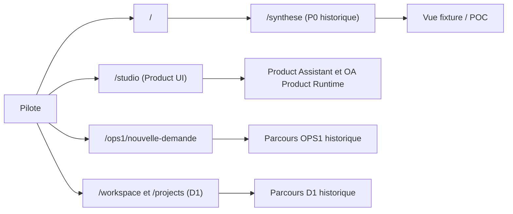
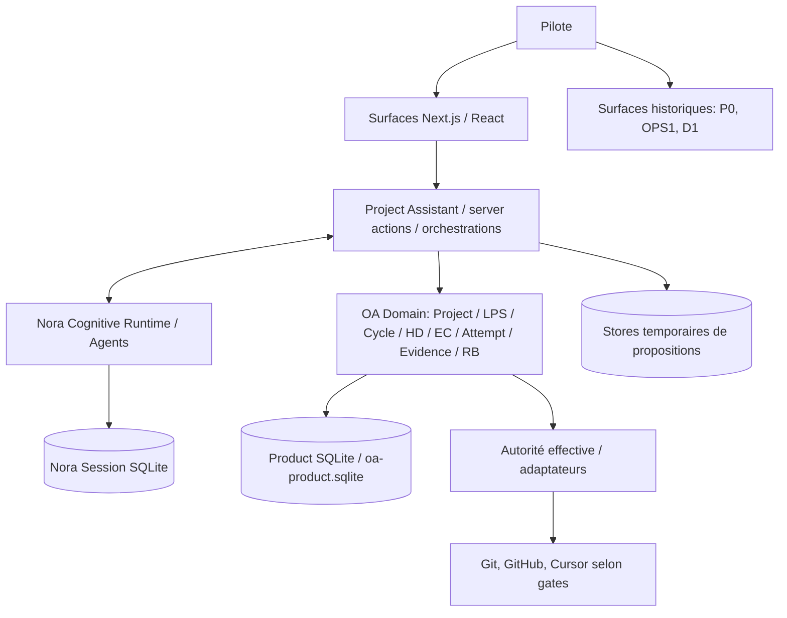

# AKG-M4 — 01 · Architecture actuelle (AS-IS)

| Champ | Valeur |
| --- | --- |
| Version | **V0.1 synthétique / non exhaustive** ; dérivée de Git et PRR |
| Baseline Git | `main` @ `1c2d5ecdac3241ac4ef9d45dea68509f761e2f8b` (2026-10-22) |
| Source prioritaire | Git + tests/proofs > [PRR](../../../production-runtime-reference/README.md) > ce résumé |
| Maturité | Certains comportements **déterministes bornés prouvés**, pas de preuve E2E REAL globale ; runtime v3 NON ADOPTED |

> **Deux niveaux de lecture :** partie A = vision pédagogique complète ; partie B = schémas Mermaid, éléments Git/PRR, compléments techniques et limites de preuve. **[Consulter aussi l'architecture TO-BE](./02-target-architecture-to-be.md).**

## Partie A — Vue de compréhension AS-IS (version initiale consolidée)

> Cette vue reprend le **document AS-IS pédagogique de notre discussion du 22 octobre 2026**. Elle complète, sans le remplacer, le détail technique de la partie B. Les affirmations AS-IS se lisent à leur baseline Git ; les principes TO-BE ne valent pas adoption du runtime.

**État constaté au 22 octobre 2026**

**Référence Git :** `main` — `1c2d5ecdac3241ac4ef9d45dea68509f761e2f8b`

**Statut :** état des lieux architectural préliminaire, fondé sur le code actuel et le référentiel Production Runtime Reference (PRR). Ce document ne vaut pas validation exhaustive du fonctionnement.

### 1. Organisation générale

SFIA Studio est une application **Next.js / React** comportant plusieurs générations d'interfaces et plusieurs sous-systèmes techniques.

La colonne vertébrale produit principale s'organise ainsi :

**Pilote → Interface Product UI → Project Assistant → Nora Cognitive Runtime / services métier OA → Persistance produit → Adaptateurs d'outils externes**

Le projet comporte également des parcours historiques conservés dans l'application.

### 2. Interfaces et parcours présents

| Famille | Éléments observés | Situation |
| --- | --- | --- |
| P0 / vertical slice | `/synthese`, `/cycle-actif`, `/decision` | Écrans historiques toujours présents |
| OPS1 | `/ops1/nouvelle-demande` et modules associés | Parcours historique distinct |
| D1 | `/workspace`, `/nouvelle-demande`, `/projects/*` | Autre famille de gestion et de création de projets |
| Product UI | `/studio`, `/studio/projects/*` | Famille d'interface raccordée au runtime produit principal |

La route `/` redirige actuellement vers `/synthese`. Cette dernière expose toujours une interface de démonstration du vertical slice POC.

**Constat architectural :** plusieurs représentations de ce que doit être Studio restent accessibles dans la même application. Elles ne constituent pas pour autant un unique parcours produit convergé.

### 3. Responsabilités techniques actuelles

| Couche | Responsabilités et composants principaux |
| --- | --- |
| Interface produit | ProductShell, vues projets, conversation, trajectoire, lifecycle, exécution, preuves |
| Orchestration conversationnelle | `features/project-assistant`, `orchestrateTurn`, routage F2 et préparation des missions |
| Cognition Nora | Analyse et recommandations, OpenAI Agents, gestion du contexte et des sessions |
| Domaine métier OA | Project, LivingProjectState, ProjectTrajectory, Cycle, HumanDecision, ExecutionContract, ExecutionAttempt, Evidence, ReviewBundle |
| Exécution technique | Qualification, sélection d'agent, autorisation, lancement, suivi et réconciliation |
| Outils externes | Adaptateurs Git/GitHub, Cursor et mécanismes d'accès aux ressources |
| Persistance | SQLite métier produit, SQLite de session Nora, données temporaires en mémoire de processus |
| Contrôles transversaux | Identité, périmètre d'autorité, contrats, permissions, invariants, traces, tests |

### 4. Fonctionnement conversationnel et exécution

Le parcours n'est pas constitué d'un seul workflow uniforme.

Plusieurs chemins coexistent :

- Formalisation d'un nouveau cycle.
- Continuation d'un cycle actif.
- Décision sur une proposition ou une trajectoire.
- Préparation générique d'un contrat d'exécution.
- Ancien chemin impliquant une décision avant préparation.
- Chemin plus récent *Single Human Execute* : contrat inspectable, puis geste humain « Exécuter ».

**Point important :** M3 a déjà permis d'intégrer un parcours *Single Human Execute*, prouvé au périmètre déterministe testé. Il serait donc inexact d'affirmer que Studio impose toujours deux validations humaines.

En revanche, des transitions internes distinctes et plusieurs chemins d'admission subsistent. Leur nécessité et leur cohérence avec l'expérience cible doivent être réévaluées.

### 5. Persistance et continuité

Les principales vérités métier sont persistées dans **Product SQLite** (`oa-product.sqlite`) : projets, états, cycles, décisions, contrats, tentatives, preuves, trajectoires et évaluations associées.

La mémoire conversationnelle de Nora relève d'une **seconde base SQLite**, distincte de la vérité métier.

Certains supports temporaires, notamment des propositions et offres de préparation, restent en mémoire de processus.

**Conséquence :** une partie de l'état projet est durable, mais la reconstitution automatique de toute l'expérience après redémarrage n'est pas démontrée.

### 6. Preuve d'exécution et restitution

Le produit possède les structures techniques nécessaires pour représenter :

- La tentative d'exécution.
- Le résultat technique.
- Les éléments de preuve.
- Le dossier de revue.
- Une continuation conversationnelle après exécution.

Des tests déterministes démontrent certaines interactions de bout en bout, y compris des transferts de rapports et d'artefacts.

Cependant, cela ne démontre pas encore que la boucle générique suivante fonctionne de manière fiable en conditions réelles :

**Contrat autorisé → Cursor REAL → rapport complet ou STOP → vérification → synthèse Nora → restitution au pilote → reprise.**

### 7. Points de complexité identifiés

**Complexité UX :** coexistence d'interfaces historiques et de la Product UI.

**Complexité d'orchestration :** plusieurs chemins pour interpréter une demande et l'orienter vers un cycle, une proposition ou une mission technique.

**Complexité d'autorité :** distinctions nombreuses entre recommandation, décision, inspection, confirmation, autorisation et lancement.

**Complexité de continuité :** coexistence de vérités métier persistantes et de supports temporaires.

**Complexité de preuve :** séparation entre résultat déclaré, résultat enregistré et résultat effectivement démontré.

Ces distinctions ne sont pas toutes inutiles. Certaines correspondent à des garanties de sécurité et d'intégrité réelles.

### 8. Limites des preuves

- Le runtime SFIA v3 reste **NON ADOPTED**.
- Le **P6 GLOBAL PASS** n'est pas acquis.
- Le fonctionnement générique Cursor REAL n'est pas prouvé de bout en bout.
- La persistance intégrale de l'expérience conversationnelle après redémarrage n'est pas acquise.
- La présence d'un composant historique ne prouve pas qu'il soit inutilisé.
- Une documentation couverte ou des tests réussis sur un périmètre borné ne démontrent pas l'ensemble du comportement réel.

**Conclusion AS-IS :** SFIA Studio possède une colonne vertébrale produit substantielle, mais conserve plusieurs générations d'interfaces, plusieurs voies d'orchestration et des frontières de gouvernance dont la complexité est à réexaminer.

#### Sources principales

- [Production Runtime Reference — Vue d'ensemble](https://github.com/mcleland147/sfia-workspace/blob/main/projects/sfia-studio/production-runtime-reference/01-system-runtime-overview.md)
- [Catalogue des flux](https://github.com/mcleland147/sfia-workspace/blob/main/projects/sfia-studio/production-runtime-reference/03-end-to-end-flow-catalog.md)
- [Persistance et reprise](https://github.com/mcleland147/sfia-workspace/blob/main/projects/sfia-studio/production-runtime-reference/06-persistence-restart-and-recovery.md)
- [Invariants et chemins d'autorité](https://github.com/mcleland147/sfia-workspace/blob/main/projects/sfia-studio/production-runtime-reference/07-authority-invariants-and-failure-modes.md)
- [Lacunes et réserves connues](https://github.com/mcleland147/sfia-workspace/blob/main/projects/sfia-studio/production-runtime-reference/09-known-gaps-reserves-and-current-boundaries.md)

## Partie B — Approfondissement AS-IS et cartographie technique

### 1. Vue d'ensemble

**Vue visuelle des parcours qui coexistent :**

**Vue visuelle des couches de la colonne produit principale :**

**Attention :** ce schéma représente des responsabilités et des chemins principaux, pas un pipeline unique ni la totalité des branches. Voir [PRR 01](../../../production-runtime-reference/01-system-runtime-overview.md), [03](../../../production-runtime-reference/03-end-to-end-flow-catalog.md).

### 2. Interfaces constatées dans le dépôt

| Famille | Code lu | Constat |
| --- | --- | --- |
| P0 / vertical slice | [`app/app/page.tsx`](../../../app/app/page.tsx), [`app/app/synthese/page.tsx`](../../../app/app/synthese/page.tsx) | `/` redirige sur `/synthese` ; écran signalant explicitement « fixture », « POC slice-only » |
| P0 autres | [`app/app/cycle-actif/page.tsx`](../../../app/app/cycle-actif/page.tsx), [`app/app/decision/page.tsx`](../../../app/app/decision/page.tsx) | Surfaces historiques toujours routées |
| OPS1 | [`app/app/ops1/nouvelle-demande/page.tsx`](../../../app/app/ops1/nouvelle-demande/page.tsx) | Commentaire code : « Legacy OPS1 session surface » |
| D1 | [`app/app/workspace/page.tsx`](../../../app/app/workspace/page.tsx), [`app/app/projects/[id]/page.tsx`](../../../app/app/projects/[id]/page.tsx) | Autres parcours fondés sur `lib/d1` |
| Product UI | [`app/app/studio/page.tsx`](../../../app/app/studio/page.tsx), [`app/app/studio/projects/[id]/page.tsx`](../../../app/app/studio/projects/[id]/page.tsx) | `ProductShell` et `features/pre-m6-product-ui`, raccordés aux services produit |

**Fait vérifié :** coexistence de plusieurs générations d'interfaces. **Non prouvé :** absence totale de consommateurs de leurs composants ; retrait = analyse distincte.

### 3. Composants, responsabilités, stockage

| Ensemble existant | Rôle / ownership décrit | Point à qualifier |
| --- | --- | --- |
| `features/pre-m6-product-ui` | Couche de présentation Product actuelle | Nom historique « pre-M6 » |
| `features/project-assistant` | Entrées, orchestration F2/W2, propositions, préparation, suivi | Chemins d'admission potentiellement redondants |
| `lib/nora-cognitive-runtime` | Agents OpenAI, raisonnement, session et journal | Cognition ≠ autorité produit |
| `lib/oa/{project,cycle,decision,execution-contract,execution-attempt,evidence-review}` | Domaines métier, autorité, contrats et preuves | Socle métier courant ; frontières à préserver/revoir |
| `lib/vertical-slice-runtime` | Composition des services OA, façades runtime | Nom historique, pas nécessairement fonction actuelle |
| `lib/ops1`, `lib/d1` | Capacités et stockages historiquement séparés | Consommateurs à identifier |
| `lib/oa/execution-run` | BC en mémoire pour FinOps/T7 shadow, hors Product Spine selon PRR | Ne pas promouvoir en moteur alternatif ni retirer sans audit |

**Product Truth C :** Product SQLite `oa-product.sqlite`. **Contexte conversationnel :** Nora Session SQLite. **États non universellement durables :** propositions F2 / offres génériques PREPARE en mémoire process-local. Voir [PRR 02](../../../production-runtime-reference/02-runtime-object-catalog.md), [06](../../../production-runtime-reference/06-persistence-restart-and-recovery.md).

### 4. Flux de décision et d'exécution

Les chemins incluent NEW_CYCLE, continuation active, propositions F2, Generic PREPARE, voie historique « disposition-before-PREPARE », voies NON_STRUCTURAL et SHE (« Single Human Execute »).

**SHE est intégré sur `main`**, avec preuve **déterministe au périmètre testé** : contrat PREPARE inspectable sans HumanDecision préalable ; le clic Pilote « Exécuter » effectue les transitions internes applicables avant lancement. **Il serait inexact de dire que tout parcours courant impose une double validation.** Distinctions internes HD / Confirmation / Authorization / Attempt sont toujours présentes. Voir [PRR 03, F06–F10](../../../production-runtime-reference/03-end-to-end-flow-catalog.md), [07](../../../production-runtime-reference/07-authority-invariants-and-failure-modes.md).

### 5. Limites de preuve et écarts saillants

- **REST/continuité :** propositions et offres process-local ; reprise après restart / multi-instance partielle. [PRR 06](../../../production-runtime-reference/06-persistence-restart-and-recovery.md).
- **Rapport/preuve/Nora :** des chemins et des tests déterministes existent, mais aucune preuve universelle de la boucle **Cursor REAL → rapport/STOP → vérification → synthèse Nora → Pilote → nouvelle décision**. [PRR 03](../../../production-runtime-reference/03-end-to-end-flow-catalog.md), [08](../../../production-runtime-reference/08-test-proof-and-conformance-map.md), [09](../../../production-runtime-reference/09-known-gaps-reserves-and-current-boundaries.md).
- **REAL no-write :** des garde-fous refusent le lancement pathless non-mutating lorsque Cursor REAL ne sait pas techniquement garantir l'absence d'écriture. Ne pas confondre « prompt no-write » avec enforcement. [PRR 07](../../../production-runtime-reference/07-authority-invariants-and-failure-modes.md).
- **Produit :** plusieurs UX et bases historiques, nommage dépendant de jalons, chemins d'orchestration coexistants.

**Cadre de preuve :** DOCUMENTED ≠ COVERAGE VERIFIED ≠ BEHAVIOR PROVEN ; les gaps et réserves M1–M3 restent gouvernés selon PRR/Roadmap. Aucun composant n'est « inutile » au seul motif d'être ancien. Voir [registre M4](03-orientations-and-gap-register.md).
