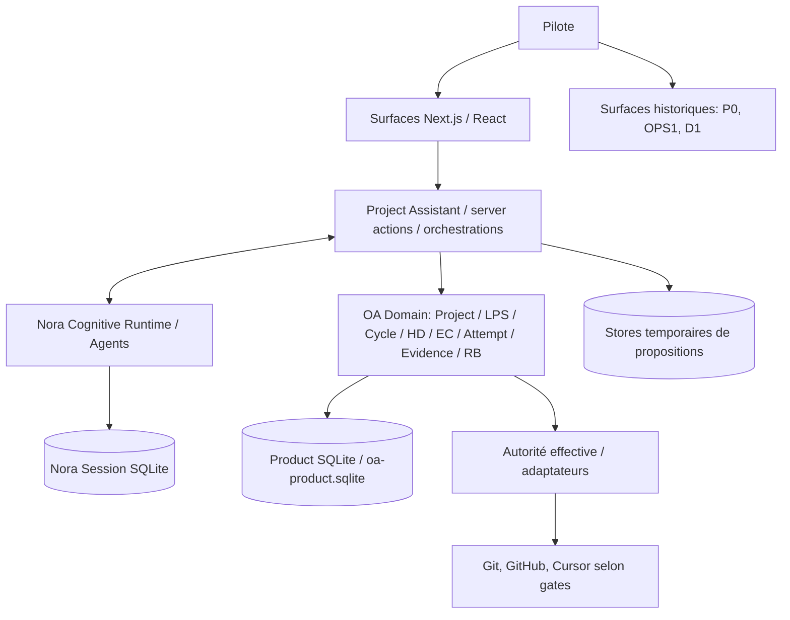

# AKG-M4 — 01 · Architecture actuelle (AS-IS)

| Champ | Valeur |
| --- | --- |
| Version | **V0.1 synthétique / non exhaustive** ; dérivée de Git et PRR |
| Baseline Git | `main` @ `1c2d5ecdac3241ac4ef9d45dea68509f761e2f8b` (2026-10-22) |
| Source prioritaire | Git + tests/proofs > [PRR](../../../production-runtime-reference/README.md) > ce résumé |
| Maturité | Certains comportements **déterministes bornés prouvés**, pas de preuve E2E REAL globale ; runtime v3 NON ADOPTED |

## 1. Vue d'ensemble

**Attention :** ce schéma représente des responsabilités et des chemins principaux, pas un pipeline unique ni la totalité des branches. Voir [PRR 01](../../../production-runtime-reference/01-system-runtime-overview.md), [03](../../../production-runtime-reference/03-end-to-end-flow-catalog.md).

## 2. Interfaces constatées dans le dépôt

| Famille | Code lu | Constat |
| --- | --- | --- |
| P0 / vertical slice | [`app/app/page.tsx`](../../../app/app/page.tsx), [`app/app/synthese/page.tsx`](../../../app/app/synthese/page.tsx) | `/` redirige sur `/synthese` ; écran signalant explicitement « fixture », « POC slice-only » |
| P0 autres | [`app/app/cycle-actif/page.tsx`](../../../app/app/cycle-actif/page.tsx), [`app/app/decision/page.tsx`](../../../app/app/decision/page.tsx) | Surfaces historiques toujours routées |
| OPS1 | [`app/app/ops1/nouvelle-demande/page.tsx`](../../../app/app/ops1/nouvelle-demande/page.tsx) | Commentaire code : « Legacy OPS1 session surface » |
| D1 | [`app/app/workspace/page.tsx`](../../../app/app/workspace/page.tsx), [`app/app/projects/[id]/page.tsx`](../../../app/app/projects/[id]/page.tsx) | Autres parcours fondés sur `lib/d1` |
| Product UI | [`app/app/studio/page.tsx`](../../../app/app/studio/page.tsx), [`app/app/studio/projects/[id]/page.tsx`](../../../app/app/studio/projects/[id]/page.tsx) | `ProductShell` et `features/pre-m6-product-ui`, raccordés aux services produit |

**Fait vérifié :** coexistence de plusieurs générations d'interfaces. **Non prouvé :** absence totale de consommateurs de leurs composants ; retrait = analyse distincte.

## 3. Composants, responsabilités, stockage

| Ensemble existant | Rôle / ownership décrit | Point à qualifier |
| --- | --- | --- |
| `features/pre-m6-product-ui` | Couche de présentation Product actuelle | Nom historique « pre-M6 » |
| `features/project-assistant` | Entrées, orchestration F2/W2, propositions, préparation, suivi | Chemins d'admission potentiellement redondants |
| `lib/nora-cognitive-runtime` | Agents OpenAI, raisonnement, session et journal | Cognition ≠ autorité produit |
| `lib/oa/{project,cycle,decision,execution-contract,execution-attempt,evidence-review}` | Domaines métier, autorité, contrats et preuves | Socle métier courant ; frontières à préserver/revoir |
| `lib/vertical-slice-runtime` | Composition des services OA, façades runtime | Nom historique, pas nécessairement fonction actuelle |
| `lib/ops1`, `lib/d1` | Capacités et stockages historiquement séparés | Consommateurs à identifier |
| `lib/oa/execution-run` | BC en mémoire pour FinOps/T7 shadow, hors Product Spine selon PRR | Ne pas promouvoir en moteur alternatif ni retirer sans audit |

**Product Truth C :** Product SQLite `oa-product.sqlite`. **Contexte conversationnel :** Nora Session SQLite. **États non universellement durables :** propositions F2 / offres génériques PREPARE en mémoire process-local. Voir [PRR 02](../../../production-runtime-reference/02-runtime-object-catalog.md), [06](../../../production-runtime-reference/06-persistence-restart-and-recovery.md).

## 4. Flux de décision et d'exécution

Les chemins incluent NEW_CYCLE, continuation active, propositions F2, Generic PREPARE, voie historique « disposition-before-PREPARE », voies NON_STRUCTURAL et SHE (« Single Human Execute »).

**SHE est intégré sur `main`**, avec preuve **déterministe au périmètre testé** : contrat PREPARE inspectable sans HumanDecision préalable ; le clic Pilote « Exécuter » effectue les transitions internes applicables avant lancement. **Il serait inexact de dire que tout parcours courant impose une double validation.** Distinctions internes HD / Confirmation / Authorization / Attempt sont toujours présentes. Voir [PRR 03, F06–F10](../../../production-runtime-reference/03-end-to-end-flow-catalog.md), [07](../../../production-runtime-reference/07-authority-invariants-and-failure-modes.md).

## 5. Limites de preuve et écarts saillants

- **REST/continuité :** propositions et offres process-local ; reprise après restart / multi-instance partielle. [PRR 06](../../../production-runtime-reference/06-persistence-restart-and-recovery.md).
- **Rapport/preuve/Nora :** des chemins et des tests déterministes existent, mais aucune preuve universelle de la boucle **Cursor REAL → rapport/STOP → vérification → synthèse Nora → Pilote → nouvelle décision**. [PRR 03](../../../production-runtime-reference/03-end-to-end-flow-catalog.md), [08](../../../production-runtime-reference/08-test-proof-and-conformance-map.md), [09](../../../production-runtime-reference/09-known-gaps-reserves-and-current-boundaries.md).
- **REAL no-write :** des garde-fous refusent le lancement pathless non-mutating lorsque Cursor REAL ne sait pas techniquement garantir l'absence d'écriture. Ne pas confondre « prompt no-write » avec enforcement. [PRR 07](../../../production-runtime-reference/07-authority-invariants-and-failure-modes.md).
- **Produit :** plusieurs UX et bases historiques, nommage dépendant de jalons, chemins d'orchestration coexistants.

**Cadre de preuve :** DOCUMENTED ≠ COVERAGE VERIFIED ≠ BEHAVIOR PROVEN ; les gaps et réserves M1–M3 restent gouvernés selon PRR/Roadmap. Aucun composant n'est « inutile » au seul motif d'être ancien. Voir [registre M4](03-orientations-and-gap-register.md).
