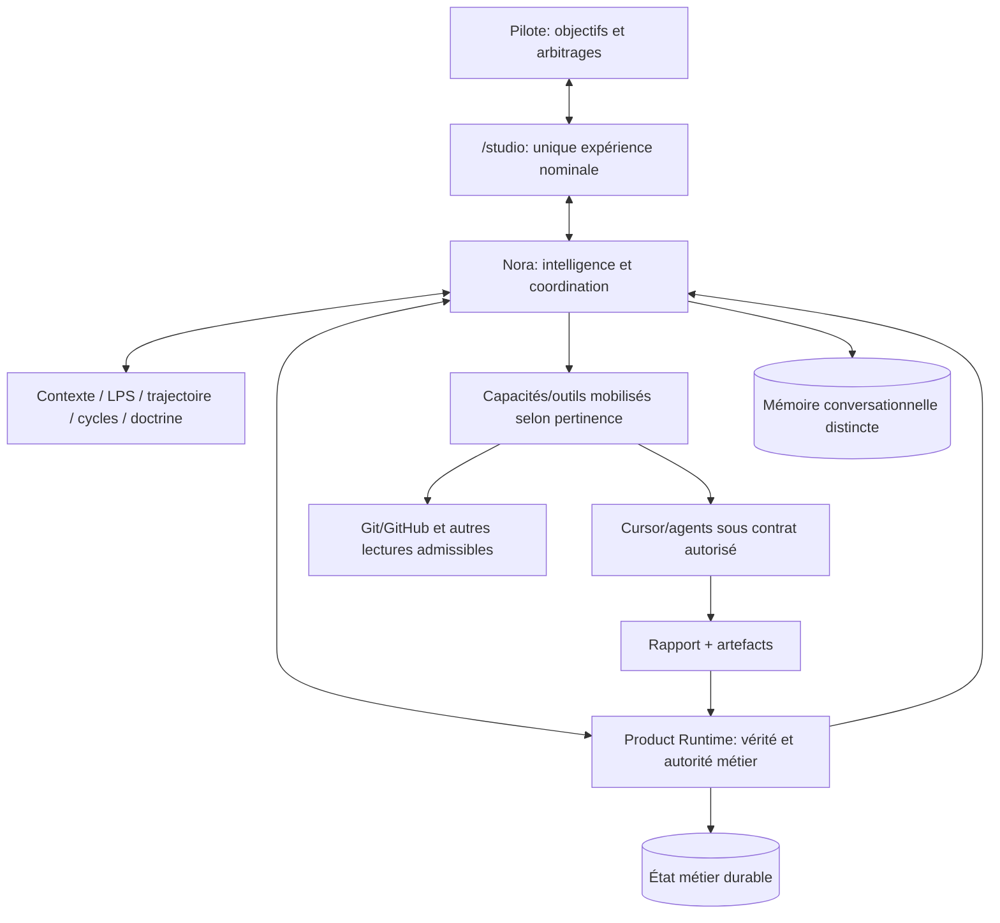
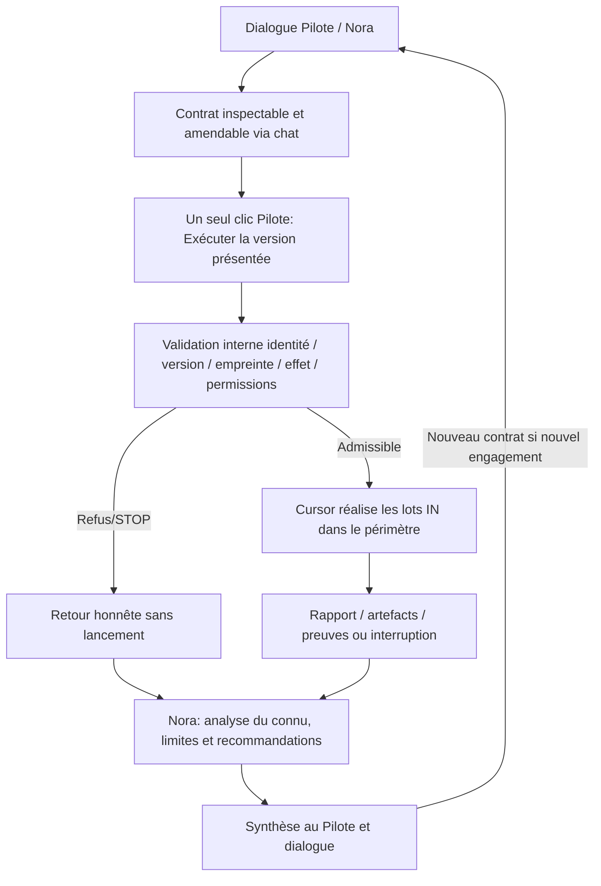

# AKG-M4 — 02 · Architecture cible (TO-BE)

| Champ | Valeur |
| --- | --- |
| Nature | **Vision de conception issue des échanges du 2026-10-22** |
| Statut | V0.1 candidate — **non adoptée formellement par AKG-M4** |
| Doctrine | Doit rester compatible avec `sfia-v3-framing/30–37` ; une contradiction demande un arbitrage |
| Non-claims | Ni runtime implémenté, ni test REAL, ni GO de transformation |

> **Deux niveaux de lecture :** partie A = vision pédagogique complète ; partie B = schémas Mermaid, éléments Git/PRR, compléments techniques et limites de preuve. **[Consulter aussi l'architecture AS-IS](./01-current-architecture-as-is.md).**

## Partie A — Vue de compréhension TO-BE (version initiale consolidée)

> Cette vue reprend le **document TO-BE pédagogique de notre discussion du 22 octobre 2026**. Elle complète, sans le remplacer, le détail technique de la partie B. Les affirmations AS-IS se lisent à leur baseline Git ; les principes TO-BE ne valent pas adoption du runtime.

**Proposition de cible issue des échanges Pilote / Nora**

**Statut :** hypothèse de rationalisation fonctionnelle et architecturale à instruire et valider. Ce document ne constitue ni une nouvelle doctrine adoptée, ni un GO de transformation.

### 1. Vision produit

SFIA Studio 3.0 est une **tour de contrôle conversationnelle pour piloter des projets de réalisation de solutions techniques et applicatives**.

Le Pilote conserve l'autorité sur le projet.

Nora agit comme copilote cognitif et orchestrateur du travail : elle comprend les besoins, mobilise les connaissances, recommande des actions, prépare des missions techniques, utilise les capacités disponibles dans leur périmètre autorisé et interprète les résultats.

**Principe fondateur : le système absorbe la complexité technique sans l'imposer au Pilote.**

### 2. Architecture fonctionnelle cible

L'expérience s'organise autour de quatre ensembles principaux.

| Ensemble | Responsabilité |
| --- | --- |
| **Pilote** | Exprime les objectifs, échange avec Nora, arbitre et autorise les missions qui l'exigent |
| **Nora** | Comprend, analyse, qualifie, recommande, planifie, coordonne et interprète |
| **Capacités et outils** | GitHub, Cursor et autres outils mobilisés selon le besoin et les permissions |
| **Contexte projet et garanties** | Doctrine v3, LPS, trajectoire, cycles, contrats, périmètres autorisés, résultats, preuves et continuité |

La relation **Pilote ↔ Nora** est permanente.

Il n'existe pas d'obligation fonctionnelle de parcourir successivement six phases avant de pouvoir utiliser un outil.

Intention, analyse, décision, exécution, preuve et continuité restent des **responsabilités du système**, mobilisables au moment opportun.

### 3. Intervention des outils

Les outils sont considérés comme des **capacités techniques** accessibles à Nora, et non comme des étapes méthodologiques autonomes.

**Exemple — Analyse documentaire :** le Pilote demande à Nora d'analyser des documents GitHub. Nora identifie les ressources pertinentes, les consulte dans les permissions déjà accordées et présente son analyse. La demande du Pilote constitue l'instruction de réaliser les lectures nécessaires.

**Exemple — Modification documentaire :** Nora qualifie le besoin, prépare un contrat d'exécution adapté à l'outil disponible et le présente au Pilote. Celui-ci peut demander des amendements par le chat, puis autorise l'intervention.

La frontière pertinente ne dépend pas du nom de l'outil. Elle dépend de l'effet de l'opération : lecture, modification bornée ou action plus engageante.

### 4. Contrat d'exécution

Le contrat constitue la **mission technique déléguée**.

Il décrit notamment :

- Les objectifs attendus.
- Les lots et opérations autorisés.
- Le périmètre IN et OUT.
- Les ressources concernées.
- Les garde-fous et conditions de STOP.
- Les livrables, résultats et preuves attendus.

Le contrat reste amendable par le dialogue avant lancement.

Une fois sa version prête et présentée, **le clic « Exécuter » constitue l'autorisation humaine de cette version précise**.

Studio peut enregistrer automatiquement la décision, l'identité du contrat et les vérifications nécessaires. Ces opérations internes n'imposent pas de validations humaines supplémentaires pour le même engagement.

### 5. Autonomie d'exécution

Cursor ou un autre agent réalise les travaux du contrat dans les limites autorisées.

Un contrat peut contenir plusieurs lots. L'exécuteur peut les enchaîner et effectuer les vérifications prévues sans demander un nouveau GO à chaque sous-opération.

Si une condition de STOP est rencontrée, le travail doit s'arrêter conformément au mandat.

L'exécuteur ne peut pas élargir seul le périmètre autorisé.

**Un contrat représente une délégation bornée ; il ne constitue pas une autorisation permanente d'engager les missions suivantes.**

### 6. Restitution et analyse Nora

Toute issue d'exécution doit donner lieu à une restitution honnête :

**Contrat → Exécution → Rapport et preuves → Analyse Nora → Synthèse Pilote.**

Nora distingue :

- Les opérations déclarées réalisées.
- Les résultats effectivement étayés par des preuves.
- Les travaux partiels ou non réalisés.
- Les échecs, blocages et incertitudes.
- Les conséquences sur le projet et la trajectoire.
- Les recommandations pour la suite.

Si aucun rapport Cursor n'est disponible, Nora ne doit pas inventer un résultat. Elle signale l'incident et les vérifications nécessaires.

### 7. Continuité et nouvel arbitrage

À l'issue de la restitution, **le dialogue Pilote / Nora reprend naturellement**.

Nora peut expliquer les écarts, proposer une correction ou préparer un prochain contrat.

Le Pilote décide de la suite.

Un nouveau travail nécessitant une autorisation explicite ne démarre pas automatiquement après la réception du rapport précédent.

La continuité repose sur l'état métier persistant, les connaissances disponibles et les preuves vérifiables, sans inventer un contexte perdu.

### 8. Architecture technique recherchée

La cible ne suppose pas de supprimer toutes les protections actuellement existantes.

Elle cherche à regrouper les responsabilités autour de frontières plus lisibles :

1. **Une expérience produit principale**, sans écrans POC accessibles comme parcours nominal.
2. **Une orchestration conversationnelle cohérente**, où Nora peut mobiliser les outils appropriés.
3. **Une préparation de mission commune**, indépendante de l'outil sélectionné.
4. **Une autorisation proportionnée aux effets**, intégrée naturellement dans les gestes du Pilote.
5. **Une exécution bornée et traçable**, sans chaîne de validations humaines redondantes.
6. **Une restitution systématique et vérifiable**, analysée par Nora.
7. **Une continuité projet durable**, sans second état métier concurrent.

Les objets existants — LPS, Cycle, HumanDecision, ExecutionContract, ExecutionAttempt, Evidence, ReviewBundle — doivent être examinés selon leur rôle effectif, avant toute décision de conservation, fusion ou retrait.

### 9. Ce que cette cible n'autorise pas

- Une suppression aveugle des contrôles de sécurité.
- Un accès illimité de Nora aux outils.
- Un élargissement silencieux du périmètre d'une mission.
- L'assimilation du rapport d'un agent à une preuve vérifiée.
- Une exécution automatique de nouveaux contrats sans mandat.
- La création d'un deuxième moteur produit parallèle.
- La présentation de cette architecture comme déjà implémentée et prouvée.

**Conclusion TO-BE :** SFIA Studio doit fonctionner comme un environnement de travail unique où Nora et le Pilote collaborent en continu, et où les outils sont mobilisés transversalement, sous un cadre d'autorité simple, proportionné et essentiellement invisible pour l'utilisateur.

#### Références doctrinales à préserver et à confronter

- [Doctrine v3 — Connaissance, contexte et décision humaine](https://github.com/mcleland147/sfia-workspace/blob/main/projects/sfia-studio/sfia-v3-framing/30-knowledge-context-human-decision-doctrine.md)
- [Living Project State et trajectoire](https://github.com/mcleland147/sfia-workspace/blob/main/projects/sfia-studio/sfia-v3-framing/32-living-project-state-and-dynamic-trajectory.md)
- [Capacités agents et gouvernance d'exécution](https://github.com/mcleland147/sfia-workspace/blob/main/projects/sfia-studio/sfia-v3-framing/34-agent-capabilities-reversibility-and-execution-governance.md)
- [Artefacts, preuves et dette](https://github.com/mcleland147/sfia-workspace/blob/main/projects/sfia-studio/sfia-v3-framing/35-artifact-evidence-debt-and-controlled-learning.md)
- [Build Doctrine](https://github.com/mcleland147/sfia-workspace/blob/main/projects/sfia-studio/convergence/sfia-studio-convergence-build-doctrine.md)

## Partie B — Approfondissement TO-BE et cartographie technique

### 1. Vision

**Une tour de contrôle conversationnelle :** le Pilote exprime ses objectifs, arbitre et garde l'autorité ; Nora comprend, recommande, planifie, coordonne et mobilise les capacités nécessaires au moment pertinent.

**Intention, analyse, décision, exécution, preuve et continuité** sont des **responsabilités transverses**, non six portes UX à franchir obligatoirement.

Ce diagramme est **fonctionnel**, pas la déclaration d'un câblage déjà adopté.

### 2. Architecture cible — responsabilités

| Ensemble | Responsabilité attendue |
| --- | --- |
| **Product UI `/studio`** | Cockpit unique : projets, conversation, contrats, résultats ; les autres expériences historiques deviennent candidates au retrait après audit |
| **Nora** | Qualification, raisonnement, recommandation, planification, sélection de capacité, analyse des preuves, synthèse ; **aucune autorité métier implicite** |
| **Product Runtime / OA** | **Socle métier unique** : Project, LPS, trajectoire, cycles, décisions, contrats, tentatives, preuves et états |
| **Orchestration** | Mission et disponibilité des outils sans imposer un « workflow exécution » à chaque consultation |
| **Outils/adaptateurs** | GitHub, Cursor et futurs outils comme capacités transversales ; gouvernance par **effet de l'opération**, pas par nom de fournisseur |
| **Gouvernance** | Permission effective, versions de contrat, STOP, audit et idempotence internes ; **sans boutons humains redondants** |
| **Persistance / continuity** | Vérité métier non dupliquée, mémoire Nora clairement distincte, reconstitution honnête et récupération sans faux contexte |

**Un seul moteur métier n'implique ni un monolithe, ni une seule bibliothèque/base :** des services spécialisés sont permis s'ils ne réintroduisent pas un Product Truth C concurrent.

### 3. Mandat, autorisation, exécution, restitution

**Lecture libre :** « Analyse les PR Git » implique généralement les lectures utiles dans le mandat et les permissions déjà données ; Nora n'attend pas un micro-GO pour chaque lecture.

**Action mutante/engageante :** Nora prépare un contrat précis, pouvant comporter plusieurs lots. Le Pilote le consulte et peut demander ses amendements dans le chat. **Exécuter** autorise **cette version inspectée**, pas des travaux hors périmètre. Studio peut enregistrer HD, Confirmation et traces **sans nouvelle cérémonie UX** pour le même mandat.

**Cursor :** libre d'enchaîner les travaux **déjà autorisés**, sous IN/OUT et STOP. Toute nécessité de droits/périmètre additionnels exige arrêt et nouvel arbitrage.

**Retour obligatoire :** Cursor renvoie résultats, erreurs, preuves ou état d'incident ; Nora distingue déclaration, preuve vérifiée, partiel, STOP, inconnu. En absence de rapport, elle ne fabrique pas de succès. Une **nouvelle mission requérant autorisation** ne démarre pas automatiquement après synthèse.

### 4. Règles de rationalisation proposées

1. **Un seul parcours produit nominal** : `/studio` ; `/` doit y conduire, tandis que routes POC/OPS1/D1 sont candidates à retrait après analyse de dépendances.
2. **Un seul moteur métier** : conserver OA Product Spine comme socle, réutiliser/hériter des capacités des systèmes historiques sans maintenir leur vérité métier parallèle.
3. **Gouvernance invisible quand possible** : maintenir validation d'autorité et idempotence, réduire CTA/états artificiels dans l'interface.
4. **Preuves avant promotion** : Attempt terminal ≠ réussite démontrée ; résultat Cursor déclaré ≠ preuve vérifiée.
5. **Nommage fonctionnel** : modules pérennes nommés selon responsabilité, non jalon (`pre-m6`, `w2`, `ops1`, etc.). Noms comme `studio-ui`, `product-domain`, `runtime-composition` sont **illustratifs**, pas encore décidés.
6. **Retraits contrôlés** : ne renommer ni reconstruire une brique destinée à disparaître ; inventorier consumers, tests, migrations, sécurité et plan de sortie avant suppression.

### 5. Limites et arbitrages ouverts

Sont **à concevoir, pas encore validés** : ownership précis entre Project Assistant/Nora/OA ; consolidation des chemins décision/mission ; modèle de rapport et synthèse Nora ; reprise multi-instance/restart ; sémantique de l'ExecutionContract avec garde-fous effectifs Cursor REAL ; catalogue de capacités ; UX exacte des contrats et résultats ; décommission des routes/stores historiques ; noms définitifs.

**Invariants à garder :** Pilote décide, Recommendation ≠ autorité, contrat versionné/inspecté, no-execute-without-authority, no auto-elevation, STOP honnête, idempotence du clic, preuve déterministe ≠ preuve REAL, no-invented-context, décisions et suppressions structurantes sous GO.

**Cette V0.1 n'est pas une réécriture de la doctrine v3.** À toute divergence avec [doctrine v3](../../../sfia-v3-framing/README.md) ou [Build Doctrine](../../sfia-studio-convergence-build-doctrine.md), consigner l'écart dans le [registre](03-orientations-and-gap-register.md) et soumettre l'arbitrage.
