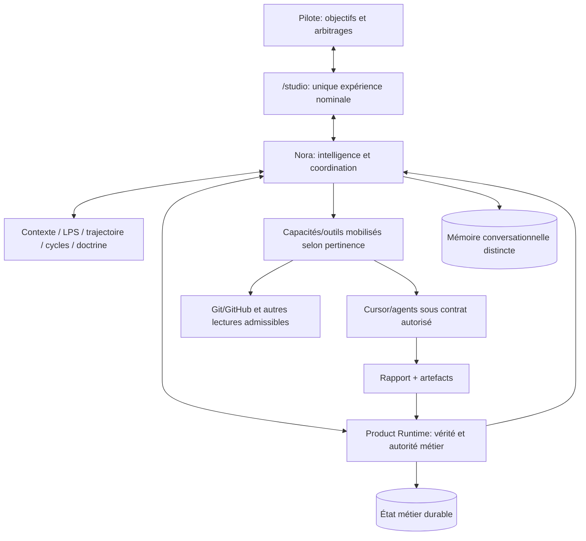
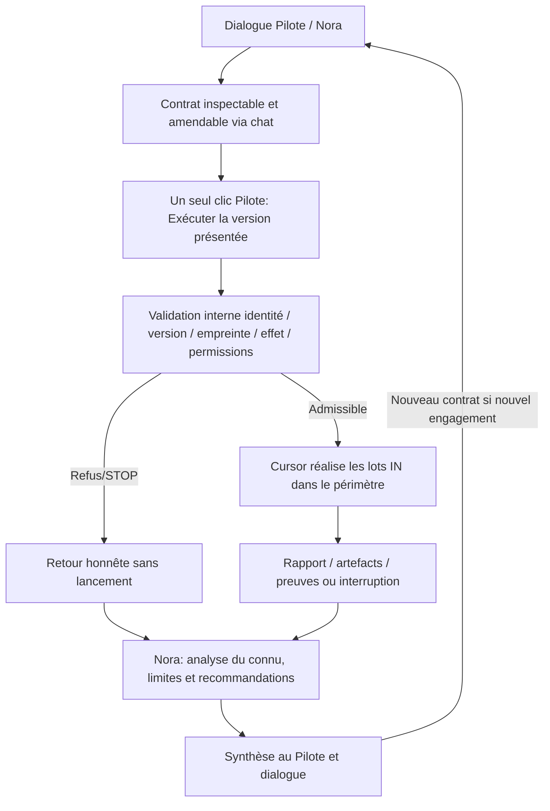

# AKG-M4 — 02 · Architecture cible (TO-BE)

| Champ | Valeur |
| --- | --- |
| Nature | **Vision de conception issue des échanges du 2026-10-22** |
| Statut | V0.1 candidate — **non adoptée formellement par AKG-M4** |
| Doctrine | Doit rester compatible avec `sfia-v3-framing/30–37` ; une contradiction demande un arbitrage |
| Non-claims | Ni runtime implémenté, ni test REAL, ni GO de transformation |

## 1. Vision

**Une tour de contrôle conversationnelle :** le Pilote exprime ses objectifs, arbitre et garde l'autorité ; Nora comprend, recommande, planifie, coordonne et mobilise les capacités nécessaires au moment pertinent.

**Intention, analyse, décision, exécution, preuve et continuité** sont des **responsabilités transverses**, non six portes UX à franchir obligatoirement.

Ce diagramme est **fonctionnel**, pas la déclaration d'un câblage déjà adopté.

## 2. Architecture cible — responsabilités

| Ensemble | Responsabilité attendue |
| --- | --- |
| **Product UI `/studio`** | Cockpit unique : projets, conversation, contrats, résultats ; les autres expériences historiques deviennent candidates au retrait après audit |
| **Nora** | Qualification, raisonnement, recommandation, planification, sélection de capacité, analyse des preuves, synthèse ; **aucune autorité métier implicite** |
| **Product Runtime / OA** | **Socle métier unique** : Project, LPS, trajectoire, cycles, décisions, contrats, tentatives, preuves et états |
| **Orchestration** | Mission et disponibilité des outils sans imposer un « workflow exécution » à chaque consultation |
| **Outils/adaptateurs** | GitHub, Cursor et futurs outils comme capacités transversales ; gouvernance par **effet de l'opération**, pas par nom de fournisseur |
| **Gouvernance** | Permission effective, versions de contrat, STOP, audit et idempotence internes ; **sans boutons humains redondants** |
| **Persistance / continuity** | Vérité métier non dupliquée, mémoire Nora clairement distincte, reconstitution honnête et récupération sans faux contexte |

**Un seul moteur métier n'implique ni un monolithe, ni une seule bibliothèque/base :** des services spécialisés sont permis s'ils ne réintroduisent pas un Product Truth C concurrent.

## 3. Mandat, autorisation, exécution, restitution

**Lecture libre :** « Analyse les PR Git » implique généralement les lectures utiles dans le mandat et les permissions déjà données ; Nora n'attend pas un micro-GO pour chaque lecture.

**Action mutante/engageante :** Nora prépare un contrat précis, pouvant comporter plusieurs lots. Le Pilote le consulte et peut demander ses amendements dans le chat. **Exécuter** autorise **cette version inspectée**, pas des travaux hors périmètre. Studio peut enregistrer HD, Confirmation et traces **sans nouvelle cérémonie UX** pour le même mandat.

**Cursor :** libre d'enchaîner les travaux **déjà autorisés**, sous IN/OUT et STOP. Toute nécessité de droits/périmètre additionnels exige arrêt et nouvel arbitrage.

**Retour obligatoire :** Cursor renvoie résultats, erreurs, preuves ou état d'incident ; Nora distingue déclaration, preuve vérifiée, partiel, STOP, inconnu. En absence de rapport, elle ne fabrique pas de succès. Une **nouvelle mission requérant autorisation** ne démarre pas automatiquement après synthèse.

## 4. Règles de rationalisation proposées

1. **Un seul parcours produit nominal** : `/studio` ; `/` doit y conduire, tandis que routes POC/OPS1/D1 sont candidates à retrait après analyse de dépendances.
2. **Un seul moteur métier** : conserver OA Product Spine comme socle, réutiliser/hériter des capacités des systèmes historiques sans maintenir leur vérité métier parallèle.
3. **Gouvernance invisible quand possible** : maintenir validation d'autorité et idempotence, réduire CTA/états artificiels dans l'interface.
4. **Preuves avant promotion** : Attempt terminal ≠ réussite démontrée ; résultat Cursor déclaré ≠ preuve vérifiée.
5. **Nommage fonctionnel** : modules pérennes nommés selon responsabilité, non jalon (`pre-m6`, `w2`, `ops1`, etc.). Noms comme `studio-ui`, `product-domain`, `runtime-composition` sont **illustratifs**, pas encore décidés.
6. **Retraits contrôlés** : ne renommer ni reconstruire une brique destinée à disparaître ; inventorier consumers, tests, migrations, sécurité et plan de sortie avant suppression.

## 5. Limites et arbitrages ouverts

Sont **à concevoir, pas encore validés** : ownership précis entre Project Assistant/Nora/OA ; consolidation des chemins décision/mission ; modèle de rapport et synthèse Nora ; reprise multi-instance/restart ; sémantique de l'ExecutionContract avec garde-fous effectifs Cursor REAL ; catalogue de capacités ; UX exacte des contrats et résultats ; décommission des routes/stores historiques ; noms définitifs.

**Invariants à garder :** Pilote décide, Recommendation ≠ autorité, contrat versionné/inspecté, no-execute-without-authority, no auto-elevation, STOP honnête, idempotence du clic, preuve déterministe ≠ preuve REAL, no-invented-context, décisions et suppressions structurantes sous GO.

**Cette V0.1 n'est pas une réécriture de la doctrine v3.** À toute divergence avec [doctrine v3](../../../sfia-v3-framing/README.md) ou [Build Doctrine](../../sfia-studio-convergence-build-doctrine.md), consigner l'écart dans le [registre](03-orientations-and-gap-register.md) et soumettre l'arbitrage.
