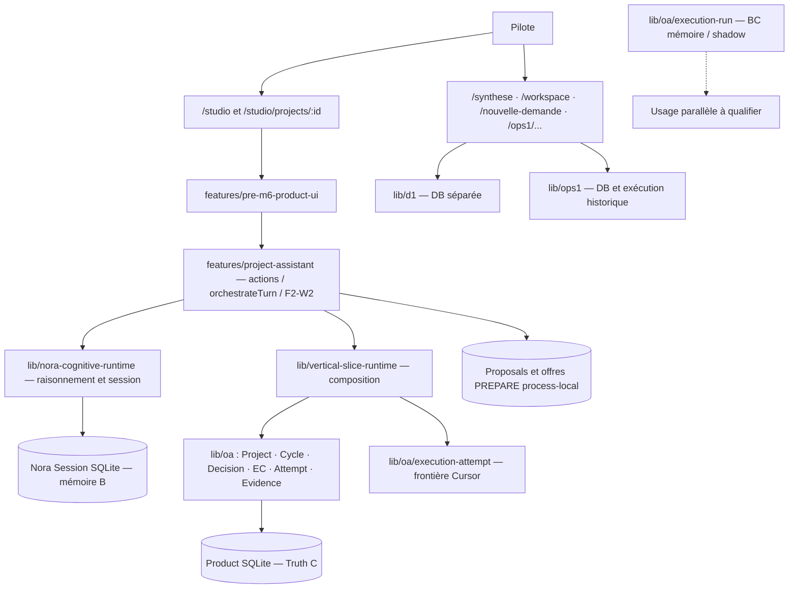

# AKG-M4-A — Cartographie initiale des responsabilités, dépendances et scénarios de rationalisation

| Champ | Valeur |
| --- | --- |
| Chantier | **AKG-M4 — Rationalization Assessment**, premier lot **M4-A** |
| Objet | Capabilities, composants, consumers et options de reconfiguration de la colonne produit |
| Base vérifiée | `main` @ `f44a99b4da84188772b80aca3c9ebe1a3e12617e` — PR #603 merged / post-merge CI #39813097786 SUCCESS |
| GO | **M4 Formal Start** puis **M4-A initial lot** autorisés explicitement par le Pilote dans les échanges du 2026-10-22 |
| Statut du lot | **STARTED — INITIAL READ-ONLY HARVEST** ; matrice préliminaire, audit des consommateurs **non exhaustif** ; **NON CLOSED** |
| Scope | Lecture code/PRR/doctrines, comparaison AS-IS→TO-BE, premières classifications et réserves ; **aucune mutation Product** |
| Autorité | Git/observations primaires > [PRR](../../../production-runtime-reference/README.md) > la présente analyse |
| Non-claims | **M4-A NON VALIDÉ / NON CLOS** ; propositions ≠ décisions ; REAL / P6 GLOBAL PASS / v3 ADOPTED non acquis |

## 1. Intention et méthode de ce premier lot

Le Pilote demande une **rationalisation architecturale globale et saine**, pas une simple réduction du code historique. **La capacité métier utile, la fiabilité et les invariants doivent survivre ; les implémentations historiques ne sont pas protégées par l'existence de consommateurs actuels.** Une reconstruction ciblée ou d'un mécanisme complet peut être préférable à l'empilement d'adaptateurs et de chemins de compatibilité.

Chaque actif est étudié dans cet ordre :

1. **Capacité réelle et bénéficiaire** : valeur de l'opération, résultat attendu, invariants et preuves.
2. **Architecture souhaitée** : propriétaire métier, limites d'autorité, ports, état durable, orchestration et UX.
3. **État technique actuel** : chemins code, consommateurs immédiats et indirects, données/effets et variantes Fake/DET/REAL.
4. **Scénarios comparés** : KEEP / ADAPT / HARVEST / CONSOLIDATE / REPLACE / **REBUILD** / RETIRE LATER (REBUILD = forme de REPLACE à qualifier, **pas** nouvelle décision doctrinale).
5. **Stratégie de transition** : non-régression, migration/compatibilité, tests et rollback, retrait seulement lorsque la nouvelle frontière est vérifiée.

**Attention :** les imports sont un indice de dépendance, **pas** un argument de conservation du module importé. Inversement, un nom historique ne suffit pas à prouver une redondance ou l'absence d'usage.

## 2. Vue de compréhension : couches et variantes AS-IS

**Ce graphe est une synthèse des responsabilités principales documentées. Il ne prouve ni le graphe d'import intégral ni une exécution linéaire obligatoire.** [PRR 01](../../../production-runtime-reference/01-system-runtime-overview.md) · [PRR 04](../../../production-runtime-reference/04-dependency-impact-map.md) · [PRR 06](../../../production-runtime-reference/06-persistence-restart-and-recovery.md).

## 3. Matrice initiale des actifs — capacité / implantation / transition

| ID | Actif actuel | Capacité à préserver / propriétaire cible envisagé | Observations code/PRR | Classification **candidate** ; risque / étude |
| --- | --- | --- | --- | --- |
| **A01** | `app/app/studio/**` + `features/pre-m6-product-ui/**` | Cockpit produit unique, conversation et vues projet | [Studio route](../../../app/app/studio/page.tsx) importe `ProductShell` et `ProjectsPage` de `pre-m6-product-ui` | **KEEP capability / ADAPT implementation** ; ne pas garder le nom historique par inertie ; audit UX, imports et parcours |
| **A02** | P0 routes `/`, `/synthese`, `/cycle-actif`, `/decision` | Accès fluide à l'unique Studio sans perte de liens/usages | [Root](../../../app/app/page.tsx) redirige actuellement `/` vers `/synthese` | **CONSOLIDATE / RETIRE LATER** ; vérifier navigation, liens externes, contenu utile, tests et redirections |
| **A03** | `app/app/nouvelle-demande`, `/workspace`, `/projects/[id]`, `features/d1`, `lib/d1` | Intake, création et lecture de projet — à rejoindre le Product Truth C | [Intake D1](../../../app/app/nouvelle-demande/page.tsx), [Workspace D1](../../../app/app/workspace/page.tsx), [Project D1](../../../app/app/projects/[id]/page.tsx) utilisent `lib/d1` ; [DB D1](../../../app/lib/d1/db.ts) conserve un modèle SQLite distinct | **HARVEST capability / REPLACE ou CONSOLIDATE implementation** ; cartographier données, consommateurs et besoin de migration ; ne pas présumer l'inutilité |
| **A04** | `app/app/ops1/**`, `lib/ops1/**` | Capacités utiles d'analyse/exécution et garde-fous s'ils restent nécessaires | [Route legacy](../../../app/app/ops1/nouvelle-demande/page.tsx) ; [OPS1 Cursor](../../../app/lib/ops1/cursorExecutionAdapter.ts) a son propre chemin et flag `OPS1_CURSOR_REAL` ; [DB OPS1](../../../app/lib/ops1/db.ts) distincte | **HARVEST ou REBUILD / RETIRE LATER** ; identifier clients, capacités non reprises, secrets/flags, sécurité, données et retrait ; **non** « keep par consumer » |
| **A05** | `lib/oa/{project,cycle,decision,execution-contract,execution-attempt,evidence-review}/**` | **Autorité et vérité métier Product uniques** | [OA Product DB](../../../app/lib/oa/project/infrastructure/sqlite/db.ts) durable ; choix **G0-A OA Native Backbone** + **G0-B SQLite** déjà adoptés | **KEEP socle / ADAPT limites** ; décisions G0 restent en vigueur ; restructuration nécessitant de réouvrir G0 = arbitrage explicite |
| **A06** | `features/project-assistant` — `orchestrateTurn.ts`, `actions.ts`, F2/W2 | Orchestration produit et préparation des missions, distinctes du raisonnement de Nora et de l'autorité OA | [Actions](../../../app/features/project-assistant/actions.ts) utilise `getRuntimeApplicationService` + F2/F3 ; [Turn](../../../app/features/project-assistant/orchestrateTurn.ts) orchestre cognition et préparation | **ADAPT / CONSOLIDATE** ; mesurer responsabilités communes, variantes historiques, interfaces publiques et tests ; **deux modules ≠ deux moteurs métier par principe** |
| **A07** | `lib/nora-cognitive-runtime` | Cognition Nora, raisonnement, outils admissibles, synthèse ; sans autorité métier | [Run Nora Cognitive Turn](../../../app/lib/nora-cognitive-runtime/runNoraCognitiveTurn.ts) ; [PRR 04](../../../production-runtime-reference/04-dependency-impact-map.md) « Nora = cognition/recommendation » | **KEEP / ADAPT** ; clarifier la frontière avec l'orchestrateur produit ; ne pas redoubler Truth C dans mémoire B |
| **A08** | `lib/vertical-slice-runtime` | Composition du runtime Product, ports et adaptateurs, séparation des responsabilités | [Actions Product](../../../app/features/project-assistant/actions.ts) importe ce runtime ; [service.ts](../../../app/lib/vertical-slice-runtime/service.ts) compose les services OA | **KEEP capability / ADAPT ou REBUILD composition** ; ne pas assimiler nom `vertical-slice` à inutilité ; examiner configuration, durée de vie, points d'entrée |
| **A09** | Dépendance `vertical-slice-runtime/service.ts` → `lib/d1/boundedAtomicAudit` | Audit borné isolé dans une frontière technique appropriée | [service.ts](../../../app/lib/vertical-slice-runtime/service.ts) : `import type { BoundedAtomicAuditStore } from "@/lib/d1/boundedAtomicAudit"` (dépendance **de type**, pas preuve d'appel runtime) | **HARVEST / REPLACE type contract** possible ; étudier où l'abstraction doit vivre avant de retirer D1 |
| **A10** | Propositions F2 et offres Generic PREPARE `process-local` | Continuité fidèle de mission sans invention d'autorisation | [proposalStore.ts](../../../app/features/project-assistant/f2/proposalStore.ts) et [pendingGenericPrepareOfferStore.ts](../../../app/features/project-assistant/w2/pendingGenericPrepareOfferStore.ts) : Map process-local ; [PRR 06](../../../production-runtime-reference/06-persistence-restart-and-recovery.md) | **ADAPT / COMPLETE ou REBUILD continuity** ; ne pas répliquer inutilement Truth C ; HD durable et chemins de reprise existants à préserver |
| **A11** | `lib/oa/execution-run/**` | Modèle d'état exécution pour usages shadow/FinOps seulement si valeur confirmée | [Index execution-run](../../../app/lib/oa/execution-run/index.ts) indique `memory/fixture-first` ; [PRR 01](../../../production-runtime-reference/01-system-runtime-overview.md) le place hors Product Spine | **FREEZE candidate / audit KEEP vs REPLACE/RETIRE LATER** ; consommateurs/tests shadow à recenser avant disposition |
| **A12** | `composeStudioProductRealBoundary` et `lib/oa/execution-attempt` | Exécution Cursor soumise au contrat/autorité OA | [Composition REAL](../../../app/lib/vertical-slice-runtime/composeStudioProductRealBoundary.ts) importe les runners/gateway de `lib/oa/execution-attempt`, **pas** l'adaptateur OPS1 par ce chemin inspecté | **KEEP garanties / ADAPT ports** ; comparaison OPS1 ↔ Product Cursor obligatoire avant toute reconstruction ; REAL no-write et autres limites non closes |

### Principaux liens de consommation réellement observés

| De | Vers | Source probante | Qualification |
| --- | --- | --- | --- |
| Route `/studio` | `features/pre-m6-product-ui` | [app/studio/page.tsx](../../../app/app/studio/page.tsx) | **Import direct observé** |
| `/nouvelle-demande`, `/workspace`, `/projects/[id]` | `lib/d1` et `features/d1` | [Trois routes D1](../../../app/app/nouvelle-demande/page.tsx) | **Imports directs observés** (voir deux autres routes dans A03) |
| `features/project-assistant/actions` | `lib/vertical-slice-runtime` | [actions.ts](../../../app/features/project-assistant/actions.ts) | **Import direct observé** |
| `lib/vertical-slice-runtime/service` | `lib/oa` | [service.ts](../../../app/lib/vertical-slice-runtime/service.ts) | **Composition OA observée** |
| `lib/vertical-slice-runtime/service` | `lib/d1/boundedAtomicAudit` | [service.ts](../../../app/lib/vertical-slice-runtime/service.ts) | **Type-only import**, pas d'effet runtime démontré |
| `lib/vertical-slice-runtime/composeStudioProductRealBoundary` | `lib/oa/execution-attempt` | [composition REAL](../../../app/lib/vertical-slice-runtime/composeStudioProductRealBoundary.ts) | **Imports directs observés** ; construction ≠ lancement |
| `features/project-assistant/orchestrateTurn` | `lib/nora-cognitive-runtime` + contrat Product | [orchestrateTurn.ts](../../../app/features/project-assistant/orchestrateTurn.ts) | **Entrée/orchestration observée** ; étude d'interaction à poursuivre |
| Proposition F2 et offre W2 | `Map` process-local | [F2](../../../app/features/project-assistant/f2/proposalStore.ts) / [W2](../../../app/features/project-assistant/w2/pendingGenericPrepareOfferStore.ts) | **Stockage observé**, pas preuve d'absence de toute reprise |

**Non couvert à ce stade :** arbre complet des imports inverses, dépendances transitives, routes/API dynamiques, consommation par scripts/CI/tests, état des données utilisateur, couverture d'intégration et exécution REAL. La carte PRR indexée ne couvre pas automatiquement tous ces liens : [PRR 04](../../../production-runtime-reference/04-dependency-impact-map.md) décrit des **arêtes curatées** et des relations descriptives distinctes.

## 4. Première étude de scénarios — reconstruire ou conserver ?

### SC-A — Retirer la dépendance historique D1 de l'intake

- **Capacité cible :** création/progression de projet dans Studio Product avec Product Truth C.
- **État :** D1 possède sa propre route, ses commandes et sa DB ; le runtime actuel importe au moins un **type** de D1.
- **Options :** KEEP D1 tel quel (questionner dette) ; HARVEST des règles réellement utiles ; REPLACE intake et abstractions dans le backbone Product ; migrer les éventuelles données D1 si nécessaires.
- **Dangers :** perte d'historique, doublons de projets, divergence d'identifiant, import transitoire impossible à retirer.
- **Preuve d'entrée attendue :** consommateurs complets de `lib/d1`, schémas/data, workflows actuels et tests de création/lecture/récupération.
- **Statut :** **CANDIDATE — REWRITE NON DÉCIDÉ**.

### SC-B — Unifier réellement la frontière Cursor, sans garder OPS1 par inertie

- **Capacité cible :** préparation + exécution sous ExecutionContract OA, Stop, Safety Journal, evidence/review et synthèse Nora.
- **État :** OPS1 dispose d'un adaptateur Cursor propre ; le Product REAL visible ici passe par `lib/oa/execution-attempt`.
- **Options :** HARVEST ponctuel des protections OPS1 effectivement utiles ; ou REBUILD ciblé de l'adaptateur pour exposer des ports cohérents ; RETIRE OPS1 après extinction vérifiée de ses consommateurs.
- **Dangers :** perte d'enforcement, scripts de démarrage non migrés, erreur d'autorisation, assimilation déterministe/REAL.
- **Preuve d'entrée attendue :** comparaison de capacités OPS1 vs OA Attempt, effets réel/Fake, permissions, flags, callers et tests, condition STOP.
- **Statut :** **CANDIDATE — NE PAS SUPPRIMER OPS1/SAFETY**.

### SC-C — Rationaliser l'orchestration Nora / Project Assistant / W2

- **Capacité cible :** dialogue continu, outils mobilisés librement dans le mandat, **un contrat inspectable / un Exécuter**, rapport et retour Nora.
- **État :** `orchestrateTurn` prépare et coordonne ; cognition autonome dans `nora-cognitive-runtime` ; autorité OA ; propositions/offres process-local ; chemins SHE et disposition-before-PREPARE coexistants.
- **Options :** responsabilité orchestrateur claire, consolidation des chemins réellement redondants, réécriture des carriers non durables si bénéfice démontré. **Ne pas supprimer** HD/Confirm/Authorize requis seulement pour simplifier l'UX.
- **Dangers :** duplication de vérité, double exécution, refus d'autorité manquant, perte de restart, écriture REAL non bornée.
- **Preuve d'entrée attendue :** parcours F04/F06–F10, invariants SHE/Tool-First, appels UI/serveur, cases SUCCESS/PARTIAL/STOP/FAIL, tests Fake/DET/REAL.
- **Statut :** **CANDIDATE — CONVERGENCE À CONCEVOIR**.

## 5. Invariants non négociables / limites de preuve

- **Décision adoptée G0-A** : OA Native Backbone + harvest OPS1 ; **G0-B** : Product SQLite (migration éventuelle PostgreSQL seulement sur cas justifié). Une remise en cause demande un arbitrage explicitement tracé.
- **SHE** intégré via PR #590 : PREPARE inspectable, inspection, clic Pilote unique Exécuter ; transitions internes HD/Confirm/Authorize et autorité **avant lancement** ; ancien chemin disposition-before-PREPARE encore disponible au périmètre historique.
- **Truth C ≠ mémoire B ≠ process-local** ; Proposal ≠ HD ; Inspection ≠ autorisation ; Authorization ≠ Attempt ; terminal Attempt ≠ Product success proven ; aucune escalade automatique de droit.
- **REAL pathless no-write** : gate fail-closed lorsque l'enforcement technique est indisponible ; **pas** de fausse garantie sur simple prompt read-only.
- **Données D1/OPS1, consumers historiques et tests** : aucune preuve exhaustive ici ; **aucune suppression autorisée**.
- **PRR** : `DOCUMENTED / COVERAGE VERIFIED / BEHAVIOR PROVEN / KNOWN GAP` ne sont pas interchangeables. Pas de P6 GLOBAL PASS ni de runtime v3 ADOPTED par inférence.

Sources : [Build Doctrine §A8/R23/R24](../../sfia-studio-convergence-build-doctrine.md), [décisions G0](../../sfia-studio-g0-architecture-persistence-decision-pack.md), [PRR 04](../../../production-runtime-reference/04-dependency-impact-map.md), [PRR 06](../../../production-runtime-reference/06-persistence-restart-and-recovery.md), [PRR 07](../../../production-runtime-reference/07-authority-invariants-and-failure-modes.md), [PRR 09](../../../production-runtime-reference/09-known-gaps-reserves-and-current-boundaries.md).

## 6. Travail restant dans M4-A (NON réalisé dans cette passe)

| ID | Investigation à poursuivre | Livrable attendu / gate |
| --- | --- | --- |
| **T-A01** | Graphe des imports inverses + API/route consumers, tests et chemins runtime des 12 actifs | Liste vérifiée consumers directs/indirects, profondeur, sens de dépendance |
| **T-A02** | Inventaire des capacités historiques réutilisées ou exclusives (OPS1, D1, P0, execution-run) | Matrice fonctionnalités requises / déjà couvertes / absentes / retrait possible |
| **T-A03** | Diagrammes de séquence réels Nora → orchestration → OA → Cursor → rapport, variant SHE/legacy, avec fail/STOP/restart | Cartographie d'autorité et de temporalité complète |
| **T-A04** | Matrice de stockage et migrations D1/OPS1/Truth C/mémoire et offres process-local | Plan de migration/recovery non destructif |
| **T-A05** | Comparaison documentée KEEP vs HARVEST vs REPLACE/REBUILD, coûts, risques et couverture de tests | Impact pack par candidat + recommandation formelle à arbitrer |
| **T-A06** | Revue contradictoire de l'alignement avec TO-BE et doctrine v3 | Critical Review M4-A, réserves, décision de continuation ou approfondissement |

**Critère de sortie de M4-A :** aucun candidat n'est classé définitivement tant que sa valeur fonctionnelle, ses consommateurs et le risque de transition ne sont pas suffisamment établis. **La première passe ci-dessus ne satisfait pas encore cette condition.**

## 7. Traçabilité

- [Index AKG](../README.md) · [TO-BE](02-target-architecture-to-be.md) · [Registre](03-orientations-and-gap-register.md).
- État du présent lot = **AUTHORING / INVESTIGATION IN PROGRESS**, sur branche documentaire ; pas de merge main ou de Formal Exit implicite.
- **R24 :** aucun comportement runtime modifié, donc **NO PRODUCT SEMANTIC IMPACT** dans ce lot documentaire ; PRR inchangée. L'actualisation des orientations et des constats M4 relève du registre/TO-BE, non d'un second AS-IS canonique.
