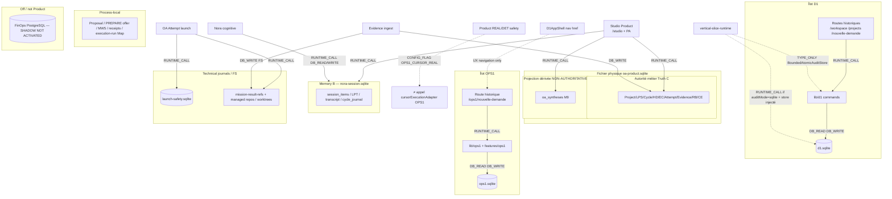
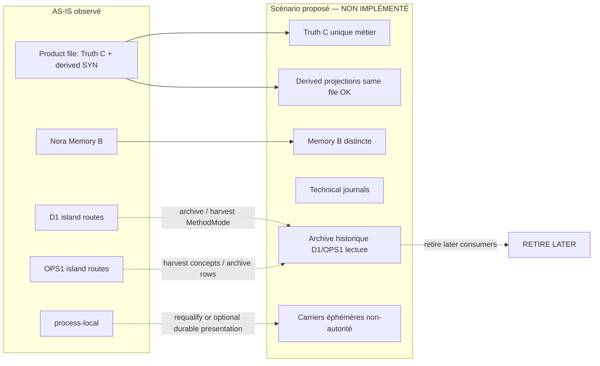

# AKG-M4-A / T-A04 — Storage, Persistence & Migration Assessment

| Champ | Valeur |
| --- | --- |
| Cycle | **AKG-M4-A / T-A04** — Storage Topology, Persistence Boundaries & Migration Strategy |
| Type / Profil | Cycle 6 — Architecture technique · **Critical** |
| Typologie | DOC / Architecture / Rationalization Assessment (+ Correction Pass 01) |
| Baseline | `analysis/akg-m4a-ta04-storage-migration` @ `c48c6a582c10ee3cf6902203d6a4eb01ce3f2139` |
| `origin/main` | `f44a99b4da84188772b80aca3c9ebe1a3e12617e` |
| PR #604 | Draft · CI SUCCESS · non mergée |
| Antecedents | T-A01 `42de13a9…` · T-A02 `51021023…` · T-A03 `640f19c1…` (handoffs immuables) |
| Correction Pass 01 | CORR-01 Synthesis ≠ Truth C · CORR-02 graphe Product/Legacy typé |
| Méthode | Audit **statique** code + schémas · **pas** d'ouverture DB utilisateur · **pas** de migration exécutée |
| Principe | **OR-13** · **G0-A/B** · **aucun dual-write D1/OA** |
| Statut | **LOCAL CANDIDATE** · M4-A **NON CLOSED** · options **candidates** |
| Non-claims | DETERMINISTIC ≠ REAL · P6 GLOBAL **NOT PASSED** · v3 **NON ADOPTED** · volumes utilisateur D1/OPS1 **UNKNOWN** · migration **design-only** · même fichier SQLite ≠ même autorité |

> **AS-IS :** code + schémas + tests > PRR. « Durable » = **conditionnel** au chemin/backend stables. Une dépendance active ≠ conservation permanente (OR-13).

---

## 1. Baseline et maturité

Worktree isolé ; WTs T-A01/T-A02/T-A03 **non modifiés**. Documents `05`/`06`/`07` lus via handoffs immuables. CKC Architecture : **fallback méthode canonique**.

**Maturité :** topologie AS-IS **CONFIRMED** pour les schémas et résolveurs de chemin ; volumes de données réelles **UNKNOWN** (aucune ouverture DB utilisateur) ; migrations **design candidates** seulement.

---

## 2. Sources et méthode

- SFIA v2.6 template / routing / operating model / rules / knowledge layer.
- Build Doctrine R23/R24 · Roadmap B-AKG · G0 pack · AKG README · M4 `01`–`04`.
- PRR 01–09 (focus 05/06).
- Doctrine v3 30/32/34/35/37.
- Handoffs T-A01 (consumers) · T-A02 (capabilities) · T-A03 (authority/restart).
- Code : Product sqlite `db.ts`/`paths.ts`/`sqliteProductStore.ts` · Nora `sessionPaths`/`productSqliteSession` · D1 `db.ts`/`paths.ts` · OPS1 `db.ts`/`paths.ts` · process-local stores · Gate D journal · mission-result / Evidence · FinOps composition (SHADOW OFF).

**Méthode :** inventaire tables/agrégats → writers/readers → autorité → durabilité conditionnelle → txn/idempotence réelle → restart → risque → valeur cible → option candidate. Pas d'invention de volumes.

---

## 3. Topologie AS-IS (observée) — CORR-01 / CORR-02

**Trois notions distinctes (CORR-01) :**
1. **Fichier physique** `oa-product.sqlite` (G0-B Product Store).
2. **Autorité métier Truth C** — agrégats autoritatifs dans ce fichier (Project/LPS/Cycle/HD/EC/Attempt/Evidence/RB/CE…).
3. **Projection dérivée** `oa_syntheses` — **même fichier**, **NON-AUTHORITATIVE / NOT Truth C** (`db.ts` L322 ; `sqliteSynthesisRepository.ts` L31–33). **Pas** de second SQLite requis.

**Liens typés (CORR-02) :** `TYPE_ONLY` · `RUNTIME_CALL` · `CONFIG_FLAG` · `DB_READ` · `DB_WRITE` · `UNKNOWN`. Un import de type ≠ `DB_READ`. Un flag ≠ appel adaptateur.

### Table des liens vérifiés (CORR-02)

| Lien | Nature | Preuve | ≠ |
| --- | --- | --- | --- |
| `/studio` → Product UI → PA/OA → Truth C | `RUNTIME_CALL` (+ `DB_READ`/`DB_WRITE` via OA) | `app/studio/page.tsx` → `pre-m6-product-ui` ; PA/OA services | Accès D1/OPS1 SQLite |
| Nora / PA → `nora-session.sqlite` | `RUNTIME_CALL` / `DB_READ` / `DB_WRITE` | `sessionPaths.ts` ; ProductSqliteSession | Truth C |
| `/workspace`, `/projects/[id]`, `/nouvelle-demande` → `lib/d1` → `d1.sqlite` | `RUNTIME_CALL` / `DB_READ` / `DB_WRITE` | routes L1–3 ; T-A01 A03 | Product Truth C |
| `/ops1/nouvelle-demande` → OPS1 features → `ops1.sqlite` | `RUNTIME_CALL` / `DB_READ` / `DB_WRITE` | `ops1/nouvelle-demande/page.tsx` ; T-A01 A04 | Product gateway |
| VSR → `BoundedAtomicAuditStore` type | `TYPE_ONLY` | `service.ts` L14, L110 | `DB_READ` D1 |
| VSR auditMode=`sqlite` + store injecté | `RUNTIME_CALL` / `DB_WRITE` **conditionnel** | `service.ts` L174–188 | Toujours actif |
| Product safety → `OPS1_CURSOR_REAL` | `CONFIG_FLAG` | `deterministicExternalLaunchBoundary.ts` L48–57 ; T-A01 | Appel `cursorExecutionAdapter` |
| D1AppShell → `/ops1/nouvelle-demande` | UX navigation | `D1AppShell.tsx` L52 | Partage DB |
| Studio/PA → D1/OPS1 SQLite | **absent** (périmètre audité) | T-A01 A03/A04 | — |
| Dual-write D1↔OA | **absent / forbidden** | G0 ; Product path guards | — |

*Pas de flèche « Studio UI → Legacy » générique. Paths défaut sous `.sfia-exec/` (cwd/env-sensitive). G0-B inchangé : un fichier Product, plusieurs classes d'autorité.*

---

## 4. Matrice ST-01 → ST-06

**Légende durabilité :** `COND-DURABLE` = fichier SQLite/FS **si** chemin/env stables · `PROCESS-LOCAL` = perdu au restart process · `VOLATILE-DEFAULT` = défaut recomputé · `EXT-DURABLE-IF-WIRED` = PG si composé.

### 4.1 ST-01 — Product SQLite (fichier G0-B) : Truth C + projections

*Le fichier `oa-product.sqlite` héberge Truth C **et** des projections non autoritatives. Même backend ≠ même autorité (CORR-01). Pas de second fichier SQLite pour Synthesis.*

| Storage ID | Agrégat | Owner | Backend | Localisation | Writers | Readers | Autorité | Durabilité | Txn / idempotence | Restart | Risque | Valeur | Option | Preuve | Statut |
| --- | --- | --- | --- | --- | --- | --- | --- | --- | --- | --- | --- | --- | --- | --- | --- |
| ST01-PATH | Product DB file | OA project infra | node:sqlite | `SFIA_STUDIO_PRODUCT_DB_PATH` ou `{studioRoot}/.sfia-exec/product/oa-product.sqlite` ; refuse d1/ops1 basenames | `SqliteProductStore` | Product services | **Physical container** (Truth C + derived) | COND-DURABLE | UoW `BEGIN IMMEDIATE` | reload if same path | cwd drift orphans | REQUIRED | KEEP | `paths.ts` L9+ ; `sqliteProductStore.ts` L53, L72 | C |
| ST01-SCHEMA | schema_meta M1→M9 | OA | same | same | `openProductSqlite` migrations | open | technical | COND-DURABLE | migrate on open | version gate | unsupported schema fail | REQUIRED | KEEP | `db.ts` L3–11, L322+, L409+ | C |
| ST01-PROJECT | oa_projects / LPS | OA project | same | same | project/LPS repos | PA / LPS readers | **Truth C** | COND-DURABLE | project idempotency table | durable | — | REQUIRED | KEEP | `db.ts` L21–46 | C |
| ST01-CYCLE | oa_cycle_instances + trajectories/epistemic | OA cycle | same | same | cycle services | PA | **Truth C** | COND-DURABLE | cycle journals | durable | epistemic drafts non-materialized = process | REQUIRED | KEEP | `db.ts` L71–82, L204–254 | C |
| ST01-HD | oa_human_decisions (+ DecisionRef in payload/epistemic) | OA decision | same | same | DecisionServices / recordF2Decision / SHE | verify PREPARE / resume HD11 | **Truth C** authority | COND-DURABLE | confirmation + decision journals | durable | DecisionRef ≠ table dédiée | REQUIRED | KEEP | `db.ts` L91–104 ; T-A03 | C |
| ST01-EC | oa_execution_contracts + inspection + confirmations + auth receipts | OA EC | same | same | prepare / SHE / authorize | inspect / execute | **Truth C** | COND-DURABLE | unique idempotency keys | durable | OCC/version mismatch | REQUIRED | KEEP | `db.ts` L111–123, L228–290 | C |
| ST01-ATT | oa_execution_attempts (+ active, result_budget) | OA Attempt | same | same | Select/Start/Record | governed execute | **Truth C** technical attempt | COND-DURABLE | adapter-bound record ; result_pending | durable | Attempt≠PROVEN | REQUIRED | KEEP | `db.ts` L132–155 ; T-A03 CORR-02 | C |
| ST01-EVID | oa_evidence / review_bundles / claim_evaluations (+ idempotency sidecars) | OA evidence-review | same + FS payloads | same | ingest / materializeW3b | W3C / resolution | **Truth C** proof | COND-DURABLE meta ; payload external COND | sidecar idempotency ; **FS+DB not cross-atomic** | meta durable ; file may orphan | orphan refs | REQUIRED | KEEP / CONSOLIDATE FS later | `db.ts` L157–319 ; ingestMissionResultEvidence | C |
| ST01-SYN | oa_syntheses M9 | OA synthesis | **same file** | same | synthesis services / SqliteSynthesisRepository | product-derived views | **Product-derived · NON-AUTHORITATIVE · NOT Truth C** | COND-DURABLE | via Product store | durable projection | confondre avec Truth C / HD | OPTIONAL | KEEP as derived ; **not** elevate to Truth C | `db.ts` L322–339 ; `sqliteSynthesisRepository.ts` L31–33 | C |

### 4.2 ST-02 — Nora Session / Memory B

| Storage ID | Agrégat | Owner | Backend | Localisation | Writers | Readers | Autorité | Durabilité | Txn / idempotence | Restart | Risque | Valeur | Option | Preuve | Statut |
| --- | --- | --- | --- | --- | --- | --- | --- | --- | --- | --- | --- | --- | --- | --- | --- |
| ST02-PATH | Nora session DB | nora-cognitive-runtime | node:sqlite | `SFIA_STUDIO_NORA_SESSION_DB_PATH` ou sibling `nora-session.sqlite` ; refuse oa-product/d1/ops1 | ProductSqliteSession | turn orchestration | Memory B ≠ Truth C | COND-DURABLE | batch append / atomic replace | durable if path | path drift orphans chat | REQUIRED (conversation) | KEEP distinct | `sessionPaths.ts` L12–32 | C |
| ST02-ITEMS | session_items / LPT / retry bindings | session | same | same | Session SDK methods | Nora turns | Memory B | COND-DURABLE | logical-turn bindings | durable | clearSession ≠ wipe journal | REQUIRED | KEEP | `productSqliteSession.ts` | C |
| ST02-JOURNAL | pilot_transcript / cycle_journal / mutation ledger | cycleJournalStore | same | same | append / materialize | continuity / UI | Memory B journal | COND-DURABLE | ledger PKs | durable | unbounded growth UNKNOWN GC | REQUIRED | KEEP ; retention later | cycleJournalStore | C |
| ST02-RUNSTATE | OpenAI RunState | nora Agents turn | process memory | in-process | Runner.run segments | same-turn resume | technical cognition | PROCESS-LOCAL (same turn) | N/A durable | **cross-restart NOT IMPLEMENTED / DEFER** | false continuity claim | OPTIONAL future | DEFER | `controlledContinuation.ts` L1–6 | C |

### 4.3 ST-03 — D1 SQLite

| Storage ID | Agrégat | Owner | Backend | Localisation | Writers | Readers | Autorité | Durabilité | Txn / idempotence | Restart | Risque | Valeur | Option | Preuve | Statut |
| --- | --- | --- | --- | --- | --- | --- | --- | --- | --- | --- | --- | --- | --- | --- | --- |
| ST03-D1 | d1_projects / assignments / audit / idempotency / atomic_audit | lib/d1 | node:sqlite | `.sfia-exec/local-i1/state/d1.sqlite` (env overrides) | createProjectAtomic / mode / activate / BoundedAtomicAudit | workspace UI / readiness | **D1 island ≠ OA Project** (`proj-*` vs OA ids) | COND-DURABLE | BEGIN IMMEDIATE + idempotency keys | durable if path | parallel identity vs Truth C | OPTIONAL historical / MethodMode hold | HARVEST patterns ; RETIRE LATER consumers | `d1/db.ts` L8–91 ; `paths.ts` ; `ids.ts` | C |
| ST03-VOLUMES | user blobs/docs | — | — | — | — | — | — | — | — | — | unknown demand | UNKNOWN | N/A until designed | no tables | U |
| ST03-HOLD | MethodMode hold override | methodModeHold | process slot | in-mem override | tests | readiness | evaluation hold | VOLATILE-DEFAULT | N/A | lost → default | confuse with DB column | OPTIONAL | KEEP code-level | methodModeHold.store.ts | C |

### 4.4 ST-04 — OPS1 SQLite

| Storage ID | Agrégat | Owner | Backend | Localisation | Writers | Readers | Autorité | Durabilité | Txn / idempotence | Restart | Risque | Valeur | Option | Preuve | Statut |
| --- | --- | --- | --- | --- | --- | --- | --- | --- | --- | --- | --- | --- | --- | --- | --- |
| ST04-OPS1 | sessions / turns / events / qualifications / candidates / gates / allowlist / contracts / attempts / results / reports / coverage | lib/ops1 | node:sqlite + worktrees FS | `.sfia-exec/local-i1/state/ops1.sqlite` + worktrees | ops1 actions / orchestrator / adapter | OPS1 UI | **OPS1 island ≠ Product Spine** ; project_key fixed | COND-DURABLE DB ; FS separate | local DB txns ; worktree **not** in DB txn | DB durable ; worktree may orphan | confuse gate≠HD ; growth no TTL | OPTIONAL historical harvest | HARVEST concepts ; RETIRE LATER ; **do not map gate→OA HD** | `ops1/db.ts` L9–234 ; `paths.ts` | C |

### 4.5 ST-05 — Process-local

| Storage ID | Agrégat | Owner | Backend | Localisation | Writers | Readers | Autorité | Durabilité | Txn / idempotence | Restart | Risque | Valeur | Option | Preuve | Statut |
| --- | --- | --- | --- | --- | --- | --- | --- | --- | --- | --- | --- | --- | --- | --- | --- |
| ST05-PROP | F2 Proposal Map | f2/proposalStore | globalThis Map | `__SFIA_F2_PROPOSAL_STORE__` | saveProposal | recordDecision / prepare | **carrier ≠ authority** | PROCESS-LOCAL | none | **lost** | false durable proposal | OPTIONAL continuity UX | REBUILD carrier candidate — **not** 2e vérité | proposalStore.ts L8–32 | C |
| ST05-OFFER | Pending Generic PREPARE offer | pendingGenericPrepareOfferStore | globalThis Map | keyed project+session | remember/clear | prepare continuity | presentation ≠ HD | PROCESS-LOCAL | none | **lost** (intended) | cross-session bind if key wrong | OPTIONAL | ADAPT/REBUILD under GO ; HD11 without offer | store L21–25, L30+ | C |
| ST05-MW5 | MW5 challenge | mw5ChallengeSessionStore | globalThis Map | process | remember challenge | intentAnalysis | episode integrity | PROCESS-LOCAL | none | lost | forge if bypassed | REQUIRED volatile | KEEP volatile | mw5ChallengeSessionStore | C |
| ST05-RECEIPT | CognitiveExecutionReceipt | cognitiveExecutionReceipt | module Map | max 512 | remember | conservation UX | ≠ Product | PROCESS-LOCAL | eviction | lost | stale UX | OPTIONAL | KEEP volatile | cognitiveExecutionReceipt.ts | C |
| ST05-RUNTIME | RuntimeApplicationService singleton | vertical-slice | globalThis | process | getRuntime… | actions | composition | PROCESS-LOCAL | N/A | recreate | multi-instance skew | REQUIRED process | KEEP | singleton.ts | C |

### 4.6 ST-06 — Autres persistances

| Storage ID | Agrégat | Owner | Backend | Localisation | Writers | Readers | Autorité | Durabilité | Txn / idempotence | Restart | Risque | Valeur | Option | Preuve | Statut |
| --- | --- | --- | --- | --- | --- | --- | --- | --- | --- | --- | --- | --- | --- | --- | --- |
| ST06-GATED | Gate D grants + launch frontier | Attempt launch safety | sqlite isolé | `.sfia-exec/m4/launch-safety.sqlite` | SqliteLaunchSafetyJournal | StartExecution consume | technical ≠ Product Store | COND-DURABLE | atomicConsumeGrantAndCreateFrontier BEGIN IMMEDIATE | durable | frontier≠Attempt row atomicity | REQUIRED for REAL safety when composed | KEEP separate | sqliteLaunchSafetyJournal.ts L225+ | C |
| ST06-MISSION-FS | mission-result JSON | F3 / evidence | filesystem | `{productDir}/mission-result-refs/...` | persistMissionResultPayload | ingest / tools | payload bytes ; Evidence row = pointer authority | COND-DURABLE FS | **file then SQLite — not one txn** | both may diverge | orphan file or meta-only | REQUIRED when path used | CONSOLIDATE later | ingestMissionResultEvidence.ts | C |
| ST06-EXEC-RUN | ExecutionRun | oa/execution-run | Memory Map | process | composeExecutionRunMemory | get/list | aggregate in-mem | PROCESS-LOCAL | invariants before save | lost (`restartSafe:false`) | mistaken FinOps ledger | OPTIONAL | REPLACE if selected later | composeExecutionRunMemory.ts | C |
| ST06-FINOPS | FinOps aggregates | oa/finops | PostgreSQL | external DSN | postgres*Store if composed | T7 / shadow | FinOps when activated | EXT-DURABLE-IF-WIRED | PG txns | survives PG | accidental SHADOW ON | OPTIONAL | KEEP OFF ; not Product | composeFinOpsT7Shadow… SHADOW NOT ACTIVATED | C |
| ST06-EXT-FS | managed repos / M4 worktrees / docs artifacts | OA / F3 | FS+git | managedRepoRootBase ; `.sfia-exec/m4-worktrees` | launch / persistDocsWrite | path probes | external effects referenced by OA | COND-DURABLE FS | outside Product UoW | may orphan | path escape | REQUIRED for REAL delivery surface | KEEP + policy | managedRepoPathFacts ; composeStudioProductRealBoundary | C |

---

## 5. Writers, readers et frontières de vérité

| Frontière | Contient | N'est pas |
| --- | --- | --- |
| Fichier Product (`oa-product.sqlite`) | Truth C aggregates **+** projections dérivées (ex. `oa_syntheses`) | Second SQLite pour Synthesis |
| Truth C (autorité métier) | Project, LPS, Cycle, HD, EC, Attempt, Evidence, RB, CE | Session chat ; Proposal Map ; OPS1 gate ; **`oa_syntheses`** |
| Projection dérivée Product | `oa_syntheses` M9 (NON-AUTHORITATIVE) | HumanDecision / Authorization / Truth C |
| Memory B | Session items, transcript, cycle journal | Autorité métier ; RunState durable |
| D1 island | proj-* projects, MethodMode column, I1 audit ; routes historiques D1 | OA Project ; dual-write target ; accès depuis Studio Product |
| OPS1 island | session/gate/allowlist/contract/attempt/report ; route `/ops1` | Product HD/EC/Attempt ; Product adapter call |
| Technical journals | Gate D launch-safety ; mission-result files | HumanDecision |
| Process-local | Proposal, offer, MW5, receipts, execution-run | Truth C |
| Couplages transverses | `TYPE_ONLY` VSR↔D1 audit type ; `CONFIG_FLAG` `OPS1_CURSOR_REAL` | `DB_READ`/`RUNTIME_CALL` OPS1 adapter depuis Product |

**Aucun dual-write D1/OA** (G0 ; path guards Product refusent d1/ops1). **Aucun** `DB_READ`/`DB_WRITE` Studio Product → D1/OPS1 SQLite retrouvé (T-A01).

---

## 6. Transactions, idempotence, cohérence multi-stockages

| Périmètre | Garantie réelle | Limite |
| --- | --- | --- |
| Product UoW | `BEGIN IMMEDIATE` / COMMIT / ROLLBACK | **intra**-fichier Product |
| D1 create | IMMEDIATE + idempotency | **intra**-D1 |
| OPS1 DB | local txns | worktree FS **hors** txn |
| Gate D journal | atomic consume grant+frontier | **≠** Attempt row dans même txn |
| Mission-result | file write → puis Evidence SQLite | **non** cross-atomic ; Attempt may succeed with Evidence fail (T-A03) |
| FinOps PG | PG txns if wired | SHADOW NOT ACTIVATED |

**Pas** de migration atomique inter-bases implémentée. **Pas** de rollback d'effets externes promis.

---

## 7. Restart / recovery

| Classe | Exemples | Après restart |
| --- | --- | --- |
| COND-DURABLE Truth C | HD, EC, Attempt, Evidence meta | rechargeable si même path |
| COND-DURABLE derived (same file) | `oa_syntheses` | rechargeable ; **≠** Truth C authority |
| COND-DURABLE Memory B | session/journal | rechargeable si même path |
| COND-DURABLE islands | D1, OPS1, launch-safety | rechargeable si même path |
| PROCESS-LOCAL | Proposal, offer, MW5, RunState, execution-run | **lost** |
| DEFER | RunState cross-restart | NOT IMPLEMENTED |
| Reconstitution | HD11 PREPARE without offer ; rehydrate*FromLps | **implemented** for those paths |
| Interdit | inventer HD / Authorization / presentation / PROVEN | fail-closed |

---

## 8. Données historiques à préserver (qualification)

| Source | Utile à préserver (candidate) | Lecture historique seule | Obsolescence candidate | Volume réel |
| --- | --- | --- | --- | --- |
| Truth C | autoritative Product aggregates | N/A | N/A | env-dependent UNKNOWN |
| Product-derived | `oa_syntheses` projections | rebuildable from sources | never elevate to Truth C | UNKNOWN |
| Memory B | transcript/journal for continuity | optional archive | GC policy missing | UNKNOWN |
| D1 | audit/idempotency patterns ; MethodMode semantics | project rows if any exist | UI D1 path | **UNKNOWN** (schema only audited) |
| OPS1 | gate/allowlist/report **concepts** ; past reports | full OPS1 DB as archive | runtime OPS1 after Product harvest | UNKNOWN |
| Process-local | none as durable history | N/A | N/A | N/A |
| mission-result FS | payloads referenced by Evidence | orphans after GC | unreferenced files | UNKNOWN |

Ne **pas** présumer de données utilisateur présentes dans l'environnement d'analyse.

---

## 9. Scénarios MIG-A → MIG-D (design-only)

### MIG-A — D1 → Product

| Aspect | Constat | Option design |
| --- | --- | --- |
| Identités | `proj-*` ≠ OA project ids | mapping table explicite **si** migration ; jamais silent merge |
| Modèle | D1 project+assignment+MethodMode column vs OA Project+LPS+Cycle | MethodMode semantics → OA/policy fields **candidate** ; pas dual-write |
| Audit/idempotence | D1 tables | harvest patterns into OA audit ; archive D1 events |
| Volumes | **not implemented** | N/A |
| Ordre | inventaire → read-only archive → map ids → convert controlled → cutover readers → retire D1 UI | **design** ; GO Delivery required later |
| Rollback | backup file + keep D1 read-only | external effects N/A for D1 project create |

### MIG-B — OPS1 → capacités Product

| Aspect | Constat | Option design |
| --- | --- | --- |
| Authority | OPS1 gate ≠ OA HD | **ne pas** importer décisions OPS1 comme HD |
| Contract/Attempt | parallel schemas | harvest controls into OA Attempt ; archive OPS1 rows |
| Allowlist | OPS1 evaluations | rebuild under Product path policy / managed repo |
| Report/reinject | OPS1 report | harvest requirements into W3C Evidence/synthesis |
| Worktrees FS | outside DB txn | quarantine + retention policy |
| Cursor adapter | OPS1_CURSOR_REAL coupled safety (T-A01) | retire after Product gateway exclusive |

### MIG-C — Continuité offres / propositions

| Option | Description | Garde-fou |
| --- | --- | --- |
| C1 Requalify | after restart, re-run F2/W2 qualification | **default** ; no invent HD |
| C2 Controlled re-present | UI re-shows prepare from Truth C EC if exists | presentation ≠ new authority |
| C3 Reconstitute from Truth C | HD11 verify → PREPARE without offer Map | **implemented** (T-A03) |
| C4 Durable carrier | new PresentedSubject store under GO | **must not** become 2e vérité / silent Authorization |

### MIG-D — Preuves multi-stockages

| Risque | Observation | Option design |
| --- | --- | --- |
| Orphan mission-result file | FS write before SQLite ingest | reconcile job candidate ; fail-closed Product already |
| Attempt succeeded + Evidence fail | T-A03 continuity fail codes | keep honest NOT_PROVEN ; repair path explicit |
| result_pending | technical persist fail | Attempt durable ; contract stays executing |
| Missing ReviewBundle | materialize path not run | do not invent PROVEN |
| Cross-store atomicity | **absent** | document ; optional future single UoW — **new GO** if changing G0 |

---

## 10. Comparaison options migration / reconstruction

| Stratégie | Pros | Cons | Fit OR-13 / G0 |
| --- | --- | --- | --- |
| Keep islands + Product Truth C | low immediate risk | dual UX / identity confusion | interim OK |
| Archive D1/OPS1 read-only + Product-only write | clear authority | need inventory tooling | aligns G0 |
| Dual-write | — | **FORBIDDEN** | violates G0 |
| Merge all DBs into one file | simple ops myth | mixes Memory B / technical / legacy authority | **reject as principle** |
| Rebuild carriers (Proposal/Offer) | UX continuity | risk of 2e vérité | only with explicit non-authority design |
| Harvest OPS1→OA capabilities | capability preserve | mapping authority carefully | OR-13 preferred |

*Diagramme cible = **scénario proposé**, pas preuve d'implémentation. Derived Synthesis reste hors Truth C.*

---

## 11. Risques

| ID | Risque | Mitigation candidate |
| --- | --- | --- |
| R1 | Dual identity D1 vs OA | cutover readers ; no dual-write |
| R2 | OPS1 gate treated as HD | explicit non-mapping (T-A03/T-A02) |
| R3 | Path/env drift orphans Truth C or Memory B | pin env paths in ops ; document |
| R4 | FS↔SQLite orphan Evidence | reconcile ; keep NOT_PROVEN honest |
| R5 | Process-local mistaken for durable authority | CORR-01/T-A03 narration ; optional carrier GO |
| R6 | Unbounded OPS1/session growth | retention policy missing |
| R7 | Accidental FinOps SHADOW ON | keep OFF ; composition refuse |
| R8 | Migration without inventory | design requires inventory first — volumes UNKNOWN |
| R9 | External effect rollback promised | **forbid** without demonstrated mechanism |

---

## 12. Recommandations pour T-A05

1. Impact pack : coût dual-path SHE + historical ; OPS1 harvest vs retire ; routes D1/OPS1 vs Studio Product séparées (CORR-02).
2. Storage impact : D1/OPS1 archive strategy ; carrier continuity GO yes/no ; **ne pas** élever Synthesis en Truth C (CORR-01).
3. Evidence multi-store coherence as delivery risk item.
4. MethodMode disposition (T-A02) tied to MIG-A.
5. Qualify VSR↔D1 audit optional store vs TYPE_ONLY when sizing retire cost.
6. **No** Delivery GO from T-A04 alone.

---

## 13. Gaps / preuves manquantes

| Gap | Statut |
| --- | --- |
| Volumes réels D1/OPS1/Product en prod | UNKNOWN (DB non ouvertes) |
| Retention/GC session & OPS1 events | NOT IMPLEMENTED |
| RunState cross-restart | DEFER |
| Cross-store atomic Evidence | absent |
| PRR 06 omits `oa_syntheses` / authority class | DOC drift vs CODE (table exists ; NOT Truth C) |
| Multi-process SQLite writers | UNKNOWN |
| Full call-graph every write in UoW | PARTIAL |
| REAL E2E / P6 GLOBAL | NOT PASSED |

---

## 14. Conditions de sortie M4-A

| Condition | État |
| --- | --- |
| T-A01 / T-A02 / T-A03 | Acceptés (handoffs) |
| T-A04 storage/migration | **LOCAL CANDIDATE** + Correction Pass 01 (ce document) |
| T-A05 impact pack | **NON** |
| T-A06 Critical alignement | **NON** |
| M4-A CLOSED | **NON** |

---

## 15. Traçabilité SFIA / R23-R24

| Règle | Application |
| --- | --- |
| R23 | Périmètre analysis-only ; pas de Delivery |
| R24 | **NO PRODUCT SEMANTIC IMPACT** — documentation uniquement |
| OR-13 | Capacités/invariants > implémentations historiques |
| G0-A/B | OA backbone + Product sqlite ; **pas** dual-write ; D1/OPS1 séparés ; **même fichier** peut héberger Truth C + projections non autoritatives |
| Fake-Real | DET ≠ REAL ; SHADOW NOT ACTIVATED ; pas de Cursor REAL |

---

## 16. Correction Pass 01 — fermeture

| ID | Preuve corrigée | Verdict |
| --- | --- | --- |
| CORR-01 | §3 diagramme + ST01-SYN + §5 frontières : `oa_syntheses` = Product-derived NON-AUTHORITATIVE / NOT Truth C ; même fichier G0-B ; pas de 2e SQLite | **PASS** |
| CORR-02 | §3 graphe + table de liens : routes D1/OPS1 isolées ; Studio→Product ; TYPE_ONLY VSR ; CONFIG_FLAG `OPS1_CURSOR_REAL` ; pas de Studio→Legacy SQLite inventé | **PASS** |

---

END — `AKG-M4-A / T-A04` — LOCAL CANDIDATE STORAGE & MIGRATION ASSESSMENT (Correction Pass 01)
