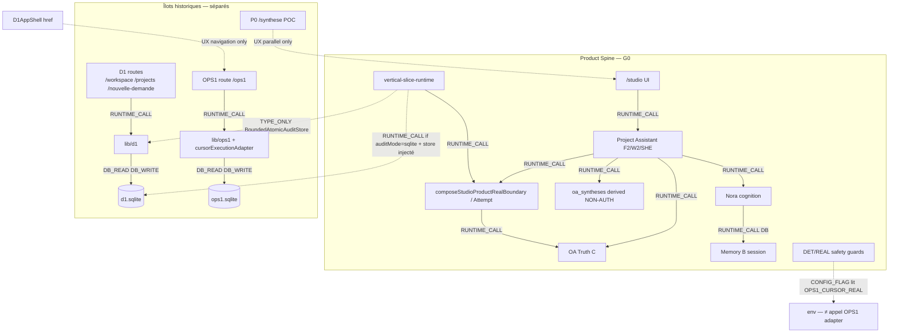
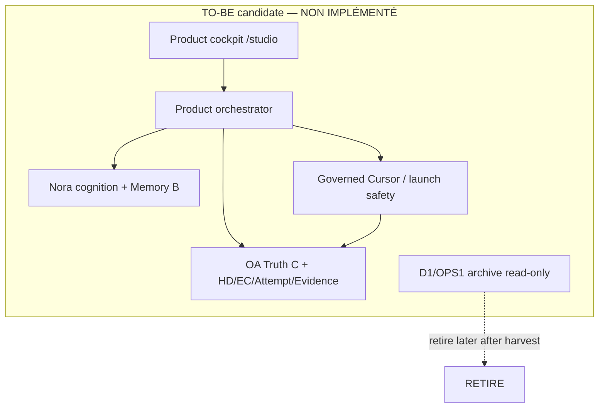
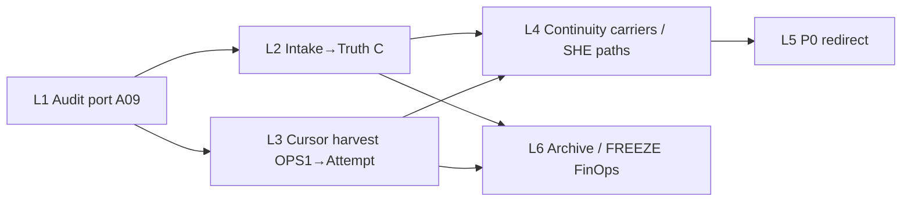

# AKG-M4-A / T-A05 — Impact Pack & Rationalization Options

| Champ | Valeur |
| --- | --- |
| Cycle | **AKG-M4-A / T-A05** — Impact Pack & Capability-First Rationalization Options |
| Type / Profil | Cycle 6 — Architecture technique · **Critical** |
| Typologie | DOC / Architecture / Rationalization Assessment (+ Correction Pass 01) |
| Baseline | `analysis/akg-m4a-ta05-rationalization-impact-pack` @ `c48c6a582c10ee3cf6902203d6a4eb01ce3f2139` |
| `origin/main` | `f44a99b4da84188772b80aca3c9ebe1a3e12617e` |
| PR #604 | Draft · CI SUCCESS · non mergée |
| Antecedents | T-A01 `42de13a9…` · T-A02 `51021023…` · T-A03 `640f19c1…` · T-A04 `6717d094…` (handoffs immuables) |
| Correction Pass 01 | CORR-01 AS-IS edges · CORR-02 SC-G3 contradictoire · CORR-03 gates A09/A11 · CORR-04 GO/lots |
| Méthode | Consolidation **statique** T-A01–T-A04 + code · **pas** de Delivery · **pas** de REAL |
| Doctrine | **OR-13** · **G0-A/B** · **aucun dual-write** |
| Statut | **LOCAL CANDIDATE** · M4-A **NON CLOSED** · options **candidates** · SC-G2 **préféré candidate** après comparaison contradictoire |
| Non-claims | Pas de GO Delivery/M5 · P6 GLOBAL **NOT PASSED** · v3 **NON ADOPTED** · REAL **NOT PROVEN** · option privilégiée ≠ décision Pilote · Attempt ≠ Evidence ≠ PROVEN · Synthesis ≠ Truth C · SHE clic ≠ disparition HD |

> Les analyses T-A01–T-A04 sont **ACCEPTED WITH RESERVES** à leurs périmètres ChatGPT ; elles **ne constituent pas** une architecture adoptée. Ce pack compare des options — **aucune transformation autorisée**.

---

## 1. Baseline Git et statut

Worktree isolé ; WTs T-A01–T-A04 **non modifiés**. Documents `05`–`08` lus via handoffs immuables uniquement. CKC Architecture : **fallback méthode canonique**.

**Maturité :** impact pack **LOCAL CANDIDATE** · scénario global privilégié **SC-G2** (candidate) · M4-A **ouvert** jusqu'à T-A06 + arbitrage Pilote.

---

## 2. Sources T-A01–T-A04 et limites

| Audit | Apport | Limite |
| --- | --- | --- |
| T-A01 | A01–A12 consumers / depth / coupling | Dynamic callers PARTIAL |
| T-A02 | 29 CAP inventory ; OPS1≠Product ; FinOps≠SHADOW ON | Some CAP PARTIAL |
| T-A03 | S01–S07 authority ; SHE ; Attempt≠Evidence ; restart | REAL E2E not proven |
| T-A04 | ST-01–06 ; MIG-A–D ; Synthesis NOT Truth C ; typed Product/Legacy | Volumes UNKNOWN |

Code primary (spot checks) : `app/studio/**`, `project-assistant`, `nora-cognitive-runtime`, `vertical-slice-runtime`, `lib/oa/**`, `lib/d1/**`, `lib/ops1/**`. PRR 03/04/06–09 · doctrine v3 30/32/34/35/37 · G0 · M4 `01`–`04` · Build Doctrine R23/R24.

---

## 3. Synthèse AS-IS consolidée

### 3.1 Couches de responsabilité (observées)

| Couche | Rôle AS-IS | Exemples |
| --- | --- | --- |
| 1. Métier / autorité | Truth C + HD/EC/Attempt/Evidence | OA Product SQLite |
| 2. Orchestration produit | UI→OA, SHE, F2/W2 | Project Assistant |
| 3. Cognition Nora | Qualification, reco, outils | nora-cognitive-runtime + Memory B |
| 4. Adaptation technique | Cursor launch, path facts | Product REAL boundary ; OPS1 island |
| 5. Persistance / projection | Truth C, Memory B, derived SYN, FS refs | ST-01–06 |
| 6. UX | `/studio` Product ; D1/OPS1/P0 historiques | pre-m6-product-ui ; îlots |

### 3.2 Diagramme AS-IS (observé) — CORR-01

### Table des arêtes vérifiées (CORR-01)

| Lien | Nature | Preuve | ≠ |
| --- | --- | --- | --- |
| Studio → PA → OA/Nora/REAL | `RUNTIME_CALL` (+ DB via OA/MemB) | `/studio` ; project-assistant ; OA services | Accès D1/OPS1 SQLite |
| D1 routes → lib/d1 → d1.sqlite | `RUNTIME_CALL` / `DB_READ` / `DB_WRITE` | T-A01 A03 ; routes workspace/projects | Product spine |
| OPS1 route → lib/ops1 → ops1.sqlite | `RUNTIME_CALL` / `DB_READ` / `DB_WRITE` | T-A01 A04 ; `ops1/nouvelle-demande` | Product Attempt gateway |
| VSR → `BoundedAtomicAuditStore` | `TYPE_ONLY` | `service.ts` L14, L110 | `DB_READ` D1 |
| VSR `auditMode=sqlite` + store | `RUNTIME_CALL` **conditionnel** | `service.ts` L174–188, L758 ; default **noop** | Toujours actif |
| Safety → `OPS1_CURSOR_REAL` | `CONFIG_FLAG` | `deterministicExternalLaunchBoundary.ts` | Appel `cursorExecutionAdapter` |
| `composeStudioProductRealBoundary` → OPS1 adapter | **absent** | grep import OPS1 dans compose… | — |
| P0 / D1AppShell → OPS1 | UX navigation / parallel entry | `D1AppShell.tsx` ; P0 routes | `RUNTIME_CALL` Product↔Legacy DB |
| Studio/PA → D1/OPS1 SQLite | **absent** | T-A01/T-A04 | — |

*Pas de flèche générique « îlot → PA/REAL ». Pas de `DB_READ` Product→D1/OPS1. Pas de dual-write.*

---

## 4. Principes et responsabilités TO-BE (candidates)

Alignés G0 / doctrine v3 / OR-13 — **non adoptés** :

1. **Un cockpit Product** Pilote ↔ Nora (`/studio`).
2. Nora = cognition / qualification / reco — **pas** autorité métier.
3. OA = backbone Truth C + autorité (G0-A/B).
4. EC = enveloppe gouvernée ; **SHE** = un clic Exécuter **avec** HD/Confirm/Authorize internes.
5. Cursor = capacité technique sous Attempt — pas source d'autorité.
6. Attempt technique ≠ Evidence ≠ ContractResult PROVEN.
7. Memory B ≠ Truth C ; Synthesis dérivée ≠ Truth C.
8. Carriers (Proposal/Offer) ≠ HumanDecision.
9. **Aucun dual-write D1/OA.**

---

## 5. Matrice de rationalisation A01–A12

| ID | Domaine | Capacité utile | Problème AS-IS | Owner actuel | Owner cible | Options étudiées | **Option privilégiée (candidate)** | Alternatives rejetées | Dépendances | Données | Autorité / sécurité | Coût / risque | Non-régression | Transition | Retirement gate | Evidence | Conf. | Decision state |
| --- | --- | --- | --- | --- | --- | --- | --- | --- | --- | --- | --- | --- | --- | --- | --- | --- | --- | --- |
| A01 | Product UI | Cockpit `/studio` | Nom `pre-m6` ; surface large | pre-m6-product-ui | Product UI | KEEP/ADAPT/REBUILD | **KEEP** cap / **ADAPT** naming | RETIRE (casse cockpit) | Studio, PA, ~53 UI tests | N/A Truth C | Presentation≠HD | L / L | UI + PA e2e | Rename/docs | N/A | T-A01 A01 | H | CANDIDATE |
| A02 | P0 access | Entrée site | POC `/`→`/synthese` parallèle | P0 routes | Redirect→`/studio` | CONSOLIDATE/RETIRE/KEEP | **CONSOLIDATE** puis **RETIRE LATER** | KEEP POC (confusion CAP-P0) | bookmarks **U** | fixtures | GO visuel≠GO | L / M | redirect e2e | L5 | links+redirect | T-A01 A02 ; CAP-P0 | M | NEEDS EVIDENCE |
| A03 | D1 island | Intake / create project | SQLite/IDs séparés | lib/d1 | OA Project + `/studio` | HARVEST/REPLACE/KEEP | **HARVEST** + **REPLACE** impl | KEEP as Product ; dual-write | D1 routes, A09 | MIG-A volumes **U** | D1≠HD ; no dual-write | M–H / H | D1+Product create tests | L1→L2 | A09 extracted ; readers cutover | T-A01 A03 ; CAP-D1 ; MIG-A | M | NEEDS EVIDENCE + HUMAN (MethodMode) |
| A04 | OPS1 island | Tool/exec + guards | Parallel gate/adapter/DB | lib/ops1 | OA Attempt + Product REAL | HARVEST/REBUILD/RETIRE | **HARVEST** + **REBUILD** ports + **RETIRE LATER** | KEEP as Product engine ; retire on tests alone | Ops1 UI, e2e, `OPS1_CURSOR_REAL` | archive OPS1 ; no gate→HD | Gate≠HD ; fail-closed | H / H | Attempt/REAL tests | L3 | SC-B caps/tests/guards | T-A01 A04 ; CAP-OPS1 ; S04 ; MIG-B | M | NEEDS EVIDENCE + HUMAN (Tool-First) |
| A05 | OA Runtime | Truth C backbone | Complexité ≠ mauvais owner | lib/oa | **Same** | KEEP/ADAPT/REBUILD | **KEEP** / **ADAPT** | Rebuild backbone (reopen G0) | VSR, PA, tests | Truth C ; SYN derived | PRR07 ; SYN≠Truth C | L keep / H reopen | OA suite | N/A | N/A unless G0 reopen | G0 ; ST01 ; T-A03 | H | CANDIDATE |
| A06 | Project Assistant | Orchestration F2/W2/SHE | Dual path ; ownership blur | project-assistant | Product orchestrator | ADAPT/CONSOLIDATE/REBUILD | **ADAPT** / **CONSOLIDATE** ; SC-G3 façade **candidate** if L4 insuffisant | Delete HD objects « for simplify » ; rebuild OA | API send, F2/W3 | carriers + Truth C | SHE≠vanished HD | M / M–H | SHE DET + historical | L4 | sequence clarity or SC-G3 GO | T-A01 A06 ; S01–S03 ; CORR-02 | H | CANDIDATE |
| A07 | Nora | Cognition / tools | Risk B↔C confusion | nora-cognitive-runtime | Nora (distinct) | KEEP/ADAPT | **KEEP** / **ADAPT** boundary | Duplicate Truth C in B | orchestrateTurn | Memory B ; RunState DEFER | Cognition≠métier | L / M | session tests | N/A | N/A | ST02 ; S06 | H | CANDIDATE |
| A08 | VSR | Composition ports | D1 type coupling | vertical-slice-runtime | Product composition | KEEP/ADAPT/REBUILD | **KEEP** / **ADAPT** | Blind rebuild | PA, W2 | singleton | Wiring≠policy | M / H rebuild | composition tests | L1 | after A09 extract | T-A01 A08 | H | CANDIDATE |
| A09 | Audit bridge | Bounded create audit | Type in `lib/d1` blocks retire | D1 BoundedAtomicAudit | Product audit **port** | HARVEST/REPLACE | **HARVEST** / **REPLACE** port | KEEP in D1 forever | VSR optional audit ; tests inject store | extract port | Audit≠authority ; default noop ≠ activation | L–M / M | audit + composition tests | L1 | **see §13 A09 gate** (type+optional path+consumers+tests) | T-A01 A09 ; `service.ts` L106–110, L174–188 | H | CANDIDATE |
| A10 | Carriers | Proposal/Offer continuity | Process-local lost | F2/W2 Maps | Non-authority carrier **or** requalify | ADAPT/REBUILD/KEEP | **ADAPT** / **REBUILD** carrier (not 2e vérité) | Promote to Truth C ; invent HD | F2/W2/SHE | PROCESS-LOCAL | Proposal≠HD ; HD11 | M / M–H | restart tests | L4 | continuity proven | T-A03 ; MIG-C ; ST05 | M | HUMAN ARBITRATION (durable GO?) |
| A11 | execution-run | FinOps/shadow SM | Not Product Spine | oa/execution-run | FinOps if GO | FREEZE/RETIRE | **FREEZE** / **RETIRE LATER** | Promote to spine ; claim SHADOW ON | FinOps scripts/tests ; `sandboxContract` re-export | memory ; PG OFF | Attempt≠Run ; compose≠activate | L freeze / H promote | FinOps unit/integration OFF | L6 | **see §13 A11 gate** (all FinOps/shadow consumers, not spine-only) | CAP-ER ; ST06 ; `composeFinOpsT7Shadow…` | H | CANDIDATE |
| A12 | Product REAL | Cursor under Attempt | Parity OPS1 PARTIAL ; Tool-First OPEN | composeStudio… + Attempt | Same + harvest | KEEP/ADAPT | **KEEP** guarantees / **ADAPT** ports | Import OPS1 adapter ; claim REAL PROVEN | VSR, DET/REAL tests | Attempt + launch-safety | Authorize≠launch ; R2≠sandbox | M–H / H | REAL DET ; R2 | L3 | exclusive Product REAL **seulement après preuves+GO** (§12) | T-A01 A12 ; S03-R2 | M | NEEDS EVIDENCE + HUMAN (Tool-First) |

---

## 6. Options par domaine (synthèse)

### D1 (A03/A09)
**HARVEST** MethodMode/idempotence/audit patterns → Product ; **REPLACE** intake under OA ; **RETIRE LATER** D1 UI/DB after cutover. **Forbidden :** dual-write. **Blocker :** volumes UNKNOWN ; MethodMode arbitration.

### OPS1 (A04/A12)
**HARVEST** allowlist/gate/report/fail-closed into Attempt/Product ports ; **do not** map gate→HD ; **RETIRE LATER** island. **Blocker :** pathPolicy Attempt parity PARTIAL ; Tool-First REAL no-write OPEN.

### P0 (A02)
**CONSOLIDATE** entry to `/studio` ; **RETIRE LATER** POC screens after redirect + link inventory.

### execution-run / FinOps (A11)
**FREEZE** as non-spine ; SHADOW **NOT ACTIVATED** ; activate only under separate FinOps GO. Retirement = **all** FinOps/shadow/script/test consumers (§13), not « absent from Product Spine » alone.

### Product modern (A01/A05–A08/A10/A12)
Keep OA/Nora/Studio spine ; **ADAPT** PA dual-path ; **SC-G3 ciblé** on PA/carriers remains a legitimate alternative if L4 ADAPT cannot clarify ownership (CORR-02) ; optional carrier rebuild under GO without 2e vérité ; **OR-13 also applies to recent code**.

---

## 7. Comparaison SC-G1 / SC-G2 / SC-G3 — CORR-02

**Questions contradictoires (SC-G3 n'est pas subordonné à l'échec d'un harvest) :**

| # | Question | Lecture |
| --- | --- | --- |
| 1 | SC-G2 rend-il la cible plus cohérente, ou fige-t-il des couches de compatibilité ? | SC-G2 **améliore** l'autorité unique (G0) en retirant les îlots après harvest, mais **conserve** temporairement dual SHE/historical et carriers process-local — dette de **compatibilité** à traiter en L4, pas à ignorer. |
| 2 | Quelles responsabilités modernes pourraient devoir être reconstruites même après absorption D1/OPS1 ? | **A06** orchestration PA (F2/W2/SHE dual paths) ; **A10** continuity carriers ; éventuelle clarté **A08** composition naming ; **pas** OA backbone sans arbitrage G0. |
| 3 | PA reste-t-il trop fragmenté après consolidation îlots ? | **Oui risque** : SHE + disposition-before-PREPARE + offer Maps + W3C loops — SC-G2 **exige** L4 ADAPT/CONSOLIDATE ; SC-G3 pourrait REBUILD l'orchestrateur produit derrière interfaces stables. |
| 4 | SC-G3 peut-il simplifier Nora / PA / OA / Cursor ? | **Oui** si on reconstruit PA comme façade unique et Cursor ports exclusifs — **sans** fusionner Nora dans OA ni OA dans Cursor. |
| 5 | Coût régression / migration / autorité / reprise ? | SC-G3 : **élevé** sur PA/tests (~160) + REAL ; SC-G2 : **moyen–élevé** sur D1/OPS1 data + coexistence ; SC-G1 : **bas** court terme, **élevé** dette long terme. |
| 6 | Que reconstruire sans remettre G0-A/B ? | PA orchestration surface ; carriers ; audit port ; Product REAL ports (harvest) ; UX naming — **pas** Truth C engine, **pas** Dual-Shell. |
| 7 | Quand SC-G3 > SC-G2 **indépendamment** du harvest ? | Si PA dual-path + continuity restent **structurellement** incohérents après L4 design ; si TO-BE exige une façade d'orchestration unique non atteignable par ADAPT ; si preuve que harvest OPS1 **suffit** aux ports mais **pas** à une UX/autorité compréhensible — alors SC-G3 **ciblé** (PA/carriers) sans rebuild OA. |

### Matrice comparative approfondie

| Critère | SC-G1 | **SC-G2** | SC-G3 |
| --- | --- | --- | --- |
| Cohérence fonctionnelle | Faible (multi-cockpit) | **Haute** après retire îlots | Haute si rebuild borné |
| Propriété des responsabilités | Floue (îlots + Product) | Claire sur spine ; L4 doit clarifier PA | Plus claire si PA reconstruit |
| Dette résiduelle | **Haute** (îlots durables) | Moyenne (compat L4, volumes U) | Basse cible ; dette migration |
| Complexité d'exploitation | Haute (N surfaces) | Moyenne en coexistence | Basse après cutover |
| Effort de transition | Bas | Moyen–haut | Haut |
| Risques de rupture | Bas immédiat | Moyen (data/flags) | Haut (PA/REAL/tests) |
| Compatibilité G0 | Faible (fige Dual-Shell de fait) | **Forte** | Forte **si** borné hors OA ; **faible** si rebuild backbone |
| Maintenabilité LT | Faible | **Bonne** si L4 réussi | Meilleure si rebuild PA justifié |
| Confiance preuves | H (status quo) | M–H (T-A01–04) | M (hypothèse rebuild) |
| Tests/garanties à établir | Couplage flags only | MIG + Attempt parity + SHE dual | + façade PA non-reg + contract tests |

**Orientation candidate actualisée :** **SC-G2** reste **préférée** — elle aligne G0/OR-13, évite dual-write, et traite SC-G3 comme **option parallèle légitime** pour **A06/A10** (et éventuellement surface A08), **pas** comme simple « plan B si harvest échoue ». SC-G1 = interim opérationnel seulement. **Pas de décision automatique.** **Pas de remplacement OA Backbone sans arbitrage G0.**

---

## 8. Recommandation architecturale candidate

1. Conserver **A01/A05/A07/A12** comme spine Product (G0) — **pas** de rebuild OA.
2. Extraire **A09** (port audit) pour débloquer D1 — gate §13.
3. Remplacer intake **A03** sous OA + `/studio` (MIG-A design ; ordre writers/readers §12).
4. Harvest **A04** vers Attempt/Product REAL ports puis archive OPS1 — **Product REAL exclusif seulement après preuves** (§12 L3).
5. **ADAPT A06** dual-path ; évaluer **SC-G3 ciblé** sur PA/carriers si L4 ADAPT insuffisant (CORR-02) ; **décider A10** sous GO.
6. **FREEZE A11** (SHADOW OFF) ; retirement gate = **tous** consumers FinOps/tests (§13) ; **CONSOLIDATE A02**.
7. **Ne pas** élever Synthesis ; **ne pas** dual-write ; **ne pas** rouvrir G0 sans arbitrage explicite.

---

## 9. Impacts consommateurs / interfaces

| Zone | Consumers impactés | Interface à migrer |
| --- | --- | --- |
| D1 retire | `/workspace`, `/projects`, `/nouvelle-demande`, features/d1 | Commands → OA Project APIs |
| OPS1 retire | `/ops1`, Ops1SessionScreen, e2e ops1-* | Gate/allowlist/report → Product ports |
| A09 | VSR type import ; optional `sqliteAuditStore` ; tests `BoundedSqliteLocalProjectCreationAudit` | Product audit port ; default noop retained until GO |
| A11 | FinOps scripts (`finops-t7-shadow-rollout`) ; compose shadow pilot ; unit/integration tests ; `sandboxContract` re-export path | FinOps transverse if GO ; **not** Product spine |
| P0 | `/`, not-found, bookmarks U | Redirect `/studio` |
| Flag | Product DET/REAL safety lit `OPS1_CURSOR_REAL` | Rename/isolate **after** exclusive Product REAL **prouvé** |
| PA | Studio send API, SHE actions | Stable public actions ; internal consolidate / optional SC-G3 façade |

---

## 10. Impacts données / persistance

| Scénario | Données | Règle |
| --- | --- | --- |
| MIG-A | d1.sqlite | inventaire → archive read-only → map ids → cutover ; **no dual-write** |
| MIG-B | ops1.sqlite + worktrees | archive ; quarantine FS ; **no gate→HD** |
| MIG-C | Proposal/Offer Maps | requalify/HD11 default ; durable carrier only under GO |
| MIG-D | mission-result FS + Evidence | keep NOT_PROVEN honest ; reconcile orphans candidate |
| Truth C / Memory B / SYN | inchangés classement | SYN remains NON-AUTHORITATIVE |

Volumes historiques **UNKNOWN** — pas de GO migration sans inventaire.

---

## 11. Autorité, sécurité, invariants

| Invariant | Préservation |
| --- | --- |
| G0-A/B OA + Product sqlite | KEEP |
| No dual-write | KEEP |
| SHE internals HD/Confirm/Authorize | KEEP |
| Attempt ≠ Evidence ≠ PROVEN | KEEP |
| Memory B ≠ Truth C | KEEP |
| Synthesis ≠ Truth C | KEEP |
| Proposal/Offer ≠ HD | KEEP |
| Tool-First R2 fail-closed | KEEP until REAL no-write architecture GO |
| OPS1 gate ≠ OA HD | KEEP |
| FinOps SHADOW OFF | KEEP |
| External rollback | **Never promise** without mechanism |

---

## 12. Stratégie de transition par lots (candidate) — CORR-04

**Quatre classes de décision (distinctes) :**
1. **GO Delivery** — décision humaine formelle **obligatoire** avant toute **implémentation** de chaque lot.
2. **Arbitrage fonctionnel** — MethodMode, carrier, Tool-First, pathPolicy, etc.
3. **Gate technique** — preuves non-régression / readiness pour passer au lot suivant.
4. **Retirement gate** — conditions avant suppression d'un composant historique.

| Lot | Objectif | Préconditions | Coexistence | Gate technique (suivant) | Retirement gate | GO Delivery | Arbitrage fonctionnel |
| --- | --- | --- | --- | --- | --- | --- | --- |
| L1 | Extract A09 Product audit port | Port contract + tests design | D1 still live | Type extracted ; optional sqlite path preserved or replaced ; noop default proven | see §13 A09 | **Required** before implement | Aucun arbitrage fonctionnel **supplémentaire** identifié à ce stade (≠ « aucune décision ») |
| L2 | Intake→OA | L1 done ; inventaire volumes ; MethodMode | D1 RO possible | Writers then readers cutover proven ; **no dual-write** | D1 UI/DB after §12 L2 order | **Required** | MethodMode ; CAP-D1-05 |
| L3 | OPS1 harvest→Attempt/ports | CAP matrix ; flags plan | OPS1 UI gel | Guards/parity PARTIAL→accepted or closed ; DET non-reg | OPS1 island after exclusive Product REAL **prouvé** | **Required** | Tool-First REAL ; pathPolicy |
| L4 | Continuity / PA | T-A03 accepted | Dual admission until UX | Restart + SHE non-reg | — | **Required** | Durable carrier Y/N ; SC-G3 PA? |
| L5 | P0→`/studio` | Link inventory | Temporary redirects | Screens gone ; claims updated | P0 retire | **Required** | Timing Delivery |
| L6 | Archive / FREEZE A11 | L2–L3 done or abandon | Archive RO | §13 A11 consumers cleared or frozen | Islands archived | **Required** | FinOps activate = GO séparée ; G0 reopen if demanded |

### L2 — ordre proposé writers/readers D1 → OA (design ; adaptable)

1. Inventaire et qualification des données (volumes aujourd'hui **UNKNOWN**).
2. Mapping d'identifiants + stratégie d'archive.
3. Tests de migration/conversion **sans effet réel** dans la phase d'analyse/Delivery prep.
4. Bascule contrôlée des **capacités d'écriture**.
5. Bascule des **lecteurs**.
6. Conservation historique en lecture seule si pertinente.
7. Retrait sous preuve de non-régression.

**Pas de dual-write.** Ordre = proposition, à adapter aux dépendances observées.

### L3 — Product REAL exclusif

Ne **pas** présenter Product REAL comme exclusif avant : harvest CAP matrix, guards Product, tests DET/REAL pertinents, disposition Tool-First, et **GO Delivery**. Flag `OPS1_CURSOR_REAL` ≠ preuve d'appel adaptateur ; exclusivité = **après** preuves.

**Pas de big bang.** Pas de micro-refactor qui fige l'incohérence.

---

## 13. Tests, succès, retirement gates — CORR-03

| Domaine | Tests existants (ex.) | Manquants / à exiger avant retire |
| --- | --- | --- |
| SHE / HD | `p6.she.*`, HD11 | Dual-path UX non-reg after consolidate |
| D1 | ~17 unit + e2e D1 | Product intake parity ; migration verify |
| OPS1 | `__tests__/ops1`, e2e ops1-* | Attempt/REAL equivalent guards |
| Tool-First | R1/R2 DET | REAL no-write if GO chooses sandbox |
| Evidence | materializeW3b / ingest | Orphan FS reconcile |
| P0 | POC e2e | Redirect + bookmark survey |
| A09 audit | `localProjectComposition` ; t-a7 persistence tests | Port contract tests ; noop default ; optional sqlite path |
| A11 FinOps | t7 shadow unit/integration ; rollout script | Consumer inventory complete ; SHADOW stays OFF |

### A09 — Retirement gate (insuffisant : « plus d'import de type »)

1. Contrat de type extrait hors `lib/d1` (Product audit port).
2. Chemin optionnel `auditMode=sqlite` + `sqliteAuditStore` **traité** (porté, remplacé, ou retiré avec preuve) — default reste **noop** (`service.ts` L106–110, L758).
3. Consommateurs identifiés : VSR `resolveAudit` / `BoundedSqliteLocalProjectCreationAudit` ; tests qui injectent `BoundedAtomicAuditStore` ; platform t-a7 si applicable.
4. Tests de comportement + non-régression (noop + sqlite injecté).
5. Suppression des dépendances D1 **restantes** (type **et** runtime optionnel) **avant** retrait de la capacité audit ou de `lib/d1` packaging.
6. **Injection possible ≠ activation effective** — ne pas traiter l'option sqlite comme toujours on.

### A11 — Retirement gate (insuffisant : « pas dans Product Spine »)

1. Inventaire consumers : `composeExecutionRunD2D3T7ShadowPilot`, `composeFinOpsT7ShadowExecutionDeps`, `scripts/finops-t7-shadow-rollout.ts`, tests `__tests__/oa/finops/**`, re-export `sandboxContract` depuis execution-run domain.
2. FREEZE : pas d'activation SHADOW par composition seule ; SHADOW **OFF** jusqu'à GO FinOps distinct.
3. Ne **pas** promouvoir execution-run comme moteur Product alternatif.
4. Retrait seulement si : consumers FinOps/shadow/tests migrés, gelés, ou abandonnés **documentés** ; pas seulement « absent de VSR service.ts ».
5. Preuves : importBoundaries PA forbids execution-run ; FinOps tests remain coherent with OFF.

**Retirement gate générique :** capacité préservée **ou** abandon documenté · consumers cutover · tests remplacés · authority/security non-regress · archive policy · **pas** de dual-write résiduel.

**Rollback :** app/config revert possible ; data restore from backup ; **external Cursor effects not compensable** without demonstrated mechanism.

---

## 14. Arbitrages humains requis

| ID | Classe | Question | Si différé |
| --- | --- | --- | --- |
| H0 | **GO Delivery** | Autoriser l'implémentation d'un lot L1–L6 ? | Aucun lot n'est implémentable sans GO |
| H1 | Fonctionnel | MethodMode → Product model ? | Ne pas importer silencieusement |
| H2 | Fonctionnel | Tool-First REAL no-write architecture ? | Garder gate fail-closed OPEN |
| H3 | Fonctionnel | Durable PresentedSubject carrier ? | Prefer requalify/HD11 only |
| H4 | Fonctionnel / prérequis | Inventaire volumes D1/OPS1 avant migrate ? | Bloquer Delivery migration |
| H5 | Fonctionnel | pathPolicy enforcement on Attempt ? | Keep PARTIAL ; instruct separately |
| H6 | Gouvernance | Reopen G0 (dual-write / Dual-Shell / rebuild OA) ? | **Refuse** as ordinary option |
| H7 | Orientation | Accept SC-G2 (vs SC-G3 ciblé PA) after T-A06 ? | Remain candidate |
| H8 | Fonctionnel | SC-G3 ciblé A06/A10 indépendamment du harvest ? | Traiter en T-A06 ; ne pas subordonner au seul échec harvest |

---

## 15. Gaps et réserves

| Gap | Impact |
| --- | --- |
| REAL E2E generic | No REAL PROVEN |
| TOOL-FIRST-REAL-NOWRITE | Gate ≠ sandbox |
| RunState cross-restart DEFER | Cognitive continuity partial |
| D1/OPS1 volumes UNKNOWN | Migration cost unscaled |
| FS↔SQLite Evidence non-atomic | Orphan risk |
| Dynamic callers PARTIAL | Matrix not 100% |
| PRR 06 / Synthesis DOC drift | Authority class must stay explicit |
| Bookmark inventory P0 | NEEDS EVIDENCE |
| A09 optional sqlite path consumers | Need full composition inventory before retire |
| A11 FinOps consumer completeness | Scripts+tests+re-exports must be gated |
| SC-G3 PA rebuild scope | Evidence for/against independent of harvest still qualitative |

---

## 16. Préparation T-A06

T-A06 doit :

1. Revue contradictoire SC-G2 vs SC-G1/SC-G3 **avec** SC-G3 évalué indépendamment du harvest (CORR-02).
2. Vérifier alignement TO-BE + doctrine v3 sans adopter runtime.
3. Challenger chaque option privilégiée A01–A12.
4. Lister décisions Morris bloquantes H0–H8 (GO Delivery vs arbitrages fonctionnels).
5. Vérifier retirement gates A09/A11.
6. **Ne pas** clore M4-A sans arbitrage explicite.
7. **Ne pas** consommer GO Delivery/M5.

---

## 17. Conditions de sortie M4-A

| Condition | État |
| --- | --- |
| T-A01–T-A04 | Acceptés (handoffs) |
| T-A05 impact pack | **LOCAL CANDIDATE** + Correction Pass 01 (ce document) |
| T-A06 Critical contradictoire | **NON** |
| Arbitrage Pilote SC-G* / H0–H8 | **NON** |
| M4-A CLOSED | **NON** |
| Delivery / M5 | **NON AUTORISÉ** |

---

## 18. Traçabilité SFIA / R23-R24 / OR-13 / G0

| Règle | Application |
| --- | --- |
| R23 | Analysis only ; no Delivery |
| R24 | **NO PRODUCT SEMANTIC IMPACT** |
| OR-13 | Capability-first ; KEEP not by inertia ; REBUILD only if better architecture ; SC-G3 possible sans échec harvest |
| G0-A/B | OA backbone + Product sqlite ; harvest OPS1 Cursor ; **no dual-write** ; no implicit OA rebuild |
| Fake-Real | DET ≠ REAL ; SHADOW NOT ACTIVATED |

---

## 19. Correction Pass 01 — fermeture

| ID | Sujet | Verdict |
| --- | --- | --- |
| CORR-01 | §3.2 graphe AS-IS + table arêtes typées (TYPE_ONLY / CONFIG_FLAG / UX) | **PASS** |
| CORR-02 | §7 comparaison SC-G3 indépendante du harvest ; SC-G2 reste préféré candidate | **PASS** |
| CORR-03 | §13 gates A09 (type+optional+consumers) et A11 (FinOps/shadow consumers) | **PASS** |
| CORR-04 | §12 GO Delivery vs arbitrage vs gates ; L1/L2/L3 clarifiés | **PASS** |

---

END — `AKG-M4-A / T-A05` — LOCAL CANDIDATE IMPACT PACK (Correction Pass 01 · SC-G2 preferred candidate)
