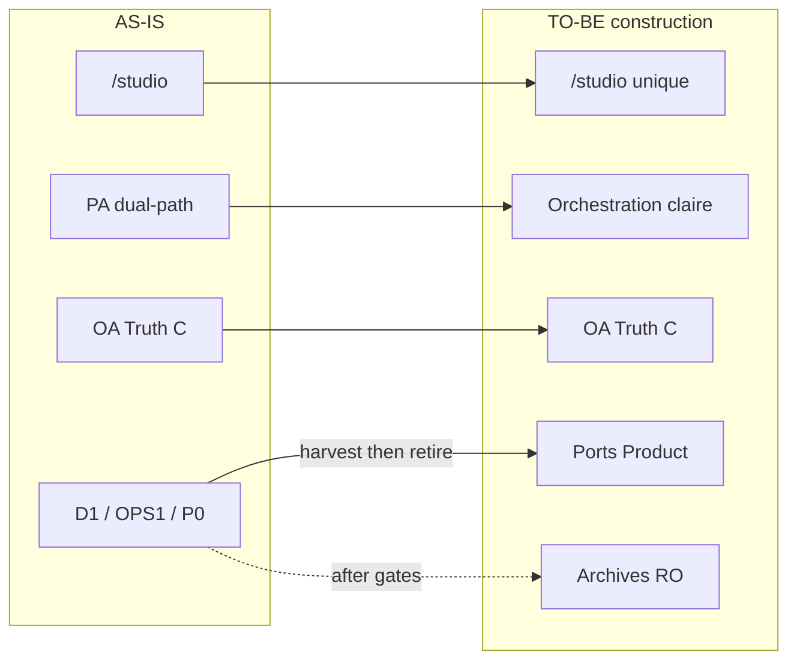
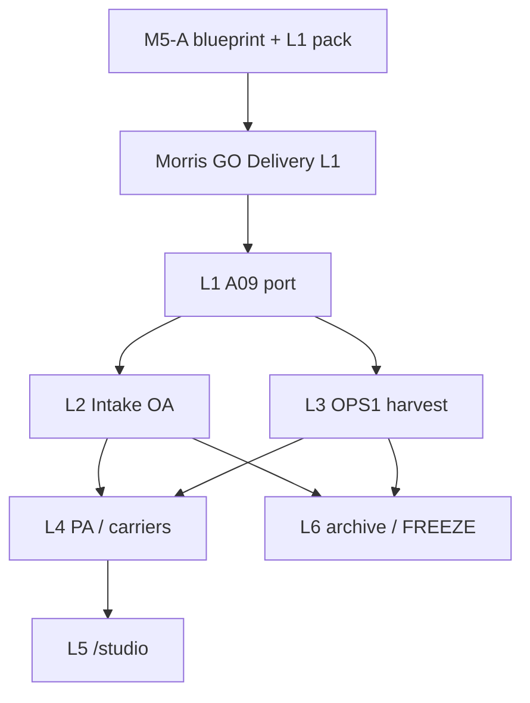

# AKG-M5-A — 01 · Product Architecture Convergence Blueprint

| Champ | Valeur |
| --- | --- |
| Cycle | **AKG-M5-A** — Product Architecture Convergence & First Delivery Readiness |
| Type / Profil | Cycle 6 — Architecture technique · **Critical** |
| Typologie | EVOL / Architecture / DOC |
| Baseline Git | `docs/akg-m5a-product-architecture-convergence` @ `f088c60271722fcf678c3862ebe192da71c7c402` (= `origin/main`) |
| Antecedent | AKG-M4 **GLOBAL CLOSED** (portée *Bounded Rationalization Assessment*) · [14](../m4-rationalization/14-akg-m4-global-formal-exit-decision-record.md) · H7/H8 [11](../m4-rationalization/11-m4a-h7-h8-architecture-orientation-decision-record.md) |
| Correction | **C1–C4** (2026-10-23) — alignement port audit / preuves / L1→L2 ; détail dans [02](./02-m5a-l1-a09-delivery-readiness-and-decision-pack.md) |
| Empreinte pré-correction | `d5026075f6c9c9fe570d107221bc6431e0c57414` |
| Statut document | **LOCAL CANDIDATE** — **non adopté** · dispositions A01–A12 restent **candidates** |
| Runtime / Delivery | **NON AUTORISÉ** · **H0-L1 NOT GRANTED** · pas de push/PR/merge projet |
| R24 | **NO PRODUCT SEMANTIC IMPACT** (cycle documentaire) |

> **Non-claims :** AKG-M5 non clos · blueprint **non ADOPTED** · runtime v3 **NON ADOPTED** · REAL **NOT PROVEN** · P6 GLOBAL **NOT PASSED** · FinOps SHADOW **OFF** · SC-G2 = orientation **≠** runtime livré · H8 ≠ GO REBUILD · aucun dual-write · Attempt ≠ Evidence ≠ PROVEN · Memory B ≠ Truth C · Synthesis ≠ Truth C · READY FOR RE-REVIEW ≠ READY FOR DELIVERY · tests présents ≠ exécutés dans M5-A.

---

## 1. Provenance et finalité

Ce blueprint **traduit** le TO-BE M4 et les lots L1–L6 en architecture de **construction** exploitable, sans rejouer les inventaires M1–M4.

**Produit attendu :** un Studio unifié, premium, maintenable, centré Pilote ↔ Nora, avec boucle projet gouvernée end-to-end.

**Hors scope :** découverte de Studio · nouvelle doctrine · refonte générale · implémentation code.

**Sources primaires (consultées) :** Build Doctrine · Roadmap · C1 · doctrine v3 30/31/32/33/34/35/37 · PRR README + 01/03/04/06/07/08/09 · AKG README · M4 `01`–`03`, `05`–`11`, `13`–`14` · code A09/VSR/D1 (spot) · CKC Architecture (guidance only).

---

## 2. Vision Product héritée (sans recadrage)

Héritage TO-BE M4 [02](../m4-rationalization/02-target-architecture-to-be.md) + OR-01…OR-13 [03](../m4-rationalization/03-orientations-and-gap-register.md) :

1. Tour de contrôle conversationnelle : **Pilote autorité** ; **Nora cognition / recommandation / préparation / interprétation**.
2. Cockpit nominal **`/studio`**.
3. **OA = Truth C unique** (G0-A/B) ; Memory B distincte.
4. Contrat inspectable/amendable ; **un Exécuter** = autorisation de **cette** version (SHE) ; HD/Confirm/Authorize **internes**.
5. Outils = capacités sous effet/périmètre ; Cursor sous Attempt.
6. Restitution honnête : déclaration ≠ preuve ; continuité sans contexte inventé.
7. **OR-13 capability-first** : capacité utile ≠ conservation de l'implémentation.

Boucle cible (destination, non couverture actuelle) :

`Intention → Nora → contexte → qualification → trajectoire → décisions → EC inspectable → autorisation → exécution bornée → Evidence/RB → analyse Nora → continuité`

---

## 3. Delta AS-IS → TO-BE (compact)

| Domaine | AS-IS (observé M4) | TO-BE construction | Delta M5 |
| --- | --- | --- | --- |
| UX | `/studio` + îlots D1/OPS1/P0 | Un cockpit ; redirect/retire historiques | Concevoir L5 ; exécuter après gates |
| Vérité | OA Product SQLite ; D1/OPS1 DB séparés | Une Truth C ; archives RO | L2/L3 harvest ; **no dual-write** |
| Orchestration | PA F2/W2/SHE dual-path | Façade claire Nora/PA/OA | L4 ADAPT ; H8 SC-G3 ciblé si insuffisant |
| Cursor | Product Attempt + îlot OPS1 | Ports Product exclusifs **après preuves** | L3 ; R-EXCL-01 / R-TF-01 / R-PP-01 |
| Audit create | Type/runtime optionnel via `lib/d1` ; `ProjectCycleAuditPort` déjà présent (platform/t-a7) | Réutiliser le port append existant ; découpler VSR/**core** de D1 ; adapter D1 transitoire | **L1** (détail [02](./02-m5a-l1-a09-delivery-readiness-and-decision-pack.md) C1/C2) |
| Continuité | Carriers process-local | Carrier non-autorité ou requalify | L4 + H3 |
| FinOps | execution-run hors spine | FREEZE ; SHADOW OFF | L6 |
| Noms | `pre-m6`, `ops1`, `d1`, `f2`/`w2`… | Noms de responsabilité | Contrat §7 ; rename aux lots adéquats |

---

## 4. Responsabilités cibles (compact)

| Acteur / composant | Responsabilité cible | Ne fait pas |
| --- | --- | --- |
| **Pilote** | Objectifs, arbitrages, Exécuter / STOP | Exécuter le runtime technique |
| **Product UI `/studio`** | Surface nominale conversation, contrats, résultats | Autorité métier |
| **Nora** | Comprendre, qualifier, recommander, préparer missions, interpréter preuves | Autorité métier autonome ; Truth C |
| **Project Assistant / façade cible** | Orchestration Product (UI→OA/Nora/ports) | Deuxième Truth C ; HD implicite |
| **OA** | Project, LPS, trajectoire, cycles, HD, EC, Attempt, Evidence | Cognition conversationnelle |
| **VSR / composition** | Wiring ports/adapters ; default fail-closed | Policy métier parallèle |
| **Tools / adapters** | Capacités sous contrat / Attempt | Élargir le mandat |
| **Persistence** | Truth C SQLite ; Memory B session ; FS Evidence refs | Dual-write ; fuse B↔C |

---

## 5. Cartographie dispositions actuelles → cible

| Classe | Actifs / zones | Disposition candidate (M4, non adoptée) | Timing |
| --- | --- | --- | --- |
| **Maintenir** | A05 OA, A07 Nora, A12 Product REAL guarantees, A01 cockpit cap | KEEP / ADAPT | Continu |
| **Déplacer / extraire** | A09 : brancher sur `ProjectCycleAuditPort` (éviter 2e contrat) ; patterns D1/OPS1 utiles | HARVEST contrat / adapter D1 jusqu’à L2 | L1 puis L2/L3 |
| **Consolider** | A06 PA dual-path ; A02 P0 entry ; chemins mission | ADAPT / CONSOLIDATE | L4 / L5 |
| **Remplacer (impl)** | A03 intake D1 ; A04 OPS1 engine | HARVEST + REPLACE/REBUILD ports | L2 / L3 |
| **Geler / retirer plus tard** | A11 FinOps ; îlots UI/DB après cutover | FREEZE / RETIRE LATER | L6 |
| **Étude conditionnelle** | A06/A10 sous H8 | SC-G3 ciblé **si** ADAPT L4 insuffisant | L4 design |

---

## 6. Matrice capacité → actif → cible → option → dépendances → preuves → gate

| Capacité utilisateur | Actif | Responsabilité cible | Option | Dépendances | Preuves actuelles | Gate |
| --- | --- | --- | --- | --- | --- | --- |
| Cockpit Pilote↔Nora | A01 | Product UI | KEEP/ADAPT name | PA, tests UI | DET UI | Rename L5+ |
| Entrée site | A02 | Redirect `/studio` | CONSOLIDATE→RETIRE | bookmarks U | DOC | L5 + R-P0-01 |
| Créer/lister projets | A03 | OA Project | HARVEST+REPLACE | A09, H1, H4 | DET D1 ; volumes U | L2 |
| Exécution tool gouvernée | A04/A12 | Attempt + Product REAL | HARVEST+ADAPT | H2, H5, R-EXCL | DET ; REAL NOT PROVEN | L3 |
| Vérité / autorité | A05 | OA | KEEP/ADAPT | G0 | OA suite | H6 interdit reopen |
| Orchestrer tour | A06 | Product orchestrator | ADAPT ; SC-G3? | H8, A10 | SHE DET | L4 |
| Cognition | A07 | Nora + Memory B | KEEP/ADAPT | A06 | session DET | boundary B≠C |
| Composer runtime | A08 | Product composition | KEEP/ADAPT | A09 | TYPE_ONLY/runtime tests | après L1 |
| Audit create borné | A09 | Journal : **`ProjectCycleAuditPort`** (réutiliser) ; events create : `LocalProjectCreationAuditPort` (distinct) ; impl D1 = adapter | HARVEST wiring / **pas** nouveau port concurrent | VSR **+ core**, tests | CODE VERIFIED (imports) ; COVERAGE VERIFIED (tests listés) ; **pas** BEHAVIOR PROVEN dans M5-A | **L1** § [02](./02-m5a-l1-a09-delivery-readiness-and-decision-pack.md) ; R-A09-01 OPEN |
| Continuité Proposal/Offer | A10 | Carrier non-auth | ADAPT/REBUILD | H3 | process-local | L4 |
| FinOps shadow | A11 | Hors spine | FREEZE | SHADOW OFF | unit OFF | L6 |
| Cursor sous EC | A12 | Same + ports | KEEP/ADAPT | L3 | DET≠REAL | exclusive après preuves |

*Les 29 CAP historiques (M4 `06`) se rattachent aux lignes A03/A04/A02/A09/A11 — non re-listées ici.*

---

## 7. Frontière Nora / PA / OA (analyse)

| Question | Lecture construction |
| --- | --- |
| Cognition vs orchestration vs autorité | Nora = cognition ; PA = orchestration Product ; OA = autorité + Truth C |
| SHE vs historique | SHE = cible UX ; chemins disposition-before-PREPARE à consolider en L4 (pas supprimer HD) |
| Carriers | Proposal/Offer ≠ HD ; perdus au restart (process-local) — H3 OPEN |
| Persistance / restart | Truth C durable ; Memory B session ; carriers non durables par défaut |
| Tools / REAL | Ports Attempt Product ; OPS1 island ≠ gateway Product ; Tool-First fail-closed jusqu'à H2 |

**Interdits de construction :** rebuild OA · seconde orchestration métier · promouvoir Memory B / Synthesis / carriers en Truth C.

---

## 8. SC-G2 vs SC-G3 (H7/H8)

| | **SC-G2** (orientation H7) | **SC-G3 ciblé A06/A10** (H8) |
| --- | --- | --- |
| Idée | ADAPT/CONSOLIDATE sur spine Product ; harvest îlots | Reconstruction façade orchestration + continuity **si** ADAPT L4 insuffisant |
| OA | Conservé | Conservé (pas de rebuild) |
| Risque | Dette compat L4 | Effort tests PA/REAL ; scope creep |
| Autorisation | Orientation seulement | **Étude** conditionnelle ≠ GO REBUILD |

**Recommandation M5-A :** construire sous **SC-G2** ; préparer critères ADAPT H8 §5.2 dans le design L4 ; ne pas démarrer SC-G3 code.

---

## 9. Contrat de nommage (recommandations — non adoptées)

| Nom historique | Responsabilité réelle | Convention / nom cible proposé | Evidence | Impact rename | Timing | Risques |
| --- | --- | --- | --- | --- | --- | --- |
| `pre-m6-product-ui` | Product cockpit UI | `studio-ui` / `product-ui` | A01 ; OR-04 | imports ~53 tests | L5+ après inventaire | casser tests |
| `vertical-slice-runtime` | Product composition / ports | `product-runtime` / `studio-composition` | A08 | large | Après L1 ; lot dédié | surface large |
| `lib/d1` | Historical intake island | garder `d1` jusqu'à retire ; **ne pas** « productiser » le nom | A03 | — | L2 retire | confusion |
| `BoundedAtomicAuditStore` (path D1) | Impl journal SQLite historique (`ProjectCycleAuditPort` + find/list **TEST_ONLY**) | **Ne pas** inventer un 2e port Product ; typer VSR/core sur `ProjectCycleAuditPort` ; packaging pérenne du port = candidate (rester t-a7 **ou** module neutre) — noms **non ADOPTED** | A09 ; [02] C1 | L1 wiring | **L1** | Duplication de contrat si mauvais naming |
| `ops1` / `OPS1_CURSOR_REAL` | Historical tool island / flag | Product REAL flags isolés après exclusivity | A04/A12 | L3+ | Après R-EXCL | faux claim |
| `f2` / `w2` | Historical mission paths | noms de responsabilité dans PA public API | A06 | L4 | L4 | dual-path |
| `execution-run` | FinOps SM | rester hors Product spine naming | A11 | L6 | FREEZE | promote accidentel |

**Règle :** préparer conventions **maintenant** ; exécuter renames **aux lots** après consumers/tests ; ne pas rename ce qui sera retiré.

---

## 10. Trajectoire L1–L6 (matrice unique)

| Lot | Capacité v3 / résultat user | Actifs | Composants code | Dépendances | Prérequis / HD | Risques | Tests réutilisables | Nouveaux tests | Preuve sortie | Dette / remboursement | Suite |
| --- | --- | --- | --- | --- | --- | --- | --- | --- | --- | --- | --- |
| **L1** | Découpler contrat audit (VSR+**core**) ; réutiliser `ProjectCycleAuditPort` | A09, A08 | `boundedAtomicAudit` (adapter), `localSqliteAudit`, `service.ts`, `projectCycleAtomicCoordinator` | — | Aucun H1–H5 **supplémentaire** ; **H0-L1** | Nouveau port concurrent ; oublier core ; sqlite≠activation | `localProjectComposition` ; t-a7 ; `importBoundaries` | Boundaries VSR+core ; noop ; sqlite inject ; Q1–Q10 | Gate A09 = §02 exit (pas doc seule) | Adapter D1 **transitoire** jusqu’à L2 ; condition exit documentée | L2 |
| **L2** | Intake Project sur OA | A03 | `lib/d1/**`, routes D1, OA project | **L1** | H1 MethodMode ; H4 volumes ; R-CUT-01 | dual-write ; id map | tests D1 + OA create | migration/verify ; cutover | Writers→readers ; no dual-write | Archive D1 RO | L4/L6 |
| **L3** | Exec gouvernée Product Attempt | A04, A12 | ops1 adapters, compose REAL, Attempt | Cap matrix | H2 ; H5/R-PP-01 ; R-EXCL | claim REAL prématuré | DET/REAL boundary ; ops1 e2e | parity guards ; exclusive | Exclusive Product REAL **prouvé** | Flag rename après | L4/L6 |
| **L4** | Orchestration + continuité | A06, A10 | project-assistant, proposal/offer stores | L2/L3 pertinents | H3 ; **H8 eval** | dual-path figé ; 2e vérité | SHE DET ; proposal tests | restart continuity ; ownership | ADAPT critères **ou** étude SC-G3 | Dette dual jusqu'à cut | L5 |
| **L5** | UX `/studio` unifiée | A01, A02 | studio UI, page `/`, P0 | Design L4 ownership | R-P0-01 | bookmarks | UI tests | redirect e2e | Screens POC gone | — | — |
| **L6** | Gel/retrait obsolète | A11, archives | execution-run, routes mortes | L2/L3 done ou abandon doc | FinOps GO séparé si activate | retire prématuré | FinOps OFF tests | consumer clear | R-A11-01 PASS ; SHADOW OFF | — | — |

### Contestation du séquencement (chemin critique Product)

1. **L1 avant L2** : confirmé — A09 bloque le packaging/retire D1 (M4 CORR-03).
2. **L3 peut démarrer en parallèle de L2** *après* L1 **si** les équipes/GO sont distincts — mais **L4** dépend des deux pour une orchestration « exclusive Product » cohérente.
3. **Ne pas commencer par renames cosmétiques** (OR-10) : ownership L4 + UX cible L5 se **conçoivent** en M5-A ; code rename plus tard.
4. **L5 n'est pas « après tout techniquement »** pour la *conception* : invariants UX dès maintenant ; *exécution* redirect après inventaire liens.
5. **L6 n'est pas un fourre-tout** : FREEZE A11 peut précéder certaines archives si consumers documentés ; retire D1/OPS1 **après** preuves L2/L3.

---

## 11. Risques et réserves (statut exact — non fermées)

| ID | Implication M5 construction |
| --- | --- |
| R-VOL-01 / H4 | Bloque L2 migration |
| R-MM-01 / H1 | Bloque sémantique intake |
| R-CUT-01 | Protocole L2 sans dual-write |
| R-TF-01 / H2 | Fail-closed jusqu'à architecture |
| R-REAL-01 / R-EXCL-01 | Pas de claim REAL / retire OPS1 |
| R-PA-01 / H8 | L4 ADAPT vs SC-G3 étude |
| R-CAR-01 / H3 | Continuité |
| R-PP-01 / H5 | Potential blocker L3 |
| R-A09-01 | Gate L1 |
| R-A11-01 | Gate L6 ; SHADOW OFF |
| R-RS-01 / R-FS-01 | Reprise / Evidence |
| R-P0-01 | L5 |
| R-DOC-01 | Sync PRR aux lots comportementaux (pas ce cycle) |

---

## 12. Recommandations Morris et critères de preuve

### Décisions sollicitées (ce cycle = cadrage)

| # | Décision | Options | Reco Cursor |
| --- | --- | --- | --- |
| D1 | Accepter ce blueprint comme **base de construction M5** (candidate→accepted cadrage) | Accept / Accept with reserves / Reject | **Accept with reserves** (réserves §11 inchangées) |
| D2 | Confirmer séquencement L1→(L2∥L3)→L4→L5/L6 | Confirm / Amend | **Confirm** avec parallélisation L2/L3 sous GO séparés |
| D3 | GO Delivery **L1/A09** | Voir [02](./02-m5a-l1-a09-delivery-readiness-and-decision-pack.md) | **GO sous conditions** (conditions dans 02) |
| D4 | Noms cibles §9 | Adopt conventions / Defer | **Defer adoption** ; garder comme guide L1+ |

### Preuves de maturité de ce document

| Critère | État |
| --- | --- |
| E01 Source truth Git | `f088c602` MATCH |
| E02 Vision Product | Héritée M4 + boucle cible |
| E03 Architecture ownership | Matrice §4–§7 |
| E04 Capability coverage | §6 + renvoi CAP M4 |
| E05 Trajectoire | §10 |
| E06 Governance H0–H8 | Conservés |
| E07 Delivery readiness | L1 détaillé dans 02 (C1–C4) ; L2–L6 cadrés ; **≠** H0-L1 GRANTED |
| E08 R23/R24 | DOCUMENTED / CODE VERIFIED / COVERAGE VERIFIED ; **pas** de BEHAVIOR PROVEN M5-A ; NO SEMANTIC IMPACT |
| E09 Critical review | Re-review ChatGPT via handoff corrections |
| E10 Décision humaine | **Requise** — Distinct Formal Exit M5-A / **H0-L1** |
| E11 Git publication projet | **NON** ce cycle |

### Dette transitoire A09 (après L1, avant L2)

| Élément | Justification | Owner cible | Condition d’exit |
| --- | --- | --- | --- |
| `BoundedAtomicAuditStore` + table `d1_atomic_audit` | Persistance historique du journal optionnel | Adapter D1 jusqu’au cutover intake | L2 : plus de dépendance Product à `lib/d1` pour audit **et** gates retire D1 |
| find/list sur classe D1 | Helpers **TEST_ONLY** | Rester hors contrat commun | OK tant que tests t-a7/composition |

---

## 13. PRR sync future (R24 — ne pas exécuter maintenant)

Lots comportementaux futurs devront synchroniser proportionnellement : PRR **04** (dépendances A09/D1), **06** (persistance audit), **08** (tests), **09** (réserves A09). Ce cycle : **aucune** sync PRR.

---

*Fin — `01` M5-A Product Architecture Convergence Blueprint — LOCAL CANDIDATE.*
