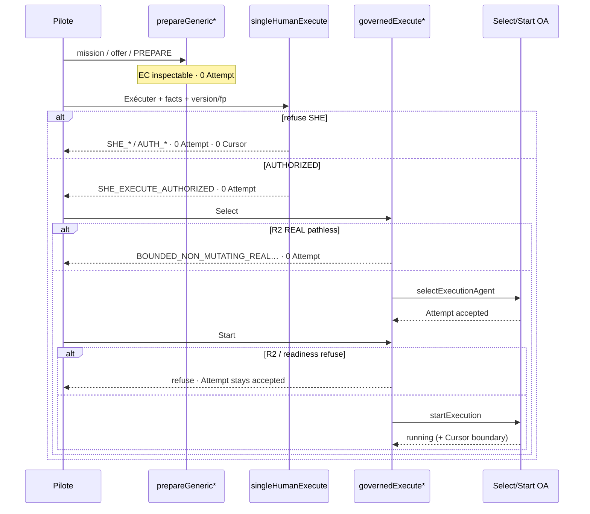
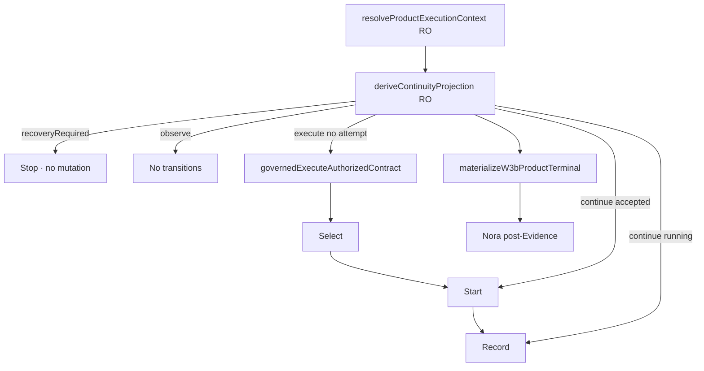
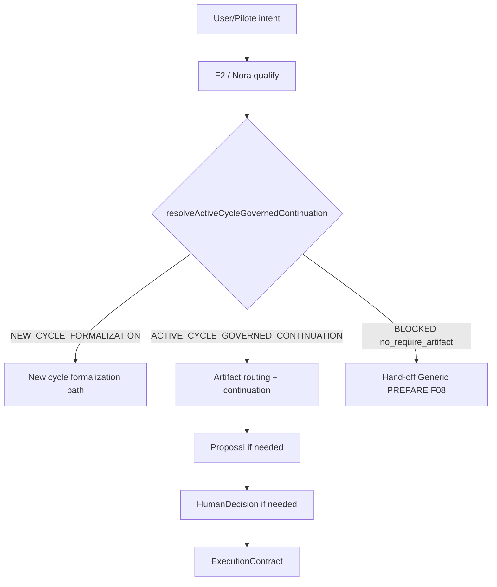
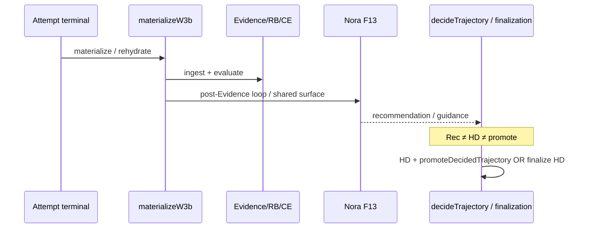

# SFIA REVIEW PACK — FULL
## AKG-M2 LOT B — CRITICAL INTERACTION UNDERSTANDING

- **Timestamp UTC:** `2026-10-20T17:03:48Z`
- **Cycle:** 6 — Architecture technique
- **Specialization:** Architecture Understanding
- **Profile:** Critical
- **Typologie:** DOC / ARCHITECTURE / REVIEW
- **Chantier:** SFIA-STUDIO-ARCHITECTURAL-KNOWLEDGE-AND-CONSTRUCTION-GOVERNANCE
- **Milestone:** AKG-M2 — Architecture Understanding (**NOT CLOSED**)
- **Lot:** M2-B — Critical Interaction Understanding
- **GO Morris exact:** `2026-10-20 — GO AKG-M2 LOT B — CRITICAL INTERACTION UNDERSTANDING`
- **Capabilities v3:** V3-F05 / V3-F06
- **Verdict Cursor:** `AKG-M2 LOT B — CRITICAL INTERACTION UNDERSTANDING COMPLETE WITH GOVERNED RESERVES — READY FOR CHATGPT CRITICAL REVIEW`
- **M2-C:** **NOT AUTHORIZED**
- **Product/PRR/Roadmap mutations this cycle:** **NONE**

---

## 1. OBJECTIF

Comprendre les interactions effectives CURRENT (code + PRR + cartes M2-A) :
communication composants · décision→autorité→exécution · lectures vs écritures · refus · restart · chevauchements · conditions M2-C.

**≠** nouvelle architecture · **≠** refonte automatique · **≠** clôture M2-B · **≠** démarrage M2-C.

---

## 2. GIT TRUTH

| Item | Value |
| --- | --- |
| Repository | `mcleland147/sfia-workspace` |
| Active worktree | `/Users/morris/Projects/sfia-workspace-akg-m2-lot-a-formal-exit-roadmap-sync` |
| Branch | `docs/sfia-studio-akg-m2-lot-a-formal-exit-roadmap-sync` |
| HEAD (local branch tip) | `8a7cd63ff703d828c96966b4f4d63b803dd59d5e` (= PR #595 head; ancestor of main) |
| **CURRENT main (evidence base)** | `d6cb457f8a3e0ce1781a8ef40b56c10f9955db30` (PR #595 MERGED) |
| origin/main ls-remote | `d6cb457f8a3e0ce1781a8ef40b56c10f9955db30` |
| Prior handoff tip | `0a2da3c3247ba26814867af27085cde78003dbbd` |
| Tracked modified | `.tmp-sfia-review/chatgpt-review.md` only (this pack) |
| Staged | none |
| Untracked project | none |
| M1 WT preserved | `…/sfia-workspace-akg-m1-formal-closure-roadmap-sync` @ `f666f19f` |
| M2-A WT | this worktree (preserved) |
| Handoff WT | `…/sfia-workspace/sfia-review-handoff` @ `0a2da3c3247ba26814867af27085cde78003dbbd` |

**Policy:** all behavioral citations use `git show d6cb457f8a3e0ce1781a8ef40b56c10f9955db30:…`. Local HEAD ≠ inventing another base.

**Git Truth Check:** PASS — CURRENT main reachable; no Product mutation; historical WTs preserved.

---

## 3. GIT REVIEW INDEX

| Ref | Role |
| --- | --- |
| `d6cb457f8a3e0ce1781a8ef40b56c10f9955db30` | CURRENT main / Lot B evidence |
| `8a7cd63ff703d828c96966b4f4d63b803dd59d5e` | Roadmap tip commit (PR #595) |
| `86a2b1e701fa5ee70997d5e39cc84a6bffa9f922` | M2-A initial handoff |
| `34ce31471782c4d8f53b8e15046ceda8d72f29e3` | M2-A Correction Pass 01 |
| `068beff9a579e28c870f00b06287aec908007d75` | M1 Formal Closure |
| `0a2da3c3247ba26814867af27085cde78003dbbd` | Prior merge-verification handoff |

---

## 4. SOURCES READ

### Method
- `prompts/templates/sfia-cycle-execution-template.md`
- `method/sfia-fast-track/core/sfia-cycle-routing-guide.md`
- `method/sfia-fast-track/core/sfia-rules-and-guardrails.md`
- `method/sfia-fast-track/core/sfia-chatgpt-cursor-operating-model.md`
- `docs/foundation/sfia-engineering-principles.md` (consult)
- `docs/architecture/sfia-repository-blueprint.md` (consult)
- `docs/architecture/2026-06-27-sfia-decision-engine.md` (consult)
- CKC pilot `03-architecture-technique.md` — **CANDIDATE GUIDANCE ONLY**

### Convergence / Product completion / v3
- Build Doctrine · Roadmap (tip M2-A ON MAIN; Lot B historically NOT AUTHORIZED in tip — **GO consumed this cycle without Roadmap edit**)
- `01-product-completion-cadrage.md` · v3 vols 30/32–35/37

### PRR (R23)
- README · 01/02/03/04/06/07/08/09 · `production-runtime-reference.manifest.json`  
  flows[] = F01–F20 (**no `F11b` id**) · DEP-EC-ATT self-edge present

### Code CURRENT (priority + call-graph)
- `w2/singleHumanExecutePreparedContract.ts` · `governedExecuteAuthorizedContract.ts` · `prepareGenericExecutionContractDraft.ts` · `pendingGenericPrepareOfferStore.ts` · `boundedNonMutatingRealLaunchGate.ts` · `resolveAuthoritativeProductMateriality.ts`
- `w2/resolveProductExecutionContext.ts` · `deriveGovernedExecutionContinuityProjection.ts` · `reconcileGovernedExecution.ts` · `materializeW3bProductTerminal.ts`
- `f2/activeCycleGovernedContinuation.ts` · `artifactTargetRouting.ts`
- `assessFinalization.ts` · `deriveFinalizationApplicability.ts` · `decideTrajectory.ts` · `approveCandidateTrajectory.ts`
- OA SelectExecutionAgent / StartExecution (via Product call sites)
- Legacy F3 `executeConfirmed*` paths (Select shared)

### Tests (read assertions / titles — not executed)
- `p6.she.singleHumanExecute*.d0.test.ts` · `p6.toolFirst.safetyClosureR1R2.d0.test.ts` · `p6.toolFirst.executionContractSimplification.d0.test.ts` · `p6.inspectionBindingSelect.d0.test.ts` · `p6.projectScopedCursorSelection.d0.test.ts` · continuity / OA lifecycle tests

---

## 5. CONVERGENCE PRE-CHECK

| Item | Status |
| --- | --- |
| AKG-M0 / M1 | CLOSED BY MORRIS |
| AKG-M2-A | CLOSED BY MORRIS · tip ON MAIN `d6cb457f8a3e0ce1781a8ef40b56c10f9955db30` |
| AKG-M2-B | **GO CONSUMED THIS CYCLE** (Roadmap tip still shows historical NOT AUTHORIZED — **not edited**) |
| AKG-M2-C / M2 global / M3 | NOT AUTHORIZED / NOT CLOSED |
| C1 | TARGET |
| Studio v3 | doctrine cible · **NON ADOPTED** runtime |
| v2.6 | processus externe |
| P6 GLOBAL PASS | NOT ACQUIRED |

---

## 6. R23 / R24

**R23:** proportionate deep read of critical seams + PRR 03/06/07 + M1/M2-A handoffs.  
**R24:** **NO SEMANTIC IMPACT** · PRR sync **NOT** this lot · Roadmap **NOT** modified.

---

# L-M2B0 — Entry Contract Reconciliation (R-M2A-04)

## Sources reconciled
1. L-M2A6 initial (`86a2b1e7…`) — full candidate table  
2. L-M2A6 CP01 (`34ce3147…`) — shortened but **status CANDIDATE**; F11b split + Artifact/Finalization corrections  
3. CURRENT Git `d6cb457f8a3e0ce1781a8ef40b56c10f9955db30` + PRR 03/06/07

## Consolidated Entry Contract

### A. Prérequis — SATISFIED
| Prerequisite | Evidence |
| --- | --- |
| M2-A Critical Re-Review PASS WITH RESERVE | CP01 handoff + Formal Exit |
| Morris Formal Exit M2-A | Roadmap tip ON MAIN |
| Distinct GO M2-B | **CONSUMED** this cycle |

### B. Acquis réutilisés (M2-A — not redefined)
- PREPARE ≠ AUTHORIZE ≠ EXECUTE  
- Recommendation ≠ HumanDecision  
- Memory B ≠ Truth C  
- SHE → **0 Attempt** before launch (`executionAttemptCreated: false`)  
- Select **creates** Attempt (`accepted`)  
- Start **mutates** existing Attempt (`accepted→running`)  
- F11b split: resolve RO · projection RO · reconciler **intent-scoped writes**  
- Artifact Routing/Continuation · Finalization Assessment ownership  

### C. Interactions approfondies this lot
I-B01…I-B08 (below).

### D. Frontières restantes
A-M2A-01…05 · unsampled B-matrix refuse cells · multi-instance · PRR/code index gaps (G-M1-15/17).

### E. Sources
CURRENT code · PRR 03/06/07 · M1 Lot C · M2-A matrices · existing tests · manifest.

### F. Exit proof (Lot B deliverables)
L-M2B1…7 present in this pack.

### G. Gates still distinct
REAL · PRR sync · Roadmap tip · M2-C · Product — **all DISTINCT REQUIRED**.

## Qualification R-M2A-04
**R-M2A-04 ENTRY CONTRACT RECONCILED** — fields A–G recovered from initial+CP01+CURRENT.

**≠** global CLOSED of R-M2A-04 (remains **OPEN / GOVERNED** until Morris Formal Exit M2-B after Critical Review).

---

# L-M2B1 — Critical Interaction Cards

## I-B01 — SHE / GOVERNED EXECUTION

| Field | Content |
| --- | --- |
| ID | I-B01 |
| Nom | SHE / Governed Execute chain |
| Question | How does Pilote Exécuter become Attempt/Cursor without collapsing PREPARE/AUTH/EXEC? |
| Components | `prepareGenericExecutionContractDraft` · `singleHumanExecutePreparedContract` · `governedExecuteSelectAgent` / `Start` / `Record` · OA Select/Start |
| Owner | Product W2 + OA ExecutionAttempt |
| Entry | Inspectable EC + Pilote Exécuter / then Select+Start actions or reconcile `execute` |
| Sources CURRENT | `w2/singleHumanExecutePreparedContract.ts:704–963` · `w2/governedExecuteAuthorizedContract.ts:757–1188` |
| Sources PRR | F08 · F10 · INV-SHE-* |
| Objets lus | EC · inspection · Product materiality · HD (if structural) |
| Objets écrits | SHE: inspect/confirm/authorize (+ optional supersede EC + HD). **No Attempt.** Governed: Attempt + launch/record |
| État initial | Prepared/inspected EC |
| Transitions | PREPARE → INSPECT → [structural HD supersede] → Confirm? → Authorize (**STOP**) → Select(accepted) → Start(running) → Record(terminal) → Evidence path |
| Autorité | Authenticated Pilote · AUTHORIZED evaluation · materiality stamps |
| Refusal paths | `SHE_*` codes · `AUTHORIZATION_NOT_ELIGIBLE` · Select auth fail · R2 REAL pathless · G-D4 binding · boundary failures |
| Persistence | EC/HD/Attempt Truth C; offer process-local |
| Restart | Offer may be lost; durable HD may resume PREPARE (PRR F18 PARTIAL) |
| Idempotency | Select idempotency key; SHE successor fingerprint compare |
| External | Cursor only after Start on REAL/fixture boundary |
| Evidence/test | `p6.she.singleHumanExecute*.d0` · `p6.projectScopedCursorSelection.d0` |
| Proof level | **BEHAVIOR PROVEN — DET/Fake AT TESTED SCOPE** · REAL **NOT PROVEN** |
| Gap | UI conflation SHE≈execute (A-M2A-02 / B-M2B-02) |
| Risque | Pilot thinks Exécuter launched Cursor |
| Impact v3 | V3-F05 authority chain |
| Capacité | V3-F05 |
| Dépendance | I-B02 materialize/post-Evidence |
| Verdict local | **COVERAGE VERIFIED + BEHAVIOR PROVEN (DET)** · REAL separate |

**Attempt rules (verified):**
- Fail before Select → **0 Attempt**
- Select refuse → **0 new Attempt**
- Start refuse → Attempt may remain **`accepted`**
- Attempt succeeded ≠ Product SUCCESS PROVEN

---

## I-B02 — F11b CONTINUITY

| Field | Content |
| --- | --- |
| ID | I-B02 |
| Nom | F11b resolve / project / reconcile |
| Question | Which F11b layers are RO vs mutating? |
| Components | `resolveProductExecutionContext` · `deriveGovernedExecutionContinuityProjection` · `reconcileGovernedExecution` · `materializeW3bProductTerminal` |
| Owner | Product Continuity (split ownership M2-A R-M2A-01) |
| Entry | TrajectorySurface / continuity actions · intents observe\|execute\|continue |
| Sources | resolve `:448+` · derive `:66+` / `:228+` · reconcile `:71+` · materialize `:355+` |
| PRR | F11b narrative in vol 03 (id **F11** in manifest — G-M1-17) |
| Reads | EC/Attempt/Evidence/RB/CE/post-Evidence surfaces |
| Writes | **Only** via reconcile intents → governed execute / materialize (not resolve/project) |
| Intents | observe=no mutation · execute=may Select pipeline · continue=Start/Record/materialize · recoveryRequired=**stop mutations** |
| Refusal / halt | lineage integrity · `recovery_required` · `human_decision_required` · transition_limit |
| Persistence | no F11b store; Truth C underlying |
| Restart | re-resolve same Attempt at tested scope (PRR); UI restart **PARTIAL** |
| Idempotency | Select key · materialize bounded loop (max transitions) |
| External | none directly in resolve |
| Evidence | `productContinuitySharedKnowledge.d0` · `p6.productContinuityClosure.integrated.d0` |
| Proof | **BEHAVIOR PROVEN DET @ tested** · **≠ GLOBAL READ-ONLY** for reconciler |
| Gap | G-M1-17 index · AWAIT_EXTERNAL vs continue still drives Start (**B-M2B-01**) |
| Verdict | **COVERAGE VERIFIED** · reconciler **NOT** globally RO |

---

## I-B03 — RESTART / PERSISTENCE

| Field | Content |
| --- | --- |
| ID | I-B03 |
| Nom | F17/F18/F19 + offer vs HD |
| Question | What survives restart; what must be revalidated? |
| Components | `pendingGenericPrepareOfferStore` · HD SQLite · EC/Attempt · Proposal store · LPS |
| Sources | offer store header · PRR06 · PRR03 F17–F19 |
| Process-local lost | PREPARE offer Map · Proposal presentation carriers · in-memory UI |
| Durable | HD · EC · Attempt · Evidence/RB/CE · Project/LPS (Truth C) |
| Reconstruction | HD11: durable verified HD may resume PREPARE without offer; **absence of offer ≠ universal PREPARE refuse**; **HD ≠ Authorization** |
| Authority revalidation | currentness / inspect / authorize still required before launch |
| Proof | F17 DET proven chat-first · F18/F19 **PARTIAL** · multi-instance **NOT PROVEN** · RunState cross-restart **DEFER** |
| Verdict | **DOCUMENTED + PARTIAL BEHAVIOR** · **≠ RESTART SAFE global** |

---

## I-B04 — ACTIVE CYCLE CONTINUATION (ACGC)

| Field | Content |
| --- | --- |
| ID | I-B04 |
| Nom | ACGC vs NEW_CYCLE_FORMALIZATION |
| Question | When does intent continue active cycle vs formalize new cycle vs hand off Generic PREPARE? |
| Components | `resolveActiveCycleGovernedContinuation` · `artifactTargetRouting` · F2 routing |
| Sources | `f2/activeCycleGovernedContinuation.ts:572+` · `artifactTargetRouting.ts` |
| Modes | `NEW_CYCLE_FORMALIZATION` · `ACTIVE_CYCLE_GOVERNED_CONTINUATION` · `ACTIVE_CYCLE_CONTINUATION_BLOCKED` (e.g. `no_require_artifact` → optional documentary → F08) |
| Reads | active cycle · obligations · pathRoot · durable same-deliverable Evidence |
| Writes | none in resolver; downstream Proposal/HD/EC |
| Refusal | blocked reasons: no_active_cycle, artifact_already_satisfied, incompatible_execution_intent, needsTargetClarification… |
| Authority | conversational intent **≠** authority; HD/EC gates remain |
| Proof | DET @ tested (F05/F08 PRR) |
| Gap | same utterance → different modes (**B-M2B-03**) |
| Verdict | **COVERAGE VERIFIED** |

---

## I-B05 — POST-EVIDENCE / NORA

| Field | Content |
| --- | --- |
| ID | I-B05 |
| Nom | Attempt terminal → Evidence → Nora F13 |
| Question | How Product truth separates from session/memory and recommendations? |
| Components | `materializeW3bProductTerminal` · `runW3cPostEvidenceLoop` · resolve post-Evidence · Nora tools |
| Sources | materialize `:355+` / rehydrate `:670+` · PRR F13 |
| Writes | Evidence/RB/CE · post-Evidence durable surface |
| Reads | Attempt/contract · Cursor report · artifact review material |
| Separation | Product Truth C ≠ Memory B ≠ Recommendation ≠ HD |
| A-M2A-03 | `t-a7` `boundedHistoryRead` is **platform** operational history — **≠** Product post-Evidence ownership; Product uses W3c durable surfaces |
| Proof | F13 DET fresh+restart handoff @ tested · REAL SprintBoard **distinct GO** |
| Verdict | **COVERAGE VERIFIED** · A-M2A-03 **PARTIALLY CLARIFIED** (boundary DOCUMENTED; ownership overclaim risk remains governed) |

---

## I-B06 — TRAJECTORY / FINALIZATION

| Field | Content |
| --- | --- |
| ID | I-B06 |
| Nom | decide/promote + finalization assessment |
| Question | Assessment≠HD≠Promotion; which writers promote? |
| Components | `decideTrajectory` · `approveCandidateTrajectory` · `promoteDecidedTrajectory` · `deriveFinalizationApplicability` · `assessFinalization` |
| Sources | decideTrajectory `:241+` / promote `:927` · approveCandidateTrajectory `:330+` / `:738` · finalization OA |
| Writes | HD + ProjectTrajectory promotion (OA) · finalize HD lifecycle |
| Non-writes | Recommendation alone · Assessment alone |
| A-M2A-01 | **All promotions observed call OA `promoteDecidedTrajectory`**. Product has **≥2 entry seams**: `decideTrajectory` (W2) + `approveCandidateTrajectory` (pre-cycle). Status: **VERIFIED WITH BOUNDED RESERVE** — dual entry, single OA promote |
| GAP-03 | git primary EC selection fail-closed if 0 or >1 effective |
| Proof | DET @ tested |
| Verdict | **COVERAGE VERIFIED** |

---

## I-B07 — LEGACY / PARALLEL PATHS

| Field | Content |
| --- | --- |
| ID | I-B07 |
| Nom | M3/F3 confirmAndExecute vs W2 governed |
| Question | Do both reach SelectExecutionAgent with same invariants? |
| Finding | **Both call OA `SelectExecutionAgent`**. Preconditions differ (M3 bounded confirm-and-execute vs SHE authorize + governed Select + materiality/R2). |
| A-M2A-02 | **PARTIALLY VERIFIED** — Select shared; orchestration **not** identical; SHE splits Authorize vs Attempt |
| Classification candidate | **KEEP** both until usage/impact proven · **≠ RETIRE** |
| Proof | code call-graph + PRR F09/F10 |
| Verdict | **COVERAGE VERIFIED** · dual surface **DOCUMENTED** |

---

## I-B08 — TOOL-FIRST FAKE/REAL

| Field | Content |
| --- | --- |
| ID | I-B08 |
| Nom | R1 stamp / R2 REAL refuse |
| Question | Does read_only stamp guarantee Cursor REAL no-write? |
| R1 | `qualifyBoundedNonMutatingAnalysisMission` + PREPARE stamps (`boundedNonMutatingAnalysis`, `NO_REPOSITORY_MUTATION_*`) |
| R2 | `assertBoundedNonMutatingCursorRealAdmissible` — if pathless non-mutating **and** `SFIA_STUDIO_CURSOR_REAL=1` → `BOUNDED_NON_MUTATING_REAL_ENFORCEMENT_UNAVAILABLE` at **Select (before Attempt)** and **Start (Attempt stays accepted)** |
| Fake/DET | Select/Start admissible |
| Proof | `p6.toolFirst.safetyClosureR1R2.d0` — **DET BEHAVIOR PROVEN** · REAL no-write **NOT** globally guaranteed · G-M1-05 **OPEN** |
| Verdict | **BEHAVIOR PROVEN (Product refuse path DET)** · **REAL BOUNDARY NOT PROVEN** |

---

# L-M2B2 — Sequence Diagrams & Refusal Paths

## S1 — SHE nominal + refusals



**Proof ceiling:** DET · Fake · ZERO REAL claimed.

## S2 — F11b observe / execute / continue



## S3 — Restart F17 / F18 / F19

| Flow | Lost on restart | Durable | Revalidation | Proof |
| --- | --- | --- | --- | --- |
| F17 Proposal pending | proposal/presentation | subject refs may vary | re-present | DET chat-first |
| F18 After HD / before exec | offer Map | HD · EC | inspect/currentness/auth | PARTIAL |
| F19 Post-Evidence | UI session | Evidence/RB/CE · W3c surface | rehydrate helpers | PARTIAL @ tested |

**Offer loss ≠ Authorization refuse.** **HD present ≠ authorized launch.**

## S4 — ACGC → Proposal / HD / EC



## S5 — Evidence → Nora → trajectory / finalization



---

# L-M2B3 — Restart / Persistence Scenario Matrix

| Checkpoint | Durable | Process-local | Loss on restart | Reconstruction | Authority revalidation | Idempotency | Failure/refusal | Evidence | Proof | Gap |
| --- | --- | --- | --- | --- | --- | --- | --- | --- | --- | --- |
| Proposal pending | subject/LPS refs | Proposal store | presentation | re-solicit | yes | n/a | subject gates | F17 tests | DET | multi-conv NOT IMPL |
| Generic PREPARE offer | none | `pendingGenericPrepareOfferStore` | **yes** | HD11 if durable HD | currentness | n/a | missing offer ≠ universal refuse | store header · PRR06 | DOCUMENTED | multi-instance |
| Durable HD recorded | `oa_human_decisions` | — | no | load by id | verify applicability | yes | HD≠auth | PRR06/07 | DET PARTIAL F18 | — |
| EC prepared/inspected | Truth C | — | no | getEC | reinspect if stale | version/fp | mismatch codes | SHE tests | DET | — |
| EC authorized | Truth C eval | — | no | re-evaluate | **required** | — | AUTH_* | SHE/gov | DET | — |
| Attempt accepted | Truth C | — | no | resolve context | Start re-gates | Select key | Start refuse keeps accepted | gov+OA | DET | — |
| Attempt running | Truth C | launch process | process may die | reconcile continue/record | readiness | — | await_external | F11b | PARTIAL restart UI | RunState DEFER |
| Attempt terminal | Truth C | — | no | resolve | — | materialize idemp | lineage recovery | materialize | DET | — |
| Evidence/RB | Truth C | — | no | rehydrate | — | CE binding | ambiguous lineage | F13 | DET @ tested | — |
| Post-Evidence Nora | durable W3c surface | session Memory B | Memory B path-dependent | rehydrateW3c* | — | — | PATH_NOT_ALLOWED historical | F13 | DET | REAL GO |
| Finalization/replan | HD + obligations | UI | UI | assess again | undisposed recs block | — | blockers family | finalization | DET | — |

**≠ RESTART SAFE global.**

---

# L-M2B4 — Authority Boundary Interaction Matrix (enrichment of B1–B16)

Reuse M2-A L-M2A2. Critical refusal deepening:

| Boundary | Trigger | Guard | Mutation already? | Mutation forbidden | Attempt expect | External | Refuse code | Test | Proof |
| --- | --- | --- | --- | --- | --- | --- | --- | --- | --- |
| B8 PREPARE≠AUTH≠EXEC | Exécuter before auth | SHE pipeline | PREPARE EC only | Attempt/Cursor | 0 | 0 | many SHE_* | p6.she* | BEHAVIOR DET |
| B11 Offer≠Auth | lost offer | store limitation | none | auth | 0 | 0 | **unique code NOT VERIFIED** (A-M2A-05) | — | DOCUMENTED |
| R2 Tool-first REAL | REAL+pathless | `boundedNonMutatingRealLaunchGate` | Select: none; Start: Attempt may exist | REAL process | Select:0 new; Start: stays accepted | 0 | `BOUNDED_NON_MUTATING_REAL_ENFORCEMENT_UNAVAILABLE` | p6.toolFirst.safetyClosureR1R2 | BEHAVIOR DET |
| G-D4 binding | partial version/fp | `resolveStampedSelectInspectionBinding` | none | Select | 0 | 0 | binding fail codes | p6.inspectionBindingSelect | BEHAVIOR DET |
| UNKNOWN materiality | stamped UNKNOWN | SHE | none | launch | 0 | 0 | `SHE_UNKNOWN_BLOCKS_EXECUTE` | p6.she* | BEHAVIOR DET |
| F11b recovery | lineage fail | derive+reconcile | none | rematerialize | no new | — | recovery_required stop | continuity tests | BEHAVIOR DET |
| Dual Select preconditions | M3 vs W2 | path-specific | varies | — | path-specific | — | path-specific | call-graph | COVERAGE |

Unsampled B-cells remain **NOT VERIFIED end-to-end** this lot (governed — not exit-blocking if explicit).

---

# L-M2B5 — Complexity & Dependency Findings

| ID | Observation | Source | Risk | E2E effect | Class (candidate) | Gate | v3 |
| --- | --- | --- | --- | --- | --- | --- | --- |
| C1 | Dual Product trajectory writers → one OA promote | decideTrajectory · approveCandidateTrajectory | operator confusion | both can promote | **KEEP** both · document | none now | F05 |
| C2 | SHE vs M3 confirm-and-execute dual orchestration | W2 · F3 executeConfirmed* | authority UX drift | both Select OA | **KEEP** · **≠ RETIRE** | M4 later | F05 |
| C3 | F11b three modules + intents | resolve/derive/reconcile | “F11b RO” overclaim | unintended writes if mis-used | **KEEP** split | — | F05 |
| C4 | Offer process-local vs HD durable | pendingGenericPrepareOfferStore | restart UX | PREPARE resume asymmetry | **ADAPT** later if GO | Product continuity GO | F06 |
| C5 | ACGC vs NEW_CYCLE vs F08 hand-off | activeCycleGovernedContinuation | wrong path | wrong EC/HD | **KEEP** · clarify | M2-C review | F05 |
| C6 | Manifest F11 vs F11b / DEP-EC-ATT self-edge | manifest.json | index drift | doc confusion | **COMPLETE** index later | **M3 PRR sync GO** | F05 |
| C7 | Memory B / Truth C / Recommendation coupling risk | Nora + materialize | overclaim ownership | wrong SoT | **KEEP** separation | — | F06 |

**≠ AKG-M4 Rationalization started.**

---

# L-M2B6 — Proof Ceilings / Gaps / Reserves

## Ambiguities A-M2A-* (reexamined)

| ID | Status | Evidence | Impact | Blocks M2-B exit? | Next |
| --- | --- | --- | --- | --- | --- |
| A-M2A-01 | **VERIFIED WITH BOUNDED RESERVE** | promote only via OA; dual Product entries | doc clarity | No | M2-C note dual seams |
| A-M2A-02 | **PARTIALLY VERIFIED** | shared Select; different preconditions | dual path | No | M2-C / rationalize later |
| A-M2A-03 | **PARTIALLY CLARIFIED** | t-a7 platform history ≠ Product W3c post-Evidence | overclaim risk | No | M3 if ownership sync |
| A-M2A-04 | **OPEN** | F11b absent flows[]; DEP-EC-ATT self-edge | index | No | **M3 PRR GO** |
| A-M2A-05 | **NOT VERIFIED** | Offer≠Auth lacks unique stable refuse string | diagnostics | No | optional deepen |

## New B-M2B-*

| ID | Ambiguity | Evidence | Criticity | Blocks exit? | Next |
| --- | --- | --- | --- | --- | --- |
| B-M2B-01 | Projection `AWAIT_EXTERNAL` vs reconcile `continue` still Starts/Records | derive + reconcile | Medium | No | M2-C UI contract |
| B-M2B-02 | Pilot Exécuter ≠ Cursor launch (two-step) | SHE + ExecutionSurface | Medium | No | UX/docs M2-C |
| B-M2B-03 | Same utterance → NEW_CYCLE / ACGC / F08 | ACGC resolver | Medium | No | M2-C scenarios |
| B-M2B-04 | Multi-instance offer/session isolation | store header NOT IMPL | Medium | No | Product GO if required |

## Preserved debts (NONE closed)

G-M1-04/05/06/09/10/12/14/15/17/18 · RS-03 · TOOL-FIRST-REAL-NOWRITE · DEP-EC-ATT · F11b INDEX · D11/D12 · **R-M2A-04 OPEN (reconciled entry, not closed)**

## Fake / REAL

| Item | Value |
| --- | --- |
| Fake/DET | SHE, R2 refuse, continuity, ACGC — contextualized |
| REAL campaign | **NONE** this cycle |
| Parity | NOT GLOBALLY VERIFIED |
| REAL BOUNDARY | **NOT PROVEN** |
| P6 GLOBAL PASS | **NOT ACQUIRED** |
| runtime v3 | **NON ADOPTED** |
| Forbidden claims | READY FOR REAL · GLOBAL BEHAVIOR PROVEN · DET⇒REAL |

---

# L-M2B7 — M2-C Entry Contract Candidate (**PROPOSAL ONLY**)

| Field | Proposal |
| --- | --- |
| Objects to review | Attempt lifecycle · EC authority · ACGC modes · F11b intents · HD/promote dual seams · post-Evidence surface |
| Critical invariants | PREPARE≠AUTH≠EXEC · Select≠Start · Offer≠Auth · Rec≠HD≠Promote · F11b not globally RO · R2 REAL refuse |
| Sources | this pack · M2-A matrices · PRR 03/06/07/09 · listed tests |
| Coverage acquired | I-B01…08 sourced · S1–S5 · restart matrix · refusal enrichment |
| Gaps remaining | A-M2A-04/05 · B-M2B-01…04 · G-M1-* · REAL · multi-instance |
| Review questions | (1) Are dual trajectory Product entries acceptable? (2) Is SHE two-step UX acceptable? (3) Which ACGC scenarios are must-prove? (4) Index F11b intentional? |
| Unproven scenarios | Cursor REAL E2E · multi-instance restart · full F18/F19 UI · every B-cell refuse |
| Exit conditions (candidate) | Critical Review PASS · ambiguity register frozen · no Product mutation from review alone |
| Gate Morris M2-C | **DISTINCT REQUIRED** — **NOT AUTHORIZED now** |

---

# EXIT PROOF E-B01…E-B10

| ID | Criterion | Result | Justification |
| --- | --- | --- | --- |
| E-B01 | R-M2A-04 reconciliation | **PASS** | L-M2B0 A–G |
| E-B02 | Reuse M1/M2-A | **PASS** | no re-inventory / no owner rewrite |
| E-B03 | Interactions sourced | **PASS** | I-B01…08 + paths |
| E-B04 | Nominal + refusal | **PASS** | S1–S5 + L-M2B4 |
| E-B05 | Reads vs writes | **PASS** | cards distinguish |
| E-B06 | Restart F17–19 | **PASS WITH BOUNDED RESERVE** | PARTIAL proof ceilings explicit |
| E-B07 | Legacy vs CURRENT | **PASS WITH BOUNDED RESERVE** | shared Select; dual orchestration |
| E-B08 | Fake/DET/REAL | **PASS** | R1/R2 separated; no promotion |
| E-B09 | Gaps governed | **PASS** | none closed illicitly |
| E-B10 | M2-C candidate | **PASS** | L-M2B7 proposal only |

Blocking FAIL: **none**.

---

## Décisions Morris restantes

1. ChatGPT Critical Review of this pack.  
2. Morris Formal Exit GO M2-B (**distinct**).  
3. Optional: post-merge CI already SUCCESS historically — not re-opened here.  
4. M2-C / REAL / PRR sync / Roadmap tip — **each DISTINCT**.  
5. Do **not** close AKG-M2 global from Lot B alone.

---

## Validations fin de cycle

```text
git status: only .tmp-sfia-review/chatgpt-review.md dirty
Product/tests/PRR/Roadmap/doctrine/method: unmodified
push projet / PR / merge: NONE
REAL/HQA: NONE
```

---

## Verdict

**AKG-M2 LOT B — CRITICAL INTERACTION UNDERSTANDING COMPLETE WITH GOVERNED RESERVES — READY FOR CHATGPT CRITICAL REVIEW.**

≠ M2-B CLOSED · ≠ M2-C AUTHORIZED · ≠ P6 PASS · ≠ REAL PROVEN · ≠ v3 ADOPTED.

---

## Instruction ChatGPT

Lire depuis Git `sfia/review-handoff` → `sfia-review-handoff/latest-chatgpt-review.md` (this pack after L3).

Vérifier: cycle 6 Critical · base `d6cb457f8a3e0ce1781a8ef40b56c10f9955db30` · L-M2B0…7 · R-M2A-04 RECONCILED≠CLOSED · transitions/refus/restart limits · Fake/REAL · gaps OPEN · M2-C proposal only · **aucune mutation Product/PRR**.

Puis Critical Review pour Morris (Formal Exit GO distinct).
