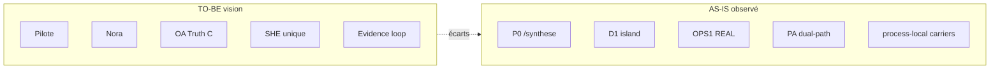
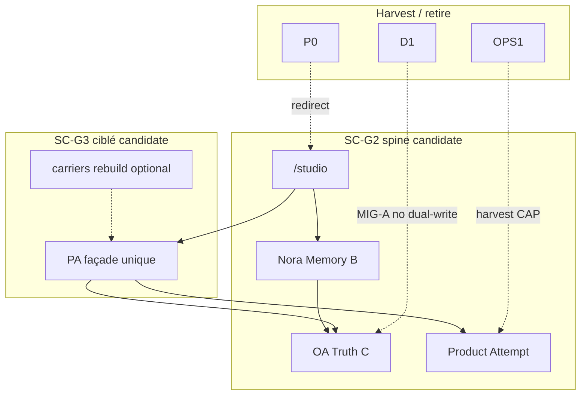
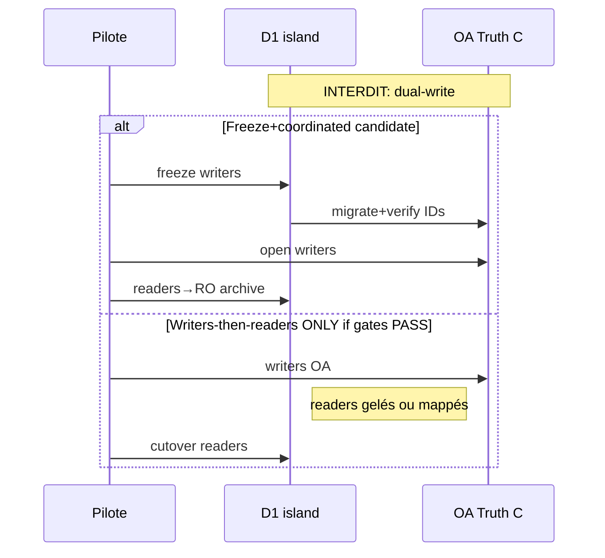

# SFIA Review Pack — FULL — CRITICAL

## 00. Identity

| Field | Value |
| --- | --- |
| Timestamp UTC | 2026-10-22T20:29:10Z |
| Cycle | AKG-M4-A / T-A06 — Critical Architecture Alignment & Contradictory Review |
| Profile | CRITICAL |
| Type | Cycle 6 — Architecture technique · DOC / Architecture / Independent Contradictory Assessment |
| Branch | `analysis/akg-m4a-ta06-critical-alignment` |
| HEAD | `c48c6a582c10ee3cf6902203d6a4eb01ce3f2139` |
| origin/main | `f44a99b4da84188772b80aca3c9ebe1a3e12617e` |
| PR #604 | OPEN · Draft · head = source HEAD |
| Document | `projects/sfia-studio/convergence/architectural-knowledge-governance/m4-rationalization/10-m4a-critical-architecture-alignment-review.md` (untracked) |
| Document hash-object | `922131cd95b05aea1fe33806c1795151770e0ab9` |
| Immutable handoffs | T-A01 `42de13a9…` · T-A02 `51021023…` · T-A03 `640f19c1…` · T-A04 `6717d094…` · T-A05 tip `1e1930d0…` |
| Prior tip `sfia/review-handoff` | `1e1930d0e7079403ac9a34b5f3b99f9dd1ddb3cd` |
| Project commit/push | NONE |
| M4-A | NON CLOSED |
| SC-G2 / SC-G3 | candidates only — **NOT adopted** |
| Delivery / M5 | NOT AUTHORIZED |
| Architecture verdict | **ARCHITECTURE CANDIDATE READY WITH RESERVES** |

## 01. Scope

AUTHORIZED: static contradictory review CR-01–CR-08; local document `10` only; Full pack; L3 handoff publish-in-cycle.
NOT AUTHORIZED: runtime/DB/tests/API/routes mutation; dual-write; REAL Cursor; FinOps SHADOW ON; adopt SC-G2/G3; modify G0/PRR/TO-BE/registre; invent Pilote decisions; project commit/push/PR/merge; close M4-A; Delivery GO; P6 GLOBAL PASS; v3 ADOPTED.

## 02. Git Review Index

```
?? projects/sfia-studio/convergence/architectural-knowledge-governance/m4-rationalization/10-m4a-critical-architecture-alignment-review.md
 M .tmp-sfia-review/chatgpt-review.md
```

| Control | Result |
| --- | --- |
| Branch/HEAD/main/PR#604 | **MATCH** (Draft OPEN) |
| Source HEAD | `c48c6a582c10ee3cf6902203d6a4eb01ce3f2139` |
| Doc hash-object | `922131cd95b05aea1fe33806c1795151770e0ab9` |
| `git diff --no-index --check` | exit `1` (untracked; no trailing whitespace errors) |
| T-A01–T-A05 WTs | untouched |
| Project files besides `10` | NONE |
| Handoffs T-A01–T-A05 | extracted to `.tmp-sfia-review/ta06-evidence/` |

### Diff identity (new file)

```
.../10-m4a-critical-architecture-alignment-review.md | 551 +++++++++++++++++++++
 1 file changed, 551 insertions(+)
```

## 03. Sources, preuves et limitations

| Famille | Sources |
| --- | --- |
| Méthode | SFIA templates · routing · OM · rules · knowledge layer |
| Doctrine | R23/R24 · G0-A/B · OR-13 · Build Doctrine · Roadmap B-AKG · doctrine v3 30/32/34/35/37 |
| M4-A | `01`–`04` AS-IS/TO-BE/registre/assessment |
| PRR | 01–09 sections pertinentes |
| Investigations | handoffs immuables T-A01…T-A05 (docs 05–09) |
| Code/tests | preuves citées T-A01–T-A05 (SHE, R2, Product sqlite, VSR, OPS1 flag, FinOps SHADOW) |

Limitations: volumes D1 UNKNOWN; REAL NOT PROVEN; Tool-First OPEN; bookmarks U; RunState DEFER; classifications A* = candidates.

## 04. Revue contradictoire (CR-01–CR-08 résumé)

| CR | Résultat |
| --- | --- |
| CR-01 Vision | Vision cohérente; AS-IS multi-îlots contredit cockpit/SHE unique; SC-G2 simplifie autorité mais peut déplacer complexité PA |
| CR-02 SC-G* | SC-G2 preferred **candidate**; SC-G3 ciblé PA/carriers légitime indépendamment harvest; combinaison SC-G2+SC-G3 possible |
| CR-03 A01–A12 | Matrice critique; anti Dual-Shell; A06/A10 sous-estimés si SC-G2 seul |
| CR-04 Invariants | G0/SHE/Evidence/SYN/Memory B confirmés DET; R2≠sandbox OPEN; exclusive REAL NOT PROVEN |
| CR-05 Cutover D1 | Writers-then-readers **seulement** si gates; alternatives freeze/cohorts/migrate-then-open/RO; **no dual-write** |
| CR-06 Retirement | Gates D1/OPS1/P0/A09/A11/A12 exigibles |
| CR-07 Risques/H0–H8 | Registre classé; décisions sans réponses inventées |
| CR-08 Readiness | **READY WITH RESERVES**; M4-A NON CLOSED |

## 05. Matrice A01–A12 (synthèse)

A01 KEEP/ADAPT · A02 CONSOLIDATE→RETIRE · A03 HARVEST+REPLACE · A04 HARVEST+REBUILD+RETIRE · A05 KEEP (G0) · A06 ADAPT **ou SC-G3 façade** · A07 KEEP/ADAPT · A08 KEEP/ADAPT · A09 HARVEST port (gate type+consumers) · A10 ADAPT/REBUILD (H3) · A11 FREEZE (gate all consumers) · A12 KEEP/ADAPT (exclusivity NOT PROVEN).

## 06. Comparaison SC-G1 / SC-G2 / SC-G3

SC-G1 = interim dette · **SC-G2 preferred candidate** (spine G0 + harvest) · SC-G3 ciblé A06/A10 **indépendant** du harvest · combinaison SC-G2+SC-G3 si L4 ADAPT insuffisant · **pas** de rebuild OA sans H6 · **pas** d'adoption automatique.

## 07. Registre de risques (classes)

BLOCKER ARCHITECTURE DECISION: R-ARCH-01/02 · BLOCKER M4-A EXIT: R-EXIT-01/02 · BLOCKER DELIVERY: R-DEL-01/02/03 · BLOCKER REAL PROOF: R-PROOF-01/02/03 · FOLLOW-UP HARDENING: R-HARD-01/02/03 · DOC DRIFT: R-DOC-01/02.

## 08. Registre décisions H0–H8

H0 refuse Delivery jusqu'arbitrage · H1 MethodMode ne pas importer silencieux · H2 Tool-First garder OPEN · H3 carrier requalify/HD11 · H4 inventaire volumes requis · H5 pathPolicy instruct séparément · H6 refuse G0 reopen ordinaire · H7 SC-G2 candidate + réserve SC-G3 · H8 SC-G3 PA option parallèle L4. **Aucune réponse Pilote inventée.**

## 09. Validations

| Check | Result |
| --- | --- |
| Sources T-A01–T-A05 | COMPLETE (immutable commits) |
| Matrice A01–A12 | PRESENT §7 doc 10 |
| SC-G1/G2/G3 challenged | YES · SC-G3 independent of harvest |
| Cutover D1 challenge | YES · no implicit obsolete-read window |
| No dual-write | AFFIRMED |
| A09/A11 retirement gates | PRESENT |
| G0 / OA / SHE / Evidence | PRESERVED |
| Truth C ≠ Memory B ≠ SYN | AFFIRMED |
| DET ≠ REAL | AFFIRMED |
| H0–H8 no invented answers | AFFIRMED |
| Risk classification by scope | AFFIRMED |
| M4-A premature close | NONE |
| Markdown + Mermaid | PRESENT |
| `git status --short` | only `10` + pack |
| `git diff --no-index --check` | exit 1 OK (no WS errors) |
| Other project files | NONE |

## 10. R23 / R24 / Fake-Real

R23: Git/code primary for AS-IS; handoffs = investigation evidence with reserves, not adopted architecture.
R24: **NO PRODUCT SEMANTIC IMPACT** (doc/analysis only).
Fake/Real: N/A runtime; REAL NOT PROVEN; SHADOW NOT ACTIVATED; DET ≠ REAL.

## 11. Handoff L3

Branch `sfia/review-handoff` · path `sfia-review-handoff/latest-chatgpt-review.md`
Prior tip preserved: `1e1930d0e7079403ac9a34b5f3b99f9dd1ddb3cd`
Message: `docs(review-handoff): AKG-M4-A T-A06 critical architecture alignment`
Mode: publish-in-cycle · fast-forward only · mono-file.

## 12. Instruction ChatGPT (§9.1)

> **Instruction ChatGPT obligatoire :**
>
> Avant de répondre à Morris sur ce rapport, ChatGPT doit consulter le fichier Git suivant :
>
> branche : `sfia/review-handoff`
> fichier : `sfia-review-handoff/latest-chatgpt-review.md`
>
> ChatGPT doit vérifier sa cohérence avec le rapport Cursor, notamment :
> - le cycle et le profil ;
> - la branche projet ;
> - le HEAD initial et final ;
> - la base main ;
> - les sources consultées ;
> - les fichiers créés ou modifiés ;
> - le contenu complet des fichiers créés ;
> - les sections complètes modifiées ou le diff utile ;
> - l'identité du contenu avant et après synchronisation, si applicable ;
> - les validations réalisées ;
> - la mergeabilité ou le statut Git attendu ;
> - les risques, réserves et écarts ;
> - les décisions Morris ;
> - le verdict du review pack ;
> - le commit et la vérification distante du handoff.
>
> **Après cette vérification**, ChatGPT doit produire une **synthèse globale du cycle** à destination de Morris comprenant **au minimum** :
> 1. l'objectif et le périmètre du cycle ;
> 2. les actions et changements réellement réalisés ;
> 3. les principaux résultats et validations ;
> 4. les risques, réserves, écarts ou éléments non couverts ;
> 5. la distinction entre observations, recommandations et décisions déjà validées ;
> 6. le verdict ChatGPT ;
> 7. la prochaine décision ou action attendue de Morris.
>
> La synthèse doit être compréhensible sans devoir relire l'intégralité du rapport Cursor ou du review pack, tout en restant fidèle au contenu du handoff Git.
>
> Elle ne doit **pas** transformer une recommandation, une hypothèse ou un résultat technique en décision validée sans GO Morris.

Perform: **CHATGPT CRITICAL REVIEW — AKG-M4-A / T-A06**.

Verify: SC-G2 not auto-adopted; SC-G3 independent; cutover D1 challenged; A01–A12 matrix; H0–H8; risk classes; READY WITH RESERVES; M4-A NON CLOSED; no Delivery.

Optional priors: T-A01 `42de13a9…` · T-A02 `51021023…` · T-A03 `640f19c1…` · T-A04 `6717d094…` · T-A05 `1e1930d0…`.

## 13. Verdict target

READY FOR CHATGPT CRITICAL REVIEW — AKG-M4-A / T-A06 LOCAL CANDIDATE

Architecture: **ARCHITECTURE CANDIDATE READY WITH RESERVES**

---

## 14. Full document `10` (verbatim)

# AKG-M4-A / T-A06 — Critical Architecture Alignment & Contradictory Review

| Champ | Valeur |
| --- | --- |
| Méthode | SFIA v2.6 · Cycle 6 — Architecture technique · Profil **Critical** |
| Typologie | DOC / Architecture / Independent Contradictory Assessment |
| Jalon / Lot / Tâche | AKG-M4 · M4-A · **T-A06** |
| Worktree | `analysis/akg-m4a-ta06-critical-alignment` |
| Source HEAD | `c48c6a582c10ee3cf6902203d6a4eb01ce3f2139` |
| Review Pack | **FULL** · Handoff Git **REQUIRED** · publish-in-cycle |
| Transformation runtime | **Interdite** |
| GO Delivery / M5 | **Aucun** |
| Statut | **LOCAL CANDIDATE** · M4-A **NON CLOSED** |

> **Non-claims :** SC-G2 ≠ adopté · SC-G3 ≠ adopté · options = candidates · REAL **NOT PROVEN** · DET ≠ REAL · FinOps SHADOW **OFF** · P6 GLOBAL **NOT PASSED** · runtime v3 **NON ADOPTED** · aucun arbitrage Pilote inventé · aucune clôture M4-A.

---

## 1. Baseline Git et statut

### 1.1 Local Git Truth Check (confirmé T-A06)

| Référence | Attendu | Observé | Statut |
| --- | --- | --- | --- |
| `origin/main` | `f44a99b4da84188772b80aca3c9ebe1a3e12617e` | `f44a99b4…` | **MATCH** |
| Branche documentaire source | `docs/akg-m4a-capability-first-rationalization` | HEAD `c48c6a58…` | **MATCH** |
| Source HEAD | `c48c6a582c10ee3cf6902203d6a4eb01ce3f2139` | `c48c6a58…` | **MATCH** |
| PR #604 | Draft, non fusionnée | OPEN · **isDraft: true** · head = source HEAD | **MATCH** |
| Branche d'analyse | `analysis/akg-m4a-ta06-critical-alignment` | créée depuis source vérifié | **OK** |

### 1.2 Handoffs immuables T-A01…T-A05 (sources d'investigation)

| Investigation | Commit handoff | Blob `latest-chatgpt-review.md` (extrait local) | Statut |
| --- | --- | --- | --- |
| T-A01 | `42de13a95c9ca4b103c9192147a4511f4f1df1dd` | extrait → `.tmp-sfia-review/ta06-evidence/handoff-ta01.md` | **AVAILABLE** |
| T-A02 | `510210231ee3ee82647a2e53b21643e536a677e1` | handoff-ta02.md | **AVAILABLE** |
| T-A03 | `640f19c1ab9d0952ae877bc5328f6705f77a9474` | handoff-ta03.md | **AVAILABLE** |
| T-A04 | `6717d0948c2aace3b058a93dcb305e13f60ad801` | handoff-ta04.md | **AVAILABLE** |
| T-A05 | `1e1930d0e7079403ac9a34b5f3b99f9dd1ddb3cd` | handoff-ta05.md (tip `sfia/review-handoff` pré-T-A06) | **AVAILABLE** |

Les worktrees T-A01…T-A05 **n'ont pas été modifiés**. Les documents projet `05`–`09` restent **non intégrés** à la branche documentaire ; les handoffs L3 sont des **preuves d'investigation acceptées avec réserves**, **pas** une architecture adoptée.

### 1.3 Fichier livrable

| Élément | Valeur |
| --- | --- |
| Chemin | `projects/sfia-studio/convergence/architectural-knowledge-governance/m4-rationalization/10-m4a-critical-architecture-alignment-review.md` |
| Tracking | **local untracked only** (pas de commit projet) |
| Autres fichiers projet | **aucun** créé/modifié hors ce livrable + Review Pack temporaire |

---

## 2. Sources et niveau de preuve

### 2.1 Hiérarchie d'autorité appliquée

1. **Git + preuves primaires** (code, tests, chemins) → AS-IS.
2. **PRR CURRENT** → comportements documentés (avec DOC DRIFT signalé).
3. **Décisions adoptées** (G0-A/B, Build Doctrine R23/R24, OR-13) → contraintes.
4. **TO-BE / registre / T-A01–T-A05** → propositions et orientations **candidates**.

### 2.2 Sources doctrinales lues / appliquées

| Famille | Sources |
| --- | --- |
| Méthode SFIA | `sfia-cycle-execution-template` · routing guide · operating model · rules/guardrails · knowledge layer |
| CKC Architecture | fallback canonique Cycle 6 si CKC non résolu en session |
| Architecture | Build Doctrine R23/R24 · Convergence Roadmap B-AKG · G0 Architecture & Persistence Decision Pack · AKG README |
| M4-A pack | `01` AS-IS · `02` TO-BE · `03` registre (OR-13) · `04` assessment |
| PRR | volumes `01`–`09` (sections pertinentes) |
| Doctrine v3 | `30`, `32`, `34`, `35`, `37` |
| Investigations | handoffs T-A01…T-A05 (docs 05–09 embarqués) |
| Code / tests | preuves citées dans T-A01–T-A05 (SHE, R2, Product sqlite, VSR audit, OPS1 flag, FinOps SHADOW) |

### 2.3 Niveau de preuve global

| Domaine | Niveau | Limite |
| --- | --- | --- |
| Cartographie responsabilités AS-IS | **M–H** | dépendances runtime dynamiques PARTIAL |
| Invariants autorité / Evidence / SHE | **H** (DET) | REAL **NOT PROVEN** |
| Orientations SC-G* | **M** (analyse) | **non décidées** |
| Volumes historiques D1/OPS1 | **U–L** | inventaire absent |
| Cutover / retirement | **M** (design) | **pas** d'exécution |
| Experience cockpit unique | **L–M** | bookmarks / liens EXTERNAL U |

---

## 3. Résumé exécutif contradictoire

**Verdict de maturité :** T-A01–T-A05 fournissent un socle d'arbitrage Pilote **suffisamment instrumenté**. Ce n'est **pas** une architecture adoptée.

| Affirmation portée par T-A05 | Contre-lecture T-A06 |
| --- | --- |
| SC-G2 « préféré candidate » | **Préférence ≠ adoption.** SC-G2 n'est **pas** le défaut opérationnel tant que H7 n'est pas arbitré. |
| Harvest îlots ⇒ TO-BE | Harvest D1/OPS1 **ne** résout **pas** la fragmentation PA (dual SHE/historical + carriers process-local). SC-G2 **seul** peut figer une « compatibilité permanente ». |
| SC-G3 = plan B harvest | **Rejeté.** SC-G3 **ciblé** (A06/A10 ± surface A08) est **légitime indépendamment** du harvest (T-A05 CORR-02). |
| OA KEEP | **Confirmé sous G0.** Rebuild OA / Dual-Shell / dual-write = **arbitrage G0 nouveau** (H6), pas option ordinaire. |
| Ordre L2 « writers puis readers » | **Acceptable seulement** sous conditions strictes ; sinon crée lectures obsolètes / Dual-Shell UX — voir §9. |

**Ce que T-A06 n'autorise pas :** Delivery GO · M4-A CLOSED · SHADOW ON · REAL PROVEN · Dual-Shell de fait · writers+readers D1/OA simultanés · inventer des réponses Pilote.

**Trajectoire candidate (non décidée) :** SC-G2 **spine** (OA/Nora/Studio + harvest îlots) **+** réserve explicite SC-G3 ciblé PA/carriers si L4 ADAPT ne clarifie pas ownership — **sans** rebuild OA.

**Verdict Critical Cursor (recommandation, non décision) :**

### ARCHITECTURE CANDIDATE READY WITH RESERVES

---

## 4. Confrontation vision produit / AS-IS / TO-BE (CR-01)

### 4.1 Objectifs produit (vision TO-BE `02`)

Un cockpit unique `/studio` · relation conversationnelle continue Pilote ↔ Nora · Nora copilote sans autorité métier · OA backbone Product / Truth C · outils selon intention et permissions · missions sous ExecutionContract · geste SHE unique · boucle résultat → Evidence → ReviewBundle → interprétation → continuité.

### 4.2 Matrice d'écarts

| Domaine | Vision TO-BE | AS-IS (T-A01–04) | Écart critique |
| --- | --- | --- | --- |
| Cockpit | `/studio` unique ; `/` → studio | `/` → `/synthese` POC ; D1/OPS1/P0 parallèles | Multi-entrée = Dual-Shell UX de fait |
| Nora | Cognition + coordination ; ≠ autorité | Memory B OK ; RunState cross-restart **DEFER** | Continuité PARTIAL ; risque B↔C si carriers flous |
| OA | Truth C unique (G0) | Product SQLite **CONFIRMED** ; SYN même fichier ≠ Truth C | Aligné G0 ; DOC drift si SYN élevée |
| SHE | Un Exécuter + contrôles internes | SHE + disposition-before-PREPARE **coexistent** | Dual-path = dette « gouvernance invisible » |
| Evidence | Rapport → preuves → Nora ; pas d'invention | Attempt ≠ Evidence ≠ PROVEN séparés | Aligné doctrine ; narration PA fragmentée |
| Outils | Capacité sous contrat | Product Attempt ≠ OPS1 adapter | Double chemin REAL jusqu'à exclusivité **prouvée** |
| Persistance | Vérité non dupliquée | D1/OPS1 islands + process-local + FS non-atomic | Volumes UNKNOWN ; dual-write **interdit** |

### 4.3 Question critique — SC-G2 simplifie-t-elle vraiment ?

**Réponse contradictoire :** SC-G2 **simplifie l'autorité** (un Truth C, retrait d'îlots) mais **peut déplacer** la complexité dans des couches de compatibilité (dual SHE/historical, Maps process-local, ports harvest) si L4 n'est pas traité comme un chantier d'ownership, pas seulement de « nettoyage ».

OR-13 : les dépendances AS-IS (type A09, flag OPS1) sont des **impacts de migration**, pas des motifs de KEEP.



---

## 5. Comparaison approfondie SC-G1 / SC-G2 / SC-G3 (CR-02)

| Critère | SC-G1 — Conservation contrôlée | SC-G2 — Consolidation sélective | SC-G3 — Reconstruction ciblée |
| --- | --- | --- | --- |
| Intention | Figer multi-surfaces | Harvest îlots → spine G0 ; ADAPT PA | REBUILD façade orchestration / continuity |
| Cockpit | Multi | Unique après L2/L5 | Unique + ownership clair |
| OA / G0 | Menacé (Dual-Shell de fait) | **Préservé** | Préservé **si** borné hors OA |
| Dual-write | Tentation élevée | **Interdit** | Interdit |
| Dette PA | Haute | **Moyenne–haute** si L4 échoue | Basse cible ; coût tests ↑ |
| Effort | Bas court terme | Moyen–haut | Haut (PA ~160 tests + REAL) |
| Preuves | Status quo | T-A01–04 M–H | Hypothèse rebuild M |

### 5.1 KEEP rationnel malgré SC-G2

| Zone | Pourquoi KEEP peut rester rationnel |
| --- | --- |
| OA Truth C / Product Store | G0-A/B adoptés ; rebuild = H6 |
| Nora Memory B (bornée) | Cognition sans autorité ; pas Truth C |
| SHE objet + contrôles HD internes | Aligné TO-BE « un clic » ; ne pas supprimer HD |
| Product Cursor Attempt gateway | Candidat d'exclusivité REAL ; pas OPS1 |

### 5.2 Risque SC-G2 — couches transitoires permanentes

Après retire D1/OPS1, restent : SHE + historical PREPARE, offer/proposal Maps, W3C loops, ownership PA↔Nora↔OA flou. Harvest **ne** reconstruit **pas** une façade d'orchestration unique.

### 5.3 SC-G3 indépendant du harvest

SC-G3 peut viser une façade PA ou un mécanisme carriers **sans** reconstruire OA Truth C. Légitime lorsque :

- L4 ADAPT ne produit pas une ownership PA unique lisible ;
- continuity carriers restent PROCESS-LOCAL avec faux claims d'autorité ;
- TO-BE « un Exécuter / mission » reste opaque pour le Pilote ;
- harvest OPS1 ports OK mais UX/autorité incompréhensible.

**Anti-SC-G3 abusif :** rebuild OA · Dual-Shell · tabula rasa OPS1 sans matrice CAP · delete HD « pour simplifier ».

---

## 6. Options combinées et responsabilités cibles (CR-02 suite)

### 6.1 Conditions d'arbitrage

| Condition | Orientation candidate |
| --- | --- |
| Besoin immédiat = retirer Dual-Shell UX/Truth/Exec sans rebuild OA | **SC-G2 spine** |
| PA dual-path structurellement opaque après design L4 | **SC-G2 + SC-G3 ciblé A06/A10** |
| Aucun harvest possible / volumes bloquants long terme | SC-G1 interim **seulement** + inventaire ; pas adoption |
| Demande de Dual-write / Dual-Shell / rebuild OA | **Refuser** hors H6 G0 reopen |

### 6.2 Répartition candidate des responsabilités

| Responsabilité | Owner candidat | Scénario |
| --- | --- | --- |
| Truth C projets / contrats / Evidence | OA Product SQLite | SC-G2 KEEP |
| Cognition / Memory B | Nora | SC-G2 KEEP/ADAPT |
| Cockpit UX | `/studio` | SC-G2 CONSOLIDATE |
| Orchestration mission / SHE surface | PA (ADAPT) ou façade SC-G3 | SC-G2 **ou** SC-G2+G3 |
| Continuity carriers | Requalify / HD11 défaut ; rebuild sous GO | H3 |
| Cursor REAL exclusif | Product Attempt + R2 | SC-G2 L3 après preuves |
| Intake projets | OA + `/studio` | SC-G2 MIG-A |
| Audit injecté | Port hors `lib/d1` | L1 avant L2 |



---

## 7. Matrice critique A01–A12 (CR-03)

Pour chaque actif : capacité conservée · responsabilité cible · implantation candidate · redondance · couplages · alternative · coût résiduel · risque non-régression · preuves · décision humaine.

| ID | Capacité | Cible | Implant. | Redondance | Couplages | Alternative | Coût résiduel | Non-reg | Preuves | Décision humaine |
| --- | --- | --- | --- | --- | --- | --- | --- | --- | --- | --- |
| A01 Studio | Cockpit | KEEP/ADAPT | `/studio` | Faible vs P0 | routes, send API | — | Faible | UI e2e | M | H0 L5 |
| A02 P0 | Entrée POC | CONSOLIDATE→RETIRE | redirect `/studio` | **Oui** vs A01 | bookmarks U | KEEP interim | Liens externes | redirect e2e | L–M | Inventaire liens |
| A03 D1 | Intake projects | HARVEST+REPLACE | OA Project | **Oui** Truth path | A09, IDs `proj-*` | KEEP island | Volumes U | create tests | M + U vol. | **H1 H4** |
| A04 OPS1 | Cursor REAL | HARVEST+REBUILD+RETIRE | Product Attempt | **Oui** Exec | flag, pathPolicy | KEEP dual | Parity PARTIAL | REAL DET | M | **H0 H2 H5** |
| A05 OA | Truth C | KEEP/ADAPT | Product sqlite | Non (autorité) | SYN, Evidence | rebuild = Dual-Shell | Complexité | G0 pack | H | **H6 refuse** défaut |
| A06 PA | Orchestration | ADAPT/CONSOLIDATE | project-assistant | Dual SHE/hist. | F2/W2/W3C/A10 | **SC-G3 façade** | Ownership blur | ~160 tests | H | **H7 H8** |
| A07 Nora | Cognition | KEEP/ADAPT | Memory B | Non si bornée | session, RunState | — | DEFER restart | session tests | M | Boundary B≠C |
| A08 VSR | Composition | KEEP/ADAPT | service compose | Faible | A09 type | — | Couplage audit | TYPE_ONLY | M | Après port A09 |
| A09 Audit | Inject audit | HARVEST port | hors `lib/d1` | Bloque D1 retire | D1, VSR, tests | KEEP in D1 | Optional sqlite | consumers | M | Gate L1 |
| A10 Carriers | Continuity PREPARE | ADAPT/REBUILD | Maps / HD11 | Soft Dual-Shell | PA, Truth C | Promote→2e vérité | Restart loss | process-local | M | **H3** |
| A11 FinOps | Shadow costing | FREEZE | hors spine | 3e moteur si promote | scripts/tests | Activate SHADOW | Consumers large | SHADOW OFF | H OFF | Gate consumers |
| A12 Product Cursor | Attempt/R2 | KEEP/ADAPT | gateway | vs A04 | Tool-First OPEN | Import OPS1 adapter | REAL NOT PROVEN | DET only | M–H | **H2** ; exclusivity GO |

### 7.1 Anti Dual-Shell — risques involontaires

| Risque | Comment il apparaît | Contre-mesure candidate |
| --- | --- | --- |
| Second moteur de décisions | Gate OPS1 mappé en HD ; carrier autoritatif | OPS1≠HD ; H3 requalify |
| Seconde vérité métier | Dual-write D1/OA ; SYN élevée | Interdit dual-write ; SYN NON-AUTH |
| Second moteur Exec Product | OPS1 + Product REAL simultanés | L3 exclusif **prouvé** |
| Couche orchestration relais | SC-G2 « façade » qui appelle encore dual-path | L4 ownership ou SC-G3 |
| Duplication SHE/historique | Conservation permanente des deux paths | Consolidate sous GO L4 |
| Carriers de facto autoritatifs | Promote Maps sans HD | Défaut requalify/HD11 |

Le **nombre de modules** n'est pas un critère de qualité. Une consolidation qui ajoute une couche de relais **aggrave** Dual-Shell soft.

---

## 8. Autorité, sécurité et invariants (CR-04)

| Invariant | Statut preuve | Note Critical |
| --- | --- | --- |
| Pilote = autorité humaine | **Doctrine + SHE path** | UX Inspect distinct de server attest |
| PREPARE inspectable ≠ autorisation | **CONFIRMED** | Disposition-before-PREPARE ≠ SHE |
| SHE = un clic ; HD/Confirm/Authorize **conservés** | **CONFIRMED** S02 | Ne pas « simplifier » en les supprimant |
| Version + fingerprint contrat | **CONFIRMED** (DET) | REAL non prouvé |
| Attempt ≠ Evidence ≠ ContractResult PROVEN | **CONFIRMED** S05 | Attempt `succeeded` + Evidence manquante / NOT_PROVEN **possible** |
| R2 Tool-First fail-closed ≠ sandbox REAL no-write | **OPEN GAP** | Ne pas revendiquer sandbox |
| OPS1 Gate ≠ HumanDecision OA | **CONFIRMED** | Pas de map |
| Synthesis NON-AUTHORITATIVE | **CONFIRMED** code | Même fichier SQLite ≠ Truth C |
| Memory B ≠ Truth C | **CONFIRMED** paths | Path drift orphans |
| FinOps SHADOW non activé | **CONFIRMED** | compose ≠ activate |
| Exclusive Product REAL | **NOT PROVEN** | Flag ≠ exclusivity |
| External rollback | **ABSENT** | Ne jamais promettre |

**Invariants insuffisamment prouvés pour transformation/retrait :** exclusivité REAL Product · volumes D1 · MethodMode import · Tool-First no-write sandbox · bookmarks P0 · atomicité FS/SQLite Evidence · RunState cross-restart.

**Ne pas déclarer un comportement REAL garanti sur la base de tests déterministes.**

---

## 9. Persistance et risque de cutover D1 (CR-05)

### 9.1 Challenge obligatoire — writers avant readers

T-A05 L2 propose : bascule des **writers** avant les **readers**.

| Risque si ordre appliqué sans garde-fous | Mécanisme | Effet |
| --- | --- | --- |
| Lectures obsolètes | Writers OA actifs + readers D1 | Pilot voit projets fantômes / IDs divergents |
| Écritures vers IDs divergents | `proj-*` D1 ≠ IDs OA | Split-brain sessions/projets |
| Incohérence sessions ↔ projets | Memory B / session pointe ancien id | Orphans ; reprise fragile |
| Erreurs d'idempotence | Double create sous deux stores | Doublons métier |
| Rupture reprise incident | Cutover partiel + restart | État non rejouable |

**Conditions où writers-then-readers est acceptable :**

1. Inventaire volumes **connu** (H4) et MethodMode arbitré (H1).
2. A09 port **PASS** (retire D1 non bloqué).
3. Fenêtre où **aucun** reader D1 n'est exposé aux nouveaux writers OA **sans** mapping id vérifié — ou readers gelés.
4. Tests identity / non-doublon / no dual-write **PASS**.
5. GO Delivery lot L2 (H0).

**Sinon :** préférer un pattern alternatif ci-dessous.

### 9.2 Alternatives de transition (aucune = dual-write)

| Pattern | Idée | Quand préférer | Coût |
| --- | --- | --- | --- |
| **Freeze + coordinated** | Gel écritures D1 → migrate batch → ouvrir writers OA → bascule readers → RO archive | Volumes connus ; fenêtre contrôlée | Discipline ops |
| **Route cohorts** | Cohortes URL/utilisateur vers `/studio` ; D1 RO pour non-migrés | Bookmarks / coexistence UX | Complexité routing |
| **Migrate-then-open** | Convertir archive **avant** tout writer OA intake ; ouvrir Product write post-verify IDs | Identités critiques | Prep plus long |
| **RO archive** | D1 lecture historique seule ; **tous** writers Product dès GO | Capacité intake déjà Product | Perte features D1-only |

**Interdit :** double écriture D1/OA · silent ID merge · gate OPS1→HD · Synthesis→Truth C.

### 9.3 Autres challenges de persistance

| Sujet | Challenge |
| --- | --- |
| Volumes historiques | UNKNOWN → migration aveugle = BLOCKER DELIVERY |
| Mapping identifiants | Obligatoire avant readers cutover |
| Données OPS1 / worktrees | Rétention / archivage sous GO ; pas delete silencieux |
| Atomicité fichiers / SQLite | Evidence FS ↔ DB non-atomic = FOLLOW-UP ; ne pas promettre cohérence transactionnelle absente |
| RunState cross-restart | DEFER ; ne pas bâtir cutover dessus |
| Carriers process-local | Perdus au restart ; ≠ Truth C |
| Projections Synthesis | NON-AUTH ; ne jamais migrer comme vérité |



---

## 10. Retirement gates (CR-06)

| Composant | Éléments exigibles avant retrait |
| --- | --- |
| **D1** | Inventaire CAP · consommateurs · transfert intake→OA · comportement équivalent ou abandon doc · sécurité/autorité · tests remplacés · données archivées · routes migrées · restart/idempotence · proof pack · décision retrait explicite · **A09 extrait** · cutover sans dual-write |
| **OPS1** | Matrice CAP harvest · guards Attempt/parity · Product REAL **exclusif prouvé** · disposition `OPS1_CURSOR_REAL` · tests remplacés · worktrees/rétention · **pas** retire-on-tests-gone |
| **P0** | Inventory liens/bookmarks · `/`→`/studio` · claims fixture retirés · e2e redirect · décision |
| **A09** | **Type** hors `lib/d1` · audit injecté conditionnel traité · optional sqlite path · consumers/tests · noop default · injection ≠ activation |
| **A11** | **Tous** consumers FinOps / shadow / scripts / tests / re-exports · SHADOW OFF · pas promote spine · « absent VSR » **insuffisant** |
| **A12 exclusivity** | Harvest + DET/REAL non-reg + Tool-First disposition + **GO** — flag seul ≠ preuve ; **ne jamais** revendiquer Product REAL exclusif avant preuves |

---

## 11. Registre de risques et blockers (CR-07)

| ID | Risque | Classe | Conséquences |
| --- | --- | --- | --- |
| R-ARCH-01 | SC-G2 adopté sans réserve SC-G3 → PA Dual-Shell soft | **BLOCKER ARCHITECTURE DECISION** | Empêche arbitrage H7/H8 fiable |
| R-ARCH-02 | Dual-write / Dual-Shell / rebuild OA comme « facilité » | **BLOCKER ARCHITECTURE DECISION** | Contredit G0 ; H6 |
| R-EXIT-01 | M4-A CLOSED sans arbitrage SC-G* / H0–H8 | **BLOCKER M4-A EXIT** | Clôture formelle illégitime |
| R-EXIT-02 | Classifications A01–A12 traitées comme définitives | **BLOCKER M4-A EXIT** | Fige options candidates |
| R-DEL-01 | Implémentation L1–L6 sans GO Delivery | **BLOCKER DELIVERY** | Transformation non autorisée |
| R-DEL-02 | Migration D1 sans inventaire volumes | **BLOCKER DELIVERY** | Perte / doublons |
| R-DEL-03 | Product REAL « exclusif » avant preuves | **BLOCKER DELIVERY** | Faux COMPLETE |
| R-PROOF-01 | REAL E2E / P6 GLOBAL | **BLOCKER REAL PROOF** | N'empêche pas arbitrage design |
| R-PROOF-02 | Tool-First REAL no-write = sandbox (si claim) | **BLOCKER REAL PROOF** | Claim faux |
| R-PROOF-03 | SHADOW ON par composition | **BLOCKER REAL PROOF** / FinOps | Activation illicit |
| R-HARD-01 | FS↔SQLite Evidence non-atomic | **FOLLOW-UP HARDENING** | Pas blocker architecture immédiat |
| R-HARD-02 | RunState DEFER ; retention session/OPS1 | **FOLLOW-UP HARDENING** | |
| R-HARD-03 | pathPolicy Attempt PARTIAL | **FOLLOW-UP HARDENING** | Instruct séparément (H5) |
| R-DOC-01 | PRR06 / SYN authority class | **DOC DRIFT** | Régularisation doc |
| R-DOC-02 | pre-m6 / vertical-slice naming | **DOC DRIFT** | |

**Règle :** ne pas imposer de fermer toutes les lacunes REAL pour autoriser la fin d'une investigation architecturale, **sauf** si elles rendent impossible un arbitrage de conception. Ici R-PROOF-* **n'empêchent pas** l'arbitrage SC-G* ; ils **empêchent** Delivery REAL claims.

---

## 12. Registre des décisions humaines H0–H8 (CR-07 suite)

*Aucune réponse Pilote inventée.*

| ID | Question | Options | Implications | Recommandation candidate (analyse) | Preuves | Si différé |
| --- | --- | --- | --- | --- | --- | --- |
| **H0** | GO Delivery par lot | GO / refuse / différer | Sans GO : **zéro** implémentation L* | **Refuse** jusqu'à arbitrage SC-G* + gates | Lots L1–L6 design | Lots restent design-only |
| **H1** | MethodMode | Import OA / abandon / inventaire besoin | Import silencieux = doctrine creep | **Ne pas importer** sans GO | CAP-D1 | Bloque sémantique MIG-A |
| **H2** | Tool-First REAL no-write | Architecture sandbox / garder fail-closed OPEN | Claim sandbox sans preuve = faux COMPLETE | **Garder gate OPEN** | R2 code | REAL pathless fail-closed |
| **H3** | Durable carrier | Requalify-only / PresentedSubject GO | Carrier→autorité = 2e vérité | **Défaut requalify/HD11** | T-A03 | Continuity UX process-local |
| **H4** | Volumes historiques | Inventaire avant migrate / migrer aveugle | Aveugle = R-DEL-02 | **Inventaire requis** avant L2 | Volumes U | Migration blocked |
| **H5** | pathPolicy Attempt | Enforce now / instruct later | PARTIAL aujourd'hui | **Instruct séparément** | Parity PARTIAL | Parity reste PARTIAL |
| **H6** | Reopen G0 | Dual-write / Dual-Shell / rebuild OA / **refuse** | Contredit pack ADOPTED | **Refuse** option ordinaire | G0 pack | G0 hold |
| **H7** | Orientation SC-G2 / SC-G3 | SC-G2 / SC-G2+SC-G3 ciblé / SC-G1 interim | Adoption = trajectoire M4-A exit | **SC-G2 candidate + réserve SC-G3** (pas auto) | CORR-02 | Reste preferred-candidate only |
| **H8** | SC-G3 PA indépendant harvest | Oui scoped A06/A10 / non / différer | Non ⇒ fragmentation post-îlots | **Oui comme option parallèle** à instruire en L4 | A06 matrix | Traité au GO L4 |

---

## 13. Recommandation architecturale candidate (CR-08)

### 13.1 Cohérence de la cible

La vision TO-BE (cockpit, Nora, OA, SHE, Evidence) est **cohérente avec G0/OR-13**. L'AS-IS multi-îlots **contredit** cette cohérence opérationnelle. SC-G2 est la **meilleure orientation candidate** pour l'autorité unique ; elle **n'est pas suffisante seule** pour garantir une orchestration PA compréhensible.

### 13.2 Responsabilités restantes à clarifier

- Ownership PA (SHE vs historical) — H7/H8.
- Carrier continuity vs Truth C — H3.
- Cutover D1 pattern exact — H4 + §9.
- Exclusivité Product REAL — preuves + H0/H2.

### 13.3 Garanties réellement préservées (si trajectoire candidate suivie)

G0-A/B · no dual-write · SYN≠Truth C · Memory B≠Truth C · SHE≠vanished HD · Attempt≠Evidence≠PROVEN · OPS1≠HD · SHADOW OFF · DET≠REAL.

### 13.4 Meilleure trajectoire candidate

1. Conserver spine G0 : A01 / A05 / A07 / A12 (+ A08).
2. SC-G2 pour îlots : A09→A03 MIG-A ; A04→A12 harvest ; A02 consolidate ; A11 FREEZE OFF.
3. Réserver SC-G3 ciblé A06/A10 si L4 ADAPT insuffisant — **sans** rebuild OA.
4. Cutover D1 via freeze/cohorts/migrate-then-open/RO archive — **never dual-write** ; writers-then-readers **seulement** si gates §9.1.
5. Retirement gates §10 avant tout RETIRE.
6. H0–H8 avant Delivery ; M4-A exit seulement après arbitrage explicite.

### 13.5 Arguments favorables SC-G2

- Aligne G0 / OR-13 / Truth C unique.
- Évite dual-write et Dual-Shell Truth/Exec.
- Harvest D1/OPS1 instrumenté par T-A01–T-A04.
- Coût inférieur à rebuild global.

### 13.6 Arguments contradictoires

- SC-G2 peut figer dual-path PA comme « dette temporaire permanente ».
- Writers-then-readers sans inventaire = Dual-Shell UX.
- REAL exclusivity et Tool-First sandbox **non prouvés**.
- SC-G3 ciblé peut être **nécessaire** même si harvest réussit.
- Classifications A* restent **candidates**.

---

## 14. Corrections documentaires à prévoir

| Cible | Correction candidate | Classe |
| --- | --- | --- |
| TO-BE `02` | Clarifier que SC-G2 n'implique pas ownership PA automatique ; mentionner option SC-G3 ciblé | DOC / arbitrage |
| Registre `03` | Distinguer BLOCKER ARCHITECTURE vs DELIVERY vs REAL | DOC |
| Impact pack T-A05 | Remplacer formulation L2 writers/readers « implicite OK » par conditions §9.1 | DOC DRIFT design |
| PRR06 | SYN authority class NON-AUTH explicite | DOC DRIFT |
| Naming pre-m6 / vertical-slice | Alignement vocabulaire v3 | DOC DRIFT |

**Interdit dans T-A06 :** modifier G0, PRR, Build Doctrine, Roadmap, TO-BE ou registre (corrections = **à prévoir**, non appliquées ici).

---

## 15. Readiness M4-A et conditions de sortie

### 15.1 Verdict

| Verdict possible | Choix T-A06 |
| --- | --- |
| ARCHITECTURE CANDIDATE READY FOR PILOTE ARBITRATION | Partiel — pack **arbitrable**, mais réserves structurantes |
| **ARCHITECTURE CANDIDATE READY WITH RESERVES** | **OUI** |
| ARCHITECTURE NOT READY — FURTHER INVESTIGATION REQUIRED | Non forcé — graphe/CAP/sequences/storage/impact présents |

### 15.2 Conditions de clôture M4-A **non satisfaites**

1. Arbitrage Pilote H7 (SC-G2 / combinaison / SC-G3).
2. Traitement explicite H0–H8 (même si plusieurs = « différé documenté »).
3. Intégration documentaire `05`–`10` (ou décision de ne pas intégrer) — hors scope T-A06 commit.
4. Absence de confusion handoff L3 ≠ architecture adoptée.
5. **M4-A NON CLOSED** jusqu'à décision Pilote post-review ChatGPT.

### 15.3 Informations encore nécessaires à l'arbitrage Pilote

- Confirmation orientation SC-G* (H7/H8).
- Inventaire volumes ou décision de geler L2 (H4).
- Position MethodMode (H1) et carrier (H3).
- Acceptation des retirement gates A09/A11 comme préconditions non négociables.

---

## 16. Frontière entre arbitrage M4-A et GO Delivery

| Niveau | Contenu | Autorise |
| --- | --- | --- |
| **Arbitrage M4-A** | SC-G* · classifications A* · H1–H8 design · corrections doc | Clôture investigation / orientation |
| **GO Delivery (par lot)** | H0 sur L1…L6 · proof packs · cutover exécutable | Implémentation / migration / retire |
| **GO REAL / P6** | Preuves REAL · Tool-First · exclusivity | Claims REAL / P6 GLOBAL |
| **FinOps** | Activation SHADOW | SHADOW ON (séparé) |

T-A06 prépare l'arbitrage architectural ; **il n'autorise** ni clôture automatique M4-A, ni adoption SC-G2/SC-G3, ni Delivery/M5.

---

## 17. Conclusion Critical

La trajectoire de rationalisation est **globalement cohérente** avec la vision produit et G0, **sous réserve** que SC-G2 ne soit pas adoptée comme simplisme qui déplace la dette PA, et que le cutover D1 ne laisse **aucune** fenêtre de lecture obsolète implicitement acceptable.

**Orientation candidate :** SC-G2 spine + réserve SC-G3 ciblé PA/carriers · G0 préservé · no dual-write · REAL/SHADOW non revendiqués.

### ARCHITECTURE CANDIDATE READY WITH RESERVES

M4-A **NON CLOSED** · Delivery / M5 **NOT AUTHORIZED** · SC-G2 **candidate only** · G0 **preserved**.

R24 : **NO PRODUCT SEMANTIC IMPACT** (documentation / analyse uniquement).

---

## 18. Traçabilité SFIA / R23 / R24 / G0 / OR-13

| Référentiel | Application T-A06 |
| --- | --- |
| SFIA v2.6 Cycle 6 Critical | Revue contradictoire indépendante · Full Review Pack · handoff L3 |
| R23 | Preuves primaires Git/code pour AS-IS ; pas d'adoption sur handoff seul |
| R24 | Aucun impact sémantique produit runtime |
| G0-A/B | OA Native + Product sqlite ; harvest OPS1 ; **no dual-write** |
| OR-13 | Capacités/garanties métiers > implémentations historiques **ou récentes** |
| M4 `01`–`04` | AS-IS/TO-BE/registre/assessment comme propositions |
| T-A01…T-A05 | Inputs immuables ; réserves ChatGPT conservées |
| Non-claims | SC-G* non adoptés · M4-A ouvert · pas de GO Delivery |

---

*Fin du document `10` — AKG-M4-A / T-A06 — LOCAL CANDIDATE — Critical Contradictory Review.*
