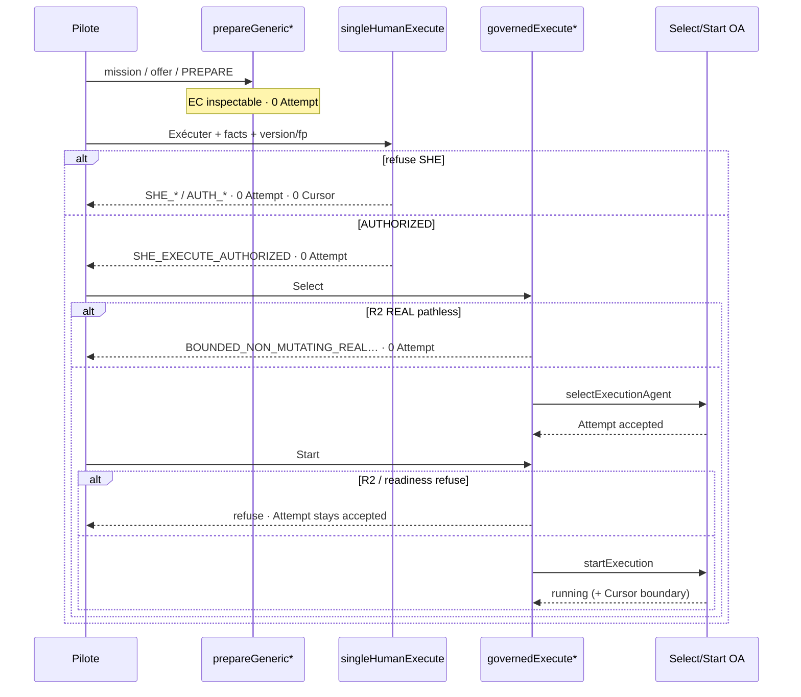
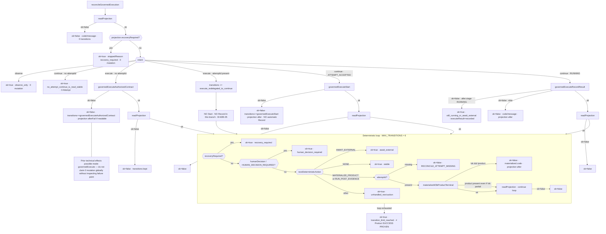
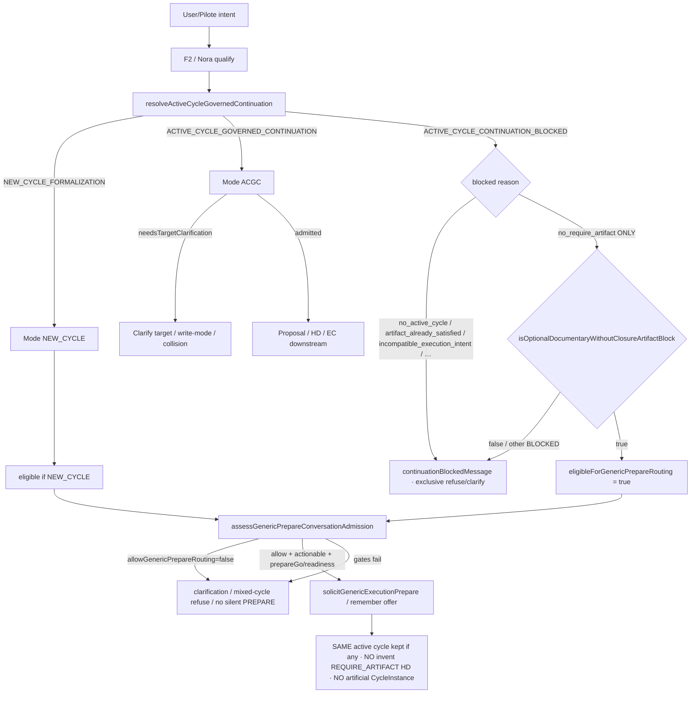
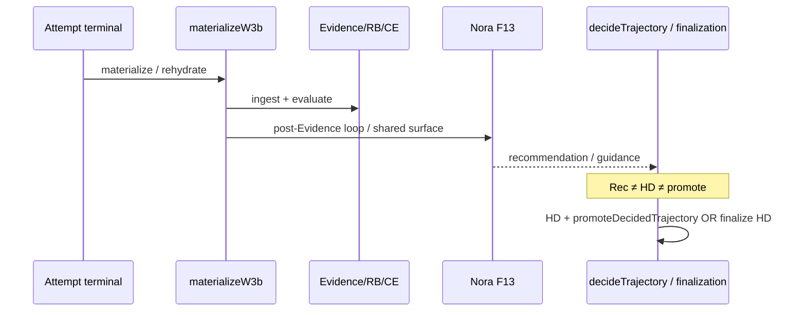

# SFIA REVIEW PACK — FULL
## AKG-M2 LOT B — CORRECTION PASS 02
### FULL REVIEW PACK CONSOLIDATION

- **Timestamp UTC:** `2026-10-20T17:58:25Z`
- **Cycle:** 6 — Architecture technique
- **Specialization:** Documentary Consolidation
- **Profile:** Critical
- **Typologie:** DOC / ARCHITECTURE / REVIEW
- **GO Morris:** `2026-10-20 — GO AKG-M2-B CORRECTION PASS 02`
- **Chantier:** SFIA-STUDIO-ARCHITECTURAL-KNOWLEDGE-AND-CONSTRUCTION-GOVERNANCE
- **Milestone:** AKG-M2 — Architecture Understanding (**NOT CLOSED**)
- **Lot:** M2-B — Critical Interaction Understanding
- **Evidence base main:** `d6cb457f8a3e0ce1781a8ef40b56c10f9955db30`
- **Source pack initial:** `6bf33c8cb8e8f42c88eb6968089e60c4459560c7` / blob `3a14e3f928bb562f7c684d0e78eef81d8974115b`
- **Source pack CP01:** `d9ee7f75acacf56858da048dcfe6cfb561f00472` / blob `e26811388cddc2630462ddcccd074df41c4ffdfa`
- **Verdict:** `AKG-M2 LOT B — CORRECTION PASS 02 COMPLETE — READY FOR CHATGPT CRITICAL RE-REVIEW`
- **M2-C:** **PROPOSAL ONLY — NOT AUTHORIZED**
- **Product/PRR/Roadmap/method edits:** **NONE**

---

## 1. GIT TRUTH

| Item | Value |
| --- | --- |
| Worktree | `/Users/morris/Projects/sfia-workspace-akg-m2-lot-a-formal-exit-roadmap-sync` |
| Branch | `docs/sfia-studio-akg-m2-lot-a-formal-exit-roadmap-sync` |
| HEAD local | `8a7cd63ff703d828c96966b4f4d63b803dd59d5e` |
| origin/main | `d6cb457f8a3e0ce1781a8ef40b56c10f9955db30` |
| handoff tip (pre-CP02) | `d9ee7f75acacf56858da048dcfe6cfb561f00472` |
| Dirty | `.tmp-sfia-review/*` only |
| Staged | none |
| M1 WT | preserved `f666f19f` |
| Code consulted | `git show d6cb457f8a3e0ce1781a8ef40b56c10f9955db30:…` |

**Git Truth:** PASS.

---

## 2. CONVERGENCE PRE-CHECK

| Item | Status |
| --- | --- |
| AKG-M0 / M1 / M2-A | CLOSED BY MORRIS |
| AKG-M2-B | UNDER CP02 consolidation after Critical Re-Review pack-completeness finding |
| AKG-M2-C | **NOT AUTHORIZED** |
| AKG-M2 global | **NOT CLOSED** |
| AKG-M3 | **NOT AUTHORIZED** |
| R-M2A-04 | ENTRY CONTRACT RECONCILED · **OPEN GOVERNED** |
| B-M2B-05 | **OPEN** |
| C1 | TARGET |
| runtime v3 | NON ADOPTED |
| P6 GLOBAL PASS | NOT ACQUIRED |
| REAL BOUNDARY | NOT PROVEN |

**R23:** Git/code/preuves priment · packs immuables = content sources.  
**R24:** consolidation documentaire · **NO SEMANTIC IMPACT**.

---

## 3. CORRECTION REGISTER (CP01 retained + CP02)

| ID | Finding | Source | Avant | Après | Sections | Validation | Preuve | Réserve | Verdict |
| --- | --- | --- | --- | --- | --- | --- | --- | --- | --- |
| R-M2B-01 | S2 F11b oversimplified | reconcile | flat derive→mat | branched A–H | I-B02 · S2 | code-mapped | COVERAGE | — | **PASS** |
| R-M2B-02 | S4 PREPARE direct | ACGC · orchF2 | direct arrow | gated | I-B04 · S4 | gates shown | COVERAGE | B-M2B-03 | **PASS** |
| R-M2B-03 | redelegated≠Start | reconcile:155–158 | implied continue | observed+gap | I-B02 · S2 · L-M2B6 | honest | OBSERVED+PARTIAL TEST | **B-M2B-05 OPEN** | **PASS WITH GOVERNED RESERVE** |
| R-M2B-04 | L-M2B7 thin | — | topic list | A–H + E-C01…10 | L-M2B7 | verifiable | DOCUMENTED | M2-C NOT AUTH | **PASS** |
| **R-PACK-M2B-01** | Pack incomplete / preserved essence | Critical Re-Review | stubs + appendix | **FULL autonomous consolidation** | all L-M2B0…7 | P1–P10 | this pack | ChatGPT verify | **CORRECTION IMPLEMENTED / READY FOR CHATGPT VERIFICATION** |
| S2 failure fidelity | missing fail/stop branches | reconcile returns | CP01 S2 success-path heavy | fail A–H + stops | S2 · I-B02 · L-M2B4 | code-mapped | COVERAGE | — | **PASS** |

---

## 4. SOURCES CONSULTED THIS CYCLE

- Handoffs `6bf33c8cb8e8f42c88eb6968089e60c4459560c7` + `d9ee7f75acacf56858da048dcfe6cfb561f00472` (full read)
- `reconcileGovernedExecution.ts` @ `d6cb457f8a3e0ce1781a8ef40b56c10f9955db30` (failure/stop paths)
- Process/convergence/PRR cited as in Lot B (no re-architecture)

---

# L-M2B0 — Entry Contract Reconciliation (R-M2A-04)

## Sources reconciled
1. L-M2A6 initial (`86a2b1e7…`) — full candidate table  
2. L-M2A6 CP01 (`34ce3147…`) — shortened but **status CANDIDATE**; F11b split + Artifact/Finalization corrections  
3. CURRENT Git `d6cb457f8a3e0ce1781a8ef40b56c10f9955db30` + PRR 03/06/07

## Consolidated Entry Contract

### A. Prérequis — SATISFIED
| Prerequisite | Evidence |
| --- | --- |
| M2-A Critical Re-Review PASS WITH RESERVE | CP01 handoff + Formal Exit |
| Morris Formal Exit M2-A | Roadmap tip ON MAIN |
| Distinct GO M2-B | **CONSUMED** this cycle |

### B. Acquis réutilisés (M2-A — not redefined)
- PREPARE ≠ AUTHORIZE ≠ EXECUTE  
- Recommendation ≠ HumanDecision  
- Memory B ≠ Truth C  
- SHE → **0 Attempt** before launch (`executionAttemptCreated: false`)  
- Select **creates** Attempt (`accepted`)  
- Start **mutates** existing Attempt (`accepted→running`)  
- F11b split: resolve RO · projection RO · reconciler **intent-scoped writes**  
- Artifact Routing/Continuation · Finalization Assessment ownership  

### C. Interactions approfondies this lot
I-B01…I-B08 (below).

### D. Frontières restantes
A-M2A-01…05 · unsampled B-matrix refuse cells · multi-instance · PRR/code index gaps (G-M1-15/17).

### E. Sources
CURRENT code · PRR 03/06/07 · M1 Lot C · M2-A matrices · existing tests · manifest.

### F. Exit proof (Lot B deliverables)
L-M2B1…7 present in this pack.

### G. Gates still distinct
REAL · PRR sync · Roadmap tip · M2-C · Product — **all DISTINCT REQUIRED**.

## Qualification R-M2A-04
**R-M2A-04 ENTRY CONTRACT RECONCILED** — fields A–G recovered from initial+CP01+CURRENT.

**≠** global CLOSED of R-M2A-04 (remains **OPEN / GOVERNED** until Morris Formal Exit M2-B after Critical Review).

---


# L-M2B1 — Critical Interaction Cards

## I-B01 — SHE / GOVERNED EXECUTION

| Field | Content |
| --- | --- |
| ID | I-B01 |
| Nom | SHE / Governed Execute chain |
| Question | How does Pilote Exécuter become Attempt/Cursor without collapsing PREPARE/AUTH/EXEC? |
| Components | `prepareGenericExecutionContractDraft` · `singleHumanExecutePreparedContract` · `governedExecuteSelectAgent` / `Start` / `Record` · OA Select/Start |
| Owner | Product W2 + OA ExecutionAttempt |
| Entry | Inspectable EC + Pilote Exécuter / then Select+Start actions or reconcile `execute` |
| Sources CURRENT | `w2/singleHumanExecutePreparedContract.ts:704–963` · `w2/governedExecuteAuthorizedContract.ts:757–1188` |
| Sources PRR | F08 · F10 · INV-SHE-* |
| Objets lus | EC · inspection · Product materiality · HD (if structural) |
| Objets écrits | SHE: inspect/confirm/authorize (+ optional supersede EC + HD). **No Attempt.** Governed: Attempt + launch/record |
| État initial | Prepared/inspected EC |
| Transitions | PREPARE → INSPECT → [structural HD supersede] → Confirm? → Authorize (**STOP**) → Select(accepted) → Start(running) → Record(terminal) → Evidence path |
| Autorité | Authenticated Pilote · AUTHORIZED evaluation · materiality stamps |
| Refusal paths | `SHE_*` codes · `AUTHORIZATION_NOT_ELIGIBLE` · Select auth fail · R2 REAL pathless · G-D4 binding · boundary failures |
| Persistence | EC/HD/Attempt Truth C; offer process-local |
| Restart | Offer may be lost; durable HD may resume PREPARE (PRR F18 PARTIAL) |
| Idempotency | Select idempotency key; SHE successor fingerprint compare |
| External | Cursor only after Start on REAL/fixture boundary |
| Evidence/test | `p6.she.singleHumanExecute*.d0` · `p6.projectScopedCursorSelection.d0` |
| Proof level | **BEHAVIOR PROVEN — DET/Fake AT TESTED SCOPE** · REAL **NOT PROVEN** |
| Gap | UI conflation SHE≈execute (A-M2A-02 / B-M2B-02) |
| Risque | Pilot thinks Exécuter launched Cursor |
| Impact v3 | V3-F05 authority chain |
| Capacité | V3-F05 |
| Dépendance | I-B02 materialize/post-Evidence |
| Verdict local | **COVERAGE VERIFIED + BEHAVIOR PROVEN (DET)** · REAL separate |

**Attempt rules (verified):**
- Fail before Select → **0 Attempt**
- Select refuse → **0 new Attempt**
- Start refuse → Attempt may remain **`accepted`**
- Attempt succeeded ≠ Product SUCCESS PROVEN

---

## I-B02 — F11b CONTINUITY

| Field | Content |
| --- | --- |
| ID | I-B02 |
| Intent enum | **only** `observe` \| `execute` \| `continue` — **recoveryRequired is projection property, not an intent** |
| READ-ONLY | `resolveProductExecutionContext` · `deriveGovernedExecutionContinuityProjection` |
| observe | return `observe_only` · **0 transitions** |
| recoveryRequired (pre-branch) | return `recovery_required` · **0 mutations** |
| continue sans Attempt | `no_attempt_continue_is_read_stable` · **0 Attempt** |
| execute sans Attempt | may `governedExecuteAuthorizedContract` (Select→Start→Record path) |
| execute **avec** Attempt | push `execute_redelegated_to_continue` **only** · **does not** enter Start/Record else-if · then deterministic loop |
| continue + ATTEMPT_ACCEPTED | `governedExecuteStart` |
| continue + RUNNING | `governedExecuteRecordResult` |
| Deterministic loop | materialize **only if** `nextDeterministicAction ∈ {MATERIALIZE_PRODUCT, RUN_POST_EVIDENCE}` |
| Stops | recovery_required · human_decision_required · await_external · stable · unhandled_next:* · transition_limit_reached · still_running_or_await_external |
| Proof | COVERAGE VERIFIED · BEHAVIOR DET @ tested for observe/continue/execute-no-attempt · execute+existing = OBSERVED + PARTIAL TEST |
| Gap | **B-M2B-05** comment vs code for execute+existing |


## I-B03 — RESTART / PERSISTENCE

| Field | Content |
| --- | --- |
| ID | I-B03 |
| Nom | F17/F18/F19 + offer vs HD |
| Question | What survives restart; what must be revalidated? |
| Components | `pendingGenericPrepareOfferStore` · HD SQLite · EC/Attempt · Proposal store · LPS |
| Sources | offer store header · PRR06 · PRR03 F17–F19 |
| Process-local lost | PREPARE offer Map · Proposal presentation carriers · in-memory UI |
| Durable | HD · EC · Attempt · Evidence/RB/CE · Project/LPS (Truth C) |
| Reconstruction | HD11: durable verified HD may resume PREPARE without offer; **absence of offer ≠ universal PREPARE refuse**; **HD ≠ Authorization** |
| Authority revalidation | currentness / inspect / authorize still required before launch |
| Proof | F17 DET proven chat-first · F18/F19 **PARTIAL** · multi-instance **NOT PROVEN** · RunState cross-restart **DEFER** |
| Verdict | **DOCUMENTED + PARTIAL BEHAVIOR** · **≠ RESTART SAFE global** |

---


## I-B04 — ACTIVE CYCLE CONTINUATION (ACGC)

| Field | Content |
| --- | --- |
| ID | I-B04 |
| Nom | ACGC vs NEW_CYCLE_FORMALIZATION vs BLOCKED |
| Question | When does intent continue active cycle vs formalize new cycle vs hand off Generic PREPARE? |
| Components | `resolveActiveCycleGovernedContinuation` · `artifactTargetRouting` · `orchestrateF2` · `assessGenericPrepareConversationAdmission` |
| Owner | Product F2 routing |
| Entry | User/Pilote intent after Nora/F2 qualification |
| Sources CURRENT | `f2/activeCycleGovernedContinuation.ts:572+` · `isOptionalDocumentaryWithoutClosureArtifactBlock:550–555` · `orchestrateF2.ts:2198–2495` · `artifactTargetRouting.ts` |
| Sources PRR | F05 · F08 |
| Modes | `NEW_CYCLE_FORMALIZATION` · `ACTIVE_CYCLE_GOVERNED_CONTINUATION` · `ACTIVE_CYCLE_CONTINUATION_BLOCKED` |
| Reads | active cycle · obligations · pathRoot · durable same-deliverable Evidence |
| Writes | none in resolver; downstream Proposal/HD/EC only if admitted |
| no_require_artifact | One BLOCKED reason only. Optional documentary (`isOptionalDocumentaryWithoutClosureArtifactBlock`) may set `eligibleForGenericPrepareRouting` **with** NEW_CYCLE eligibility. Then requires `assessGenericPrepareConversationAdmission.allowGenericPrepareRouting` + actionable/`execution_request` intent + prepareGo/readiness + Product prepare gates. Else clarification/refusal via `continuationBlockedMessage`. |
| Other BLOCKED | `no_active_cycle` · `artifact_already_satisfied` · `incompatible_execution_intent` · etc. stay **exclusive** — not aliased to Generic PREPARE |
| Non-effects | **Never** invent REQUIRE_ARTIFACT HD · **never** auto-create CycleInstance |
| Authority | conversational intent ≠ authority; HD/EC gates remain |
| Proof | COVERAGE VERIFIED DET @ tested |
| Gap | B-M2B-03 (same utterance → different modes) |
| Capacité v3 | V3-F05 |
| Verdict local | **COVERAGE VERIFIED** (CP01 routing fidelity) |


## I-B05 — POST-EVIDENCE / NORA

| Field | Content |
| --- | --- |
| ID | I-B05 |
| Nom | Attempt terminal → Evidence → Nora F13 |
| Question | How Product truth separates from session/memory and recommendations? |
| Components | `materializeW3bProductTerminal` · `runW3cPostEvidenceLoop` · resolve post-Evidence · Nora tools |
| Sources | materialize `:355+` / rehydrate `:670+` · PRR F13 |
| Writes | Evidence/RB/CE · post-Evidence durable surface |
| Reads | Attempt/contract · Cursor report · artifact review material |
| Separation | Product Truth C ≠ Memory B ≠ Recommendation ≠ HD |
| A-M2A-03 | `t-a7` `boundedHistoryRead` is **platform** operational history — **≠** Product post-Evidence ownership; Product uses W3c durable surfaces |
| Proof | F13 DET fresh+restart handoff @ tested · REAL SprintBoard **distinct GO** |
| Verdict | **COVERAGE VERIFIED** · A-M2A-03 **PARTIALLY CLARIFIED** (boundary DOCUMENTED; ownership overclaim risk remains governed) |

---

## I-B06 — TRAJECTORY / FINALIZATION

| Field | Content |
| --- | --- |
| ID | I-B06 |
| Nom | decide/promote + finalization assessment |
| Question | Assessment≠HD≠Promotion; which writers promote? |
| Components | `decideTrajectory` · `approveCandidateTrajectory` · `promoteDecidedTrajectory` · `deriveFinalizationApplicability` · `assessFinalization` |
| Sources | decideTrajectory `:241+` / promote `:927` · approveCandidateTrajectory `:330+` / `:738` · finalization OA |
| Writes | HD + ProjectTrajectory promotion (OA) · finalize HD lifecycle |
| Non-writes | Recommendation alone · Assessment alone |
| A-M2A-01 | **All promotions observed call OA `promoteDecidedTrajectory`**. Product has **≥2 entry seams**: `decideTrajectory` (W2) + `approveCandidateTrajectory` (pre-cycle). Status: **VERIFIED WITH BOUNDED RESERVE** — dual entry, single OA promote |
| GAP-03 | git primary EC selection fail-closed if 0 or >1 effective |
| Proof | DET @ tested |
| Verdict | **COVERAGE VERIFIED** |

---

## I-B07 — LEGACY / PARALLEL PATHS

| Field | Content |
| --- | --- |
| ID | I-B07 |
| Nom | M3/F3 confirmAndExecute vs W2 governed |
| Question | Do both reach SelectExecutionAgent with same invariants? |
| Finding | **Both call OA `SelectExecutionAgent`**. Preconditions differ (M3 bounded confirm-and-execute vs SHE authorize + governed Select + materiality/R2). |
| A-M2A-02 | **PARTIALLY VERIFIED** — Select shared; orchestration **not** identical; SHE splits Authorize vs Attempt |
| Classification candidate | **KEEP** both until usage/impact proven · **≠ RETIRE** |
| Proof | code call-graph + PRR F09/F10 |
| Verdict | **COVERAGE VERIFIED** · dual surface **DOCUMENTED** |

---

## I-B08 — TOOL-FIRST FAKE/REAL

| Field | Content |
| --- | --- |
| ID | I-B08 |
| Nom | R1 stamp / R2 REAL refuse |
| Question | Does read_only stamp guarantee Cursor REAL no-write? |
| R1 | `qualifyBoundedNonMutatingAnalysisMission` + PREPARE stamps (`boundedNonMutatingAnalysis`, `NO_REPOSITORY_MUTATION_*`) |
| R2 | `assertBoundedNonMutatingCursorRealAdmissible` — if pathless non-mutating **and** `SFIA_STUDIO_CURSOR_REAL=1` → `BOUNDED_NON_MUTATING_REAL_ENFORCEMENT_UNAVAILABLE` at **Select (before Attempt)** and **Start (Attempt stays accepted)** |
| Fake/DET | Select/Start admissible |
| Proof | `p6.toolFirst.safetyClosureR1R2.d0` — **DET BEHAVIOR PROVEN** · REAL no-write **NOT** globally guaranteed · G-M1-05 **OPEN** |
| Verdict | **BEHAVIOR PROVEN (Product refuse path DET)** · **REAL BOUNDARY NOT PROVEN** |

---


# L-M2B2 — Sequence Diagrams & Refusal Paths

## S1 — SHE nominal + refusals



**Proof ceiling:** DET · Fake · ZERO REAL claimed.


## S2 — F11b observe / execute / continue (CP01 + CP02 failure fidelity)

Source: `w2/reconcileGovernedExecution.ts` @ `d6cb457f8a3e0ce1781a8ef40b56c10f9955db30` · `deriveGovernedExecutionContinuityProjection.ts` · `resolveProductExecutionContext.ts` · `materializeW3bProductTerminal.ts`

**Intent enum only:** `observe` | `execute` | `continue`.  
**`recoveryRequired` is a projection property — not an intent.**



### Stop / failure catalog (S2)

| Condition | Result shape | Mutations already possible | Notes |
| --- | --- | --- | --- |
| readProjection initial fail | ok=false | none | A |
| recoveryRequired pre-intent | ok=true · recovery_required | none | |
| observe | ok=true · observe_only | none | |
| continue sans Attempt | ok=true · no_attempt_continue_is_read_stable | none | |
| execute sans Attempt fail | ok=false | transitions may include governedExecuteAuthorizedContract; internal partial effects possible | B — inspect failure point |
| execute+Attempt | label only then LOOP | no Start/Record | B-M2B-05 |
| Start fail | ok=false | Start attempted; no Record | C · Attempt state from projection after |
| Record fail + still RUNNING | ok=true · still_running_or_await_external | Record attempted | D — no invented terminal |
| Record fail + other | ok=false | Record attempted | D |
| Materialize !ok && !product | ok=false | materialize attempted | E |
| Materialize with product despite !ok | continue loop | product/postEvidence may be set | E — exact reconciler logic |
| readProjection fail after Start/Record/Mat | ok=false | prior transitions kept | F |
| AWAIT_EXTERNAL / NONE / HD / recovery in loop | ok=true · matching stop | prior transitions only | H |
| unhandled_next | ok=true | prior | H |
| MAX_TRANSITIONS exhausted | ok=true · transition_limit_reached | prior | G — **≠ finalization success** |

**ok=true ≠ Product SUCCESS PROVEN.**

Typical ATTEMPT_ACCEPTED/RUNNING projection: `nextDeterministicAction=AWAIT_EXTERNAL` → loop stops await_external unless Start/Record already advanced stage via **continue**.


## S3 — Restart F17 / F18 / F19

| Flow | Lost on restart | Durable | Revalidation | Proof |
| --- | --- | --- | --- | --- |
| F17 Proposal pending | proposal/presentation | subject refs may vary | re-present | DET chat-first |
| F18 After HD / before exec | offer Map | HD · EC | inspect/currentness/auth | PARTIAL |
| F19 Post-Evidence | UI session | Evidence/RB/CE · W3c surface | rehydrate helpers | PARTIAL @ tested |

**Offer loss ≠ Authorization refuse.** **HD present ≠ authorized launch.**


## S4 — ACGC CORRECTED (R-M2B-02)




## S5 — Evidence → Nora → trajectory / finalization



---


# L-M2B3 — Restart / Persistence Scenario Matrix

| Checkpoint | Durable | Process-local | Loss on restart | Reconstruction | Authority revalidation | Idempotency | Failure/refusal | Evidence | Proof | Gap |
| --- | --- | --- | --- | --- | --- | --- | --- | --- | --- | --- |
| Proposal pending | subject/LPS refs | Proposal store | presentation | re-solicit | yes | n/a | subject gates | F17 tests | DET | multi-conv NOT IMPL |
| Generic PREPARE offer | none | `pendingGenericPrepareOfferStore` | **yes** | HD11 if durable HD | currentness | n/a | missing offer ≠ universal refuse | store header · PRR06 | DOCUMENTED | multi-instance |
| Durable HD recorded | `oa_human_decisions` | — | no | load by id | verify applicability | yes | HD≠auth | PRR06/07 | DET PARTIAL F18 | — |
| EC prepared/inspected | Truth C | — | no | getEC | reinspect if stale | version/fp | mismatch codes | SHE tests | DET | — |
| EC authorized | Truth C eval | — | no | re-evaluate | **required** | — | AUTH_* | SHE/gov | DET | — |
| Attempt accepted | Truth C | — | no | resolve context | Start re-gates | Select key | Start refuse keeps accepted | gov+OA | DET | — |
| Attempt running | Truth C | launch process | process may die | reconcile continue/record | readiness | — | await_external | F11b | PARTIAL restart UI | RunState DEFER |
| Attempt terminal | Truth C | — | no | resolve | — | materialize idemp | lineage recovery | materialize | DET | — |
| Evidence/RB | Truth C | — | no | rehydrate | — | CE binding | ambiguous lineage | F13 | DET @ tested | — |
| Post-Evidence Nora | durable W3c surface | session Memory B | Memory B path-dependent | rehydrateW3c* | — | — | PATH_NOT_ALLOWED historical | F13 | DET | REAL GO |
| Finalization/replan | HD + obligations | UI | UI | assess again | undisposed recs block | — | blockers family | finalization | DET | — |

**≠ RESTART SAFE global.**

---


# L-M2B4 — Authority Boundary Interaction Matrix (enrichment of B1–B16)

Reuse M2-A L-M2A2. Critical refusal deepening:

| Boundary | Trigger | Guard | Mutation already? | Mutation forbidden | Attempt expect | External | Refuse code | Test | Proof |
| --- | --- | --- | --- | --- | --- | --- | --- | --- | --- |
| B8 PREPARE≠AUTH≠EXEC | Exécuter before auth | SHE pipeline | PREPARE EC only | Attempt/Cursor | 0 | 0 | many SHE_* | p6.she* | BEHAVIOR DET |
| B11 Offer≠Auth | lost offer | store limitation | none | auth | 0 | 0 | **unique code NOT VERIFIED** (A-M2A-05) | — | DOCUMENTED |
| R2 Tool-first REAL | REAL+pathless | `boundedNonMutatingRealLaunchGate` | Select: none; Start: Attempt may exist | REAL process | Select:0 new; Start: stays accepted | 0 | `BOUNDED_NON_MUTATING_REAL_ENFORCEMENT_UNAVAILABLE` | p6.toolFirst.safetyClosureR1R2 | BEHAVIOR DET |
| G-D4 binding | partial version/fp | `resolveStampedSelectInspectionBinding` | none | Select | 0 | 0 | binding fail codes | p6.inspectionBindingSelect | BEHAVIOR DET |
| UNKNOWN materiality | stamped UNKNOWN | SHE | none | launch | 0 | 0 | `SHE_UNKNOWN_BLOCKS_EXECUTE` | p6.she* | BEHAVIOR DET |
| F11b recovery | lineage fail | derive+reconcile | none | rematerialize | no new | — | recovery_required stop | continuity tests | BEHAVIOR DET |
| Dual Select preconditions | M3 vs W2 | path-specific | varies | — | path-specific | — | path-specific | call-graph | COVERAGE |

Unsampled B-cells remain **NOT VERIFIED end-to-end** this lot (governed — not exit-blocking if explicit).

---

### CP01 enrichments (integrated)
| Boundary | Trigger | Guard | Mutation already? | Forbidden | Attempt | Refuse / stop | Proof |
| --- | --- | --- | --- | --- | --- | --- | --- |
| ACGC no_require_artifact | BLOCKED reason only | optional-doc eligibility + conversation admission + actionable + prepareGo/readiness | none until PREPARE admitted | invent HD / createCycle / silent PREPARE | 0 | clarification/refusal if gates fail | COVERAGE VERIFIED |
| F11b execute+existing | intent=execute · attemptId set | else-if structure | label only | Start/Record in same call | no new | then loop (often await_external) | OBSERVED + B-M2B-05 |
| F11b Start fail | continue+ACCEPTED | governedExecuteStart | Start attempted | Record | may stay accepted | ok=false | COVERAGE VERIFIED |
| F11b Record fail while RUNNING | continue+RUNNING | RecordResult | Record attempted | invented terminal | stays running | still_running_or_await_external | COVERAGE VERIFIED |
| F11b transition_limit | MAX_TRANSITIONS=6 | loop exit | prior only | treat as SUCCESS | — | transition_limit_reached | COVERAGE VERIFIED |

Unsampled B-cells remain **NOT VERIFIED** end-to-end (governed).


# L-M2B5 — Complexity & Dependency Findings

| ID | Observation | Source | Risk | E2E effect | Class (candidate) | Gate | v3 |
| --- | --- | --- | --- | --- | --- | --- | --- |
| C1 | Dual Product trajectory writers → one OA promote | decideTrajectory · approveCandidateTrajectory | operator confusion | both can promote | **KEEP** both · document | none now | F05 |
| C2 | SHE vs M3 confirm-and-execute dual orchestration | W2 · F3 executeConfirmed* | authority UX drift | both Select OA | **KEEP** · **≠ RETIRE** | M4 later | F05 |
| C3 | F11b three modules + intents | resolve/derive/reconcile | “F11b RO” overclaim | unintended writes if mis-used | **KEEP** split | — | F05 |
| C4 | Offer process-local vs HD durable | pendingGenericPrepareOfferStore | restart UX | PREPARE resume asymmetry | **ADAPT** later if GO | Product continuity GO | F06 |
| C5 | ACGC vs NEW_CYCLE vs F08 hand-off | activeCycleGovernedContinuation · orchF2 | wrong path | wrong EC/HD | **KEEP** · clarify | M2-C review | F05 |
| C6 | Manifest F11 vs F11b / DEP-EC-ATT self-edge | manifest.json | index drift | doc confusion | **COMPLETE** index later | **M3 PRR sync GO** | F05 |
| C7 | Memory B / Truth C / Recommendation coupling risk | Nora + materialize | overclaim ownership | wrong SoT | **KEEP** separation | — | F06 |
| C8 | execute+existing Attempt: COMMENT “treat as continue” vs OBSERVED label-only (no Start/Record same call) | reconcileGovernedExecution.ts:155–158 | caller expects Start on execute | stop await_external | **KEEP** until Product GO | Product GO optional · M2-C Q3 | F05 |

**≠ AKG-M4 Rationalization started.** KEEP ≠ décision de retrait.


# L-M2B6 — Proof Ceilings / Gaps / Reserves

## Critical Review reserves (documentary)

| ID | Origin | Status after CP02 |
| --- | --- | --- |
| R-M2B-01 | CP01 F11b S2 | **PASS** (retained) |
| R-M2B-02 | CP01 ACGC S4 | **PASS** (retained) |
| R-M2B-03 | CP01 execute+existing | **PASS WITH GOVERNED RESERVE** → **B-M2B-05 OPEN** |
| R-M2B-04 | CP01 M2-C contract | **PASS** (retained) |
| **R-PACK-M2B-01** | CP02 pack completeness | **CORRECTION IMPLEMENTED / READY FOR CHATGPT VERIFICATION** |
| S2 failure branch completeness | CP02 | **PASS** (integrated in S2) |

## Ambiguities A-M2A-* (reexamined)

| ID | Status | Evidence | Impact | Blocks M2-B exit? | Next |
| --- | --- | --- | --- | --- | --- |
| A-M2A-01 | **VERIFIED WITH BOUNDED RESERVE** | promote only via OA; dual Product entries | doc clarity | No | M2-C note dual seams |
| A-M2A-02 | **PARTIALLY VERIFIED** | shared Select; different preconditions | dual path | No | M2-C / rationalize later |
| A-M2A-03 | **PARTIALLY CLARIFIED** | t-a7 platform history ≠ Product W3c post-Evidence | overclaim risk | No | M3 if ownership sync |
| A-M2A-04 | **OPEN** | F11b absent flows[]; DEP-EC-ATT self-edge | index | No | **M3 PRR GO** |
| A-M2A-05 | **NOT VERIFIED** | Offer≠Auth lacks unique stable refuse string | diagnostics | No | optional deepen |

## Architectural ambiguities B-M2B-*

| ID | Ambiguity | Evidence | Criticity | Blocks exit? | Next |
| --- | --- | --- | --- | --- | --- |
| B-M2B-01 | Projection `AWAIT_EXTERNAL` vs reconcile `continue` still Starts/Records | derive + reconcile | Medium | No | M2-C UI contract |
| B-M2B-02 | Pilot Exécuter ≠ Cursor launch (two-step) | SHE + ExecutionSurface | Medium | No | UX/docs M2-C |
| B-M2B-03 | Same utterance → NEW_CYCLE / ACGC / F08 | ACGC + orchF2 | Medium | No | M2-C scenarios |
| B-M2B-04 | Multi-instance offer/session isolation | store header NOT IMPL | Medium | No | Product GO if required |
| **B-M2B-05** | execute+existing Attempt: COMMENT vs OBSERVED (label only; Start/Record need intent=continue) | reconcile:155–158 · derive AWAIT_EXTERNAL · postExecutionHandoff loose OR | Medium | No if documented | Product GO optional · M2-C Q3 |

## Preserved debts (NONE closed by documentation)

G-M1-04/05/06/09/10/12/14/15/17/18 · RS-03 · TOOL-FIRST-REAL-NOWRITE · DEP-EC-ATT · F11b INDEX · D11/D12 · **R-M2A-04 OPEN (GOVERNED)**

## Fake / REAL

| Item | Value |
| --- | --- |
| Fake/DET | SHE, R2 refuse, continuity, ACGC — contextualized |
| REAL campaign | **NONE** (Lot B / CP01 / CP02) |
| Parity | NOT GLOBALLY VERIFIED |
| REAL BOUNDARY | **NOT PROVEN** |
| P6 GLOBAL PASS | **NOT ACQUIRED** |
| runtime v3 | **NON ADOPTED** |
| Forbidden claims | READY FOR REAL · GLOBAL BEHAVIOR PROVEN · DET⇒REAL · GLOBAL RESTART SAFE · AKG-M2 CLOSED |

### R-M2B-03 detail (retained)

### R-M2B-03 — Execute + existing Attempt (detailed)

| Layer | Finding |
| --- | --- |
| OBSERVED CODE | `:155–158` push `execute_redelegated_to_continue` only; Start/Record else-if require `intent===continue` |
| LOOP EFFECTS | May materialize if next=MATERIALIZE/RUN_POST_EVIDENCE; typically ATTEMPT_ACCEPTED→AWAIT_EXTERNAL → stop `await_external` without Start |
| MUTATIONS same call | No second Attempt; no Start; no Record; possible materialize only if projection already terminal-ready |
| TESTED | `postExecutionHandoff.integrated.d0` asserts redelegated **OR** terminal/stable/HD stop + **single Attempt** — does **not** assert Start on second execute |
| COMMENT/INTENDED | Header/comment “existing Attempt → continues deterministic steps” / “treat as continue” |
| HYPOTHESIS | Explicit `continue` is the Start/Record path |
| KNOWN GAP | **B-M2B-05** — redelegation is label≠continue branch |

**No Product change. No architectural decision.**

---


# L-M2B7 — M2-C Entry Contract Candidate (**COMPLETE — PROPOSAL ONLY**)

## Title
**AKG-M2 LOT C — ARCHITECTURE UNDERSTANDING REVIEW**  
**Status: PROPOSAL ONLY — NOT AUTHORIZED**

### A. Prérequis
- M2-A Formal Exit acté (main tip)
- M2-B Critical Re-Review **PASS** (after this CP01)
- M2-B Formal Exit Morris **distinct**
- GO Morris M2-C **distinct**
- Git CURRENT requalified at M2-C start

### B. Objet
Cohérence globale: responsabilités M2-A · interactions M2-B · architecture CURRENT · PRR · invariants v3 cibles (V3-F05/F06).

### C. Questions vérifiables
1. PREPARE/HD/Confirm/Authorize/Execute frontiers cohérentes ?
2. SHE/Select/Start séparés + refus ?
3. F11b intents/projection/effets vs contrats (incl. B-M2B-05) ?
4. Restart F17/F18/F19 plafonds bornés ?
5. ACGC modes/routages/refus (no_require_artifact gated) ?
6. Trajectory/Finalization: Rec≠HD≠Promote ?
7. Legacy/CURRENT coexistence sans retrait prématuré ?
8. PRR/manifest F11b + DEP-EC-ATT gaps ?
9. Fake/DET/REAL sans sur-claim ?
10. Complexité/contradictions requalifiées ?

### D. Preuves d'entrée (par question — pattern)
| Q | Code | PRR | M2 record | Test | Niveau | Gap |
| --- | --- | --- | --- | --- | --- | --- |
| 1–2 | SHE + governedExecute* | F08/F10 | I-B01 | p6.she* · toolFirst | BEHAVIOR DET | REAL |
| 3 | reconcile/derive/resolve | F11b narr. | I-B02 · B-M2B-05 | continuity · postExecutionHandoff | COVERAGE+PARTIAL | B-M2B-05 |
| 4 | offer store · PRR06 | F17–19 | I-B03 | chat-first / partial | PARTIAL | multi-instance |
| 5 | ACGC + orchF2 | F05/F08 | I-B04 | F2 tests | COVERAGE | B-M2B-03 |
| 6 | decideTrajectory · approveCandidate · finalization | F07 | I-B06 | trajectory tests | COVERAGE | A-M2A-01 |
| 7 | executeConfirmed* vs W2 | F09/F10 | I-B07 | call-graph | COVERAGE | A-M2A-02 |
| 8 | manifest flows[] | README/manifest | A-M2A-04 | — | DOCUMENTED | G-M1-15/17 |
| 9 | R1/R2 gates | F10 | I-B08 | toolFirst R1R2 | BEHAVIOR DET | G-M1-05 |
| 10 | L-M2B5 | — | C1–C7 | — | DOCUMENTED | M4 later |

### E. Scénarios requis
| Scenario | Status |
| --- | --- |
| nominal SHE→Select→Start | PROVEN DET |
| refuse SHE/R2/G-D4 | PROVEN DET |
| stale currentness | PROVEN DET (SHE) |
| missing authority | PROVEN DET |
| restart F17 | PROVEN DET |
| restart F18/F19 | PARTIAL |
| lineage inconsistency / recoveryRequired | PROVEN DET @ tested |
| retry/idempotence Select | PROVEN DET |
| execute+existing Attempt | OBSERVED + PARTIAL TEST · gap B-M2B-05 |
| concurrent/multi-instance | NOT PROVEN / hors scope unless GO |
| legacy confirmAndExecute | COVERAGE VERIFIED |
| Fake vs REAL boundary | DET refuse proven · REAL NOT PROVEN |

### F. Critères de sortie M2-C (candidate)

| ID | Attendu | Preuve | Source | Limite | Blocking? | Next |
| --- | --- | --- | --- | --- | --- | --- |
| E-C01 | M2-A/M2-B reconciliés | packs L3 | handoffs | — | Yes | — |
| E-C02 | Séquences critiques cohérentes | S1–S5 vs code | M2-B CP01 | B-M2B-05 | Yes | Product GO if fix |
| E-C03 | Invariants autorité | B-matrix + tests | PRR07 · M2-A/B | unsampled cells | Yes | — |
| E-C04 | Persistence/restart bornés | matrix L-M2B3 | PRR06 | ≠ global safe | Yes | — |
| E-C05 | Surfaces historiques qualifiées | I-B07 | F3/W2 | ≠ RETIRE | No | M4 |
| E-C06 | Écarts PRR/code recensés | G-M1-15/17 | manifest | no sync here | No | **M3 PRR GO** |
| E-C07 | Dettes gouvernées | gap register | L-M2B6 | none closed illicitly | Yes | — |
| E-C08 | Fake/DET/REAL honest | I-B08 | tests | ZERO REAL claim | Yes | REAL GO |
| E-C09 | Trajectoire AKG-M3 définie | M3 entry notes | Roadmap | M3 NOT started | Yes | M3 GO |
| E-C10 | Revue+décision Morris traçables | Formal Exit | conversation | — | Yes | — |

Statuts E-C* = **à évaluer en M2-C** (ici PROPOSAL ONLY).

### G. Exits / dépendances
M2-C **prépare** AKG-M3 Reference Consolidation.  
M2-C **ne doit pas**: exécuter M3 · modifier PRR · clôturer AKG-M2 global · Product Transformation · M4 rationalize.  
Dépendances pour M3: G-M1-15/17 · A-M2A-04 · PRR sync gate.

### H. Gates (all DISTINCT)
GO M2-C · GO AKG-M2 Formal Milestone Exit · GO PRR sync · GO Product · GO REAL/HQA.

---


# EXIT PROOF E-B01…E-B10 (CP02 requalified)

| ID | Criterion | Result | Justification |
| --- | --- | --- | --- |
| E-B01 | R-M2A-04 reconciliation | **PASS** | L-M2B0 A–G full |
| E-B02 | Reuse M1/M2-A | **PASS** | no re-inventory |
| E-B03 | Interactions sourced | **PASS** | I-B01…08 full |
| E-B04 | Nominal + refusal fidelity | **PASS WITH BOUNDED RESERVE** | S1–S5 full · S2/S4 CP01+CP02 · B-M2B-05 |
| E-B05 | Reads/writes + failure returns | **PASS** | S2 failure catalog A–H |
| E-B06 | Restart F17–19 | **PASS WITH BOUNDED RESERVE** | L-M2B3 full · PARTIAL ceilings |
| E-B07 | Legacy vs CURRENT | **PASS WITH BOUNDED RESERVE** | I-B07 |
| E-B08 | Fake/DET/REAL | **PASS** | no promotion |
| E-B09 | Gaps governed | **PASS** | A/B/G/R registers · none illicitly closed |
| E-B10 | M2-C candidate | **PASS** | L-M2B7 A–H + E-C01…10 |

## CP02 completeness checks P1–P10

| ID | Check | Result |
| --- | --- | --- |
| P1 | L-M2B0…7 intégralement présents | **PASS** |
| P2 | I-B01…08 complets | **PASS** |
| P3 | S1…S5 complets | **PASS** |
| P4 | S2 failure/stop fidelity | **PASS** |
| P5 | S4 gates préservés | **PASS** |
| P6 | Matrices non abrégées | **PASS** |
| P7 | Registres/gaps conservés | **PASS** |
| P8 | M2-C candidate complet | **PASS** |
| P9 | Aucun Product/PRR/Roadmap edit | **PASS** |
| P10 | Handoff L3 distant conforme | **PASS** after publish |

Forbidden phrases check: no "preserved essence" / "see previous pack" / "unchanged from initial" as content substitutes.

---

## Décisions Morris restantes

1. ChatGPT Critical Re-Review CP02.  
2. Morris Formal Exit GO M2-B (**distinct**).  
3. Optional Product GO for B-M2B-05.  
4. M2-C / PRR sync / REAL — each **DISTINCT**.  
5. No AKG-M2 global close from Lot B alone.

---

## Validations

```text
git status: .tmp-sfia-review only
Product/tests/PRR/Roadmap/doctrine/method: unmodified
REAL/HQA: NONE
```

---

## Verdict

**AKG-M2 LOT B — CORRECTION PASS 02 COMPLETE — READY FOR CHATGPT CRITICAL RE-REVIEW.**

≠ M2-B CLOSED · ≠ M2-C AUTHORIZED · ≠ P6 PASS · ≠ REAL PROVEN · ≠ v3 ADOPTED.

---

## Instruction ChatGPT

Lire `sfia/review-handoff` → `sfia-review-handoff/latest-chatgpt-review.md` (this pack after L3).

Vérifier spécialement:

- P1…P10 ;
- absence de "preserved essence" / stubs substitutifs ;
- complétude L-M2B0…7 · I-B01…08 · S1…S5 ;
- fidélité S2 (échecs A–H · MAX_TRANSITIONS) et S4 ;
- execute+Attempt · B-M2B-05 OPEN ;
- R-M2A-04 OPEN ;
- M2-C PROPOSAL ONLY ;
- aucune mutation projet ;
- Fake/REAL honest.

Puis **CHATGPT CRITICAL RE-REVIEW CP02**.
