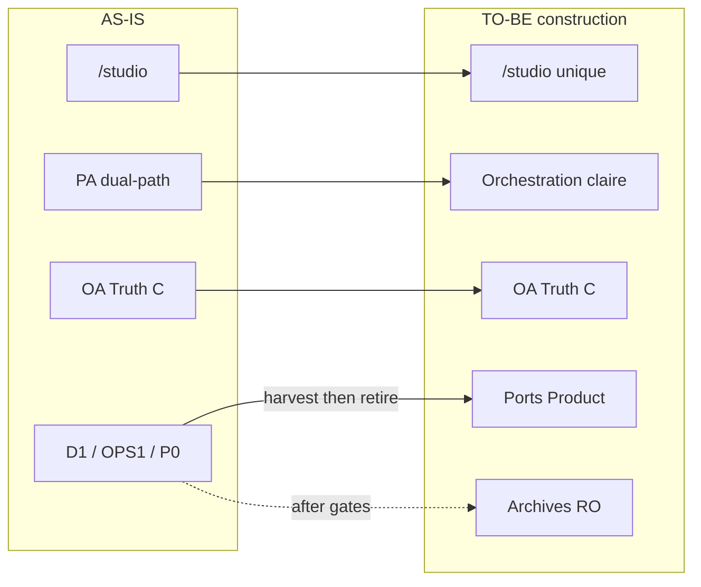
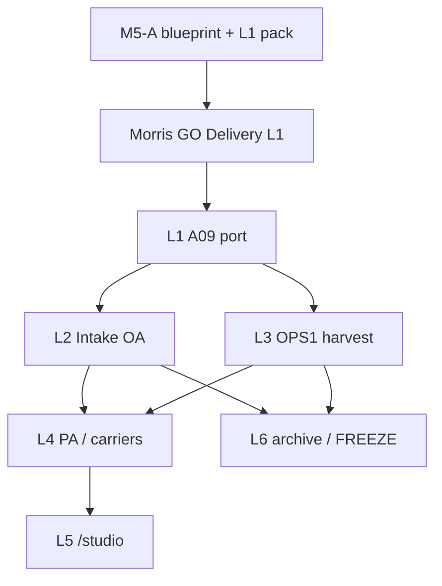

# SFIA Review Pack — FULL
## AKG-M5-A — Git Integration / Draft PR Readiness

| Champ | Valeur |
| --- | --- |
| Generated (UTC) | 2026-10-23T14:32:52Z |
| Repository | mcleland147/sfia-workspace |
| Worktree | `/Users/morris/Projects/sfia-workspace-akg-m5a-product-architecture-convergence` |
| Branch | `docs/akg-m5a-product-architecture-convergence` |
| HEAD / origin/branch | `0cb05b75491bb7dc89f2d3eb9f75bef3a4e2d0e4` |
| origin/main | `f088c60271722fcf678c3862ebe192da71c7c402` |
| Tip base | `f088c60271722fcf678c3862ebe192da71c7c402` |
| Morris GO | **Git Integration documentaire AKG-M5-A** (2026-10-23) |
| Draft PR | **#607** — https://github.com/mcleland147/sfia-workspace/pull/607 — **DRAFT** |
| CI | **PENDING** (Detect SFIA Studio changes queued at pack time) |
| H0-L1 | **NOT GRANTED** |
| R24 | **NO PRODUCT SEMANTIC IMPACT** |
| Merge | **NOT AUTHORIZED** |

## Instruction ChatGPT

Lire ce fichier **complet** depuis `sfia/review-handoff` → `sfia-review-handoff/latest-chatgpt-review.md`.
Vérifier SHA branche `0cb05b75…`, PR #607 Draft, fichiers, C3, checks (**PENDING ≠ PASS**), handoff blob.
Puis : synthèse intégration · revue contradictoire PR · réserves · verdict PR readiness · reco merge (**≠** autorisation merge) · décision Morris exacte.

## Justification Critical

Architecture de construction, responsabilités, dépendances historiques, gates Delivery futurs.

## Décision Morris consommée

GO Git Integration documentaire : correction C3 · sync navigation · commit · push branche · Draft PR.
**Non consommé :** merge · Delivery L1 · runtime.

## Matrice C3 avant → après (Git Integration)

| Assertion | Avant (C1–C4 pack) | Après |
| --- | --- | --- |
| sqlite injecté en tests | BEHAVIOR PROVEN (historique) — « intention des tests » | **COVERAGE VERIFIED** (fichiers/assertions identifiés) ; comportement *run* = **KNOWN GAP** jusqu’à Delivery L1 |
| Preuve run primaire CI/log | Non démontrée | Recherche proportionnée **non aboutie** → pas d’invention |

Aucune exécution Vitest dans M5-A.

## Git Review Index

```
## docs/akg-m5a-product-architecture-convergence...origin/docs/akg-m5a-product-architecture-convergence
 M .tmp-sfia-review/chatgpt-review.md

Commit 0cb05b75491bb7dc89f2d3eb9f75bef3a4e2d0e4:
M	projects/sfia-studio/convergence/architectural-knowledge-governance/README.md
A	projects/sfia-studio/convergence/architectural-knowledge-governance/m5-product-transformation/01-m5a-product-architecture-convergence-blueprint.md
A	projects/sfia-studio/convergence/architectural-knowledge-governance/m5-product-transformation/02-m5a-l1-a09-delivery-readiness-and-decision-pack.md
M	projects/sfia-studio/convergence/sfia-studio-convergence-roadmap.md

.../architectural-knowledge-governance/README.md   |  19 +-
 ...a-product-architecture-convergence-blueprint.md | 275 ++++++++++++++++++++
 ...-l1-a09-delivery-readiness-and-decision-pack.md | 287 +++++++++++++++++++++
 .../convergence/sfia-studio-convergence-roadmap.md |   5 +-
 4 files changed, 579 insertions(+), 7 deletions(-)

Document hashes @ HEAD:
01=089a36953ae6f5701692385f64cc5bd0a6105f97
02=45c29c9c3a29c421925c5671cd24eaa6cd0787d2
```

## Validations locales

- Git Truth tip MATCH base `f088c602`
- Empreintes pré-C3-GI recalculées puis C3 appliquée
- Scope index = 4 fichiers autorisés
- `git diff --cached --check` clean avant commit
- Push SHA match remote branch
- Draft PR #607 créée ; mergeable=MERGEABLE ; isDraft=true
- CI checks : **PENDING** au moment du pack

## Validations NON exécutées / non affirmées

- Vitest/REAL
- Sync PRR
- CI SUCCESS (PENDING)
- Merge / post-merge

## Réserves & décisions restantes

- H0-L1 NOT GRANTED · H1–H5 OPEN · R-A09-01 OPEN · Q1–Q10 NOT PASS
- Packaging port (t-a7 vs neutre) candidate
- **GO Morris merge** distinct si revue ChatGPT OK + CI observée
- Puis post-merge CURRENT sync · puis arbitrage H0-L1

## Verdict Cursor (pré-review ChatGPT)

**M5-A DRAFT PR PUBLISHED — READY FOR CHATGPT PR REVIEW**
(sous réserve handoff remote vérifié ; CI **PENDING** — ne pas annoncer CI PASS ni READY FOR MERGE)

---

# README AKG — FULL (post-intégration)

# SFIA Studio — Architectural Knowledge & Construction Governance (AKG)

| Champ | Valeur |
| --- | --- |
| Portée | Construction / connaissance architecturale de **SFIA Studio uniquement** |
| Version | **V0.5 — 2026-10-23** · AKG-M5-A dossier documentaire (candidat Git) ; V0.4 = M4 GLOBAL Formal Exit ; V0.1–V0.3 historiques |
| Base de lecture | `main` au départ M5-A : `f088c60271722fcf678c3862ebe192da71c7c402` (inclut M4 global exit) ; base M4 GO historique `b7bff88b…` / PR #605 |
| Autorisation Pilote | **AKG-M4 GLOBAL FORMAL EXIT ADOPTED** ; **GO 2026-10-23 Git Integration documentaire AKG-M5-A** (Draft PR) ; **H0 Delivery L1 NOT GRANTED** |
| Non-claims | M4 GLOBAL CLOSED (portée assessment) ; M5-A = **dossier documentaire candidat** ≠ M5 CLOSED ≠ Delivery ; A01–A12 candidates ; H1–H5 OPEN ; REAL NOT PROVEN ; runtime v3 NON ADOPTED ; merge M5-A **non** affirmé avant GO merge distinct |

## Point d'entrée AKG

Les acquis AKG-M0 à M3 sont répartis entre la Build Doctrine, la Roadmap, la PRR et les preuves Git. Cet index **n'est pas une seconde source de vérité** : il rend ces sources navigables et introduit les livrables préparatoires de M4.

| Jalon | Contenu et maturité bornée | Source |
| --- | --- | --- |
| **M0 — Methodological Foundation** | R23/R24, clôture méthodologique | [Build Doctrine](../sfia-studio-convergence-build-doctrine.md), [Roadmap B-AKG](../sfia-studio-convergence-roadmap.md) |
| **M1 — System Inventory** | Inventaire système borné et réserves | [PRR 01](../../production-runtime-reference/01-system-runtime-overview.md), [02](../../production-runtime-reference/02-runtime-object-catalog.md), [03](../../production-runtime-reference/03-end-to-end-flow-catalog.md), [Roadmap](../sfia-studio-convergence-roadmap.md) |
| **M2 — Architecture Understanding** | Responsabilités, dépendances, frontières d'autorité | [PRR 03](../../production-runtime-reference/03-end-to-end-flow-catalog.md), [04](../../production-runtime-reference/04-dependency-impact-map.md), [07](../../production-runtime-reference/07-authority-invariants-and-failure-modes.md), [09](../../production-runtime-reference/09-known-gaps-reserves-and-current-boundaries.md) |
| **M3 — Reference Consolidation** | Living PRR consolidée au périmètre borné, réserves gouvernées | [PRR README](../../production-runtime-reference/README.md), [08](../../production-runtime-reference/08-test-proof-and-conformance-map.md), [09](../../production-runtime-reference/09-known-gaps-reserves-and-current-boundaries.md) |
| **M4 — Rationalization Assessment** | **GLOBAL FORMAL EXIT ADOPTED — BOUNDED ASSESSMENT with governed OPEN reserves** ; M4-A CLOSED, PR #605 MERGED/CI SUCCESS ; A01–A12 candidate | [Global Exit 14](m4-rationalization/14-akg-m4-global-formal-exit-decision-record.md) · [M4-A Exit 13](m4-rationalization/13-m4a-formal-exit-decision-record.md) |
| **M5 — Product Transformation** | **M5-A documentaire préparé** (blueprint + L1 pack) ; revue ChatGPT PASS WITH GOVERNED RESERVE ; intégration Git sous GO Morris 2026-10-23 ; **H0-L1 NOT GRANTED** ; Delivery/runtime non autorisés | [m5-product-transformation/](m5-product-transformation/) · [01 blueprint](m5-product-transformation/01-m5a-product-architecture-convergence-blueprint.md) · [02 L1 pack](m5-product-transformation/02-m5a-l1-a09-delivery-readiness-and-decision-pack.md) |

## État CURRENT — AKG-M5-A (2026-10-23)

- **M5-A préparé** : Product Architecture Convergence blueprint + L1/A09 Delivery Readiness pack (corrections C1–C4 ; C3 résiduelle requalifiée en Git Integration).
- **Revue critique ChatGPT :** PASS WITH GOVERNED RESERVE (handoff `c81d7d47…` puis pack d’intégration).
- **GO Morris 2026-10-23 :** intégration Git documentaire autorisée (commit / push branche / Draft PR) — **intégration dans `main` non affirmée** tant que merge + CI post-merge non vérifiés.
- **H0 Delivery L1 :** **NOT GRANTED** · Q1–Q10 **NOT PASS** · R-A09-01 **OPEN** · runtime v3 **NON ADOPTED** · REAL **NOT PROVEN** · P6 GLOBAL **NOT PASSED**.
- **Livrables :** [01 — Convergence blueprint](m5-product-transformation/01-m5a-product-architecture-convergence-blueprint.md) · [02 — L1/A09 readiness](m5-product-transformation/02-m5a-l1-a09-delivery-readiness-and-decision-pack.md).

## Livrables AKG-M4 (V0.1)

1. **[01 — AS-IS](m4-rationalization/01-current-architecture-as-is.md)** : **deux niveaux dans un document** — vue pédagogique A intégrale + cartographie technique B, *dérivées* de Git/PRR. La PRR demeure **le** référentiel documentaire du CURRENT.
2. **[02 — TO-BE](m4-rationalization/02-target-architecture-to-be.md)** : **deux niveaux dans un document** — vision pédagogique B intégrale + schémas cible et responsabilités détaillées, sous réserve d'arbitrage formel et de compatibilité avec la doctrine v3.
3. **[03 — Orientations et écarts](m4-rationalization/03-orientations-and-gap-register.md)** : intentions confirmées en conversation, hypothèses, écarts, risques et décisions encore à consommer.

## Actualisation AKG-M4 — démarrage et principe de rationalisation (2026-10-22)

- **PR #603 :** V0.1 documentaire intégrée sur `main` via `f44a99b4da84188772b80aca3c9ebe1a3e12617e`; CI post-merge #39813097786 **SUCCESS**.
- **M4 Formal Start :** GO du Pilote exprimé après cette intégration ; limité à l'analyse, qualification et recommandations. **M4-A :** GO explicite pour démarrer l'analyse des responsabilités et redondances du runtime.
- **OR-13 / capability-first :** conserver les capacités/garanties et considérer la reconstruction d'implémentations, même encore consommées ; dépendance AS-IS ≠ justification de KEEP.
- **Statut d'authoring au snapshot 2026-10-22 (historique) :** cette actualisation est **candidate sur branche documentaire** tant qu'une PR/merge distincts n'ont pas été vérifiés. Aucun code runtime, DB, API ou chemin protégé modifié dans le produit. **AKG-M4 ≠ AKG-M5 ; classification ≠ GO Delivery.**

## Lot AKG-M4-A — investigation documentaire (historique et état courant)

**[04 — M4-A : responsabilités, consommateurs et scénarios de reconstruction](m4-rationalization/04-m4a-runtime-responsibilities-and-transition-assessment.md)** — cartographie initiale code/PRR, douze actifs et scénarios historiques ; investigations T-A01–T-A06 documentées dans les fichiers `05`–`10`. **Historique au démarrage : M4-A était NON CLOSED ; clôture bornée FE ultérieure.**

## Snapshot historique pré-merge #604 — 2026-10-23 (RES-04)

- **Décisions Pilote :** H7 = orientation SC-G2 retenue avec option SC-G3 ciblée A06/A10 ; H8 = instruire SC-G3 au lot L4 si ADAPT ne clarifie pas les responsabilités. Voir le [Decision Record `11`](m4-rationalization/11-m4a-h7-h8-architecture-orientation-decision-record.md).
- **Investigations :** T-A01–T-A06 acceptées avec réserves ; index, preuves et réserves dans le [registre `03` V0.4](m4-rationalization/03-orientations-and-gap-register.md).
- **Git documentaire :** commit `c64f804613dda09e4757febcc2e26f530d6f3014`, [PR #604](https://github.com/mcleland147/sfia-workspace/pull/604) **Draft OPEN, non mergée** ; CI sur ce commit SUCCESS au moment de la synchronisation.
- **Frontière de gouvernance :** M4-A **NON CLOSED** ; aucune adoption runtime v3 ; aucun GO merge / Delivery / M5. Les réserves techniques demeurent ouvertes.
- **RES-04 :** l'en-tête historique « M4 FORMAL START non consommé » décrivait la V0.1 avant le GO du 2026-10-22 ; il ne décrit plus l'état courant.

## État CURRENT M4-A — Formal Exit bornée adoptée (2026-10-23)

- **M4A-FE-01–05 : ADOPTED BY PILOTE**. M4-A **CLOSED BY MORRIS — BOUNDED RATIONALIZATION ASSESSMENT — WITH GOVERNED OPEN RESERVES**. Source : [13 — Formal Exit Decision Record](m4-rationalization/13-m4a-formal-exit-decision-record.md).
- **Readiness historique :** [12 — Formal Exit Readiness Pack](m4-rationalization/12-m4a-formal-exit-readiness-and-decision-pack.md) (propositions NOT ADOPTED exactes **avant** réponse Pilote).
- **Git :** PR [#604](https://github.com/mcleland147/sfia-workspace/pull/604) MERGED `d739143f9a0e29fdb8475fc1f73d0b9897da5bf6` ; CI post-merge `39887430929` SUCCESS.
- **Réserves :** H1–H5 et Delivery/REAL OPEN ou DEFER ; gouvernance temporaire Pilote ; formal owners UNASSIGNED ; ChatGPT support documentaire uniquement.
- **Frontières :** H0 NOT GRANTED, H6 NOT AUTHORIZED ; H7/H8 et G0 inchangés ; **AKG-M5 NOT AUTHORIZED**, Product REAL NOT PROVEN, P6 GLOBAL NOT PASSED, runtime v3 NON ADOPTED.
- **Publication de ce truth-sync :** candidat documentaire sur branche Git dédiée tant que son merge et sa CI ne sont pas vérifiés.

## État CURRENT — AKG-M4 Global Formal Exit (2026-10-23)

- **GLOBAL CLOSED BY MORRIS** au seul périmètre **Bounded Architectural Rationalization Assessment with Governed Open Reserves** ; [Decision Record 14](m4-rationalization/14-akg-m4-global-formal-exit-decision-record.md).
- **Preuve d'amont :** `main` au GO `b7bff88b4d6baef5745014c990b07af05a0063ff`, PR #605 MERGED, CI post-merge #39893659601 SUCCESS ; cette nouvelle publication est un candidat Git distinct.
- **H7/H8** inchangés, dispositions finales A01–A12 non adoptées individuellement ; **H1–H5 OPEN**, H0 Delivery NOT GRANTED, H6 G0 reopen NOT AUTHORIZED ; réserves techniques gardées aux futurs gates.
- Gouvernance temporaire **Pilote**, propriétaires techniques formels **UNASSIGNED** ; ChatGPT assistance seulement. **AKG-M5 NOT AUTHORIZED**, L1–L6 sans GO, REAL NOT PROVEN, P6 GLOBAL NOT PASSED, runtime v3 NON ADOPTED, SHADOW OFF.

## Mode de consultation dans les futurs travaux

**Source routing (proportionné) :** code Git courant + preuves primaires → Build Doctrine → Roadmap → doctrine v3 applicable → volumes PRR pertinents → **si architecture cible/rationalisation/transformation touchée : index AKG + TO-BE + registre**, et AS-IS si utile. Jamais un chargement exhaustif obligatoire pour toute petite correction Studio.

Ce rattachement est prévu dans [Cycle Routing Guide §4.3.0a](../../../../method/sfia-fast-track/core/sfia-cycle-routing-guide.md) et [Knowledge Layer — Documentation Routing Matrix](../../../../method/sfia-fast-track/core/sfia-knowledge-layer.md).

## Revue documentaire de cohérence — 2026-10-22

**Niveau de revue : REVUE CRITIQUE DOCUMENTAIRE — SUFFISANTE POUR DRAFT PR, SOUS RÉSERVES.**

- **Périmètre inspecté :** quatre nouveaux documents AKG-M4 et les trois documents de routage/gouvernance modifiés, par comparaison avec le `main` de base ; confrontation ciblée aux doctrines v3 (notamment §30, §32, §34, §35, §37), à la Build Doctrine et aux volumes PRR 01/03/06/07/09.
- **Corrections intégrées :** origine historique de Single Human Execute (PR #590, antérieure à la consolidation M3) ; syntaxe d'un lien du registre ; terminologie de reprise/redémarrage ; qualification de statut Git datée pour éviter une assertion périmée après merge.
- **Vérifications documentaires :** index et renvois relatifs des documents M4 passés en revue ; schémas Mermaid présents (AS-IS : 2 ; TO-BE : 2). Cette revue **ne** certifie **ni** l'intégrité exhaustive des liens de toute la Roadmap historique **ni** le rendu automatique des schémas en navigateur.
- **Réserves non bloquantes :** caractère préliminaire/non exhaustif de l'AS-IS ; dispositions de retrait non prouvées ; cohérence fine du TO-BE à instruire par lots et GO M4 distinct ; REAL/P6 GLOBAL PASS non acquis ; revue GitHub/CI ultérieure à la Draft PR nécessaire.
- **Statut :** publication en **Draft PR recommandée**, **aucune fusion ni adoption runtime** par la présente revue.

## Gouvernance et statut des sources

- **Vérité du CURRENT :** Git et preuves primaires > PRR descriptive > AS-IS résumé.
- **Cible :** doctrine v3 adoptée + orientations explicitement qualifiées du TO-BE ; contradiction = écart à arbitrer, jamais changement silencieux de doctrine.
- **Décision :** H7/H8 sont des arbitrages humains adoptés **dans leur périmètre limité** ; ils ne valent ni adoption runtime, ni GO merge, ni GO Delivery/M5. Les autres orientations de discussion restent non adoptées tant qu'un arbitrage formel n'est pas rendu.
- **Continuité R23/R24 :** tout changement comportemental futur doit réévaluer et synchroniser la PRR applicable.
- **Hors scope V0.1 :** code, tests REAL, schémas SQLite, routes, suppressions, migrations, autorisation M5, merge main.

Chaque document doit expliciter sa version, son statut et ses preuves ; le registre constitue l'historique des évolutions et des arbitrages, sans recopier l'inventaire PRR.


---

# ROADMAP — tip CURRENT + ligne AKG-M5

```
# SFIA Studio Convergence Roadmap

| Métadonnée | Valeur |
| --- | --- |
| **Rôle** | Roadmap **vivante** de convergence vers l’utilisation complète de la doctrine produit SFIA Studio v3 |
| **Statut** | **VALIDATED — ACTIVE LIVING ROADMAP** |
| **CURRENT TIP 2026-10-23 — AKG-M5-A documentary Git Integration** | **AKG-M5-A** Product Architecture Convergence + L1/A09 readiness **préparés** ; corrections C1–C4 ; C3 résiduelle requalifiée (sqlite inject = COVERAGE VERIFIED) ; revue ChatGPT **PASS WITH GOVERNED RESERVE** ; **GO Morris 2026-10-23 Git Integration documentaire** (commit / push / Draft PR) ; dossier [m5-product-transformation](./architectural-knowledge-governance/m5-product-transformation/) ; **H0 Delivery L1 NOT GRANTED** ; Q1–Q10 NOT PASS ; R-A09-01 OPEN ; packaging port t-a7 = candidate ; **pas** de Delivery · **pas** runtime v3 ADOPTED · REAL NOT PROVEN · P6 GLOBAL NOT PASSED ; **intégration `main` non affirmée** tant que merge + CI post-merge non vérifiés. |
| **HISTORICAL TIP 2026-10-23 — AKG-M4 GLOBAL Formal Exit** | **AKG-M4 GLOBAL CLOSED BY MORRIS — BOUNDED ARCHITECTURAL RATIONALIZATION ASSESSMENT WITH GOVERNED OPEN RESERVES** ; [Decision Record 14](./architectural-knowledge-governance/m4-rationalization/14-akg-m4-global-formal-exit-decision-record.md) ; M4-A CLOSED, PR #605 MERGED, CI #39893659601 SUCCESS ; H7/H8 conserved, A01–A12 dispositions CANDIDATE, H1–H5 OPEN ; governance Pilote, formal owners UNASSIGNED ; à la date du tip M4 : AKG-M5 Delivery **NOT AUTHORIZED** ; REAL NOT PROVEN, runtime v3 NON ADOPTED. |
| **HISTORICAL TIP 2026-10-23 — AKG-M4-A Formal Exit** | **M4A-FE-01–05 ADOPTED BY PILOTE** : **M4-A CLOSED BY MORRIS AT BOUNDED RATIONALIZATION ASSESSMENT SCOPE WITH GOVERNED OPEN RESERVES** ; H7/H8 conservés ; H1–H5 et dettes Delivery/REAL GOVERNED OPEN ; responsabilité temporaire Pilote, owners formels UNASSIGNED ; FE-04 truth-sync documentaire autorisé (candidat Git) ; **PR #604 MERGED**, `main` `d739143f9a0e29fdb8475fc1f73d0b9897da5bf6`, CI `39887430929` SUCCESS ; [13 Formal Exit](./architectural-knowledge-governance/m4-rationalization/13-m4a-formal-exit-decision-record.md) ; **M4 global et AKG-M5 / Delivery NON automatiquement autorisés**, REAL NOT PROVEN, runtime v3 NON ADOPTED ; lignes datées ci-dessous = snapshots historiques. |
| **HISTORICAL SNAPSHOT — Timestamp maintenance AKG-M4 START / LOT M4-A DOCUMENTARY ANALYSIS — CANDIDATE 2026-10-22** | **GO Morris M4 FORMAL START** reçu dans la conversation après intégration vérifiée **PR #603** (`f44a99b4…`, CI post-merge #39813097786 SUCCESS) ; **GO LOT M4-A** reçu ensuite ; orientation OR-13 **capability-first** confirmée ; lot M4-A **READ-ONLY ANALYSIS IN PROGRESS**, documents candidats dans `convergence/architectural-knowledge-governance/` ; aucune classification finale, aucun runtime/code modifié, aucun retrait, REAL/P6/v3 inchangés ; ce statut documentaire **n'est pas encore intégré sur main** tant que son merge n'est pas vérifié. |
| **Timestamp maintenance SFIA-STUDIO-ARCHITECTURAL-KNOWLEDGE-AND-CONSTRUCTION-GOVERNANCE AKG-M3 FORMAL EXIT — PR #601 POST-MERGE VERIFIED — DOCUMENTARY STATUS TRUTH-SYNC LOCAL AUTHORING** | 2026-10-22 Europe/Paris — **AKG-M3 — REFERENCE CONSOLIDATION — CLOSED BY MORRIS AT BOUNDED REFERENCE CONSOLIDATION SCOPE WITH GOVERNED RESERVES — PR #601 MERGED / POST-MERGE VERIFIED** · Chantier **SFIA-STUDIO-ARCHITECTURAL-KNOWLEDGE-AND-CONSTRUCTION-GOVERNANCE** · Milestone **AKG-M3 — Reference Consolidation** · Cycle **8 — Delivery / implémentation (spécialisation Bounded Post-Merge Documentary Status Truth-Sync)** · Profile **Critical** · Typologie **DOC / GOVERNANCE / METHOD** · Autorité **MORRIS** · GO Morris Post-Merge Documentary Status Sync 2026-10-22 (« ok go ») — **Roadmap only** · **≠** réadoption FE · **≠** cleanup · **≠** AKG-M4 · **Git CURRENT Formal Exit** : **FE-01–FE-04 ADOPTED** · Decision Record **`7339d49fe6a4807e114bae616caf3f118cc87356`** / blob **`f141bfef45aa254bf15beb868c01dd67cd0afa9d`** · **FE-01** milestone **CLOSED BY MORRIS** at bounded Reference Consolidation scope with governed reserves · Exit Proof **E12 SATISFIED** · **FE-02** six **FORMALLY CLOSED BY MORRIS AT BOUNDED M3/G6 SCOPE** — **R-M3A-01 · R-M3B-01 · R-G6-SR-01…04** · owners **OWNER UNASSIGNED** · Exit Proof **E8 SATISFIED** · **FE-03** **R-M3-PM-CLEANUP-01 GOVERNED OPEN / DEFER** · temporary governance **MORRIS** · formal owner **UNASSIGNED** · cleanup **NOT EXECUTED** · branches G7 + PR #600 + PR #601 **RETAINED** · **FE-04** M2/REAL/P6/v3 continuity preserved · **AKG-M4 NOT AUTHORIZED / NOT STARTED** · **Git CURRENT intégration** : Formal Exit documentary lot **PR #601 MERGED** · merge **`966fc949d4bdeb21ab5e06112b45af564563ddd2`** · parents **`606f756ef09811c5e68e6ed8a69d08d492a4a426`** + **`ea2446e0da9d7f52e7244a9fea5e850a0806ec25`** · mergedAt **2026-10-22T09:56:35Z** · three blobs on main : Roadmap **`8a006dd1ec8941e166214c1717b605ec72543044`** · PRR09 **`ee13e7a7b0407d3cea46535f07b54638b30857f4`** (40936 octets · sha256_16 **`9e1e97a2524f14de`**) · Manifest **`079e6315c883b97c8d74a59437750977150b8cba`** · checker PRR **CONFORMANCE OK** · index **13 / 20 / 20 / 9** · **Post-merge CI** workflow **`39759306363` COMPLETED / SUCCESS** · Detect / Build / Required Gate **SUCCESS** · Critical Post-Merge Review **PASS WITH GOVERNED RESERVES** · handoff Post-Merge **`bffd1f7e2345e1124b62ab22c850229a84228acb`** / blob **`f2d3261158b095ac55fedbaa78f5d142974339cf`** · Exit Proof E1–E6 **SATISFIED** · E7/E9/E10 **SATISFIED WITH GOVERNED RESERVE** · E8/E12 **SATISFIED** · **E11** = SATISFIED for prior lot PR **#600** post-merge · **PR #601** = additional documentary integration / CI proof (≠ rewrite of E11 row) · Dettes préservées : R-M2A-04 · R-M2B-03 · B-M2B-01…05 · 38×20 · RS-03 · TOOL-FIRST-REAL-NOWRITE · F18/F19 PARTIAL · REAL **NOT PROVEN** · P6 GLOBAL **NOT PASSED** · runtime v3 **NON ADOPTED** · L5 global **NOT AUTHORIZED** · **Git CURRENT : PR #601 merged on main, post-merge verified. This new Roadmap status sync: LOCAL AUTHORING CANDIDATE — NOT YET INTEGRATED ON MAIN.** · Scope this cycle = **ROADMAP ONLY** · **NO** PRR09/manifest edit · **NO** project commit/push/PR/merge · **NO** cleanup · Next gates = ChatGPT Critical Semantic Review of this tip → Morris **Documentary Git Integration GO** distinct (Roadmap only) → PR / merge / post-merge → [optional] cleanup GO · AKG-M4 sous GO Morris distinct · **≠** this tip integrated on main · **≠** cleanup DONE · **≠** AKG-M4 START · **≠** P6 PASS · **≠** REAL PROVEN · **≠** v3 ADOPTED |
| **Timestamp maintenance SFIA-STUDIO-ARCHITECTURAL-KNOWLEDGE-AND-CONSTRUCTION-GOVERNANCE AKG-M3 FORMAL EXIT — DOCUMENTARY TRUTH-SYNC LOCAL AUTHORING** | 2026-10-22 Europe/Paris — **HISTORICAL / SUPERSEDED AS TIP** — Accurate at documentary authoring time; superseded as CURRENT after PR **#601 MERGED**, post-merge CI SUCCESS and Critical Post-Merge Review. Historical local-authoring and not-integrated claims must not be read as Git CURRENT. *(prior tip AKG-M3 FORMAL EXIT — DOCUMENTARY TRUTH-SYNC LOCAL AUTHORING)* — **AKG-M3 — REFERENCE CONSOLIDATION — CLOSED BY MORRIS AT BOUNDED REFERENCE CONSOLIDATION SCOPE WITH GOVERNED RESERVES** · Chantier **SFIA-STUDIO-ARCHITECTURAL-KNOWLEDGE-AND-CONSTRUCTION-GOVERNANCE** · Milestone **AKG-M3 — Reference Consolidation** · Cycle **8 — Delivery / implémentation (spécialisation Formal Exit Documentary Governance Truth-Sync)** · Profile **Critical** · Typologie **DOC / GOVERNANCE / METHOD** · Autorité **MORRIS** · Décisions **FE-01–FE-04** = **ADOPTED / CONSUMED** par le **GO Morris Formal Exit AKG-M3** du 2026-10-22, attesté par le Decision Record **`7339d49f…`** ; **GO Morris Documentary Truth-Sync** du 2026-10-22 = autorisation ultérieure et distincte d'authoring local Roadmap + PRR09, sans nouvel arbitrage FE · **FE-01** Formal Exit **ADOPTED** — milestone **CLOSED BY MORRIS** at bounded Reference Consolidation scope with governed reserves · Exit Proof **E12 SATISFIED** · **FE-02** six FORMALLY CLOSED BY MORRIS AT BOUNDED M3/G6 SCOPE — **R-M3A-01 · R-M3B-01 · R-G6-SR-01…04** · owners **OWNER UNASSIGNED** · Exit Proof **E8 SATISFIED** · **FE-03** **R-M3-PM-CLEANUP-01 GOVERNED OPEN / DEFER** · temporary governance **MORRIS** · formal owner **UNASSIGNED** · cleanup **NOT EXECUTED** · branches G7 + PR #600 **RETAINED** · **FE-04** M2/REAL/P6/v3 continuity preserved · **AKG-M4 NOT AUTHORIZED / NOT STARTED** · Chaîne prouvée : G5 START · G6 Semantic PASS · Digest Sync PASS · G7 PASS · PR **#599 MERGED** (`d41c6a66…`) · documentary truth-sync PR **#600 MERGED** · merge **`606f756ef09811c5e68e6ed8a69d08d492a4a426`** · parents `d41c6a66…` + `2134fc18…` · CI post-merge **`39729128729` SUCCESS** · checker PRR **CONFORMANCE OK** · E1–E6 SATISFIED · E7/E9/E10 WITH GOVERNED RESERVE · E8/E11/E12 SATISFIED · Handoffs : Decision Record **`7339d49fe6a4807e114bae616caf3f118cc87356`** / blob **`f141bfef45aa254bf15beb868c01dd67cd0afa9d`** · Post-Merge **`8ebb1a02…`** · Merge **`a0e1c972…`** · GI **`c6c810e9…`** · Digest **`98294888…`** · Truth-Sync **`cf421e3c…`** · Arbitration **`41f802eb…`** · PRR index **13 / 20 / 20 / 9** · OBJ-ATTEMPT · DEP-EC-ATT · DEP-HD-EC · F11b hors flows[] · Dettes préservées : R-M2A-04 · R-M2B-03 · B-M2B-01…05 · 38×20 · RS-03 · TOOL-FIRST-REAL-NOWRITE · F18/F19 PARTIAL · REAL **NOT PROVEN** · P6 GLOBAL **NOT PASSED** · runtime v3 **NON ADOPTED** · L5 global **NOT AUTHORIZED** · Scope this cycle = **LOCAL DOCUMENTARY AUTHORING ONLY** (Roadmap + PRR09) · **NO** project commit/push/PR/merge · **NO** digest sync · **NO** manifest write · Publication de ce tip = **LOCAL AUTHORING CANDIDATE / NOT YET INTEGRATED ON MAIN** · Next gates = ChatGPT Critical Formal Exit Documentary Semantic Review → Morris **PRR09 Digest Sync GO** distinct → Git Integration / PR / merge / post-merge → [optional] cleanup GO · AKG-M4 sous GO Morris distinct · **≠** Digests synced · **≠** this lot integrated on main · **≠** cleanup DONE · **≠** AKG-M4 START · **≠** P6 PASS · **≠** REAL PROVEN · **≠** v3 ADOPTED |
…
| **AKG-M5** Product Transformation | Cadrage/architecture documentaire puis lots Product gouvernés | V3-F05+ | AKG-M4 GLOBAL CLOSED + GO M5 distinct | **M5-A** blueprint + L1 pack (candidats) ; lots L1–L6 sous GO | Preuves Product / Q1–Q10 selon GO Delivery | Handoffs M5-A ; CI Draft PR documentaire | Confusion avec P6 Exit · confondre M5-A doc avec Delivery | **M5-A Git Integration GO 2026-10-23** (Draft PR) · **H0-L1 NOT GRANTED** · merge `main` sous GO distinct | Arbitrage **H0-L1** après merge/post-merge |
```

---

# DOCUMENT 01 — FULL CONTENT

# AKG-M5-A — 01 · Product Architecture Convergence Blueprint

| Champ | Valeur |
| --- | --- |
| Cycle | **AKG-M5-A** — Product Architecture Convergence & First Delivery Readiness |
| Type / Profil | Cycle 6 — Architecture technique · **Critical** |
| Typologie | EVOL / Architecture / DOC |
| Baseline Git | `docs/akg-m5a-product-architecture-convergence` @ `f088c60271722fcf678c3862ebe192da71c7c402` (= `origin/main`) |
| Antecedent | AKG-M4 **GLOBAL CLOSED** (portée *Bounded Rationalization Assessment*) · [14](../m4-rationalization/14-akg-m4-global-formal-exit-decision-record.md) · H7/H8 [11](../m4-rationalization/11-m4a-h7-h8-architecture-orientation-decision-record.md) |
| Correction | **C1–C4** (2026-10-23) — alignement port audit / preuves / L1→L2 ; détail dans [02](./02-m5a-l1-a09-delivery-readiness-and-decision-pack.md) |
| Empreinte pré-correction | `d5026075f6c9c9fe570d107221bc6431e0c57414` |
| Statut document | **LOCAL CANDIDATE** — **non adopté** · dispositions A01–A12 restent **candidates** |
| Runtime / Delivery | **NON AUTORISÉ** · **H0-L1 NOT GRANTED** · pas de push/PR/merge projet |
| R24 | **NO PRODUCT SEMANTIC IMPACT** (cycle documentaire) |

> **Non-claims :** AKG-M5 non clos · blueprint **non ADOPTED** · runtime v3 **NON ADOPTED** · REAL **NOT PROVEN** · P6 GLOBAL **NOT PASSED** · FinOps SHADOW **OFF** · SC-G2 = orientation **≠** runtime livré · H8 ≠ GO REBUILD · aucun dual-write · Attempt ≠ Evidence ≠ PROVEN · Memory B ≠ Truth C · Synthesis ≠ Truth C · READY FOR RE-REVIEW ≠ READY FOR DELIVERY · tests présents ≠ exécutés dans M5-A.

---

## 1. Provenance et finalité

Ce blueprint **traduit** le TO-BE M4 et les lots L1–L6 en architecture de **construction** exploitable, sans rejouer les inventaires M1–M4.

**Produit attendu :** un Studio unifié, premium, maintenable, centré Pilote ↔ Nora, avec boucle projet gouvernée end-to-end.

**Hors scope :** découverte de Studio · nouvelle doctrine · refonte générale · implémentation code.

**Sources primaires (consultées) :** Build Doctrine · Roadmap · C1 · doctrine v3 30/31/32/33/34/35/37 · PRR README + 01/03/04/06/07/08/09 · AKG README · M4 `01`–`03`, `05`–`11`, `13`–`14` · code A09/VSR/D1 (spot) · CKC Architecture (guidance only).

---

## 2. Vision Product héritée (sans recadrage)

Héritage TO-BE M4 [02](../m4-rationalization/02-target-architecture-to-be.md) + OR-01…OR-13 [03](../m4-rationalization/03-orientations-and-gap-register.md) :

1. Tour de contrôle conversationnelle : **Pilote autorité** ; **Nora cognition / recommandation / préparation / interprétation**.
2. Cockpit nominal **`/studio`**.
3. **OA = Truth C unique** (G0-A/B) ; Memory B distincte.
4. Contrat inspectable/amendable ; **un Exécuter** = autorisation de **cette** version (SHE) ; HD/Confirm/Authorize **internes**.
5. Outils = capacités sous effet/périmètre ; Cursor sous Attempt.
6. Restitution honnête : déclaration ≠ preuve ; continuité sans contexte inventé.
7. **OR-13 capability-first** : capacité utile ≠ conservation de l'implémentation.

Boucle cible (destination, non couverture actuelle) :

`Intention → Nora → contexte → qualification → trajectoire → décisions → EC inspectable → autorisation → exécution bornée → Evidence/RB → analyse Nora → continuité`

---

## 3. Delta AS-IS → TO-BE (compact)

| Domaine | AS-IS (observé M4) | TO-BE construction | Delta M5 |
| --- | --- | --- | --- |
| UX | `/studio` + îlots D1/OPS1/P0 | Un cockpit ; redirect/retire historiques | Concevoir L5 ; exécuter après gates |
| Vérité | OA Product SQLite ; D1/OPS1 DB séparés | Une Truth C ; archives RO | L2/L3 harvest ; **no dual-write** |
| Orchestration | PA F2/W2/SHE dual-path | Façade claire Nora/PA/OA | L4 ADAPT ; H8 SC-G3 ciblé si insuffisant |
| Cursor | Product Attempt + îlot OPS1 | Ports Product exclusifs **après preuves** | L3 ; R-EXCL-01 / R-TF-01 / R-PP-01 |
| Audit create | Type/runtime optionnel via `lib/d1` ; `ProjectCycleAuditPort` déjà présent (platform/t-a7) | Réutiliser le port append existant ; découpler VSR/**core** de D1 ; adapter D1 transitoire | **L1** (détail [02](./02-m5a-l1-a09-delivery-readiness-and-decision-pack.md) C1/C2) |
| Continuité | Carriers process-local | Carrier non-autorité ou requalify | L4 + H3 |
| FinOps | execution-run hors spine | FREEZE ; SHADOW OFF | L6 |
| Noms | `pre-m6`, `ops1`, `d1`, `f2`/`w2`… | Noms de responsabilité | Contrat §7 ; rename aux lots adéquats |



---

## 4. Responsabilités cibles (compact)

| Acteur / composant | Responsabilité cible | Ne fait pas |
| --- | --- | --- |
| **Pilote** | Objectifs, arbitrages, Exécuter / STOP | Exécuter le runtime technique |
| **Product UI `/studio`** | Surface nominale conversation, contrats, résultats | Autorité métier |
| **Nora** | Comprendre, qualifier, recommander, préparer missions, interpréter preuves | Autorité métier autonome ; Truth C |
| **Project Assistant / façade cible** | Orchestration Product (UI→OA/Nora/ports) | Deuxième Truth C ; HD implicite |
| **OA** | Project, LPS, trajectoire, cycles, HD, EC, Attempt, Evidence | Cognition conversationnelle |
| **VSR / composition** | Wiring ports/adapters ; default fail-closed | Policy métier parallèle |
| **Tools / adapters** | Capacités sous contrat / Attempt | Élargir le mandat |
| **Persistence** | Truth C SQLite ; Memory B session ; FS Evidence refs | Dual-write ; fuse B↔C |

---

## 5. Cartographie dispositions actuelles → cible

| Classe | Actifs / zones | Disposition candidate (M4, non adoptée) | Timing |
| --- | --- | --- | --- |
| **Maintenir** | A05 OA, A07 Nora, A12 Product REAL guarantees, A01 cockpit cap | KEEP / ADAPT | Continu |
| **Déplacer / extraire** | A09 : brancher sur `ProjectCycleAuditPort` (éviter 2e contrat) ; patterns D1/OPS1 utiles | HARVEST contrat / adapter D1 jusqu’à L2 | L1 puis L2/L3 |
| **Consolider** | A06 PA dual-path ; A02 P0 entry ; chemins mission | ADAPT / CONSOLIDATE | L4 / L5 |
| **Remplacer (impl)** | A03 intake D1 ; A04 OPS1 engine | HARVEST + REPLACE/REBUILD ports | L2 / L3 |
| **Geler / retirer plus tard** | A11 FinOps ; îlots UI/DB après cutover | FREEZE / RETIRE LATER | L6 |
| **Étude conditionnelle** | A06/A10 sous H8 | SC-G3 ciblé **si** ADAPT L4 insuffisant | L4 design |

---

## 6. Matrice capacité → actif → cible → option → dépendances → preuves → gate

| Capacité utilisateur | Actif | Responsabilité cible | Option | Dépendances | Preuves actuelles | Gate |
| --- | --- | --- | --- | --- | --- | --- |
| Cockpit Pilote↔Nora | A01 | Product UI | KEEP/ADAPT name | PA, tests UI | DET UI | Rename L5+ |
| Entrée site | A02 | Redirect `/studio` | CONSOLIDATE→RETIRE | bookmarks U | DOC | L5 + R-P0-01 |
| Créer/lister projets | A03 | OA Project | HARVEST+REPLACE | A09, H1, H4 | DET D1 ; volumes U | L2 |
| Exécution tool gouvernée | A04/A12 | Attempt + Product REAL | HARVEST+ADAPT | H2, H5, R-EXCL | DET ; REAL NOT PROVEN | L3 |
| Vérité / autorité | A05 | OA | KEEP/ADAPT | G0 | OA suite | H6 interdit reopen |
| Orchestrer tour | A06 | Product orchestrator | ADAPT ; SC-G3? | H8, A10 | SHE DET | L4 |
| Cognition | A07 | Nora + Memory B | KEEP/ADAPT | A06 | session DET | boundary B≠C |
| Composer runtime | A08 | Product composition | KEEP/ADAPT | A09 | TYPE_ONLY/runtime tests | après L1 |
| Audit create borné | A09 | Journal : **`ProjectCycleAuditPort`** (réutiliser) ; events create : `LocalProjectCreationAuditPort` (distinct) ; impl D1 = adapter | HARVEST wiring / **pas** nouveau port concurrent | VSR **+ core**, tests | CODE VERIFIED (imports) ; COVERAGE VERIFIED (tests listés) ; **pas** BEHAVIOR PROVEN dans M5-A | **L1** § [02](./02-m5a-l1-a09-delivery-readiness-and-decision-pack.md) ; R-A09-01 OPEN |
| Continuité Proposal/Offer | A10 | Carrier non-auth | ADAPT/REBUILD | H3 | process-local | L4 |
| FinOps shadow | A11 | Hors spine | FREEZE | SHADOW OFF | unit OFF | L6 |
| Cursor sous EC | A12 | Same + ports | KEEP/ADAPT | L3 | DET≠REAL | exclusive après preuves |

*Les 29 CAP historiques (M4 `06`) se rattachent aux lignes A03/A04/A02/A09/A11 — non re-listées ici.*

---

## 7. Frontière Nora / PA / OA (analyse)

| Question | Lecture construction |
| --- | --- |
| Cognition vs orchestration vs autorité | Nora = cognition ; PA = orchestration Product ; OA = autorité + Truth C |
| SHE vs historique | SHE = cible UX ; chemins disposition-before-PREPARE à consolider en L4 (pas supprimer HD) |
| Carriers | Proposal/Offer ≠ HD ; perdus au restart (process-local) — H3 OPEN |
| Persistance / restart | Truth C durable ; Memory B session ; carriers non durables par défaut |
| Tools / REAL | Ports Attempt Product ; OPS1 island ≠ gateway Product ; Tool-First fail-closed jusqu'à H2 |

**Interdits de construction :** rebuild OA · seconde orchestration métier · promouvoir Memory B / Synthesis / carriers en Truth C.

---

## 8. SC-G2 vs SC-G3 (H7/H8)

| | **SC-G2** (orientation H7) | **SC-G3 ciblé A06/A10** (H8) |
| --- | --- | --- |
| Idée | ADAPT/CONSOLIDATE sur spine Product ; harvest îlots | Reconstruction façade orchestration + continuity **si** ADAPT L4 insuffisant |
| OA | Conservé | Conservé (pas de rebuild) |
| Risque | Dette compat L4 | Effort tests PA/REAL ; scope creep |
| Autorisation | Orientation seulement | **Étude** conditionnelle ≠ GO REBUILD |

**Recommandation M5-A :** construire sous **SC-G2** ; préparer critères ADAPT H8 §5.2 dans le design L4 ; ne pas démarrer SC-G3 code.

---

## 9. Contrat de nommage (recommandations — non adoptées)

| Nom historique | Responsabilité réelle | Convention / nom cible proposé | Evidence | Impact rename | Timing | Risques |
| --- | --- | --- | --- | --- | --- | --- |
| `pre-m6-product-ui` | Product cockpit UI | `studio-ui` / `product-ui` | A01 ; OR-04 | imports ~53 tests | L5+ après inventaire | casser tests |
| `vertical-slice-runtime` | Product composition / ports | `product-runtime` / `studio-composition` | A08 | large | Après L1 ; lot dédié | surface large |
| `lib/d1` | Historical intake island | garder `d1` jusqu'à retire ; **ne pas** « productiser » le nom | A03 | — | L2 retire | confusion |
| `BoundedAtomicAuditStore` (path D1) | Impl journal SQLite historique (`ProjectCycleAuditPort` + find/list **TEST_ONLY**) | **Ne pas** inventer un 2e port Product ; typer VSR/core sur `ProjectCycleAuditPort` ; packaging pérenne du port = candidate (rester t-a7 **ou** module neutre) — noms **non ADOPTED** | A09 ; [02] C1 | L1 wiring | **L1** | Duplication de contrat si mauvais naming |
| `ops1` / `OPS1_CURSOR_REAL` | Historical tool island / flag | Product REAL flags isolés après exclusivity | A04/A12 | L3+ | Après R-EXCL | faux claim |
| `f2` / `w2` | Historical mission paths | noms de responsabilité dans PA public API | A06 | L4 | L4 | dual-path |
| `execution-run` | FinOps SM | rester hors Product spine naming | A11 | L6 | FREEZE | promote accidentel |

**Règle :** préparer conventions **maintenant** ; exécuter renames **aux lots** après consumers/tests ; ne pas rename ce qui sera retiré.

---

## 10. Trajectoire L1–L6 (matrice unique)

| Lot | Capacité v3 / résultat user | Actifs | Composants code | Dépendances | Prérequis / HD | Risques | Tests réutilisables | Nouveaux tests | Preuve sortie | Dette / remboursement | Suite |
| --- | --- | --- | --- | --- | --- | --- | --- | --- | --- | --- | --- |
| **L1** | Découpler contrat audit (VSR+**core**) ; réutiliser `ProjectCycleAuditPort` | A09, A08 | `boundedAtomicAudit` (adapter), `localSqliteAudit`, `service.ts`, `projectCycleAtomicCoordinator` | — | Aucun H1–H5 **supplémentaire** ; **H0-L1** | Nouveau port concurrent ; oublier core ; sqlite≠activation | `localProjectComposition` ; t-a7 ; `importBoundaries` | Boundaries VSR+core ; noop ; sqlite inject ; Q1–Q10 | Gate A09 = §02 exit (pas doc seule) | Adapter D1 **transitoire** jusqu’à L2 ; condition exit documentée | L2 |
| **L2** | Intake Project sur OA | A03 | `lib/d1/**`, routes D1, OA project | **L1** | H1 MethodMode ; H4 volumes ; R-CUT-01 | dual-write ; id map | tests D1 + OA create | migration/verify ; cutover | Writers→readers ; no dual-write | Archive D1 RO | L4/L6 |
| **L3** | Exec gouvernée Product Attempt | A04, A12 | ops1 adapters, compose REAL, Attempt | Cap matrix | H2 ; H5/R-PP-01 ; R-EXCL | claim REAL prématuré | DET/REAL boundary ; ops1 e2e | parity guards ; exclusive | Exclusive Product REAL **prouvé** | Flag rename après | L4/L6 |
| **L4** | Orchestration + continuité | A06, A10 | project-assistant, proposal/offer stores | L2/L3 pertinents | H3 ; **H8 eval** | dual-path figé ; 2e vérité | SHE DET ; proposal tests | restart continuity ; ownership | ADAPT critères **ou** étude SC-G3 | Dette dual jusqu'à cut | L5 |
| **L5** | UX `/studio` unifiée | A01, A02 | studio UI, page `/`, P0 | Design L4 ownership | R-P0-01 | bookmarks | UI tests | redirect e2e | Screens POC gone | — | — |
| **L6** | Gel/retrait obsolète | A11, archives | execution-run, routes mortes | L2/L3 done ou abandon doc | FinOps GO séparé si activate | retire prématuré | FinOps OFF tests | consumer clear | R-A11-01 PASS ; SHADOW OFF | — | — |

### Contestation du séquencement (chemin critique Product)

1. **L1 avant L2** : confirmé — A09 bloque le packaging/retire D1 (M4 CORR-03).
2. **L3 peut démarrer en parallèle de L2** *après* L1 **si** les équipes/GO sont distincts — mais **L4** dépend des deux pour une orchestration « exclusive Product » cohérente.
3. **Ne pas commencer par renames cosmétiques** (OR-10) : ownership L4 + UX cible L5 se **conçoivent** en M5-A ; code rename plus tard.
4. **L5 n'est pas « après tout techniquement »** pour la *conception* : invariants UX dès maintenant ; *exécution* redirect après inventaire liens.
5. **L6 n'est pas un fourre-tout** : FREEZE A11 peut précéder certaines archives si consumers documentés ; retire D1/OPS1 **après** preuves L2/L3.



---

## 11. Risques et réserves (statut exact — non fermées)

| ID | Implication M5 construction |
| --- | --- |
| R-VOL-01 / H4 | Bloque L2 migration |
| R-MM-01 / H1 | Bloque sémantique intake |
| R-CUT-01 | Protocole L2 sans dual-write |
| R-TF-01 / H2 | Fail-closed jusqu'à architecture |
| R-REAL-01 / R-EXCL-01 | Pas de claim REAL / retire OPS1 |
| R-PA-01 / H8 | L4 ADAPT vs SC-G3 étude |
| R-CAR-01 / H3 | Continuité |
| R-PP-01 / H5 | Potential blocker L3 |
| R-A09-01 | Gate L1 |
| R-A11-01 | Gate L6 ; SHADOW OFF |
| R-RS-01 / R-FS-01 | Reprise / Evidence |
| R-P0-01 | L5 |
| R-DOC-01 | Sync PRR aux lots comportementaux (pas ce cycle) |

---

## 12. Recommandations Morris et critères de preuve

### Décisions sollicitées (ce cycle = cadrage)

| # | Décision | Options | Reco Cursor |
| --- | --- | --- | --- |
| D1 | Accepter ce blueprint comme **base de construction M5** (candidate→accepted cadrage) | Accept / Accept with reserves / Reject | **Accept with reserves** (réserves §11 inchangées) |
| D2 | Confirmer séquencement L1→(L2∥L3)→L4→L5/L6 | Confirm / Amend | **Confirm** avec parallélisation L2/L3 sous GO séparés |
| D3 | GO Delivery **L1/A09** | Voir [02](./02-m5a-l1-a09-delivery-readiness-and-decision-pack.md) | **GO sous conditions** (conditions dans 02) |
| D4 | Noms cibles §9 | Adopt conventions / Defer | **Defer adoption** ; garder comme guide L1+ |

### Preuves de maturité de ce document

| Critère | État |
| --- | --- |
| E01 Source truth Git | `f088c602` MATCH |
| E02 Vision Product | Héritée M4 + boucle cible |
| E03 Architecture ownership | Matrice §4–§7 |
| E04 Capability coverage | §6 + renvoi CAP M4 |
| E05 Trajectoire | §10 |
| E06 Governance H0–H8 | Conservés |
| E07 Delivery readiness | L1 détaillé dans 02 (C1–C4) ; L2–L6 cadrés ; **≠** H0-L1 GRANTED |
| E08 R23/R24 | DOCUMENTED / CODE VERIFIED / COVERAGE VERIFIED ; **pas** de BEHAVIOR PROVEN M5-A ; NO SEMANTIC IMPACT |
| E09 Critical review | Re-review ChatGPT via handoff corrections |
| E10 Décision humaine | **Requise** — Distinct Formal Exit M5-A / **H0-L1** |
| E11 Git publication projet | **NON** ce cycle |

### Dette transitoire A09 (après L1, avant L2)

| Élément | Justification | Owner cible | Condition d’exit |
| --- | --- | --- | --- |
| `BoundedAtomicAuditStore` + table `d1_atomic_audit` | Persistance historique du journal optionnel | Adapter D1 jusqu’au cutover intake | L2 : plus de dépendance Product à `lib/d1` pour audit **et** gates retire D1 |
| find/list sur classe D1 | Helpers **TEST_ONLY** | Rester hors contrat commun | OK tant que tests t-a7/composition |

---

## 13. PRR sync future (R24 — ne pas exécuter maintenant)

Lots comportementaux futurs devront synchroniser proportionnellement : PRR **04** (dépendances A09/D1), **06** (persistance audit), **08** (tests), **09** (réserves A09). Ce cycle : **aucune** sync PRR.

---

*Fin — `01` M5-A Product Architecture Convergence Blueprint — LOCAL CANDIDATE.*


---

# DOCUMENT 02 — FULL CONTENT

# AKG-M5-A — 02 · L1 / A09 Delivery Readiness & Decision Pack

| Champ | Valeur |
| --- | --- |
| Cycle | **AKG-M5-A** — L1/A09 readiness · **Critical Correction Pass C1–C4** (2026-10-23) |
| Baseline | `f088c60271722fcf678c3862ebe192da71c7c402` (`origin/main`) |
| Actif | **A09** — Bounded audit bridge (VSR/core ↔ `lib/d1/boundedAtomicAudit`) |
| Statut | **LOCAL CANDIDATE** · **H0-L1 NOT GRANTED** · corrections C1–C4 **documentaires** |
| Code Delivery | **NON AUTORISÉ** dans ce cycle / cette passe |
| Empreinte pré-correction | `e9559678f64126abd67c5416e03332a125425fce` |
| R24 | **NO PRODUCT SEMANTIC IMPACT** |

> **Non-claims :** READY FOR CRITICAL RE-REVIEW ≠ READY FOR DELIVERY · recommandation GO ≠ décision Morris · contrat extrait ≠ R-A09-01 PASS · injection ≠ activation · DET ≠ REAL · tests présents ≠ tests exécutés dans M5-A · A09 non retiré · D1 non découplé globalement après L1.

---

## 0. Matrice C1–C4 (passe corrective)

| ID | Constat initial | Correction | Source primaire | Preuve | Statut passe | Réserve |
| --- | --- | --- | --- | --- | --- | --- |
| **C1** | Nouveau port Product proposé sans résoudre `ProjectCycleAuditPort` existant ; risque de duplication | Recommander **réutilisation** de `ProjectCycleAuditPort` comme contrat append canonique ; conserver `LocalProjectCreationAuditPort` (événements distincts) ; **ne pas** promouvoir find/list au contrat commun | `projectCycleAtomicCoordinator.ts` L29–41 ; `boundedAtomicAudit.ts` L53 ; `audit.ts` L21–23 ; `localSqliteAudit.ts` | CODE VERIFIED signatures + consumers find/list = **TEST_ONLY** | **CORRECTED (doc)** | Noms/emplacement Packaging **candidates** ; H0-L1 ouvert |
| **C2** | Frontières VSR **et** core sous-spécifiées ; importBoundaries autorise encore l’audit D1 | Cartographie arêtes TYPE_ONLY/RUNTIME/TEST ; exit L1 exige **VSR + core** sans import audit D1 ; adapter D1 transitoire jusqu’à L2 | `service.ts` L14 ; `localSqliteAudit.ts` L1–5 ; `importBoundaries.test.ts` L38–40 | CODE VERIFIED | **CORRECTED (doc)** | R-A09-01 OPEN jusqu’au Delivery |
| **C3** | « BEHAVIOR PROVEN » insuffisamment qualifié (pas d’exécution M5-A) ; assertion sqlite tests trop faible | Matrice DOCUMENTED / CODE VERIFIED / COVERAGE VERIFIED / BEHAVIOR PROVEN *(historique, seulement si run primaire)* / KNOWN GAP ; sqlite inject → **COVERAGE VERIFIED** (Git Integration) | §6 | Distinction + requalification | **CORRECTED (doc)** · **C3 résiduelle fermée documentairement** | Aucune exécution test M5-A ; preuve Delivery L1 restante |
| **C4** | Qualité archi non mesurable | Grille Q1–Q10 avec PASS mesurable, preuve attendue, statut **actuel = NOT PASS** | §7 | Critères futurs | **CORRECTED (doc)** | Q* ne passent **pas** par cette passe |

---

## 1. Objectif L1 (inchangé dans l’intention)

**Débloquer** le packaging/retire futur de D1 (L2) en **découplant le contrat d’audit borné** des consommateurs Product (VSR + vertical-slice-core), sans second moteur d’audit métier, sans migration intake, sans nouvelle persistance Product.

Capacité utile : journal borné / idempotence (CAP-D1-07 / A09). **Audit ≠ autorité.**

---

## 2. Qualification code-first (signatures réelles) — C1

### 2.1 Quatre surfaces distinctes (CODE VERIFIED)

| Surface | Fichier | Contrat | Méthodes |
| --- | --- | --- | --- |
| **A — Journal atomique (phases)** | `lib/platform/t-a7/projectCycleAtomicCoordinator.ts` | `ProjectCycleAuditPort` | **`append` only** |
| **B — Store D1 concret** | `lib/d1/boundedAtomicAudit.ts` | `class BoundedAtomicAuditStore implements ProjectCycleAuditPort` | `append` + `findByIdempotencyKey` + `listByOpId` + `clearForTests` |
| **C — Audit création projet locale** | `lib/vertical-slice-core/audit.ts` | `LocalProjectCreationAuditPort` | **`append(LocalProjectCreationAuditEvent)` only** |
| **D — Adapter create→journal** | `lib/vertical-slice-core/localSqliteAudit.ts` | `BoundedSqliteLocalProjectCreationAudit implements LocalProjectCreationAuditPort` | mappe events → `store.append(...)` ; types phases/outcomes importés **depuis D1** |

### 2.2 Qui a besoin de quoi

| Consommateur | Besoin | Nature |
| --- | --- | --- |
| `projectCycleAtomicCoordinator` | `ProjectCycleAuditPort.append` | RUNTIME (si `auditStore` injecté) |
| `localProjectComposition` / facade create | `LocalProjectCreationAuditPort.append` | RUNTIME via composition |
| `BoundedSqliteLocalProjectCreationAudit` | appelle `store.append` (shape journal) | RUNTIME **si** mode sqlite + store |
| VSR `resolveAudit` | choisit noop / memory / sqlite adapter | RUNTIME wiring ; défaut **noop** |
| Tests t-a7 + `localProjectComposition` | `findByIdempotencyKey` / `listByOpId` / `clearForTests` | **TEST_ONLY** sur la classe D1 |

**Conclusion C1 :** les consommateurs Product runtime n’ont **pas** besoin de find/list dans le contrat commun. Ajouter find/list à un « port Product » serait une **duplication inutile**.

### 2.3 Comparaison d’options

| Option | Description | Pour | Contre | Verdict |
| --- | --- | --- | --- | --- |
| **A — Réutiliser `ProjectCycleAuditPort`** | Typer VSR/`localSqliteAudit` sur l’interface existante ; déplacer/réexporterer types phase/outcome **avec** ce port si packaging le exige | Zéro second contrat append ; déjà implémenté par D1 store | Packaging actuel sous `platform/t-a7` (nom historique) | **Preferred** |
| **B — Extraire port neutre minimal** | Copier/move **uniquement** le contrat append (+ types phase/outcome) hors D1 vers module neutre ; `ProjectCycleAuditPort` devient alias ou migre | Packaging pérenne si t-a7 jugé trop « campagne » | Coût move ; doit rester **un** contrat | Acceptable **si** Option A packaging insuffisant — **sans** nouvelles méthodes |
| **C — Plusieurs ports** | Nouveau port + garder les deux existants | — | Duplication si même responsabilité append journal | **Reject** sauf distinction démontrée |

**Distinction démontrée à conserver (pas duplication) :**

- `LocalProjectCreationAuditPort` = **événements métier create** (REQUESTED / DOCTRINE_RESOLVED / …) — responsabilité **distincte**.
- `ProjectCycleAuditPort` = **journal de phases atomiques** — responsabilité **distincte**.
- L’adapter D (`BoundedSqliteLocalProjectCreationAudit`) est le pont justifié entre C et A/B.

### 2.4 Recommandation canonique (candidate — non ADOPTED)

1. **Contrat append canonique du journal :** `ProjectCycleAuditPort` (Option A).
2. **Ne pas** inventer `BoundedProjectAuditStore` / module `product-audit` **pour le seul naming**.
3. **Ne pas** ajouter find/list au contrat commun.
4. Garder find/list/clearForTests sur l’**implémentation D1** (ou surface test) jusqu’à L2.
5. Packaging pérenne (candidate, à trancher au Delivery design) :
   - **Owner architectural journal :** Platform composition / Product wiring (VSR) consomme le port ; **impl D1** = adapter de persistance historique.
   - Emplacement candidat du port : rester `lib/platform/t-a7/…` **ou** déplacer vers un module neutre type `lib/platform/project-cycle-audit` (nom **illustratif**) — **pas** adopté ici.
6. VSR : `sqliteAuditStore?: ProjectCycleAuditPort` (plus le type classe D1).
7. `localSqliteAudit` : dépendre des types phase/outcome **colocated avec le port**, plus `@/lib/d1/boundedAtomicAudit`.
8. Dette temporaire : classe D1 + table `d1_atomic_audit` jusqu’à cutover L2.
9. Condition de retrait D1 (hors L1) : plus aucun consumer Product/runtime/test obligé d’importer `lib/d1` pour l’audit **après** L2 migration/retire gates.

### 2.5 Compatibilité

- Comportements noop / memory / sqlite **préservés**.
- Default **noop** (singleton `SFIA_V2_RUNTIME_AUDIT` / `resolveAudit`).
- Aucune nouvelle table Product SQLite en L1.

---

## 3. Frontières D1 / VSR / core / t-a7 — C2

### 3.1 Cartographie des arêtes (CODE VERIFIED @ tip)

| Arête | Kind | Active par défaut ? | Preuve |
| --- | --- | --- | --- |
| `vertical-slice-runtime/service.ts` → `@/lib/d1/boundedAtomicAudit` | **TYPE_ONLY** | Compile-time always | L14 `import type` |
| `service.ts` `resolveAudit(..., sqliteAuditStore)` → `BoundedSqliteLocalProjectCreationAudit` | **RUNTIME_CALL conditionnel** | **Non** (default noop) | L174–188, L758 |
| `vertical-slice-core/localSqliteAudit.ts` → D1 types + store type | **TYPE_ONLY** (+ value ctor param) | Si adapter instancié | L1–5, L43 |
| `boundedAtomicAudit.ts` → `ProjectCycleAuditPort` | TYPE + implements | N/A | L9, L53 |
| `boundedAtomicAudit.ts` → `openD1Db` | **RUNTIME_CALL** | Quand store construit | L54 |
| t-a7 coordinator → `ProjectCycleAuditPort` | interface locale | Si `auditStore` injecté | L65, append calls |
| Tests composition / t-a7 | **TEST_ONLY** inject store D1 + find/list | Tests only | listed §2.2 |
| `importBoundaries.test.ts` | Autorise actuellement références audit D1 (commente L38–40) ; **interdit** `@/lib/d1/db` | TEST_ONLY policy | L38–54 |

### 3.2 Ce que L1 doit prouver (exit technique — futur Delivery)

| # | Condition | Couches |
| --- | --- | --- |
| 1 | Aucun import `@/lib/d1/boundedAtomicAudit` (type ou value) depuis **VSR** | VSR |
| 2 | Aucun import audit D1 depuis **vertical-slice-core** (`localSqliteAudit` et réexports) | core |
| 3 | `sqliteAuditStore` / adapter typés sur **`ProjectCycleAuditPort`** (ou alias unique) | VSR + core |
| 4 | Default **noop** inchangé ; memory inchangé | composition |
| 5 | Chemin sqlite optionnel **préservé** via adapter D1 injecté | tests + option |
| 6 | **Aucune** nouvelle persistence Product pour cet audit | schema |
| 7 | `importBoundaries` **adapté** : interdire audit D1 dans VSR (+ règle core si absente) | tests |
| 8 | Compatibilité D1 : store D1 continue d’implémenter le port ; îlot D1 UI **non** touché | jusqu’à L2 |

### 3.3 Distinctions obligatoires

| Notion | Après L1 réussi | Pas après L1 |
| --- | --- | --- |
| Découplage contrat Product | **Oui** (VSR/core) | — |
| Adapter D1 transitoire | **Oui** (reste dans `lib/d1`) | — |
| Retrait / découplage global D1 | — | **Non** (L2+) |
| R-A09-01 PASS | Possible **si** gate §3.2 + tests | Pas par doc seule |

---

## 4. Scope IN / OUT Delivery L1 (requalifié)

### IN

- Brancher VSR + `localSqliteAudit` sur `ProjectCycleAuditPort` (+ types phase/outcome hors packaging D1 si move Option B).
- Adapter D1 : `BoundedAtomicAuditStore` reste l’impl.
- Tests : composition, t-a7, importBoundaries VSR **et** core.
- Préserver noop/memory/sqlite.
- Plan R24 PRR 04/06/08/09 pour le lot Delivery (pas cette passe).

### OUT

- Migration D1→OA · retire routes/UI D1 · schema Product nouveau · OPS1/REAL/FinOps/PA · renames massifs · adoption noms.

### Stops Delivery

- Besoin d’un second journal Product · dual-write · retire D1 dans le même GO · H0 absent.

---

## 5. Fichiers candidats (futur GO — inchangés dans l’esprit, contrats corrigés)

| Action | Fichier |
| --- | --- |
| Adapt | `service.ts` — type `ProjectCycleAuditPort` |
| Adapt | `localSqliteAudit.ts` — plus d’imports D1 |
| Adapt éventuel | `projectCycleAtomicCoordinator.ts` — export types phase/outcome si manquants au packaging |
| Keep as adapter | `lib/d1/boundedAtomicAudit.ts` |
| Adapt tests | `localProjectComposition.test.ts` ; `t-a7-hard-ta6-persistence-foundation.test.ts` ; `importBoundaries.test.ts` |

---

## 6. Maturité et preuves — C3

### 6.1 Légende

| Niveau | Signification |
| --- | --- |
| **DOCUMENTED** | Affirmé dans PRR/M4/docs |
| **CODE VERIFIED** | Inspecté sur tip `f088c602` dans M5-A / cette passe |
| **COVERAGE VERIFIED** | Fichiers/tests **identifiés** ; **aucune** exécution Vitest dans M5-A |
| **BEHAVIOR PROVEN (historique)** | Preuve d’**exécution** antérieure identifiable (log CI/run/SHA de résultat) — **pas** rejouée ici ; **non utilisée** pour l’assertion sqlite inject faute de run primaire facilement vérifiable |
| **KNOWN GAP** | Branche/activation/preuve insuffisante |

### 6.2 Assertions clés

| Assertion | Niveau | Source / périmètre | Limite |
| --- | --- | --- | --- |
| Import type VSR→D1 audit | CODE VERIFIED | `service.ts` L14 | — |
| Default audit = noop | CODE VERIFIED | `resolveAudit` ; `singleton.ts` `envAuditMode` | Env peut forcer sqlite **si** store aussi fourni |
| sqlite sans store → throw | CODE VERIFIED | `service.ts` L182–185 | Structure inspectée ; **non exécuté** dans M5-A |
| Store D1 implémente `ProjectCycleAuditPort` | CODE VERIFIED | `boundedAtomicAudit.ts` L53 | — |
| find/list = test helpers | CODE VERIFIED | grep consumers | Pas runtime Product |
| Suites `localProjectComposition` / t-a7 existent (chemins + assertions sqlite inject) | **COVERAGE VERIFIED** | fichiers tests listés §5 / §2.2 | Existence et intention de couverture **identifiées** ; **aucune** exécution Vitest/CI ciblée démontrée dans M5-A ni run historique primaire isolé facilement accessible → **pas** BEHAVIOR PROVEN |
| Comportement sqlite injecté *prouvé par run* | KNOWN GAP *(jusqu’à Delivery L1)* | — | Doit être **prouvé en Delivery L1** (exécution tests) |
| sqlite used en prod Studio nominal | KNOWN GAP | pas de preuve d’activation nominale | injection ≠ activation |
| Gate A09 PASS | KNOWN GAP / futur | §3.2 | Doc ≠ PASS |
| REAL / P6 / v3 | KNOWN GAP / non-claims | M4 exit | inchangé |

**Note C3 (Git Integration 2026-10-23) :** recherche d’une preuve primaire historique (log CI / run dédié) pour « sqlite injecté en tests » **non aboutie** de façon isolable dans le périmètre proportionné. Requalification **COVERAGE VERIFIED** + KNOWN GAP pour le comportement run. Aucune exécution de test dans M5-A.

### 6.3 Anti-confusion (obligatoire)

- Tests présents ≠ tests exécutés (M5-A).
- Injection possible ≠ activation nominale.
- Déterministe ≠ REAL.
- Contrat extrait ≠ retirement gate PASS.
- READY FOR RE-REVIEW ≠ READY FOR DELIVERY.
- Recommandation GO ≠ H0-L1 GRANTED.

---

## 7. Critères de qualité architecturale Q1–Q10 — C4

*Statut actuel = état **avant** implémentation L1. Cette passe documentaire **ne** les fait **pas** passer.*

| ID | Critère | Condition PASS mesurable | Preuve attendue (Delivery) | Statut actuel | Risque si non satisfait |
| --- | --- | --- | --- | --- | --- |
| **Q1** | Ownership | Owner journal = port platform/Product wiring ; owner impl historique = D1 adapter ; owner events create = vertical-slice-core | Doc Delivery + code owners paths | **NOT PASS** | Ambiguïté / double écriture |
| **Q2** | Unicité contrat | Un seul contrat append journal (`ProjectCycleAuditPort`) ; `LocalProjectCreationAuditPort` justifié distinct ; pas de 3e port append | Grep interfaces ; revue design | **NOT PASS** | Duplication C1 |
| **Q3** | Dépendances | 0 import audit D1 dans VSR **et** core | `importBoundaries` + grep CI | **NOT PASS** | Bloque L2 packaging |
| **Q4** | Compatibilité D1 | Store D1 + tests îlot D1 non régressés | Suites D1 + t-a7 sqlite inject | **NOT PASS** (non run) | Casse L2 prep |
| **Q5** | Comportements | noop/memory/sqlite sémantiques stables | Tests mode ×3 | **NOT PASS** | Régression create |
| **Q6** | Persistance | Pas de nouvelle table Truth C ; default noop ; sqlite non activé implicitement | Diff schema vide ; singleton default | **NOT PASS** (doc only) | 2e vérité / activation silencieuse |
| **Q7** | Nommage | Noms livrés = responsabilité ; pas de rename massif historique | Diff borné | **NOT PASS** | Bruit / dette |
| **Q8** | Tests | Contrat + composition + boundaries + non-reg listés et **verts** | CI Delivery | **NOT PASS** | Faux READY |
| **Q9** | Dette | Adapter D1 documenté + condition exit L2 | Note dette + R-A09 lien L2 | **NOT PASS** | Adapter permanent |
| **Q10** | Périmètre | Aucune migration/suppression D1/OA schema/OPS1/REAL dans le PR L1 | Review scope PR | **NOT PASS** | Scope creep |

---

## 8. Exit proof L1 (gate R-A09-01) — aligné C2/C4

1. Consommateurs Product (VSR + core) hors types/imports D1 audit.
2. Contrat append unique (`ProjectCycleAuditPort`) branché.
3. sqlite optionnel via adapter D1 ; default noop.
4. Tests Q5/Q8 verts (exécution **Delivery**).
5. importBoundaries adaptés (VSR + core).
6. Q1–Q10 PASS documentés dans le rapport Delivery.
7. Injection ≠ activation rappelé.

**Puis seulement** R-A09-01 → PASS technique (≠ GO L2).

---

## 9. Recommandation (requalifiée)

### **GO L1 SOUS CONDITIONS** — recommandation Cursor uniquement

**Conditions :**

1. Morris accorde **H0-L1** explicite sur le périmètre §4 IN.
2. Design Delivery adopte **C1 Option A** (réutiliser `ProjectCycleAuditPort`) ; Option B seulement si packaging t-a7 doit bouger — **sans** nouveau contrat concurrent.
3. Exit §8 + Q1–Q10 à satisfaire **dans** le lot Delivery.
4. Default noop ; pas d’activation prod sqlite.
5. Pas de L2/migration/retire dans le même GO.
6. Revue Critical de **cette** passe corrective acceptée.

**Pas STOP :** couplage localisé, contrat existant réutilisable, risque prod bas (noop).
**Pas GO inconditionnel :** H0 ouvert ; Q* NOT PASS ; aucune exécution test M5-A.

---

## 10. Gouvernance préservée

| ID | Statut |
| --- | --- |
| G0-A/B | ADOPTED |
| H7 / H8 | ADOPTED orientation / directive L4 |
| **H0-L1** | **NOT GRANTED** |
| H1–H5 | OPEN |
| H6 | NOT AUTHORIZED |
| A01–A12 | candidates |
| R-A09-01 | OPEN jusqu’au gate Delivery |

---

## 11. R24 — sync PRR future (Delivery L1)

Volumes candidats : **04**, **06**, **08**, **09**. **Aucune** sync dans cette passe.

---

## 12. Traçabilité

| Source | Usage |
| --- | --- |
| M4 `05`/`06`/`09` §13 / `03` R-A09-01 | Gates |
| Code tip `f088c602` | C1–C2 CODE VERIFIED |
| Blueprint [01](./01-m5a-product-architecture-convergence-blueprint.md) | Alignement port / L1→L2 |

---

*Fin — `02` M5-A L1/A09 — Correction Pass C1–C4 — LOCAL CANDIDATE — recommandation **GO L1 SOUS CONDITIONS**.*


---

# END FULL REVIEW PACK — AKG-M5-A GIT INTEGRATION / PR #607
