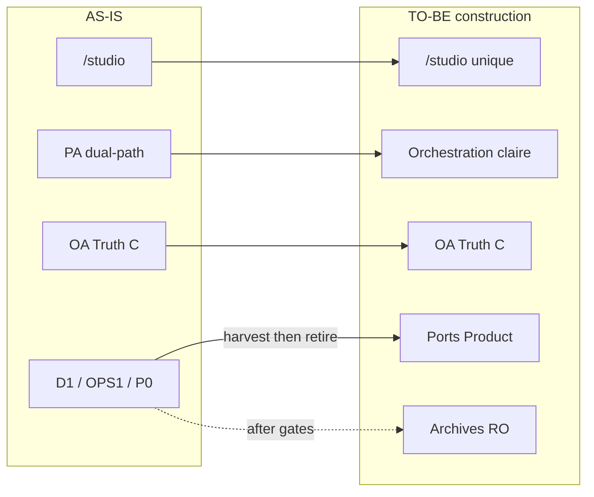
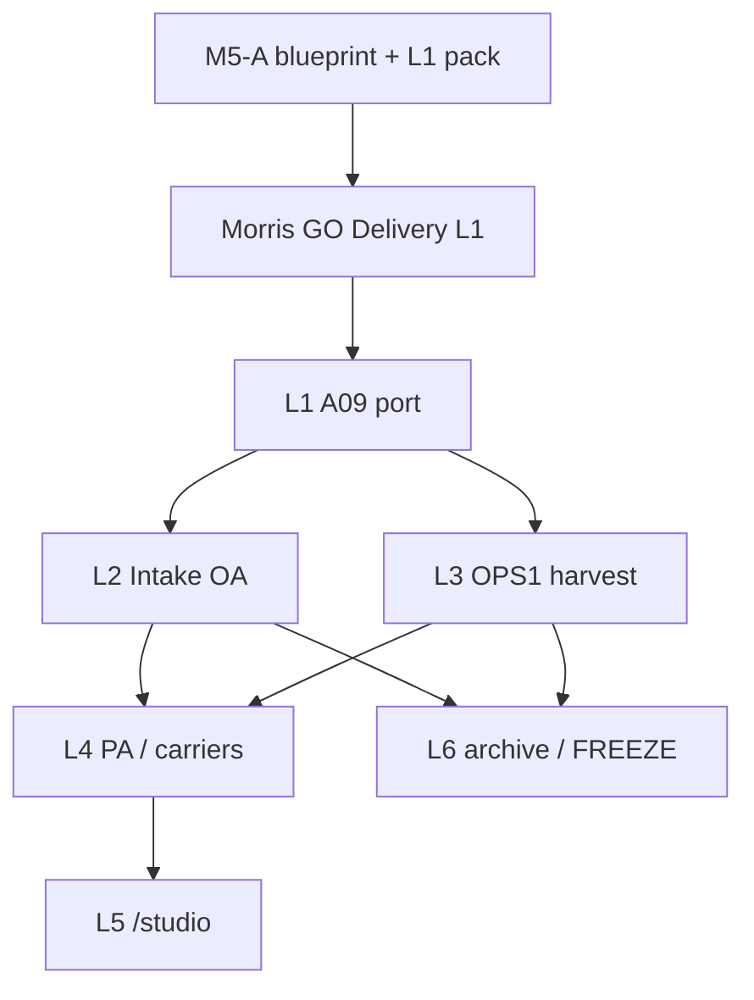

# SFIA Review Pack — FULL
## AKG-M5-A — Critical Correction Pass C1 / C2 / C3 / C4

| Champ | Valeur |
| --- | --- |
| Generated (UTC) | 2026-10-23T14:18:00Z |
| Repository | mcleland147/sfia-workspace |
| Worktree | `/Users/morris/Projects/sfia-workspace-akg-m5a-product-architecture-convergence` |
| Branch | `docs/akg-m5a-product-architecture-convergence` |
| HEAD | `f088c60271722fcf678c3862ebe192da71c7c402` |
| origin/main | `f088c60271722fcf678c3862ebe192da71c7c402` |
| Tip match | YES |
| Prior handoff | `920f2ad190dc12cb99a1cee27c03072b69a8f406` |
| Pre-correction hashes | 01=`d5026075f6c9c9fe570d107221bc6431e0c57414` · 02=`e9559678f64126abd67c5416e03332a125425fce` |
| Post-correction hashes | 01=`089a36953ae6f5701692385f64cc5bd0a6105f97` · 02=`c319b65fbc8515da05a522400b76181f1f290b87` |
| Profile | Critical · documentary correction |
| Project push/PR | **NOT AUTHORIZED** |
| H0-L1 | **NOT GRANTED** |
| R24 | **NO PRODUCT SEMANTIC IMPACT** |

## Instruction ChatGPT

Lire **ce fichier complet** depuis `sfia/review-handoff` → `sfia-review-handoff/latest-chatgpt-review.md`.
Vérifier HEAD, C1–C4, docs complets, diffs, SHA distant.
Puis : qualité des corrections · réserves · verdict M5-A · qualification futur GO H0-L1 (**sans** consommer H0).

## Matrice C1–C4 (synthèse)

| ID | Correction | Statut passe |
| --- | --- | --- |
| C1 | Réutiliser `ProjectCycleAuditPort` ; pas de 2e port ; find/list TEST_ONLY ; LocalProjectCreationAuditPort distinct | CORRECTED (doc) |
| C2 | Arêtes VSR+core ; exit L1 exige les deux couches ; adapter D1 jusqu’à L2 | CORRECTED (doc) |
| C3 | Matrice DOCUMENTED/CODE/COVERAGE/BEHAVIOR*(hist)*/KNOWN GAP ; anti-surclaim | CORRECTED (doc) |
| C4 | Q1–Q10 mesurables ; tous **NOT PASS** actuellement | CORRECTED (doc) |

## Verdict Cursor (pré re-review)

**M5-A CORRECTIONS READY FOR CRITICAL RE-REVIEW** — sous réserve handoff remote vérifié.

Recommandation Delivery : **GO L1 SOUS CONDITIONS** (02 §9). H0-L1 **NOT GRANTED**.

## Git Review Index

```
## docs/akg-m5a-product-architecture-convergence...origin/main
 M .tmp-sfia-review/chatgpt-review.md
?? projects/sfia-studio/convergence/architectural-knowledge-governance/m5-product-transformation/

M .tmp-sfia-review/chatgpt-review.md
?? projects/sfia-studio/convergence/architectural-knowledge-governance/m5-product-transformation/

hashes: 01=089a36953ae6f5701692385f64cc5bd0a6105f97 02=c319b65fbc8515da05a522400b76181f1f290b87
```

## Validations exécutées

- Git Truth tip MATCH `f088c602`
- Signatures ports / imports inspectées (CODE VERIFIED)
- Grep find/list consumers (TEST_ONLY)
- Scope fichiers = 01 + 02 seulement
- Trailing whitespace strip

## Validations NON exécutées

- Vitest / E2E / REAL
- Sync PRR / README / Roadmap
- Commit/push/PR projet
- Q1–Q10 PASS (futures Delivery)

## Réserves ouvertes

H0-L1 NOT GRANTED · H1–H5 OPEN · R-A09-01 OPEN · autres R-* M4 · Q1–Q10 NOT PASS

## Décisions Morris

1. Accepter corrections C1–C4 (re-review)
2. Futur **H0-L1** GO / GO sous conditions / STOP
3. Packaging port (t-a7 vs neutre) — defer Delivery design

---

# DIFF UTILE — DOCUMENT 01 (before → after)

```diff
--- /tmp/m5a-01-before.md	2026-10-23 16:15:01
+++ projects/sfia-studio/convergence/architectural-knowledge-governance/m5-product-transformation/01-m5a-product-architecture-convergence-blueprint.md	2026-10-23 16:17:02
@@ -7,11 +7,13 @@
 | Typologie | EVOL / Architecture / DOC |
 | Baseline Git | `docs/akg-m5a-product-architecture-convergence` @ `f088c60271722fcf678c3862ebe192da71c7c402` (= `origin/main`) |
 | Antecedent | AKG-M4 **GLOBAL CLOSED** (portée *Bounded Rationalization Assessment*) · [14](../m4-rationalization/14-akg-m4-global-formal-exit-decision-record.md) · H7/H8 [11](../m4-rationalization/11-m4a-h7-h8-architecture-orientation-decision-record.md) |
+| Correction | **C1–C4** (2026-10-23) — alignement port audit / preuves / L1→L2 ; détail dans [02](./02-m5a-l1-a09-delivery-readiness-and-decision-pack.md) |
+| Empreinte pré-correction | `d5026075f6c9c9fe570d107221bc6431e0c57414` |
 | Statut document | **LOCAL CANDIDATE** — **non adopté** · dispositions A01–A12 restent **candidates** |
-| Runtime / Delivery | **NON AUTORISÉ** · H0 **NOT GRANTED** · pas de push/PR/merge projet |
+| Runtime / Delivery | **NON AUTORISÉ** · **H0-L1 NOT GRANTED** · pas de push/PR/merge projet |
 | R24 | **NO PRODUCT SEMANTIC IMPACT** (cycle documentaire) |

-> **Non-claims :** AKG-M5 non clos · runtime v3 **NON ADOPTED** · REAL **NOT PROVEN** · P6 GLOBAL **NOT PASSED** · FinOps SHADOW **OFF** · SC-G2 = orientation **≠** runtime livré · H8 ≠ GO REBUILD · aucun dual-write · Attempt ≠ Evidence ≠ PROVEN · Memory B ≠ Truth C · Synthesis ≠ Truth C.
+> **Non-claims :** AKG-M5 non clos · blueprint **non ADOPTED** · runtime v3 **NON ADOPTED** · REAL **NOT PROVEN** · P6 GLOBAL **NOT PASSED** · FinOps SHADOW **OFF** · SC-G2 = orientation **≠** runtime livré · H8 ≠ GO REBUILD · aucun dual-write · Attempt ≠ Evidence ≠ PROVEN · Memory B ≠ Truth C · Synthesis ≠ Truth C · READY FOR RE-REVIEW ≠ READY FOR DELIVERY · tests présents ≠ exécutés dans M5-A.

 ---

@@ -53,7 +55,7 @@
 | Vérité | OA Product SQLite ; D1/OPS1 DB séparés | Une Truth C ; archives RO | L2/L3 harvest ; **no dual-write** |
 | Orchestration | PA F2/W2/SHE dual-path | Façade claire Nora/PA/OA | L4 ADAPT ; H8 SC-G3 ciblé si insuffisant |
 | Cursor | Product Attempt + îlot OPS1 | Ports Product exclusifs **après preuves** | L3 ; R-EXCL-01 / R-TF-01 / R-PP-01 |
-| Audit create | Type/runtime optionnel via `lib/d1` | Port Product hors packaging D1 | **L1** |
+| Audit create | Type/runtime optionnel via `lib/d1` ; `ProjectCycleAuditPort` déjà présent (platform/t-a7) | Réutiliser le port append existant ; découpler VSR/**core** de D1 ; adapter D1 transitoire | **L1** (détail [02](./02-m5a-l1-a09-delivery-readiness-and-decision-pack.md) C1/C2) |
 | Continuité | Carriers process-local | Carrier non-autorité ou requalify | L4 + H3 |
 | FinOps | execution-run hors spine | FREEZE ; SHADOW OFF | L6 |
 | Noms | `pre-m6`, `ops1`, `d1`, `f2`/`w2`… | Noms de responsabilité | Contrat §7 ; rename aux lots adéquats |
@@ -102,7 +104,7 @@
 | Classe | Actifs / zones | Disposition candidate (M4, non adoptée) | Timing |
 | --- | --- | --- | --- |
 | **Maintenir** | A05 OA, A07 Nora, A12 Product REAL guarantees, A01 cockpit cap | KEEP / ADAPT | Continu |
-| **Déplacer / extraire** | A09 audit port ; patterns D1/OPS1 utiles | HARVEST / REPLACE port | L1 puis L2/L3 |
+| **Déplacer / extraire** | A09 : brancher sur `ProjectCycleAuditPort` (éviter 2e contrat) ; patterns D1/OPS1 utiles | HARVEST contrat / adapter D1 jusqu’à L2 | L1 puis L2/L3 |
 | **Consolider** | A06 PA dual-path ; A02 P0 entry ; chemins mission | ADAPT / CONSOLIDATE | L4 / L5 |
 | **Remplacer (impl)** | A03 intake D1 ; A04 OPS1 engine | HARVEST + REPLACE/REBUILD ports | L2 / L3 |
 | **Geler / retirer plus tard** | A11 FinOps ; îlots UI/DB après cutover | FREEZE / RETIRE LATER | L6 |
@@ -122,7 +124,7 @@
 | Orchestrer tour | A06 | Product orchestrator | ADAPT ; SC-G3? | H8, A10 | SHE DET | L4 |
 | Cognition | A07 | Nora + Memory B | KEEP/ADAPT | A06 | session DET | boundary B≠C |
 | Composer runtime | A08 | Product composition | KEEP/ADAPT | A09 | TYPE_ONLY/runtime tests | après L1 |
-| Audit create borné | A09 | Product audit **port** | HARVEST/REPLACE | VSR, tests | CODE VERIFIED | **L1** § doc 02 |
+| Audit create borné | A09 | Journal : **`ProjectCycleAuditPort`** (réutiliser) ; events create : `LocalProjectCreationAuditPort` (distinct) ; impl D1 = adapter | HARVEST wiring / **pas** nouveau port concurrent | VSR **+ core**, tests | CODE VERIFIED (imports) ; COVERAGE VERIFIED (tests listés) ; **pas** BEHAVIOR PROVEN dans M5-A | **L1** § [02](./02-m5a-l1-a09-delivery-readiness-and-decision-pack.md) ; R-A09-01 OPEN |
 | Continuité Proposal/Offer | A10 | Carrier non-auth | ADAPT/REBUILD | H3 | process-local | L4 |
 | FinOps shadow | A11 | Hors spine | FREEZE | SHADOW OFF | unit OFF | L6 |
 | Cursor sous EC | A12 | Same + ports | KEEP/ADAPT | L3 | DET≠REAL | exclusive après preuves |
@@ -165,7 +167,7 @@
 | `pre-m6-product-ui` | Product cockpit UI | `studio-ui` / `product-ui` | A01 ; OR-04 | imports ~53 tests | L5+ après inventaire | casser tests |
 | `vertical-slice-runtime` | Product composition / ports | `product-runtime` / `studio-composition` | A08 | large | Après L1 ; lot dédié | surface large |
 | `lib/d1` | Historical intake island | garder `d1` jusqu'à retire ; **ne pas** « productiser » le nom | A03 | — | L2 retire | confusion |
-| `BoundedAtomicAuditStore` (path D1) | Bounded create/audit journal | Port : `ProjectCreationAuditStore` / `BoundedProjectAuditPort` sous `lib/oa` ou `lib/product-audit` | A09 | L1 | **L1** | type churn |
+| `BoundedAtomicAuditStore` (path D1) | Impl journal SQLite historique (`ProjectCycleAuditPort` + find/list **TEST_ONLY**) | **Ne pas** inventer un 2e port Product ; typer VSR/core sur `ProjectCycleAuditPort` ; packaging pérenne du port = candidate (rester t-a7 **ou** module neutre) — noms **non ADOPTED** | A09 ; [02] C1 | L1 wiring | **L1** | Duplication de contrat si mauvais naming |
 | `ops1` / `OPS1_CURSOR_REAL` | Historical tool island / flag | Product REAL flags isolés après exclusivity | A04/A12 | L3+ | Après R-EXCL | faux claim |
 | `f2` / `w2` | Historical mission paths | noms de responsabilité dans PA public API | A06 | L4 | L4 | dual-path |
 | `execution-run` | FinOps SM | rester hors Product spine naming | A11 | L6 | FREEZE | promote accidentel |
@@ -178,7 +180,7 @@

 | Lot | Capacité v3 / résultat user | Actifs | Composants code | Dépendances | Prérequis / HD | Risques | Tests réutilisables | Nouveaux tests | Preuve sortie | Dette / remboursement | Suite |
 | --- | --- | --- | --- | --- | --- | --- | --- | --- | --- | --- | --- |
-| **L1** | Audit create découplé D1 | A09, A08 | `boundedAtomicAudit`, `localSqliteAudit`, `service.ts`, t-a7 port | — | Aucun H1–H5 **supplémentaire** ; **H0 GO L1** | Couplage type ; confondre option sqlite / activation | `localProjectComposition` ; t-a7 persistence | Port contract ; noop default ; sqlite inject | Gate A09 PASS (type+path+consumers) | Adapter D1 jusqu'à L2 | L2 |
+| **L1** | Découpler contrat audit (VSR+**core**) ; réutiliser `ProjectCycleAuditPort` | A09, A08 | `boundedAtomicAudit` (adapter), `localSqliteAudit`, `service.ts`, `projectCycleAtomicCoordinator` | — | Aucun H1–H5 **supplémentaire** ; **H0-L1** | Nouveau port concurrent ; oublier core ; sqlite≠activation | `localProjectComposition` ; t-a7 ; `importBoundaries` | Boundaries VSR+core ; noop ; sqlite inject ; Q1–Q10 | Gate A09 = §02 exit (pas doc seule) | Adapter D1 **transitoire** jusqu’à L2 ; condition exit documentée | L2 |
 | **L2** | Intake Project sur OA | A03 | `lib/d1/**`, routes D1, OA project | **L1** | H1 MethodMode ; H4 volumes ; R-CUT-01 | dual-write ; id map | tests D1 + OA create | migration/verify ; cutover | Writers→readers ; no dual-write | Archive D1 RO | L4/L6 |
 | **L3** | Exec gouvernée Product Attempt | A04, A12 | ops1 adapters, compose REAL, Attempt | Cap matrix | H2 ; H5/R-PP-01 ; R-EXCL | claim REAL prématuré | DET/REAL boundary ; ops1 e2e | parity guards ; exclusive | Exclusive Product REAL **prouvé** | Flag rename après | L4/L6 |
 | **L4** | Orchestration + continuité | A06, A10 | project-assistant, proposal/offer stores | L2/L3 pertinents | H3 ; **H8 eval** | dual-path figé ; 2e vérité | SHE DET ; proposal tests | restart continuity ; ownership | ADAPT critères **ou** étude SC-G3 | Dette dual jusqu'à cut | L5 |
@@ -249,12 +251,19 @@
 | E04 Capability coverage | §6 + renvoi CAP M4 |
 | E05 Trajectoire | §10 |
 | E06 Governance H0–H8 | Conservés |
-| E07 Delivery readiness | L1 détaillé dans 02 ; L2–L6 cadrés |
-| E08 R23/R24 | DOCUMENTED / CODE VERIFIED spots ; NO SEMANTIC IMPACT |
-| E09 Critical review | À ChatGPT via handoff |
-| E10 Décision humaine | **Requise** — Distinct Formal Exit M5-A / GO L1 |
+| E07 Delivery readiness | L1 détaillé dans 02 (C1–C4) ; L2–L6 cadrés ; **≠** H0-L1 GRANTED |
+| E08 R23/R24 | DOCUMENTED / CODE VERIFIED / COVERAGE VERIFIED ; **pas** de BEHAVIOR PROVEN M5-A ; NO SEMANTIC IMPACT |
+| E09 Critical review | Re-review ChatGPT via handoff corrections |
+| E10 Décision humaine | **Requise** — Distinct Formal Exit M5-A / **H0-L1** |
 | E11 Git publication projet | **NON** ce cycle |

+### Dette transitoire A09 (après L1, avant L2)
+
+| Élément | Justification | Owner cible | Condition d’exit |
+| --- | --- | --- | --- |
+| `BoundedAtomicAuditStore` + table `d1_atomic_audit` | Persistance historique du journal optionnel | Adapter D1 jusqu’au cutover intake | L2 : plus de dépendance Product à `lib/d1` pour audit **et** gates retire D1 |
+| find/list sur classe D1 | Helpers **TEST_ONLY** | Rester hors contrat commun | OK tant que tests t-a7/composition |
+
 ---

 ## 13. PRR sync future (R24 — ne pas exécuter maintenant)

```

---

# DIFF UTILE — DOCUMENT 02 (before → after)

```diff
--- /tmp/m5a-02-before.md	2026-10-23 16:15:01
+++ /Users/morris/Projects/sfia-workspace-akg-m5a-product-architecture-convergence/projects/sfia-studio/convergence/architectural-knowledge-governance/m5-product-transformation/02-m5a-l1-a09-delivery-readiness-and-decision-pack.md	2026-10-23 16:17:30
@@ -2,278 +2,284 @@

 | Champ | Valeur |
 | --- | --- |
-| Cycle | **AKG-M5-A** — qualification code-first du lot candidat **L1 / A09** |
+| Cycle | **AKG-M5-A** — L1/A09 readiness · **Critical Correction Pass C1–C4** (2026-10-23) |
 | Baseline | `f088c60271722fcf678c3862ebe192da71c7c402` (`origin/main`) |
-| Actif | **A09** — Bounded audit bridge (VSR ↔ `lib/d1/boundedAtomicAudit`) |
-| Statut | **LOCAL CANDIDATE** · **H0 Delivery L1 NOT GRANTED** jusqu'à arbitrage Morris |
-| Code Delivery | **NON AUTORISÉ dans ce cycle** |
-| R23 maturité | CODE VERIFIED (imports/paths) · COVERAGE VERIFIED (tests listés) · BEHAVIOR PROVEN (DET tests existants) · KNOWN GAP (prod sqlite path rarely/never default-on) |
-| R24 | **NO PRODUCT SEMANTIC IMPACT** (doc only) |
+| Actif | **A09** — Bounded audit bridge (VSR/core ↔ `lib/d1/boundedAtomicAudit`) |
+| Statut | **LOCAL CANDIDATE** · **H0-L1 NOT GRANTED** · corrections C1–C4 **documentaires** |
+| Code Delivery | **NON AUTORISÉ** dans ce cycle / cette passe |
+| Empreinte pré-correction | `e9559678f64126abd67c5416e03332a125425fce` |
+| R24 | **NO PRODUCT SEMANTIC IMPACT** |

-> **Non-claims :** extraction de type ≠ retrait D1 · `auditMode=sqlite` optionnel ≠ activation · injection ≠ runtime prod · REAL/migration **hors L1** · A01–A12 non adoptés.
+> **Non-claims :** READY FOR CRITICAL RE-REVIEW ≠ READY FOR DELIVERY · recommandation GO ≠ décision Morris · contrat extrait ≠ R-A09-01 PASS · injection ≠ activation · DET ≠ REAL · tests présents ≠ tests exécutés dans M5-A · A09 non retiré · D1 non découplé globalement après L1.

 ---

-## 1. Objectif L1
+## 0. Matrice C1–C4 (passe corrective)

-**Débloquer** le retrait futur de l'îlot D1 (L2) en extrayant le **contrat d'audit borné** hors du packaging `lib/d1`, sans créer un second moteur d'audit métier et sans migrer l'intake.
+| ID | Constat initial | Correction | Source primaire | Preuve | Statut passe | Réserve |
+| --- | --- | --- | --- | --- | --- | --- |
+| **C1** | Nouveau port Product proposé sans résoudre `ProjectCycleAuditPort` existant ; risque de duplication | Recommander **réutilisation** de `ProjectCycleAuditPort` comme contrat append canonique ; conserver `LocalProjectCreationAuditPort` (événements distincts) ; **ne pas** promouvoir find/list au contrat commun | `projectCycleAtomicCoordinator.ts` L29–41 ; `boundedAtomicAudit.ts` L53 ; `audit.ts` L21–23 ; `localSqliteAudit.ts` | CODE VERIFIED signatures + consumers find/list = **TEST_ONLY** | **CORRECTED (doc)** | Noms/emplacement Packaging **candidates** ; H0-L1 ouvert |
+| **C2** | Frontières VSR **et** core sous-spécifiées ; importBoundaries autorise encore l’audit D1 | Cartographie arêtes TYPE_ONLY/RUNTIME/TEST ; exit L1 exige **VSR + core** sans import audit D1 ; adapter D1 transitoire jusqu’à L2 | `service.ts` L14 ; `localSqliteAudit.ts` L1–5 ; `importBoundaries.test.ts` L38–40 | CODE VERIFIED | **CORRECTED (doc)** | R-A09-01 OPEN jusqu’au Delivery |
+| **C3** | « BEHAVIOR PROVEN » insuffisamment qualifié (pas d’exécution M5-A) | Matrice DOCUMENTED / CODE VERIFIED / COVERAGE VERIFIED / BEHAVIOR PROVEN *(historique)* / KNOWN GAP | §6 ci-dessous | Distinction explicite | **CORRECTED (doc)** | Aucune preuve runtime M5-A |
+| **C4** | Qualité archi non mesurable | Grille Q1–Q10 avec PASS mesurable, preuve attendue, statut **actuel = NOT PASS** | §7 | Critères futurs | **CORRECTED (doc)** | Q* ne passent **pas** par cette passe |

-Capacité utile (CAP-D1-07 / A09) : journal d'audit atomique borné (idempotency / phases) pour création projet locale et coordinator t-a7 — **Audit ≠ autorité**.
-
 ---

-## 2. Qualification code-first (Git courant)
+## 1. Objectif L1 (inchangé dans l’intention)

-### 2.1 Définition et implémentation historique
+**Débloquer** le packaging/retire futur de D1 (L2) en **découplant le contrat d’audit borné** des consommateurs Product (VSR + vertical-slice-core), sans second moteur d’audit métier, sans migration intake, sans nouvelle persistance Product.

-| Élément | Chemin | Rôle |
-| --- | --- | --- |
-| Store SQLite D1 | `app/lib/d1/boundedAtomicAudit.ts` | Classe `BoundedAtomicAuditStore` ; table `d1_atomic_audit` via `openD1Db()` ; implémente `ProjectCycleAuditPort` |
-| Port platform | `app/lib/platform/t-a7/projectCycleAtomicCoordinator.ts` | Interface `ProjectCycleAuditPort` — **déjà** sans import `lib/d1` |
-| Adapter V-slice | `app/lib/vertical-slice-core/localSqliteAudit.ts` | `BoundedSqliteLocalProjectCreationAudit` adapte events → `store.append` ; **importe types depuis `lib/d1`** |
-| Composition VSR | `app/lib/vertical-slice-runtime/service.ts` | `import type { BoundedAtomicAuditStore }` ; `resolveAudit` ; options `auditMode` / `sqliteAuditStore` |
-| Singleton | `app/lib/vertical-slice-runtime/singleton.ts` | `SFIA_V2_RUNTIME_AUDIT` → `noop` \| `memory` \| `sqlite` ; **défaut noop** |
+Capacité utile : journal borné / idempotence (CAP-D1-07 / A09). **Audit ≠ autorité.**

-### 2.2 Contrat actuel (observé)
+---

-```text
-RuntimeAuditMode = "noop" | "memory" | "sqlite"
-default = noop  (service.ts resolveAudit ; singleton envAuditMode)
-sqlite ⇒ exige sqliteAuditStore sinon throw
-Audit never rehydrates business state  (commentaire D-V2-03)
-```
+## 2. Qualification code-first (signatures réelles) — C1

-`BoundedAtomicAuditStore.append` : BEGIN IMMEDIATE + INSERT + COMMIT ; phases prepare/apply_*/verify/commit/rollback ; outcomes IN_PROGRESS/COMMITTED/…
+### 2.1 Quatre surfaces distinctes (CODE VERIFIED)

-### 2.3 Consommateurs (inventory bornée)
+| Surface | Fichier | Contrat | Méthodes |
+| --- | --- | --- | --- |
+| **A — Journal atomique (phases)** | `lib/platform/t-a7/projectCycleAtomicCoordinator.ts` | `ProjectCycleAuditPort` | **`append` only** |
+| **B — Store D1 concret** | `lib/d1/boundedAtomicAudit.ts` | `class BoundedAtomicAuditStore implements ProjectCycleAuditPort` | `append` + `findByIdempotencyKey` + `listByOpId` + `clearForTests` |
+| **C — Audit création projet locale** | `lib/vertical-slice-core/audit.ts` | `LocalProjectCreationAuditPort` | **`append(LocalProjectCreationAuditEvent)` only** |
+| **D — Adapter create→journal** | `lib/vertical-slice-core/localSqliteAudit.ts` | `BoundedSqliteLocalProjectCreationAudit implements LocalProjectCreationAuditPort` | mappe events → `store.append(...)` ; types phases/outcomes importés **depuis D1** |

-| Consumer | Nature | Preuve |
+### 2.2 Qui a besoin de quoi
+
+| Consommateur | Besoin | Nature |
 | --- | --- | --- |
-| `vertical-slice-runtime/service.ts` | **TYPE_ONLY** import + wiring `resolveAudit` | L14, L106–110, L174–188, L758 |
-| `vertical-slice-core/localSqliteAudit.ts` | **TYPE + runtime adapter** vers store | import store + phases/outcomes |
-| Tests `localProjectComposition.test.ts` | Injecte `BoundedAtomicAuditStore` + adapter | import `@/lib/d1/boundedAtomicAudit` |
-| Tests `t-a7-hard-ta6-persistence-foundation.test.ts` | Injecte store comme `ProjectCycleAuditPort` | idem |
-| Nombreux tests Product/PA/Nora | Passent `auditMode: "noop"` seulement | grep `auditMode: "noop"` — **pas** de dépendance type D1 |
-| Îlot D1 UI/commands | Autre audit D1 métier (`listProjectAudit`, etc.) | **Hors** A09 port VSR — **OUT of L1** |
+| `projectCycleAtomicCoordinator` | `ProjectCycleAuditPort.append` | RUNTIME (si `auditStore` injecté) |
+| `localProjectComposition` / facade create | `LocalProjectCreationAuditPort.append` | RUNTIME via composition |
+| `BoundedSqliteLocalProjectCreationAudit` | appelle `store.append` (shape journal) | RUNTIME **si** mode sqlite + store |
+| VSR `resolveAudit` | choisit noop / memory / sqlite adapter | RUNTIME wiring ; défaut **noop** |
+| Tests t-a7 + `localProjectComposition` | `findByIdempotencyKey` / `listByOpId` / `clearForTests` | **TEST_ONLY** sur la classe D1 |

-**Arête AS-IS (M4 CORR-01 confirmée sur tip) :**
+**Conclusion C1 :** les consommateurs Product runtime n’ont **pas** besoin de find/list dans le contrat commun. Ajouter find/list à un « port Product » serait une **duplication inutile**.

-- VSR → type D1 : TYPE_ONLY
-- VSR `auditMode=sqlite` + store injecté : RUNTIME_CALL **conditionnel**
-- Défaut prod/singleton : **noop** (pas d'écriture `d1_atomic_audit`)
+### 2.3 Comparaison d’options

-### 2.4 Chemins noop / memory / sqlite
+| Option | Description | Pour | Contre | Verdict |
+| --- | --- | --- | --- | --- |
+| **A — Réutiliser `ProjectCycleAuditPort`** | Typer VSR/`localSqliteAudit` sur l’interface existante ; déplacer/réexporterer types phase/outcome **avec** ce port si packaging le exige | Zéro second contrat append ; déjà implémenté par D1 store | Packaging actuel sous `platform/t-a7` (nom historique) | **Preferred** |
+| **B — Extraire port neutre minimal** | Copier/move **uniquement** le contrat append (+ types phase/outcome) hors D1 vers module neutre ; `ProjectCycleAuditPort` devient alias ou migre | Packaging pérenne si t-a7 jugé trop « campagne » | Coût move ; doit rester **un** contrat | Acceptable **si** Option A packaging insuffisant — **sans** nouvelles méthodes |
+| **C — Plusieurs ports** | Nouveau port + garder les deux existants | — | Duplication si même responsabilité append journal | **Reject** sauf distinction démontrée |

-| Mode | Comportement | Activation typique |
-| --- | --- | --- |
-| `noop` | `NoOpLocalProjectCreationAudit` | **Default** ; quasi tous les tests Product |
-| `memory` | `MemoryLocalProjectCreationAudit` | Tests / debug process-local |
-| `sqlite` | `BoundedSqliteLocalProjectCreationAudit(store)` | Tests composition + t-a7 ; env `SFIA_V2_RUNTIME_AUDIT=sqlite` **et** store fourni |
+**Distinction démontrée à conserver (pas duplication) :**

-**KNOWN GAP :** pas de preuve BEHAVIOR PROVEN que le chemin sqlite est utilisé en prod Studio nominal ; l'option existe pour tests/platform.
+- `LocalProjectCreationAuditPort` = **événements métier create** (REQUESTED / DOCTRINE_RESOLVED / …) — responsabilité **distincte**.
+- `ProjectCycleAuditPort` = **journal de phases atomiques** — responsabilité **distincte**.
+- L’adapter D (`BoundedSqliteLocalProjectCreationAudit`) est le pont justifié entre C et A/B.

-### 2.5 Dépendances transitives pertinentes
+### 2.4 Recommandation canonique (candidate — non ADOPTED)

-```text
-service.ts --type--> lib/d1/boundedAtomicAudit
-localSqliteAudit.ts --type+value--> lib/d1/boundedAtomicAudit
-boundedAtomicAudit.ts --> lib/d1/db (openD1Db) + ProjectCycleAuditPort (platform)
-```
+1. **Contrat append canonique du journal :** `ProjectCycleAuditPort` (Option A).
+2. **Ne pas** inventer `BoundedProjectAuditStore` / module `product-audit` **pour le seul naming**.
+3. **Ne pas** ajouter find/list au contrat commun.
+4. Garder find/list/clearForTests sur l’**implémentation D1** (ou surface test) jusqu’à L2.
+5. Packaging pérenne (candidate, à trancher au Delivery design) :
+   - **Owner architectural journal :** Platform composition / Product wiring (VSR) consomme le port ; **impl D1** = adapter de persistance historique.
+   - Emplacement candidat du port : rester `lib/platform/t-a7/…` **ou** déplacer vers un module neutre type `lib/platform/project-cycle-audit` (nom **illustratif**) — **pas** adopté ici.
+6. VSR : `sqliteAuditStore?: ProjectCycleAuditPort` (plus le type classe D1).
+7. `localSqliteAudit` : dépendre des types phase/outcome **colocated avec le port**, plus `@/lib/d1/boundedAtomicAudit`.
+8. Dette temporaire : classe D1 + table `d1_atomic_audit` jusqu’à cutover L2.
+9. Condition de retrait D1 (hors L1) : plus aucun consumer Product/runtime/test obligé d’importer `lib/d1` pour l’audit **après** L2 migration/retire gates.

-Retirer `lib/d1` packaging **sans** L1 casse la compilation VSR/core même si runtime reste noop.
+### 2.5 Compatibilité

-### 2.6 Risques
+- Comportements noop / memory / sqlite **préservés**.
+- Default **noop** (singleton `SFIA_V2_RUNTIME_AUDIT` / `resolveAudit`).
+- Aucune nouvelle table Product SQLite en L1.

-| Risque | Mitigation L1 |
-| --- | --- |
-| Casser imports tests | Adapter paths + re-export temporaire |
-| Second moteur audit | Un seul port ; impl D1 devient **adapter** |
-| Activer sqlite par erreur | Garder default **noop** ; pas de changement env prod |
-| Confondre avec audit D1 UI | Scope OUT ; ne pas migrer `listProjectAudit` |
-| « Type extracted ⇒ A09 done » | Gate §8 exige path optionnel + consumers + tests |
-
 ---

-## 3. Solution de port Product recommandée
+## 3. Frontières D1 / VSR / core / t-a7 — C2

-### 3.1 Recommandation (candidate)
+### 3.1 Cartographie des arêtes (CODE VERIFIED @ tip)

-**HARVEST / REPLACE port** sous un module Product pérenne, en deux couches :
+| Arête | Kind | Active par défaut ? | Preuve |
+| --- | --- | --- | --- |
+| `vertical-slice-runtime/service.ts` → `@/lib/d1/boundedAtomicAudit` | **TYPE_ONLY** | Compile-time always | L14 `import type` |
+| `service.ts` `resolveAudit(..., sqliteAuditStore)` → `BoundedSqliteLocalProjectCreationAudit` | **RUNTIME_CALL conditionnel** | **Non** (default noop) | L174–188, L758 |
+| `vertical-slice-core/localSqliteAudit.ts` → D1 types + store type | **TYPE_ONLY** (+ value ctor param) | Si adapter instancié | L1–5, L43 |
+| `boundedAtomicAudit.ts` → `ProjectCycleAuditPort` | TYPE + implements | N/A | L9, L53 |
+| `boundedAtomicAudit.ts` → `openD1Db` | **RUNTIME_CALL** | Quand store construit | L54 |
+| t-a7 coordinator → `ProjectCycleAuditPort` | interface locale | Si `auditStore` injecté | L65, append calls |
+| Tests composition / t-a7 | **TEST_ONLY** inject store D1 + find/list | Tests only | listed §2.2 |
+| `importBoundaries.test.ts` | Autorise actuellement références audit D1 (commente L38–40) ; **interdit** `@/lib/d1/db` | TEST_ONLY policy | L38–54 |

-1. **Port + types** (sans SQLite D1) — ex. proposé :
-   - `projects/sfia-studio/app/lib/product-audit/boundedProjectAuditPort.ts`
-     (ou `lib/oa/project-audit/…` si ownership OA journal est retenu — **à trancher en Delivery design**, reco : **module dédié `product-audit`** pour éviter de charger OA de détails d'îlot)
-   - Types : phases, outcomes, record, `BoundedProjectAuditStore` (interface)
-   - Aligner / dédupliquer avec `ProjectCycleAuditPort` (platform) — soit type alias, soit adapter mince
+### 3.2 Ce que L1 doit prouver (exit technique — futur Delivery)

-2. **Adapter D1** (reste dans `lib/d1` jusqu'à L2) :
-   - `BoundedAtomicAuditStore` **implémente** le port Product
-   - `localSqliteAudit` dépend du **port Product**, plus de types D1
+| # | Condition | Couches |
+| --- | --- | --- |
+| 1 | Aucun import `@/lib/d1/boundedAtomicAudit` (type ou value) depuis **VSR** | VSR |
+| 2 | Aucun import audit D1 depuis **vertical-slice-core** (`localSqliteAudit` et réexports) | core |
+| 3 | `sqliteAuditStore` / adapter typés sur **`ProjectCycleAuditPort`** (ou alias unique) | VSR + core |
+| 4 | Default **noop** inchangé ; memory inchangé | composition |
+| 5 | Chemin sqlite optionnel **préservé** via adapter D1 injecté | tests + option |
+| 6 | **Aucune** nouvelle persistence Product pour cet audit | schema |
+| 7 | `importBoundaries` **adapté** : interdire audit D1 dans VSR (+ règle core si absente) | tests |
+| 8 | Compatibilité D1 : store D1 continue d’implémenter le port ; îlot D1 UI **non** touché | jusqu’à L2 |

-3. **VSR** :
-   - `sqliteAuditStore?: BoundedProjectAuditStore` (port)
-   - `resolveAudit` inchangé sémantiquement
-   - default **noop**
+### 3.3 Distinctions obligatoires

-### 3.2 Nommage Product proposé (non adopté)
+| Notion | Après L1 réussi | Pas après L1 |
+| --- | --- | --- |
+| Découplage contrat Product | **Oui** (VSR/core) | — |
+| Adapter D1 transitoire | **Oui** (reste dans `lib/d1`) | — |
+| Retrait / découplage global D1 | — | **Non** (L2+) |
+| R-A09-01 PASS | Possible **si** gate §3.2 + tests | Pas par doc seule |

-| Actuel | Proposé |
-| --- | --- |
-| Path `lib/d1/boundedAtomicAudit` (contrat) | `lib/product-audit` |
-| `BoundedAtomicAuditStore` (interface contract) | `BoundedProjectAuditStore` (interface) ; classe D1 peut rester nom historique en adapter |
-| `BoundedSqliteLocalProjectCreationAudit` | conserver ou `SqliteProjectCreationAuditAdapter` |
+---

-### 3.3 Alternatives et trade-offs
+## 4. Scope IN / OUT Delivery L1 (requalifié)

-| Option | Description | Pour | Contre | Verdict |
-| --- | --- | --- | --- | --- |
-| **A — Port Product + adapter D1** (reco) | Extraire contrat ; D1 impl | Débloque retire ; clear ownership | Léger churn imports | **Preferred** |
-| **B — Move file only** | Déplacer `boundedAtomicAudit.ts` hors `d1` en gardant `openD1Db` | Rapide | Packaging encore couplé DB D1 ; retire D1 incomplet | Acceptable **étape interne** si suivie de A |
-| **C — Dupliquer store Product SQLite** | Nouvelle table Truth C | « tout dans OA » | Second journal ; risque dual-write sémantique ; hors L1 | **Reject for L1** |
-| **D — Delete audit path** | Retirer sqlite mode | Simplifie | Perd CAP utile ; casse t-a7 tests | **Reject** |
-| **E — Keep type in D1** | Status quo | Zero effort | Bloque L2 packaging | **Reject** (oriente M4) |
+### IN

+- Brancher VSR + `localSqliteAudit` sur `ProjectCycleAuditPort` (+ types phase/outcome hors packaging D1 si move Option B).
+- Adapter D1 : `BoundedAtomicAuditStore` reste l’impl.
+- Tests : composition, t-a7, importBoundaries VSR **et** core.
+- Préserver noop/memory/sqlite.
+- Plan R24 PRR 04/06/08/09 pour le lot Delivery (pas cette passe).
+
+### OUT
+
+- Migration D1→OA · retire routes/UI D1 · schema Product nouveau · OPS1/REAL/FinOps/PA · renames massifs · adoption noms.
+
+### Stops Delivery
+
+- Besoin d’un second journal Product · dual-write · retire D1 dans le même GO · H0 absent.
+
 ---

-## 4. Fichiers candidats d'implémentation (futur GO L1)
+## 5. Fichiers candidats (futur GO — inchangés dans l’esprit, contrats corrigés)

 | Action | Fichier |
 | --- | --- |
-| **Create** | `app/lib/product-audit/boundedProjectAuditPort.ts` (+ `index.ts` si besoin) |
-| **Adapt** | `app/lib/d1/boundedAtomicAudit.ts` — implement port ; optionally re-export types from product-audit |
-| **Adapt** | `app/lib/vertical-slice-core/localSqliteAudit.ts` — import port Product |
-| **Adapt** | `app/lib/vertical-slice-runtime/service.ts` — type import Product |
-| **Adapt** | `app/lib/platform/t-a7/projectCycleAtomicCoordinator.ts` — optional align types |
-| **Adapt tests** | `app/__tests__/vertical-slice-core/localProjectComposition.test.ts` |
-| **Adapt tests** | `app/__tests__/platform/t-a7-hard-ta6-persistence-foundation.test.ts` |
-| **Check** | `app/__tests__/vertical-slice-runtime/importBoundaries.test.ts` (règles d1) |
-| **Docs Delivery** | Note R24 PRR 04/06/08/09 — **dans le lot Delivery**, pas ici |
+| Adapt | `service.ts` — type `ProjectCycleAuditPort` |
+| Adapt | `localSqliteAudit.ts` — plus d’imports D1 |
+| Adapt éventuel | `projectCycleAtomicCoordinator.ts` — export types phase/outcome si manquants au packaging |
+| Keep as adapter | `lib/d1/boundedAtomicAudit.ts` |
+| Adapt tests | `localProjectComposition.test.ts` ; `t-a7-hard-ta6-persistence-foundation.test.ts` ; `importBoundaries.test.ts` |

-**Ne pas toucher (L1 OUT) :** routes D1, `features/d1`, OA schema Product, OPS1, PA orchestration, REAL flags, FinOps.
-
 ---

-## 5. Tests et non-régression
+## 6. Maturité et preuves — C3

-### 5.1 Réutiliser
+### 6.1 Légende

-- `localProjectComposition` — sqlite audit injecté
-- `t-a7-hard-ta6-persistence-foundation` — `BoundedAtomicAuditStore`
-- Smoke composition VSR avec `auditMode: "noop"` (régression large suite Product)
+| Niveau | Signification |
+| --- | --- |
+| **DOCUMENTED** | Affirmé dans PRR/M4/docs |
+| **CODE VERIFIED** | Inspecté sur tip `f088c602` dans M5-A / cette passe |
+| **COVERAGE VERIFIED** | Fichiers/tests **identifiés** ; **aucune** exécution Vitest dans M5-A |
+| **BEHAVIOR PROVEN (historique)** | Preuve d’exécution **antérieure** (suites DET connues) — **pas** rejouée ici |
+| **KNOWN GAP** | Branche/activation/preuve insuffisante |

-### 5.2 Ajouter / exiger avant gate A09 PASS
+### 6.2 Assertions clés

-| Test | Intention |
-| --- | --- |
-| Port contract unit | append/find API sans importer `lib/d1/db` depuis VSR/core |
-| Default noop | `createRuntimeApplicationService()` sans options → no D1 open for audit |
-| Sqlite inject | mode sqlite + store → events persisted ; sans store → throw (comportement actuel) |
-| importBoundaries | VSR **ne** doit plus importer `@/lib/d1/boundedAtomicAudit` (type ou value) |
-| Adapter D1 | store D1 continue de satisfaire port (t-a7) |
+| Assertion | Niveau | Source / périmètre | Limite |
+| --- | --- | --- | --- |
+| Import type VSR→D1 audit | CODE VERIFIED | `service.ts` L14 | — |
+| Default audit = noop | CODE VERIFIED | `resolveAudit` ; `singleton.ts` `envAuditMode` | Env peut forcer sqlite **si** store aussi fourni |
+| sqlite sans store → throw | CODE VERIFIED | `service.ts` L182–185 | Non exécuté dans M5-A |
+| Store D1 implémente `ProjectCycleAuditPort` | CODE VERIFIED | `boundedAtomicAudit.ts` L53 | — |
+| find/list = test helpers | CODE VERIFIED | grep consumers | Pas runtime Product |
+| Suites composition/t-a7 existent | COVERAGE VERIFIED | chemins tests | **Non exécutées** en M5-A |
+| Comportement sqlite injecté en tests | BEHAVIOR PROVEN **(historique)** | intention des tests listés | ≠ validation M5-A |
+| sqlite utilisé en prod Studio nominal | KNOWN GAP | pas de preuve d’activation nominale | injection ≠ activation |
+| Gate A09 PASS | KNOWN GAP / futur | §3.2 | Doc ≠ PASS |
+| REAL / P6 / v3 | KNOWN GAP / non-claims | M4 exit | inchangé |

-### 5.3 Non exécuté dans ce cycle
+### 6.3 Anti-confusion (obligatoire)

-Aucune commande test runtime ; maturité = analyse statique + existence des suites.
+- Tests présents ≠ tests exécutés (M5-A).
+- Injection possible ≠ activation nominale.
+- Déterministe ≠ REAL.
+- Contrat extrait ≠ retirement gate PASS.
+- READY FOR RE-REVIEW ≠ READY FOR DELIVERY.
+- Recommandation GO ≠ H0-L1 GRANTED.

 ---

-## 6. Scope IN / OUT du futur lot Delivery L1
+## 7. Critères de qualité architecturale Q1–Q10 — C4

-### IN
+*Statut actuel = état **avant** implémentation L1. Cette passe documentaire **ne** les fait **pas** passer.*

-- Extraire port/types Product pour audit borné create/coordinator
-- Rebrancher VSR + `localSqliteAudit` + tests listés
-- Préserver sémantique noop / memory / sqlite
-- Prouver importBoundaries sans type D1 dans VSR
-- Documenter R24 sync PRR **plan** (exécuter sync dans le même GO Delivery si comportement inchangé côté user — sinon note « no user-visible change »)
+| ID | Critère | Condition PASS mesurable | Preuve attendue (Delivery) | Statut actuel | Risque si non satisfait |
+| --- | --- | --- | --- | --- | --- |
+| **Q1** | Ownership | Owner journal = port platform/Product wiring ; owner impl historique = D1 adapter ; owner events create = vertical-slice-core | Doc Delivery + code owners paths | **NOT PASS** | Ambiguïté / double écriture |
+| **Q2** | Unicité contrat | Un seul contrat append journal (`ProjectCycleAuditPort`) ; `LocalProjectCreationAuditPort` justifié distinct ; pas de 3e port append | Grep interfaces ; revue design | **NOT PASS** | Duplication C1 |
+| **Q3** | Dépendances | 0 import audit D1 dans VSR **et** core | `importBoundaries` + grep CI | **NOT PASS** | Bloque L2 packaging |
+| **Q4** | Compatibilité D1 | Store D1 + tests îlot D1 non régressés | Suites D1 + t-a7 sqlite inject | **NOT PASS** (non run) | Casse L2 prep |
+| **Q5** | Comportements | noop/memory/sqlite sémantiques stables | Tests mode ×3 | **NOT PASS** | Régression create |
+| **Q6** | Persistance | Pas de nouvelle table Truth C ; default noop ; sqlite non activé implicitement | Diff schema vide ; singleton default | **NOT PASS** (doc only) | 2e vérité / activation silencieuse |
+| **Q7** | Nommage | Noms livrés = responsabilité ; pas de rename massif historique | Diff borné | **NOT PASS** | Bruit / dette |
+| **Q8** | Tests | Contrat + composition + boundaries + non-reg listés et **verts** | CI Delivery | **NOT PASS** | Faux READY |
+| **Q9** | Dette | Adapter D1 documenté + condition exit L2 | Note dette + R-A09 lien L2 | **NOT PASS** | Adapter permanent |
+| **Q10** | Périmètre | Aucune migration/suppression D1/OA schema/OPS1/REAL dans le PR L1 | Review scope PR | **NOT PASS** | Scope creep |

-### OUT
+---

-- Migration données D1 → OA
-- Retrait `lib/d1` / routes / UI
-- Activation sqlite en prod
-- Dual-write
-- Renames massifs `pre-m6` / `vertical-slice-runtime`
-- REAL / OPS1 / FinOps / PA carriers
-- Adoption dispositions A01–A12 hors A09 technique de ce lot
+## 8. Exit proof L1 (gate R-A09-01) — aligné C2/C4

-### Stops Delivery L1
+1. Consommateurs Product (VSR + core) hors types/imports D1 audit.
+2. Contrat append unique (`ProjectCycleAuditPort`) branché.
+3. sqlite optionnel via adapter D1 ; default noop.
+4. Tests Q5/Q8 verts (exécution **Delivery**).
+5. importBoundaries adaptés (VSR + core).
+6. Q1–Q10 PASS documentés dans le rapport Delivery.
+7. Injection ≠ activation rappelé.

-- Besoin d'ouvrir Truth C pour le journal
-- Besoin MethodMode / volumes
-- Divergence remote / dirty worktree non isolé
-- Tentative de retire D1 dans le même PR
+**Puis seulement** R-A09-01 → PASS technique (≠ GO L2).

 ---

-## 7. Exit proof L1 (à satisfaire sous GO Delivery)
+## 9. Recommandation (requalifiée)

-Reprise M4 A09 retirement gate (CORR-03) — **insuffisant : « plus d'import de type »** :
+### **GO L1 SOUS CONDITIONS** — recommandation Cursor uniquement

-1. Contrat de type **hors** `lib/d1`
-2. Chemin `auditMode=sqlite` + store **traité** (porté via port Product) ; default **noop**
-3. Consumers VSR / localSqliteAudit / tests injecteurs mis à jour
-4. Tests port + noop + sqlite inject + importBoundaries
-5. Plus de dépendance **type** VSR→`lib/d1/boundedAtomicAudit`
-6. Injection possible ≠ activation — documenté
+**Conditions :**

-**Puis** R-A09-01 peut passer à **PASS** (gate technique) — **≠** autorisation L2.
+1. Morris accorde **H0-L1** explicite sur le périmètre §4 IN.
+2. Design Delivery adopte **C1 Option A** (réutiliser `ProjectCycleAuditPort`) ; Option B seulement si packaging t-a7 doit bouger — **sans** nouveau contrat concurrent.
+3. Exit §8 + Q1–Q10 à satisfaire **dans** le lot Delivery.
+4. Default noop ; pas d’activation prod sqlite.
+5. Pas de L2/migration/retire dans le même GO.
+6. Revue Critical de **cette** passe corrective acceptée.

----
+**Pas STOP :** couplage localisé, contrat existant réutilisable, risque prod bas (noop).
+**Pas GO inconditionnel :** H0 ouvert ; Q* NOT PASS ; aucune exécution test M5-A.

-## 8. Périmètre d'implémentation prêt pour prompt Delivery
-
-Sous GO Morris L1, le prochain prompt Cursor Delivery devrait contenir :
-
-1. Baseline tip `main` à figer
-2. WT isolé `delivery/…-l1-a09-product-audit-port`
-3. Fichiers §4 + tests §5
-4. Exit proof §7 checklist
-5. Interdits OUT §6
-6. Review Pack + handoff selon profil Delivery
-7. **Pas** de merge sans CI verte + R24 note
-
 ---

-## 9. Décisions restant à consommer
+## 10. Gouvernance préservée

-| ID | Question | Bloque L1 ? |
-| --- | --- | --- |
-| **H0-L1** | GO Delivery L1 ? | **Oui** |
-| Nommage module `product-audit` vs `oa/…` | Préférence packaging | Non (trancher en Delivery design) |
-| H1–H5 | MethodMode, Tool-First, carrier, volumes, pathPolicy | **Non pour L1** |
-| H6 | G0 reopen | N/A — interdit |
-| H7/H8 | Orientation / L4 | N/A L1 |
+| ID | Statut |
+| --- | --- |
+| G0-A/B | ADOPTED |
+| H7 / H8 | ADOPTED orientation / directive L4 |
+| **H0-L1** | **NOT GRANTED** |
+| H1–H5 | OPEN |
+| H6 | NOT AUTHORIZED |
+| A01–A12 | candidates |
+| R-A09-01 | OPEN jusqu’au gate Delivery |

 ---

-## 10. Recommandation
+## 11. R24 — sync PRR future (Delivery L1)

-### **GO L1 SOUS CONDITIONS**
+Volumes candidats : **04**, **06**, **08**, **09**. **Aucune** sync dans cette passe.

-**Conditions :**
-
-1. Morris accorde **H0 Delivery L1** explicite (périmètre = ce pack §6 IN).
-2. Worktree Delivery isolé depuis `main` tip vérifié.
-3. Default **noop** conservé ; aucun flag prod sqlite activé par le lot.
-4. Exit proof §7 obligatoire avant claim « A09 gate PASS ».
-5. Pas de L2/migration/retire dans le même GO.
-6. Sync index AKG / Roadmap **hors** ou **après** merge L1 sous GO doc distinct si besoin.
-
-**Pourquoi pas STOP :** le couplage est localisé, la capacité est claire, les tests existent, le risque runtime prod est bas (noop default), et L1 est le prérequis structurel documenté pour L2.
-
-**Pourquoi pas GO inconditionnel :** H0 non consommé ; choix exact du path module ; validation ChatGPT Critical encore requise sur ce pack.
-
 ---

-## 11. Traçabilité
+## 12. Traçabilité

 | Source | Usage |
 | --- | --- |
-| M4 `05` A09 · `06` CAP-D1-07 · `09` §13 gate · `03` R-A09-01 | Gates et capacité |
-| `service.ts` / `boundedAtomicAudit.ts` / `localSqliteAudit.ts` / `singleton.ts` / t-a7 coordinator | CODE VERIFIED |
-| Blueprint [01](./01-m5a-product-architecture-convergence-blueprint.md) | Contexte trajectoire |
+| M4 `05`/`06`/`09` §13 / `03` R-A09-01 | Gates |
+| Code tip `f088c602` | C1–C2 CODE VERIFIED |
+| Blueprint [01](./01-m5a-product-architecture-convergence-blueprint.md) | Alignement port / L1→L2 |

 ---

-*Fin — `02` M5-A L1/A09 Delivery Readiness — LOCAL CANDIDATE — recommandation **GO L1 SOUS CONDITIONS**.*
+*Fin — `02` M5-A L1/A09 — Correction Pass C1–C4 — LOCAL CANDIDATE — recommandation **GO L1 SOUS CONDITIONS**.*

```

---

# DOCUMENT 01 — FULL CONTENT (post-correction)

# AKG-M5-A — 01 · Product Architecture Convergence Blueprint

| Champ | Valeur |
| --- | --- |
| Cycle | **AKG-M5-A** — Product Architecture Convergence & First Delivery Readiness |
| Type / Profil | Cycle 6 — Architecture technique · **Critical** |
| Typologie | EVOL / Architecture / DOC |
| Baseline Git | `docs/akg-m5a-product-architecture-convergence` @ `f088c60271722fcf678c3862ebe192da71c7c402` (= `origin/main`) |
| Antecedent | AKG-M4 **GLOBAL CLOSED** (portée *Bounded Rationalization Assessment*) · [14](../m4-rationalization/14-akg-m4-global-formal-exit-decision-record.md) · H7/H8 [11](../m4-rationalization/11-m4a-h7-h8-architecture-orientation-decision-record.md) |
| Correction | **C1–C4** (2026-10-23) — alignement port audit / preuves / L1→L2 ; détail dans [02](./02-m5a-l1-a09-delivery-readiness-and-decision-pack.md) |
| Empreinte pré-correction | `d5026075f6c9c9fe570d107221bc6431e0c57414` |
| Statut document | **LOCAL CANDIDATE** — **non adopté** · dispositions A01–A12 restent **candidates** |
| Runtime / Delivery | **NON AUTORISÉ** · **H0-L1 NOT GRANTED** · pas de push/PR/merge projet |
| R24 | **NO PRODUCT SEMANTIC IMPACT** (cycle documentaire) |

> **Non-claims :** AKG-M5 non clos · blueprint **non ADOPTED** · runtime v3 **NON ADOPTED** · REAL **NOT PROVEN** · P6 GLOBAL **NOT PASSED** · FinOps SHADOW **OFF** · SC-G2 = orientation **≠** runtime livré · H8 ≠ GO REBUILD · aucun dual-write · Attempt ≠ Evidence ≠ PROVEN · Memory B ≠ Truth C · Synthesis ≠ Truth C · READY FOR RE-REVIEW ≠ READY FOR DELIVERY · tests présents ≠ exécutés dans M5-A.

---

## 1. Provenance et finalité

Ce blueprint **traduit** le TO-BE M4 et les lots L1–L6 en architecture de **construction** exploitable, sans rejouer les inventaires M1–M4.

**Produit attendu :** un Studio unifié, premium, maintenable, centré Pilote ↔ Nora, avec boucle projet gouvernée end-to-end.

**Hors scope :** découverte de Studio · nouvelle doctrine · refonte générale · implémentation code.

**Sources primaires (consultées) :** Build Doctrine · Roadmap · C1 · doctrine v3 30/31/32/33/34/35/37 · PRR README + 01/03/04/06/07/08/09 · AKG README · M4 `01`–`03`, `05`–`11`, `13`–`14` · code A09/VSR/D1 (spot) · CKC Architecture (guidance only).

---

## 2. Vision Product héritée (sans recadrage)

Héritage TO-BE M4 [02](../m4-rationalization/02-target-architecture-to-be.md) + OR-01…OR-13 [03](../m4-rationalization/03-orientations-and-gap-register.md) :

1. Tour de contrôle conversationnelle : **Pilote autorité** ; **Nora cognition / recommandation / préparation / interprétation**.
2. Cockpit nominal **`/studio`**.
3. **OA = Truth C unique** (G0-A/B) ; Memory B distincte.
4. Contrat inspectable/amendable ; **un Exécuter** = autorisation de **cette** version (SHE) ; HD/Confirm/Authorize **internes**.
5. Outils = capacités sous effet/périmètre ; Cursor sous Attempt.
6. Restitution honnête : déclaration ≠ preuve ; continuité sans contexte inventé.
7. **OR-13 capability-first** : capacité utile ≠ conservation de l'implémentation.

Boucle cible (destination, non couverture actuelle) :

`Intention → Nora → contexte → qualification → trajectoire → décisions → EC inspectable → autorisation → exécution bornée → Evidence/RB → analyse Nora → continuité`

---

## 3. Delta AS-IS → TO-BE (compact)

| Domaine | AS-IS (observé M4) | TO-BE construction | Delta M5 |
| --- | --- | --- | --- |
| UX | `/studio` + îlots D1/OPS1/P0 | Un cockpit ; redirect/retire historiques | Concevoir L5 ; exécuter après gates |
| Vérité | OA Product SQLite ; D1/OPS1 DB séparés | Une Truth C ; archives RO | L2/L3 harvest ; **no dual-write** |
| Orchestration | PA F2/W2/SHE dual-path | Façade claire Nora/PA/OA | L4 ADAPT ; H8 SC-G3 ciblé si insuffisant |
| Cursor | Product Attempt + îlot OPS1 | Ports Product exclusifs **après preuves** | L3 ; R-EXCL-01 / R-TF-01 / R-PP-01 |
| Audit create | Type/runtime optionnel via `lib/d1` ; `ProjectCycleAuditPort` déjà présent (platform/t-a7) | Réutiliser le port append existant ; découpler VSR/**core** de D1 ; adapter D1 transitoire | **L1** (détail [02](./02-m5a-l1-a09-delivery-readiness-and-decision-pack.md) C1/C2) |
| Continuité | Carriers process-local | Carrier non-autorité ou requalify | L4 + H3 |
| FinOps | execution-run hors spine | FREEZE ; SHADOW OFF | L6 |
| Noms | `pre-m6`, `ops1`, `d1`, `f2`/`w2`… | Noms de responsabilité | Contrat §7 ; rename aux lots adéquats |



---

## 4. Responsabilités cibles (compact)

| Acteur / composant | Responsabilité cible | Ne fait pas |
| --- | --- | --- |
| **Pilote** | Objectifs, arbitrages, Exécuter / STOP | Exécuter le runtime technique |
| **Product UI `/studio`** | Surface nominale conversation, contrats, résultats | Autorité métier |
| **Nora** | Comprendre, qualifier, recommander, préparer missions, interpréter preuves | Autorité métier autonome ; Truth C |
| **Project Assistant / façade cible** | Orchestration Product (UI→OA/Nora/ports) | Deuxième Truth C ; HD implicite |
| **OA** | Project, LPS, trajectoire, cycles, HD, EC, Attempt, Evidence | Cognition conversationnelle |
| **VSR / composition** | Wiring ports/adapters ; default fail-closed | Policy métier parallèle |
| **Tools / adapters** | Capacités sous contrat / Attempt | Élargir le mandat |
| **Persistence** | Truth C SQLite ; Memory B session ; FS Evidence refs | Dual-write ; fuse B↔C |

---

## 5. Cartographie dispositions actuelles → cible

| Classe | Actifs / zones | Disposition candidate (M4, non adoptée) | Timing |
| --- | --- | --- | --- |
| **Maintenir** | A05 OA, A07 Nora, A12 Product REAL guarantees, A01 cockpit cap | KEEP / ADAPT | Continu |
| **Déplacer / extraire** | A09 : brancher sur `ProjectCycleAuditPort` (éviter 2e contrat) ; patterns D1/OPS1 utiles | HARVEST contrat / adapter D1 jusqu’à L2 | L1 puis L2/L3 |
| **Consolider** | A06 PA dual-path ; A02 P0 entry ; chemins mission | ADAPT / CONSOLIDATE | L4 / L5 |
| **Remplacer (impl)** | A03 intake D1 ; A04 OPS1 engine | HARVEST + REPLACE/REBUILD ports | L2 / L3 |
| **Geler / retirer plus tard** | A11 FinOps ; îlots UI/DB après cutover | FREEZE / RETIRE LATER | L6 |
| **Étude conditionnelle** | A06/A10 sous H8 | SC-G3 ciblé **si** ADAPT L4 insuffisant | L4 design |

---

## 6. Matrice capacité → actif → cible → option → dépendances → preuves → gate

| Capacité utilisateur | Actif | Responsabilité cible | Option | Dépendances | Preuves actuelles | Gate |
| --- | --- | --- | --- | --- | --- | --- |
| Cockpit Pilote↔Nora | A01 | Product UI | KEEP/ADAPT name | PA, tests UI | DET UI | Rename L5+ |
| Entrée site | A02 | Redirect `/studio` | CONSOLIDATE→RETIRE | bookmarks U | DOC | L5 + R-P0-01 |
| Créer/lister projets | A03 | OA Project | HARVEST+REPLACE | A09, H1, H4 | DET D1 ; volumes U | L2 |
| Exécution tool gouvernée | A04/A12 | Attempt + Product REAL | HARVEST+ADAPT | H2, H5, R-EXCL | DET ; REAL NOT PROVEN | L3 |
| Vérité / autorité | A05 | OA | KEEP/ADAPT | G0 | OA suite | H6 interdit reopen |
| Orchestrer tour | A06 | Product orchestrator | ADAPT ; SC-G3? | H8, A10 | SHE DET | L4 |
| Cognition | A07 | Nora + Memory B | KEEP/ADAPT | A06 | session DET | boundary B≠C |
| Composer runtime | A08 | Product composition | KEEP/ADAPT | A09 | TYPE_ONLY/runtime tests | après L1 |
| Audit create borné | A09 | Journal : **`ProjectCycleAuditPort`** (réutiliser) ; events create : `LocalProjectCreationAuditPort` (distinct) ; impl D1 = adapter | HARVEST wiring / **pas** nouveau port concurrent | VSR **+ core**, tests | CODE VERIFIED (imports) ; COVERAGE VERIFIED (tests listés) ; **pas** BEHAVIOR PROVEN dans M5-A | **L1** § [02](./02-m5a-l1-a09-delivery-readiness-and-decision-pack.md) ; R-A09-01 OPEN |
| Continuité Proposal/Offer | A10 | Carrier non-auth | ADAPT/REBUILD | H3 | process-local | L4 |
| FinOps shadow | A11 | Hors spine | FREEZE | SHADOW OFF | unit OFF | L6 |
| Cursor sous EC | A12 | Same + ports | KEEP/ADAPT | L3 | DET≠REAL | exclusive après preuves |

*Les 29 CAP historiques (M4 `06`) se rattachent aux lignes A03/A04/A02/A09/A11 — non re-listées ici.*

---

## 7. Frontière Nora / PA / OA (analyse)

| Question | Lecture construction |
| --- | --- |
| Cognition vs orchestration vs autorité | Nora = cognition ; PA = orchestration Product ; OA = autorité + Truth C |
| SHE vs historique | SHE = cible UX ; chemins disposition-before-PREPARE à consolider en L4 (pas supprimer HD) |
| Carriers | Proposal/Offer ≠ HD ; perdus au restart (process-local) — H3 OPEN |
| Persistance / restart | Truth C durable ; Memory B session ; carriers non durables par défaut |
| Tools / REAL | Ports Attempt Product ; OPS1 island ≠ gateway Product ; Tool-First fail-closed jusqu'à H2 |

**Interdits de construction :** rebuild OA · seconde orchestration métier · promouvoir Memory B / Synthesis / carriers en Truth C.

---

## 8. SC-G2 vs SC-G3 (H7/H8)

| | **SC-G2** (orientation H7) | **SC-G3 ciblé A06/A10** (H8) |
| --- | --- | --- |
| Idée | ADAPT/CONSOLIDATE sur spine Product ; harvest îlots | Reconstruction façade orchestration + continuity **si** ADAPT L4 insuffisant |
| OA | Conservé | Conservé (pas de rebuild) |
| Risque | Dette compat L4 | Effort tests PA/REAL ; scope creep |
| Autorisation | Orientation seulement | **Étude** conditionnelle ≠ GO REBUILD |

**Recommandation M5-A :** construire sous **SC-G2** ; préparer critères ADAPT H8 §5.2 dans le design L4 ; ne pas démarrer SC-G3 code.

---

## 9. Contrat de nommage (recommandations — non adoptées)

| Nom historique | Responsabilité réelle | Convention / nom cible proposé | Evidence | Impact rename | Timing | Risques |
| --- | --- | --- | --- | --- | --- | --- |
| `pre-m6-product-ui` | Product cockpit UI | `studio-ui` / `product-ui` | A01 ; OR-04 | imports ~53 tests | L5+ après inventaire | casser tests |
| `vertical-slice-runtime` | Product composition / ports | `product-runtime` / `studio-composition` | A08 | large | Après L1 ; lot dédié | surface large |
| `lib/d1` | Historical intake island | garder `d1` jusqu'à retire ; **ne pas** « productiser » le nom | A03 | — | L2 retire | confusion |
| `BoundedAtomicAuditStore` (path D1) | Impl journal SQLite historique (`ProjectCycleAuditPort` + find/list **TEST_ONLY**) | **Ne pas** inventer un 2e port Product ; typer VSR/core sur `ProjectCycleAuditPort` ; packaging pérenne du port = candidate (rester t-a7 **ou** module neutre) — noms **non ADOPTED** | A09 ; [02] C1 | L1 wiring | **L1** | Duplication de contrat si mauvais naming |
| `ops1` / `OPS1_CURSOR_REAL` | Historical tool island / flag | Product REAL flags isolés après exclusivity | A04/A12 | L3+ | Après R-EXCL | faux claim |
| `f2` / `w2` | Historical mission paths | noms de responsabilité dans PA public API | A06 | L4 | L4 | dual-path |
| `execution-run` | FinOps SM | rester hors Product spine naming | A11 | L6 | FREEZE | promote accidentel |

**Règle :** préparer conventions **maintenant** ; exécuter renames **aux lots** après consumers/tests ; ne pas rename ce qui sera retiré.

---

## 10. Trajectoire L1–L6 (matrice unique)

| Lot | Capacité v3 / résultat user | Actifs | Composants code | Dépendances | Prérequis / HD | Risques | Tests réutilisables | Nouveaux tests | Preuve sortie | Dette / remboursement | Suite |
| --- | --- | --- | --- | --- | --- | --- | --- | --- | --- | --- | --- |
| **L1** | Découpler contrat audit (VSR+**core**) ; réutiliser `ProjectCycleAuditPort` | A09, A08 | `boundedAtomicAudit` (adapter), `localSqliteAudit`, `service.ts`, `projectCycleAtomicCoordinator` | — | Aucun H1–H5 **supplémentaire** ; **H0-L1** | Nouveau port concurrent ; oublier core ; sqlite≠activation | `localProjectComposition` ; t-a7 ; `importBoundaries` | Boundaries VSR+core ; noop ; sqlite inject ; Q1–Q10 | Gate A09 = §02 exit (pas doc seule) | Adapter D1 **transitoire** jusqu’à L2 ; condition exit documentée | L2 |
| **L2** | Intake Project sur OA | A03 | `lib/d1/**`, routes D1, OA project | **L1** | H1 MethodMode ; H4 volumes ; R-CUT-01 | dual-write ; id map | tests D1 + OA create | migration/verify ; cutover | Writers→readers ; no dual-write | Archive D1 RO | L4/L6 |
| **L3** | Exec gouvernée Product Attempt | A04, A12 | ops1 adapters, compose REAL, Attempt | Cap matrix | H2 ; H5/R-PP-01 ; R-EXCL | claim REAL prématuré | DET/REAL boundary ; ops1 e2e | parity guards ; exclusive | Exclusive Product REAL **prouvé** | Flag rename après | L4/L6 |
| **L4** | Orchestration + continuité | A06, A10 | project-assistant, proposal/offer stores | L2/L3 pertinents | H3 ; **H8 eval** | dual-path figé ; 2e vérité | SHE DET ; proposal tests | restart continuity ; ownership | ADAPT critères **ou** étude SC-G3 | Dette dual jusqu'à cut | L5 |
| **L5** | UX `/studio` unifiée | A01, A02 | studio UI, page `/`, P0 | Design L4 ownership | R-P0-01 | bookmarks | UI tests | redirect e2e | Screens POC gone | — | — |
| **L6** | Gel/retrait obsolète | A11, archives | execution-run, routes mortes | L2/L3 done ou abandon doc | FinOps GO séparé si activate | retire prématuré | FinOps OFF tests | consumer clear | R-A11-01 PASS ; SHADOW OFF | — | — |

### Contestation du séquencement (chemin critique Product)

1. **L1 avant L2** : confirmé — A09 bloque le packaging/retire D1 (M4 CORR-03).
2. **L3 peut démarrer en parallèle de L2** *après* L1 **si** les équipes/GO sont distincts — mais **L4** dépend des deux pour une orchestration « exclusive Product » cohérente.
3. **Ne pas commencer par renames cosmétiques** (OR-10) : ownership L4 + UX cible L5 se **conçoivent** en M5-A ; code rename plus tard.
4. **L5 n'est pas « après tout techniquement »** pour la *conception* : invariants UX dès maintenant ; *exécution* redirect après inventaire liens.
5. **L6 n'est pas un fourre-tout** : FREEZE A11 peut précéder certaines archives si consumers documentés ; retire D1/OPS1 **après** preuves L2/L3.



---

## 11. Risques et réserves (statut exact — non fermées)

| ID | Implication M5 construction |
| --- | --- |
| R-VOL-01 / H4 | Bloque L2 migration |
| R-MM-01 / H1 | Bloque sémantique intake |
| R-CUT-01 | Protocole L2 sans dual-write |
| R-TF-01 / H2 | Fail-closed jusqu'à architecture |
| R-REAL-01 / R-EXCL-01 | Pas de claim REAL / retire OPS1 |
| R-PA-01 / H8 | L4 ADAPT vs SC-G3 étude |
| R-CAR-01 / H3 | Continuité |
| R-PP-01 / H5 | Potential blocker L3 |
| R-A09-01 | Gate L1 |
| R-A11-01 | Gate L6 ; SHADOW OFF |
| R-RS-01 / R-FS-01 | Reprise / Evidence |
| R-P0-01 | L5 |
| R-DOC-01 | Sync PRR aux lots comportementaux (pas ce cycle) |

---

## 12. Recommandations Morris et critères de preuve

### Décisions sollicitées (ce cycle = cadrage)

| # | Décision | Options | Reco Cursor |
| --- | --- | --- | --- |
| D1 | Accepter ce blueprint comme **base de construction M5** (candidate→accepted cadrage) | Accept / Accept with reserves / Reject | **Accept with reserves** (réserves §11 inchangées) |
| D2 | Confirmer séquencement L1→(L2∥L3)→L4→L5/L6 | Confirm / Amend | **Confirm** avec parallélisation L2/L3 sous GO séparés |
| D3 | GO Delivery **L1/A09** | Voir [02](./02-m5a-l1-a09-delivery-readiness-and-decision-pack.md) | **GO sous conditions** (conditions dans 02) |
| D4 | Noms cibles §9 | Adopt conventions / Defer | **Defer adoption** ; garder comme guide L1+ |

### Preuves de maturité de ce document

| Critère | État |
| --- | --- |
| E01 Source truth Git | `f088c602` MATCH |
| E02 Vision Product | Héritée M4 + boucle cible |
| E03 Architecture ownership | Matrice §4–§7 |
| E04 Capability coverage | §6 + renvoi CAP M4 |
| E05 Trajectoire | §10 |
| E06 Governance H0–H8 | Conservés |
| E07 Delivery readiness | L1 détaillé dans 02 (C1–C4) ; L2–L6 cadrés ; **≠** H0-L1 GRANTED |
| E08 R23/R24 | DOCUMENTED / CODE VERIFIED / COVERAGE VERIFIED ; **pas** de BEHAVIOR PROVEN M5-A ; NO SEMANTIC IMPACT |
| E09 Critical review | Re-review ChatGPT via handoff corrections |
| E10 Décision humaine | **Requise** — Distinct Formal Exit M5-A / **H0-L1** |
| E11 Git publication projet | **NON** ce cycle |

### Dette transitoire A09 (après L1, avant L2)

| Élément | Justification | Owner cible | Condition d’exit |
| --- | --- | --- | --- |
| `BoundedAtomicAuditStore` + table `d1_atomic_audit` | Persistance historique du journal optionnel | Adapter D1 jusqu’au cutover intake | L2 : plus de dépendance Product à `lib/d1` pour audit **et** gates retire D1 |
| find/list sur classe D1 | Helpers **TEST_ONLY** | Rester hors contrat commun | OK tant que tests t-a7/composition |

---

## 13. PRR sync future (R24 — ne pas exécuter maintenant)

Lots comportementaux futurs devront synchroniser proportionnellement : PRR **04** (dépendances A09/D1), **06** (persistance audit), **08** (tests), **09** (réserves A09). Ce cycle : **aucune** sync PRR.

---

*Fin — `01` M5-A Product Architecture Convergence Blueprint — LOCAL CANDIDATE.*


---

# DOCUMENT 02 — FULL CONTENT (post-correction)

# AKG-M5-A — 02 · L1 / A09 Delivery Readiness & Decision Pack

| Champ | Valeur |
| --- | --- |
| Cycle | **AKG-M5-A** — L1/A09 readiness · **Critical Correction Pass C1–C4** (2026-10-23) |
| Baseline | `f088c60271722fcf678c3862ebe192da71c7c402` (`origin/main`) |
| Actif | **A09** — Bounded audit bridge (VSR/core ↔ `lib/d1/boundedAtomicAudit`) |
| Statut | **LOCAL CANDIDATE** · **H0-L1 NOT GRANTED** · corrections C1–C4 **documentaires** |
| Code Delivery | **NON AUTORISÉ** dans ce cycle / cette passe |
| Empreinte pré-correction | `e9559678f64126abd67c5416e03332a125425fce` |
| R24 | **NO PRODUCT SEMANTIC IMPACT** |

> **Non-claims :** READY FOR CRITICAL RE-REVIEW ≠ READY FOR DELIVERY · recommandation GO ≠ décision Morris · contrat extrait ≠ R-A09-01 PASS · injection ≠ activation · DET ≠ REAL · tests présents ≠ tests exécutés dans M5-A · A09 non retiré · D1 non découplé globalement après L1.

---

## 0. Matrice C1–C4 (passe corrective)

| ID | Constat initial | Correction | Source primaire | Preuve | Statut passe | Réserve |
| --- | --- | --- | --- | --- | --- | --- |
| **C1** | Nouveau port Product proposé sans résoudre `ProjectCycleAuditPort` existant ; risque de duplication | Recommander **réutilisation** de `ProjectCycleAuditPort` comme contrat append canonique ; conserver `LocalProjectCreationAuditPort` (événements distincts) ; **ne pas** promouvoir find/list au contrat commun | `projectCycleAtomicCoordinator.ts` L29–41 ; `boundedAtomicAudit.ts` L53 ; `audit.ts` L21–23 ; `localSqliteAudit.ts` | CODE VERIFIED signatures + consumers find/list = **TEST_ONLY** | **CORRECTED (doc)** | Noms/emplacement Packaging **candidates** ; H0-L1 ouvert |
| **C2** | Frontières VSR **et** core sous-spécifiées ; importBoundaries autorise encore l’audit D1 | Cartographie arêtes TYPE_ONLY/RUNTIME/TEST ; exit L1 exige **VSR + core** sans import audit D1 ; adapter D1 transitoire jusqu’à L2 | `service.ts` L14 ; `localSqliteAudit.ts` L1–5 ; `importBoundaries.test.ts` L38–40 | CODE VERIFIED | **CORRECTED (doc)** | R-A09-01 OPEN jusqu’au Delivery |
| **C3** | « BEHAVIOR PROVEN » insuffisamment qualifié (pas d’exécution M5-A) | Matrice DOCUMENTED / CODE VERIFIED / COVERAGE VERIFIED / BEHAVIOR PROVEN *(historique)* / KNOWN GAP | §6 ci-dessous | Distinction explicite | **CORRECTED (doc)** | Aucune preuve runtime M5-A |
| **C4** | Qualité archi non mesurable | Grille Q1–Q10 avec PASS mesurable, preuve attendue, statut **actuel = NOT PASS** | §7 | Critères futurs | **CORRECTED (doc)** | Q* ne passent **pas** par cette passe |

---

## 1. Objectif L1 (inchangé dans l’intention)

**Débloquer** le packaging/retire futur de D1 (L2) en **découplant le contrat d’audit borné** des consommateurs Product (VSR + vertical-slice-core), sans second moteur d’audit métier, sans migration intake, sans nouvelle persistance Product.

Capacité utile : journal borné / idempotence (CAP-D1-07 / A09). **Audit ≠ autorité.**

---

## 2. Qualification code-first (signatures réelles) — C1

### 2.1 Quatre surfaces distinctes (CODE VERIFIED)

| Surface | Fichier | Contrat | Méthodes |
| --- | --- | --- | --- |
| **A — Journal atomique (phases)** | `lib/platform/t-a7/projectCycleAtomicCoordinator.ts` | `ProjectCycleAuditPort` | **`append` only** |
| **B — Store D1 concret** | `lib/d1/boundedAtomicAudit.ts` | `class BoundedAtomicAuditStore implements ProjectCycleAuditPort` | `append` + `findByIdempotencyKey` + `listByOpId` + `clearForTests` |
| **C — Audit création projet locale** | `lib/vertical-slice-core/audit.ts` | `LocalProjectCreationAuditPort` | **`append(LocalProjectCreationAuditEvent)` only** |
| **D — Adapter create→journal** | `lib/vertical-slice-core/localSqliteAudit.ts` | `BoundedSqliteLocalProjectCreationAudit implements LocalProjectCreationAuditPort` | mappe events → `store.append(...)` ; types phases/outcomes importés **depuis D1** |

### 2.2 Qui a besoin de quoi

| Consommateur | Besoin | Nature |
| --- | --- | --- |
| `projectCycleAtomicCoordinator` | `ProjectCycleAuditPort.append` | RUNTIME (si `auditStore` injecté) |
| `localProjectComposition` / facade create | `LocalProjectCreationAuditPort.append` | RUNTIME via composition |
| `BoundedSqliteLocalProjectCreationAudit` | appelle `store.append` (shape journal) | RUNTIME **si** mode sqlite + store |
| VSR `resolveAudit` | choisit noop / memory / sqlite adapter | RUNTIME wiring ; défaut **noop** |
| Tests t-a7 + `localProjectComposition` | `findByIdempotencyKey` / `listByOpId` / `clearForTests` | **TEST_ONLY** sur la classe D1 |

**Conclusion C1 :** les consommateurs Product runtime n’ont **pas** besoin de find/list dans le contrat commun. Ajouter find/list à un « port Product » serait une **duplication inutile**.

### 2.3 Comparaison d’options

| Option | Description | Pour | Contre | Verdict |
| --- | --- | --- | --- | --- |
| **A — Réutiliser `ProjectCycleAuditPort`** | Typer VSR/`localSqliteAudit` sur l’interface existante ; déplacer/réexporterer types phase/outcome **avec** ce port si packaging le exige | Zéro second contrat append ; déjà implémenté par D1 store | Packaging actuel sous `platform/t-a7` (nom historique) | **Preferred** |
| **B — Extraire port neutre minimal** | Copier/move **uniquement** le contrat append (+ types phase/outcome) hors D1 vers module neutre ; `ProjectCycleAuditPort` devient alias ou migre | Packaging pérenne si t-a7 jugé trop « campagne » | Coût move ; doit rester **un** contrat | Acceptable **si** Option A packaging insuffisant — **sans** nouvelles méthodes |
| **C — Plusieurs ports** | Nouveau port + garder les deux existants | — | Duplication si même responsabilité append journal | **Reject** sauf distinction démontrée |

**Distinction démontrée à conserver (pas duplication) :**

- `LocalProjectCreationAuditPort` = **événements métier create** (REQUESTED / DOCTRINE_RESOLVED / …) — responsabilité **distincte**.
- `ProjectCycleAuditPort` = **journal de phases atomiques** — responsabilité **distincte**.
- L’adapter D (`BoundedSqliteLocalProjectCreationAudit`) est le pont justifié entre C et A/B.

### 2.4 Recommandation canonique (candidate — non ADOPTED)

1. **Contrat append canonique du journal :** `ProjectCycleAuditPort` (Option A).
2. **Ne pas** inventer `BoundedProjectAuditStore` / module `product-audit` **pour le seul naming**.
3. **Ne pas** ajouter find/list au contrat commun.
4. Garder find/list/clearForTests sur l’**implémentation D1** (ou surface test) jusqu’à L2.
5. Packaging pérenne (candidate, à trancher au Delivery design) :
   - **Owner architectural journal :** Platform composition / Product wiring (VSR) consomme le port ; **impl D1** = adapter de persistance historique.
   - Emplacement candidat du port : rester `lib/platform/t-a7/…` **ou** déplacer vers un module neutre type `lib/platform/project-cycle-audit` (nom **illustratif**) — **pas** adopté ici.
6. VSR : `sqliteAuditStore?: ProjectCycleAuditPort` (plus le type classe D1).
7. `localSqliteAudit` : dépendre des types phase/outcome **colocated avec le port**, plus `@/lib/d1/boundedAtomicAudit`.
8. Dette temporaire : classe D1 + table `d1_atomic_audit` jusqu’à cutover L2.
9. Condition de retrait D1 (hors L1) : plus aucun consumer Product/runtime/test obligé d’importer `lib/d1` pour l’audit **après** L2 migration/retire gates.

### 2.5 Compatibilité

- Comportements noop / memory / sqlite **préservés**.
- Default **noop** (singleton `SFIA_V2_RUNTIME_AUDIT` / `resolveAudit`).
- Aucune nouvelle table Product SQLite en L1.

---

## 3. Frontières D1 / VSR / core / t-a7 — C2

### 3.1 Cartographie des arêtes (CODE VERIFIED @ tip)

| Arête | Kind | Active par défaut ? | Preuve |
| --- | --- | --- | --- |
| `vertical-slice-runtime/service.ts` → `@/lib/d1/boundedAtomicAudit` | **TYPE_ONLY** | Compile-time always | L14 `import type` |
| `service.ts` `resolveAudit(..., sqliteAuditStore)` → `BoundedSqliteLocalProjectCreationAudit` | **RUNTIME_CALL conditionnel** | **Non** (default noop) | L174–188, L758 |
| `vertical-slice-core/localSqliteAudit.ts` → D1 types + store type | **TYPE_ONLY** (+ value ctor param) | Si adapter instancié | L1–5, L43 |
| `boundedAtomicAudit.ts` → `ProjectCycleAuditPort` | TYPE + implements | N/A | L9, L53 |
| `boundedAtomicAudit.ts` → `openD1Db` | **RUNTIME_CALL** | Quand store construit | L54 |
| t-a7 coordinator → `ProjectCycleAuditPort` | interface locale | Si `auditStore` injecté | L65, append calls |
| Tests composition / t-a7 | **TEST_ONLY** inject store D1 + find/list | Tests only | listed §2.2 |
| `importBoundaries.test.ts` | Autorise actuellement références audit D1 (commente L38–40) ; **interdit** `@/lib/d1/db` | TEST_ONLY policy | L38–54 |

### 3.2 Ce que L1 doit prouver (exit technique — futur Delivery)

| # | Condition | Couches |
| --- | --- | --- |
| 1 | Aucun import `@/lib/d1/boundedAtomicAudit` (type ou value) depuis **VSR** | VSR |
| 2 | Aucun import audit D1 depuis **vertical-slice-core** (`localSqliteAudit` et réexports) | core |
| 3 | `sqliteAuditStore` / adapter typés sur **`ProjectCycleAuditPort`** (ou alias unique) | VSR + core |
| 4 | Default **noop** inchangé ; memory inchangé | composition |
| 5 | Chemin sqlite optionnel **préservé** via adapter D1 injecté | tests + option |
| 6 | **Aucune** nouvelle persistence Product pour cet audit | schema |
| 7 | `importBoundaries` **adapté** : interdire audit D1 dans VSR (+ règle core si absente) | tests |
| 8 | Compatibilité D1 : store D1 continue d’implémenter le port ; îlot D1 UI **non** touché | jusqu’à L2 |

### 3.3 Distinctions obligatoires

| Notion | Après L1 réussi | Pas après L1 |
| --- | --- | --- |
| Découplage contrat Product | **Oui** (VSR/core) | — |
| Adapter D1 transitoire | **Oui** (reste dans `lib/d1`) | — |
| Retrait / découplage global D1 | — | **Non** (L2+) |
| R-A09-01 PASS | Possible **si** gate §3.2 + tests | Pas par doc seule |

---

## 4. Scope IN / OUT Delivery L1 (requalifié)

### IN

- Brancher VSR + `localSqliteAudit` sur `ProjectCycleAuditPort` (+ types phase/outcome hors packaging D1 si move Option B).
- Adapter D1 : `BoundedAtomicAuditStore` reste l’impl.
- Tests : composition, t-a7, importBoundaries VSR **et** core.
- Préserver noop/memory/sqlite.
- Plan R24 PRR 04/06/08/09 pour le lot Delivery (pas cette passe).

### OUT

- Migration D1→OA · retire routes/UI D1 · schema Product nouveau · OPS1/REAL/FinOps/PA · renames massifs · adoption noms.

### Stops Delivery

- Besoin d’un second journal Product · dual-write · retire D1 dans le même GO · H0 absent.

---

## 5. Fichiers candidats (futur GO — inchangés dans l’esprit, contrats corrigés)

| Action | Fichier |
| --- | --- |
| Adapt | `service.ts` — type `ProjectCycleAuditPort` |
| Adapt | `localSqliteAudit.ts` — plus d’imports D1 |
| Adapt éventuel | `projectCycleAtomicCoordinator.ts` — export types phase/outcome si manquants au packaging |
| Keep as adapter | `lib/d1/boundedAtomicAudit.ts` |
| Adapt tests | `localProjectComposition.test.ts` ; `t-a7-hard-ta6-persistence-foundation.test.ts` ; `importBoundaries.test.ts` |

---

## 6. Maturité et preuves — C3

### 6.1 Légende

| Niveau | Signification |
| --- | --- |
| **DOCUMENTED** | Affirmé dans PRR/M4/docs |
| **CODE VERIFIED** | Inspecté sur tip `f088c602` dans M5-A / cette passe |
| **COVERAGE VERIFIED** | Fichiers/tests **identifiés** ; **aucune** exécution Vitest dans M5-A |
| **BEHAVIOR PROVEN (historique)** | Preuve d’exécution **antérieure** (suites DET connues) — **pas** rejouée ici |
| **KNOWN GAP** | Branche/activation/preuve insuffisante |

### 6.2 Assertions clés

| Assertion | Niveau | Source / périmètre | Limite |
| --- | --- | --- | --- |
| Import type VSR→D1 audit | CODE VERIFIED | `service.ts` L14 | — |
| Default audit = noop | CODE VERIFIED | `resolveAudit` ; `singleton.ts` `envAuditMode` | Env peut forcer sqlite **si** store aussi fourni |
| sqlite sans store → throw | CODE VERIFIED | `service.ts` L182–185 | Non exécuté dans M5-A |
| Store D1 implémente `ProjectCycleAuditPort` | CODE VERIFIED | `boundedAtomicAudit.ts` L53 | — |
| find/list = test helpers | CODE VERIFIED | grep consumers | Pas runtime Product |
| Suites composition/t-a7 existent | COVERAGE VERIFIED | chemins tests | **Non exécutées** en M5-A |
| Comportement sqlite injecté en tests | BEHAVIOR PROVEN **(historique)** | intention des tests listés | ≠ validation M5-A |
| sqlite utilisé en prod Studio nominal | KNOWN GAP | pas de preuve d’activation nominale | injection ≠ activation |
| Gate A09 PASS | KNOWN GAP / futur | §3.2 | Doc ≠ PASS |
| REAL / P6 / v3 | KNOWN GAP / non-claims | M4 exit | inchangé |

### 6.3 Anti-confusion (obligatoire)

- Tests présents ≠ tests exécutés (M5-A).
- Injection possible ≠ activation nominale.
- Déterministe ≠ REAL.
- Contrat extrait ≠ retirement gate PASS.
- READY FOR RE-REVIEW ≠ READY FOR DELIVERY.
- Recommandation GO ≠ H0-L1 GRANTED.

---

## 7. Critères de qualité architecturale Q1–Q10 — C4

*Statut actuel = état **avant** implémentation L1. Cette passe documentaire **ne** les fait **pas** passer.*

| ID | Critère | Condition PASS mesurable | Preuve attendue (Delivery) | Statut actuel | Risque si non satisfait |
| --- | --- | --- | --- | --- | --- |
| **Q1** | Ownership | Owner journal = port platform/Product wiring ; owner impl historique = D1 adapter ; owner events create = vertical-slice-core | Doc Delivery + code owners paths | **NOT PASS** | Ambiguïté / double écriture |
| **Q2** | Unicité contrat | Un seul contrat append journal (`ProjectCycleAuditPort`) ; `LocalProjectCreationAuditPort` justifié distinct ; pas de 3e port append | Grep interfaces ; revue design | **NOT PASS** | Duplication C1 |
| **Q3** | Dépendances | 0 import audit D1 dans VSR **et** core | `importBoundaries` + grep CI | **NOT PASS** | Bloque L2 packaging |
| **Q4** | Compatibilité D1 | Store D1 + tests îlot D1 non régressés | Suites D1 + t-a7 sqlite inject | **NOT PASS** (non run) | Casse L2 prep |
| **Q5** | Comportements | noop/memory/sqlite sémantiques stables | Tests mode ×3 | **NOT PASS** | Régression create |
| **Q6** | Persistance | Pas de nouvelle table Truth C ; default noop ; sqlite non activé implicitement | Diff schema vide ; singleton default | **NOT PASS** (doc only) | 2e vérité / activation silencieuse |
| **Q7** | Nommage | Noms livrés = responsabilité ; pas de rename massif historique | Diff borné | **NOT PASS** | Bruit / dette |
| **Q8** | Tests | Contrat + composition + boundaries + non-reg listés et **verts** | CI Delivery | **NOT PASS** | Faux READY |
| **Q9** | Dette | Adapter D1 documenté + condition exit L2 | Note dette + R-A09 lien L2 | **NOT PASS** | Adapter permanent |
| **Q10** | Périmètre | Aucune migration/suppression D1/OA schema/OPS1/REAL dans le PR L1 | Review scope PR | **NOT PASS** | Scope creep |

---

## 8. Exit proof L1 (gate R-A09-01) — aligné C2/C4

1. Consommateurs Product (VSR + core) hors types/imports D1 audit.
2. Contrat append unique (`ProjectCycleAuditPort`) branché.
3. sqlite optionnel via adapter D1 ; default noop.
4. Tests Q5/Q8 verts (exécution **Delivery**).
5. importBoundaries adaptés (VSR + core).
6. Q1–Q10 PASS documentés dans le rapport Delivery.
7. Injection ≠ activation rappelé.

**Puis seulement** R-A09-01 → PASS technique (≠ GO L2).

---

## 9. Recommandation (requalifiée)

### **GO L1 SOUS CONDITIONS** — recommandation Cursor uniquement

**Conditions :**

1. Morris accorde **H0-L1** explicite sur le périmètre §4 IN.
2. Design Delivery adopte **C1 Option A** (réutiliser `ProjectCycleAuditPort`) ; Option B seulement si packaging t-a7 doit bouger — **sans** nouveau contrat concurrent.
3. Exit §8 + Q1–Q10 à satisfaire **dans** le lot Delivery.
4. Default noop ; pas d’activation prod sqlite.
5. Pas de L2/migration/retire dans le même GO.
6. Revue Critical de **cette** passe corrective acceptée.

**Pas STOP :** couplage localisé, contrat existant réutilisable, risque prod bas (noop).
**Pas GO inconditionnel :** H0 ouvert ; Q* NOT PASS ; aucune exécution test M5-A.

---

## 10. Gouvernance préservée

| ID | Statut |
| --- | --- |
| G0-A/B | ADOPTED |
| H7 / H8 | ADOPTED orientation / directive L4 |
| **H0-L1** | **NOT GRANTED** |
| H1–H5 | OPEN |
| H6 | NOT AUTHORIZED |
| A01–A12 | candidates |
| R-A09-01 | OPEN jusqu’au gate Delivery |

---

## 11. R24 — sync PRR future (Delivery L1)

Volumes candidats : **04**, **06**, **08**, **09**. **Aucune** sync dans cette passe.

---

## 12. Traçabilité

| Source | Usage |
| --- | --- |
| M4 `05`/`06`/`09` §13 / `03` R-A09-01 | Gates |
| Code tip `f088c602` | C1–C2 CODE VERIFIED |
| Blueprint [01](./01-m5a-product-architecture-convergence-blueprint.md) | Alignement port / L1→L2 |

---

*Fin — `02` M5-A L1/A09 — Correction Pass C1–C4 — LOCAL CANDIDATE — recommandation **GO L1 SOUS CONDITIONS**.*


---

# END FULL REVIEW PACK — AKG-M5-A CORRECTION PASS C1–C4
