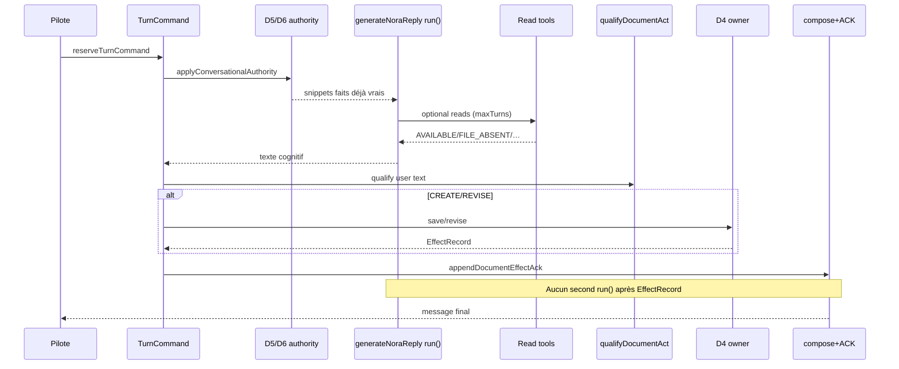
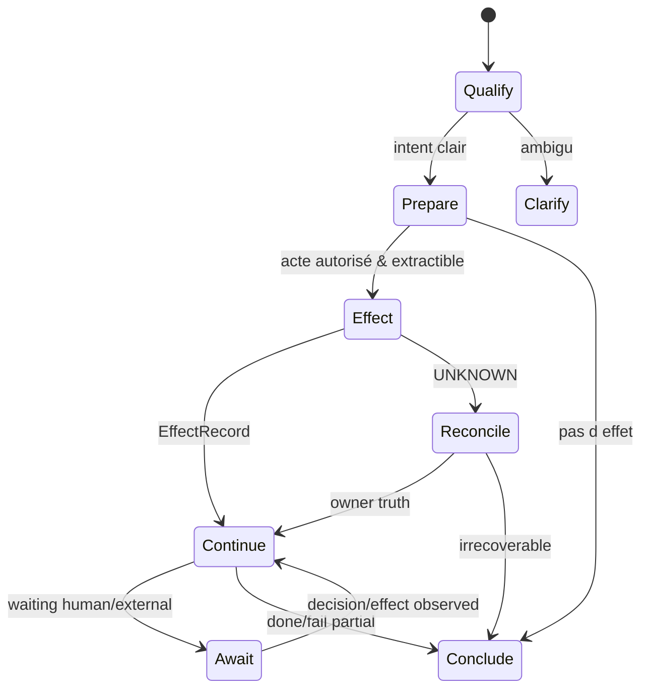

# SFIA Studio Next — Review Pack FULL
## R5 / Cycle 6 — Architecture technique — Conception continuité cognitive Nora/Studio

**Date/heure :** 2026-11-10 10:24:09 +0100 (Europe/Paris)
**GO Morris :** conception technique approfondie lecture seule — 2026-11-10 — AUCUNE implémentation
**Profil :** CRITICAL / EVOL — conception préalable
**Candidat local :** `fix/next-ml4-chat-first-d4-provenance-20261109` @ `d7f1507a` / tree `3e9e1086…`
**Handoff précédent (entrée) :** `sfia/review-handoff@63c08254` blob `52b6e419…`
**RECETTE runtime vérifié :** `127.0.0.1:3200` sert BUILD `8vZjme4-KnnPkAqm_QxMz` (worktree `…-d7f1507a`)
**Verdict :** NORA/STUDIO COGNITIVE CONTINUATION DESIGN QUALIFIED — E2E CONTRACTS DOCUMENTED — ARCHITECTURE OPTIONS READY FOR MORRIS DECISION — NO IMPLEMENTATION AUTHORIZED

---

## 01. Git Truth Check et environnement

| Champ | Observé |
|---|---|
| remote | `origin` → `https://github.com/mcleland147/sfia-workspace.git` |
| branche | `fix/next-ml4-chat-first-d4-provenance-20261109` |
| HEAD | `d7f1507a56e50660ea24903c2dc563c249ba9086` — **MATCH attendu** |
| tree | `3e9e1086aaf83e22d8e3350565f1c747bb31f556` — **MATCH** |
| parent | `771844fda083ce3c1858b77b0012e5bf2b801605` |
| origin/main | `6667a43858a5421e391b7441246536daad148bd6` |
| merge-base(HEAD, origin/main) | `c658f59023d44a0e22448c7ee034e3c1dda292a2` |
| staged | vide |
| worktree Product | `…-next-ml4-git-collaboration` @ `d7f1507a` |
| worktree RECETTE servi | `…-next-ml4-recette-build-d7f1507a` @ `d7f1507a`, BUILD_ID fichier = `8vZjme4-KnnPkAqm_QxMz` |
| handoff worktree | `…/sfia-review-handoff-m5a-gi-20261023` @ `63c08254` |

**Untracked / dirty préexistants (non modifiés) :** `.tmp-sfia-review/chatgpt-review.md` (réécrit ce cycle), manifests ENV-01, `projects/.tmp-sfia-review/`, script `github-app-installation-read-qualify.ts`. Aucun clean/reset.

**SDK installé :** `@openai/agents@0.21.0` (package + lock). Usage réel : `Agent` + `run(..., { maxTurns, stream: true, signal })` dans `nora-adapter.ts` ~L388–437. `maxTurns` = budget boucle modèle↔outils **dans un seul `run()`** ; ≠ second passage post-effet applicatif.

**Fake/Real :** Git Truth = REAL local. HTTP RECETTE root répond (HTML Next avec BUILD comment) ; endpoint `/api/health` = 404 (pas de preuve health dédiée ce cycle). Dataset non muté.

---

## 02. Reprise critique du handoff précédent (@63c08254)

Constatations **conservées et vérifiées** sur le code exact `d7f1507a` :

| ID | Constat | Statut ce cycle |
|---|---|---|
| A | REC-08 : génération Nora **avant** effet D4 ; ACK post-hoc | **CONFIRMÉ** `service.ts` L457→L586→L635→L942 |
| B | CREATE→REVISE_NOT_FOUND : priorité REVISE | **Mécanisme CODE-PROVEN** ; texte LIVE exact toujours **REPRO PENDING** ; **nouveau** probe déterministe (ci-dessous) |
| C | 5 outils lecture Nora ; mutations hors outils | **CONFIRMÉ** `cognitive-policy.ts` L217–226 |
| D | Propriétaires / D6 au point d’effet | **CONFIRMÉ** (D4 serveur ; D7 authorize/dispatch) |
| E | Options T1/T2/H **non adoptées** | **Respecté** — H précédente **non retenue** (continuation conditionnée à contradiction narrative = insuffisant) |

**Limite du handoff précédent :** inventaire D1–D9 et cause REC-08 solides ; contrat de **continuation de travail** après résultats applicatifs encore trop centré « vérité narrative » vs mission multi-étapes. Ce cycle approfondit S01–S18 et le contrat de travail.

---

## 03. Sources consultées (refs)

| Source | Ref / lieu | Usage |
|---|---|---|
| Handoff transverse | `sfia/review-handoff@63c08254` blob `52b6e419` | entrée canonique |
| Handoff G1 / bascule | `@4c97b65c` / `@2c0c4791` | contexte correctifs & deploy |
| Registre ML4 §11 | `docs/…@2075aa4f` | REC-08/11/07 LIVE |
| Code candidat | HEAD `d7f1507a` | flux réels |
| Vision | `cadrage/vision-produit.md` §2.2 autonomie post-intention | destination produit |
| A3 | `governance/decisions/2026-11-07-convergence-ux-arbitrages.md` | **Non** à moteur générique d’actions Nora **dans le lot convergence UX** — n’interdit pas de **concevoir** la continuation ; frontière à arbitrer |
| SEF / roadmap / ENV-01 / versioning | governance/* | lanes protégées ; N/A READ ONLY |
| CKC pilot 03-architecture | method/…/pilots/03-architecture-technique.md | guidance non normative |
| ADR R4 / cadrage-r4 | architecture-technique/* | frontières domaines |
| Doctrine 30–37 | consultée pour compatibilité conceptuelle | **aucun** import code historique |

---

## 04. Parcours E2E S01–S18 (code vs cible)

Légende : **IMPL** = code path ; **PARTIAL** = fragments ; **NOT** = absent ; **DESIGN GAP** = vision sans runtime ; preuve **DET** = déterministe in-memory ; **LIVE** = §11 / campagne ; **CODE** = lecture statique.

| ID | Cible | Implémenté aujourd’hui | Nora post-résultat ? | Classe |
|---|---|---|---|---|
| **S01** | Dialogue sans effet | `qualifyCognitiveProfile` → tools ∅ si simple ; `generateNoraReply` ; `qualifyDocumentAct=NONE` ; pas D4 | N/A (pas d’effet) | **IMPL + DET** |
| **S02** | Investigation multi-sources | Tools D4/Git dans **un** `run()` (`maxTurns`) ; snippets knowledge/docs | Continuation **intra-run** outils lecture seulement ; pas de 2e phase post-synthèse hors tools | **PARTIAL** (boucle outils OK ; mission multi-tours non modélisée) |
| **S03** | Création projet D2 | `createProjectCommand` + UI/API ; prompt Nora « ne crée jamais de projet » | Non — surface Studio ; fil peut continuer après création via navigation projet | **IMPL Studio / NOT outil Nora** — DESIGN GAP continuité cognitive dans le projet créé |
| **S04** | CREATE D4 | post-generate `savePreparationDocument` ; ACK | **Non** — Nora a déjà parlé | **IMPL effet + LIVE CREATE** ; restitution cognitive **PARTIAL** (REC-08) |
| **S05** | REVISE D4 | `reviseDocument` post-generate ; ACK | **Non** | **IMPL + LIVE AVAILABLE** ; narration **FAIL LIVE** REC-08 |
| **S06** | Capitalisation | `maybeCapitalizeFromExchange` post-generate | Non (effet parallèle, pas feedback cognitif) | **PARTIAL** |
| **S07** | Trajectoire/cycle D5 | `applyConversationalAuthority` **avant** Nora ; snippets effets | Nora **voit** effet D5 déjà confirmé (pattern A) | **PARTIAL/IMPL borné** |
| **S08** | HumanDecision D6 | authority avant Nora ; UI décisions ; D7 authorize | Attente = **tour suivant** / UI ; pas de génération ouverte | **IMPL surfaces** ; continuation mission **DESIGN GAP** |
| **S09** | Lecture Git | `read_git_file` / refs / sources | Oui **intra-run** | **IMPL + LIVE REC-11/07** |
| **S10** | Prépare D7 | API/UI `preparePublication` ; **pas** outil Nora | Non | **IMPL Studio + LIVE PREPARED** ; Nora ne conduit pas D7 |
| **S11** | Effet Git gouverné | authorize→dispatch→reconcile ; D6 gate | UI/API ; Nora absente de la boucle d’effet | **IMPL CODE** ; REAL dispatch **hors** ce cycle |
| **S12** | Mission D4→publish | Enchaînement **manuel Pilote** multi-surfaces | Aucun objet « travail » liant les étapes | **NOT / DESIGN GAP** |
| **S13** | Échec partiel | D4 peut AVAILABLE + D7 DENIED séparément ; messages distincts | Pas de synthèse mission unifiée | **PARTIAL** (états isolés OK) |
| **S14** | Effet OK / Nora fail | Si Nora throw **avant** D4 → pas d’effet ; si ownership lost après generate → pas D4 ; **pas** de path « D4 commit puis 2e generate fail » car 2e generate inexistant | — | **PARTIAL** : C02 protège D5/D6 ; D4 après generate COMPLETE seulement |
| **S15** | UNKNOWN | `markTurnUnknown`, reconcile turn, `reconcileAttempt` D7, `reconcileCreateProject` | Reprise = lecture états propriétaires ; **pas** rejeu aveugle D4 si fence perdu | **IMPL borné CODE** |
| **S16** | Reprise différée HD | Nouveau message ; authority rejoue ; historique messages | Pas de plan d’étapes persisté | **PARTIAL** |
| **S17** | Concurrence | `clientTurnKey` idempotence ; lease owner_token ; correlationKey docs ; attempt unique | Double effet bloqué au propriétaire | **IMPL + DET/PG** (tests existants) |
| **S18** | STOP Pilote | Abort provider / wallClock ; reconcile orphan ; **pas** d’API STOP conversationnel Pilote trouvée | Effets déjà commités restent | **PARTIAL / DESIGN GAP** STOP humain tour |

### Séquence réelle (rappel prouvé)



---

## 05. Capacités et outils effectivement impliqués

Réemploi de l’inventaire @63c08254 (vérifié, non refait exhaustivement).

**Outils Nora (5, read-only, profil ≠ simple) :**
`search_project_resources`, `read_project_document_revision`, `list_project_git_sources`, `read_git_file`, `list_git_refs`.

**Services Studio non-outils :** D2 create-project ; D4 write post-hoc ; capitalisation ; D5/D6 conversational authority ; D7 prepare/authorize/dispatch/reconcile ; OAuth/link ; merge (hard-blocked REAL).

**Implication conception :** la « mobilisation des capacités » vision §2.2 n’égale pas « tool call Nora ». Il faut un **catalogue de capacités** (outil modèle ∪ commande Studio ∪ surface UI) avec propriétaire et mode d’invocation.

---

## 06. Modèle du travail actuel (ce qui existe vraiment)

| Notion | Existe ? | Identité / durée | Remarque |
|---|---|---|---|
| Génération modèle | OUI | `generationId` / un `run()` | COMPLETE ≠ mission finie |
| Tour conversation | OUI | `conversationTurnCommands` + `clientTurnKey` + lease | Idempotence HTTP |
| Commande applicative D5/D6 | OUI | `businessCommands` / conversational key | Avant Nora |
| Effet D4 | OUI | document/revision + provenance + correlationKey | Après Nora |
| Tentative D7 | OUI | effect attempts + claim lease + reconcile | UI/API |
| HumanDecision | OUI | `humanDecisions` | Opposable dispatch |
| **Travail / mission multi-étapes** | **NON** | — | **GAP prouvé** pour S12/S16 |
| Conclusion ancrée faits | PARTIEL | ACK textuel post-hoc | Pas de phase cognitive post-faits pour D4 |

**Conclusion analytique :** les états propriétaires existent ; ce qui manque n’est **pas** un second magasin universel, mais (1) un **enchaînement de phases** dans le tour immédiat, et (2) éventuellement une **projection légère de travail** pour attentes différées — seulement si S12/S16 l’exigent après arbitrage.

---

## 07. Contrat de continuation cognitive candidat (non normatif)

### 7.1 Distinctions obligatoires

1. **Génération** — un `run()` Agents SDK.
2. **Tour** — une réservation `TurnCommand` (peut contenir 0..n générations + 0..n effets).
3. **Commande / transaction** — propriétaire de domaine (D2/D4/D5/D6/D7/D9).
4. **Travail (Work)** — objectif Pilote potentiellement multi-tours ; **candidate** ; pas créé par défaut pour S01.
5. **Conclusion** — restitution fidèle aux EffectRecords + limites.

### 7.2 Phases logiques (indépendantes d’une techno queue)

```
IntentQualify → CognitivePrepare → OwnerEffect* → CognitiveContinue? → Await/Stop/Conclude
```

- `*` = zéro ou plusieurs effets **séquencés**, chacun chez son propriétaire.
- `CognitiveContinue` = nouvelle génération **alimentée uniquement par faits structurés** (+ contexte utile), jamais par « l’espoir » d’un outil d’écriture.
- Déclencheur de continuation = **présence de résultats applicatifs / dépendances de travail**, **pas** détection regex de contradiction narrative.

### 7.3 Interfaces candidates (logiques)

**IntentQualification**
- `expectedOutcomes[]`, `objects[]`, `constraints[]`, `stepsNeeded[]`, `uncertainties[]`, `actHints` (CREATE/REVISE/NONE/PILOTAGE/GIT_PREPARE/… ).

**CapabilityRef**
- `{ id, owner, surface: tool|command|ui, mutative, authorityGate }`

**EffectRecord** (déjà proche D4 ACK / D7 attempt)
- `{ owner, act, status, ids[], reason?, correlationId }`

**ContinueContext**
- `{ priorGenerationId?, effectRecords[], openQuestions[], nextStepHint?, workId? }`

**WorkProjection** (optionnelle, différé seulement)
- `{ workId, preparationId/projectId, goalSummary, stepCursor, waitingOn: none|human_decision|external_effect|pilot, lastEffectRefs[] }`
- **Ne remplace pas** les états D4/D6/D7 ; projection dérivée / index.

### 7.4 Règles d’autorité (invariants)

- Un effet = un propriétaire.
- Aucun outil n’accorde une autorité.
- D6 revérifié au point d’effet (TOCTOU déjà assumé D7).
- Continuation cognitive ≠ permission de rejouer l’effet.
- `UNKNOWN` ⇒ reconcile propriétaire ; pas retry automatique.
- STOP / ownership lost ⇒ pas de COMPLETE menteur ; effets déjà commités restent consultables.

### 7.5 Frontière A3

A3 interdit un **moteur générique d’actions/commandes Nora** dans le lot convergence UX. La conception ici propose des **phases Studio** qui invoquent Nora comme cogniteur, pas un bus de commandes émis par le modèle. Tout écart (ex. outil Nora `prepare_publication` non mutatif) = **arbitrage Morris explicite**, hors A3 « convergence UX » historique.

---

## 08. Séquences synchrones et différées

### CAS A — Résultat immédiat (ex. CREATE/REVISE D4)

**Aujourd’hui :** Prepare cognitif et effet fusionnés à l’envers (texte avant fait).

**Cible :**
1. Qualify intent (user text, fail-closed).
2. `CognitivePrepare` : outils lecture + proposition extractible (ou refus clair).
3. OwnerEffect D4 (inchangé fonctionnellement).
4. `CognitiveContinue` (même HTTP turn, nouveau `run()` **court**, facts-only) **si** au moins un EffectRecord produit ou FAILED structurant.
5. Compose message final = continue text + ACK canonique (ACK reste source de vérité transactionnelle).

**Persistance extra :** non requise si tout tient dans le turn lease existant.

### CAS B — HumanDecision requise (ex. publish)

**Aujourd’hui :** UI authorize ; Nora hors boucle.

**Cible :**
1. Prepare peut **recommander** et pointer la surface / mandat.
2. Tour se termine `COMPLETE` avec état métier `WAITING_HUMAN` **sur l’attempt/decision**, pas une génération ouverte.
3. Reprise : prochain tour ou événement décision → authority/faits injectés → Continue.

**Interdit :** garder `run()` ouvert en attendant le Pilote.

### CAS C — Résultat externe retardé (D7 dispatch / futur Cursor)

**Aujourd’hui :** `reconcileAttempt` + UI.

**Cible :** même pattern ; CognitiveContinue au moment où un fait nouveau est **réconcilié**, sur initiative Pilote ou signal Studio gouverné — pas de worker IA permanent.

### CAS D — Interruptions

**Aujourd’hui :** wallClock abort ; ownership reconcile ; C02 D5/D6 ; fence D4.

**Cible :** conserver ; ajouter distinction explicite demande STOP vs arrêt effectif vs effet déjà produit (S18 encore DESIGN GAP UX).



---

## 09. États, commandes, dépendances, résultats

| Étape | Entrée | Sortie | Propriétaire | Autorité |
|---|---|---|---|---|
| Qualify | user text + contexte fil | IntentQualification | D3 policy + qualifiers domaine | aucune mutation |
| Prepare | Intent + tools read | proposal / analysis / plan | D3 | read scopes projet |
| Effect D4 | proposal extractible | EffectRecord | D4 | ownership + fence turn |
| Effect D7 prepare | doc rev + path + repo | attempt PREPARED | D7 | link + permissions read |
| Effect D7 dispatch | attempt + D6 | remote result / UNKNOWN | D7/D9 | D6 + re-check |
| Continue | EffectRecords | restitution / next-step | D3 | **lecture faits seulement** |
| Await | waitingOn | WorkProjection/attempt state | domaine concerné | Pilote/D6 |

**Dépendances S12 :** step N+1 ne démarre que si EffectRecord N ∈ {AVAILABLE, PREPARED, … succès défini} ; sinon S13 restitution partielle.

---

## 10. Diagnostic causal et preuves

### 10.1 REC-08 — frontière de reprise après ACK

**Cause structurelle (CONFIRMÉE) :** Nora rédige sous prompt « pas d’écriture » + tools read-only **avant** que D4 n’existe ; `appendDocumentEffectAck` / `reconcileNarrationWithDocumentEffect` corrigent **après**, sans permettre au modèle d’**intégrer** le fait.

**Frontière où le modèle peut reprendre après ACK :** **aujourd’hui aucune** dans le même tour. Seul le **tour utilisateur suivant** peut « voir » l’ACK dans l’historique (et encore : snippets tronqués 200 chars — L413–416).

**Implication conception :** CAS A exige `CognitiveContinue` **avant** commit UI final, avec `EffectRecord` injecté comme faits non négociables.

### 10.2 CREATE → REVISE_NOT_FOUND

**Mécanisme (DET ce cycle) :** `qualifyDocumentAct` priorise REVISE si verbe revise + objet documentaire, **avant** CREATE (`document-act.ts` L433–447).

Probe déterministe (tsx, sans DB) :

| Texte | Résultat |
|---|---|
| `Crée un nouveau document D4 intitulé Test…` | CREATE |
| `Crée un document et révise ensuite la section 2.` | **REVISE** (hint section 2) |
| `Ne crée pas de document, révise la section 2.` | REVISE |
| `Nouveau document fictif pour tester…` | NONE / NO_EXPLICIT_WRITE |

→ Un CREATE phrasé avec « et révise… » ou indices revise+document **explique** REVISE puis `REVISE_NOT_FOUND` si cible absente.

**Texte exact du premier essai LIVE §11 :** toujours **inconnu** → `REPRODUCTION PENDING — CONTROLLED TEST GO REQUIRED` (fixture du message exact + unit + éventuellement tour isolé).

### 10.3 Capacité Studio non exposée

Discrimination (CODE + LIVE REC-11) :

| Situation | Exemple | Diagnostic |
|---|---|---|
| Outil absent | write D4, D7 prepare | **contrat** : capacité via serveur/UI |
| Capacité ailleurs | D7 panneau Publication | **BEHAVIOR PROVEN** §11 |
| Méconnaissance Nora | affirme absence alors que UI peut | prompt + pas de catalogue |
| Gouvernance | publish sans D6 | **interdit** — correct |
| Autorisé sans interface cognitive | create project | DESIGN : orienter surface, pas inventer outil mutatif |

---

## 11. Options techniques comparées

> Ne pas confondre avec T1/T2/H du handoff précédent. Re-cadrage demandé : A / B / C.

### OPTION A — Adaptation native (un `run()`, enrichir tools/commandes/ACK)

**Idée :** rester sur generate→effet→ACK ; améliorer qualify + strip ; éventuellement tools non mutatifs supplémentaires ; s’appuyer sur boucle `maxTurns` existante.

| Critère | Éval |
|---|---|
| Vision §2.2 continuation post-résultat | **Faible** pour effets post-run (D4) — le SDK `maxTurns` ne voit pas EffectRecord serveur post-`run()` |
| Refactor | Faible |
| Autorité | OK si pas de write tools |
| Coût | Faible |
| REC-08 | Mitigation strip seulement — **déjà insuffisant LIVE** |
| Dette | Regex/strip récurrents |

**Limite prouvée :** les outils mid-`run()` ne peuvent produire un EffectRecord D4 **sans** soit (i) write tool Nora (conflit propriétaire/autorité), soit (ii) appeler le propriétaire depuis un tool wrapper — ce qui **est** déjà une forme de B déguisée.

### OPTION B — Préparation / effet / continuation (séparation logique)

**Idée :** deux générations conditionnelles dans le même tour HTTP pour CAS A ; faits structurés entre les deux ; effets restent propriétaires ; pas de broker.

| Critère | Éval |
|---|---|
| Fidélité vision | **Haute** |
| Séquencement | Déterministe sur EffectRecords |
| Refactor | Moyen — `service.ts` pipeline + adapter continue + budgets |
| Autorité | Conservée |
| Latence/tokens | +1 generate court sur tours à effet |
| Idempotence | Réutiliser lease/fence ; Continue **après** effet commit ; fail Continue ≠ rollback effet (S14) |
| Testabilité | Haute (hook entre phases) |

### OPTION C — Composition hybride

- S01 / lectures pures : **une** génération (A).
- Tours avec EffectRecord immédiat : **B** (Prepare→Effect→Continue).
- Attentes HD / externes : terminer tour + reprendre (B différé), **sans** Work store tant que message+attempt+decision suffisent ; introduire WorkProjection **seulement** si S12 le justifie.

| Critère | Éval |
|---|---|
| Proportionnalité | Meilleure |
| Complexité | Moyenne, paths explicites |
| Alignement A3 | OK si phases Studio, pas moteur actions Nora |
| Réversibilité | Feature-flag path Continue |

### Variante rejetée

- **H précédente (@63c08254)** : Continue **seulement si** contradiction narrative détectée → **REJETÉE** (mandat + insuffisant produit).
- Orchestrateur universel / multi-agents / queue technique / D7 propriétaire de mutations internes → **REJETÉS**.
- Write tools Nora comme autorité → **REJETÉ**.

### Recommandation conditionnelle (non adoptée)

**OPTION C (hybride B-triggered-by-effects)** — continuation gouvernée par EffectRecords / waitingOn, paths courts sans Continue.

**Preuves encore utiles avant GO code :** protocole CREATE texte exact ; budget tokens Continue ; UX états WAITING.

---

## 12. Risques et blast radius

| Zone | Risque si mauvais Continue | Mitigation conception |
|---|---|---|
| `conversation/service.ts` | double D4, COMPLETE menteur | fence ownership ; Continue after commit ; jamais re-save |
| `document-act.ts` | faux CREATE/REVISE | tests DET ; fail-closed |
| `nora-adapter.ts` | 2e run rencontre provider fail | S14 : effet reste ; message UNKNOWN+ACK |
| D7/D9 | contournement D6 | pas d’effet depuis Continue |
| UI messages | double bulle / flicker | un seul message final composé |
| Budgets | latence | Continue profil `simple`/`low`, tools ∅ |
| REC-10/11/07 | régression | gates non-régression obligatoires |
| A3 | dérive « action engine » | checklist revue : aucune commande émise par le modèle |

**Garanties actuelles à préserver :** turn idempotence ; D4 correlationKey ; FILE_ABSENT ; blob≠commit ; D6 gate dispatch ; capitalisation fence.

---

## 13. Contrats d’autorité et de sécurité

- Isolation Pilote/projet inchangée (`requireStudioSession`, ownership queries).
- ContinueContext = **projection** de faits déjà autorisés, pas élargissement de scope tools.
- Pas de permissions dérivées d’un document Git.
- Replay `clientTurnKey` : rejouer Continue interdit si effet déjà ACK dans resultJson.
- STOP futur : doit être opposable au fence avant nouvel effet ; n’efface pas AVAILABLE.

---

## 14. Matrice de tests d’acceptation candidats (NON exécutés)

| ID | Scénario | Niveau | Oracle | Risque |
|---|---|---|---|---|
| T-S01 | question simple | DET | 1 generate ; 0 effet ; 0 Continue | faible |
| T-S04 | CREATE | DET/PG | Effect AVAILABLE ; Continue cite IDs ; pas de « non enregistré » concurrent | moyen |
| T-S05 | REVISE | DET/PG + LIVE borné | idem REC-08 inverted | moyen |
| T-QUAL | `Crée … et révise…` | DET | politique arbitrée (REVISE vs CREATE-first vs dual-step) | moyen |
| T-S09 | Git read | DET/PG | FILE_ABSENT / provenance | faible |
| T-S10 | prepare UI | PG/BROWSER | PREPARED ; Nora n’écrit pas Git | faible |
| T-S11 | authorize sans D6 | PG | DENIED | faible |
| T-S12 | multi-step mock | DET | step2 blocked si step1 fail | moyen |
| T-S13 | D4 OK D7 fail | DET | restitution partielle | moyen |
| T-S14 | Continue provider fail | DET hooks | D4 remains AVAILABLE ; turn UNKNOWN honest | fort |
| T-S15 | UNKNOWN reconcile | PG | no duplicate | fort |
| T-S17 | double POST | PG | idempotent | fort |
| T-NR07/10/11 | non-régression | DET+LIVE ciblé | PASS inchangé | — |

Environnements : DET local ; PG integration isolé ; BROWSER ; NORA LIVE ; GITHUB REAL — chacun avec GO séparé s’il mute RECETTE/REAL.

---

## 15. Plan de non-régression

1. Suites unit `document-act` + `git-file-provenance` + effect fingerprint.
2. PG `ml4-chat-first-d4-provenance` + `git-collaboration` (lane DEV isolée seulement).
3. Témoins LIVE ciblés post-correctif : REC-07, REC-10 CREATE minimal, REC-11 FILE_ABSENT + D7 PREPARED — **sans** rouvrir leur design.
4. Interdiction de « corriger » REC-08 uniquement par élargissement regex sans phase Continue si Option C retenue.

---

## 16. Proposition de futur macro-lot intégré (à arbitrer — non démarré)

**Résultat utilisateur :** Nora conduit une demande simple ou à effet immédiat jusqu’à une restitution fidèle aux faits ; oriente vers les surfaces différées (D7/D6/D2) sans faux refus d’outil ; pas de contradiction AVAILABLE vs « non enregistré ».

**Capacité R5 suivante :** *Cognitive continuation post-EffectRecord* (CAS A) + catalogue capacités + qualify dual-intent CREATE/REVISE.

**IN :**
- Pipeline Prepare→Effect→Continue (Option C).
- Intent qualify CREATE/REVISE (politique Morris).
- ContinueContext facts-only ; budgets.
- ACK reste canonique.
- Tests DET/PG listés.
- Docs techniques matrices/spec synchrones au lot code.

**OUT :**
- Moteur actions Nora générique.
- Work DB store (v1) sauf GO ultérieur S12.
- Outils write Nora.
- Publication Git REAL / R13–R14.
- Migrations sauf nécessité prouvée.
- Changement SEF/ADR normatif.

**Modules candidats :** `conversation/service.ts`, `nora-adapter.ts`, `document-act.ts`, `cognitive-policy.ts`, éventuellement types `continue-context.ts` ; UI message rendering si états intermédiaires ; **pas** `effect-service` mutatif sauf exposition lecture de faits.

**Rollback :** revert commits lot ; feature flag Continue off → comportement ACK-only actuel.

**Dette évitée :** strip wars ; orchestrateur.
**Dette acceptée avec exit :** second generate conditionnel — exit = flag off / single-pass.

---

## 17. Arbitrages Morris structurants

1. **Adopter Option C (recommandée), B pure, ou A minimale ?**
2. **Autoriser un second `run()` dans le même tour HTTP** quand EffectRecord existe ?
3. **Politique dual-intent** : `Crée … et révise…` → CREATE-only / REVISE-only / Work 2 steps dans le même tour ?
4. **Exposer un outil Nora non mutatif de préparation D7** ou garder UI-only + orientation verbale ?
5. **WorkProjection persistée** dès le macro-lot ou reporter après preuve S12 ?
6. **GO reproduction contrôlée** du texte exact CREATE→REVISE_NOT_FOUND ?
7. Puis **GO implémentation** distinct — aucun enchaînement automatique.

Ne pas demander : détails regex internes, choix de librairie queue, multi-agents.

---

## 18. Réserves et limites de preuve

- Texte exact premier CREATE LIVE §11 : **absent** → REPRO PENDING.
- Agents SDK 0.21.0 : capacités **au-delà** de l’usage `run/maxTurns/stream` **non présumées** (handoffs multi-agents non utilisés ici).
- S18 STOP Pilote : pas d’API dédiée observée.
- S11 REAL : non exécuté (mandat).
- Subagents d’exploration en cours éventuels : conclusions principales basées sur lecture directe HEAD ; pas d’attente bloquante.
- Aucune affirmation BEHAVIOR PROVEN hors code + §11 + probes DET.

---

## 19. Verdict unique

**NORA/STUDIO COGNITIVE CONTINUATION DESIGN QUALIFIED — E2E CONTRACTS DOCUMENTED — ARCHITECTURE OPTIONS READY FOR MORRIS DECISION — NO IMPLEMENTATION AUTHORIZED**

---

## 20. Git Review Index

| Artefact | Valeur |
|---|---|
| Product HEAD analysé | `d7f1507a56e50660ea24903c2dc563c249ba9086` |
| Product tree | `3e9e1086aaf83e22d8e3350565f1c747bb31f556` |
| Entrée handoff | `63c082542bf93b1d8219033fa693fa8d45d505f7` / blob `52b6e41930a5328770f24e14754090cff47b39e2` |
| RECETTE BUILD | `8vZjme4-KnnPkAqm_QxMz` |
| Review pack local | `.tmp-sfia-review/chatgpt-review.md` |
| Publication autorisée | `sfia/review-handoff` → `sfia-review-handoff/latest-chatgpt-review.md` uniquement |

**Instruction ChatGPT :** relire le handoff **distant** après publication ; confronter Option C recommandée, rejet de H-narrative, S01–S18, invariants ; préparer arbitrage Morris **sans** implémenter.

**STOP** après publication L3. Aucun GO d’implémentation.
