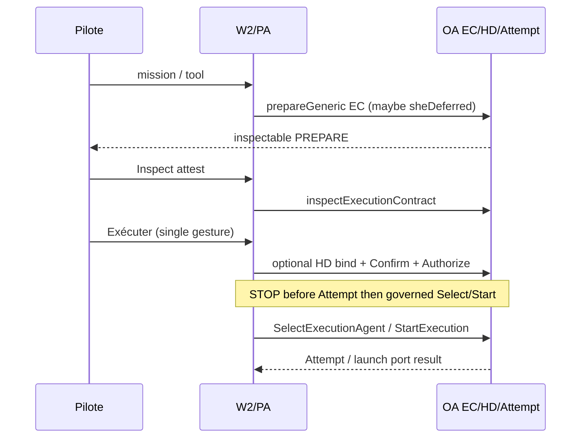
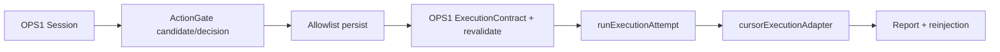
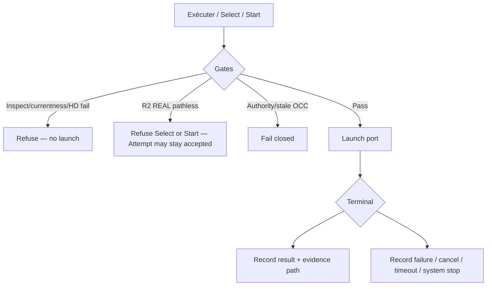

# SFIA Review Pack — FULL — CRITICAL

## 00. Identity

| Field | Value |
| --- | --- |
| Timestamp UTC | 2026-10-22T19:06:34Z |
| Cycle | AKG-M4-A / T-A03 — Runtime Sequences, Authority Boundaries & Failure/Restart |
| Profile | CRITICAL |
| Type | Cycle 6 — Architecture technique · DOC / Architecture / Rationalization Assessment |
| Branch | `analysis/akg-m4a-ta03-authority-sequences` |
| HEAD | `c48c6a582c10ee3cf6902203d6a4eb01ce3f2139` |
| origin/main | `f44a99b4da84188772b80aca3c9ebe1a3e12617e` |
| PR #604 | Draft · CI SUCCESS · non mergée (source tip) |
| Document | `projects/sfia-studio/convergence/architectural-knowledge-governance/m4-rationalization/07-m4a-authority-sequences-stop-fail-restart.md` (untracked) |
| Document hash-object | `ae67fed56b54fa71fe676eade84c9a41e2fa270d` |
| Antecedent T-A01 handoff | commit `42de13a95c9ca4b103c9192147a4511f4f1df1dd` · blob `5b341ce88b6db868c70dd0f3deb00fc29a2b799a` |
| Antecedent T-A02 handoff | commit `510210231ee3ee82647a2e53b21643e536a677e1` · blob `d35d0157788ae619fd1b8b718b2bec3f5b2d226e` |
| Project commit/push | NONE |
| M4-A | NON CLOSED |
| REAL / P6 / v3 | DETERMINISTIC ≠ REAL · P6 GLOBAL NOT PASSED · v3 NON ADOPTED |

## 01. Scope

AUTHORIZED: static sequence/authority analysis; local `07` only; Full pack; L3 handoff publish-in-cycle.
NOT AUTHORIZED: runtime/tests/API mutation; Cursor REAL; DB migration; dual-write; project commit/push/PR/merge; reopen G0; modify PRR/Build Doctrine/Roadmap/TO-BE; close M4-A; declare P6 PASS or v3 ADOPTED.

## 02. Git Review Index

```
?? projects/sfia-studio/convergence/architectural-knowledge-governance/m4-rationalization/07-m4a-authority-sequences-stop-fail-restart.md
```

| Control | Result |
| --- | --- |
| Branch | `analysis/akg-m4a-ta03-authority-sequences` MATCH |
| HEAD / source tip | `c48c6a582c10ee3cf6902203d6a4eb01ce3f2139` MATCH expected `c48c6a58…` |
| origin/main | `f44a99b4da84188772b80aca3c9ebe1a3e12617e` MATCH expected `f44a99b4…` |
| T-A01 / T-A02 worktrees | NOT modified |
| Project files besides `07` | NONE |
| `git diff --no-index --check` | exit `1` (new file; no trailing whitespace) |
| Trailing whitespace | NONE |
| Document hash-object | `ae67fed56b54fa71fe676eade84c9a41e2fa270d` |

### Diff identity

```
...7-m4a-authority-sequences-stop-fail-restart.md} | 298 +++++++++++++++++++++
 1 file changed, 298 insertions(+)
```

## 03. Sources consulted

### Method SFIA v2.6
- `prompts/templates/sfia-cycle-execution-template.md`
- `method/sfia-fast-track/core/sfia-cycle-routing-guide.md`
- `method/sfia-fast-track/core/sfia-chatgpt-cursor-operating-model.md`
- `method/sfia-fast-track/core/sfia-rules-and-guardrails.md`
- `method/sfia-fast-track/core/sfia-knowledge-layer.md`
- CKC Architecture: fallback méthode canonique (guidance candidate only)

### Governance / AKG / PRR / v3
- Build Doctrine · Roadmap B-AKG · G0 pack
- AKG README · M4 `01`–`04`
- PRR README, 01–04, 06–09
- Doctrine v3 30/32/34/35/37
- Immutable handoffs T-A01 / T-A02 (docs 05/06 via handoff blobs — not WT untracked files)

### Primary code symbols
- `f2/proposalStore.ts` · `f2/recordDecision.ts` · `f2/orchestrateF2.ts`
- `w2/prepareGenericExecutionContractDraft.ts` · `pendingGenericPrepareOfferStore.ts`
- `w2/singleHumanExecutePreparedContract.ts` (L11–21, L600+, L704+, L757, L819+)
- `w2/boundedNonMutatingRealLaunchGate.ts` (R2)
- `w2/governedExecuteAuthorizedContract.ts` · `w2/actions.ts` L386
- `oa/execution-attempt/application/*` · `attemptSupport.verifyAttemptAuthority` L44
- `lib/ops1/*` (gate/allowlist/contract/orchestrator/adapter/report)
- `f3/rehydrateEvidenceOutcomeFromLps.ts` · W3C post-evidence loop

## 04. Scenario results S01–S07

| ID | Verdict synthétique | Niveau |
| --- | --- | --- |
| S01 F2 historical disposition→HD→PREPARE | Proposal process-local carrier; HD Truth C; PREPARE gated by verified accepted HD; still available beside SHE | CONFIRMED |
| S02 SHE CURRENT | PREPARE inspectable → Inspect → single Exécuter → optional structural HD bind → Confirm → Authorize → STOP before Attempt → Select/Start; objects remain | CONFIRMED |
| S03 Generic W2 / Tool-First | Offer process-local lost on restart; R1 materiality; R2 Product fail-closed ≠ sandbox no-write; HD11 resume | CONFIRMED (+ OPEN REAL no-write) |
| S04 OPS1 legacy | Session→gate→allowlist→contract→attempt→adapter→report island; not Product Spine; harvest candidates only | CONFIRMED |
| S05 STOP/FAIL/PARTIAL | Fail-closed gates; cancel/timeout/system stop; no invented rollback/compensation; retry needs new controls | CONFIRMED (+ PARTIAL evidence path) |
| S06 Restart | Truth C + Session B durable; proposals/offers lost; RunState DEFER; rehydrate from LPS implemented for evidence paths | CONFIRMED |
| S07 Migration points | Dual-path SHE+historical; OPS1 harvest; carrier rebuild candidates; Tool-First gap OPEN — all **candidates** | CONFIRMED framing |

## 05. Authority boundary analysis

- Accept Proposal ≠ Inspect ≠ Authorize ≠ Start ≠ Cursor launch.
- One Pilote click (SHE) does **not** erase internal HD/Confirm/Authorize objects.
- Module-to-module call ≠ authority delegation.
- OPS1 similar capability ≠ Product legitimacy.
- Product R2 gate ≠ technical REAL no-write sandbox proof.
- DETERMINISTIC tested scope ≠ REAL PROVEN.

## 06. Matrices (summary)

Full step matrices live in document §4–§10 and diagram §11. Critical rows:

| Sequence | Authority exercised | Durable mutation | Lost on restart |
| --- | --- | --- | --- |
| S01 Accept | Pilote + OA Decision | HD Truth C | Proposal Map |
| S02 Exécuter | Pilote gesture + OA HD/Confirm/Authorize | HD/EC Truth C | — |
| S02 Select/Start | OA Attempt + R2 gate | Attempt Truth C (+ launch) | — |
| S03 Offer | Presentation only | none (Map) | Offer Map |
| S04 OPS1 Gate/Allowlist | OPS1 island | OPS1 DB | — (island) |
| S05 Refuse/R2 | fail-closed | durable refuse / Attempt may stay accepted | — |
| S06 HD11 | verified HD | PREPARE resume without offer | Offer |

## 07. Diagrams

Four Mermaid diagrams in `07` §11 (SHE CURRENT, OPS1 legacy, Product failure, Restart/rehydration). Legend: observed call/control flow only; target proposals excluded from edges.

## 08. Validations

| Check | Result |
| --- | --- |
| Paths coherent code ↔ tests ↔ PRR | YES (static) |
| Human gates positioned (Inspect / Exécuter / HD / Authorize / Start) | YES |
| No implicit authorization claimed | YES |
| PREPARE / Inspect / Authorize / Start distinguished | YES |
| Restart classes qualified | YES |
| No invented rollback | YES |
| OPS1≠Product equivalence avoided | YES |
| REBUILD options marked candidate | YES |
| Mermaid legend present | YES |
| Only `07` project delta | YES |
| Whitespace clean | YES |
| Behavioral / REAL tests run | NOT REQUIRED (static cycle) |

## 09. Gaps / anti-claims

G1 REAL E2E generic not proven · G2 TOOL-FIRST-REAL-NOWRITE OPEN · G3 RunState DEFER · G4 dual-path complexity · G5 OPS1≠Product · G6 alternate callers PARTIAL.

Anti-claims: M4-A CLOSED · P6 GLOBAL PASS · v3 ADOPTED · REAL PROVEN · Inspect=Execute · HD vanished by one click · Product gate = sandbox · OPS1 = Product Spine · automatic compensation.

## 10. R23 / R24 / Fake-Real

R24 **NO PRODUCT SEMANTIC IMPACT** — analysis documentation only.
Static reading only. No Cursor REAL. Fake/DET vs REAL distinguished.

## 11. Handoff L3

Branch `sfia/review-handoff` · file `sfia-review-handoff/latest-chatgpt-review.md`
Prior tip preserved in history: `510210231ee3ee82647a2e53b21643e536a677e1` / `d35d0157788ae619fd1b8b718b2bec3f5b2d226e`
Message: `docs(review-handoff): AKG-M4-A T-A03 authority sequences STOP FAIL restart`

## 12. Human decisions still required

- Accept / correct T-A03 LOCAL CANDIDATE after ChatGPT Critical Review.
- T-A04 / T-A05 GO sequencing (not authorized here).
- Any REBUILD/HARVEST classification remains **candidate** until MethodMode / Morris GO.
- Tool-First REAL no-write architecture remains OPEN (Morris GO).

## 13. Instruction ChatGPT (§9.1)

Read Git branch `sfia/review-handoff` → file `sfia-review-handoff/latest-chatgpt-review.md` (this pack).
Optional prior T-A02 tip: `510210231ee3ee82647a2e53b21643e536a677e1`.
Optional prior T-A01 tip: `42de13a95c9ca4b103c9192147a4511f4f1df1dd`.

Perform: **CHATGPT CRITICAL REVIEW — AKG-M4-A / T-A03**.

Verify independently: S01–S07 against code/PRR; SHE one-click ≠ vanished authority objects; Tool-First gate ≠ sandbox; OPS1≠Product; restart classes; no invented rollback; matrices + 4 Mermaid; only `07` delta; M4-A NON CLOSED; DET≠REAL.

## 14. Verdict target

READY FOR CHATGPT CRITICAL REVIEW — AKG-M4-A / T-A03 LOCAL CANDIDATE

---

## 15. Full document `07` (verbatim)


# AKG-M4-A / T-A03 — Séquences d'autorité, STOP/FAIL et restart

| Champ | Valeur |
| --- | --- |
| Cycle | **AKG-M4-A / T-A03** — Runtime Sequences, Authority Boundaries & Failure/Restart |
| Type / Profil | Cycle 6 — Architecture technique · **Critical** |
| Typologie | DOC / Architecture / Rationalization Assessment |
| Capacités | V3-F05 / V3-F07 (+ F2/W2/EC/Attempt/Evidence) |
| Baseline | `analysis/akg-m4a-ta03-authority-sequences` @ `c48c6a582c10ee3cf6902203d6a4eb01ce3f2139` |
| `origin/main` | `f44a99b4da84188772b80aca3c9ebe1a3e12617e` |
| PR #604 | Draft · CI SUCCESS · non mergée |
| Antecedents | T-A01 handoff `42de13a9…` / `5b341ce8…` · T-A02 handoff `51021023…` / `d35d0157…` (immuables) |
| Méthode | Analyse **statique** des chemins de code · **pas** de Cursor REAL |
| Principe | **OR-13** · G0-A/B inchangés · **pas de dual-write** |
| Statut | **LOCAL CANDIDATE** · M4-A **NON CLOSED** · scénarios **candidates** |
| Non-claims | DETERMINISTIC ≠ REAL · P6 GLOBAL **NOT PASSED** · v3 **NON ADOPTED** · Inspect ≠ Execute · HD ≠ Confirm ≠ Authorize ≠ Start |

> **Autorité AS-IS :** code + tests + PRR CURRENT > analyses AKG. « Séquences réelles » = chemins **présents dans le tip**, pas preuves d'exécution REAL.

---

## 1. Baseline et périmètre

Worktree isolé créé ; WTs T-A01/T-A02 **non modifiés**. Documents `05`/`06` lus via handoffs immuables (pas recopiés comme sources projet). CKC Architecture : **fallback méthode canonique** (guidance candidate seulement).

**In scope :** S01–S07 Product + OPS1 legacy comparatif.
**Out of scope :** mutation runtime, REAL launch, migrations, classifications définitives.

---

## 2. Sources et méthode

- SFIA v2.6 template / routing §4.3.0a / operating model / rules / knowledge layer.
- Build Doctrine · Roadmap B-AKG · G0 pack · AKG README · M4 `01`–`04`.
- PRR 01–04, 06–09 (SHE dual-path, restart, Tool-First).
- Doctrine v3 30/32/34/35/37.
- Code : `f2/recordDecision`, `proposalStore`, `prepareGenericExecutionContractDraft`, `singleHumanExecutePreparedContract`, `boundedNonMutatingRealLaunchGate`, `governedExecuteAuthorizedContract`, `lib/oa/execution-attempt/application/*`, `lib/ops1/*`, `w3cPostEvidenceLoop`, `rehydrateEvidenceOutcomeFromLps`.

**Méthode :** pour chaque étape — déclencheur → caller → exécutant → objet → précondition → autorité → mutation → failure → restart → preuve → niveau → orientation candidate.

---

## 3. Acteurs et frontières d'autorité

| Acteur | Rôle effectif (tip) | N'est pas |
| --- | --- | --- |
| Pilote | Disposition / Inspect / **Exécuter** (SHE) | Runtime |
| Nora / cognitive runtime | Qualification, reco, outils admissibles | Autorité métier |
| Project Assistant (F2/W2) | Orchestration UI→OA, carriers process-local | Vérité C |
| OA Decision / EC / Attempt | HD durable, contrat, tentative, lancement | Cognition |
| Product SQLite (Truth C) | Projet, LPS, Cycle, HD, EC, Attempt, Evidence | Session chat |
| Nora Session SQLite (B) | Transcript/journal | Truth C |
| Process-local Maps | Proposal / pending PREPARE offer | Durable |
| OPS1 (legacy) | Session/gate/allowlist/adapter/report **îlot** | Product Spine |
| Cursor gateway Product | Launch sous Attempt + flags | Autorisation Pilote |

**Règle :** communication module→module ≠ délégation d'autorité. Accept Proposal ≠ Inspect ≠ Authorize ≠ Start.

---

## 4. S01 — F2 historique : Proposal → Decision → PREPARE

**Chemin A PRR — disposition-before-PREPARE (HISTORICAL / still available).**

| Step | Déclencheur | Caller | Exécutant | Objet | Précondition | Autorité | Mutation | Failure | Restart | Preuve | Nv | Orient. |
| --- | --- | --- | --- | --- | --- | --- | --- | --- | --- | --- | --- | --- |
| S01-01 | Intent / F2 turn | `orchestrateF2` / PA | F2 analysis | Proposal candidate | Session/project | Nora reco | process-local Proposal | refuse create | Proposal **lost** | `proposalStore.ts` | C | HARVEST subject / ADAPT carrier |
| S01-02 | Save proposal | F2 | `saveProposal` | ProposalDto Map | — | none (carrier) | process-local | — | lost | L38+ | C | REBUILD continuity candidate |
| S01-03 | Pilot Accept/Refuse/Amend | UI | `recordF2Decision` | HumanDecision OA | Proposal not terminal | Pilote + OA DecisionServices | Truth C HD + DecisionRef UoW | atomic fail | HD **durable** | `recordDecision.ts` L211+, L393 | C | KEEP HD |
| S01-04 | Accepted → PREPARE | W2/F3 | `verifyGenericMissionHumanDecisionForPrepare` + prepare | EC | accepted verified HD (historical path) | OA gates | EC Truth C | HD refused/amend blocks | HD may resume PREPARE (HD11) | PRR 07 Chemin A ; PRR 06 HD11 | C | KEEP verify |
| S01-05 | Refuse/Amend | Pilot | recordF2Decision | HD refused/amended | — | Pilote | Truth C | PREPARE forbidden on that path | durable record | PRR 07 | C | KEEP |

**Lecture :** Proposal = carrier **non autorité**. HD = autorité durable. Chemin encore disponible à côté de SHE.

---

## 5. S02 — SHE CURRENT (PR #590)

**Un geste utilisateur « Exécuter » après PREPARE inspectable — objets internes HD/Confirm/Authorize restent.**

| Step | Déclencheur | Caller | Exécutant | Objet | Précondition | Autorité | Mutation | Failure | Restart | Preuve | Nv | Orient. |
| --- | --- | --- | --- | --- | --- | --- | --- | --- | --- | --- | --- | --- |
| S02-01 | Mission/tool | F2/W2 | `solicitGenericExecutionPrepare` / `prepareGenericExecutionContractDraft` | EC draft | Materiality gates ; may set `sheDeferredStructuralAuthority` | Product prepare (≠ launch) | EC Truth C ; maybe empty decisionRefs | MATERIALITY_UNKNOWN etc. | EC durable | prepareGeneric… L570+, L666–710 ; PRR 04 | C | KEEP SHE PREPARE |
| S02-02 | Present/inspect | UI / `inspectExecutionContract` | Inspection attestation | EC | presented facts | Inspect ≠ Execute | attestation | insufficient → no HD | durable EC | SHE header L11–17 ; inspect call ~L820+ | C | KEEP |
| S02-03 | Pilot **Exécuter** | `w2/actions` | `singleHumanExecutePreparedContract` | bind id+version+fp | inspected contract | Pilote gesture | — | bind fail | — | L704+ ; actions L386 | C | KEEP |
| S02-04 | STRUCTURAL empty refs | SHE | record HD authorize-inspected-execute + supersede refs | HD + EC successor | sheDeferred / structural | Pilote+OA | Truth C | UNKNOWN blocks execute | HD durable | L821+ needsStructuralHdBind ; PRR INV-STRUCTURAL-* | C | KEEP |
| S02-05 | Confirm (si requis) | SHE server | Confirm fold possible | EC | after attest | OA Confirm | Truth C | refuse | durable | PRR INV-INSPECT-NE-EXECUTE-CTA | C | KEEP/ADAPT UX |
| S02-06 | Authorize | SHE | `evaluateExecutionAuthorization` | EC authorized | gates | OA Authorize | Truth C | refuse | durable | import authorizeExecutionContract | C | KEEP |
| S02-07 | STOP before Attempt | SHE comment | caller reconcile/execute | — | post-authorize | governed execute séparément | — | — | — | SHE L17 « STOP before Attempt » | C | CONSOLIDATE caller clarity |
| S02-08 | Select/Start | governed execute | `SelectExecutionAgent` / `StartExecution` | Attempt | verifyAttemptAuthority | OA Attempt | Attempt Truth C + launch port | R2 may refuse | Attempt durable | attemptSupport L44 ; select/start | C | KEEP |

**Anti-claims SHE :** un clic ≠ disparition HD/Confirm/Authorize. DETERMINISTIC tested scope ≠ REAL.

---

## 6. S03 — Generic W2 / Tool-First / PREPARE

| Step | Déclencheur | Exécutant | Objet | Notes d'autorité | Restart | Preuve | Nv | Orient. |
| --- | --- | --- | --- | --- | --- | --- | --- | --- |
| S03-01 | Remember offer | `pendingGenericPrepareOfferStore` | offer Map | presentation carrier ≠ HD | **lost** process restart ; NOT PROVEN continuity | store header L21–25 | C | ADAPT/REBUILD carrier |
| S03-02 | Materiality | `resolveAuthoritativeProductMateriality` | stamped materiality | pathless needs positive non-mutating claim (R1) | facts on EC | resolveAuthoritative… ; PRR Tool-First R1 | C | KEEP |
| S03-03 | PREPARE NON_STRUCTURAL | prepareGeneric… | EC decisionRefs=[] | Complementary Product gates ; declaration ≠ authority | EC durable | PRR 04 Chemin B | C | KEEP |
| S03-04 | Tool-First R2 | `boundedNonMutatingRealLaunchGate` / governedExecute | Select/Start refuse | REAL+pathless → fail-closed **Product gate** ≠ sandbox no-write technique | Attempt may stay `accepted` without launch | gate L18–65 ; PRR OPEN TOOL-FIRST-REAL-NOWRITE | C | KEEP gate ; gap OPEN |
| S03-05 | HD11 resume | verify HD + prepare | EC | accepted HD may PREPARE without restoring offer | HD durable ; offer lost OK | PRR 06 HD11 | C | KEEP |

---

## 7. S04 — OPS1 legacy

| Step | Exécutant | Objet | vs Product | Preuve | Nv | Orient. |
| --- | --- | --- | --- | --- | --- | --- |
| S04-01 Session | `ops1CreateSessionAction` / lifecycle | OPS1 session DB | ≠ Project+Nora session | actions / sessionLifecycle | C | RETIRE LATER model |
| S04-02 Candidate/Gate | `createFixtureActionCandidate` / `recordGateDecision` | gate tables | ≠ F2/W2 readiness+HD | actionGate L208–353 | C | HARVEST concepts |
| S04-03 Allowlist | `evaluateAndPersistAllowlist` | OPS1 allowlist | ≠ managed repo/agents (T-A02 PARTIAL) | allowlistService L98 | C | HARVEST/REBUILD |
| S04-04 Contract | `createExecutionContract` / revalidate | OPS1 contract | ≠ OA EC Truth C | executionContractService | C | REPLACE sous OA |
| S04-05 Attempt | `runExecutionAttempt` | OPS1 attempt | ≠ OA Attempt | orchestrator L107 | C | CONSOLIDATE concepts |
| S04-06 Cursor | `runCursorAdapter` + `OPS1_CURSOR_REAL` | spawn | ≠ StudioCursorRealLaunchGateway | adapter L230 | C | HARVEST/REBUILD ports |
| S04-07 Report+reinject | `generateExecutionReport` / `generateReportAndReinject` | OPS1 report | ≠ W3C evidence/synthesis | reportReinjection L84 | C | HARVEST exigences |

**Pas d'équivalence inventée** avec Product (T-A02). Flag `OPS1_CURSOR_REAL` couplé Product safety (T-A01).

---

## 8. S05 — STOP / FAIL / PARTIAL / terminal

| Cas | Comportement observé (tip) | Mutation | Compensation auto? | Preuve | Nv |
| --- | --- | --- | --- | --- | --- |
| Refus autorité / HD | PREPARE or Execute blocked | HD refused durable possible | **Non** inventée | recordF2Decision ; PRR 07 | C |
| Inspect insuffisant | SHE fail before HD | no HD | Non | SHE inspectSufficient check | C |
| Currentness fail | SHE fail | no launch | Non | assertSheProductCurrentness | C |
| UNKNOWN materiality execute | `SHE_UNKNOWN_BLOCKS_EXECUTE` | no HD | Non | SHE ~L790 | C |
| Contract stale/OCC | Select/Start fail | no new attempt | Non | selectExecutionAgent fail codes | C |
| Authority verify fail | `verifyAttemptAuthority` | refuse | Non | attemptSupport L44 | C |
| Tool-First R2 | refuse Select (0 Attempt) or Start (Attempt stays accepted) | partial Attempt state | Non ; **Product gate** | boundedNonMutatingRealLaunchGate ; PRR 04 | C |
| Cancel / timeout / system stop | `CancelExecutionAttempt` / `TriggerAttemptTimeout` / `SystemGovernedStop` | Attempt terminal transitions | Non rollback externe inventé | application classes | C |
| Record failure/result | `RecordExecutionFailure` / `RecordExecutionResult` | Evidence path | Non | application | C |
| Retry | `RetryExecutionAttempt` | new controls required | Pas de réexec silencieuse | Retry class | C |
| Partial / missing evidence | W3C loop / claim evaluation | durable markers | Non inventer succès | w3cPostEvidenceLoop ; postEvidenceNoraAnalysis | P |

---

## 9. S06 — Restart / recovery

| Objet | Stockage | Après restart process | Reconstitution | Preuve | Nv |
| --- | --- | --- | --- | --- | --- |
| Project / LPS / Cycle | Truth C | durable | get/list OA | PRR 06 | C |
| HumanDecision | Truth C | durable | list/verify ; HD11 PREPARE | PRR 06 | C |
| ExecutionContract | Truth C | durable | load by id/version | OA EC | C |
| ExecutionAttempt | Truth C | durable | get/list | OA Attempt | C |
| Evidence / ReviewBundle | Truth C | durable | `rehydrateEvidenceOutcomeFromLps` ; `rehydrateW3cPostEvidenceFromLps` | f3/w2 rehydrate | C |
| Nora Session / transcript | Session SQLite | durable **si** même path DB | session APIs | PRR 06 | C |
| RunState cognitive | process | **NOT IMPLEMENTED / DEFER** | — | PRR 06 RCD-01 | C |
| F2 Proposal Map | process-local | **lost** | requalify ; no invent | proposalStore | C |
| Pending PREPARE offer | process-local | **lost** | re-present ; HD may still PREPARE | pending store ; HD11 | C |
| OPS1 session/report | OPS1 DB | durable dans îlot | OPS1 APIs | ops1 db | C |

**Jamais inventer** HD / presentation / mission / Authorization au restart.

---

## 10. S07 — Redondances et reconstruction (candidates)

| Zone | Observation | Option candidate |
| --- | --- | --- |
| Dual admission SHE + disposition-before-PREPARE | Deux timings HD | CONSOLIDATE documentation/UX ; KEEP safety objects |
| Proposal Map vs HD | Carrier vs autorité | REBUILD continuity without 2e vérité |
| OPS1 gate/allowlist/adapter vs OA Attempt | Capacités similaires non équivalentes | HARVEST → Product ports (T-A05) |
| OPS1 report reinject vs W3C | Restitution double | HARVEST exigences |
| Tool-First R2 vs « no-write sandbox » | Gate Product ≠ tech sandbox | KEEP gap OPEN ; pas faux COMPLETE |
| Orchestration PA multi-chemins | Complexité | ADAPT ownership (SC-C) |

---

## 11. Diagrammes (observés)

*Légende : flèches = **appels / flux de contrôle observés** (pas « même nom ⇒ même pouvoir »). Propositions cibles = hors ces diagrammes.*

### 11.1 SHE Product CURRENT (observé)



### 11.2 OPS1 legacy (observé)



### 11.3 Product failure paths (observé, synthétique)



### 11.4 Restart / rehydration (observé)


---

## 12. Invariants, tests et preuves

| Famille | Exemples | Portée |
| --- | --- | --- |
| SHE DET | `p6.she.*` | DETERMINISTIC tested scope |
| HD / PREPARE | `p6.mHd01.genericMissionHumanDecision.d0` (HD11) | DET restart HD≠offer |
| Tool-First | R1/R2 tests + `boundedNonMutatingRealLaunchGate` | DET ; REAL no-write **OPEN** |
| Attempt | select/start/cancel/timeout tests | DET |
| OPS1 | `__tests__/ops1`, e2e ops1-* | îlot |
| PRR 07/04/06 | invariants SHE dual-path ; restart matrix | DOCUMENTED + coverage refs |

---

## 13. Risques, écarts, non démontré

| ID | Écart | Impact |
| --- | --- | --- |
| G1 | REAL E2E générique | Pas de preuve S02 launch REAL |
| G2 | TOOL-FIRST-REAL-NOWRITE | Gate ≠ sandbox |
| G3 | RunState cross-restart DEFER | Continuité cognitive partielle |
| G4 | Dual path SHE + historical | Complexité UX/autorité |
| G5 | OPS1≠Product parity | T-A05 requis |
| G6 | Dynamic/alternate callers PARTIAL | Matrice non exhaustive 100% |

---

## 14. Implications T-A04 / T-A05

- **T-A04 :** persistance Truth C vs B vs process-local vs OPS1/D1 ; migration **sans dual-write** ; offers/proposals continuity.
- **T-A05 :** impact pack harvest OPS1 gate/allowlist/adapter/report vs Attempt ; coût dual-path SHE ; decision MethodMode (T-A02).
- **T-A03** fournit la cartographie d'autorité — **pas** GO Delivery.

---

## 15. Conditions de sortie M4-A

| Condition | État |
| --- | --- |
| T-A01 consumers | Accepté (handoff) |
| T-A02 capabilities | Accepté Correction Pass 01 (handoff) |
| T-A03 sequences/authority | **LOCAL CANDIDATE** (ce document) |
| T-A04 storage/migration | **NON** |
| T-A05 impact pack | **NON** |
| T-A06 Critical alignement | **NON** |
| M4-A CLOSED | **NON** |

---

## 16. R24

**NO PRODUCT SEMANTIC IMPACT** — documentation d'analyse uniquement.

---

END — `AKG-M4-A / T-A03` — LOCAL CANDIDATE AUTHORITY SEQUENCES
