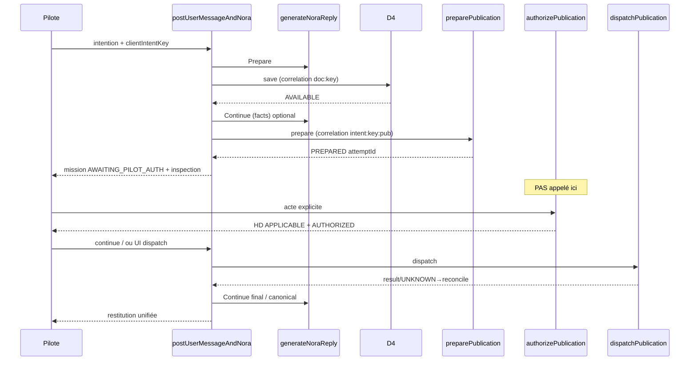

# SFIA Studio Next — Review Pack FULL
## R5 / Cycle 6 — Préflight d'intégration nominale — Continuité cognitive Nora/Studio

**Date/heure :** 2026-11-10 11:44:01 +0100 (Europe/Paris)
**GO Morris :** investigation READ-ONLY — 2026-11-10 — AUCUNE implémentation
**Candidat :** `fix/next-ml4-chat-first-d4-provenance-20261109` @ `d7f1507a` / tree `3e9e1086`
**Cadrage produit :** `69c27832` blob `2322644a` (VALIDATED)
**Handoff entrée contrats :** `fccc8bc6` blob `a05cfe71`
**RECETTE :** BUILD `8vZjme4-KnnPkAqm_QxMz` — non mutée
**Verdict :** NORA/STUDIO NOMINAL ARCHITECTURE INTEGRATION QUALIFIED — THREE P0 CONTRACTS RESOLVED — NO PARALLEL ENGINE OR OWNER — ACCEPT-01 PRESERVED — READY FOR MORRIS REVIEW — NO IMPLEMENTATION AUTHORIZED

---

## 1. Git Truth Check et sources

| Champ | Observé |
|---|---|
| HEAD | `d7f1507a56e50660ea24903c2dc563c249ba9086` MATCH |
| tree | `3e9e1086aaf83e22d8e3350565f1c747bb31f556` MATCH |
| origin/main | `6667a43858a5421e391b7441246536daad148bd6` |
| handoff entrée | `fccc8bc63ea770a5d5b8f6e99570830a2f459d0c` / blob `a05cfe71…` MATCH |
| cadrage blob | `2322644a…` MATCH |
| staged | vide |
| dirty/untracked | `.tmp-sfia-review/*`, manifests ENV-01, script — non nettoyés |

Sources lues pour ce préflight : code `effect-service.ts`, `PublicationInspectionPanel.tsx`, `decisions/service.ts`, `conversation/service.ts`, `document/service.ts`, `turn-command.ts`, schema, handoff @fccc8bc6, cadrage @69c27832, A3/R4, cadrage-r4 (modules intégrés, pas microservices).

---

## 2. Résumé des mécanismes nominaux existants

| Mécanisme | Fichier | Rôle |
|---|---|---|
| Entrée chat unique | `postUserMessageAndNora` `service.ts:254` | D3 conduit le tour |
| Turn lease / idempotence | `turn-command.ts` `clientTurnKey`+`ownerToken` | un tour HTTP |
| Authority D5/D6 pre-Nora | `applyConversationalAuthority` | effets pilotage avant generate |
| Nora `run()` unique | `nora-adapter.ts` `@openai/agents@0.21.0` | tools READ mid-run |
| D4 post-generate | `qualifyDocumentAct` → save/revise | puis `appendDocumentEffectAck` |
| D4 correlation | `doc:{key}` / `docrev:…` + `creationCorrelationKey` | idempotent replay |
| D4 reconstitution | `reconstituteConfirmedD4Effects` `service.ts:306+` | après UNKNOWN/ownership loss |
| D7 prepare | `preparePublication` L787 → status **PREPARED**, **sans HD** | unique `(pilot,project,correlationKey)` |
| D7 authorize | `authorizePublication` L920 → **insertHumanDecision APPLICABLE** + status **AUTHORIZED** | acte Pilote |
| D7 dispatch | `dispatchPublication` L1025 → claim lease + provider | exige AUTHORIZED |
| UI | `PublicationInspectionPanel` authorize disabled unless PREPARED; dispatch unless AUTHORIZED | L528–537 |
| HD insert | `insertHumanDecision` toujours `state: "APPLICABLE"` `decisions/service.ts:37` | **pas de PENDING** |

**Constat fondateur :** la conduite multi-domaines manquante n'est pas l'absence d'owners — c'est l'absence d'**enchaînement D3** après EffectRecords et le **lien durable tour↔attempt PREPARED** avant authorize.

---

## 3. Analyse P0-D6 — ÉCART CONFIRMÉ puis CONTRAT CORRIGÉ

### 3.1 Vérification code `d7f1507a`

**CONFIRMÉ :** `authorizePublication` crée immédiatement une HumanDecision **APPLICABLE** et passe l'attempt à **AUTHORIZED** (`effect-service.ts:999–1021`). Aucun état HD « PENDING » n'existe (`insertHumanDecision` L37).

**CONFIRMÉ UI :** bouton authorize seulement si `attempt.status === "PREPARED"` (`PublicationInspectionPanel.tsx:528–530`).

**CONFIRMÉ :** `preparePublication` seul crée PREPARED sans `decisionId` (L901–917).

### 3.2 Écart du contrat candidat @fccc8bc6

Le pack précédent plaçait `authorizePublication` dans une phase « présentation / attente » pré-Pilote. **INCORRECT sur ce code.** Appeler authorize = **acte d'autorisation réel**, pas une mise en attente.

### 3.3 Séquencement EXACT corrigé (réemploi API)

```
preparePublication → effect_attempts.status=PREPARED (decisionId=null)
→ présentation inspection (panel et/ou message D3 ; faits attemptId+fingerprint)
→ ATTENTE = Work/mission ancrée sur attempt PREPARED (PAS de HD fictive)
→ acte explicite Pilote (UI authorize OU commande conversationnelle qui appelle la MÊME API)
→ authorizePublication → HD APPLICABLE + AUTHORIZED
→ re-check gates (existant dans dispatch/assertStepAuthority)
→ dispatchPublication
→ reconcileAttempt si besoin
→ CognitiveContinue / restitution
```

### 3.4 Lien durable travail ↔ tentative sans decisionId

| Besoin | Solution nominale |
|---|---|
| Identité wait | `effect_attempts.id` + `status=PREPARED` |
| Clé stable avant effet | `correlationKey` choisie **avant** prepare ; unique index L742–747 |
| Lien conversation | stocker `attemptId` (+ correlationKey) dans `TurnResult.resultJson` / bloc ACK mission ; **pas** second registre d'autorité |
| Reprise | retrouver attempt PREPARED par id ou correlationKey ; panel inchangé |

**Interdit :** HumanDecision PENDING artificielle ; second owner D6 ; authorize « pour préparer l'attente ».

---

## 4. Analyse P0 — CognitiveContinue / PARTIAL (contradiction résolue)

### 4.1 Problème

Pack @fccc8bc6 : Continue fail → WorkIntent **PARTIAL terminal**, tout en prévoyant reprise cognitive. Contradiction.

### 4.2 Distinction d'états (corrigée)

| Couche | États | Signification |
|---|---|---|
| **Owner effect** | D4 AVAILABLE / D7 PREPARED|AUTHORIZED|… | vérité métier |
| **Tour / génération** | COMPLETE / UNKNOWN / FAILED / INTERRUPTED | `conversation_turn_commands` + Nora |
| **Mission / intention** | ACTIVE / AWAITING_PILOT_AUTH / RESTITUTION_PENDING / PARTIAL_FAILED_STEP / COMPLETED / STOPPED | projection D3 **logique** |
| **Restitution** | pending / delivered / canonical-fallback | message assistant |

**Règles :**
1. Effet confirmé + Continue fail → mission **RESTITUTION_PENDING** (toujours ACTIVE métier), **pas** PARTIAL terminal.
2. **PARTIAL_FAILED_STEP** seulement si une étape owner requise FAILED/DENIED/REVOKED (ex. HD deny).
3. Tour UNKNOWN ≠ mission terminée.
4. Reprise cognition : nouvel appel `generateNoraReply` Continue **sans** OwnerInvoke ; faits via `documentSave` reconstituté / attempt row.
5. Si modèle indisponible : restitution **canonique déterministe** (compose ACK/faits comme `composeDocumentTurnMessage`) — déjà le pattern D4 ; à généraliser. Mission peut COMPLETED_WITH_CANONICAL_RESTITUTION.

### 4.3 Preuve chemin reprise AS-IS

- `reconstituteConfirmedD4Effects` après ownership loss / UNKNOWN (`service.ts:980–987`, `1092+`).
- D4 idempotent sur `correlationKey` (`document/service.ts` find by creationCorrelationKey).
- Donc : **rejouer le tour avec même correlation ne recrée pas** ; Continue peut s'appuyer sur reconstitution.

---

## 5. Analyse P0 — Crash après effet / réconciliation

### 5.1 Clés stables AVANT effet

| Effet | Clé choisie avant | Persistée où | Unicité |
|---|---|---|---|
| D4 CREATE | `correlationKey` (`doc:{client}`) | `documents.creationCorrelationKey` + revision.correlationKey | lookup + race wait (`document/service.ts:194–245`) |
| D4 REVISE | `docrev:{client}:{doc}:{baseRev}` | revision.correlationKey | idempotent replay L472–483 |
| D7 | `correlationKey` input prepare | `effect_attempts` unique (pilot,project,key) L742–747 | prior same fingerprint → idempotent return L885–898 |
| Tour HTTP | `clientTurnKey` | `conversation_turn_commands` unique | fingerprint mismatch → 409 |

### 5.2 Fenêtres critiques

| P | Scénario | Vérité | Reprise sans double effet |
|---|---|---|---|
| P3 | commande émise, résultat local perdu | DB owner si commit | lookup correlation ; si trouvé → skip invoke |
| P4 | effet OK, ACK/projection perdu | owner row | reconstitute + compose canonique |
| P5 | effet OK, Continue pas fait | owner DONE | Continue only |
| P6 | Continue crash | owner DONE | retry Continue / canonical |
| P8 | HD OK, dispatch pas fait | AUTHORIZED | dispatch once (claim) |
| P9 | DISPATCHED retour perdu | attempt DISPATCHED | `reconcileAttempt` ; pas re-dispatch HTTP (L1041–1047) |
| P11 | double HTTP | keys | idempotent |
| P12 | STOP concurrent | fence / status | no invoke |

**Garantie réelle :** idempotent apply + reconcile — **pas** exactly-once distribué absolu.

### 5.3 WorkIntent table ?

**Non obligatoire pour P0 crash.** Les owners portent déjà la vérité. Une projection mission (JSON dans resultJson / message structuré / éventuelle table légère) ne fait que **référencer** attemptId/docIds/correlationKeys.

---

## 6. Matrice de réemploi

| Besoin cadrage | Existant | Extension |
|---|---|---|
| Qualify intention | cognitive-policy + document-act + pilotage intent | plan multi-steps in-memory / resultJson |
| Mobiliser D4 | post-generate save/revise | éventuellement **avant Continue** inchangé owner |
| Recevoir résultat D4 | DocumentEffectSummary + ACK | alimenter Continue |
| Mobiliser D7 prepare | `preparePublication` API/UI | **appel depuis D3 service** avec correlation dérivée |
| Attendre Pilote | PREPARED sans HD | message + panel ; pas authorize précoce |
| Autoriser | authorizePublication | inchangé — acte Pilote |
| Publier | dispatchPublication | inchangé après HD |
| Continue cognitif | — | 2e `generateNoraReply` facts-only **ou** tour suivant |
| Crash D4 | correlation + reconstitute | lier mission refs |
| Crash D7 | correlation + reconcileAttempt | idem |

---

## 7. Audit des quatre abstractions candidates (GATE anti-parallèle)

### 7.1 IntentConductor

| Q | Réponse |
|---|---|
| A Besoin | Enchaîner invoke owners après faits (E12) |
| B Existant | `postUserMessageAndNora` est déjà le conducteur de tour |
| C Étendre ? | **OUI** — phases dans service.ts (ou helper **privé** `runIntentPhases`) |
| D Nature | **responsabilité logique / module helper**, pas service déployé ni owner |
| E Duplication risque | second pipeline parallèle à postUserMessageAndNora |
| F Coût | moyen si helper ; élevé si micro-service |
| G Preuve nécessité | AS-IS s'arrête après ACK ; D7 hors chat |
| H Plus simple | étendre service.ts |
| I Régression | tours S01 si phases mal gardées |
| J Rollback | flag off → pipeline actuel |

**Verdict audit :** garder le **nom logique** ; **implémenter comme orchestration interne D3**, interdit comme moteur concurrent.

### 7.2 WorkIntent (table)

| Q | Réponse |
|---|---|
| A | Continuité multi-tours await PREPARED + reprise (E14) |
| B | effect_attempts + messages + turn resultJson + correlationKeys |
| C | **D'abord** projection dans `TurnResult` + ancrage attempt PREPARED |
| D | table = **option** si reconstruction insuffisante |
| E | risque second journal d'effets |
| F | migration+code si table |
| G | ACCEPT-01 wait cross-session : attempt PREPARED suffit comme vérité wait ; table seulement si plan multi-steps non reconstructible |
| H | `missionProjection` dans resultJson + liste attempts PREPARED projet |
| I | faible si refs-only |
| J | ignorer projection ; owners restent |

**Verdict audit :** **pas de table WorkIntent par postulat.** Recommandation préflight : **Phase 1 sans table** ; ouvrir table seulement si gap reconstruction prouvé en tests.

### 7.3 CapabilityCatalog

| Q | Réponse |
|---|---|
| A | E05–E06 connaître capacités vs tools |
| B | `cognitive-policy` allowlist + routes API existantes |
| C | module const/code `capability-catalog.ts` **read-only map** |
| D | config code, pas DB permissions |
| E | ne pas dupliquer D1/D6/D9 rights |
| H | étendre cognitive-policy + commentaires invokeMode |

**Verdict :** catalogue **code**, pas registre d'autorité.

### 7.4 CognitiveContinue

| Q | Réponse |
|---|---|
| A | E09/E11/E19 REC-08 |
| B | generateNoraReply ; next-turn context snippets |
| C | 2e appel adapter **même process** après EffectRecord ; ou tour suivant si await |
| D | phase, pas second moteur |
| E | double generate coût |
| H | canonical ACK-only sans 2e IA pour cas triviaux ; Continue IA quand narration métier nécessaire |
| I | latence |

**Verdict :** phase réutilisant `generateNoraReply` ; **pas** SDK session parallèle.

---

## 8. Doublons / états concurrents à éviter

- ❌ Second effect log dans WorkIntent
- ❌ HD PENDING
- ❌ authorize pré-Pilote
- ❌ IntentConductor HTTP service à côté de messages API
- ❌ Write-tools Nora comme autorité
- ❌ Remplacer turn lease / D7 claim
- ✅ Une entrée chat ; helpers internes
- ✅ Wait = PREPARED
- ✅ Truth = D4/D6/D7 rows

---

## 9. Proposition d'intégration minimale (cible préflight)

### Trajectoire

```
AS-IS postUserMessageAndNora
→ helper runMissionPhases (même transactionnel de tour / mêmes owners)
→ après D4 EffectRecord : optional Continue (adapter)
→ si plan inclut publish : preparePublication(correlation dérivée)
→ commit turn avec missionProjection {attemptId, status:AWAITING_PILOT_AUTH, effectRefs}
→ Pilote authorize (API existante)
→ event/next message : dispatch si AUTHORIZED + Continue final / canonical
```

**Structures réellement nouvelles (minimales) :**
1. Helper orchestration D3 (+ types MissionProjection).
2. Catalogue code invokeMode.
3. Phase Continue (appel adapter) + compose restitution multi-effects.
4. **Pas** de nouveau owner ; **pas** de table imposée en Phase 1.

**Couvre ACCEPT-01 :** oui, avec wait ancré sur PREPARED + authorize réel + dispatch existant.
**Évite moteur parallèle :** oui — un seul chemin messages.

---

## 10. Contrats d'interface et états corrigés

### MissionProjection (dans resultJson / message — Phase 1)

```ts
type MissionProjection = {
  clientIntentKey: string;
  status: "ACTIVE"|"AWAITING_PILOT_AUTH"|"RESTITUTION_PENDING"|"PARTIAL_FAILED_STEP"|"COMPLETED"|"STOPPED";
  steps: Array<{
    id: string; capabilityId: string; status: string;
    correlationKey?: string; attemptId?: string;
    documentId?: string; revisionId?: string; decisionId?: string;
  }>;
};
```

### Waiting sans HD

`status=AWAITING_PILOT_AUTH` + `steps[prepare].attemptId` + attempt row PREPARED.

### Continue fail

`status=RESTITUTION_PENDING` ; effects remain ; retry Continue or canonical compose.

---

## 11. Séquence ACCEPT-01 corrigée



---

## 12. Blast radius

| Zone | Impact |
|---|---|
| `conversation/service.ts` | phases + prepare call + projection |
| `nora-adapter.ts` | mode continue facts-only |
| `document-act.ts` | compose multi-effect ; dual-intent plan |
| `effect-service.ts` | **réemploi** ; pas de nouvelle autorité |
| Panel | inspection ; reste chemin authorize |
| schema | **Phase 1 : aucune migration obligatoire** |
| tests | ACCEPT-01 + P0 + NR |

---

## 13. Contrats d'idempotence

- D4/D7/turn : existants.
- Mission : `clientIntentKey` → mêmes correlationKeys dérivées.
- Continue fail : never new correlation for same step DONE.
- authorize/dispatch : idempotent paths existants L955–969, L1038–1040.

---

## 14. STOP, UNKNOWN, reprise

| Cas | Comportement |
|---|---|
| STOP Pilote | mission STOPPED ; no dispatch ; effects kept |
| D7 UNKNOWN | reconcileAttempt ; no blind dispatch |
| HD deny/revoke | PARTIAL_FAILED_STEP ; D4 kept |
| RESTITUTION_PENDING | Continue/canonical only |
| Session expire | re-auth D1 ; resume via attemptId/correlation |

---

## 15. Risques, dette, exit

| Risque | Mitigation |
|---|---|
| service.ts god-file | helper module private |
| prepare depuis D3 élargit surface | same gates preparePublication |
| Continue coût | skip if canonical sufficient |
| Tentation table précoce | gate Phase 2 only |

**Exit :** flag `MISSION_PHASES=off` → AS-IS tour ; attempts/docs intactes.

---

## 16. Matrice tests / non-régression (non exécutés)

| ID | Focus | Oracle |
|---|---|---|
| ACCEPT-01 | E2E mission | PREPARED wait sans HD ; authorize crée HD ; publish ; restitution |
| P0-D6 | authorize timing | prepare≠HD ; authorize⇒APPLICABLE |
| P0-Cont | Continue fail | RESTITUTION_PENDING ; D4 not duplicated |
| P0-Crash | kill after D4/D7 | correlation resume |
| NR-07/10/11 | témoins | PASS |
| REC-08 | Continue/canonical | no competing deny |
| S01 | simple | no forced prepare |

Niveaux futurs : DET / PG isolé / BROWSER / NORA LIVE / GITHUB REAL — gates séparés.

---

## 17. Plan macro-lot intégré (après GO Morris)

1. Catalogue code + MissionProjection types + dual-intent qualify.
2. Phases D4→Continue (REC-08) dans service helper.
3. preparePublication depuis D3 + AWAITING_PILOT_AUTH.
4. Reprise post-authorize/dispatch + Continue final.
5. Tests ACCEPT-01 + P0 + NR.
6. Docs sync.

**Sortie produit unique :** ACCEPT-01 — pas d'acceptation partielle « Continue only = done ».

---

## 18. Arbitrages Morris réellement nécessaires

1. **GO implémentation** intégration minimale ci-dessus (oui/non).
2. **Confirmer** wait = PREPARED sans HD PENDING (aligné code) — validation produit.
3. **A3** : orchestration interne D3 ≠ moteur d'actions Nora — confirmation courte.

**Non demandés :** table WorkIntent maintenant ; IntentConductor service ; bus.

---

## 19. Réserves

- Intégration **qualifiée conception** — non codée.
- Reconstruction multi-steps sans table : à prouver en DET/PG avant d'exclure table définitivement.
- Texte LIVE CREATE→REVISE : REPRO PENDING.
- REAL publish hors cycle.

---

## 20. Verdict et Git Review Index

**NORA/STUDIO NOMINAL ARCHITECTURE INTEGRATION QUALIFIED — THREE P0 CONTRACTS RESOLVED — NO PARALLEL ENGINE OR OWNER — ACCEPT-01 PRESERVED — READY FOR MORRIS REVIEW — NO IMPLEMENTATION AUTHORIZED**

| Artefact | SHA |
|---|---|
| Product | `d7f1507a` |
| Cadrage | `69c27832` / `2322644a` |
| Entrée | `fccc8bc6` / `a05cfe71` |
| RECETTE BUILD | `8vZjme4-KnnPkAqm_QxMz` |

**Corrections P0 vs @fccc8bc6 :** (1) authorize = acte Pilote réel ; wait=PREPARED ; (2) Continue fail→RESTITUTION_PENDING non PARTIAL terminal ; (3) crash→correlation owners, pas nouveau journal.

**STOP** — aucune implémentation.
