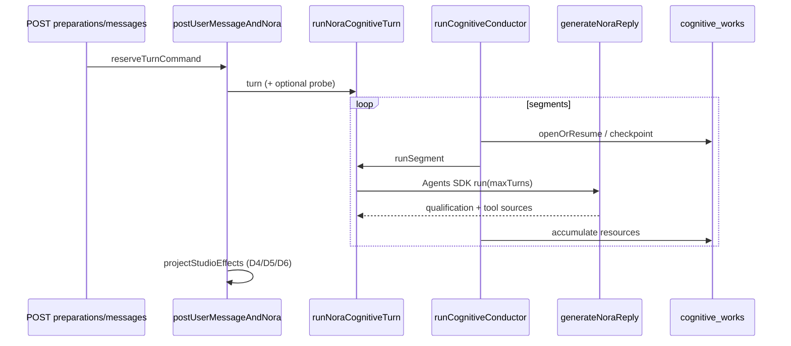

# SFIA Studio Next — ML5 Review Pack FULL
## Integrated cognitive convergence — TECHNICAL PREFLIGHT (READ ONLY)

| Field | Value |
|---|---|
| Date/heure | 2026-11-26T08:26:29+01:00 |
| Cycle | **6 — Architecture technique** · Profil **CRITICAL** · EVOL / READ-ONLY |
| Programme | R5 / ML5 — Convergence WEB sécurisé + allocation cognitive + FinOps |
| GO Morris | **PREFLIGHT ACCORDÉ** · delivery **NON** · LIVE/WEB LIVE **NON** · NO RELEASE |
| Mode | publish-in-cycle · Review Pack **FULL** · Handoff L3 REQUIRED |
| Product HEAD | `e3f5bde266c4e2549024f68458971278aad123eb` |
| Product candidate (code) | `1633c86b0330265436a1d73a7762de6562867bac` |
| Web tree | `e972dc0437033c4e463ac8f51519285927b1f45c` (identique HEAD↔1633c86b) |
| Merge-base main | `997897fd7cf914771e7d08e8030dc7123fab7d25` |
| Docs tip | `c601efa188ba4a09bb9a688d79dd1cf4371cb914` |
| Handoff tip pré-cycle | `22c52156ff546222dedcec2110df78c9fb75dbe0` (cutover UX ; mandat citait `480a32cc` — **stale**) |
| DEV HTML | `qWUDds50AUSup8n2GqNTC` · `:3100` (**observé**, no mutation) |
| RECETTE HTML | `g91mwyAgMId3zEUm7CcLq` · `:3200` · SHA servi **`1633c86b`** (**observé** ; mandat citait encore `70cf3e4a` — **stale**) |
| WEB LIVE | **BLOCKED** (env gates + code fail-closed) |
| Tests runtime | **NOT RUN — READ ONLY** |
| OpenAI / WEB LIVE calls | **NONE** |
| Product commits/pushes | **NONE** |
| Verdict | **ML5 INTEGRATED COGNITIVE CONVERGENCE — TECHNICAL PREFLIGHT COMPLETE WITH EXPLICIT RESERVES — READY FOR CHATGPT DESIGN REVIEW AND MORRIS ARBITRATIONS** |

---

## P1 — Git Truth et provenance

### Repository / branche / HEAD
- Repo : `mcleland147/sfia-workspace` · remote `https://github.com/mcleland147/sfia-workspace.git`
- Worktree : `/Users/morris/Projects/sfia-wt-next-ml5-20261123`
- Branche : `sfia/next-ml5-integrated-delivery-20261123`
- HEAD : `e3f5bde2…` = candidat code `1633c86b` + **2 commits docs-only** (`delivery-history` cutover UX) — **web tree inchangé** `e972dc04…`
- Ascendance `1633c86b ⊂ HEAD` : YES
- `origin/main` / `ls-remote` : `997897fd…` (inchangé)
- Dirty : uniquement `.tmp-sfia-review/chatgpt-review.md` (pack réinitialisé puis réécrit ce cycle)
- Staged : vide
- Aucun reset/stash/clean/pull/rebase

### Divergence vs observations distantes du mandat
| Observation mandat | État local/observé | Qualification |
|---|---|---|
| Handoff `480a32cc` | tip `22c52156` | Cutover RECETTE UX publié après ; handoff UX delivery toujours ancestral |
| RECETTE `70cf3e4a` / `m5QcOrvj…` | HTML `g91mwyAg…` = build de `1633c86b` | Cutover UX exécuté ; rollback `70cf3e4a` conservé |
| Décision `1e8299c5` …/2026-11-23-ml5-cursor-git-direct… | **ABSENT** HEAD/main/docs tip ; objet Git **non fetchable** (`not our ref`) | Provenance **UNKNOWN locale** ; liée historiquement à branche conception `017a77e9` (lien dans conducteur.md) — **ne pas réécrire** |
| Doc allocation FinOps | **ABSENT** produit HEAD ; **PRESENT** docs tip `c601efa1:…/allocation-cognitive-adaptative-et-finops.md` | Écart Product↔docs ; OUT WEB LIVE dans ce doc **≠** arbitrage Morris 26/11 regroupant WEB+allocation+FinOps |

### Baseline qualifiée
**ML5 CURRENT BASELINE QUALIFIED** — candidat code sans ambiguïté (`1633c86b` / web `e972dc04`).

---

## P2 — Architecture as-implemented (conducteur D3)

### Flux (CODE INSPECTED)

### Propriétaires / fichiers clés
| Responsabilité | Fichier | Symbole |
|---|---|---|
| Entrée | `web/src/app/api/preparations/[preparationId]/messages/route.ts` | POST |
| Orchestration tour | `domains/conversation/service.ts` | `postUserMessageAndNora` |
| Tour cognitif | `run-nora-cognitive-turn.ts` | `runNoraCognitiveTurn`, `resolveDocumentaryProductionBoundary` |
| Conducteur adaptatif | `cognitive-conductor.ts` | `runCognitiveConductor` |
| Politique | `cognitive-policy.ts` | `buildCognitivePolicy`, `NORA_STUDY_MODEL` |
| Adaptateur | `nora-adapter.ts` | `generateNoraReply`, `runLiveWithTools` |
| Persistance travail | `cognitive-work.ts` + `db/schema.ts` `cognitive_works` | checkpoints, `resources_json` |
| Activité LIVE | `activity-projection.ts` + `NoraLiveActivity.tsx` | projection métier |

### Réponses déterminantes (Bloc A)
1. **Modèle/effort** : `cognitive-policy.ts` fixe `gpt-6.2-sol` ; effort via `modelSettings.reasoning.effort` (`nora-adapter.ts` ~1131–1133). `qualifyCognitiveProfile` = toujours `analyse`/`medium` (pas de routage longueur).
2. **Changement inter-segments** : **oui** — `resolvePolicy` dans `runNoraCognitiveTurn` peut passer `investigation`/`high`, restitution `simple`/`medium` ; **modèle reste Sol** (pas de catalogue multi-modèles).
3. **Unité génération** : un `generateNoraReply` → un `generationId` ; un segment ≈ une génération (probe réutilisable).
4. **Requêtes fournisseur / segment** : un `run(agent,…)` ; boucle outils jusqu’à `maxTurnsForPolicy` (= `max(2,maxProviderCalls)`). Compteur HTTP = `usage.requests` si exposé sinon UNKNOWN.
5. **Acquis transmis** : état investigation checkpointé + `formatInvestigationContinuationContext` (compaction) ; consignes de non-relecture CONSULTED.
6. **Réutilisation** : refs journal sources ; pas de relecture systématique des corps d’outils.
7. **Compteurs** : `CognitiveResources` cumulés (`input/output/cache/reasoning/webCalls/segmentCalls/duration`) dans `resources_json`.
8. **Limites** : envelope global 2M tokens / 1M reeval / 120 segments (`cognitive-work.ts` 618–705) ; soft stop → `RESTITUTION_PHASE` ; stagnation 3 segments ; `maxSegmentsThisInvocation` local.
9. **Concurrents** : snapshot legacy `investigation-persistence` read-compat ; hosted `webSearchTool` détaché de Nora.
10. **Frontière cognition≠D4** : production D3 (`documentProduction*`, APPEND/SUPERSEDE) ≠ écriture D4 (intents + `projectStudioEffects` + autorité Pilote). IT-06 acquis — ne pas rouvrir.

### Non-régression documentaire à préserver
- `resolveDocumentaryProductionBoundary` — SUPERSEDE entre productions ; APPEND mid-work.
- Candidat unique / visionneuse / conservation V1–V2.
- `modelApplied` souvent `"UNVERIFIED"` LIVE — ne pas fonder la non-régression sur l’égalité de chaîne modèle appliqué.

---

## P3 — WEB Security and Capability Assessment

### Path as-implemented
Nora tools `public_web_search` / `public_web_open_page` → `canUsePublicWebFrontier` → `authorizePublicWebQuery` / registry → sanitize → **SCRIPTED** ou **LIVE isolé** (`executeIsolatedLiveWebSearch` : Agent séparé + `webSearchTool`, query-only) → open via `web-egress-guard` (DNS pin, no redirect) → journal sources → merge investigation.

**Hosted tool jamais attaché à Nora** (`nora-adapter` ; legacy `web-search-tools.ts` P0-03).

### Gates (WEB LIVE BLOCKED)
- OFF si `SFIA_WEB_SEARCH_ENABLED≠1`
- LIVE seulement si aussi `SFIA_WEB_SEARCH_LIVE=1`
- TEST_BOUNDARY exige `SFIA_WEB_SEARCH_TEST=1`
- RECETTE/DEV observés : LIVE=0 (cutover scripts + env)

### B01–B09 / P0-03 (code courant + registre)

| ID | Impl. | Preuve | Écart déterminant | Action candidate |
|---|---|---|---|---|
| B01 | PARTIAL | unit SCRIPTED | Pas de gate sémantique « valeur déterminante » serveur | Politique conductor + Morris gate LIVE |
| B02 | PARTIAL | unit open | Pas find-in-page ; PDF non traité | Compléter open LIVE + content-type |
| B03 | PARTIAL unwired | unit only | `confrontWebSources` **non appelé** produit | Brancher après search |
| B04 | PARTIAL | unit citation | **Pas d’UI** citations | Surface Pilote |
| B05 | PARTIAL | journal coverage | Discipline outil | Labels honnêtes enforcement |
| B06 | PARTIAL | instructions + scrub | Injection LIVE **NOT PROVEN** | Red-team LIVE borné (GO futur) |
| B07 | PARTIAL→C22 | unit authorize | `admitNoraProposedPublicQuery` = sanitize+markers ≠ classification métier | File d’admission humaine / faits enregistrés ; renforcer patterns |
| B08 | PARTIAL | open timeout/bytes | Search LIVE **sans timeout** explicite `run()` ; PDF absent | Timeout + content gate |
| B09 | IMPLEMENTED (registre C14) / LIVE gated | scripts C14 historiques | Compat runtime non gate ; usage isolé mal attribué | Attribuer usage worker ; CI mock |
| P0-03 | KEEP | unit boundary | Double mécanisme documenté | Frontier seule autorité |

### Confidentialité (B.1)
- **KEEP** : séparation Nora privée vs worker query-only ; deny free-form ; catalog exact queries.
- **GAP** : `admitNoraProposedPublicQuery` (`public-web-registry.ts` 127–151) — secrets métier non matchés par regex peuvent être admis puis exact-allowlistés.
- **GAP** : Search LIVE DNS/destinations = **garantie fournisseur**, pas Studio (`WEB_FRONTIER_NETWORK_BARRIER_LIMITS`).
- Instruction système / regex / env **≠** preuve d’exfiltration impossible. Verdict sécurité définitif : **NOT PROVEN** (statique).

### Réseau (B.2)
- Open LIVE : HTTPS, deny private/link-local/metadata, DNS resolve+pin, **no redirect follow**, byte/timeout caps — **CODE INSPECTED** + unit.
- Search LIVE : hors pin Studio — **DOCUMENTED GAP**.

---

## P4 — Cognitive Allocation Assessment

### SDK / modèles (CODE INSPECTED)
| Item | Valeur |
|---|---|
| `package.json` | `@openai/agents ^0.21.0` |
| Lock | `openai@7.50.0`, `@openai/agents@0.21.0`, `@openai/agents-openai@0.21.0` |
| Modèle demandé | `NORA_STUDY_MODEL = "gpt-6.2-sol"` |
| Effort | `reasoning: { effort: policy.effortRequested }` (`low|medium|high`) |
| Modèle appliqué | souvent `"UNVERIFIED"` LIVE |
| Luna/Terra/Sol API IDs | **NOT OBSERVED** comme catalogue runtime — candidats calibration doc uniquement |
| Disponibilité compte API | **NOT OBSERVED** (aucun appel) |

### Allocation initiale
- Défaut serveur : `analyse`/`medium`/Sol — **pas** de classifieur LLM préalable (`qualifyCognitiveProfile`).
- Extension points existants : `profileHint`/`effortHint`, `resolvePolicy(work, segmentIndex)`, budgets OPERATIONAL vs TEST_BOUNDARY.
- Alternatives futures (non décidées) : (A) conserver Sol + effort adaptatif seul ; (B) catalogue gouverné Luna/Terra/Sol + admission serveur ; (C) micro-qualification bornée — coûts/risques à arbitrer.

### Réallocation mid-work
- Identité travail **stable** (`cgw_*`) ; ressources **cumulées** ; checkpoints versionnés.
- Changer de modèle : hook possible via `resolvePolicy` mais **aucun catalogue multi-modèles** aujourd’hui.
- Chaîne de raisonnement interne **non transférable** — seuls acquis investigation/production/refs.
- Structured outputs / tools / fencing / idempotence : à re-prouver par couple modèle×outils.

### Politique ressources (appliquée en code)
| Limite | Owner | Défaut code | Env |
|---|---|---|---|
| Max tokens admin | `evaluateGlobalResourceEnvelope` | **2_000_000** | `SFIA_COGNITIVE_MAX_TOKENS` |
| Seuil réévaluation | idem | **1_000_000** | `SFIA_COGNITIVE_REEVAL_TOKENS` |
| Max segments | idem | **120** | `SFIA_COGNITIVE_MAX_SEGMENTS` |
| Budgets segment | `OPERATIONAL_BUDGETS_PROVISIONAL` | ex. analyse 8 provider / 10 D4 / 12 Git | profileType |
| Wall clock | budgets | 600s–1800s | policy |

Preuve d’application runtime RECETTE : boot log cutover `MAX_TOK=2000000 REEVAL=1000000 SEGS=120` (**historique récent**, pas rejoué ce cycle).

---

## P5 — Usage Accounting and FinOps Assessment

### Collecte
- `provider-usage.ts` `extractProviderUsageFromRunResult` — input/output/total/reasoning/cached/requests ; null = UNKNOWN (jamais 0 inventé).
- Accumulation `accumulateResources` — **ne double-compte pas** reasoning dans envelope (comment C24) ; cache **hors** envelope sécurité, **dans** OBS coûts.
- Points : générations Nora, segments, webCalls (count sources WEB) ; **worker WEB isolé** : usage **pas clairement fusionné** dans usage Nora.
- Qualification/consolidation : même adaptateur si via `generateNoraReply` ; sinon **UNKNOWN**.

### Attribution
Clés disponibles : pilot, preparation, project?, conversation, workId, turnCommandId, generationId, segmentIndex, attempt_id (OBS). Lane via env/OBS. **Pas** de table `usage_events` dédiée.

### Persistance
- `cognitive_works.resources_json` + checkpoints `resources_json` (migration `020_cognitive_work.sql`) — **KEEP / REUSE**.
- Traces OBS `SFIA_OBS` — complémentaires, non vérité financière.
- Post-restart : resources checkpointées si CAS OK ; in-flight SDK state **non** rejoué.

### Tarification
- **MISSING** catalogue tarifaire versionné runtime.
- Référence historique hardcodée test e2e `ensemble05-live-bounded.spec.ts` (USD/1M) — **non** autorité FinOps.
- `estimatedCostUsd` champ présent, alimentation **non systématique**.

### UX surfaces
- Activité LIVE métier ≠ FinOps.
- Candidats réutilisation : settings/integrations, pilotage, observabilité (`obs-query` scripts), admin — **pas d’écran FinOps**.
- Options : (1) projection agrégée lecture seule sur pilotage ; (2) page settings opérateur ; (3) export OBS — arbitrage Morris.

---

## P6 — Corpus de calibration réutilisable

| Preuve | Source | Mesure | Limites |
|---|---|---|---|
| Investigation Git ~50 sources | Doc allocation `c601efa1` citant handoff `5f208d5e` blob `1a72b12a…` | 280 545 totaux ; 276 712 in ; 3 833 out ; 188 698 cache ; 11 req ; suspension | **DOCUMENTED** handoff — pas rejoué ; candidat historique `cb4ae599` rapporté ; modèle Sol pressenti ; **NOT** facturation |
| Notes 37 452 / 36 589 / 38 638 | Même doc | Tokens travaux note | Comparabilité limitée ; SHAs exacts **NON OBSERVÉS** ici |
| StockTrack IT-06 UAT | PV InterventionTrack + cutover `70cf3e4a`→`1633c86b` | Comportement documentaire accepté Morris | Tokens **NON OBSERVÉS** ce cycle ; UX residual à UAT |
| Envelope 2M/1M/120 | Code + RECETTE boot | Appliqué | Calibration administrative ≠ coût $ |

**Réutilisabilité :** référence Sol pour coût/qualité **à reconduire** sous GO LIVE borné futur ; ne pas traiter les chiffres handoff comme vérité tarifaire actuelle.

---

## P7 — Integrated Architecture Assessment

### Actifs
| Actif | Classe | Motif |
|---|---|---|
| Conducteur D3 unique | **KEEP** | Option B validée ; multi-segments |
| `cognitive_works` + checkpoints | **KEEP** | Continuité ≠ production |
| Politique fail-closed lanes | **KEEP** | DEV/RECETTE provisional |
| Frontier WEB query-only + egress open | **REUSE/ADAPT** | Base P0 ; gaps B07 propose / search DNS |
| Authorize exact/registry | **KEEP/EXTEND** | Renforcer admission faits publics |
| `provider-usage` + resources_json | **EXTEND** | Socle FinOps |
| Hosted webSearchTool on Nora | **RETIRE CANDIDATE** (déjà détaché) | P0-03 |
| Catalogue Luna/Terra/Sol runtime | **MISSING** | Doc only |
| Tarif versionné | **MISSING** | — |
| confrontWebSources product path | **MISSING wiring** | Fonction existe |
| Décision 23/11 Git/session dans baseline | **UNKNOWN** locale | Objet distant non fetchable |

### Blast radius (delivery futur)
API/contrats : adaptateur + policy + frontier + accounting. PG : probablement EXTEND `resources_json`/projections (éviter 2e vérité). D3 fort ; D4/D6 non-régression documentaire ; D7/D8 hors lot ; SDK models ; UX activité vs FinOps ; sécurité WEB ; tests unit+LIVE bornés ; ENV-01 RECETTE gelée jusqu’à GO cutover.

### Options à arbitrer (extrait)

**1. Autorisation données WEB**
- A — Catalog + exact only (strict) · B — A + file d’admission humaine des `proposedPublicQuery` · C — classifieur public/privé (coût/complexité). **Rec. préflight :** B minimal avant LIVE privé.

**2. Protection réseau B1**
- A — Conserver pin open + accepter risque provider search · B — Proxy egress Studio pour search aussi · C — Désactiver search LIVE jusqu’à pin. **Rec. :** A documenté + tests ; B si risque inacceptable.

**3. Allocation initiale**
- A — Sol + effort adaptatif · B — Catalogue multi-modèles calibré · C — classifieur systématique (éviter). **Rec. :** A court terme ; B après calibration.

**4. Réallocation**
- Aux frontières de segment uniquement ; même workId ; pas de transfert CoT.

**5–8. Comptabilité / tarif / protections $ / UX FinOps**
- Étendre resources+OBS d’abord ; tarif versionné hors code métier ; plafonds déjà 2M ; UX lecture séparée de LIVE.

---

## P8 — Proposed Integrated Delivery Scope (non normatif)

**Résultat utilisateur :** Nora recherche le WEB **sans fuite privée**, alloue modèle/effort **proportionnés et mesurables**, opérateur voit **coût/origine** ; Pilote garde une seule Nora.

**IN :** fermeture P0 WEB (B06–B08 + admission), catalogue/calibration modèles, allocation D3, comptabilité bout-en-bout, UX FinOps minimale, tests, docs as-built.
**OUT :** livraison 2 D7/D8, nouveau conducteur, STABLE, WEB LIVE sans Morris gate, FinOps concurrent DB.

**Dépendances internes :** (1) accounting instrumentation early → (2) calibration Sol baseline → (3) WEB LIVE gated trials → (4) multi-model if justified → (5) UX FinOps.
Sous-travaux parallélisables : citation UI ; tarif catalog ; tests SSRF. Point d’intégration : D3 policy + frontier + resources.

**Critères de sortie (candidats) :** WEB LIVE sous gate avec B07 non regress ; allocation observée ; FinOps agrégats sans double-count ; IT-06 non regress ; RECETTE cutover sous GO distinct.

**Écart doc :** `allocation-cognitive-adaptative-et-finops.md` exclut encore WEB LIVE — **réconcilier** au prochain cycle documentaire (hors ce READ-ONLY).

---

## P9 — Contrôles et verdict

### Préservation projet
| Contrôle | Résultat |
|---|---|
| HEAD avant/après | `e3f5bde2` inchangé |
| Branche | inchangée |
| Web tree | `e972dc04` inchangé |
| Diff Product | **aucun** fichier Product créé/modifié |
| Docs projet | **non** modifiées |
| Dépendances | **non** installées |
| DB / OpenAI / WEB LIVE | **aucune** mutation / appel |
| Commit/push produit | **NONE** |
| Dirty non attribuable | pack `.tmp-sfia-review` seulement |

### Limites investigation
- Statique + docs tip + handoffs cités ; **pas** de nouvelle preuve LIVE/REAL.
- Décision 23/11 objet Git **non résolu** localement.
- Calibration chiffres = **DOCUMENTED** via handoff historique, non re-mesurés.
- RECETTE/DEV HTML **observés** (curl login) sans effet métier.

### Gates restants
- Morris UAT UX residual RECETTE (`g91mwyAg…`)
- Conception + arbitrages WEB/allocation/FinOps
- GO delivery distinct
- WEB LIVE Morris gate
- OPERATIONAL_VALIDATED **non disponible**

### Verdicts
**ML5 INTEGRATED COGNITIVE CONVERGENCE — TECHNICAL PREFLIGHT COMPLETE WITH EXPLICIT RESERVES — READY FOR CHATGPT DESIGN REVIEW AND MORRIS ARBITRATIONS.**

**HANDOFF UPDATED — REMOTE VERIFIED** *(après publication L3)*

R5 IN PROGRESS · ML5 OPEN · WEB LIVE BLOCKED — P0 OPEN · D8 indépendant non qualifié · Livraison 2 non engagée · R6 NOT STARTED · NO RELEASE · NOT ADOPTED

---

## Instruction ChatGPT (obligatoire)

Relire le fichier canonique publié sur `sfia/review-handoff` au commit exact rapporté après push, vérifier son blob, et examiner les conclusions **P1–P9** avant toute recommandation de delivery. Ne pas traiter les observations stale du mandat (RECETTE `70cf3e4a`, handoff `480a32cc`) comme état courant.
