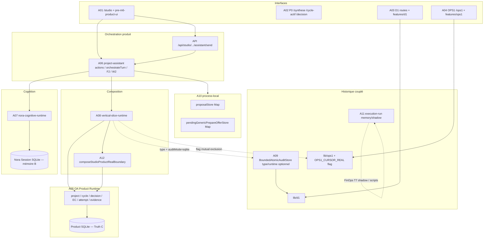

# SFIA Review Pack — FULL — CRITICAL

## 00. Identity

| Field | Value |
| --- | --- |
| Timestamp UTC | 2026-10-22T17:45:17Z |
| Cycle | AKG-M4-A / T-A01 — Dependency & consumers audit |
| Type | Cycle 6 — Architecture technique |
| Profile | CRITICAL |
| Typologie | DOC / Architecture / Rationalization Assessment |
| Mode | Analysis local candidate + Review Handoff L3 bounded |
| Repository | mcleland147/sfia-workspace |
| Analysis branch |  |
| Analysis HEAD |  (= source tip docs/akg-m4a-capability-first-rationalization) |
| origin/main |  |
| PR source | #604 Draft OPEN · CI SUCCESS · non merged |
| GO | M4 Formal Start + M4-A initial lot (Pilot 2026-10-22); T-A01 investigation |
| Project mutation authorized | ONE documentary file only; NO project commit/push/PR/merge |
| Handoff push | L3 bounded only |

## 01. GO / Autorisations

AUTHORIZED: static dependency/consumer audit A01–A12; create  on analysis branch; Full Review Pack; Review Handoff L3 publish.

NOT AUTHORIZED: app/runtime/test/config mutation; data migration; Cursor REAL; PRR/Build Doctrine/v3 edits; M4-A CLOSED; v3 ADOPTED; P6 GLOBAL PASS; project commit/push/PR/merge; destructive git.

## 02. Local Git Truth — before

| Check | Result |
| --- | --- |
| origin/main |  MATCH expected f44a99b4… |
| Source branch tip | c48c6a582c10ee3cf6902203d6a4eb01ce3f2139 MATCH |
| PR #604 | Draft OPEN; Detect/Build/Required Gate SUCCESS |
| Isolation | New worktree  from source commit; preexisting dirty WTs untouched |
| Analysis HEAD |  |

## 03. Sources consulted

Method: sfia-cycle-execution-template (§§2,3,5,7,9); cycle-routing-guide §4.3.0a; operating-model; rules-and-guardrails; knowledge-layer.

Governance: Build Doctrine; Roadmap; G0 architecture-persistence decision pack.

AKG: README; 01 AS-IS; 02 TO-BE; 03 orientations; 04 M4-A responsibilities.

PRR: README; 01; 02; 03; 04; 06; 07; 08; 09 (relevant sections).

Doctrine v3: 30; 32; 34; 35.

Code (static): app/studio/**; P0 routes; D1/OPS1 routes+libs+features; project-assistant; nora-cognitive-runtime; vertical-slice-runtime (+composeStudioProductRealBoundary); oa modules; proposal/prepare stores; execution-run; sample tests/e2e/scripts.

## 04. Convergence / method notes

OR-13 capability-first applied. CKC Architecture = cognitive guidance only. Runtime v3 NON ADOPTED. G0-A/B remain ADOPTED constraints.

## 05. Deliverable created

Path:

Only project file added this cycle. Content covers required sections 1–10 (baseline, graph, A01–A12 matrix, capability/impl, historical deps, scenarios, impacts, gaps, recommendations, M4-A exit conditions unmet).

## 06. Audit matrix — significant conclusions

- A01 Product UI: CONFIRMED consumers; KEEP capability / ADAPT impl candidate.
- A02 P0: active routes; no Product Spine consumer; CONSOLIDATE/RETIRE LATER candidate.
- A03 D1: confirmed island + SQLite; HARVEST/REPLACE candidate (SC-A); not KEEP-by-import.
- A04 OPS1: confirmed island + e2e; Product couples via OPS1_CURSOR_REAL flag only (not adapter import from A12); HARVEST/REBUILD/RETIRE LATER (SC-B).
- A05 OA: heavy consumption; KEEP socle (G0); ADAPT limits.
- A06 PA: central orchestration; ADAPT/CONSOLIDATE (SC-C).
- A07 Nora: cognition consumers via PA; KEEP/ADAPT boundary.
- A08 VSR: composition hub; KEEP capability / ADAPT or REBUILD composition.
- A09 D1 audit type: CONFIRMED type + optional sqlite auditMode (default noop); HARVEST/REPLACE port before D1 retire.
- A10 process-local stores: CONFIRMED F2/W2 path; restart continuity NOT PROVEN; ADAPT/COMPLETE/REBUILD candidate.
- A11 execution-run: outside Product Spine; FinOps/shadow/tests; FREEZE candidate.
- A12 REAL boundary: OA execution-attempt only; KEEP guarantees / ADAPT ports.

## 07. Candidate classifications (non-final)

SC-A D1 intake · SC-B Cursor unify · SC-C orchestration · SC-D P0 · SC-E composition · SC-F continuity · SC-G execution-run FREEZE.

All CANDIDATE. No definitive retire. No Delivery GO.

## 08. Risks / reserves

- Dual UI generations still routable.
- Flag coupling OPS1↔Product safety.
- Process-local continuity debt.
- Incomplete T-A02…T-A06.
- REAL / P6 / v3 boundaries unchanged.
- Dynamic import graph PARTIAL.

## 09. Fake/Real

Static analysis only. New Fake: NONE. New REAL proof: NONE. REAL NOT PROVEN. P6 GLOBAL NOT PASSED. Runtime v3 NON ADOPTED.

## 10. Validations

- git status: only untracked  (+ review pack temp).
- git diff --check: clean on tracked (new file untracked).
- Single project documentary file created.
- No project commit/push.

## 11. Review Handoff L3

Branch: sfia/review-handoff
Canonical: sfia-review-handoff/latest-chatgpt-review.md
Publisher: scripts/sfia/publish-review-handoff.sh
Worktree: /Users/morris/Projects/sfia-workspace/sfia-review-handoff
Message: docs(review-handoff): AKG-M4-A T-A01 dependency consumers audit

(Results filled after publish in Cursor report.)

## 12. Verdict (Cursor)

READY FOR CHATGPT CRITICAL REVIEW — AKG-M4-A / T-A01 LOCAL CANDIDATE

(Conditional on successful handoff remote verify.)

## 13. Instruction ChatGPT (template §9.1)

Read on Git branch  the file .

Perform: **CHATGPT CRITICAL REVIEW — AKG-M4-A / T-A01**.

Independently verify:

1. Handoff commit/blob remote.
2. Git baseline (main f44a99b4…; analysis/source c48c6a58…; PR #604 Draft).
3. Only one project documentary file created; no runtime mutation.
4. Completeness of A01–A12 consumer matrix and evidence refs.
5. OR-13 respected (no KEEP-by-import alone; no REBUILD-by-old-name alone).
6. G0-A/B continuity; TO-BE alignment without claiming adoption.
7. Scenarios remain CANDIDATE; M4-A exit conditions unmet.
8. Fake/Real / P6 / v3 anti-claims.
9. Open T-A02…T-A06 gaps honest.
10. No project push/PR/merge claimed.

If PASS: qualify T-A01 as accepted local investigation input for subsequent M4-A tasks — **not** M4-A CLOSED.

## 14. Full document content

The complete local candidate document follows verbatim.

---
# AKG-M4-A / T-A01 — Audit des dépendances et consommateurs du runtime

| Champ | Valeur |
| --- | --- |
| Cycle | **AKG-M4-A / T-A01** — Audit dépendances & consommateurs |
| Type / Profil | Cycle 6 — Architecture technique · **Critical** |
| Typologie | DOC / Architecture / Rationalization Assessment |
| Capacités v3 | V3-F05 / V3-F07 (sous doctrines applicables) |
| Baseline Git (analyse) | Branche `analysis/akg-m4a-ta01-dependency-audit` @ `c48c6a582c10ee3cf6902203d6a4eb01ce3f2139` (= tip `docs/akg-m4a-capability-first-rationalization` / PR #604 Draft) |
| `origin/main` au démarrage | `f44a99b4da84188772b80aca3c9ebe1a3e12617e` |
| Méthode | Analyse **statique** (imports, routes, factories, compositions, tests) · profondeur transitive ≤ 6 · **aucune mutation runtime** |
| Principe | **OR-13 / capability-first** — une dépendance activement utilisée ne justifie pas, à elle seule, la conservation de son implémentation historique |
| Statut maturité | **LOCAL CANDIDATE — INVESTIGATION** · M4-A **NON CLOSED** · classifications **candidates** seulement |
| Non-claims | Pas de GO Delivery · pas de retrait · pas de P6 GLOBAL PASS · runtime v3 **NON ADOPTED** · REAL **NOT PROVEN** · Fake/Real inchangés |

> **Autorité de vérité AS-IS :** code Git + preuves primaires > [PRR](../../../production-runtime-reference/README.md) > [04 M4-A](./04-m4a-runtime-responsibilities-and-transition-assessment.md) > le présent audit. Une contradiction documentaire = écart explicite.

---

## 1. Baseline Git, périmètre et limites

### 1.1 Git Truth (démarrage)

| Référence | Attendu | Observé live | Qualification |
| --- | --- | --- | --- |
| Repository | `mcleland147/sfia-workspace` | MATCH | CONFIRMED |
| `origin/main` | `f44a99b4…` | `f44a99b4da84188772b80aca3c9ebe1a3e12617e` | CONFIRMED |
| Branche source | `docs/akg-m4a-capability-first-rationalization` | tip `c48c6a582c10ee3cf6902203d6a4eb01ce3f2139` | CONFIRMED |
| PR source | #604 Draft, CI validée, non mergée | OPEN Draft · Detect/Build/Required Gate **SUCCESS** · URL https://github.com/mcleland147/sfia-workspace/pull/604 | CONFIRMED |
| Worktree d'analyse | Créé isolé (ne touche pas les WTs dirty préexistants) | `/Users/morris/Projects/sfia-workspace-akg-m4a-ta01-dependency-audit` · branche `analysis/akg-m4a-ta01-dependency-audit` | CONFIRMED |
| Push/commit/PR/merge projet | Interdits | Non exécutés | CONFIRMED |

### 1.2 Périmètre

Auditer les **douze actifs A01–A12** du [document M4-A](./04-m4a-runtime-responsibilities-and-transition-assessment.md) :

- Product UI / routes P0 / D1 / OPS1 ;
- OA Product Runtime ;
- Project Assistant (F2/W2/`orchestrateTurn`) ;
- Nora Cognitive Runtime ;
- `vertical-slice-runtime` et composition REAL ;
- `oa/execution-run` ;
- stores process-local et liens SQLite.

Inclure appels **directs et indirects** : imports TS, routes Next.js, server actions, factories/composition, imports dynamiques, scripts et tests lorsque pertinents.

### 1.3 Limites d'investigation (explicites)

| Limite | Conséquence |
| --- | --- |
| Statique uniquement | Aucune exécution Cursor REAL, aucun effet mutable, aucun build/test comportemental lancé dans ce cycle |
| Profondeur transitive plafonnée à **6** | Au-delà : lien marqué PARTIAL / UNKNOWN avec justification |
| Pas d'inventaire exhaustif de données utilisateur D1/OPS1 | Migration/data = **T-A04** (ouvert) |
| Pas de séquences temporelles complètes Nora→OA→Cursor | **T-A03** (ouvert) |
| PRR 04 = arêtes **curatées**, pas graphe d'import automatique | Complété ici par preuves Git ciblées ; non exhaustif global |
| Consumers « humains » (bookmarks, docs externes) | UNKNOWN hors dépôt |
| Dynamic `import()` non listés exhaustivement | PARTIAL là où seul un échantillon confirmé |

---

## 2. Cartographie composants et dépendances

### 2.1 Graphe de consommation principal (observé)

**Lecture :** les flèches continues sont des consommations runtime CONFIRMED au tip analysé. Les flèches pointillées sont des couplages de type, de flag, ou de composition optionnelle.

### 2.2 Cycles / couplages transverses observés

| Couplage | Nature | Preuve | Qualification |
| --- | --- | --- | --- |
| Product REAL ↔ flag `OPS1_CURSOR_REAL` | Exclusion mutuelle / safety | `deterministicExternalLaunchBoundary.ts` L47–57 ; `realLaunchSafety.ts` L106–107 | CONFIRMED — **dépendance de gouvernance**, pas d'appel OPS1 adapter depuis A12 |
| VSR → D1 `BoundedAtomicAuditStore` | Type + option `auditMode=sqlite` | `service.ts` L14, L110, L176–187, L758 | CONFIRMED type ; runtime effect **seulement si** store injecté |
| PA ↔ Nora ↔ OA | Orchestration / cognition / autorité | `orchestrateTurn.ts` imports Nora + OA cycle ; `actions.ts` → `getRuntimeApplicationService` | CONFIRMED |
| F2 Proposal → HD → EC | Chaîne autorité (PRR 04) | `proposalStore` → `recordDecision` → prepare paths | CONFIRMED (chemin logique) ; continuité process-local PARTIAL restart |
| execution-run ↔ FinOps T7 | Shadow / scripts | `scripts/finops-t7-shadow-rollout.ts` ; `composeFinOpsT7ShadowExecutionDeps.ts` | CONFIRMED hors Product Spine |
| D1 ↔ OPS1 (nav) | Lien UX historique | `features/d1/D1AppShell.tsx` href `/ops1/nouvelle-demande` | CONFIRMED navigation ; ≠ partage DB |

### 2.3 Chemins sans consommation Product Spine retrouvée

| Actif | Consommation Product Spine | Autre consommation | Qualification |
| --- | --- | --- | --- |
| A02 P0 screens | **Aucune** depuis `/studio` / PA | Routes + features propres + `not-found` → `/synthese` | CONFIRMED routes actives ; consumers Product = absents |
| A03 D1 (hors audit type) | **Aucune** depuis PA/OA Truth C | Routes D1 + `features/d1` + tests D1 | CONFIRMED îlot |
| A04 OPS1 adapter Cursor | **Aucune** depuis `composeStudioProductRealBoundary` | Route OPS1 + `features/ops1` + e2e OPS1 + flag cross-check Product | CONFIRMED îlot + **couplage flag** |
| A11 execution-run | **Aucune** dans Product Spine observée | Tests dédiés + FinOps T7 shadow + script rollout | CONFIRMED hors spine |

---

## 3. Matrice A01–A12 — consommateurs directs / indirects

Légende liens : **C** = CONFIRMED · **P** = PARTIAL · **U** = UNKNOWN.
Profondeur : D0 = actif · D1 = consommateur direct · D2+ = transitif (cap 6).

### A01 — Product UI `/studio` + `features/pre-m6-product-ui`

| Capacité | Implémentation actuelle | Entrées | Consommateurs D1 | Transitif pertinent | Preuves | Lien |
| --- | --- | --- | --- | --- | --- | --- |
| Cockpit produit unique (projets, workspace, conversation) | Routes `app/studio/**` + feature `pre-m6-product-ui` (nom historique) | `/studio`, `/studio/projects/[id]`, `/studio/projects/new` | `ProductShell`, `ProjectsPage`, `ProjectWorkspacePage`, surfaces Lifecycle/Trajectory/Conversation/… | → hooks → `project-assistant` actions / W2 / API send | `app/studio/page.tsx` L1–7 ; `app/studio/projects/[id]/page.tsx` ; `login-client.tsx` tokens CSS | **C** |

**Indirects notables :** nombreuses surfaces importent `features/project-assistant/*` (ex. `TrajectorySurface.tsx`, `LifecycleSurface.tsx`, `ExecutionSurface.tsx`, `HistorySurface.tsx`). Tests UI : ~53 fichiers sous `__tests__/pre-m6-product-ui`.

**Classification candidate (inchangée en esprit vs 04) :** KEEP capability / ADAPT implementation (rename éventuel ≠ ce cycle).

### A02 — P0 `/`, `/synthese`, `/cycle-actif`, `/decision`

| Capacité | Implémentation | Consommateurs D1 | Indirects | Preuves | Lien |
| --- | --- | --- | --- | --- | --- |
| Accès « Studio » historique / POC slice | `app/page.tsx` → `redirect("/synthese")` ; screens `features/{synthese,cycle-actif,decision}` | Browser default `/` ; `app/not-found.tsx` → `/synthese` | UtilityRail pointe aussi `/studio` (parallèle) | `app/page.tsx` L1–5 ; `app/synthese/page.tsx` (pills « fixture · slice-only ») | **C** routes ; **U** bookmarks externes |

**Pas de consommateur** depuis Product Assistant / OA observé.
**Candidate :** CONSOLIDATE / RETIRE LATER après audit liens + redirections + tests e2e éventuels.

### A03 — D1 intake / workspace / projects

| Capacité | Implémentation | Consommateurs D1 | Indirects | Données | Preuves | Lien |
| --- | --- | --- | --- | --- | --- | --- |
| Intake, création/lecture projet (historique) | `lib/d1/**` + `features/d1/**` + routes | `app/nouvelle-demande/page.tsx` → `listWorkspaceProjects` + `IntakeView` ; `app/workspace/page.tsx` ; `app/projects/[id]/page.tsx` → `getProject` ; `app/projects/new/page.tsx` → `NewProjectForm` | `features/d1/intake/*`, confirmation, context matching | SQLite distincte `d1.sqlite` via `lib/d1/paths.ts` | Routes L1–4 ci-dessus ; `lib/d1/db.ts` | **C** |

**Pont Product :** seul pont code observé vers colonne Product = **A09** (type/audit optionnel) — **pas** de partage Truth C.
**Tests :** ~17 fichiers `__tests__` référencent `lib/d1` (+ e2e D1).
**Candidate :** HARVEST capability / REPLACE ou CONSOLIDATE implementation (SC-A). **≠ KEEP par existence de routes.**

### A04 — OPS1 sessions / Cursor historique

| Capacité | Implémentation | Consommateurs D1 | Indirects | Couplage Product | Preuves | Lien |
| --- | --- | --- | --- | --- | --- | --- |
| Session OPS1, gate, allowlist, Cursor adapter, report | `lib/ops1/**` + `features/ops1/Ops1SessionScreen` | `app/ops1/nouvelle-demande/page.tsx` → `NouvelleDemandePageClient` → `Ops1SessionScreen` | e2e OPS1 nombreux ; `features/d1/D1AppShell` lien nav | Flag `OPS1_CURSOR_REAL` lu par Product safety / DET boundary | `cursorExecutionAdapter.ts` `OPS1_CURSOR_REAL_FLAG` ; `deterministicExternalLaunchBoundary.ts` L47–57 | **C** îlot + **C** flag |

**Non observé :** import de `lib/ops1/cursorExecutionAdapter` depuis `composeStudioProductRealBoundary` (A12 importe `@/lib/oa/execution-attempt`).
**Candidate :** HARVEST protections utiles / REBUILD ports Product / RETIRE LATER après extinction consumers (SC-B). **Ne pas supprimer safety.**

### A05 — OA Product Runtime (project/cycle/decision/EC/attempt/evidence)

| Capacité | Implémentation | Consommateurs D1 | Volume | Preuves | Lien |
| --- | --- | --- | --- | --- | --- |
| Autorité + vérité métier Product (Truth C) | `lib/oa/{project,cycle,decision,execution-contract,execution-attempt,evidence-review}` + SQLite product | `vertical-slice-runtime/service.ts` compose les services ; PA/actions ; nombreux tests | Imports `@/lib/oa/*` : order of magnitude decision≈214, EC/attempt≈161, cycle≈128, project≈112, evidence≈123 (fichiers matching) | `service.ts` imports L16–70 ; G0-A/B ADOPTED | **C** |

**Décisions G0 :** G0-A OA Native Backbone + Harvest OPS1 Cursor **ADOPTED** ; G0-B Product `node:sqlite` **ADOPTED** ([decision pack](../../sfia-studio-g0-architecture-persistence-decision-pack.md)). Remise en cause = arbitrage explicite.
**Candidate :** KEEP socle / ADAPT limites — **pas** REBUILD backbone sans GO G0.

### A06 — Project Assistant (`orchestrateTurn`, `actions`, F2/W2)

| Capacité | Implémentation | Entrées D1 | Consommateurs | Preuves | Lien |
| --- | --- | --- | --- | --- | --- |
| Orchestration produit, préparation missions, décisions UI | `features/project-assistant/**` | API `app/api/studio/projects/[projectId]/assistant/send/route.ts` → `sendProjectAssistantTurn` ; surfaces pre-m6 ; server actions | → VSR (`getRuntimeApplicationService` × nombreuses actions) ; → Nora ; → F2/W2/F3 ; → stores A10 | `actions.ts` L3+ ; `orchestrateTurn.ts` imports Nora+OA ; route send L12–17 | **C** |

**Tests :** ~160 fichiers `__tests__/project-assistant`.
**Candidate :** ADAPT / CONSOLIDATE responsabilités (SC-C) — clarifier frontières vs Nora vs OA ; **ne pas** supprimer HD/Confirm/Authorize pour « simplifier ».

### A07 — Nora Cognitive Runtime

| Capacité | Implémentation | Consommateurs D1 | Persistance | Preuves | Lien |
| --- | --- | --- | --- | --- | --- |
| Cognition, outils admissibles, session/journal | `lib/nora-cognitive-runtime/**` | `orchestrateTurn`, `mw6GovernedNoraTurn`, `logicalProductTurn`, F2/F3, materialize paths | Nora Session SQLite (mémoire B) ≠ Truth C | Imports depuis `features/project-assistant/*` ; `sessionPaths.ts` | **C** |

**Invariant :** cognition ≠ autorité métier (PRR 04 ; doctrine 30/34).
**Candidate :** KEEP / ADAPT frontière avec orchestrateur ; ne pas dupliquer Truth C dans mémoire B.

### A08 — `vertical-slice-runtime`

| Capacité | Implémentation | Consommateurs D1 | Rôle | Preuves | Lien |
| --- | --- | --- | --- | --- | --- |
| Composition Product runtime, ports, singleton | `lib/vertical-slice-runtime/**` (`service.ts`, `singleton.ts`, actions, preflight) | PA `actions.ts` / `w2/actions.ts` / `mw6GovernedNoraTurn` ; `features/studio-projects/*` ; `features/vertical-slice-ui/*` ; e2e/scripts preflight ; nora-eval | Compose OA + audit optionnel + REAL boundary | `getRuntimeApplicationService` usages ; `service.ts` composition | **C** |

**Candidate :** KEEP capability / ADAPT ou REBUILD **composition** (nom `vertical-slice` historique ≠ inutilité). Examiner durée de vie singleton, points d'entrée, disclosures.

### A09 — Dépendance VSR → `lib/d1/boundedAtomicAudit`

| Capacité | Implémentation | Nature du lien | Consommateurs | Preuves | Lien |
| --- | --- | --- | --- | --- | --- |
| Audit borné création projet locale | Classe `BoundedAtomicAuditStore` dans `lib/d1/boundedAtomicAudit.ts` | **Type import** dans `service.ts` ; runtime via `BoundedSqliteLocalProjectCreationAudit` **si** `auditMode=sqlite` + store fourni ; défaut **noop** | `localSqliteAudit.ts` ; tests platform/vertical-slice-core | `service.ts` L14, L106–110, L176–187, L758 ; `localSqliteAudit.ts` L1–43 | **C** type ; **P** usage runtime prod default (noop) |

**OR-13 :** ce lien **prouve un impact de migration**, pas un KEEP D1.
**Candidate :** HARVEST / REPLACE type contract dans frontière Product (port d'audit) **avant** retrait D1.

### A10 — Proposals F2 + offres Generic PREPARE (process-local)

| Capacité | Implémentation | Consommateurs D1 (prod) | Tests | Limite | Preuves | Lien |
| --- | --- | --- | --- | --- | --- | --- |
| Continuité mission / sujet de décision sans inventer l'autorité | `f2/proposalStore.ts` (`Map` sur `globalThis`) ; `w2/pendingGenericPrepareOfferStore.ts` | `orchestrateF2`, `recordDecision`, `validateF2ForPrepare`, `prepareGenericExecutionContractDraft`, `resolve/close/activeProposal*`, `actions` (notice) | ~72 fichiers tests référencent proposalStore | Perdu au restart ; pas multi-instance | En-têtes stores + PRR 06 | **C** |

**HD durable** reste dans Product SQLite via OA decision — à préserver.
**Candidate :** ADAPT / COMPLETE ou REBUILD continuity carriers (sans répliquer Truth C).

### A11 — `lib/oa/execution-run`

| Capacité | Implémentation | Consommateurs hors self | Product Spine | Preuves | Lien |
| --- | --- | --- | --- | --- | --- |
| Modèle d'état exécution memory/fixture-first (FinOps/shadow) | `lib/oa/execution-run/**` (+ `server/`) | ~29 tests dédiés ; `scripts/finops-t7-shadow-rollout.ts` ; composition FinOps T7 shadow | **Non branché** dans `service.ts` Product observé | `index.ts` « memory/fixture-first » ; PRR 01 hors spine | **C** hors spine |

**Candidate :** FREEZE / audit KEEP vs REPLACE/RETIRE LATER — **pas** promouvoir en moteur alternatif ; **pas** retirer sans T-A02/T-A05.

### A12 — `composeStudioProductRealBoundary` + `execution-attempt`

| Capacité | Implémentation | Consommateurs D1 | Non-consommé | Preuves | Lien |
| --- | --- | --- | --- | --- | --- |
| Exécution Cursor sous contrat/autorité OA | Composition dans VSR + runners/gateway `lib/oa/execution-attempt/infrastructure/*` | `service.ts` L55–57, L764 ; preflight ; tests DET/REAL boundary | OPS1 `cursorExecutionAdapter` **non** importé ici | `composeStudioProductRealBoundary.ts` imports `@/lib/oa/execution-attempt` | **C** |

**Candidate :** KEEP garanties / ADAPT ports ; comparaison OPS1↔Product **obligatoire** avant reconstruction (SC-B). REAL pathless no-write / Tool-First reserves : **KNOWN GAP** (PRR 09) — hors preuve nouvelle ce cycle.

---

## 4. Distinction capacité / implémentation / responsabilité cible

| ID | Capacité à préserver (quoi) | Implémentation AS-IS (comment) | Responsabilité cible TO-BE (où) | Effets / état | Frontière d'autorité | Protections |
| --- | --- | --- | --- | --- | --- | --- |
| A01 | Cockpit unique Pilot↔Nora | `pre-m6-product-ui` + routes studio | Product UI `/studio` unique | React client + server actions | Présentation ≠ HD | Auth session / surfaces gouvernées |
| A02 | Accès fluide sans liens cassés | P0 screens POC | Redirections → `/studio` puis retrait | Aucun Truth C | N/A POC | Claims fixture explicites |
| A03 | Intake / création projet | `lib/d1` + DB `d1.sqlite` | Intake dans Product Truth C | Écritures D1 isolées | Gouvernance D1 propre | authz D1, confirmation |
| A04 | Analyse/exécution outillée + garde-fous | OPS1 session + Cursor adapter + DB ops1 | Capacités outils sous EC OA | OPS1 SQLite + worktrees | Gate OPS1 ≠ OA HD | `OPS1_CURSOR_REAL`, allowlist, path policy |
| A05 | Vérité + autorité métier | Modules OA + Product SQLite | **Socle unique** (G0) | Truth C durable | HD/EC/Attempt | Invariants PRR 07 |
| A06 | Orchestration conversation→mission | PA F2/W2/orchestrateTurn | Orchestrateur produit clair | Actions + projections | N'autorise pas seule | SHE + historical paths |
| A07 | Raisonnement / outils cognitifs | nora-cognitive-runtime | Nora cognition | Mémoire B | Reco ≠ autorité | MW5 challenge, budgets |
| A08 | Composition ports/adapters | vertical-slice-runtime | Composition Product (renommable) | Singleton process | Wiring ≠ policy | serverGuard, disclosures |
| A09 | Audit borné ops locales | Type/classe D1 | Port audit Product | Table D1 si activé | Audit ≠ autorité | Idempotency keys |
| A10 | Continuité sujet/offre courte | Maps process-local | Carrier dédié ou reconstruction HD | Volatile | Proposal ≠ HD | Notices + session key |
| A11 | État exécution shadow/FinOps | execution-run memory | Transverse FinOps **si** valeur | Memory/fixtures | Hors spine | Policy read-only domain |
| A12 | Launch Cursor borné | OA attempt gateways | Port exécution sous EC | Attempt + safety journal | Authorize ≠ launch | REAL flags, confinement |

---

## 5. Dépendances historiques — nécessité actuelle vs inertie

| Dépendance | Utilisée ? | Nécessité structurelle actuelle | Inertie potentielle | Lecture OR-13 |
| --- | --- | --- | --- | --- |
| Routes P0 actives + `/` → synthese | Oui (routing) | **Faible** pour Product Spine | Défaut navigateur `/` | Conserver *capacité d'accès* via redirect ; implémentation POC candidate retrait |
| D1 routes + DB | Oui (îlot) | **Locale à l'îlot** ; pas Truth C | Données/tests/e2e | Harvest capacité intake ; REPLACE impl |
| Type `BoundedAtomicAuditStore` dans VSR | Oui (compile + option) | **Contrat d'audit** utile ; packaging D1 **non** nécessaire | Import path historique | Extraire port ; retirer dépendance module D1 ensuite |
| OPS1 UI + adapter | Oui (îlot + e2e) | Capacités Cursor/gate **à qualifier** vs OA attempt | Surface legacy + flag partagé | Harvest/Rebuild ; flag coupling = impact migration |
| Flag `OPS1_CURSOR_REAL` dans Product safety | Oui | **Oui** tant que flag existe (fail-closed) | Nom OPS1 dans Product | Remplacer par flag Product unique après extinction OPS1 |
| proposalStore Map | Oui (chemin F2 courant) | Continuité courte **oui** ; packaging Map **non** sacré | Process-local debt | ADAPT/REBUILD continuity |
| execution-run | Oui (FinOps/tests) | Pour Product Spine : **non démontrée** | Suite tests large | FREEZE ; ne pas KEEP-as-spine |
| Nom `pre-m6` / `vertical-slice` | N/A | Non | Lexique historique | ADAPT naming ≠ rebuild forcé |

---

## 6. Scénarios candidats (tous non décidés)

Conformité [04 §4](./04-m4a-runtime-responsibilities-and-transition-assessment.md) et TO-BE OR-13. **Aucune classification définitive.**

| ID scénario | Actifs | Options candidates | Ancrage TO-BE / G0 | Statut |
| --- | --- | --- | --- | --- |
| **SC-A** Intake Product | A03, A09, A01 | KEEP D1 (dette) · HARVEST règles · REPLACE intake Truth C · migrer data si besoin | Une expérience `/studio` ; Truth C unique | CANDIDATE |
| **SC-B** Frontière Cursor unifiée | A04, A12, A05 | HARVEST protections OPS1 · REBUILD ports · RETIRE OPS1 après extinction | Outils sous contrat ; G0-A harvest | CANDIDATE — ne pas supprimer safety |
| **SC-C** Orchestration Nora/PA/W2 | A06, A07, A10, A01 | Clarifier ownership · CONSOLIDATE chemins redondants · REBUILD carriers non durables | Dialogue continu ; SHE proportionné | CANDIDATE |
| **SC-D** P0 consolidation | A02 | Redirect `/`→`/studio` · RETIRE screens · conserver claims tests | Cockpit unique | CANDIDATE |
| **SC-E** Composition runtime | A08, A09 | ADAPT singleton/disclosures · REBUILD composition · extraire audit port | Composition claire | CANDIDATE |
| **SC-F** Continuity carriers | A10 | COMPLETE restart binding · REBUILD PresentedSubject durable · KEEP Map court terme | Continuité sans 2e vérité | CANDIDATE |
| **SC-G** execution-run | A11 | KEEP shadow · REPLACE FinOps-only · RETIRE LATER | Pas de 2e moteur Product | CANDIDATE FREEZE |

**Anti-biais :** pas de KEEP parce qu'un import existe ; pas de REBUILD parce qu'un nom est ancien.

---

## 7. Impacts (pour candidats REPLACE / REBUILD / CONSOLIDATE sérieux)

### 7.1 SC-A — D1 → Product intake

| Dimension | Impact |
| --- | --- |
| Consommateurs affectés | Routes D1, `features/d1/**`, e2e D1, tests platform audit, **A09** type path |
| Contrats/données | Schéma `d1.sqlite` ; IDs projet D1 vs OA projectId ; audit events |
| Autorité/sécurité | Ne pas confondre confirmation D1 avec HD OA |
| Risques | Perte historique, doublons, divergence d'identifiants, import A09 bloquant retrait |
| Tests existants | `__tests__` D1/platform ; e2e d1-* |
| Tests manquants | Migration round-trip ; création via `/studio` ≡ capacité intake |
| Coexistence | Dual-write ou read-only D1 pendant transition (à concevoir en T-A04) |
| Retrait ultérieur | Après A09 port extrait + zero import `lib/d1` + data disposition |

### 7.2 SC-B — OPS1 Cursor → OA Attempt

| Dimension | Impact |
| --- | --- |
| Consommateurs | `Ops1SessionScreen`, e2e ops1-*, scripts live-smoke ; **flags** Product DET/REAL |
| Contrats | Allowlist/path policy OPS1 vs managed repo / confinement Product |
| Autorité | Gate OPS1 ≠ EC authorize ; éviter double chemin REAL |
| Risques | Perte enforcement, scripts non migrés, assimilation DET/REAL |
| Tests | `__tests__/ops1` (~26) ; tests Product `deterministicCursorBoundary`, `m4RealOff*` |
| Manquants | Matrice capacité-à-capacité OPS1↔Attempt (T-A02) |
| Coexistence | Flag bridge jusqu'à extinction ; surfaces OPS1 read-only |
| Retrait | Zero route/e2e OPS1 + flag renommé + harvest documenté |

### 7.3 SC-C — Orchestration / continuity

| Dimension | Impact |
| --- | --- |
| Consommateurs | pre-m6 surfaces, API send, F2/W2/F3, tests PA (~160) |
| Contrats | Proposal DTO, pending offer session key, SHE vs historical prepare |
| Autorité | Préservation HD/Confirm/Authorize/SHE ; Proposal≠HD |
| Risques | Double exécution, perte restart, REAL non borné, UX régression |
| Tests | Large deterministic suite ; e2e studio-* |
| Manquants | Séquences fail/STOP/restart complètes (T-A03) |
| Coexistence | Dual admission SHE + historical déjà documenté PRR 04 |
| Retrait carriers | Seulement après continuité prouvée (restart) |

### 7.4 Autres (synthèse)

- **SC-D P0 :** impact UX/bookmarks/`not-found` ; faible impact OA.
- **SC-E composition :** risque large (tout PA) ; tests runtime composition critiques.
- **SC-G execution-run :** impact FinOps T7/shadow ; **nul** sur spine si gelé correctement.

---

## 8. Lacunes de preuve et investigations ouvertes

| ID | Lacune | Impact sur T-A01 | Suite |
| --- | --- | --- | --- |
| L1 | Inventaire capacités exclusives OPS1/D1/P0/execution-run non exhaustif | Classifications restreignables | **T-A02** |
| L2 | Séquences runtime temporelles / restart | Continuity A10 PARTIAL | **T-A03** |
| L3 | Données utilisateur D1/OPS1 volume/valeur | Migration SC-A/B | **T-A04** |
| L4 | Comparaison coûts KEEP vs REBUILD chiffrée | Décision formelle | **T-A05** |
| L5 | Revue contradictoire TO-BE/doctrine v3 | Alignement | **T-A06** |
| L6 | Dynamic imports / conditional requires non exhaustifs | Graphe PARTIAL | Complément audit ciblé |
| L7 | Consommateurs hors dépôt (URLs partagées) | A02/A03 UNKNOWN | Inventory ops |
| L8 | REAL E2E générique | Pas de nouvelle preuve | Hors scope ; PRR 09 gaps |

**Fake/Real :** analyse statique seulement — **aucune preuve REAL nouvelle**. Statuts existants conservés. Realism gaps documentés (PRR 09, Tool-First, restart continuity) restent **KNOWN GAP**.

---

## 9. Recommandations argumentées (étapes suivantes)

1. **Traiter T-A01 comme socle de graphe**, pas comme Formal Exit M4-A.
2. Enchaîner **T-A02** sur A03/A04/A11/A02 : matrice « capacité requise / déjà couverte Product / exclusive / retrait possible ».
3. Prioriser **extraction du port d'audit (A09)** comme déblocage structurel du retrait D1 — sans encore migrer l'intake.
4. Documenter la **matrice OPS1 protections ↔ OA attempt** avant tout harvest code (SC-B).
5. Pour A10 : décider en T-A05 si COMPLETE (binding durable) ou REBUILD carrier — tests restart manquants = bloqueur.
6. **FREEZE** A11 hors spine jusqu'à T-A02/T-A05 ; interdire promotion silencieuse.
7. P0 (A02) : candidat redirect `/`→`/studio` sous GO Delivery distinct après inventaire liens.
8. Maintenir G0-A/B ; toute remise en cause OA/SQLite = arbitrage Morris tracé.
9. Ne pas ouvrir M5 / Delivery transformation depuis ce lot.
10. Publier ce document via revue Critical ChatGPT ; intégration Git projet = GO distinct (commit/PR non autorisés ici).

---

## 10. Conditions de sortie M4-A — encore non satisfaites

Reprise du critère [04 §6](./04-m4a-runtime-responsibilities-and-transition-assessment.md) :

> Aucun candidat n'est classé définitivement tant que sa valeur fonctionnelle, ses consommateurs et le risque de transition ne sont pas suffisamment établis.

| Condition | État après T-A01 |
| --- | --- |
| Graphe consumers A01–A12 vérifié (direct + transitif borné) | **PARTIELLEMENT SATISFAITE** — présents avec limites §1.3 |
| Capacités historiques exclusives inventoriées | **NON** — T-A02 |
| Séquences autorité/temporalité complètes | **NON** — T-A03 |
| Matrice stockage/migration | **NON** — T-A04 |
| Impact pack KEEP/HARVEST/REPLACE/REBUILD + reco formelle | **NON** — T-A05 (ce doc fournit impacts préliminaires seulement) |
| Critical Review alignement TO-BE | **EN COURS** via handoff T-A01 ; clôture T-A06 |
| M4-A CLOSED | **NON** |

---

## 11. Traçabilité et validations de cycle

### Sources consultées (statut)

- Méthode SFIA v2.6 : template cycle, routing guide §4.3.0a, operating model, rules, knowledge layer (guidance).
- Build Doctrine, Roadmap, G0 decision pack.
- AKG : README, 01 AS-IS, 02 TO-BE, 03 registre, 04 M4-A.
- PRR : README, 01, 02, 03, 04, 06, 07, 08, 09 (sections pertinentes).
- Doctrine v3 : 30, 32, 34, 35 (confrontation ; pas de mutation).
- Code tip `c48c6a58…` : routes, features, lib OA/D1/OPS1/VSR/Nora, stores, scripts, tests (échantillon systématique par actif).

### Validations Git (à rejouer en fin de cycle Cursor)

- Un seul fichier projet créé : le présent `05-m4a-dependency-consumers-audit.md`.
- `git diff --check` / `git diff --stat` / `git status --short` attendus : uniquement ce path (+ Review Pack temp hors produit).
- Aucun commit/push projet.

### R24

**NO PRODUCT SEMANTIC IMPACT** — document d'analyse uniquement ; PRR/runtime inchangés.

---

END — `AKG-M4-A / T-A01` — LOCAL CANDIDATE DEPENDENCY & CONSUMERS AUDIT

---

## 15. Useful diff identity

Untracked new file only (not yet project-committed — commit/push projet INTERDITS this cycle):

## 16. Local Git Truth — after (pre-handoff)

Analysis branch unchanged at .
Project files: single new documentary path untracked.
No staged project commit.

END — AKG-M4-A / T-A01
