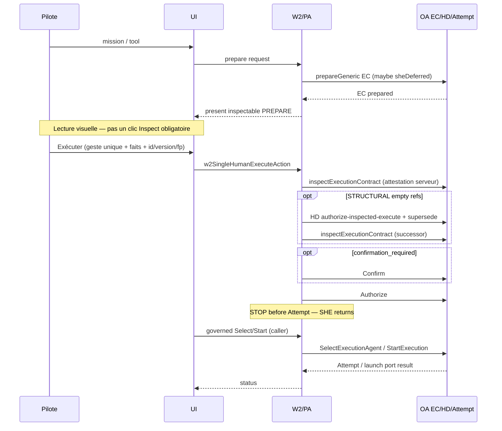
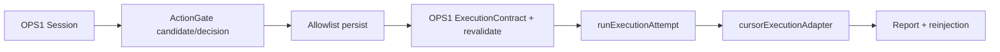
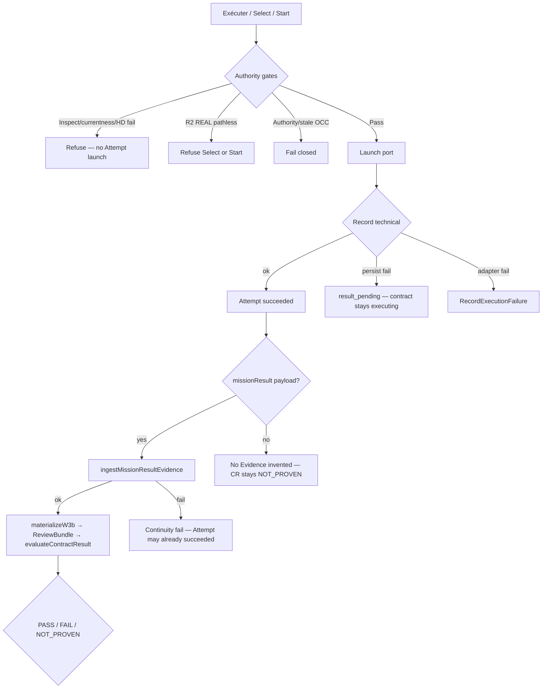
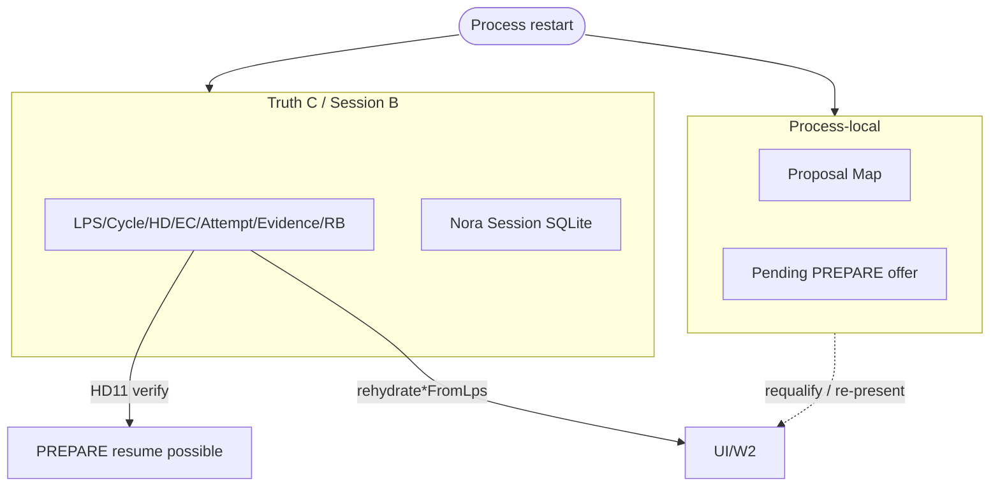

# SFIA Review Pack — FULL — CRITICAL

## 00. Identity

| Field | Value |
| --- | --- |
| Timestamp UTC | 2026-10-22T19:19:23Z |
| Cycle | AKG-M4-A / T-A03 — Critical Review Correction Pass 01 |
| Profile | CRITICAL |
| Type | Cycle 6 — Architecture technique · DOC / Architecture / Correction Pass |
| Branch | `analysis/akg-m4a-ta03-authority-sequences` |
| HEAD | `c48c6a582c10ee3cf6902203d6a4eb01ce3f2139` |
| origin/main | `f44a99b4da84188772b80aca3c9ebe1a3e12617e` |
| Document | `projects/sfia-studio/convergence/architectural-knowledge-governance/m4-rationalization/07-m4a-authority-sequences-stop-fail-restart.md` (untracked) |
| Document hash-object (prior) | `ae67fed56b54fa71fe676eade84c9a41e2fa270d` |
| Document hash-object (this pass) | `3841b769ab3e312397b06e442842c067cbabf289` |
| Prior T-A03 handoff | commit `e31544b6382cf4899fb5d61e53a29dd1adc8c979` · blob `2069a1d8082c61c79373772a6c742f7e0a4e6bae` |
| Project commit/push | NONE |
| M4-A | NON CLOSED |
| T-A03 status | LOCAL CANDIDATE (pending independent re-review) |

## 01. Scope

AUTHORIZED: correct CORR-01/02/03 in local `07` only; Full pack; L3 handoff.
NOT AUTHORIZED: runtime mutation; other project files; project push/PR; M4-A CLOSED; T-A01/T-A02 WT changes; REAL launch.

## 02. Git Review Index

```
 M .tmp-sfia-review/chatgpt-review.md
?? projects/sfia-studio/convergence/architectural-knowledge-governance/m4-rationalization/07-m4a-authority-sequences-stop-fail-restart.md
```

| Control | Result |
| --- | --- |
| Branch/HEAD/main | MATCH expected |
| Prior doc hash | `ae67fed5…` confirmed before edit |
| New doc hash | `3841b769ab3e312397b06e442842c067cbabf289` |
| `git diff --no-index --check` | exit `1` (new/untracked file; no trailing whitespace) |
| Trailing whitespace | NONE |
| Project files besides `07` | NONE (pack is `.tmp` only) |
| T-A01 / T-A02 WTs | untouched |

### Diff identity

```
...7-m4a-authority-sequences-stop-fail-restart.md} | 396 +++++++++++++++++++++
 1 file changed, 396 insertions(+)
```

## 03. CORR results

| ID | Preuve | Verdict |
| --- | --- | --- |
| CORR-01 | S02 §5 + Mermaid §11.1: single Exécuter gesture; server `inspectExecutionContract` on click; variant `w2InspectExecutionContractAction` explicit; no invented OA→Pilote arrow; internal HD/Confirm/Authorize retained | **PASS** |
| CORR-02 | S05 §8 + Mermaid §11.3: Select/Start → Record (`result_pending`) → payload → ingest Evidence → materializeW3b ReviewBundle → ContractResult PASS/FAIL/NOT_PROVEN; Attempt≠Evidence≠PROVEN; no invented rollback | **PASS** |
| CORR-03 | §10bis normalized matrix S03–S06 critical steps with full columns; N/A justified where needed; orientations candidate | **PASS** |

## 04. Sources (correction)

Template SFIA; routing; Build Doctrine R23/R24; G0; OR-13; M4 AS-IS/TO-BE/register; PRR 03/04/06/07/08/09; doctrine v3 30/34/35.
Code: `singleHumanExecutePreparedContract.ts` L11–21, L704–915; `actions.ts` L286–311, L355–402; `inspectExecutionContract.ts`; `governedExecuteAuthorizedContract.ts` L1632–1677, L1700+; `recordExecutionResult.ts` L1–8; `recordExecutionFailure.ts`; `ingestMissionResultEvidence.ts` L1–5; `materializeW3bProductTerminal.ts`; `resolveProductExecutionContext.ts` L877.

## 05. Authority / Evidence anti-claims retained

- One Pilote click ≠ vanished internal authority controls.
- Server attestation ≠ independent Inspect click (SHE nominal).
- Attempt technical succeeded ≠ Product Result PROVEN.
- Missing Evidence / NOT_PROVEN remain honest outcomes.
- DETERMINISTIC ≠ REAL · P6 GLOBAL NOT PASSED · v3 NON ADOPTED · M4-A NON CLOSED.

## 06. R23/R24 / Fake-Real

R24 NO PRODUCT SEMANTIC IMPACT. Static only. REAL NOT PROVEN.

## 07. Handoff L3

Branch `sfia/review-handoff` · `sfia-review-handoff/latest-chatgpt-review.md`
Preserves prior tip identity `e31544b6382cf4899fb5d61e53a29dd1adc8c979` / `2069a1d8082c61c79373772a6c742f7e0a4e6bae` in history.
Message: `docs(review-handoff): AKG-M4-A T-A03 correction pass 01`

## 08. Instruction ChatGPT (§9.1)

Read Git `sfia/review-handoff` → `sfia-review-handoff/latest-chatgpt-review.md`.
Optional prior: `e31544b6382cf4899fb5d61e53a29dd1adc8c979`.

Perform: **CHATGPT CRITICAL RE-REVIEW — AKG-M4-A / T-A03 CORRECTION PASS 01**.

Verify CORR-01/02/03 independently against code; SHE one-click + server attest; Attempt≠Evidence≠PROVEN; normalized S03–S06 matrix; no project mutation; M4-A NON CLOSED; T-A03 remains LOCAL CANDIDATE.

## 09. Verdict target

READY FOR CHATGPT CRITICAL RE-REVIEW — AKG-M4-A / T-A03 CORRECTION PASS 01

---

## 10. Full document `07` (verbatim)


# AKG-M4-A / T-A03 — Séquences d'autorité, STOP/FAIL et restart

| Champ | Valeur |
| --- | --- |
| Cycle | **AKG-M4-A / T-A03** — Runtime Sequences, Authority Boundaries & Failure/Restart |
| Type / Profil | Cycle 6 — Architecture technique · **Critical** |
| Typologie | DOC / Architecture / Rationalization Assessment (+ Correction Pass 01) |
| Capacités | V3-F05 / V3-F07 (+ F2/W2/EC/Attempt/Evidence) |
| Baseline | `analysis/akg-m4a-ta03-authority-sequences` @ `c48c6a582c10ee3cf6902203d6a4eb01ce3f2139` |
| `origin/main` | `f44a99b4da84188772b80aca3c9ebe1a3e12617e` |
| PR #604 | Draft · CI SUCCESS · non mergée |
| Antecedents | T-A01 handoff `42de13a9…` / `5b341ce8…` · T-A02 handoff `51021023…` / `d35d0157…` |
| Correction Pass 01 | CORR-01 SHE click/attest · CORR-02 Attempt≠Evidence · CORR-03 matrice S03–S06 |
| Méthode | Analyse **statique** des chemins de code · **pas** de Cursor REAL |
| Principe | **OR-13** · G0-A/B inchangés · **pas de dual-write** |
| Statut | **LOCAL CANDIDATE** · M4-A **NON CLOSED** · scénarios **candidates** |
| Non-claims | DETERMINISTIC ≠ REAL · P6 GLOBAL **NOT PASSED** · v3 **NON ADOPTED** · Inspect ≠ Execute · HD ≠ Confirm ≠ Authorize ≠ Start · Attempt succeeded ≠ Product PROVEN |

> **Autorité AS-IS :** code + tests + PRR CURRENT > analyses AKG. « Séquences réelles » = chemins **présents dans le tip**, pas preuves d'exécution REAL.

---

## 1. Baseline et périmètre

Worktree isolé ; WTs T-A01/T-A02 **non modifiés**. Documents `05`/`06` via handoffs immuables. CKC Architecture : **fallback méthode canonique**.

**In scope :** S01–S07 Product + OPS1 legacy comparatif · Correction Pass 01.
**Out of scope :** mutation runtime, REAL launch, migrations, classifications définitives.

---

## 2. Sources et méthode

- SFIA v2.6 template / routing / operating model / rules / knowledge layer.
- Build Doctrine R23/R24 · Roadmap B-AKG · G0 · AKG README · M4 `01`–`04`.
- PRR 03, 04, 06, 07, 08, 09.
- Doctrine v3 30/34/35 (+ 32/37).
- Code : `singleHumanExecutePreparedContract`, `w2/actions` (`w2SingleHumanExecuteAction`, `w2InspectExecutionContractAction`), `inspectExecutionContract`, `governedExecuteAuthorizedContract`, `recordExecutionResult` / `recordExecutionFailure`, `ingestMissionResultEvidence`, `materializeW3bProductTerminal`, `lib/ops1/*`, rehydrate LPS.

**Méthode :** déclencheur → caller → exécutant → objet → précondition → autorité → mutation → failure → restart → preuve → niveau → orientation candidate.

---

## 3. Acteurs et frontières d'autorité

| Acteur | Rôle effectif (tip) | N'est pas |
| --- | --- | --- |
| Pilote | Disposition / lecture visuelle PREPARE / **geste unique Exécuter** (SHE) | Runtime ; attestation serveur |
| Nora / cognitive runtime | Qualification, reco, outils admissibles | Autorité métier |
| Project Assistant (F2/W2) | Orchestration UI→OA ; carriers process-local ; **attestation serveur** sur Exécuter | Vérité C |
| OA Decision / EC / Attempt | HD durable, contrat, tentative technique | Cognition ; Evidence/Claim |
| Evidence Review (OA) | Mission-result Evidence, ReviewBundle, ContractResult | Attempt technique |
| Product SQLite (Truth C) | Projet, LPS, Cycle, HD, EC, Attempt, Evidence | Session chat |
| Nora Session SQLite (B) | Transcript/journal | Truth C |
| Process-local Maps | Proposal / pending PREPARE offer | Durable |
| OPS1 (legacy) | Session/gate/allowlist/adapter/report **îlot** | Product Spine |
| Cursor gateway Product | Launch sous Attempt + flags | Autorisation Pilote |

**Règles :**
- Communication module→module ≠ délégation d'autorité.
- Accept Proposal ≠ lecture visuelle PREPARE ≠ attestation serveur ≠ Authorize ≠ Start.
- **Un clic Pilote « Exécuter » ≠ disparition des contrôles d'autorité internes** (HD / Confirm / Authorize / Select / Start / R2).
- Attempt terminal technique ≠ Evidence valide ≠ ContractResult PROVEN.

---

## 4. S01 — F2 historique : Proposal → Decision → PREPARE

**Chemin A PRR — disposition-before-PREPARE (HISTORICAL / still available).**

| Step | Déclencheur | Caller | Exécutant | Objet | Précondition | Autorité | Mutation | Failure | Restart | Preuve | Nv | Orient. |
| --- | --- | --- | --- | --- | --- | --- | --- | --- | --- | --- | --- | --- |
| S01-01 | Intent / F2 turn | `orchestrateF2` / PA | F2 analysis | Proposal candidate | Session/project | Nora reco | process-local Proposal | refuse create | Proposal **lost** | `proposalStore.ts` | C | HARVEST subject / ADAPT carrier |
| S01-02 | Save proposal | F2 | `saveProposal` | ProposalDto Map | — | none (carrier) | process-local | — | lost | L38+ | C | REBUILD continuity candidate |
| S01-03 | Pilot Accept/Refuse/Amend | UI | `recordF2Decision` | HumanDecision OA | Proposal not terminal | Pilote + OA DecisionServices | Truth C HD + DecisionRef UoW | atomic fail | HD **durable** | `recordDecision.ts` L211+ | C | KEEP HD |
| S01-04 | Accepted → PREPARE | W2/F3 | `verifyGenericMissionHumanDecisionForPrepare` + prepare | EC | accepted verified HD | OA gates | EC Truth C | HD refused/amend blocks | HD may resume PREPARE (HD11) | PRR 07 Chemin A ; PRR 06 HD11 | C | KEEP verify |
| S01-05 | Refuse/Amend | Pilot | recordF2Decision | HD refused/amended | — | Pilote | Truth C | PREPARE forbidden on that path | durable record | PRR 07 | C | KEEP |

**Lecture :** Proposal = carrier **non autorité**. HD = autorité durable. Chemin encore disponible à côté de SHE.

---

## 5. S02 — SHE CURRENT (PR #590) — CORR-01

**Chemin nominal SHE :** un **seul geste Pilote « Exécuter »** après PREPARE **inspectable visuellement**. L'attestation d'inspection est **serveur**, portée par ce geste (faits présentés + id + version + fingerprint) — **pas** un second clic humain obligatoire.

### 5.1 Variante distincte (non-SHE nominal)

| Variante | Action | Rôle | Preuve |
| --- | --- | --- | --- |
| Inspect UI Conversation / Trajectory | `w2InspectExecutionContractAction` → `inspectExecutionContract` | Bouton Inspect **indépendant** (disclosure) ; **Confirm/Execute ne doivent pas l'appeler en side-effect** | `actions.ts` L286–311 commentaire L291–296 |

Ne **pas** confondre cette variante avec le chemin SHE nominal (§5.2).

### 5.2 Matrice SHE nominale

| Step | Déclencheur | Caller | Exécutant | Objet | Précondition | Autorité | Mutation | Failure | Restart | Preuve | Nv | Orient. |
| --- | --- | --- | --- | --- | --- | --- | --- | --- | --- | --- | --- | --- |
| S02-01 | Mission/tool | F2/W2 | `solicitGenericExecutionPrepare` / `prepareGenericExecutionContractDraft` | EC draft | Materiality gates ; may set `sheDeferredStructuralAuthority` | Product prepare (≠ launch) | EC Truth C ; maybe empty decisionRefs | MATERIALITY_UNKNOWN etc. | EC durable | prepareGeneric… L666–710 ; PRR 04 | C | KEEP SHE PREPARE |
| S02-02 | UI présente PREPARE | UI/W2 | (lecture visuelle) | EC présenté | EC exists | Pilote lit — **pas** encore d'autorité d'exécution | aucune (affichage) | — | EC durable | SHE header L11–17 ; UX PREPARE | C | KEEP |
| S02-03 | Pilote **Exécuter** (geste unique) | `w2SingleHumanExecuteAction` | `singleHumanExecutePreparedContract` | bind id+version+fp + `presentedFactIds` | facts non vides ; Pilote authentifié | **Geste Pilote** | — | empty facts / auth fail | — | `actions.ts` L355–402 ; SHE L704–724 | C | KEEP |
| S02-04 | Attestation serveur initiale | SHE (même geste) | `inspectExecutionContract` | attestation inspection | presented facts vs disclosure | Serveur (pas 2e clic) | attestation durable | INSPECTION_INSUFFICIENT → **no HD** | durable EC | SHE L768–786 | C | KEEP |
| S02-05 | Currentness | SHE | `assertSheProductCurrentness` | EC | stamped currentness | OA/Product | — | réinspection requise | — | SHE L600+, L799–809 | C | KEEP |
| S02-06 | STRUCTURAL empty refs | SHE | HD authorize-inspected-execute + supersede + **re-attest successor** | HD + EC successor | sheDeferred / structural | Pilote+OA | Truth C | UNKNOWN blocks ; successor inspect fail | HD durable | SHE L819–863 ; PRR INV-STRUCTURAL-* | C | KEEP |
| S02-07 | Confirm (si `confirmation_required`) | SHE serveur | `confirmExecutionContractForAuthorization` | EC confirmed | after attest | OA Confirm (plié dans Exécuter) | Truth C | refuse | durable | SHE L902–915 | C | KEEP/ADAPT UX |
| S02-08 | Authorize | SHE serveur | `evaluateExecutionAuthorization` | EC authorized | gates | OA Authorize (plié dans Exécuter) | Truth C | refuse | durable | SHE post-confirm | C | KEEP |
| S02-09 | STOP before Attempt | SHE return | caller | — | post-authorize | **pas** de Attempt ici | — | — | — | SHE L17 ; `actions.ts` L358 | C | CONSOLIDATE caller clarity |
| S02-10 | Select/Start | `governedExecute*` | `SelectExecutionAgent` / `StartExecution` | Attempt | `verifyAttemptAuthority` ; R2 | OA Attempt | Attempt Truth C + launch port | R2 may refuse | Attempt durable | attemptSupport L44 ; gate R2 | C | KEEP |

**Anti-claims SHE :** un clic ≠ disparition HD/Confirm/Authorize. Attestation serveur ≠ clic Inspect indépendant. DETERMINISTIC tested scope ≠ REAL.

---

## 6. S03 — Generic W2 / Tool-First / PREPARE

| Step | Déclencheur | Exécutant | Objet | Notes d'autorité | Restart | Preuve | Nv | Orient. |
| --- | --- | --- | --- | --- | --- | --- | --- | --- |
| S03-01 | Remember offer | `pendingGenericPrepareOfferStore` | offer Map | presentation carrier ≠ HD | **lost** process restart ; NOT PROVEN continuity | store header L21–25 | C | ADAPT/REBUILD carrier |
| S03-02 | Materiality | `resolveAuthoritativeProductMateriality` | stamped materiality | pathless needs positive non-mutating claim (R1) | facts on EC | resolveAuthoritative… ; PRR Tool-First R1 | C | KEEP |
| S03-03 | PREPARE NON_STRUCTURAL | prepareGeneric… | EC decisionRefs=[] | Complementary Product gates ; declaration ≠ authority | EC durable | PRR 04 Chemin B | C | KEEP |
| S03-04 | Tool-First R2 | `boundedNonMutatingRealLaunchGate` / governedExecute | Select/Start refuse | REAL+pathless → fail-closed **Product gate** ≠ sandbox no-write technique | Attempt may stay `accepted` without launch | gate L18–65 ; PRR OPEN TOOL-FIRST-REAL-NOWRITE | C | KEEP gate ; gap OPEN |
| S03-05 | HD11 resume | verify HD + prepare | EC | accepted HD may PREPARE without restoring offer | HD durable ; offer lost OK | PRR 06 HD11 | C | KEEP |

---

## 7. S04 — OPS1 legacy

| Step | Exécutant | Objet | vs Product | Preuve | Nv | Orient. |
| --- | --- | --- | --- | --- | --- | --- |
| S04-01 Session | `ops1CreateSessionAction` / lifecycle | OPS1 session DB | ≠ Project+Nora session | actions / sessionLifecycle | C | RETIRE LATER model |
| S04-02 Candidate/Gate | `createFixtureActionCandidate` / `recordGateDecision` | gate tables | ≠ F2/W2 readiness+HD | actionGate L208–353 | C | HARVEST concepts |
| S04-03 Allowlist | `evaluateAndPersistAllowlist` | OPS1 allowlist | ≠ managed repo/agents (T-A02 PARTIAL) | allowlistService L98 | C | HARVEST/REBUILD |
| S04-04 Contract | `createExecutionContract` / revalidate | OPS1 contract | ≠ OA EC Truth C | executionContractService | C | REPLACE sous OA |
| S04-05 Attempt | `runExecutionAttempt` | OPS1 attempt | ≠ OA Attempt | orchestrator L107 | C | CONSOLIDATE concepts |
| S04-06 Cursor | `runCursorAdapter` + `OPS1_CURSOR_REAL` | spawn | ≠ StudioCursorRealLaunchGateway | adapter L230 | C | HARVEST/REBUILD ports |
| S04-07 Report+reinject | `generateExecutionReport` / `generateReportAndReinject` | OPS1 report | ≠ W3C evidence/synthesis | reportReinjection L84 | C | HARVEST exigences |

**Pas d'équivalence inventée** avec Product (T-A02). Flag `OPS1_CURSOR_REAL` couplé Product safety (T-A01).

---

## 8. S05 — STOP / FAIL / PARTIAL / terminal — CORR-02

**Séparation obligatoire :** Attempt technique ≠ Evidence ≠ ReviewBundle ≠ ContractResult Product.

| Cas / Step | Comportement observé (tip) | Mutation | Compensation auto? | Preuve | Nv |
| --- | --- | --- | --- | --- | --- |
| Refus autorité / HD | PREPARE or Execute blocked | HD refused durable possible | **Non** | recordF2Decision ; PRR 07 | C |
| Inspect insuffisant (SHE) | SHE fail **before HD** (attestation serveur) | no HD | Non | SHE L779–785 | C |
| Currentness fail | SHE fail | no launch | Non | assertSheProductCurrentness | C |
| UNKNOWN materiality execute | `SHE_UNKNOWN_BLOCKS_EXECUTE` | no HD | Non | SHE L754–759 | C |
| Contract stale/OCC | Select/Start fail | no new attempt | Non | selectExecutionAgent fail codes | C |
| Authority verify fail | `verifyAttemptAuthority` | refuse | Non | attemptSupport L44 | C |
| Tool-First R2 | refuse Select (0 Attempt) or Start (Attempt stays accepted) | partial Attempt state | Non ; **Product gate** | boundedNonMutatingRealLaunchGate | C |
| Select / Start | Attempt créé / running | Attempt Truth C | Non | SelectExecutionAgent / StartExecution | C |
| Record result technique | `RecordExecutionResult` | succeeded **ou** `result_pending` si persist terminal échoue (contrat reste `executing`) | Non | `recordExecutionResult.ts` L1–8, L111+, L287+ | C |
| Record failure technique | `RecordExecutionFailure` | Attempt/contract failed | Non | `recordExecutionFailure.ts` L1–3 | C |
| Cancel / timeout / system stop | Cancel / TriggerTimeout / SystemGovernedStop | Attempt terminal transitions | Non rollback externe | application classes | C |
| Payload mission-result | `buildMissionResultPayloadFromReport` | local payload | Non | governedExecute ~L1632–1639 | C |
| Ingest Evidence | `ingestMissionResultEvidence` **si** payload OK | Evidence Truth C | Non ; si échec → Attempt already succeeded + continuity fail code | ingestMissionResultEvidence.ts L1–5 ; governedExecute L1641–1657 | C |
| Sans mission payload | Attempt may stay succeeded ; **ne pas inventer Evidence** | ContractResult reste not_proven (honnête) | Non | governedExecute L1675–1677 | C |
| ReviewBundle + ContractResult | `materializeW3bProductTerminal` → freezeReviewBundle → evaluateContractResult | ReviewBundle + CE ; verdict PASS/FAIL/**NOT_PROVEN** | Non | materializeW3bProductTerminal.ts L355+, L512+, L549+ ; resolveProduct… L877 | C |
| Preuves manquantes | W3C / resolution fail-closed ; NOT_PROVEN | durable markers | Non inventer succès | w3cPostEvidenceLoop ; resolvePostEvidenceRecoveryContext | P |
| Retry | `RetryExecutionAttempt` | new controls required | Pas de réexec silencieuse | Retry class | C |

**Anti-claims S05 :** Attempt terminal ≠ Evidence valide ≠ Product PROVEN. Échec d'enregistrement technique (`result_pending` / RESULT_RECORDING_FAILED) ≠ échec d'ingestion Evidence (chemins distincts).

---

## 9. S06 — Restart / recovery

| Objet | Stockage | Après restart process | Reconstitution | Preuve | Nv |
| --- | --- | --- | --- | --- | --- |
| Project / LPS / Cycle | Truth C | durable | get/list OA | PRR 06 | C |
| HumanDecision | Truth C | durable | list/verify ; HD11 PREPARE | PRR 06 | C |
| ExecutionContract | Truth C | durable | load by id/version | OA EC | C |
| ExecutionAttempt (incl. `result_pending`) | Truth C | durable | get/list | OA Attempt ; recordExecutionResult | C |
| Evidence / ReviewBundle / CE | Truth C | durable **si** matérialisés | `rehydrateEvidenceOutcomeFromLps` ; `rehydrateW3cPostEvidenceFromLps` | f3/w2 rehydrate | C |
| Nora Session / transcript | Session SQLite | durable **si** même path DB | session APIs | PRR 06 | C |
| RunState cognitive | process | **NOT IMPLEMENTED / DEFER** | — | PRR 06 RCD-01 | C |
| F2 Proposal Map | process-local | **lost** | requalify ; no invent | proposalStore | C |
| Pending PREPARE offer | process-local | **lost** | re-present ; HD may still PREPARE | pending store ; HD11 | C |
| OPS1 session/report | OPS1 DB | durable dans îlot | OPS1 APIs | ops1 db | C |

**Jamais inventer** HD / presentation / mission / Authorization / Evidence / PROVEN au restart.

---

## 10. S07 — Redondances et reconstruction (candidates)

| Zone | Observation | Option candidate |
| --- | --- | --- |
| Dual admission SHE + disposition-before-PREPARE | Deux timings HD | CONSOLIDATE documentation/UX ; KEEP safety objects |
| Proposal Map vs HD | Carrier vs autorité | REBUILD continuity without 2e vérité |
| Inspect UI indépendant vs SHE attest serveur | Deux surfaces d'inspection | KEEP distinct ; documenter (CORR-01) |
| Attempt technique vs Evidence/RB/CR | Couches séparées | KEEP séparation ; CONSOLIDATE narration |
| OPS1 gate/allowlist/adapter vs OA Attempt | Capacités similaires non équivalentes | HARVEST → Product ports (T-A05) |
| OPS1 report reinject vs W3C | Restitution double | HARVEST exigences |
| Tool-First R2 vs « no-write sandbox » | Gate Product ≠ tech sandbox | KEEP gap OPEN ; pas faux COMPLETE |
| Orchestration PA multi-chemins | Complexité | ADAPT ownership (SC-C) |

---

## 10bis. Matrice normalisée S03–S06 (CORR-03)

Colonnes : Sequence/Step · Déclencheur · Appelant · Exécutant/symbole · Objet · Précondition · Autorité · Mutation/effet · STOP/FAIL · Restart · Preuve · Niveau · Orientation candidate.

| Seq/Step | Déclencheur | Appelant | Exécutant | Objet | Précondition | Autorité | Mutation / effet | STOP / FAIL | Restart | Preuve | Nv | Orient. |
| --- | --- | --- | --- | --- | --- | --- | --- | --- | --- | --- | --- | --- |
| S03-R1 | pathless / materiality | prepareGeneric | `resolveAuthoritativeProductMateriality` | stamped materiality | positive non-mutating claim when pathless | Product (≠ Pilote launch) | facts stamped on EC | MATERIALITY_UNKNOWN may block later Execute | facts on durable EC | prepareGeneric / PRR Tool-First R1 | C | KEEP |
| S03-R2 | Select/Start + REAL | governedExecute | `assertBoundedNonMutatingCursorRealAdmissible` | EC pathless non-mut | `SFIA_STUDIO_CURSOR_REAL=1` + stamped pathless | Product fail-closed gate | **aucun** launch | `BOUNDED_NON_MUTATING_REAL_ENFORCEMENT_UNAVAILABLE` | Attempt may stay accepted | `boundedNonMutatingRealLaunchGate.ts` L18–70 | C | KEEP ; gap OPEN |
| S03-HD11 | restart / resume PREPARE | W2 prepare path | verify accepted HD | HD + EC | accepted verified HD | Pilote (prior) + OA verify | EC prepare | refuse if HD not accepted | HD durable ; offer **N/A** (lost OK) | PRR 06 HD11 | C | KEEP |
| S03-OFFER | remember / present | W2 | pendingGenericPrepareOfferStore | offer Map | project+session key | presentation only | process-local | N/A (carrier) | **lost** | store L21–25 | C | ADAPT/REBUILD |
| S04-GATE | candidate action | OPS1 UI/actions | `recordGateDecision` | OPS1 gate | session/candidate | OPS1 operator path | OPS1 DB | gate refuse | durable OPS1 | actionGate L208–353 | C | HARVEST |
| S04-ALLOW | after gate | OPS1 | `evaluateAndPersistAllowlist` | allowlist | gate decision | OPS1 | OPS1 DB | deny | durable OPS1 | allowlistService L98 | C | HARVEST/REBUILD |
| S04-EC | prepare execute | OPS1 | `createExecutionContract` / revalidate | OPS1 contract | allowlist | OPS1 | OPS1 DB | revalidate fail | durable OPS1 | executionContractService | C | REPLACE sous OA |
| S04-ATT | run | OPS1 | `runExecutionAttempt` | OPS1 attempt | contract valid | OPS1 | OPS1 DB | fail/stop | durable OPS1 | orchestrator L107 | C | CONSOLIDATE |
| S04-CUR | adapter | OPS1 | `runCursorAdapter` | spawn | `OPS1_CURSOR_REAL=1` | flag+adapter | externe possible | REAL off blocks | N/A Product | adapter L230 ; flag | C | HARVEST/REBUILD |
| S04-REP | post | OPS1 | report + reinject | OPS1 report | attempt terminal | OPS1 | OPS1 DB + chat island | report fail | durable OPS1 | reportReinjection L84 | C | HARVEST |
| S05-SEL | after authorize | governedExecute | `SelectExecutionAgent` | Attempt accepted | verifyAttemptAuthority ; R2 | OA Attempt | Attempt Truth C | refuse Select | durable | selectExecutionAgent.ts | C | KEEP |
| S05-START | after select | governedExecute | `StartExecution` | Attempt running | authority ; R2 | OA Attempt | Attempt + launch port | refuse Start | durable | startExecution.ts | C | KEEP |
| S05-REC-OK | adapter result | governedExecute / OA | `RecordExecutionResult` | Attempt succeeded / `result_pending` | running\|result_pending ; adapter identity | Adapter-bound | Truth C technical | persist fail → result_pending ; budget → RESULT_RECORDING_FAILED | durable | recordExecutionResult.ts L1–8 | C | KEEP |
| S05-REC-FAIL | adapter fail | governedExecute / OA | `RecordExecutionFailure` | Attempt failed | running\|result_pending | Adapter-bound | Truth C | fail | durable | recordExecutionFailure.ts | C | KEEP |
| S05-EVID | post technical succeed + report | governedExecute | `ingestMissionResultEvidence` | Evidence | structured missionResult payload | Product continuity | Evidence Truth C (+ files refsRoot) | ingest fail → continuity fail (Attempt may already succeeded) | Evidence durable if ok | ingestMissionResultEvidence.ts ; governedExecute L1641+ | C | KEEP |
| S05-EVID-SKIP | succeed sans payload | governedExecute | (skip invent) | — | no missionResult fields | N/A | **no Evidence invented** | ContractResult stays not_proven | N/A | governedExecute L1675–1677 | C | KEEP |
| S05-RB-CR | materialize path | reconcile / action | `materializeW3bProductTerminal` | ReviewBundle + ContractResult | Evidence present as required by path | OA Evidence Review | RB frozen + CE ; PASS/FAIL/NOT_PROVEN | fail-closed if RB/Evidence absent | durable if materialized | materializeW3b… L512+ L549+ | C | KEEP |
| S05-RETRY | retry request | OA | `RetryExecutionAttempt` | new Attempt controls | prior terminal + policy | OA | new Attempt | refuse if policy | durable | RetryExecutionAttempt | C | KEEP |
| S06-HD | process restart | — | OA Decision get/list | HD | Truth C path | prior Pilote | none (read) | N/A | **durable** ; HD11 PREPARE | PRR 06 | C | KEEP |
| S06-EC | process restart | — | OA EC get | EC | Truth C | — | none (read) | N/A | **durable** | OA EC | C | KEEP |
| S06-ATT | process restart | — | OA Attempt get | Attempt (+ result_pending) | Truth C | — | none (read) | N/A | **durable** | OA Attempt | C | KEEP |
| S06-EVID | process restart | UI/W2 | `rehydrateEvidenceOutcomeFromLps` | Evidence/RB view | LPS markers | — | none (read) | absent → not invent PROVEN | durable if prior materialize | f3/rehydrate… | C | KEEP |
| S06-NORA | process restart | session APIs | Nora Session SQLite | transcript B | same DB path | — | none | wrong path → empty | durable **if path** | PRR 06 | C | KEEP |
| S06-PROP | process restart | — | proposalStore | Proposal Map | — | N/A | **lost** | N/A | **lost** — requalify | proposalStore | C | REBUILD candidate |
| S06-OFFER | process restart | — | pending offer Map | offer | — | N/A | **lost** | N/A | **lost** — re-present | pending store L21–25 | C | ADAPT/REBUILD |
| S06-RUN | process restart | — | RunState | cognitive | — | N/A | **NOT IMPLEMENTED** | N/A | DEFER / unknown continuity | PRR 06 RCD-01 | C | DEFER |

---

## 11. Diagrammes (observés) — CORR-01 / CORR-02

*Légende : flèches = **appels / flux de contrôle observés** (ou **présentation UI** annotée). Pas « même nom ⇒ même pouvoir ». Propositions cibles = hors ces diagrammes. Pas de flèche OA→Pilote directe inventée.*

### 11.1 SHE Product CURRENT (observé) — CORR-01



### 11.2 OPS1 legacy (observé)



### 11.3 Product failure / terminal paths (observé) — CORR-02



### 11.4 Restart / rehydration (observé)



---

## 12. Invariants, tests et preuves

| Famille | Exemples | Portée |
| --- | --- | --- |
| SHE DET | `p6.she.*` ; SHE L11–21 / L704+ | DETERMINISTIC ; **one click + server attest** |
| Inspect variante | `w2InspectExecutionContractAction` | Distinct de SHE nominal |
| HD / PREPARE | `p6.mHd01…` (HD11) | DET restart HD≠offer |
| Tool-First | R1/R2 + `boundedNonMutatingRealLaunchGate` | DET ; REAL no-write **OPEN** |
| Attempt technical | recordResult / recordFailure / result_pending | DET ; ≠ Evidence |
| Evidence / RB / CR | ingestMissionResultEvidence ; materializeW3b ; ContractResult PASS/FAIL/NOT_PROVEN | DET paths ; Attempt≠PROVEN |
| OPS1 | `__tests__/ops1`, e2e ops1-* | îlot |
| PRR 07/04/06/08/09 | SHE dual-path ; restart ; Tool-First | DOCUMENTED |

---

## 13. Risques, écarts, non démontré

| ID | Écart | Impact |
| --- | --- | --- |
| G1 | REAL E2E générique | Pas de preuve S02 launch REAL |
| G2 | TOOL-FIRST-REAL-NOWRITE | Gate ≠ sandbox |
| G3 | RunState cross-restart DEFER | Continuité cognitive partielle |
| G4 | Dual path SHE + historical | Complexité UX/autorité |
| G5 | OPS1≠Product parity | T-A05 requis |
| G6 | Dynamic/alternate callers PARTIAL | Matrice non exhaustive 100% |
| G7 | Evidence/RB only if path succeeds | Attempt succeeded may coexist with NOT_PROVEN / missing Evidence |

---

## 14. Implications T-A04 / T-A05

- **T-A04 :** persistance Truth C vs B vs process-local vs OPS1/D1 ; migration **sans dual-write** ; offers/proposals continuity.
- **T-A05 :** impact pack harvest OPS1 ; coût dual-path SHE ; Attempt vs Evidence layering ; MethodMode (T-A02).
- **T-A03** cartographie d'autorité — **pas** GO Delivery.

---

## 15. Conditions de sortie M4-A

| Condition | État |
| --- | --- |
| T-A01 consumers | Accepté (handoff) |
| T-A02 capabilities | Accepté Correction Pass 01 (handoff) |
| T-A03 sequences/authority | **LOCAL CANDIDATE** + Correction Pass 01 (ce document) |
| T-A04 storage/migration | **NON** |
| T-A05 impact pack | **NON** |
| T-A06 Critical alignement | **NON** |
| M4-A CLOSED | **NON** |

---

## 16. R24

**NO PRODUCT SEMANTIC IMPACT** — documentation d'analyse uniquement.

---

## 17. Correction Pass 01 — fermeture

| ID | Preuve corrigée | Verdict |
| --- | --- | --- |
| CORR-01 | §5 S02 + §11.1 SHE : geste unique Exécuter ; attestation serveur ; variante Inspect UI distincte ; pas de OA→Pilote inventé | **PASS** |
| CORR-02 | §8 S05 + §11.3 : Attempt / result_pending / Evidence / ReviewBundle / ContractResult NOT_PROVEN séparés | **PASS** |
| CORR-03 | §10bis matrice normalisée S03–S06 | **PASS** |

---

END — `AKG-M4-A / T-A03` — LOCAL CANDIDATE AUTHORITY SEQUENCES (Correction Pass 01)
