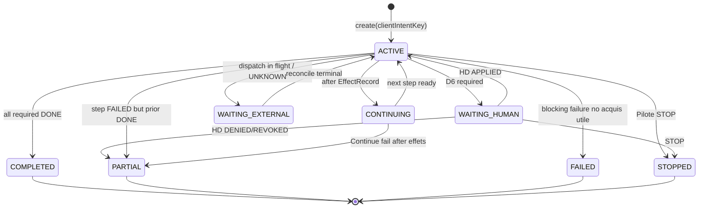
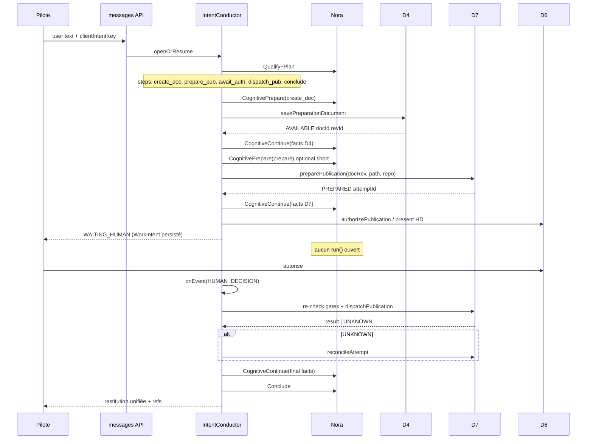

# SFIA Studio Next — Review Pack FULL
## R5 / Cycle 6 — Qualification technique finale — Conduite des intentions Nora/Studio

**Date/heure :** 2026-11-10 11:27:36 +0100 (Europe/Paris)
**GO Morris :** qualification technique lecture seule — 2026-11-10 — AUCUNE implémentation
**Exigence produit :** cadrage `69c27832` blob `2322644a` — VALIDATED IN CONTENT BY MORRIS
**Base technique de travail :** S1 (IntentConductor + CognitiveContinue + WorkIntent + Catalog) — **NON ADOPTÉE**, consolidée ici
**Candidat Product :** `fix/next-ml4-chat-first-d4-provenance-20261109` @ `d7f1507a` / tree `3e9e1086`
**RECETTE :** BUILD `8vZjme4-KnnPkAqm_QxMz` — non mutée
**Handoff entrée :** `sfia/review-handoff@836d6298` blob `63872f7e`
**SDK :** `@openai/agents@0.21.0`
**Verdict :** NORA/STUDIO END-TO-END CONTINUITY — TECHNICAL CONTRACTS QUALIFIED — ACCEPT-01 FULLY SPECIFIED — READY FOR MORRIS IMPLEMENTATION GATE — NO CODE CHANGED


---

## 01. Git Truth Check

| Champ | Observé |
|---|---|
| remote | `https://github.com/mcleland147/sfia-workspace.git` |
| branche | `fix/next-ml4-chat-first-d4-provenance-20261109` |
| HEAD | `d7f1507a56e50660ea24903c2dc563c249ba9086` MATCH |
| tree | `3e9e1086aaf83e22d8e3350565f1c747bb31f556` MATCH |
| origin/main | `6667a43858a5421e391b7441246536daad148bd6` |
| merge-base | `c658f59023d44a0e22448c7ee034e3c1dda292a2` |
| cadrage blob | `2322644aa028f882b57570fd962a9a971d772762` MATCH |
| handoff @836d6298 blob | `63872f7e7bec8569f17262df52483d07df5cb8a9` MATCH |
| staged | vide |
| dirty/untracked | `.tmp-sfia-review/chatgpt-review.md` + manifests ENV-01 + script — inventoriés, non nettoyés |

Candidat accessible. Contexte technique COMPLET pour qualification.


---

## 02. Sources et décisions applicables

| Source | Usage |
|---|---|
| Cadrage conduite intentions @69c27832 | **Exigence produit non négociable** E01–E25 |
| Handoff @836d6298 | S1 base ; E-matrix ; ACCEPT-01 design outline |
| A3 2026-11-07 | Lot convergence UX : pas de moteur générique d'actions Nora — **périmètre borné** ; conflit à qualifier §23 |
| R4-01..04 | Une vérité / domaine ; Nora ne décide pas ; D7 tentative ; D6 HD |
| RG-CRE-008 D2 | Acte explicite « Créer le projet » |
| Code `d7f1507a` | AS-IS owners, leases, APIs |
| ML4 §11 @2075aa4f | REC-07/08/10/11 preuves |
| Vision R1 §2.2 | Autonomie post-intention |

S1 n'est **pas** une décision Morris. A/B/C généraux **non rouverts** ; seule S1 est consolidée.


---

## 03. Rappel E01–E25 (traçabilité Q01)

E01 Nora conduit ; E02 bout-en-bout multi-capacités ; E03 qualify proportionné ; E04 deps sans présomption ; E05 distinguer cognitif/Studio/HD/indispo ; E06 pas de faux refus outil ; E07 rôles ; E08 D2 acte explicite ; E09 boucle résultat→continue ; E10 faits avant suite ; E11 restitution factuelle ; E12 scénario create→publish ; E13 pas de réassemblage Pilote ; E14 multi-tours/sessions ; E15 échec partiel ; E16 pas de rejeu après effet confirmé ; E17 UNKNOWN→reconcile ; E18 STOP opposable ; E19 pas succès/échec fictifs ; E20 distinguer génération/opération/mission ; E21 D1–D9 ; E22 techno libre si couverture totale ; E23 narration-only insuffisant ; E24 slices OK si contrat E2E ; E25 conflits→arbitrage.

**Tous E01–E25 restent la cible.** Ce pack les transforme en contrats d'ingénierie.


---

## 04. Contrat de conduite des intentions

### 04.1 Distinctions obligatoires

| Notion | Identité | Durée | Propriétaire vérité |
|---|---|---|---|
| Génération IA | `generationId` | un `run()` | D3 adapter |
| Tour conversation | `conversation_turn_commands.id` + `clientTurnKey` | un HTTP turn | D3 turn-command |
| **WorkIntent** | `wint_…` | multi-tours/sessions | D3 projection (pas vérité D4/D6/D7) |
| WorkStep | `wint_…#stepN` | vie du WorkIntent | D3 projection |
| Opération applicative | commande domaine | transaction | D2/D4/D5/D6/D7/D9 |
| Tentative d'effet | `effect_attempts.id` | cycle D7 | **D7** |
| HumanDecision | `human_decisions.id` | gouvernance | **D6** |
| EffectRecord | snapshot structuré | immuable après commit | dérivé du owner |
| FinalRestitution | message + WorkIntent terminal | durable | D3 compose sur faits owners |

### 04.2 Boucle canonique

```
IntentQualify → WorkPlan
→ CognitivePrepare(step)
→ OwnerInvoke(capability)  [Studio Conductor]
→ EffectRecord
→ CognitiveContinue(facts)
→ NextStep | AwaitHuman | Stop | Conclude
```

Invariant : **texte Nora ≠ autorisation ≠ preuve d'effet.**


---

## 05. Responsabilités inter-domaines

| Acteur | Fait | Ne fait pas |
|---|---|---|
| **Nora / D3** | qualify, prepare contenu, choisir next step, interpréter EffectRecords, continuer, conclure | créer HD ; dispatch Git ; inventer droits ; écrire vérité D4/D7 |
| **IntentConductor (D3 Studio)** | valider CapabilityRef ; ordonner deps ; appeler owner ; corréler ; suspendre/reprendre ; journaliser refs | absorber états D4/D6/D7 ; élargir permissions |
| **D1** | session, isolation Pilote | autoriser effets métier |
| **D2** | create project sur acte UI explicite | création par phrase Nora seule |
| **D4** | create/revise/read/capitalise | publication Git |
| **D5** | cycles/méthode via authority existante | effets Git |
| **D6** | HD, restrictions, STOP humain | exécuter Git |
| **D7** | prepare / authorize-bind / dispatch / reconcile | cognition ; verdict D8 final |
| **D8** | qualify preuves / facts | lancer effets |
| **D9** | read/write Git sous provider + perms | HD |
| **Pilote** | intention, HD, acte D2, STOP | connaître modules internes |


---

## 06. Capability Catalog (contrat)

Type d'entrée catalogue (illustratif) :

```ts
type CapabilityKind = "TOOL_READ" | "OWNER_COMMAND" | "HUMAN_SURFACE" | "EXTERNAL_GATED" | "UNAVAILABLE";
type CapabilityRef = {
  id: string;                 // stable, ex. "d4.create_document"
  owner: "D1"|"D2"|"D3"|"D4"|"D5"|"D6"|"D7"|"D8"|"D9";
  operation: string;
  kind: CapabilityKind;
  mutative: boolean;          // true si change état Studio ou externe
  persistsStudioState: boolean; // prepare D7 = true même sans GitHub write
  preconditions: string[];
  authorityGate: "NONE"|"SESSION"|"OWNERSHIP"|"HUMAN_DECISION"|"EXPLICIT_UI_ACT";
  invokeMode: "nora_tool" | "conductor_owner" | "pilot_ui";
  resultSchema: "EffectRecord" | "ToolJson" | "UiEvent";
  reconcile: "n/a" | "owner_reconcile" | "turn_reconcile";
};
```

### Catalogue utile ACCEPT-01 / transverse

| id | owner | kind | mutative | gate | invoke | Notes |
|---|---|---|---|---|---|---|
| `d4.search_resources` | D4 | TOOL_READ | false | SESSION | nora_tool | existant |
| `d4.read_revision` | D4 | TOOL_READ | false | SESSION | nora_tool | existant |
| `d9.list_sources` | D9 | TOOL_READ | false | SESSION | nora_tool | existant |
| `d9.read_file` | D9 | TOOL_READ | false | SESSION | nora_tool | FILE_ABSENT etc. |
| `d9.list_refs` | D9 | TOOL_READ | false | SESSION | nora_tool | existant |
| `d4.create_document` | D4 | OWNER_COMMAND | true | OWNERSHIP+turn fence | conductor_owner | `savePreparationDocument` |
| `d4.revise_document` | D4 | OWNER_COMMAND | true | OWNERSHIP+baseRev | conductor_owner | `reviseDocument` |
| `d7.prepare_publication` | D7 | OWNER_COMMAND | **true** (attempt PREPARED) | link+perms | conductor_owner | **pas READ-ONLY** |
| `d6.authorize_publication` | D6/D7 | HUMAN_SURFACE | true | Pilote | pilot_ui / conductor present | `authorizePublication`→HD |
| `d7.dispatch_publication` | D7 | EXTERNAL_GATED | true | **HUMAN_DECISION** | conductor_owner | re-check D6 at point |
| `d7.reconcile_attempt` | D7 | OWNER_COMMAND | false* | OWNERSHIP | conductor_owner | *obs may update |
| `d2.create_project` | D2 | HUMAN_SURFACE | true | EXPLICIT_UI_ACT | pilot_ui | RG-CRE-008 |
| `d5.conversational_command` | D5/D6 | OWNER_COMMAND | true | CLEAR intent | pre-Nora authority | existant |

**E06 :** si `kind∈{OWNER_COMMAND,HUMAN_SURFACE}` et disposabilité OK → Nora oriente / Conductor mobilise ; **interdit** « impossible faute d'outil modèle ».

Le catalogue **ne stocke pas** permissions : il **pointe** vers contrôles D1/D9/D6 au invoke.


---

## 07. Modèle WorkIntent recommandé (ingénierie)

### 07.1 Choix de persistance — RECOMMANDATION TECHNIQUE

| Option | Verdict |
|---|---|
| Réemploi seul `conversation_turn_commands` | **INSUFFISANT** — lifetime = un tour ; lease/idempotence HTTP |
| Réemploi seul `effect_attempts` | **REFUSÉ** — vérité D7 ; ne porte pas D4/mission |
| Projection uniquement dans `messages` | **FRAGILE** — non structuré, non concurrent-safe |
| **Table dédiée `work_intents` (+ `work_steps`)** | **RECOMMANDÉ** — projection D3 ; refs vers owners |

**Pas d'arbitrage Morris requis** pour ce choix d'ingénierie sauf opposition doctrine (Q08 respecté : refs only).

### 07.2 Champs candidats `work_intents`

```ts
type WorkIntentStatus =
  | "ACTIVE" | "WAITING_HUMAN" | "WAITING_EXTERNAL"
  | "CONTINUING" | "PARTIAL" | "COMPLETED" | "FAILED" | "STOPPED";

type WorkIntentRow = {
  id: string;                    // wint_…
  ownerPilotId: string;
  preparationId: string;
  projectId: string | null;
  conversationId: string;
  clientIntentKey: string;       // idempotence création intention
  goalSummary: string;           // projection textuelle courte
  status: WorkIntentStatus;
  currentStepId: string | null;
  waitingOn: null | {
    kind: "HUMAN_DECISION" | "EXTERNAL_EFFECT" | "PILOT_INPUT";
    decisionId?: string;
    attemptId?: string;
  };
  effectRefsJson: Array<{        // refs ONLY
    owner: string; capabilityId: string;
    documentId?: string; revisionId?: string;
    attemptId?: string; decisionId?: string;
    status: string; at: string;
  }>;
  planJson: WorkStep[];          // ou table work_steps
  lastContinueGenerationId: string | null;
  terminalRestitutionMessageId: string | null;
  createdAt: string; updatedAt: string;
};
```

### 07.3 `WorkStep`

```ts
type WorkStepStatus =
  | "PENDING" | "PREPARING" | "INVOKING" | "OBSERVED"
  | "WAITING" | "SKIPPED" | "FAILED" | "DONE";

type WorkStep = {
  stepId: string;
  capabilityId: string;
  dependsOn: string[];           // stepIds
  status: WorkStepStatus;
  ownerCommandKey: string | null; // correlation / client key owner
  effectRef: object | null;
  error: { code: string; message: string } | null;
};
```

### 07.4 Invariants WorkIntent

1. Ne contient jamais le markdown documentaire comme vérité (D4).
2. Ne décide jamais l'état d'un `effect_attempt` (D7).
3. Ne crée/valide jamais une HD (D6).
4. `effectRefs` append-only pour faits confirmés ; invalidation = nouveau step.
5. Transition status via Conductor seul (pas le modèle).


---

## 08. États et transitions WorkIntent



**Reconstruction crash :** charger WorkIntent → pour chaque effectRef, **re-lire owner** (doc rev status, attempt status, decision state) → réparer projection si divergente → reprendre `currentStep` sans rejouer DONE.


---

## 09. Contrats d'interface (typés candidats)

### 09.1 IntentConductor API (module candidat)

Fichiers cibles (non écrits) :
- `domains/conversation/intent-conductor.ts` (nouveau)
- `domains/conversation/work-intent.ts` (nouveau)
- `domains/conversation/capability-catalog.ts` (nouveau)
- adaptations : `service.ts`, `nora-adapter.ts`, `document-act.ts`

```ts
// Pseudocontrat — NON IMPLÉMENTÉ
type ConductorEvent =
  | { type: "USER_MESSAGE"; turnId: string; text: string }
  | { type: "HUMAN_DECISION"; decisionId: string; state: string }
  | { type: "RECONCILE"; attemptId: string }
  | { type: "STOP"; reason: string };

type InvokeResult =
  | { ok: true; effect: EffectRecord; idempotentReplay?: boolean }
  | { ok: false; status: "FAILED"|"DENIED"|"UNKNOWN"; code: string; retryable: boolean };

interface IntentConductor {
  openOrResume(input: {
    pilotId: string; preparationId: string; projectId?: string;
    clientIntentKey: string; userText: string;
  }): Promise<WorkIntentRow>;

  qualifyAndPlan(workIntentId: string, userText: string): Promise<IntentQualification>;

  cognitivePrepare(workIntentId: string, stepId: string): Promise<{
    generationId: string; prepared: unknown; status: "COMPLETE"|"FAILED"|"UNKNOWN"|"INTERRUPTED";
  }>;

  invokeOwner(workIntentId: string, stepId: string): Promise<InvokeResult>;

  cognitiveContinue(workIntentId: string, effects: EffectRecord[]): Promise<{
    generationId: string; decision: "NEXT"|"AWAIT"|"STOP"|"CONCLUDE";
    nextCapabilityId?: string; restitutionDraft?: string;
  }>;

  awaitHuman(workIntentId: string, decisionId: string): Promise<void>;
  onEvent(workIntentId: string, event: ConductorEvent): Promise<void>;
  conclude(workIntentId: string): Promise<FinalRestitution>;
}
```

### 09.2 EffectRecord canonique

```ts
type EffectRecord = {
  correlationId: string;
  capabilityId: string;
  owner: string;
  act: string;
  status: "AVAILABLE"|"PREPARED"|"FAILED"|"DENIED"|"CONFLICT"|"UNKNOWN"|"NOT_EXECUTED";
  refs: Record<string, string | number | boolean | null>;
  reason?: string;
  observedAt: string;
};
```

Réutilise la sémantique de `DocumentEffectSummary` (`document-act.ts:1071`) et l'étend aux attempts D7.

### 09.3 CognitiveContinue input

```ts
type ContinueContext = {
  workIntentId: string;
  goalSummary: string;
  stepsDone: EffectRecord[];
  openSteps: { stepId: string; capabilityId: string }[];
  waitingOn: WorkIntentRow["waitingOn"];
  // tools: READ allowlist only; mutative tools FORBIDDEN in Continue
};
```

### 09.4 Owner invoke mapping (code existant)

| capabilityId | Fonction existante | Clé idempotence |
|---|---|---|
| d4.create_document | `savePreparationDocument` (via service) | `doc:{generationId\|correlation}` |
| d4.revise_document | `reviseDocument` | `docrev:{gen}:{doc}:{baseRev}` |
| d7.prepare_publication | `preparePublication` | `effect_attempts.correlationKey` |
| d6.authorize_publication | `authorizePublication` | decision + attempt |
| d7.dispatch_publication | `dispatchPublication` | attempt status machine + claim lease |
| d7.reconcile_attempt | `reconcileAttempt` | attemptId |
| d2.create_project | `createProjectCommand` | `idempotencyKey` |

### 09.5 Validation sorties Nora

| Phase | Sortie attendue | Validateur Studio |
|---|---|---|
| Qualify | plan steps + capabilityIds | catalog membership + deps DAG |
| Prepare D4 | fence `sfia-document` extractible | `extractContractualDocumentProposal` |
| Continue | enum NEXT/AWAIT/STOP/CONCLUDE + optional next id | whitelist ; reject unknown capability |
| Conclude | prose | must cite only EffectRecords présents |


---

## 10. Séquence complète ACCEPT-01

Intention : « Nora, crée ce document, publie-le dans mon dépôt GitHub et présente-moi le résultat. »



### Table étape par étape

| # | Étape | Entrée | Commande | Sortie | Persist | Erreur |
|---|---|---|---|---|---|---|
| 1 | Qualify | user text | `qualifyAndPlan` | WorkPlan | work_intents ACTIVE | clarify sans effet |
| 2 | Prepare doc | plan | `generateNoraReply` prepare | proposal fence | generationId | UNKNOWN turn ; no D4 |
| 3 | Create D4 | proposal | `savePreparationDocument` | AVAILABLE | documents/revisions | FAILED extract ; no continue publish |
| 4 | Confirm | EffectRecord | Continue | next=prepare | effectRefs | Continue fail → PARTIAL keep D4 |
| 5 | Prepare D7 | revId+path+repo | `preparePublication` | PREPARED | effect_attempts | DENIED/404 ; PARTIAL |
| 6 | Inspectable | attempt | UI/projection | plan/diff | planJson | — |
| 7 | HD | attempt | `authorizePublication` | decisionId | human_decisions | deny → PARTIAL |
| 8 | Suspend | decisionId | `awaitHuman` | WAITING_HUMAN | work_intents | — |
| 9 | Resume | HD APPLIED | `onEvent` | ACTIVE | — | revoked → PARTIAL |
| 10 | Re-check | attempt | effect-authority | ok/deny | — | stale base → STOP requalify |
| 11 | Publish | mandate | `dispatchPublication` | remote result | attempt+facts | UNKNOWN→reconcile |
| 12 | Observe | attempt | `reconcileAttempt` | terminal | observed_git_facts | AMBIGUOUS STOP |
| 13 | Continue final | all effects | CognitiveContinue | CONCLUDE | — | provider fail → PARTIAL + faits |
| 14 | Restitue | journal | conclude+message | COMPLETED | message + WorkIntent | — |

**Oracle ACCEPT-01 :** une `workIntentId` ; EffectRecords D4+D7(+D6) ; restitution unique ; **zéro** navigation forcée panel-only pour enchaîner.


---

## 11. Attente D6 et reprise gouvernée

| Question | Contrat |
|---|---|
| Entrée attente | Après PREPARED inspectable + `authorizePublication` crée/lie HD ; WorkIntent→WAITING_HUMAN |
| Présentation | Message conversation + surface inspection (panel Publication **réutilisé** comme viewer) |
| Vérité officielle HD | `human_decisions` (D6) |
| Vérité attempt | `effect_attempts` (D7) |
| Ref WorkIntent | `waitingOn.decisionId` + `waitingOn.attemptId` |
| Refus/révocation | onEvent → steps publish SKIPPED/FAILED ; status PARTIAL ; **pas** dispatch |
| Déclencheur reprise | (a) callback API post-authorize ; (b) prochain message Pilote « continue » avec same workIntentId ; propriétaire = Conductor |
| Anti-doublon reprise | transition CAS status WAITING_HUMAN→ACTIVE avec version/updatedAt ; dispatch idempotent D7 |
| Revérif mandat | `assertStepAuthority` existant avant mutate provider |
| Revérif D7/D9 | base SHA / revision / perms / link ACTIVE |
| Vers Nora | CognitiveContinue(facts) **après** transition ; jamais run pendant wait |
| Interdits | run() ouvert ; Nora→HD ; mandate stale reuse |


---

## 12. Continuation cognitive

### Phases

| Phase | Preconditions | Visible modèle | Tools | Budget |
|---|---|---|---|---|
| CognitivePrepare | step PENDING ; WorkIntent ACTIVE | user goal, context snippets, reads | read allowlist if needed | policy profile |
| OwnerInvoke | prepared valid ; gates OK | — (pas modèle) | — | — |
| CognitiveContinue | ≥1 EffectRecord new OR await resolved | ContinueContext facts-only | **tools mutatifs interdits** ; reads optionnels | effort low/medium ; maxTurns borné |
| Conclude | decision CONCLUDE or terminal status | all effectRefs | none | short |

### Règles

- Nombre d'appels IA : **N = 1 + k Continues** (k = steps avec faits) — justifié par E09/E19 (REC-08). Simple S01 : N=1.
- Pas de boucle Continue sans nouveau fait ou input Pilote (anti-spin) : `maxContinuePerIntent` (ex. 8) + require effect/event delta.
- SDK 0.21.0 : Continue = **nouveau** `generateNoraReply`/`run()` ; sessions SDK non utilisées (comme aujourd'hui).
- Message final : `composeDocumentTurnMessage`-like généralisé → `composeWorkRestitution(body, effectRecords[])` ; ACK/faits **canoniques** vs prose.
- REC-08 : Continue **voit** AVAILABLE avant prose finale → contradiction structurellement évitée (pas regex-only).


---

## 13. Idempotence et concurrence

| Couche | Mécanisme existant / étendu |
|---|---|
| Turn HTTP | `clientTurnKey` + fingerprint (`turn-command.ts`) |
| WorkIntent | `clientIntentKey` unique (pilot, conversation) |
| D4 | correlationKey create/revise |
| D7 | correlationKey + fingerprint + status machine + claim lease 60s |
| D2 | idempotencyKey |
| Conductor invoke | `(workIntentId, stepId, ownerCommandKey)` unique success |

**Garantie réelle :** *at-least-once delivery of commands with owner-level idempotent apply* + *no duplicate confirmed effects on Continue failure*.
**Non promis :** exactly-once distribué bout-en-bout sans preuve infra.

Double clic / retry : même clientIntentKey → resume same WorkIntent ; pas de second CREATE si effectRef AVAILABLE.


---

## 14. Fenêtres de panne P1–P12

| P | Fenêtre | Vérité | Réconciliation | Retry | UX |
|---|---|---|---|---|---|
| P1 | Avant WorkIntent | rien | user renvoie | ok new key | — |
| P2 | WI créé, avant commande | WI ACTIVE | resume plan | invoke step1 | en cours |
| P3 | commande émise, avant résultat | owner inflight | owner reconcile / turn fence | **no blind** | inconnu |
| P4 | effet OK, projection WI manquante | owner DONE | rebuild effectRefs from owner | patch projection | — |
| P5 | effet OK, avant Continue | owner DONE | Continue later | **never re-invoke** | résultat confirmé |
| P6 | pendant Continue | owner DONE | mark CONTINUING fail→PARTIAL | regenerate Continue only | partial + faits |
| P7 | WAITING_HUMAN | HD+attempt | wait event | n/a | en attente Pilote |
| P8 | HD OK, avant dispatch | HD APPLIED | CAS resume | dispatch once | — |
| P9 | dispatch, retour perdu | attempt DISPATCHED | `reconcileAttempt` | controlled resume | UNKNOWN |
| P10 | avant restitution | all facts | Conclude from journal | Continue/Conclude only | — |
| P11 | double HTTP | keys | idempotent | replay resultJson | — |
| P12 | STOP concurrent | STOPPED | fence blocks invoke | none | arrêté |

Oracle tests : chaque P a un hook (pattern `turnRaceHooks` existant à étendre).


---

## 15. Contrats UX

| État WorkIntent | Signal Pilote (contrat) |
|---|---|
| ACTIVE/CONTINUING | travail en cours ; étapes intermédiaires confirmées listées |
| WAITING_HUMAN | en attente d'autorisation ; lien/carte inspection attempt |
| WAITING_EXTERNAL | opération externe ; UNKNOWN possible |
| PARTIAL | acquis + non faits |
| COMPLETED | terminé + refs |
| FAILED/STOPPED | arrêté / échec ; faits conservés |

**Panel Publication Git** (`PublicationInspectionPanel.tsx`) : **surface d'inspection/contrôle** (diff, authorize, STOP labels). Chemin **nominal** = conduite Nora/Conductor ; panel n'est plus l'unique orchestrateur humain des étapes.

Pas de Figma/code UX ce cycle — contrat fonctionnel seulement.


---

## 16. Couverture D1–D9

| D | Rôle dans conduite | Contrat |
|---|---|---|
| D1 | authz invoke | session required every event |
| D2 | HUMAN_SURFACE | hors ACCEPT-01 publish ; acte explicite |
| D3 | Conductor+Nora | ce pack |
| D4 | create/revise/read | EffectRecords |
| D5 | optional steps | authority bridge existant |
| D6 | HD await | §11 |
| D7 | prepare/dispatch/reconcile | mutative prepare |
| D8 | facts after remote | observed_git_facts |
| D9 | read tools + provider writes via D7 | gates |


---

## 17. Modifications techniques candidates (fichiers vérifiés)

| Fichier | Changement candidat |
|---|---|
| `db/schema.ts` | tables `work_intents` / `work_steps` + migration future |
| `domains/conversation/service.ts` | brancher Conductor ; garder postUserMessageAndNora comme entrée |
| `domains/conversation/nora-adapter.ts` | `generateNoraReply` modes prepare/continue ; ContinueContext |
| `domains/conversation/document-act.ts` | qualify dual-intent CREATE→then REVISE plan ; generalize ACK compose |
| `domains/conversation/cognitive-policy.ts` | budgets Continue |
| `domains/conversation/turn-command.ts` | lier operationId↔workIntentId (ref) |
| **nouveau** `intent-conductor.ts` / `work-intent.ts` / `capability-catalog.ts` | cœur |
| `domains/execution/effect-service.ts` | API déjà OK ; appel depuis Conductor ; events authorize→resume |
| `components/integrations/PublicationInspectionPanel.tsx` | mode inspection + afficher workIntentId |
| tests unit/PG/e2e | ACCEPT-01 + P-windows + NR |

**Aucune de ces modifications n'est effectuée ce cycle.**


---

## 18. Blast radius

API messages : payload optionnel `clientIntentKey` / `workIntentId`.
DB : migration additive.
Sécurité : pas de nouveaux droits ; gates existants au invoke.
UX : états mission.
Perf : +k generates Continue.
Obs : events `d3.workintent.*` + corrélation workIntentId/operationId/attemptId/generationId.


---

## 19. Matrice d'acceptation et oracles

| ID | Oracle | Niveaux |
|---|---|---|
| ACCEPT-01 | WI unique ; D4 AVAILABLE ; D7 PREPARED ; HD ; dispatch gated ; restitution unifiée | DET→PG→BROWSER→LIVE→REAL |
| ACCEPT-02 S01 | N=1 generate ; no WI overhead obligatoire (WI ephemeral/skip) | DET |
| ACCEPT-03 D2 | pas de create sans UI act | BROWSER |
| ACCEPT-04 REC-08 | Continue après AVAILABLE ; 0 claim « non enregistré » concurrent | DET+LIVE |
| ACCEPT-05 HD deny | PARTIAL ; no dispatch ; D4 kept | PG |
| ACCEPT-06 UNKNOWN | reconcile before retry | PG |
| ACCEPT-07 STOP | no invoke | PG |
| ACCEPT-08 P5/P6 | effet kept ; Continue fail → PARTIAL | DET hooks |
| ACCEPT-09 dual intent | « crée puis révise » → 2 steps CREATE then REVISE | DET |
| NR-07/10/11 | PASS témoins | DET/LIVE |

**Politique dual-intent (ingénierie) :** si CREATE et REVISE tous deux explicites → **WorkPlan séquentiel** (CREATE puis REVISE sur doc créé) ; si REVISE seul avec objet → REVISE ; priorité REVISE-avant-CREATE **conservée seulement** pour négations « ne crée pas, révise… ». Ambigu → NONE + clarification (fail-closed).


---

## 20. Plan de non-régression

1. Unit document-act (REC-10, dual-intent).
2. Unit compose restitution / Continue facts.
3. PG ml4-chat-first + git-collaboration (REC-07/11 paths).
4. PG work-intent idempotence P11.
5. Browser panel inspection still works.
6. LIVE borné REC-08 inverted + ACCEPT-01 Fake/Scripted avant REAL.


---

## 21. Macro-lot intégré

**Résultat utilisateur unique :** ACCEPT-01 mission documentaire+publication conduite par Nora.

**IN :** WorkIntent+Catalog+Conductor ; Prepare/Continue ; D4/D7/D6 wiring ; UX états ; tests ; docs techniques sync.
**OUT :** merge REAL obligatoire ; multi-agents ; write-tools Nora non fencés ; changement SEF sans GO ; R13/R14 hors scope sauf GO.

**Ordre d'intégration interne (non-acceptations produit séparées) :**
1. schema WorkIntent + catalog
2. Conductor D4-only Continue (REC-08)
3. Conductor D7 prepare + await HD
4. dispatch+reconcile+Conclude ACCEPT-01
5. UX + NR sweep

**Preuve de sortie produit :** ACCEPT-01 + NR-07/10/11 + P5/P6/P11.
**Gate :** Morris implementation GO distinct.


---

## 22. Rollback et dette/exit

- Feature flag `INTENT_CONDUCTOR=off` → comportement tour actuel (ACK-only).
- Migration additive : tables inertes si flag off.
- Revert git commits macro-lot.
- Dette : +Continues coût tokens — exit = coalesce Continue pour steps triviaux.
- Exit Conductor : ne pas laisser WorkIntent devenir owner de vérité.


---

## 23. Conflits réels avec décisions existantes

| Décision | Tension | Qualification |
|---|---|---|
| **A3** (lot convergence UX) | « Non moteur générique actions Nora » | S1 = **Conductor Studio** + owners ; Nora ne dispatch pas. **Compatible en lecture stricte** si A3 = interdiction d'un bus de commandes émis par le modèle. **Arbitrage Morris** utile pour confirmer que la conduite multi-capacités du cadrage 10/11 **n'est pas** bloquée par A3 (A3 était borné au lot UX 07/11, non mergé). |
| **R4-03** | pas d'exécution depuis Nora | Respecté (InvokeOwner = D7/D4 services) |
| **RG-CRE-008** | acte D2 | Respecté (HUMAN_SURFACE) |
| Panel-only publish UX de facto | E13 | Panel = inspection ; nominal = Conductor — **évolution UX** sous GO, pas violation ADR |

Aucun changement normatif SEF/ADR proposé ici.


---

## 24. Arbitrages Morris strictement nécessaires

1. **GO d'implémentation** du macro-lot ACCEPT-01 (oui/non + slices autorisées).
2. **Confirmation A3** : IntentConductor Studio compatible avec A3 / cadrage 10/11.
3. **UX** : valider panel Publication comme inspection (pas orchestrateur obligatoire).

**Non demandés :** choix table vs JSON fields fins ; nombre exact maxContinue ; libellés UI micro.


---

## 25. Réserves

- Contrats **QUALIFIED ON DESIGN** — code non écrit ; ACCEPT-01 non prouvé runtime.
- CREATE→REVISE_NOT_FOUND texte LIVE exact : REPRO PENDING.
- REAL GitHub publish : hors exécution ce cycle.
- Q01–Q15 : satisfaits **au niveau conception/contrat** ; preuves runtime = futur GO.


---

## 26. Verdict

**NORA/STUDIO END-TO-END CONTINUITY — TECHNICAL CONTRACTS QUALIFIED — ACCEPT-01 FULLY SPECIFIED — READY FOR MORRIS IMPLEMENTATION GATE — NO CODE CHANGED**

Checklist Q01–Q15 : OUI (contrats) — preuves d'exécution : NON (hors mandat).


---

## 27. Git Review Index

| Artefact | Valeur |
|---|---|
| Product HEAD | `d7f1507a56e50660ea24903c2dc563c249ba9086` |
| Cadrage | `69c27832` / `2322644a` |
| Handoff entrée | `836d6298` / `63872f7e` |
| RECETTE BUILD | `8vZjme4-KnnPkAqm_QxMz` |
| Pack | `.tmp-sfia-review/chatgpt-review.md` |

**STOP** après publication L3. Aucun développement automatique.
