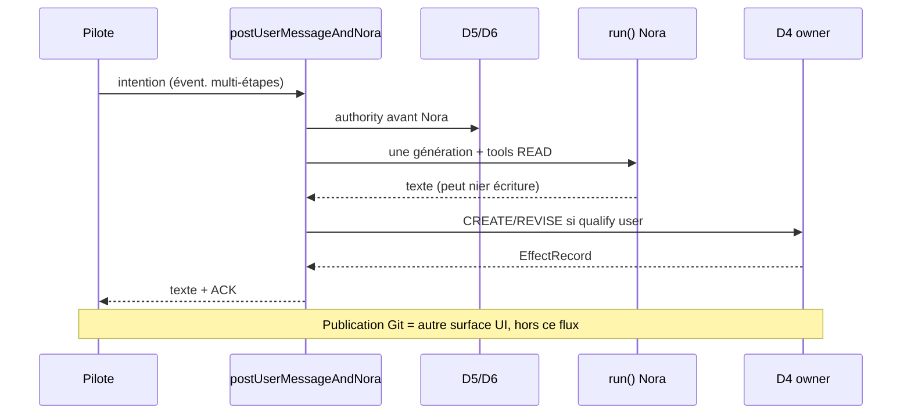
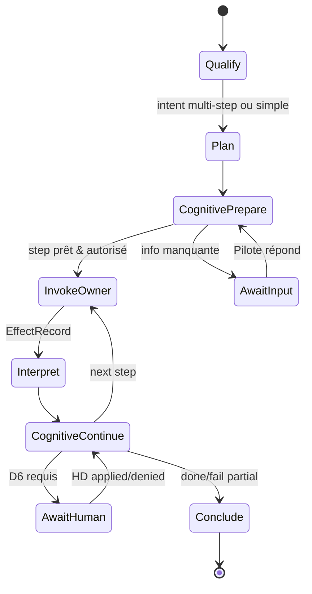
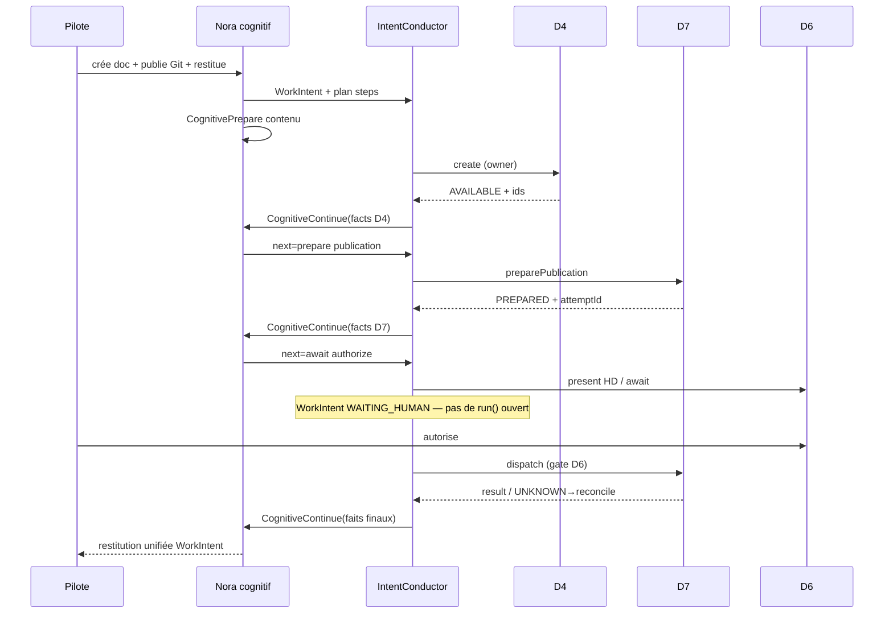

# SFIA Studio Next — Review Pack FULL
## R5 / Cycle 6 — Conduite des intentions et continuité cognitive Nora/Studio

**Date/heure :** 2026-11-10 11:05:16 +0100 (Europe/Paris)
**GO Morris :** analyse et conception lecture seule — 2026-11-10 — AUCUNE implémentation
**Profil :** CRITICAL / EVOL
**Exigence produit :** `docs/next-nora-intent-continuity-cadrage-20261110` @ `69c27832` blob `2322644a…` — VALIDATED IN CONTENT BY MORRIS
**Candidat Product inspecté :** `fix/next-ml4-chat-first-d4-provenance-20261109` @ `d7f1507a` / tree `3e9e1086…`
**RECETTE :** BUILD `8vZjme4-KnnPkAqm_QxMz` (worktree `…-d7f1507a`) — non mutée
**Handoff architectural antérieur (preuves, non décisions) :** `sfia/review-handoff@46fd9cc7`
**Verdict :** NORA/STUDIO END-TO-END INTENT CONTINUITY — FULL PRODUCT REQUIREMENTS COVERED IN DESIGN — TECHNICAL ARCHITECTURE READY FOR MORRIS REVIEW — NO IMPLEMENTATION AUTHORIZED

---

## 1. Git Truth Check

| Champ | Observé |
|---|---|
| remote | `origin` → `https://github.com/mcleland147/sfia-workspace.git` |
| branche Product | `fix/next-ml4-chat-first-d4-provenance-20261109` |
| HEAD | `d7f1507a56e50660ea24903c2dc563c249ba9086` **MATCH** |
| tree | `3e9e1086aaf83e22d8e3350565f1c747bb31f556` **MATCH** |
| origin/main | `6667a43858a5421e391b7441246536daad148bd6` |
| merge-base | `c658f59023d44a0e22448c7ee034e3c1dda292a2` |
| staged | vide |
| cadrage commit | `69c2783205994741a3a6daeedd639b2cbbc6cadb` |
| cadrage blob | `2322644aa028f882b57570fd962a9a971d772762` **MATCH** |
| handoff distant entrée | `46fd9cc7940c655ebc44e8078f1ae9b28e475c61` |
| RECETTE BUILD | `8vZjme4-KnnPkAqm_QxMz` |

Untracked/dirty préexistants inventoriés, non nettoyés, hors analyse. Cadrage **lu** depuis son commit distant ; **non** intégré à la branche Product.

---

## 2. Références Git des sources

| Priorité | Source | Ref |
|---|---|---|
| P1 | Cadrage validé conduite intentions | `69c27832` / blob `2322644a` |
| P2 | Vision produit, SEF, roadmap, décisions A3/R4, specs D1–D9, ADR | HEAD candidat + paths governance/cadrage/conception |
| P3 | Méthode SFIA / CKC architecture | method/* (guidance) |
| P4 | Handoffs @46fd9cc7, @63c08254 ; registre ML4 §11 @2075aa4f ; code `d7f1507a` | preuves |

Les options A/B/C/T1/T2/H des packs antérieurs = **analyse historique**, **non décisions**.

---

## 3. Lecture du cadrage Morris — extraction d'exigences

Document : *Conduite des intentions et continuité cognitive Nora/Studio* — VALIDATED IN CONTENT 2026-11-10.

### 3.1 Exigences comportementales (E)

| ID | Exigence (résumé fidèle) | § |
|---|---|---|
| **E01** | Nora interlocutrice principale ; conduit cognitivement le travail de l'intention | 1–2 |
| **E02** | Intention conduite de bout en bout multi-capacités, multi-étapes, HD, reprises | 1, 5–6 |
| **E03** | Qualification proportionnée : résultat, contraintes, dépendances, capacités, autorisations, conditions arrêt/échec | 2.1 |
| **E04** | Séquencement par dépendances réelles ; pas de présomption de succès | 2.2 |
| **E05** | Distinguer : cognitif direct / capacité Studio / besoin HD / indisponible réel | 3.1 |
| **E06** | Absence d'outil modèle ≠ impossibilité Studio | 3.1, 7 |
| **E07** | Pilote / Nora / domaines : responsabilités distinctes ; pas de fragmentation UX | 3.2 |
| **E08** | D2 création projet = acte explicite Pilote conservé | 3.2 |
| **E09** | Boucle Intention→qualify→prepare→opération→résultat→continuation→suite/restitution | 4 |
| **E10** | Résultat exploitable (IDs, versions, états, FAILED/UNKNOWN) avant suite | 4 |
| **E11** | Restitution finale ancrée sur faits observés | 4, 5.6, 7 |
| **E12** | Scénario référence create D4 → prepare Git → await HD → publish → synthèse **une intention** | 5 |
| **E13** | Pilote non obligé de réassembler manuellement les étapes | 5, 9 |
| **E14** | Continuité au-delà d'un tour ; suspend/resume avec acquis | 6 |
| **E15** | Échec partiel : distinguer acquis / non obtenus | 6 |
| **E16** | Effet confirmé ≠ rejeu pour cause de restitution ratée | 6 |
| **E17** | UNKNOWN ⇒ réconciliation propriétaire avant nouvel effet | 6 |
| **E18** | STOP/révocation Pilote opposables | 6 |
| **E19** | Pas de succès avant confirmation ; pas d'échec si AVAILABLE | 7 |
| **E20** | Distinguer génération / opération / mission | 7 |
| **E21** | Couverture transverse D1–D9 sans duplication d'autorité | 8 |
| **E22** | Aucune techno imposée ; solution doit couvrir **intégralité** | 9 |
| **E23** | Correction narrative D4 seule = **non suffisante** | 9 |
| **E24** | Construction progressive OK si conception E2E + limites explicites | 9 |
| **E25** | Conflits avec décisions existantes → arbitrage explicite | 11 |

### 3.2 Scénario d'acceptation principal (référence)

« Nora, crée ce document, publie-le dans mon dépôt GitHub et présente-moi le résultat. »

Étapes obligatoires : Qualify → D4 create+résultat → D7 prepare+résultat → await D6 (intention non close) → publish gouverné → restitution unifiée.

---

## 4. Matrice de traçabilité exigences → AS-IS → TO-BE

| E | AS-IS (`d7f1507a`) | Couverture AS-IS | Composant TO-BE | Test sortie |
|---|---|---|---|---|
| E01–E04 | Qualification partielle (cognitive profile + document-act + pilotage intent) ; pas de plan multi-étapes | PARTIAL | IntentQualify + WorkPlan | DET + LIVE |
| E05–E06 | Prompt nie écriture ; 5 read tools ; D2/D4write/D7 hors Nora → faux « impossible » | FAIL vs E06 | CapabilityCatalog + mobilization Studio | DET REC-08 inverted |
| E07–E08 | Domaines propriétaires OK ; D2 create-project explicite OK | PASS borné | inchangé D2 acte | E2E D2 |
| E09–E11 | generate→D4→ACK ; **pas** de continuation cognitive post-résultat | FAIL E09/E11 pour D4 write | CognitiveContinue post-EffectRecord | DET/PG/LIVE |
| E12–E13 | D4 chat + D7 **UI manuelle** séparée | **FAIL** scénario principal | IntentConductor multi-steps | E2E ACCEPT-01 |
| E14–E18 | Turn lease, reconcile D3/D7, HD tables ; **pas** WorkIntent | PARTIAL | WorkIntent await/resume | PG + BROWSER |
| E19–E20 | ACK post-hoc vs narration (REC-08 LIVE FAIL) | FAIL E19 | Continue facts-first + ACK canonique | LIVE REC-08 |
| E21 | Inventaire D1–D9 présent mais non conduit | PARTIAL | Catalog + owners | matrice |
| E22–E25 | — | — | design ci-dessous + arbitrages | revue Morris |

---

## 5. Inventaire D1–D9 (vérifié, synthétique)

Réemploie preuves @46fd9cc7 / @63c08254, revalidées HEAD.

| D | Implémenté | Nora tool | Studio surface | Résultat→Nora même tour | Suite conduite |
|---|---|---|---|---|---|
| D1 | session/ownership | NON | auth | N/A | contexte |
| D2 | createProjectCommand | NON | UI/API acte explicite | NON | **manuel** après création |
| D3 | postUserMessageAndNora + agents 0.21.0 | read tools | messages API | tools mid-run only | **1 run / tour** |
| D4 | docs/revs + chat-first write post-generate | read ; write serveur | Documents + chat | ACK text **après** generate | **pas** Continue |
| D5 | pilotage commands | NON | authority pre-Nora | snippets pré-Nora | borné |
| D6 | humanDecisions | NON | UI + authorize | projection | await manuel |
| D7 | prepare/authorize/dispatch/reconcile | NON | Publication panel | NON | **UI Pilote** |
| D8 | qualify/observed facts borné | NON | reconcile | NON | — |
| D9 | providers + git read tools | read | integrations | mid-run | — |

**Écart structurant vs E12/E13 :** aucune entité `WorkIntent` / mission ; aucune mobilisation D7 depuis la conduite Nora ; aucune boucle post-effet cognitive.

---

## 6. Parcours AS-IS démontrés

### 6.1 Tour conversationnel actuel

Preuve CODE : `service.ts` ordre generate L457 → qualify L586 → D4 L635+ → ACK L940–942.

### 6.2 Scénario principal AS-IS

| Étape exigée | AS-IS | Écart |
|---|---|---|
| 1 Qualify multi-step | profile + acts locaux | pas de plan D4→D7→D6→publish |
| 2 D4 create + Nora reçoit | D4 OK ; Nora a parlé **avant** | E09/E11/E19 |
| 3 Prepare Git | UI `preparePublication` | Nora ne mobilise pas (REC-11 LIVE) |
| 4 Await HD | UI authorize | intention chat **close** après tour |
| 5 Publish | dispatch UI | hors conduite Nora |
| 6 Restitution unifiée | absente | Pilote réassemble |

**Verdict AS-IS scénario principal : NON CONFORME au cadrage validé.**

---

## 7. Causes des dysfonctionnements

### 7.1 REC-08 — CAUSE ÉTABLIE

Génération sous tools/prompt read-only **avant** effet D4 ; ACK compositionnel après (`appendDocumentEffectAck`). LIVE §11 : REVISE AVAILABLE + narration « ne peux pas attester ».

### 7.2 CREATE→REVISE_NOT_FOUND — CAUSE CANDIDATE CODE + DET

`qualifyDocumentAct` priorise REVISE avant CREATE. Probe DET : « Crée un document et révise ensuite… » → REVISE. Texte LIVE exact **REPRO PENDING**.

### 7.3 Capacités hors outils — CAUSE CONTRAT D'EXPOSITION

D2/D4write/D7 existent ; non exposés comme tools ; pas de pont de mobilisation conduit. LIVE REC-11 : prepare via panneau seulement.

### 7.4 Écart E12 (nouveau focus)

**Cause systémique :** absence d'objet d'intention durable + absence de conducteur Studio capable d'enchaîner invocations propriétaires après résultats + absence de CognitiveContinue. Ce n'est **pas** un bug D4 isolé.

---

## 8. Architecture cible TO-BE complète

### 8.1 Principe

Satisfaire **E01–E25** et le scénario §5 du cadrage, en réutilisant les propriétaires D1–D9 existants.

**Nora** = conductrice cognitive (qualify, prepare contenu, décider prochaine capacité, interpréter faits, restituer).
**Studio IntentConductor** = enchaînement gouverné des invocations de domaines selon le plan et les EffectRecords.
**Domaines** = seuls exécutants d'effets + états.
**Pilote** = HD / acte D2 / STOP.

Ce n'est **pas** un orchestrateur universel multi-agents, **pas** une file imposée, **pas** un second magasin d'autorité : WorkIntent est une **projection de conduite** corrélée aux états propriétaires.

### 8.2 Objets logiques (durée de vie)

| Objet | Rôle | Persistance |
|---|---|---|
| Génération | un `run()` | generationId / obs |
| Tour | HTTP turn + lease | `conversation_turn_commands` (existant) |
| **WorkIntent** | intention Pilote multi-étapes | **nécessaire** (table ou document corrélé — choix d'implémentation ouvert) |
| IntentStep | étape + deps + status | lié WorkIntent |
| CapabilityRef | entrée catalogue | config/code |
| Commande/Attempt | effet domaine | existant D4/D5/D6/D7 |
| EffectRecord | fait vérifiable | existant + projection WorkIntent |
| Conclusion | restitution mission | message final + WorkIntent TERMINAL |

### 8.3 Capability Catalog (interface Nora↔Studio)

Chaque capacité : `{id, owner, mutative, authorityGate, invoke(surface), resultSchema}`.

Exemples :

| id | owner | gate | invoke |
|---|---|---|---|
| `d4.read_*` | D4 | session+projet | tool Nora (existant) |
| `d4.create_revision` | D4 | ownership + turn fence | **Conductor → save/revise** (pas autorité modèle) |
| `d7.prepare_publication` | D7 | link+perms | **Conductor → preparePublication** |
| `d6.request_authorization` | D6 | Pilote | Conductor crée/présente HD ; await |
| `d7.dispatch_publication` | D7 | **D6 applicable** | Conductor → dispatch après HD |
| `d2.create_project` | D2 | **acte explicite UI** | Nora prépare ; Pilote clique (E08) |
| `d9.read_*` | D9 | authz | tools (existant) |

**Règle E06 :** si `invoke` Studio existe et droits OK, Nora **ne** dit pas « impossible faute d'outil ».

### 8.4 Boucle de conduite (contrat cognitif)

**CognitiveContinue** reçoit uniquement faits structurés + plan restant ; **n'autorise aucun effet**.

### 8.5 Scénario principal TO-BE (ACCEPT-01)

Couverture : E12, E13, E14, E09–E11, E19.

### 8.6 Attentes / reprises / robustesse

| Cas | Mécanisme TO-BE |
|---|---|
| HD requise | WorkIntent `WAITING_HUMAN` ; message d'accompagnement ; reprise sur décision |
| UNKNOWN D7 | `reconcileAttempt` avant retry ; step blocked |
| D4 OK puis Continue fail | EffectRecord conservé ; WorkIntent `PARTIAL` ; restitution honnête (E16) |
| Double soumission | idempotence WorkIntent key + turn clientTurnKey + correlation D4/D7 |
| STOP Pilote | flag opposable ; pas de nouvel InvokeOwner |
| Reconnexion | recharger WorkIntent + états propriétaires ; ne pas rejouer AVAILABLE |
| Version doc / HEAD Git changés | invalidate step prepare ; requalify |
| Session expirée | D1 re-auth ; WorkIntent intact ; gates re-check |

---

## 9. Contrats de conduite cognitive

1. **Qualify** produit `IntentQualification` + `WorkPlan` proportionné (vide si S01 simple).
2. **Prepare** produit artefacts cognitifs extractibles pour l'étape courante.
3. **InvokeOwner** est **Studio-only** ; vérifie catalogue + gate + préconditions domaine.
4. **Interpret** n'accepte que EffectRecords / reconcile results.
5. **Continue** choisit next step / await / conclude — sans mutation.
6. **Conclude** émet synthèse E11 à partir du journal d'EffectRecords du WorkIntent.

---

## 10. Interfaces Nora ↔ capacités Studio

| Mode | Usage | Exemples |
|---|---|---|
| Tool modèle read | investigation mid-run | D4/D9 read (existant) |
| Conductor invoke | effets / préparations | D4 write, D7 prepare/dispatch |
| Surface Pilote obligatoire | actes humains non déléguables | D2 « Créer le projet », confirmation HD |
| Projection prompt | faits déjà vrais | D5/D6 snippets (existant, étendu aux EffectRecords WorkIntent) |

---

## 11. Séquences multi-étapes (autres parcours)

| Parcours | Plan typique | Notes |
|---|---|---|
| S01 simple | Qualify → Conclude | 0 Conductor invoke |
| Investigation | Prepare+read tools loops → Conclude | maxTurns existant |
| REVISE D4 | Prepare → D4.revise → Continue → Conclude | corrige REC-08 |
| D2 create | Prepare preview → **await acte Pilote** → Continue dans projet | E08 |
| D5 cycle | authority existante + évent. step plan | ne pas absorber D5 dans D7 |
| Partiel D4 OK D7 DENIED | Conclude PARTIAL | E15 |

---

## 12. Attentes et reprises gouvernées

- Pas de `run()` ouvert pendant await (cadrage §5.4 / E14).
- Reprise = nouvel événement (message Pilote, HD applied, reconcile done) → Conductor + CognitiveContinue.
- Permissions **revérifiées** à chaque InvokeOwner (TOCTOU D7 déjà assumé).

---

## 13. États et propriétaires

| État | Propriétaire |
|---|---|
| WorkIntent status (ACTIVE/WAITING_HUMAN/PARTIAL/COMPLETED/FAILED/STOPPED) | D3 Conductor projection |
| document/revision | D4 |
| effect_attempt | D7 |
| human_decision | D6 |
| business_command | D5/D6 |
| turn_command | D3 |
| git facts | D9/D8 |

**Invariant :** WorkIntent ne duplique pas la vérité transactionnelle ; il **référence** les IDs propriétaires.

---

## 14. Autorité et sécurité

- D6 au point d'effet mutatif externe (R4-03).
- Nora ne crée pas HD, ne dispatch pas, ne merge pas.
- D2 acte explicite conservé.
- Isolation Pilote/projet inchangée.
- Pas de permission dérivée d'un document.
- UNKNOWN ≠ retry.

### Conflits à arbitrer (non tranchés ici)

| Conflit | Détail |
|---|---|
| **A3** (convergence UX 07/11) « Non à un moteur générique d'actions Nora » | Cadrage 10/11 exige mobilisation multi-capacités par Nora. **IntentConductor Studio** ≠ moteur d'actions émis par le modèle, mais élargit la conduite au-delà du lot A3. **Morris doit confirmer** compatibilité ou périmètre supersession. |
| **R4-03** pas d'exécution depuis Nora | Respecté si InvokeOwner = D7/D4 services, pas exécution modèle. |
| Panel Publication vs conduite Nora | Cadrage E13 exige que le Pilote ne réassemble pas ; prepare/dispatch via Conductor **change l'UX** (panel devient inspection/override, pas chemin obligatoire). Arbitrage UX. |

---

## 15. Alternatives techniques **conformes** (même contrat fonctionnel)

Seules les stratégies couvrant E12+E14+E09 sont candidates « architecture cible ».

### Stratégie S1 — IntentConductor Studio + phases cognitives (recommandée)

- Nora planifie / prépare / interprète / restitue.
- Studio invoque domaines.
- WorkIntent pour await/resume.
- Tools read conservés ; pas de write-tools Nora obligatoires.

**Couverture :** complète E01–E25 si catalogue + Conductor + Continue + WorkIntent.

### Stratégie S2 — Capability tools owner-fenced + WorkIntent différé

- Adapters tools appellent D4/D7 mid-`run()` pour étapes immédiates.
- Await HD toujours hors run via WorkIntent.
- Plus proche Agents SDK loop ; risque A3 plus élevé (apparence « action engine »).
- Dispatch toujours gated D6 hors tool libre.

**Couverture :** complète si tools = thin adapters + mêmes gates.

### Stratégie S3 — Hybride

- Read tools + Conductor pour mutations (S1).
- Optionnellement 1–2 tools non mutatifs d'inspection enrichie.
- Même WorkIntent.

**Couverture :** complète ; complexité maîtrisée.

### Non-candidates (PARTIAL — refusées comme architecture cible)

| Stratégie | Motif d'exclusion vs cadrage |
|---|---|
| ACK/strip only (ex-T1/H narrative) | viole E12, E13, E23 |
| Continue D4-only sans D7 conduit | viole E12 |
| Forcer Pilote panel-only pour publish | viole E13 |
| Queue/multi-agents universels par principe | non justifié ; E22 liberté mais pas obligation |

---

## 16. Comparaison argumentée S1 / S2 / S3

| Critère | S1 Conductor | S2 Tools mutatifs | S3 Hybride |
|---|---|---|---|
| Fidélité cadrage E12 | Haute | Haute | Haute |
| Clarté propriétaires | Meilleure | Bonne si fences stricts | Meilleure |
| Tension A3 | Moyenne (à arbitrer) | Plus haute | Moyenne |
| Alignement code actuel | Étend service.ts pipeline | Refonte adapter tools | Étend pipeline |
| Await/resume | Naturel WorkIntent | WorkIntent + fin de run | idem S1 |
| Testabilité | Hooks entre invokes | mocks tools | hooks |
| Risque double effet | Conductor séquentiel + idempotence domaine | tool retry SDK | Conductor |
| Coût tokens | N Continues | 1 run long + resumes | mix |
| Réversibilité | flag Conductor | flag tools | flag |

---

## 17. Architecture recommandée (non adoptée)

**S1 IntentConductor Studio + CognitiveContinue + WorkIntent + CapabilityCatalog**, éventuellement raffinée en **S3** si des tools d'inspection supplémentaires s'avèrent utiles sans mutation.

**Justification :** satisfait le scénario principal sans donner l'autorité d'effet au modèle ; réutilise D4/D7/D6/turn leases ; sépare génération / tour / intention / effet (E20) ; permet construction progressive (E24) sans réduire le contrat cible.

**Ce que S1 n'est pas :** orchestrateur Cursor multi-agents ; remplacement de D7 ; file Kafka obligatoire.

---

## 18. Blast radius et risques

| Zone | Impact | Risque |
|---|---|---|
| `conversation/service.ts` | boucle Conductor | régression tours simples |
| nouveau module intent-conductor / work-intent | persistance | migration DB si table |
| `document-act.ts` | dual-intent qualify | REC-10 |
| `effect-service.ts` | invoke depuis Conductor | D6 bypass si bug |
| UI Publication | rôle inspection | confusion UX |
| `nora-adapter.ts` | Continue prompts | tokens/latence |
| Tests PG/E2E | nouveaux scénarios ACCEPT-01 | flakiness LIVE |

Non-régression obligatoire : REC-07, REC-10, REC-11.

---

## 19. Scénarios de non-régression

- REC-07 blob≠commit + permalink
- REC-10 CREATE fail-closed / CREATE minimal
- REC-11 FILE_ABSENT + D7 PREPARED (UI path conservé comme surface d'inspection)
- Tours S01 sans WorkIntent overhead artificiel
- D2 toujours acte explicite
- Pas de dispatch sans D6

---

## 20. Matrice de preuves d'acceptation

| ID | Exigences | Scénario | Niveaux | Oracle |
|---|---|---|---|---|
| **ACCEPT-01** | E12–E13, E09–E11 | create→prepare→await→publish→restitute | DET→PG→BROWSER→NORA LIVE→GITHUB REAL (gates) | une WorkIntent ; 4 EffectRecords ; synthèse unifiée ; 0 réassemblage Pilote |
| ACCEPT-02 | E01, E03 | question simple | DET/LIVE | pas de plan artificiel |
| ACCEPT-03 | E08 | create projet | BROWSER | acte UI requis |
| ACCEPT-04 | E09, E19 | REVISE D4 | PG/LIVE | Continue sans contradiction AVAILABLE |
| ACCEPT-05 | E14–E16 | HD deny mid-mission | PG/BROWSER | D4 kept ; no publish ; PARTIAL honest |
| ACCEPT-06 | E17 | D7 UNKNOWN | PG | reconcile before retry |
| ACCEPT-07 | E18 | STOP | PG | no new invoke |
| ACCEPT-08 | E16 | Continue fail after D4 | DET hooks | no rollback D4 ; no duplicate |
| ACCEPT-09 | dual-intent | CREATE vs REVISE phrasing | DET | policy arbitrated |
| NR-07/10/11 | témoins | existants | DET/LIVE | PASS |

Aucune preuve ci-dessus n'est déclarée acquise dans ce cycle.

---

## 21. Proposition de macro-lot de construction cohérent

**Conception = complète E2E (ce pack).**
**Construction progressive proposée (après GO Morris) :**

| Slice | Livrable | Ne pas revendiquer |
|---|---|---|
| L0 | WorkIntent + Catalog + Qualify plan | — |
| L1 | D4 Prepare→Effect→Continue (casse REC-08) | ≠ mission Git complète |
| L2 | Conductor → D7 prepare + Continue | ≠ publish |
| L3 | Await HD + resume + dispatch gate | — |
| L4 | Restitution unifiée ACCEPT-01 | — |
| L5 | D2/D5 paths + polish UX | — |

Chaque slice : tests + docs sync ; limites explicites (E24).

**OUT immédiat sans GO :** REAL merge, R13/R14, changement SEF/ADR sans arbitrage, write-tools Nora non fencés.

---

## 22. Dépendances, dette, exit, rollback

- **Dépendances :** décisions A3/UX panel ; éventuelle migration WorkIntent ; budgets Continue.
- **Dette acceptée :** Conductor v1 séquentiel simple — exit = désactiver flag, retomber sur tours isolés (régression produit vs cadrage = assumée).
- **Rollback :** revert commits slices ; RECETTE non basculée sans GO ; WorkIntent rows inertes si flag off.

---

## 23. Arbitrages Morris uniquement nécessaires

1. **Confirmer S1 (recommandé) / S2 / S3** comme cible technique du cadrage validé.
2. **A3 vs IntentConductor** : compatibilité ou révision de portée A3 pour ce nouveau cadrage 10/11.
3. **UX Publication** : panel devient inspection/override ; Conductor chemin nominal — OK ?
4. **WorkIntent persistence** : table dédiée vs méta corrélée — préférence ?
5. **Politique dual-intent CREATE/REVISE** (texte ambigu).
6. **GO reproduction** texte exact CREATE→REVISE_NOT_FOUND.
7. **GO construction** slices L0… — distinct ; pas d'auto-enchaînement.

---

## 24. Réserves et limites de preuve

- AS-IS et causes REC-08/exposition : CODE + LIVE historiques.
- ACCEPT-01 TO-BE : **design only** — non implémenté, non prouvé.
- Texte LIVE CREATE→REVISE : REPRO PENDING.
- Cadrage sur branche docs non mergée ; Product candidat local non mergé.
- Aucune mutation code/DB/RECETTE ce cycle.

---

## 25. Verdict

**NORA/STUDIO END-TO-END INTENT CONTINUITY — FULL PRODUCT REQUIREMENTS COVERED IN DESIGN — TECHNICAL ARCHITECTURE READY FOR MORRIS REVIEW — NO IMPLEMENTATION AUTHORIZED**

L'architecture S1 (IntentConductor + CognitiveContinue + WorkIntent + Catalog) est conçue pour satisfaire **l'intégralité** du cadrage `69c27832`, incluant le scénario create→publish→restitute comme **une** intention. Les correctifs narration-only sont explicitement **non suffisants** (E23).

---

## Git Review Index

| Artefact | Valeur |
|---|---|
| Product HEAD | `d7f1507a56e50660ea24903c2dc563c249ba9086` |
| Cadrage | `69c27832` / blob `2322644a` |
| Entrée handoff design | `46fd9cc7` |
| RECETTE BUILD | `8vZjme4-KnnPkAqm_QxMz` |
| Pack local | `.tmp-sfia-review/chatgpt-review.md` |

**ChatGPT :** relire handoff distant ; vérifier couverture E01–E25 et ACCEPT-01 ; confronter S1 aux conflits A3/R4 ; préparer arbitrage Morris.
**STOP** — aucune implémentation.
