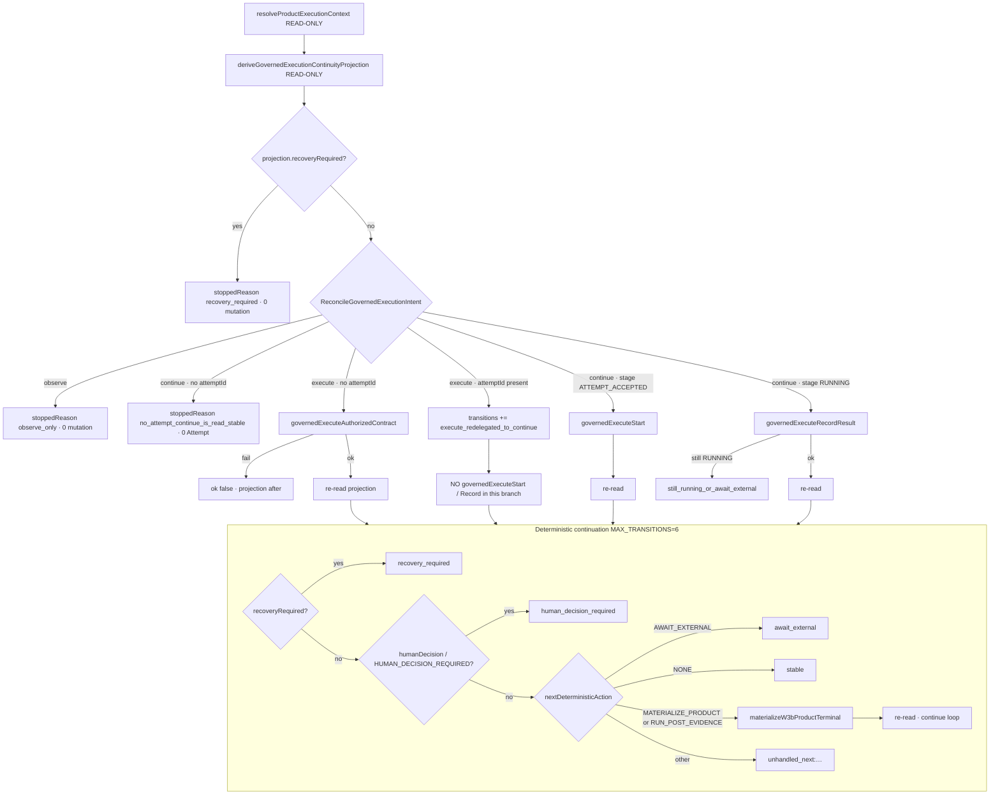
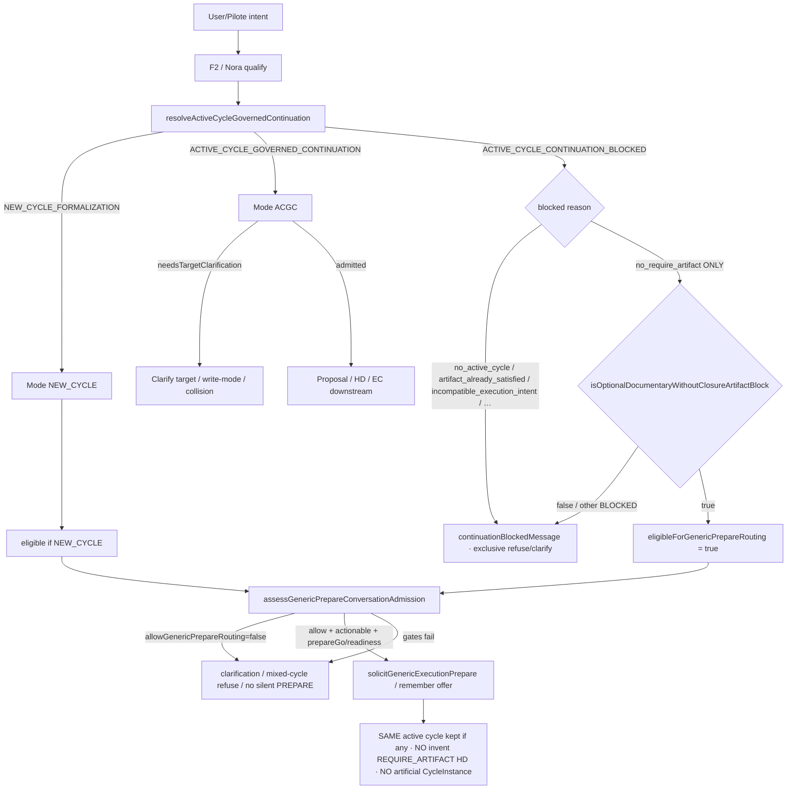

# SFIA REVIEW PACK — FULL
## AKG-M2 LOT B — CORRECTION PASS 01
### CRITICAL INTERACTION UNDERSTANDING

- **Timestamp UTC:** `2026-10-20T17:24:12Z`
- **Cycle:** 6 — Architecture technique
- **Specialization:** Critical Review Correction
- **Profile:** Critical
- **Typologie:** DOC / ARCHITECTURE / REVIEW
- **GO Morris:** `2026-10-20 — GO AKG-M2-B CORRECTION PASS 01`
- **Prior pack:** `6bf33c8cb8e8f42c88eb6968089e60c4459560c7` / blob `3a14e3f928bb562f7c684d0e78eef81d8974115b`
- **Evidence base main:** `d6cb457f8a3e0ce1781a8ef40b56c10f9955db30`
- **Verdict:** `AKG-M2 LOT B — CORRECTION PASS 01 COMPLETE — READY FOR CHATGPT CRITICAL RE-REVIEW`
- **M2-C:** **NOT AUTHORIZED**
- **Product/PRR/Roadmap edits:** **NONE**

---

## 1. GIT TRUTH

| Item | Value |
| --- | --- |
| Worktree | `/Users/morris/Projects/sfia-workspace-akg-m2-lot-a-formal-exit-roadmap-sync` |
| Branch | `docs/sfia-studio-akg-m2-lot-a-formal-exit-roadmap-sync` |
| HEAD local | `8a7cd63ff703d828c96966b4f4d63b803dd59d5e` |
| origin/main | `d6cb457f8a3e0ce1781a8ef40b56c10f9955db30` |
| handoff tip (pre) | `6bf33c8cb8e8f42c88eb6968089e60c4459560c7` |
| Dirty | `.tmp-sfia-review/chatgpt-review.md` only |
| Staged | none |
| M1 WT | preserved `f666f19f` |
| Code consulted via | `git show d6cb457f8a3e0ce1781a8ef40b56c10f9955db30:…` |

**Git Truth:** PASS.

---

## 2. CONVERGENCE / R23-R24

AKG-M0/M1/M2-A CLOSED · M2-B UNDER CORRECTION · M2-C NOT AUTHORIZED · M2 global NOT CLOSED · M3 NOT AUTHORIZED.  
R-M2A-04 ENTRY CONTRACT RECONCILED / **OPEN GOVERNED**.  
C1 TARGET · v3 NON ADOPTED · P6 NOT ACQUIRED · REAL NOT PROVEN.

**R23:** code primary for F11b/ACGC/reconcile.  
**R24:** documentary pack correction only — **NO SEMANTIC IMPACT**.

---

## 3. CORRECTION REGISTER R-M2B-01…04

| ID | Finding | Source | Avant | Après | Impact | Validation | Preuve | Réserve restante | Verdict |
| --- | --- | --- | --- | --- | --- | --- | --- | --- | --- |
| **R-M2B-01** | S2 oversimplified F11b; suggested derive→materialize | `reconcileGovernedExecution.ts:71–351` · derive · resolve | Flat flowchart | Branched S2 A–H | I-B02 · S2 · L-M2B4 | Each branch code-mapped | COVERAGE VERIFIED | none for diagram | **PASS** |
| **R-M2B-02** | S4 showed no_require_artifact → Generic PREPARE direct | `activeCycleGovernedContinuation.ts` · `orchestrateF2.ts:2198–2495` | Direct arrow | Gated S4 | I-B04 · S4 | Gates+refusals shown | COVERAGE VERIFIED | B-M2B-03 remains | **PASS** |
| **R-M2B-03** | “redelegated” ≠ Start/Record same call | reconcile `:155–158` + loop `:229–338` · derive AWAIT_EXTERNAL · test postExecutionHandoff | Implied continue=Start | Exact observed behavior + gap | I-B02 · S2 · L-M2B6 | Honest limits | OBSERVED CODE + TEST partial | **B-M2B-05 OPEN** (runtime/contract drift) | **PASS WITH GOVERNED RESERVE** |
| **R-M2B-04** | L-M2B7 too thin | — | Topic list | Full M2-C entry contract A–H + E-C01…10 | L-M2B7 · E-B10 | Verifiable questions | DOCUMENTED candidate | M2-C still NOT AUTH | **PASS** |

**Correction IDs ≠ architectural IDs B-M2B-*.**

---

# L-M2B0 — Entry Contract Reconciliation (preserved)

**R-M2A-04 ENTRY CONTRACT RECONCILED** / **OPEN GOVERNED** — unchanged.  
Sources: L-M2A6 `86a2b1e7` + CP01 `34ce3147` + CURRENT `d6cb457f8a3e0ce1781a8ef40b56c10f9955db30`.  
Fields A–G (prereqs · acquis · interactions · frontiers · sources · exit · gates) preserved from Lot B initial.

---

# L-M2B1 — Interaction Cards (updated where impacted)

## I-B01 SHE / GOVERNED EXECUTION — PRESERVED
(unchanged from Lot B initial — SHE 0 Attempt · Select creates · Start mutates · DET BEHAVIOR @ tested · REAL NOT PROVEN)

## I-B02 F11b CONTINUITY — CORRECTED

| Field | Content |
| --- | --- |
| ID | I-B02 |
| Intent enum | **only** `observe` \| `execute` \| `continue` — **recoveryRequired is projection property, not an intent** |
| READ-ONLY | `resolveProductExecutionContext` · `deriveGovernedExecutionContinuityProjection` |
| observe | return `observe_only` · **0 transitions** |
| recoveryRequired (pre-branch) | return `recovery_required` · **0 mutations** |
| continue sans Attempt | `no_attempt_continue_is_read_stable` · **0 Attempt** |
| execute sans Attempt | may `governedExecuteAuthorizedContract` (Select→Start→Record path) |
| execute **avec** Attempt | push `execute_redelegated_to_continue` **only** · **does not** enter Start/Record else-if · then deterministic loop |
| continue + ATTEMPT_ACCEPTED | `governedExecuteStart` |
| continue + RUNNING | `governedExecuteRecordResult` |
| Deterministic loop | materialize **only if** `nextDeterministicAction ∈ {MATERIALIZE_PRODUCT, RUN_POST_EVIDENCE}` |
| Stops | recovery_required · human_decision_required · await_external · stable · unhandled_next:* · transition_limit_reached · still_running_or_await_external |
| Proof | COVERAGE VERIFIED · BEHAVIOR DET @ tested for observe/continue/execute-no-attempt · execute+existing = OBSERVED + PARTIAL TEST |
| Gap | **B-M2B-05** comment vs code for execute+existing |

## I-B03 RESTART — PRESERVED
## I-B04 ACGC — CORRECTED

Modes remain three-way. **no_require_artifact** is one BLOCKED reason only. Optional documentary path (`isOptionalDocumentaryWithoutClosureArtifactBlock`) may become **eligible** for Generic PREPARE routing in `orchestrateF2`, **iff** `assessGenericPrepareConversationAdmission.allowGenericPrepareRouting` + actionable intent + prepareGo/readiness gates. Other BLOCKED reasons stay exclusive (clarification/refusal via `continuationBlockedMessage`). **Never** invent REQUIRE_ARTIFACT HD · **never** auto createCycle.

## I-B05…I-B08 — PRESERVED
(with I-B08 R2 refuse code still DET-proven; REAL NOT PROVEN)

---

# L-M2B2 — Sequence Diagrams (S2/S4 corrected; S1/S3/S5 preserved essence)

## S1 — SHE (preserved essence)

PREPARE → INSPECT → [structural HD] → Confirm? → Authorize (**0 Attempt**) → Select → Start → Record · refusals SHE_*/AUTH_*/R2/G-D4.

## S2 — F11b CORRECTED (R-M2B-01)



**Critical fidelity notes (code):**
- Materialize is **not** reached from derive alone — only via reconcile loop when next action is MATERIALIZE/RUN_POST_EVIDENCE.
- ATTEMPT_ACCEPTED / RUNNING stages typically project `nextDeterministicAction=AWAIT_EXTERNAL` (`deriveGovernedExecutionContinuityProjection.ts` ~115–128) → loop stops **await_external** unless Start/Record already advanced stage via **continue** intent.

## S3 — Restart F17/F18/F19 (preserved)
Offer process-local lost · HD durable · F18/F19 PARTIAL · ≠ RESTART SAFE global.

## S4 — ACGC CORRECTED (R-M2B-02)



## S5 — Evidence → Nora → trajectory (preserved essence)
materialize → Evidence/RB/CE → post-Evidence · Rec ≠ HD ≠ promote.

---

# L-M2B3 — Restart Matrix (preserved)
(See Lot B initial rows — offer loss · HD durable · Attempt/Evidence durable · F17 DET · F18/F19 PARTIAL · multi-instance NOT PROVEN.)

---

# L-M2B4 — Authority / Refusal (enriched)

Preserved B8/B11/R2/G-D4/UNKNOWN/F11b recovery.  
**ACGC enrichment:** no_require_artifact ≠ universal Generic PREPARE; requires optional-documentary eligibility + conversation admission.  
**F11b enrichment:** execute+existing Attempt does not Start/Record in same call (see R-M2B-03).

---

# L-M2B5 — Complexity (preserved + note)
C1–C7 preserved. Add: comment/code drift on execute redelegation (**B-M2B-05**) — classification **KEEP** behavior until Product GO; documentary now accurate.

---

# L-M2B6 — Gaps / Proof Ceilings

### Critical Review reserves R-M2B-*
| ID | Status after CP01 |
| --- | --- |
| R-M2B-01 | **PASS** |
| R-M2B-02 | **PASS** |
| R-M2B-03 | **PASS WITH GOVERNED RESERVE** → feeds **B-M2B-05** |
| R-M2B-04 | **PASS** |

### Architectural ambiguities
| ID | Status |
| --- | --- |
| A-M2A-01…05 | preserved (01 bounded · 02/03 partial · 04/05 open) |
| B-M2B-01…04 | preserved |
| **B-M2B-05** | **NEW OPEN** — `execute`+existing Attempt: COMMENT “treat as continue” vs OBSERVED CODE (label only + loop; Start/Record only on `intent=continue`). Impact: callers using execute expecting Start may stop at `await_external`. Blocks M2-B exit? **No** if documented. Next: Product GO or M2-C review question — **no fix this cycle**. |

### Debts preserved OPEN
G-M1-* · RS-03 · TOOL-FIRST-REAL-NOWRITE · R-M2A-04 · D11/D12

### R-M2B-03 — Execute + existing Attempt (detailed)

| Layer | Finding |
| --- | --- |
| OBSERVED CODE | `:155–158` push `execute_redelegated_to_continue` only; Start/Record else-if require `intent===continue` |
| LOOP EFFECTS | May materialize if next=MATERIALIZE/RUN_POST_EVIDENCE; typically ATTEMPT_ACCEPTED→AWAIT_EXTERNAL → stop `await_external` without Start |
| MUTATIONS same call | No second Attempt; no Start; no Record; possible materialize only if projection already terminal-ready |
| TESTED | `postExecutionHandoff.integrated.d0` asserts redelegated **OR** terminal/stable/HD stop + **single Attempt** — does **not** assert Start on second execute |
| COMMENT/INTENDED | Header/comment “existing Attempt → continues deterministic steps” / “treat as continue” |
| HYPOTHESIS | Explicit `continue` is the Start/Record path |
| KNOWN GAP | **B-M2B-05** — redelegation is label≠continue branch |

**No Product change. No architectural decision.**

---

# L-M2B7 — M2-C Entry Contract Candidate (**COMPLETE — PROPOSAL ONLY**)

## Title
**AKG-M2 LOT C — ARCHITECTURE UNDERSTANDING REVIEW**  
**Status: PROPOSAL ONLY — NOT AUTHORIZED**

### A. Prérequis
- M2-A Formal Exit acté (main tip)
- M2-B Critical Re-Review **PASS** (after this CP01)
- M2-B Formal Exit Morris **distinct**
- GO Morris M2-C **distinct**
- Git CURRENT requalified at M2-C start

### B. Objet
Cohérence globale: responsabilités M2-A · interactions M2-B · architecture CURRENT · PRR · invariants v3 cibles (V3-F05/F06).

### C. Questions vérifiables
1. PREPARE/HD/Confirm/Authorize/Execute frontiers cohérentes ?
2. SHE/Select/Start séparés + refus ?
3. F11b intents/projection/effets vs contrats (incl. B-M2B-05) ?
4. Restart F17/F18/F19 plafonds bornés ?
5. ACGC modes/routages/refus (no_require_artifact gated) ?
6. Trajectory/Finalization: Rec≠HD≠Promote ?
7. Legacy/CURRENT coexistence sans retrait prématuré ?
8. PRR/manifest F11b + DEP-EC-ATT gaps ?
9. Fake/DET/REAL sans sur-claim ?
10. Complexité/contradictions requalifiées ?

### D. Preuves d'entrée (par question — pattern)
| Q | Code | PRR | M2 record | Test | Niveau | Gap |
| --- | --- | --- | --- | --- | --- | --- |
| 1–2 | SHE + governedExecute* | F08/F10 | I-B01 | p6.she* · toolFirst | BEHAVIOR DET | REAL |
| 3 | reconcile/derive/resolve | F11b narr. | I-B02 · B-M2B-05 | continuity · postExecutionHandoff | COVERAGE+PARTIAL | B-M2B-05 |
| 4 | offer store · PRR06 | F17–19 | I-B03 | chat-first / partial | PARTIAL | multi-instance |
| 5 | ACGC + orchF2 | F05/F08 | I-B04 | F2 tests | COVERAGE | B-M2B-03 |
| 6 | decideTrajectory · approveCandidate · finalization | F07 | I-B06 | trajectory tests | COVERAGE | A-M2A-01 |
| 7 | executeConfirmed* vs W2 | F09/F10 | I-B07 | call-graph | COVERAGE | A-M2A-02 |
| 8 | manifest flows[] | README/manifest | A-M2A-04 | — | DOCUMENTED | G-M1-15/17 |
| 9 | R1/R2 gates | F10 | I-B08 | toolFirst R1R2 | BEHAVIOR DET | G-M1-05 |
| 10 | L-M2B5 | — | C1–C7 | — | DOCUMENTED | M4 later |

### E. Scénarios requis
| Scenario | Status |
| --- | --- |
| nominal SHE→Select→Start | PROVEN DET |
| refuse SHE/R2/G-D4 | PROVEN DET |
| stale currentness | PROVEN DET (SHE) |
| missing authority | PROVEN DET |
| restart F17 | PROVEN DET |
| restart F18/F19 | PARTIAL |
| lineage inconsistency / recoveryRequired | PROVEN DET @ tested |
| retry/idempotence Select | PROVEN DET |
| execute+existing Attempt | OBSERVED + PARTIAL TEST · gap B-M2B-05 |
| concurrent/multi-instance | NOT PROVEN / hors scope unless GO |
| legacy confirmAndExecute | COVERAGE VERIFIED |
| Fake vs REAL boundary | DET refuse proven · REAL NOT PROVEN |

### F. Critères de sortie M2-C (candidate)

| ID | Attendu | Preuve | Source | Limite | Blocking? | Next |
| --- | --- | --- | --- | --- | --- | --- |
| E-C01 | M2-A/M2-B reconciliés | packs L3 | handoffs | — | Yes | — |
| E-C02 | Séquences critiques cohérentes | S1–S5 vs code | M2-B CP01 | B-M2B-05 | Yes | Product GO if fix |
| E-C03 | Invariants autorité | B-matrix + tests | PRR07 · M2-A/B | unsampled cells | Yes | — |
| E-C04 | Persistence/restart bornés | matrix L-M2B3 | PRR06 | ≠ global safe | Yes | — |
| E-C05 | Surfaces historiques qualifiées | I-B07 | F3/W2 | ≠ RETIRE | No | M4 |
| E-C06 | Écarts PRR/code recensés | G-M1-15/17 | manifest | no sync here | No | **M3 PRR GO** |
| E-C07 | Dettes gouvernées | gap register | L-M2B6 | none closed illicitly | Yes | — |
| E-C08 | Fake/DET/REAL honest | I-B08 | tests | ZERO REAL claim | Yes | REAL GO |
| E-C09 | Trajectoire AKG-M3 définie | M3 entry notes | Roadmap | M3 NOT started | Yes | M3 GO |
| E-C10 | Revue+décision Morris traçables | Formal Exit | conversation | — | Yes | — |

Statuts E-C* = **à évaluer en M2-C** (ici PROPOSAL ONLY).

### G. Exits / dépendances
M2-C **prépare** AKG-M3 Reference Consolidation.  
M2-C **ne doit pas**: exécuter M3 · modifier PRR · clôturer AKG-M2 global · Product Transformation · M4 rationalize.  
Dépendances pour M3: G-M1-15/17 · A-M2A-04 · PRR sync gate.

### H. Gates (all DISTINCT)
GO M2-C · GO AKG-M2 Formal Milestone Exit · GO PRR sync · GO Product · GO REAL/HQA.

---

# EXIT PROOF E-B01…E-B10 (requalified)

| ID | Result | Note |
| --- | --- | --- |
| E-B01 | **PASS** | R-M2A-04 reconciled |
| E-B02 | **PASS** | reuse M1/M2-A |
| E-B03 | **PASS** | interactions sourced |
| E-B04 | **PASS WITH BOUNDED RESERVE** | S1/S2/S4 fidelity fixed; B-M2B-05 on execute+existing |
| E-B05 | **PASS** | read/write fidelity corrected in S2/I-B02 |
| E-B06 | **PASS WITH BOUNDED RESERVE** | restart PARTIAL ceilings |
| E-B07 | **PASS WITH BOUNDED RESERVE** | legacy dual path |
| E-B08 | **PASS** | Fake/DET/REAL separated |
| E-B09 | **PASS** | gaps governed; none illicitly closed |
| E-B10 | **PASS** | L-M2B7 complete candidate |

≠ M2-B CLOSED · ≠ automatic Formal Exit.

---

## Fake / REAL
NONE REAL this cycle · DET evidence reused · correction **does not** raise proof ceiling · REAL BOUNDARY NOT PROVEN · P6 NOT ACQUIRED · v3 NON ADOPTED.

---

## Validations
```text
git status: .tmp-sfia-review/chatgpt-review.md only
Product/tests/PRR/Roadmap/doctrine: unmodified
```

---

## Décisions Morris restantes
1. ChatGPT Critical Re-Review of CP01.  
2. Morris Formal Exit GO M2-B (**distinct**).  
3. Optional Product GO for B-M2B-05 (execute redelegation).  
4. M2-C / PRR / REAL — each DISTINCT.

---

## Verdict
**AKG-M2 LOT B — CORRECTION PASS 01 COMPLETE — READY FOR CHATGPT CRITICAL RE-REVIEW.**

---

## Instruction ChatGPT
Lire `sfia/review-handoff` → `sfia-review-handoff/latest-chatgpt-review.md` (this pack after L3).  
Vérifier: main `d6cb457f8a3e0ce1781a8ef40b56c10f9955db30` · Correction Register R-M2B-01…04 · S2/S4 fidelity · execute+existing Attempt (OBSERVED vs COMMENT · B-M2B-05) · L-M2B7 E-C01…10 · R-M2A-04 still OPEN · gaps preserved · **no Product mutation**.  
Puis **CHATGPT CRITICAL RE-REVIEW**.

---

## APPENDIX — Preserved interaction cards (full text from Lot B, non-contradicted)

### I-B01 — SHE / GOVERNED EXECUTION (full)
| Field | Content |
| --- | --- |
| Question | How does Pilote Exécuter become Attempt/Cursor without collapsing PREPARE/AUTH/EXEC? |
| Components | prepareGenericExecutionContractDraft · singleHumanExecutePreparedContract · governedExecuteSelect/Start/Record · OA Select/Start |
| Sources | `w2/singleHumanExecutePreparedContract.ts:704–963` · `governedExecuteAuthorizedContract.ts:757–1188` · PRR F08/F10 |
| Reads | EC · inspection · materiality · HD if structural |
| Writes (SHE) | inspect/confirm/authorize (+ optional supersede+HD) · **executionAttemptCreated always false** |
| Writes (Gov) | Attempt accepted→running→terminal · Cursor boundary on Start |
| Refusals | SHE_* · AUTH_* · R2 `BOUNDED_NON_MUTATING_REAL_ENFORCEMENT_UNAVAILABLE` · G-D4 binding · UNKNOWN blocks |
| Attempt rules | fail before Select→0 · Select refuse→0 new · Start refuse→may stay accepted · Attempt succeeded ≠ Product SUCCESS PROVEN |
| Proof | BEHAVIOR PROVEN DET/Fake @ tested · REAL NOT PROVEN |
| Verdict | COVERAGE VERIFIED + BEHAVIOR PROVEN (DET) |

### I-B03 — RESTART / PERSISTENCE (full)
| Checkpoint class | Durable | Process-local lost | Revalidation | Proof |
| --- | --- | --- | --- | --- |
| PREPARE offer | no | `pendingGenericPrepareOfferStore` Map | HD11 may resume PREPARE | DOCUMENTED |
| HD | oa_human_decisions | — | verify applicability · HD≠auth | DET PARTIAL F18 |
| EC prepared/inspected/authorized | Truth C | — | reinspect/re-evaluate | DET |
| Attempt accepted/running/terminal | Truth C | launch process | Start gates / reconcile | DET · UI restart PARTIAL |
| Evidence/RB/CE · post-Evidence W3c | Truth C | Memory B path-dependent | rehydrate | F13 DET @ tested |
| Proposal pending | refs vary | proposal store | re-present | F17 DET |
| Finalization | HD+obligations | UI | re-assess | DET |

Offer loss ≠ Authorization refuse. HD present ≠ authorized launch. **≠ RESTART SAFE global.** Multi-instance NOT PROVEN. RunState cross-restart DEFER.

### I-B05 — POST-EVIDENCE / NORA (full)
materializeW3bProductTerminal → Evidence/RB/CE → runW3cPostEvidenceLoop / rehydrate · Product Truth C ≠ Memory B ≠ Recommendation ≠ HD.  
A-M2A-03: platform `t-a7` boundedHistory ≠ Product W3c post-Evidence ownership. Proof: F13 DET · REAL distinct GO.

### I-B06 — TRAJECTORY / FINALIZATION (full)
decideTrajectory + approveCandidateTrajectory both call OA `promoteDecidedTrajectory` after HD · Assessment≠HD≠Promotion · GAP-03 git primary EC fail-closed. A-M2A-01 VERIFIED WITH BOUNDED RESERVE (dual Product entries, single OA promote).

### I-B07 — LEGACY / PARALLEL (full)
M3/F3 `executeConfirmed*` and W2 `governedExecuteSelectAgent` both reach OA SelectExecutionAgent · different preconditions · KEEP ≠ RETIRE · A-M2A-02 PARTIALLY VERIFIED.

### I-B08 — TOOL-FIRST FAKE/REAL (full)
R1 stamp at PREPARE/materiality · R2 pathless+REAL refuse at Select (before Attempt) and Start (Attempt stays accepted) with `BOUNDED_NON_MUTATING_REAL_ENFORCEMENT_UNAVAILABLE` · Fake/DET admissible · G-M1-05 OPEN · stamp ≠ REAL no-write guarantee.

### L-M2B3 Restart matrix (minimum rows)
| Checkpoint | Durable | Process-local | Loss | Reconstruction | Auth reval | Proof | Gap |
| --- | --- | --- | --- | --- | --- | --- | --- |
| Proposal pending | subject refs | proposal store | presentation | re-solicit | yes | DET F17 | multi-conv |
| Generic PREPARE offer | none | offer Map | yes | HD11 if HD | currentness | DOCUMENTED | multi-instance |
| Durable HD | yes | — | no | load | verify | PARTIAL F18 | — |
| EC prepared→authorized | yes | — | no | get/re-eval | required | DET | — |
| Attempt accepted | yes | — | no | resolve | Start gates | DET | — |
| Attempt running | yes | process | process die | continue/record | readiness | PARTIAL UI | RunState DEFER |
| Attempt terminal | yes | — | no | resolve | — | DET | — |
| Evidence/RB | yes | — | no | rehydrate | — | DET | — |
| Post-Evidence Nora | W3c durable | Memory B | path-dep | rehydrateW3c* | — | DET | REAL GO |
| Finalization/replan | HD+obl | UI | UI | assess | undisposed recs | DET | — |

### L-M2B5 Complexity findings (preserved)
| ID | Observation | Class candidate |
| --- | --- | --- |
| C1 | Dual trajectory Product writers → one OA promote | KEEP both |
| C2 | SHE vs M3 confirm-and-execute dual orchestration | KEEP ≠ RETIRE |
| C3 | F11b three modules — not globally RO | KEEP split |
| C4 | Offer process-local vs HD durable | ADAPT later if GO |
| C5 | ACGC vs NEW_CYCLE vs F08 hand-off | KEEP · clarify |
| C6 | Manifest F11 vs F11b / DEP-EC-ATT | COMPLETE later · M3 PRR GO |
| C7 | Memory B / Truth C / Rec coupling risk | KEEP separation |
| C8 | execute redelegation comment≠continue branch | KEEP until Product GO · B-M2B-05 |

≠ AKG-M4 started.

