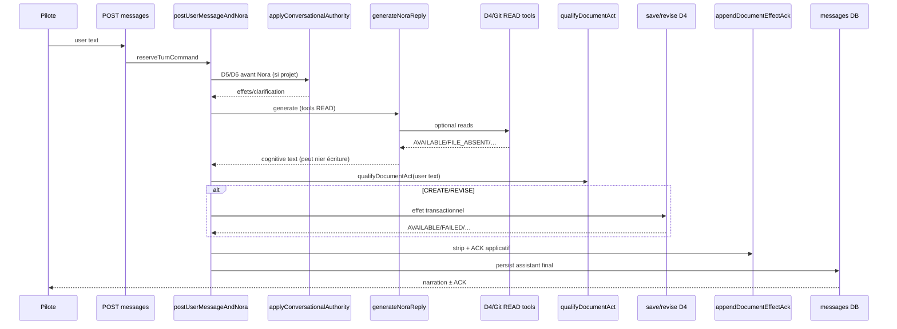

# SFIA Studio Next — Review Pack FULL
## R5 / Cycle 6 — Architecture technique — Revue transverse Nora/Studio

**Date/heure :** 2026-11-10 09:55:12 +0100 (Europe/Paris)
**GO Morris :** investigation lecture seule 2026-11-10 — AUCUNE modification produit
**Profil :** CRITICAL / EVOL — INVESTIGATION PRÉALABLE
**Candidat local :** fix/next-ml4-chat-first-d4-provenance-20261109 @ d7f1507a / tree 3e9e1086…
**RECETTE runtime vérifié :** 127.0.0.1:3200 sert BUILD 8vZjme4-KnnPkAqm_QxMz via …-d7f1507a
**Verdict :** TRANSVERSE NORA/STUDIO ARCHITECTURE REVIEW COMPLETE — ROOT CAUSES QUALIFIED WHERE PROVEN — DESIGN OPTIONS READY FOR MORRIS ARBITRATION — NO IMPLEMENTATION AUTHORIZED

---

## 1. Git Truth Check

| Champ | Valeur |
|---|---|
| remote | origin https://github.com/mcleland147/sfia-workspace.git |
| branche | fix/next-ml4-chat-first-d4-provenance-20261109 |
| HEAD | d7f1507a56e50660ea24903c2dc563c249ba9086 |
| tree | 3e9e1086aaf83e22d8e3350565f1c747bb31f556 |
| parent | 771844fda083ce3c1858b77b0012e5bf2b801605 |
| origin/main | 6667a43858a5421e391b7441246536daad148bd6 |
| staged | vide |
| push Product | AUCUN |
| worktree Product | …-next-ml4-git-collaboration @ d7f1507a |
| worktree RECETTE | …-recette-build-d7f1507a @ d7f1507a (servi) |

Untracked préexistants (manifests ENV-01, scripts, preuves) : inventoriés, non modifiés, hors analyse.

---

## 2. Sources consultées

- Anomalies docs@2075aa4f §11 (blob e110064b…) — rejeu G1 LIVE
- Handoffs G1 4c97b65c ; bascule 2c0c4791
- Code local d7f1507a : `conversation/service.ts`, `document-act.ts`, `nora-adapter.ts`, `cognitive-policy.ts`, `git-read-tools.ts`, `d4-read-tools.ts`, `pilotage/conversation-authority`, `preparation/create-project`, `execution/effect-service`, routes API
- Gouvernance/méthode : consultées pour cadrage (pas de modification)

Distinction : **IMPLEMENTED** = code présent ; **BEHAVIOR PROVEN** = LIVE §11 ou tests ; **DOCUMENTED** ≠ prouvé.

---

## 3. Inventaire capacités / outils (matrice)

### 3.1 Outils exposés DIRECTEMENT à Nora (D3 Runner)

| Outil | Domaine | Mutatif | Condition | Statut |
|---|---|---|---|---|
| search_project_resources | D4 read | NON | profil ≠ simple | IMPLEMENTED + DET |
| read_project_document_revision | D4 read | NON | profil ≠ simple | IMPLEMENTED + DET |
| list_project_git_sources | D9 read | NON | profil ≠ simple | IMPLEMENTED + LIVE REC-11 |
| read_git_file | D9 read | NON | profil ≠ simple | IMPLEMENTED + LIVE REC-11/07 |
| list_git_refs | D9 read | NON | profil ≠ simple | IMPLEMENTED |

Allowlist : `cognitive-policy.ts` (~L217–226). Profil `simple` → **aucun outil**.

Prompt système (`nora-adapter.ts`) : Nora **ne crée jamais** projet/cycle/dépôt/mandat/HumanDecision ; outils Git/D4 en lecture.

### 3.2 Capacités Studio NON exposées comme outils Nora

| Capacité | Entrée | Propriétaire | Nora tool? | Observation Nora |
|---|---|---|---|---|
| CREATE projet D2 | UI + `POST …/create-project` | preparation/create-project | **NON** | Interdit par prompt |
| CREATE/REVISE D4 | **post-génération** dans `postUserMessageAndNora` | document service | **NON** (effet serveur) | ACK post-hoc seulement |
| Capitalisation | post-génération | knowledge | NON | — |
| Autorité conversationnelle D5/D6 | **pré-Nora** `applyConversationalAuthority` | pilotage | NON | snippets après effet |
| Préparation publication D7 | UI/API `…/git/publications/prepare` | execution | **NON** | LIVE §11 : Nora lecture ≠ D7 |
| Authorize/dispatch D6/D7 | UI/API | decisions + execution | NON | — |
| OAuth GitHub / attach repo | UI/API integrations | integrations | NON | — |
| Merge | API merge/* | execution | NON | HARD-BLOCKED REAL |

### 3.3 Matrice D1–D9 (synthèse)

| D | Implémentation | Outil Nora | Studio surface | Autorité | ACK | Preuve |
|---|---|---|---|---|---|---|
| D1 | Better Auth / session / requireStudioSession | NON | login/API | session | 401 sans session | SMOKE REAL |
| D2 | preparations + createProjectCommand | NON | sas UI | ownership Pilote | commande idempotente | IMPLEMENTED |
| D3 | service + nora-adapter + policy | OUI (read) | messages API | turn lease | status COMPLETE/UNKNOWN | IMPLEMENTED + LIVE |
| D4 | document service + act qualifier | read only ; write via serveur | Documents UI | ownership + fence | Résultat applicatif D4 | LIVE CREATE/REVISE + ACK |
| D5 | pilotage commands (partiel) | NON | pilotage API | D6 | command status | IMPLEMENTED borné |
| D6 | decisions + conversational authority | NON | décisions UI/API | HumanDecision | decisionId | IMPLEMENTED |
| D7 | effect-service prepare/dispatch | NON | Publication Git UI | D6 pour dispatch | PREPARED/… | LIVE PREPARED REC-11 |
| D8 | observed facts / qualifyObservedFacts | NON | reconciliation | preuves | — | DET + borné REAL |
| D9 | resource-service + providers | read tools | Intégrations + git/* | gate + App | FILE_ABSENT/AVAILABLE | LIVE REC-11/07 |

---

## 4. Flux réel du tour conversationnel (code exact)

**Ordre prouvé** dans `service.ts` :
1. D5/D6 `applyConversationalAuthority` — ~L370–410 (**avant** Nora)
2. `generateNoraReply` — ~L457–472
3. `qualifyDocumentAct(content)` — ~L586 (**après** génération, sur texte **utilisateur**)
4. CREATE/REVISE D4 — ~L635–907
5. `appendDocumentEffectAck(reply.content, …)` — ~L940–942
6. Persist message assistant composé

**Conséquence architecturale :** Nora **ne voit jamais** le résultat D4 au moment où elle rédige. L’ACK est une composition **post-effet** sur le texte cognitif déjà produit.

---

## 5. Diagnostic causal — incidents

### 5.1 REC-08 (REVISE AVAILABLE + narration « ne peux pas attester ») — CAUSE ÉTABLIE

**Faits LIVE §11 :** doc_94b6b1c9… REVISE/AVAILABLE v2 drev_455a13a3… ; Nora nie outil d’écriture et attestation.

**Cause (code) :**
1. Outils Nora = lecture seule ; prompt dit explicitement qu’elle n’écrit pas.
2. Génération cognitive **avant** effet D4.
3. Effet D4 = responsabilité serveur, pas outil Nora.
4. ACK ajouté après coup ; strip (`TRANSACTIONAL_CLAIM_RE`) tente d’enlever contradictions mais :
   - ne change pas le fait que le modèle a déjà « pensé » l’absence d’outil ;
   - résidus possibles si formulation hors regex ;
   - le Pilote voit encore une tension cognitive vs bloc applicatif.

**Niveau :** ROOT CAUSE QUALIFIED (séquencement + frontière outil) — **BEHAVIOR PROVEN** par code + LIVE §11.

**Ce qui n’est PAS la cause principale :** absence d’ACK Studio (l’ACK existe) ; échec D4 (AVAILABLE).

### 5.2 Premier CREATE → REVISE_NOT_FOUND — CAUSE CANDIDATE FORTE / REPRO PENDING

**Faits LIVE §11 :** demande CREATE explicite → qualifiée REVISE → FAILED/REVISE_NOT_FOUND.

**Mécanisme code :**
- `qualifyDocumentAct` priorise **REVISE avant CREATE** (`document-act.ts` ~L433–447).
- Si le texte contient un verbe de révision **et** un objet documentaire (titre/ID/« document »), → REVISE.
- Puis `resolveReviseTarget` échoue → `REVISE_NOT_FOUND` (`service.ts` ~L731–737).
- CREATE n’est jamais tenté dans ce tour.

**Hypothèse :** formulation du premier essai contenait des indices REVISE (référence à un doc existant / « réviser/mettre à jour » / contexte fil) malgré intention CREATE.

**Preuve manquante :** texte exact du premier message LIVE non rejoué ici (READ-ONLY, pas de Nora LIVE).

**Statut :** CAUSE CANDIDATE CODE-PROVEN ; **REPRODUCTION PENDING — CONTROLLED TEST GO REQUIRED** (fixture texte exact + `qualifyDocumentAct` unitaire).

Deuxième essai CREATE minimal → CREATE/AVAILABLE : **BEHAVIOR PROVEN** (parcours nominal OK).

### 5.3 Capacité non exposée à Nora (ex. projet / D7)

**BEHAVIOR PROVEN §11 REC-11 :** Nora FILE_ABSENT OK ; demande Nora de « calculer le diff » ≠ D7 ; préparation via panneau Publication Git → PREPARED CREATE.

**Cause :** D7 n’est pas un outil Nora ; création projet = API/UI uniquement ; prompt interdit création projet.

Pas un bug d’outil manquant au sens « bug » — **contrat d’exposition** : capacités Studio hors allowlist outil.

---

## 6. Témoins non-régression (ne pas rouvrir)

| Item | Statut |
|---|---|
| REC-11 FILE_ABSENT + D7 PREPARED | PASS LIVE §11 |
| REC-07 blob≠commit + permalink | PASS LIVE §11 |
| REC-10 CREATE R12 | PASS LIVE historique + non-régression ciblée |

---

## 7. Problème transverse de séquencement

**Constats consolidés :**

| Pattern | Où | Effet Pilote |
|---|---|---|
| A. Effet **avant** Nora (D5/D6) | authority puis snippets | Nora peut citer un effet déjà vrai |
| B. Effet **après** Nora (D4 write) | generate puis D4 puis ACK | Narration peut nier un succès ultérieur |
| C. Capacité **hors outil** (D2/D7/D6 UI) | surfaces Studio | Nora dit « pas d’outil » alors que Studio peut |

Vision Morris (intention → … → continuation post-résultat → restitution) **n’est pas** le contrat runtime actuel pour D4 write : il n’y a **pas** de second passage cognitif post-ACK.

---

## 8. Options d’architecture (comparaison — NON décidées)

### Option T1 — Adapter le runner/outils/commandes existants

Idée : garder un seul generate ; améliorer (a) qualification CREATE/REVISE, (b) strip/ACK, (c) éventuellement outils « propose_* » non mutatifs + effets serveur inchangés ; pour D7 continuer surface Studio ou outil de **préparation** borné sans D6.

| Critère | Évaluation |
|---|---|
| Fidélité intention | Améliore CREATE ; REC-08 partiel si pas de relecture post-effet |
| Séquencement | Toujours generate-avant-D4 sauf si outil write (à éviter) |
| Autorité | Conservée si write reste serveur |
| Complexité | Faible–moyenne |
| Coût tokens | Faible |
| Risque | Micro-patches récurrents (regex/strip) |

### Option T2 — Phase préparation + continuation post-résultat

Idée : (1) génération/outils lecture + plan cognitif ; (2) effets propriétaires ; (3) **second passage** cognitif avec **faits structurés** (ACK/IDs) injectés — sans second moteur d’autorité.

| Critère | Évaluation |
|---|---|
| Fidélité intention | Haute — alignée vision Morris |
| Séquencement | Déterministe sur faits post-effet |
| Autorité | OK si faits = projection D4/D7, pas pouvoir |
| Complexité | Moyenne ; touche service.ts + adapter + UX états |
| Coût | +1 generate conditionnel |
| Risque | double generate ; latence ; idempotence tour |

### Variante hybride H (recommandée à l’arbitrage, non adoptée)

1. **P0 qualification** : démêler CREATE vs REVISE (T1) — cause candidate §5.2.
2. **P0 vérité post-effet** : continuation courte post-ACK **uniquement** quand effet D4/D7 observé et narration concurrente détectée (T2 borné) — ou, plus simple, **supprimer/neutraliser** le corps cognitif transactionnel et ne laisser que proposition + ACK (T1 fort).
3. **P1 exposition** : catalogue explicite « capacités Studio vs outils Nora » dans UI/prompt (sans nouveaux outils mutatifs).
4. **Ne pas** : orchestrateur universel ; D7 propriétaire de toutes mutations ; second store d’état ; write tools Nora.

---

## 9. Conception cible candidate (non normative)

**Représentation :** Turn = commande idempotente ; IntentQualification (CREATE/REVISE/NONE/PILOTAGE/…) ; EffectRecords propriétaires ; FinalComposition.

**Règles :**
- Un effet = un propriétaire (D4/D6/D7/D9).
- Nora tools = lecture / proposition structurée ; jamais autorité.
- Après effet confirmé : restitution **doit** être ancrée sur EffectRecord (ACK ou continuation bornée).
- HumanDecision D6 opposable au dispatch.
- Pas de double effet sur replay (déjà : turn command lease + idempotence).

**États à distinguer :** generation COMPLETE ≠ mission SUCCESS ≠ D4 AVAILABLE.

---

## 10. Zones susceptibles de changer (futur lot — PAS modifié ici)

| Zone | Rôle | Risque |
|---|---|---|
| `document-act.ts` qualifyDocumentAct | CREATE vs REVISE | faux CREATE/REVISE |
| `conversation/service.ts` ordre generate/effet/ACK | vérité post-effet | tours UNKNOWN / ownership |
| `document-act.ts` strip/compose | REC-08 | sur-strip métier |
| `nora-adapter.ts` prompt/tools | exposition | dérive cognitive |
| `cognitive-policy.ts` allowlist | outils | budget |
| UI Publication Git / messages | clarté surfaces | UX |
| Tests unit/PG | non-régression REC-10/11/07 | — |

Hors périmètre futur immédiat sans GO : SEF/ADR, migrations, nouveau provider, multi-agents.

---

## 11. Proposition de macro-lot intégré (à arbitrer)

**Résultat utilisateur :** le Pilote obtient une restitution non contradictoire après effet D4/D7 ; CREATE n’est pas mangé par REVISE ; Nora oriente vers la bonne surface quand l’outil manque.

**IN :** qualification CREATE/REVISE ; vérité post-effet (ACK-first ou continuation bornée) ; catalogue capacités ; tests DET/PG ; docs techniques.

**OUT :** publication Git REAL ; R13/R14 ; merge ; nouveau moteur ; migrations ; UX Figma générale.

**Preuves :** T1–Tn qualification ; REC-08 unit sur phrases LIVE ; PG CREATE/REVISE ; non-régression REC-11/07/10.

**Rollback :** revert commit local ; RECETTE non basculée sans GO.

---

## 12. Arbitrages Morris requis

1. Choisir T1 fort (ACK-first / strip) vs T2 continuation vs hybride H.
2. Autoriser ou non un **deuxième generate** conditionnel.
3. Exposer ou non un outil Nora non mutatif `prepare_git_publication_inspection` (D7 prepare) — vs garder UI seule.
4. GO de reproduction contrôlée du premier CREATE→REVISE_NOT_FOUND (texte exact).
5. Puis seulement GO d’implémentation.

---

## 13. Fake / Real Qualification

| Preuve | Niveau |
|---|---|
| Ordre generate→D4→ACK | IMPLEMENTED / CODE-PROVEN |
| REC-08 LIVE contradiction | BEHAVIOR PROVEN (§11) |
| REC-11/07 LIVE | BEHAVIOR PROVEN |
| CREATE→REVISE_NOT_FOUND cause exacte | CODE mechanism + LIVE symptom ; **texte exact NOT REPRODUCED** ce cycle |
| Options archi | ANALYSIS ONLY |

Aucune mutation DB/runtime/code dans ce cycle.

---

## 14. Actions interdites respectées

Lecture seule ; pas de patch ; pas de tests PG mutatifs ; pas Nora LIVE ; pas GitHub REAL ; pas push Product ; Review Pack + handoff L3 seuls en écriture Git.

---

## 15. Instruction ChatGPT

Lire `sfia/review-handoff` → `sfia-review-handoff/latest-chatgpt-review.md`.
Comparer HEAD d7f1507a, causes REC-08, options T1/T2/H, gaps de reproduction, absence d’implémentation.

---

## 16. Verdict unique

**TRANSVERSE NORA/STUDIO ARCHITECTURE REVIEW COMPLETE — ROOT CAUSES QUALIFIED WHERE PROVEN — DESIGN OPTIONS READY FOR MORRIS ARBITRATION — NO IMPLEMENTATION AUTHORIZED**
