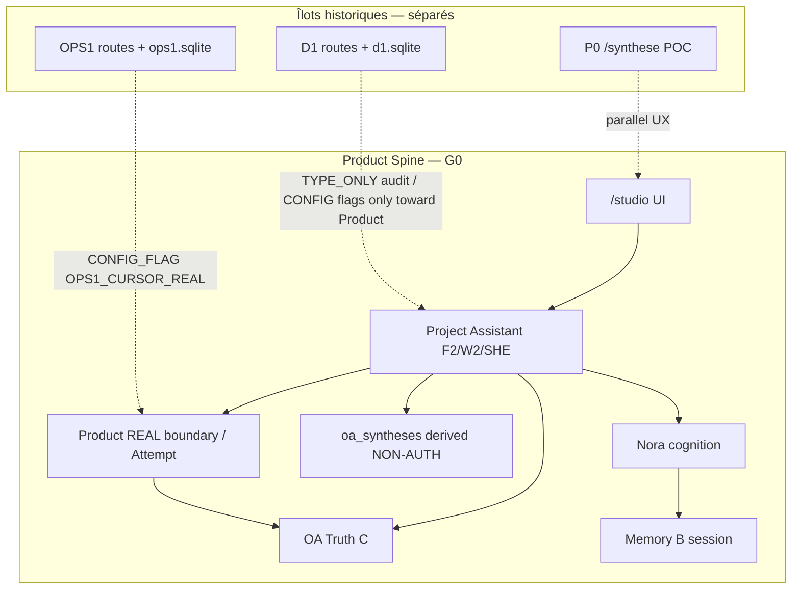
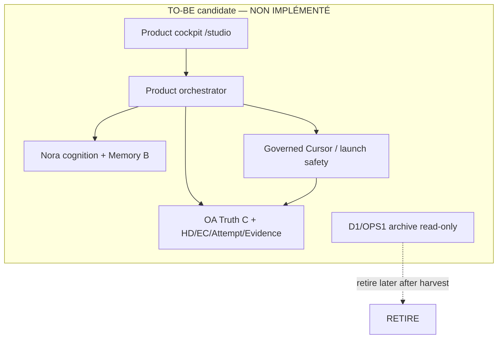
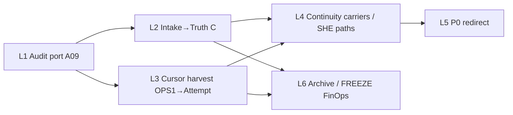

# SFIA Review Pack — FULL — CRITICAL

## 00. Identity

| Field | Value |
| --- | --- |
| Timestamp UTC | 2026-10-22T19:56:14Z |
| Cycle | AKG-M4-A / T-A05 — Impact Pack & Capability-First Rationalization Options |
| Profile | CRITICAL |
| Type | Cycle 6 — Architecture technique · DOC / Architecture / Rationalization Assessment |
| Branch | `analysis/akg-m4a-ta05-rationalization-impact-pack` |
| HEAD | `c48c6a582c10ee3cf6902203d6a4eb01ce3f2139` |
| origin/main | `f44a99b4da84188772b80aca3c9ebe1a3e12617e` |
| PR #604 | Draft · CI SUCCESS · non mergée |
| Document | `projects/sfia-studio/convergence/architectural-knowledge-governance/m4-rationalization/09-m4a-rationalization-options-and-impact-pack.md` (untracked) |
| Document hash-object | `719d7c48bf2ae017bff54c69e4d21055e29822dd` |
| Antecedent T-A01 | `42de13a95c9ca4b103c9192147a4511f4f1df1dd` |
| Antecedent T-A02 | `510210231ee3ee82647a2e53b21643e536a677e1` |
| Antecedent T-A03 | `640f19c1ab9d0952ae877bc5328f6705f77a9474` |
| Antecedent T-A04 | `6717d0948c2aace3b058a93dcb305e13f60ad801` |
| Project commit/push | NONE |
| M4-A | NON CLOSED |
| Preferred global scenario | **SC-G2** selective consolidation (**CANDIDATE** — not adopted) |
| Delivery / M5 | NOT AUTHORIZED |

## 01. Scope

AUTHORIZED: consolidate T-A01–T-A04 into local `09` only; Full pack; L3 handoff.
NOT AUTHORIZED: runtime/DB mutation; dual-write; REAL; FinOps SHADOW ON; project commit/push/PR; promote candidates to decisions; close M4-A; start M5; declare P6 PASS / v3 ADOPTED.

## 02. Git Review Index

```
?? projects/sfia-studio/convergence/architectural-knowledge-governance/m4-rationalization/09-m4a-rationalization-options-and-impact-pack.md
```

| Control | Result |
| --- | --- |
| Branch/HEAD/main | MATCH expected |
| T-A01–T-A04 WTs | NOT modified |
| Project files besides `09` | NONE |
| `git diff --no-index --check` | exit `1` (new file; no trailing whitespace) |
| Trailing whitespace | NONE |
| Document hash-object | `719d7c48bf2ae017bff54c69e4d21055e29822dd` |

### Diff identity

```
...m4a-rationalization-options-and-impact-pack.md} | 342 +++++++++++++++++++++
 1 file changed, 342 insertions(+)
```

## 03. Sources

SFIA v2.6 template/routing/OM/rules/knowledge; Build Doctrine R23/R24; Roadmap B-AKG; G0; AKG README; M4 01–04; PRR 01–09; doctrine v3 30/32/34/35/37; immutable handoffs T-A01–T-A04 (docs 05–08).
Code families: studio, project-assistant, nora, VSR, oa, d1, ops1 (static).

## 04. Matrix A01–A12 (summary)

| ID | Preferred candidate | Decision state |
| --- | --- | --- |
| A01 Product UI | KEEP/ADAPT | CANDIDATE |
| A02 P0 | CONSOLIDATE→RETIRE LATER | NEEDS EVIDENCE |
| A03 D1 | HARVEST+REPLACE | NEEDS EVIDENCE + HUMAN MethodMode |
| A04 OPS1 | HARVEST+REBUILD+RETIRE LATER | NEEDS EVIDENCE + HUMAN Tool-First |
| A05 OA | KEEP/ADAPT | CANDIDATE |
| A06 PA | ADAPT/CONSOLIDATE | CANDIDATE |
| A07 Nora | KEEP/ADAPT | CANDIDATE |
| A08 VSR | KEEP/ADAPT | CANDIDATE |
| A09 Audit bridge | HARVEST/REPLACE port | CANDIDATE |
| A10 Carriers | ADAPT/REBUILD non-authority | HUMAN ARBITRATION |
| A11 execution-run | FREEZE/RETIRE LATER | CANDIDATE |
| A12 Product REAL | KEEP/ADAPT ports | NEEDS EVIDENCE + HUMAN Tool-First |

## 05. SC-G1 / SC-G2 / SC-G3

| Scenario | Verdict |
| --- | --- |
| SC-G1 controlled conservation | Interim only — freezes multi-cockpit debt |
| **SC-G2 selective consolidation** | **Preferred candidate** — G0+OR-13; harvest then retire; no dual-write |
| SC-G3 targeted rebuild | Only if harvest proven insufficient |

## 06. Transition lots

L1 A09 port → L2 D1 intake→OA → L3 OPS1 harvest→Attempt → L4 continuity/SHE → L5 P0 redirect → L6 archive/FREEZE. Design-only.

## 07. Human decisions still required

H1 MethodMode · H2 Tool-First REAL no-write · H3 durable carrier · H4 volume inventory · H5 pathPolicy on Attempt · H6 G0 reopen (refuse ordinary) · H7 accept SC-G2 after T-A06.

## 08. Validations

A01–A12 covered · T-A02 CAPs · T-A03 S01–S07 · T-A04 ST/MIG · KEEP/HARVEST/REBUILD compared · no dual-write · Truth C/Memory B/SYN · SHE/Attempt/Evidence · no invented REAL · Mermaid AS-IS/TO-BE/lots · only `09` · whitespace clean.

## 09. R23/R24 / Fake-Real

R24 NO PRODUCT SEMANTIC IMPACT. Static only. REAL NOT PROVEN. SHADOW NOT ACTIVATED.

## 10. Handoff L3

Branch `sfia/review-handoff` · `sfia-review-handoff/latest-chatgpt-review.md`
Prior tip preserved: `6717d0948c2aace3b058a93dcb305e13f60ad801`
Message: `docs(review-handoff): AKG-M4-A T-A05 rationalization impact pack`

## 11. Instruction ChatGPT (§9.1)

Read Git `sfia/review-handoff` → `sfia-review-handoff/latest-chatgpt-review.md` (this pack).
Optional priors: T-A04 `6717d094…` · T-A03 `640f19c1…` · T-A02 `51021023…` · T-A01 `42de13a9…`.

Perform: **CHATGPT CRITICAL REVIEW — AKG-M4-A / T-A05**.

Verify SC-G2 vs alternatives; A01–A12 options; no dual-write; G0 preserved; SHE/Attempt/Evidence/SYN invariants; lots design-only; M4-A NON CLOSED; candidates ≠ decisions; DET≠REAL.

## 12. Verdict target

READY FOR CHATGPT CRITICAL REVIEW — AKG-M4-A / T-A05 LOCAL CANDIDATE

---

## 13. Full document `09` (verbatim)


# AKG-M4-A / T-A05 — Impact Pack & Rationalization Options

| Champ | Valeur |
| --- | --- |
| Cycle | **AKG-M4-A / T-A05** — Impact Pack & Capability-First Rationalization Options |
| Type / Profil | Cycle 6 — Architecture technique · **Critical** |
| Typologie | DOC / Architecture / Rationalization Assessment |
| Baseline | `analysis/akg-m4a-ta05-rationalization-impact-pack` @ `c48c6a582c10ee3cf6902203d6a4eb01ce3f2139` |
| `origin/main` | `f44a99b4da84188772b80aca3c9ebe1a3e12617e` |
| PR #604 | Draft · CI SUCCESS · non mergée |
| Antecedents | T-A01 `42de13a9…` · T-A02 `51021023…` · T-A03 `640f19c1…` · T-A04 `6717d094…` (handoffs immuables) |
| Méthode | Consolidation **statique** T-A01–T-A04 + code · **pas** de Delivery · **pas** de REAL |
| Doctrine | **OR-13** · **G0-A/B** · **aucun dual-write** |
| Statut | **LOCAL CANDIDATE** · M4-A **NON CLOSED** · options **candidates** |
| Non-claims | Pas de GO Delivery/M5 · P6 GLOBAL **NOT PASSED** · v3 **NON ADOPTED** · REAL **NOT PROVEN** · option privilégiée ≠ décision Pilote · Attempt ≠ Evidence ≠ PROVEN · Synthesis ≠ Truth C · SHE clic ≠ disparition HD |

> Les analyses T-A01–T-A04 sont **ACCEPTED WITH RESERVES** à leurs périmètres ChatGPT ; elles **ne constituent pas** une architecture adoptée. Ce pack compare des options — **aucune transformation autorisée**.

---

## 1. Baseline Git et statut

Worktree isolé ; WTs T-A01–T-A04 **non modifiés**. Documents `05`–`08` lus via handoffs immuables uniquement. CKC Architecture : **fallback méthode canonique**.

**Maturité :** impact pack **LOCAL CANDIDATE** · scénario global privilégié **SC-G2** (candidate) · M4-A **ouvert** jusqu'à T-A06 + arbitrage Pilote.

---

## 2. Sources T-A01–T-A04 et limites

| Audit | Apport | Limite |
| --- | --- | --- |
| T-A01 | A01–A12 consumers / depth / coupling | Dynamic callers PARTIAL |
| T-A02 | 29 CAP inventory ; OPS1≠Product ; FinOps≠SHADOW ON | Some CAP PARTIAL |
| T-A03 | S01–S07 authority ; SHE ; Attempt≠Evidence ; restart | REAL E2E not proven |
| T-A04 | ST-01–06 ; MIG-A–D ; Synthesis NOT Truth C ; typed Product/Legacy | Volumes UNKNOWN |

Code primary (spot checks) : `app/studio/**`, `project-assistant`, `nora-cognitive-runtime`, `vertical-slice-runtime`, `lib/oa/**`, `lib/d1/**`, `lib/ops1/**`. PRR 03/04/06–09 · doctrine v3 30/32/34/35/37 · G0 · M4 `01`–`04` · Build Doctrine R23/R24.

---

## 3. Synthèse AS-IS consolidée

### 3.1 Couches de responsabilité (observées)

| Couche | Rôle AS-IS | Exemples |
| --- | --- | --- |
| 1. Métier / autorité | Truth C + HD/EC/Attempt/Evidence | OA Product SQLite |
| 2. Orchestration produit | UI→OA, SHE, F2/W2 | Project Assistant |
| 3. Cognition Nora | Qualification, reco, outils | nora-cognitive-runtime + Memory B |
| 4. Adaptation technique | Cursor launch, path facts | Product REAL boundary ; OPS1 island |
| 5. Persistance / projection | Truth C, Memory B, derived SYN, FS refs | ST-01–06 |
| 6. UX | `/studio` Product ; D1/OPS1/P0 historiques | pre-m6-product-ui ; îlots |

### 3.2 Diagramme AS-IS (observé)



*Légende : flèches pleines = RUNTIME Product observé. Pointillés = couplages typés (≠ DB Product↔Legacy). Pas de dual-write.*

---

## 4. Principes et responsabilités TO-BE (candidates)

Alignés G0 / doctrine v3 / OR-13 — **non adoptés** :

1. **Un cockpit Product** Pilote ↔ Nora (`/studio`).
2. Nora = cognition / qualification / reco — **pas** autorité métier.
3. OA = backbone Truth C + autorité (G0-A/B).
4. EC = enveloppe gouvernée ; **SHE** = un clic Exécuter **avec** HD/Confirm/Authorize internes.
5. Cursor = capacité technique sous Attempt — pas source d'autorité.
6. Attempt technique ≠ Evidence ≠ ContractResult PROVEN.
7. Memory B ≠ Truth C ; Synthesis dérivée ≠ Truth C.
8. Carriers (Proposal/Offer) ≠ HumanDecision.
9. **Aucun dual-write D1/OA.**



---

## 5. Matrice de rationalisation A01–A12

| ID | Domaine | Capacité utile | Problème AS-IS | Owner actuel | Owner cible | Options étudiées | **Option privilégiée (candidate)** | Alternatives rejetées | Dépendances | Données | Autorité / sécurité | Coût / risque | Non-régression | Transition | Retirement gate | Evidence | Conf. | Decision state |
| --- | --- | --- | --- | --- | --- | --- | --- | --- | --- | --- | --- | --- | --- | --- | --- | --- | --- | --- |
| A01 | Product UI | Cockpit `/studio` | Nom `pre-m6` ; surface large | pre-m6-product-ui | Product UI | KEEP/ADAPT/REBUILD | **KEEP** cap / **ADAPT** naming | RETIRE (casse cockpit) | Studio, PA, ~53 UI tests | N/A Truth C | Presentation≠HD | L / L | UI + PA e2e | Rename/docs | N/A | T-A01 A01 | H | CANDIDATE |
| A02 | P0 access | Entrée site | POC `/`→`/synthese` parallèle | P0 routes | Redirect→`/studio` | CONSOLIDATE/RETIRE/KEEP | **CONSOLIDATE** puis **RETIRE LATER** | KEEP POC (confusion CAP-P0) | bookmarks **U** | fixtures | GO visuel≠GO | L / M | redirect e2e | L5 | links+redirect | T-A01 A02 ; CAP-P0 | M | NEEDS EVIDENCE |
| A03 | D1 island | Intake / create project | SQLite/IDs séparés | lib/d1 | OA Project + `/studio` | HARVEST/REPLACE/KEEP | **HARVEST** + **REPLACE** impl | KEEP as Product ; dual-write | D1 routes, A09 | MIG-A volumes **U** | D1≠HD ; no dual-write | M–H / H | D1+Product create tests | L1→L2 | A09 extracted ; readers cutover | T-A01 A03 ; CAP-D1 ; MIG-A | M | NEEDS EVIDENCE + HUMAN (MethodMode) |
| A04 | OPS1 island | Tool/exec + guards | Parallel gate/adapter/DB | lib/ops1 | OA Attempt + Product REAL | HARVEST/REBUILD/RETIRE | **HARVEST** + **REBUILD** ports + **RETIRE LATER** | KEEP as Product engine ; retire on tests alone | Ops1 UI, e2e, `OPS1_CURSOR_REAL` | archive OPS1 ; no gate→HD | Gate≠HD ; fail-closed | H / H | Attempt/REAL tests | L3 | SC-B caps/tests/guards | T-A01 A04 ; CAP-OPS1 ; S04 ; MIG-B | M | NEEDS EVIDENCE + HUMAN (Tool-First) |
| A05 | OA Runtime | Truth C backbone | Complexité ≠ mauvais owner | lib/oa | **Same** | KEEP/ADAPT/REBUILD | **KEEP** / **ADAPT** | Rebuild backbone (reopen G0) | VSR, PA, tests | Truth C ; SYN derived | PRR07 ; SYN≠Truth C | L keep / H reopen | OA suite | N/A | N/A unless G0 reopen | G0 ; ST01 ; T-A03 | H | CANDIDATE |
| A06 | Project Assistant | Orchestration F2/W2/SHE | Dual path ; ownership blur | project-assistant | Product orchestrator | ADAPT/CONSOLIDATE | **ADAPT** / **CONSOLIDATE** paths | Delete HD objects « for simplify » | API send, F2/W3 | carriers + Truth C | SHE≠vanished HD | M / M | SHE DET + historical | L4 | sequence clarity | T-A01 A06 ; S01–S03 | H | CANDIDATE |
| A07 | Nora | Cognition / tools | Risk B↔C confusion | nora-cognitive-runtime | Nora (distinct) | KEEP/ADAPT | **KEEP** / **ADAPT** boundary | Duplicate Truth C in B | orchestrateTurn | Memory B ; RunState DEFER | Cognition≠métier | L / M | session tests | N/A | N/A | ST02 ; S06 | H | CANDIDATE |
| A08 | VSR | Composition ports | D1 type coupling | vertical-slice-runtime | Product composition | KEEP/ADAPT/REBUILD | **KEEP** / **ADAPT** | Blind rebuild | PA, W2 | singleton | Wiring≠policy | M / H rebuild | composition tests | L1 | after A09 extract | T-A01 A08 | H | CANDIDATE |
| A09 | Audit bridge | Bounded create audit | Type in `lib/d1` blocks retire | D1 BoundedAtomicAudit | Product audit **port** | HARVEST/REPLACE | **HARVEST** / **REPLACE** port | KEEP in D1 forever | VSR optional audit | extract port | Audit≠authority | L–M / M | audit tests | L1 | no VSR→d1 type | T-A01 A09 ; CORR-02 | H | CANDIDATE |
| A10 | Carriers | Proposal/Offer continuity | Process-local lost | F2/W2 Maps | Non-authority carrier **or** requalify | ADAPT/REBUILD/KEEP | **ADAPT** / **REBUILD** carrier (not 2e vérité) | Promote to Truth C ; invent HD | F2/W2/SHE | PROCESS-LOCAL | Proposal≠HD ; HD11 | M / M–H | restart tests | L4 | continuity proven | T-A03 ; MIG-C ; ST05 | M | HUMAN ARBITRATION (durable GO?) |
| A11 | execution-run | FinOps/shadow SM | Not Product Spine | oa/execution-run | FinOps if GO | FREEZE/RETIRE | **FREEZE** / **RETIRE LATER** | Promote to spine ; claim SHADOW ON | FinOps scripts | memory ; PG OFF | Attempt≠Run | L freeze / H promote | FinOps tests OFF | L6 | no spine consumers | CAP-ER ; ST06 | H | CANDIDATE |
| A12 | Product REAL | Cursor under Attempt | Parity OPS1 PARTIAL ; Tool-First OPEN | composeStudio… + Attempt | Same + harvest | KEEP/ADAPT | **KEEP** guarantees / **ADAPT** ports | Import OPS1 adapter ; claim REAL PROVEN | VSR, DET/REAL tests | Attempt + launch-safety | Authorize≠launch ; R2≠sandbox | M–H / H | REAL DET ; R2 | L3 | exclusive Product REAL | T-A01 A12 ; S03-R2 | M | NEEDS EVIDENCE + HUMAN (Tool-First) |

---

## 6. Options par domaine (synthèse)

### D1 (A03/A09)
**HARVEST** MethodMode/idempotence/audit patterns → Product ; **REPLACE** intake under OA ; **RETIRE LATER** D1 UI/DB after cutover. **Forbidden :** dual-write. **Blocker :** volumes UNKNOWN ; MethodMode arbitration.

### OPS1 (A04/A12)
**HARVEST** allowlist/gate/report/fail-closed into Attempt/Product ports ; **do not** map gate→HD ; **RETIRE LATER** island. **Blocker :** pathPolicy Attempt parity PARTIAL ; Tool-First REAL no-write OPEN.

### P0 (A02)
**CONSOLIDATE** entry to `/studio` ; **RETIRE LATER** POC screens after redirect + link inventory.

### execution-run / FinOps (A11)
**FREEZE** as non-spine ; SHADOW **NOT ACTIVATED** ; activate only under separate FinOps GO.

### Product modern (A01/A05–A08/A10/A12)
Keep OA/Nora/Studio spine ; **ADAPT** PA dual-path documentation/UX ; optional carrier rebuild under GO without 2e vérité ; **OR-13 also applies to recent code** (ownership clarity, not gratuitous rewrite).

---

## 7. Comparaison SC-G1 / SC-G2 / SC-G3

| | SC-G1 Conservation contrôlée | **SC-G2 Consolidation sélective (privilégiée)** | SC-G3 Reconstruction ciblée |
| --- | --- | --- | --- |
| Idée | Garder îlots ; corriger couplages | Harvest D1/OPS1 → Product ; retire later ; KEEP G0 spine | Rebuild mechanisms judged incoherent |
| Bénéfice | Risque migration bas | Autorité unique ; OR-13 ; pas dual-write | Propreté long terme si harvest échoue |
| Risque | Dette multi-cockpit / dual UX | Coexistence longue ; volumes U ; parity PARTIAL | Blast PA/VSR/REAL ; tentation Dual-Shell |
| Fit G0/OR-13 | Faible (fige historique) | **Fort** | Moyen (peut rouvrir G0 si mal borné) |
| Verdict | Interim only | **Orientation candidate** | Seulement si harvest insuffisant **prouvé** |

**Orientation candidate :** **SC-G2**. Pas de décision automatique.

---

## 8. Recommandation architecturale candidate

1. Conserver **A01/A05/A07/A12** comme spine Product (G0).
2. Extraire **A09** (port audit) pour débloquer D1.
3. Remplacer intake **A03** sous OA + `/studio` (MIG-A design).
4. Harvest **A04** vers Attempt/REAL puis archive OPS1 (MIG-B).
5. **ADAPT A06** (dual SHE/historical) ; **décider A10** carrier sous GO.
6. **FREEZE A11** ; **CONSOLIDATE A02** ; FinOps SHADOW reste OFF.
7. **Ne pas** élever Synthesis ; **ne pas** dual-write ; **ne pas** rouvrir G0 sans arbitrage explicite.

---

## 9. Impacts consommateurs / interfaces

| Zone | Consumers impactés | Interface à migrer |
| --- | --- | --- |
| D1 retire | `/workspace`, `/projects`, `/nouvelle-demande`, features/d1 | Commands → OA Project APIs |
| OPS1 retire | `/ops1`, Ops1SessionScreen, e2e ops1-* | Gate/allowlist/report → Product ports |
| A09 | VSR `service.ts` type import | Product audit port |
| P0 | `/`, not-found, bookmarks U | Redirect `/studio` |
| Flag | Product DET/REAL safety | Rename/isolate from OPS1 after exclusive Product REAL |
| PA | Studio send API, SHE actions | Stable public actions ; internal consolidate |

---

## 10. Impacts données / persistance

| Scénario | Données | Règle |
| --- | --- | --- |
| MIG-A | d1.sqlite | inventaire → archive read-only → map ids → cutover ; **no dual-write** |
| MIG-B | ops1.sqlite + worktrees | archive ; quarantine FS ; **no gate→HD** |
| MIG-C | Proposal/Offer Maps | requalify/HD11 default ; durable carrier only under GO |
| MIG-D | mission-result FS + Evidence | keep NOT_PROVEN honest ; reconcile orphans candidate |
| Truth C / Memory B / SYN | inchangés classement | SYN remains NON-AUTHORITATIVE |

Volumes historiques **UNKNOWN** — pas de GO migration sans inventaire.

---

## 11. Autorité, sécurité, invariants

| Invariant | Préservation |
| --- | --- |
| G0-A/B OA + Product sqlite | KEEP |
| No dual-write | KEEP |
| SHE internals HD/Confirm/Authorize | KEEP |
| Attempt ≠ Evidence ≠ PROVEN | KEEP |
| Memory B ≠ Truth C | KEEP |
| Synthesis ≠ Truth C | KEEP |
| Proposal/Offer ≠ HD | KEEP |
| Tool-First R2 fail-closed | KEEP until REAL no-write architecture GO |
| OPS1 gate ≠ OA HD | KEEP |
| FinOps SHADOW OFF | KEEP |
| External rollback | **Never promise** without mechanism |

---

## 12. Stratégie de transition par lots (candidate)



| Lot | Objectif | Préconditions | Coexistence | Critère suivant | Retirement | Décision humaine |
| --- | --- | --- | --- | --- | --- | --- |
| L1 | Extract A09 Product audit port | Port + tests | D1 still live | No VSR→d1 type | — | None |
| L2 | Intake→OA | L1 ; **volume inventory** ; MethodMode | D1 read-only OK | Readers on Product | D1 UI freeze | MethodMode ; D1-05 |
| L3 | OPS1 harvest→A12 | CAP matrix ; flags plan | OPS1 UI gel | Product-only REAL | OPS1 retire later | Tool-First REAL ; pathPolicy |
| L4 | Continuity / PA paths | T-A03 accepted | Dual admission until UX | Restart non-reg | — | Durable carrier Y/N |
| L5 | P0→`/studio` | Link inventory | Temporary redirects | Screens gone | P0 retire | Delivery timing |
| L6 | Archive / FREEZE A11 | L2–L3 done or abandon | Archive RO | No spine consumers | Islands archived | FinOps GO separate ; G0 reopen if demanded |

**Pas de big bang.** Pas de micro-refactor qui fige l'incohérence.

---

## 13. Tests, succès, retirement gates

| Domaine | Tests existants (ex.) | Manquants / à exiger avant retire |
| --- | --- | --- |
| SHE / HD | `p6.she.*`, HD11 | Dual-path UX non-reg after consolidate |
| D1 | ~17 unit + e2e D1 | Product intake parity ; migration verify |
| OPS1 | `__tests__/ops1`, e2e ops1-* | Attempt/REAL equivalent guards |
| Tool-First | R1/R2 DET | REAL no-write if GO chooses sandbox |
| Evidence | materializeW3b / ingest | Orphan FS reconcile |
| P0 | POC e2e | Redirect + bookmark survey |

**Retirement gate générique :** capacité préservée **ou** abandon documenté · consumers cutover · tests remplacés · authority/security non-regress · archive policy · **pas** de dual-write résiduel.

**Rollback :** app/config revert possible ; data restore from backup ; **external Cursor effects not compensable** without demonstrated mechanism.

---

## 14. Arbitrages humains requis

| ID | Question | Si différé |
| --- | --- | --- |
| H1 | MethodMode → Product model ? | Ne pas importer silencieusement |
| H2 | Tool-First REAL no-write architecture ? | Garder gate fail-closed OPEN |
| H3 | Durable PresentedSubject carrier ? | Prefer requalify/HD11 only |
| H4 | Inventaire volumes D1/OPS1 avant migrate ? | Bloquer Delivery migration |
| H5 | pathPolicy enforcement on Attempt ? | Keep PARTIAL ; instruct separately |
| H6 | Reopen G0 (dual-write / Dual-Shell) ? | **Refuse** as ordinary option |
| H7 | Accept SC-G2 as M4 orientation after T-A06 ? | Remain candidate |

---

## 15. Gaps et réserves

| Gap | Impact |
| --- | --- |
| REAL E2E generic | No REAL PROVEN |
| TOOL-FIRST-REAL-NOWRITE | Gate ≠ sandbox |
| RunState cross-restart DEFER | Cognitive continuity partial |
| D1/OPS1 volumes UNKNOWN | Migration cost unscaled |
| FS↔SQLite Evidence non-atomic | Orphan risk |
| Dynamic callers PARTIAL | Matrix not 100% |
| PRR 06 / Synthesis DOC drift | Authority class must stay explicit |
| Bookmark inventory P0 | NEEDS EVIDENCE |

---

## 16. Préparation T-A06

T-A06 doit :

1. Revue contradictoire SC-G2 vs SC-G1/SC-G3.
2. Vérifier alignement TO-BE + doctrine v3 sans adopter runtime.
3. Challenger chaque option privilégiée A01–A12.
4. Lister décisions Morris bloquantes H1–H7.
5. **Ne pas** clore M4-A sans arbitrage explicite.
6. **Ne pas** consommer GO Delivery/M5.

---

## 17. Conditions de sortie M4-A

| Condition | État |
| --- | --- |
| T-A01–T-A04 | Acceptés (handoffs) |
| T-A05 impact pack | **LOCAL CANDIDATE** (ce document) |
| T-A06 Critical contradictoire | **NON** |
| Arbitrage Pilote SC-G* / H* | **NON** |
| M4-A CLOSED | **NON** |
| Delivery / M5 | **NON AUTORISÉ** |

---

## 18. Traçabilité SFIA / R23-R24 / OR-13 / G0

| Règle | Application |
| --- | --- |
| R23 | Analysis only ; no Delivery |
| R24 | **NO PRODUCT SEMANTIC IMPACT** |
| OR-13 | Capability-first ; KEEP not by inertia ; REBUILD only if better architecture |
| G0-A/B | OA backbone + Product sqlite ; harvest OPS1 Cursor ; **no dual-write** |
| Fake-Real | DET ≠ REAL ; SHADOW NOT ACTIVATED |

---

END — `AKG-M4-A / T-A05` — LOCAL CANDIDATE IMPACT PACK (SC-G2 orientation candidate)
