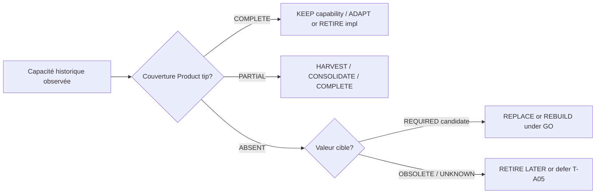
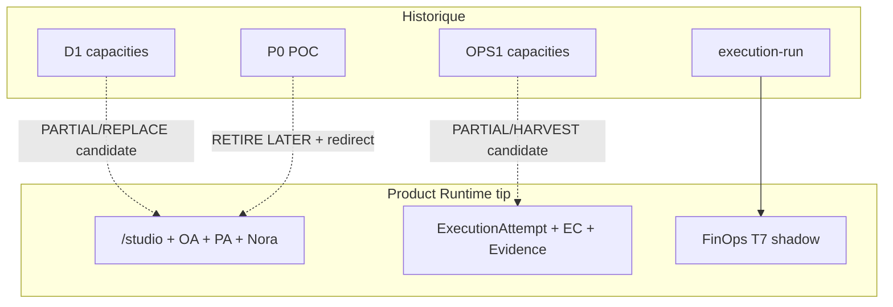

# SFIA Review Pack — FULL — CRITICAL

## 00. Identity

| Field | Value |
| --- | --- |
| Timestamp UTC | 2026-10-22T18:05:01Z |
| Cycle | AKG-M4-A / T-A02 — Historical Capability Inventory |
| Type | Cycle 6 — Architecture technique |
| Profile | CRITICAL |
| Typologie | DOC / Architecture / Rationalization Assessment |
| Repository | mcleland147/sfia-workspace |
| Analysis branch | `analysis/akg-m4a-ta02-capability-inventory` |
| Analysis HEAD | `c48c6a582c10ee3cf6902203d6a4eb01ce3f2139` |
| origin/main | `f44a99b4da84188772b80aca3c9ebe1a3e12617e` |
| PR #604 | Draft OPEN · CI SUCCESS · non merged |
| Project document | `projects/sfia-studio/convergence/architectural-knowledge-governance/m4-rationalization/06-m4a-historical-capabilities-inventory.md` |
| Document state | untracked local candidate |
| Document hash-object | `192255072fac3bb72f9de2dafb8649294cbfe5d8` |
| Prior T-A01 handoff (immutable) | commit `42de13a95c9ca4b103c9192147a4511f4f1df1dd` · blob `5b341ce88b6db868c70dd0f3deb00fc29a2b799a` · section Full corrected document |
| Project commit/push/PR | FORBIDDEN / not executed |
| Handoff | L3 publish-in-cycle |

## 01. GO / scope

AUTHORIZED: historical capability inventory D1/OPS1/P0/execution-run vs Product; one documentary file; Full pack; L3 handoff.

NOT AUTHORIZED: runtime mutation; dual-write; G0 reopen; M4-A CLOSED; Delivery/M5; project commit/push/PR/merge; modify T-A01 worktree.

## 02. Git Review Index

### Baseline

| Check | Result |
| --- | --- |
| Worktree | `/Users/morris/Projects/sfia-workspace-akg-m4a-ta02-capability-inventory` |
| Branch/HEAD | `analysis/akg-m4a-ta02-capability-inventory` @ `c48c6a582c10ee3cf6902203d6a4eb01ce3f2139` MATCH |
| origin/main | `f44a99b4da84188772b80aca3c9ebe1a3e12617e` MATCH |
| T-A01 WT | left untouched |
| T-A01 source | handoff `42de13a95c9ca4b103c9192147a4511f4f1df1dd` ancestor of origin/sfia/review-handoff at cycle start |

### Status (pre-handoff)

```
?? projects/sfia-studio/convergence/architectural-knowledge-governance/m4-rationalization/06-m4a-historical-capabilities-inventory.md
```

### Validations

| Control | Result |
| --- | --- |
| `git diff --no-index --check` exit | `1` (1 expected for new file) |
| Trailing whitespace | `NONE` |
| Mermaid | 2 blocks in document |
| Single project file | YES — `projects/sfia-studio/convergence/architectural-knowledge-governance/m4-rationalization/06-m4a-historical-capabilities-inventory.md` |
| Dual-write proposed | NO |
| G0-A/B | preserved |

### Diff identity

```
.../06-m4a-historical-capabilities-inventory.md    | 294 +++++++++++++++++++++
 1 file changed, 294 insertions(+)
```

## 03. Sources

SFIA v2.6 template/routing/operating-model/rules/knowledge-layer (CKC Architecture: candidate/fallback canonique).
Build Doctrine; Roadmap B-AKG; G0 pack; AKG README; M4 01–04; T-A01 corrected from handoff `42de13a95c9ca4b103c9192147a4511f4f1df1dd`; PRR 01–04/06–09; doctrine 30/32/34/35/37; code tip `c48c6a582c10ee3cf6902203d6a4eb01ce3f2139`.

## 04. Coverage synthesis

- **D1:** create/list/get/intake/confirmation/audit = PARTIAL vs Product; MethodMode durable ABSENT Product; REPLACE/HARVEST candidates; no dual-write.
- **OPS1:** session model ABSENT Product; conversation/gate/allowlist/cursor/EC/attempt/report = PARTIAL (not equivalent); pathPolicy COMPLETE via shared platform; HARVEST/REBUILD candidates.
- **P0:** POC fixture OBSOLETE CANDIDATE; CAP-P0-04 redirect `/`→`/studio` REQUIRED access capability.
- **execution-run:** outside Product Spine; FinOps T7 shadow CONFIRMED; FREEZE; not Product alternate engine.

## 05. Exclusive / divergence highlights

MethodMode D1; OPS1 session/DB; OPS1 reinjection timeline; P0 fixture GO; ER memory authority.
Confirmation/allowlist/Cursor REAL/project create = similar names, **non-equivalent** without proof.

## 06. Open follow-ons

T-A03 sequences; T-A04 storage/migration; T-A05 impact pack; MethodMode & context-match value arbitration.

## 07. R23/R24 / Fake-Real

R23 architecture-informed inventory. R24 NO PRODUCT SEMANTIC IMPACT.
Static only. REAL NOT PROVEN. P6 GLOBAL NOT PASSED. v3 NON ADOPTED.

## 08. Review Handoff L3

Prior handoff preserved in history: `42de13a95c9ca4b103c9192147a4511f4f1df1dd` / `5b341ce88b6db868c70dd0f3deb00fc29a2b799a` (T-A01 Correction Pass 01).
This publish replaces canonical tip on `sfia/review-handoff` with T-A02 pack.
Publisher: `scripts/sfia/publish-review-handoff.sh`
Message: `docs(review-handoff): AKG-M4-A T-A02 historical capabilities inventory`

## 09. Instruction ChatGPT (§9.1)

Read on Git:

- Branch: `sfia/review-handoff`
- Path: `sfia-review-handoff/latest-chatgpt-review.md`

Also retain ability to read prior immutable commit `42de13a95c9ca4b103c9192147a4511f4f1df1dd` for T-A01 corrected audit.

Perform: **CHATGPT CRITICAL REVIEW — AKG-M4-A / T-A02**.

Verify independently:

1. Handoff remote commit/blob.
2. Git baseline main `f44a99b4da84188772b80aca3c9ebe1a3e12617e` · analysis `c48c6a582c10ee3cf6902203d6a4eb01ce3f2139`.
3. Single untracked project file `projects/sfia-studio/convergence/architectural-knowledge-governance/m4-rationalization/06-m4a-historical-capabilities-inventory.md`; no project push.
4. T-A01 sourced from handoff `42de13a95c9ca4b103c9192147a4511f4f1df1dd` not silent rewrite.
5. Four families inventoried with coverage tags COMPLETE/PARTIAL/ABSENT/UNKNOWN.
6. OR-13 & G0 (no dual-write; no implicit G0 reopen).
7. No false equivalence OPS1↔OA / D1↔Product.
8. execution-run not promoted to Product spine.
9. Fake/Real/P6/v3 anti-claims; M4-A NON CLOSED.
10. Recommendations T-A03–T-A05 coherent.

If PASS: accept T-A02 as LOCAL CANDIDATE investigation input — **not** M4-A CLOSED / Delivery GO.

## 10. Verdict target

READY FOR CHATGPT CRITICAL REVIEW — AKG-M4-A / T-A02 LOCAL CANDIDATE

## 11. Full document (verbatim)

---
# AKG-M4-A / T-A02 — Inventaire des capacités historiques & couverture fonctionnelle

| Champ | Valeur |
| --- | --- |
| Cycle | **AKG-M4-A / T-A02** — Historical Capability Inventory |
| Type / Profil | Cycle 6 — Architecture technique · **Critical** |
| Typologie | DOC / Architecture / Rationalization Assessment |
| Capacités v3 | V3-F05 / V3-F07 (+ transverses) |
| Baseline analyse | `analysis/akg-m4a-ta02-capability-inventory` @ `c48c6a582c10ee3cf6902203d6a4eb01ce3f2139` |
| `origin/main` | `f44a99b4da84188772b80aca3c9ebe1a3e12617e` |
| PR documentaire | #604 Draft · CI SUCCESS · non mergée |
| Source T-A01 | Handoff immuable `42de13a95c9ca4b103c9192147a4511f4f1df1dd` · blob `5b341ce88b6db868c70dd0f3deb00fc29a2b799a` · section *Full corrected document* (CORR-01…04) |
| Principe | **OR-13 capability-first** — dépendance ≠ KEEP ; nom ancien ≠ REBUILD |
| Méthode | Analyse **statique** · aucune mutation runtime · **pas de dual-write D1/OA** |
| Statut | **LOCAL CANDIDATE — INVESTIGATION** · M4-A **NON CLOSED** · options **candidates** |
| Non-claims | Pas de GO Delivery · pas de retrait · REAL **NOT PROVEN** · P6 GLOBAL **NOT PASSED** · runtime v3 **NON ADOPTED** · G0-A/B **non réouverts** |

> **Autorité AS-IS :** code Git + preuves primaires > PRR > T-A01 (handoff) > ce document. TO-BE / OR-13 **orientent** ; ils ne remplacent pas G0 adopté.

---

## 1. Baseline Git, sources et niveaux de preuve

### 1.1 Git Truth

| Référence | Observé | Qualification |
| --- | --- | --- |
| Worktree T-A02 | `/Users/morris/Projects/sfia-workspace-akg-m4a-ta02-capability-inventory` | CONFIRMED isolé |
| Branche | `analysis/akg-m4a-ta02-capability-inventory` | CONFIRMED |
| HEAD | `c48c6a582c10ee3cf6902203d6a4eb01ce3f2139` | CONFIRMED |
| Worktree T-A01 | Présent, **non modifié** par ce cycle | CONFIRMED |
| T-A01 projet | Non committé sur branche projet ; preuve via handoff | CONFIRMED |

### 1.2 Sources

- SFIA v2.6 template / routing §4.3.0a / operating model / rules / knowledge layer.
- CKC Architecture : **fallback méthode canonique** si CKC non utilisé comme autorité (guidance candidate seulement).
- Build Doctrine · Roadmap B-AKG · G0 decision pack · AKG README · M4 `01`–`04`.
- T-A01 corrigé (handoff `42de13a9…`) — consumers A01–A12, OR-13, anti dual-write.
- PRR 01–04, 06–09 (sections utiles) · doctrine v3 30/32/34/35/37.
- Code tip `c48c6a58…` : `lib/d1`, `lib/ops1`, P0 routes/features, `lib/oa/execution-run`, contreparties Product (`lib/oa/*`, `vertical-slice-runtime`, `project-assistant`, `pre-m6-product-ui`).

### 1.3 Niveaux de preuve

| Tag | Sens |
| --- | --- |
| **CONFIRMED** | Symbole/route/import inspecté dans le tip |
| **PARTIAL** | Preuve incomplète, équivalence comportementale non établie, ou couverture inégale |
| **UNKNOWN** | Hors périmètre statique (runtime REAL, data utilisateur, dynamic imports non exhaustifs) |

Couverture Product : **COMPLETE** / **PARTIAL** / **ABSENT** / **UNKNOWN** — *ABSENT ≠ obligation de développer*.

---

## 2. Méthodologie d'identification des capacités

1. Partir des **surfaces publiques** (exports `actions`/`commands`, routes, orchestrateurs).
2. Croiser avec **consommateurs** T-A01 (routes, features, tests, scripts).
3. Pour chaque capacité : besoin → fournisseur historique → contrepartie Product éventuelle → écart comportemental.
4. Qualifier **valeur cible** (REQUIRED / OPTIONAL / OBSOLETE CANDIDATE / UNKNOWN) vs TO-BE *sans* adopter le TO-BE.
5. Proposer option technique **candidate** seulement (KEEP / HARVEST / CONSOLIDATE / REPLACE / REBUILD / RETIRE LATER).
6. Respecter G0-A/B : OA + Product SQLite = vérité métier Product ; **pas de dual-write** ; remise en cause G0 = arbitrage nouveau.



*Diagramme **proposé** (méthode), non un graphe d'import observé.*

---

## 3. Inventaire D1 (A03) — Priorité 1

**Fournisseur :** `lib/d1/**`, `features/d1/**`, routes `/nouvelle-demande`, `/workspace`, `/projects/*`.
**Persistance :** `d1.sqlite` (isolée de Truth C).
**Pont Product (T-A01) :** type/option `BoundedAtomicAuditStore` dans VSR — pas de partage Truth C.

| ID | Besoin fonctionnel | Fournisseur historique | Consommateurs (périmètre) | Couverture Product | Preuves | Données / effets | Invariants | Valeur cible | Option tech. | Risque | Statut |
| --- | --- | --- | --- | --- | --- | --- | --- | --- | --- | --- | --- |
| **CAP-D1-01** | Créer un projet (nom, objectif, idempotence, audit events) | `lib/d1/commands.ts` `createProject` L24+ ; `actionCreateProject` | Routes D1 ; `features/d1/NewProjectForm` | **PARTIAL** — OA `CreateProject` + `createProjectRuntimeAction` + `/studio/projects/new` existent ; **modèle ≠** (pas le même schéma/events/methodMode) | D1 commands ; `lib/oa/project/application/createProject.ts` ; `NewProjectIntentionPage.tsx` | Écriture `d1.sqlite` vs Product SQLite | Idempotency D1 vs OA ports | **REQUIRED** (capacité) | **HARVEST** règles utiles / **REPLACE** impl D1 | Divergence IDs ; perte histo | CONFIRMED |
| **CAP-D1-02** | Sélectionner / persister un *MethodMode* et activer DRAFT→ACTIVE | `selectMethodMode` ; `lib/d1/domain.ts` ; methodModeHold | Intake/confirmation D1 | **ABSENT** comme champ métier D1 — Product a *advisory* `methodOrientation` (prompt), **≠** MethodMode durable D1 ; commentaires OA « Does not replace … MethodMode » | `lib/oa/project/index.ts` L5 ; `f2/methodOrientation` | Hold/readiness D1 | Mode avant ACTIVE | **UNKNOWN→OPTIONAL?** (cible TO-BE à arbitrer) | **HARVEST** si besoin gouvernance / sinon **RETIRE LATER** concept D1 | Réintroduire Mode sans GO doctrine | PARTIAL (écart nommé CONFIRMED) |
| **CAP-D1-03** | Lister / lire projets workspace + audit trail projet | `listWorkspaceProjects`, `getProject`, `listProjectAudit` | `/workspace`, `/projects/[id]` | **PARTIAL** — `listProjects`/`getProject` OA + UI studio ; **pas** d'équivalence audit events D1 | commands L200–220 ; VSR list/get | Lectures D1 | Mono-opérateur D1 | **REQUIRED** lecture projet | **REPLACE** vers Truth C | Migration data | CONFIRMED |
| **CAP-D1-04** | Intake conversationnel (analyze intent, clarification, cancel session) | `lib/d1/intake/actions.ts` | `/nouvelle-demande` · `IntakeView` | **PARTIAL** — onboarding cognitif `/studio/projects/new` (`runNewProjectOnboardingTurn`) puis create OA | intake actions L42+ ; `newProjectOnboardingContract.ts` | Sessions intake D1 | Fake intake provider possible | **REQUIRED** (intention→projet) | **CONSOLIDATE/REPLACE** vers onboarding Product | Perte UX intake D1 | CONFIRMED |
| **CAP-D1-05** | Context matching (projets existants / scoring) | `lib/d1/context/actions.ts` `actionMatchExistingContext` | Intake UI | **UNKNOWN/ABSENT** — aucune contrepartie Product Spine **retrouvée** dans le tip | context/actions | Lectures D1 | — | **UNKNOWN** | Inventaire T-A05 si REQUIRED | Faux négatif dynamic | PARTIAL |
| **CAP-D1-06** | Confirmation bornée avant mutation (fingerprint, summary, execute) | `lib/d1/confirmation/*` | Intake confirmation panels | **PARTIAL** — Product HD/Confirm/Authorize/SHE sur **EC**, pas sur create D1 | `executeConfirmation.ts` ; W2 SHE paths | Mutations D1 | Fingerprint match | **REQUIRED** (confirmation humaine proportionnée) | **HARVEST** pattern / **REPLACE** sous OA HD | Assimiler ≠ équivalent | CONFIRMED |
| **CAP-D1-07** | Audit atomique borné (idempotency keys) | `BoundedAtomicAuditStore` | VSR option `auditMode=sqlite` ; tests platform | **PARTIAL** — port utile ; packaging D1 non nécessaire | T-A01 A09 ; `boundedAtomicAudit.ts` | Table D1 si activé | Idempotence | **REQUIRED** (audit ops) | **HARVEST** → port Product | Bloque retrait D1 | CONFIRMED |
| **CAP-D1-08** | Operational readiness / method mode hold | `operationalReadiness.ts`, `methodModeHold*` | Internes D1 / tests | **ABSENT** Product Spine **non retrouvé** | fichiers cités | Process/override test | Hold reasons | **UNKNOWN** | Différer | — | PARTIAL |

**Synthèse D1 :** la *capacité* « projet + intake + confirmation » est **REQUIRED** pour Studio ; l'*implémentation* D1/SQLite est **candidate REPLACE** sous G0 (migration non destructive T-A04 — **sans dual-write**). MethodMode D1 n'est **pas** prouvé REQUIRED dans la cible Product actuelle.

---

## 4. Inventaire OPS1 (A04) — Priorité 2

**Fournisseur :** `lib/ops1/**`, `features/ops1/Ops1SessionScreen`, route `/ops1/nouvelle-demande`.
**Persistance :** DB OPS1 distincte.
**Couplage Product (T-A01) :** flag `OPS1_CURSOR_REAL` dans safety/DET — **pas** d'import adapter depuis A12.

| ID | Besoin fonctionnel | Fournisseur historique | Consommateurs | Couverture Product | Preuves | Données / effets | Invariants | Valeur cible | Option tech. | Risque | Statut |
| --- | --- | --- | --- | --- | --- | --- | --- | --- | --- | --- | --- |
| **CAP-OPS1-01** | Session OPS1 open/list/get/close/continuation | `ops1CreateSessionAction`… `ops1CloseSessionAction` ; `sessionLifecycle` | Ops1SessionScreen ; e2e ops1-* | **ABSENT** comme modèle session OPS1 — Product = Project + Nora session SQLite + conversation canonique | `lib/ops1/actions.ts` L107+ | OPS1 DB | refuseClosedMutation | **OPTIONAL** (modèle session) | **RETIRE LATER** modèle / **HARVEST** règles lifecycle si utiles | Perte parcours legacy | CONFIRMED |
| **CAP-OPS1-02** | Conversation outillée dans session | `ops1SendMessageAction` ; conversation/service | UI OPS1 | **PARTIAL** — `orchestrateTurn` / Nora / API studio send | actions L252+ ; PA | Journal OPS1 | Live vs fixture config | **REQUIRED** dialogue | **REPLACE** déjà largement Product | Régression outils | CONFIRMED |
| **CAP-OPS1-03** | Action gate (qualify / candidate / gate decision / refuse) | `actionGate.ts` ; actions gate | UI + e2e I3 | **PARTIAL** — F2/W2 readiness, HD, SHE ≠ même machine d'états | actionGate exports ; W2 prepare | OPS1 tables gate | Gate avant exec | **REQUIRED** (admission) | **HARVEST** concepts / **CONSOLIDATE** sous OA | Fausse équivalence | CONFIRMED |
| **CAP-OPS1-04** | Allowlist évaluation persistée | `allowlistService.evaluateAndPersistAllowlist` | Exec path OPS1 | **PARTIAL** — managed repo root + agent allowlists Product **≠** allowlist OPS1 persistée | allowlistService ; managedRepoRootBaseConfig | OPS1 DB | Supersede evaluations | **REQUIRED** (bornage chemins) | **HARVEST/REBUILD** sous ports Product | Trous de couverture | CONFIRMED |
| **CAP-OPS1-05** | Path policy sécurité | `lib/ops1/tools/pathPolicy.ts` **re-export** `@/lib/platform/security/pathPolicy` | OPS1 tools | **COMPLETE** au niveau module partagé (déjà extrait) | pathPolicy L1–7 comment Phase 6 cleanup | — | Shared platform | **REQUIRED** | **KEEP** platform / **RETIRE LATER** wrapper OPS1 | Faible si wrapper only | CONFIRMED |
| **CAP-OPS1-06** | Lancer Cursor REAL/fixture sous flag OPS1 | `cursorExecutionAdapter.runCursorAdapter` ; `OPS1_CURSOR_REAL` | Exec OPS1 ; cross-check Product flags | **PARTIAL** — `StudioCursorRealLaunchGateway` + `SFIA_STUDIO_CURSOR_REAL` ; agents M4 bornés ; **≠** même adapter | adapter L13–230 ; composeStudioProductRealBoundary ; realLaunchSafety | Process spawn / worktree | Fail-closed sans flag ; no fixture fallback REAL | **REQUIRED** (exec bornée) | **HARVEST** protections / **REBUILD** ports uniques (SC-B T-A01) | Double chemin REAL | CONFIRMED |
| **CAP-OPS1-07** | Contrat d'exécution OPS1 + revalidation | `executionContractService` ; `revalidateBeforeExecution` | I5 flow | **PARTIAL** — OA ExecutionContract + inspection attestation + SHE | OPS1 contract service ; OA EC | OPS1 vs Truth C | Revalidate before run | **REQUIRED** | **REPLACE** sous OA EC (G0) | Perte checks OPS1-only | CONFIRMED |
| **CAP-OPS1-08** | Orchestration attempt + post-check | `executionOrchestrator.runExecutionAttempt` ; `postCheckExecution` | I5/I6 | **PARTIAL** — OA ExecutionAttempt + safety journal SQLite/memory | orchestrator ; attempt infra | Attempts OPS1 | — | **REQUIRED** | **CONSOLIDATE** vers Attempt | Écart STOP/FAIL | CONFIRMED |
| **CAP-OPS1-09** | Rapport d'exécution + réinjection chat | `reportService` ; `reportReinjection.generateReportAndReinject` | I6 ; UI | **PARTIAL** — W3C post-evidence loop + synthesis Product ; **≠** reinjection OPS1 prefix | reportReinjection L63–84 ; `w3cPostEvidenceLoop.ts` | OPS1 reports | Honest report | **REQUIRED** restitution | **HARVEST** exigences / **REPLACE** sous evidence/review | Perte timeline unifiée OPS1 | CONFIRMED |
| **CAP-OPS1-10** | SFIA context / instantiate Cursor prompt | `ops1EnsureSfiaContextAction` ; `ops1InstantiateCursorPromptAction` | UI OPS1 | **UNKNOWN/PARTIAL** — doctrine/prompt Product existent sous d'autres modules ; équivalence non prouvée | actions L302–336 | OPS1 sfia/* | — | **UNKNOWN** | T-A02 complément / T-A05 | — | PARTIAL |
| **CAP-OPS1-11** | Outils lecture Git/GitHub bornés | `tools/gitLocalReadAdapter`, `githubReadAdapter`, `toolRouter` | Conversation OPS1 | **PARTIAL** — `lib/oa/git-ports` et outils Nora ; matrice exacte non exhaustive ici | tools/* ; git-ports imports | Lectures | Path policy | **REQUIRED** lecture | **HARVEST/CONSOLIDATE** | Permissions | PARTIAL |

**Avertissement d'équivalence :** allowlist OPS1, gate I3, adapter Cursor et EC OA peuvent **se ressembler** sans offrir les **mêmes** garanties (autorité HD, Truth C, SHE, confinement env). Qualification **PARTIAL** obligatoire jusqu'à matrice T-A05 / tests croisés.

---

## 5. Inventaire P0 (A02) — Priorité 3

**Fournisseur :** `app/page.tsx` → `/synthese` ; `features/{synthese,cycle-actif,decision}` + `Vs*Screen` + fixtures `vertical-slice`.

| ID | Besoin fonctionnel | Fournisseur | Consommateurs | Couverture Product | Preuves | Données / effets | Invariants | Valeur cible | Option tech. | Risque | Statut |
| --- | --- | --- | --- | --- | --- | --- | --- | --- | --- | --- | --- |
| **CAP-P0-01** | Vue synthèse portefeuille/projet | `SyntheseScreen` → `VsSyntheseScreen` + fixture | `/synthese` ; `not-found`→synthese | **ABSENT** comme POC — Product Overview/Lifecycle/Trajectory **PARTIAL** conceptuellement | `app/synthese/page.tsx` pills « fixture · slice-only » | Fixture mémoire démo | Claims anti-MVP explicites | **OBSOLETE CANDIDATE** (POC) | **RETIRE LATER** après redirect | Bookmarks | CONFIRMED |
| **CAP-P0-02** | Vue cycle actif démo | `CycleActifScreen` / `VsCycleActifScreen` | `/cycle-actif` | **PARTIAL** concept — LifecycleSurface Product | page + Vs fixture | Fixture | — | **OBSOLETE CANDIDATE** | **RETIRE LATER** | — | CONFIRMED |
| **CAP-P0-03** | Vue décision / GO visuel fixture | `DecisionScreen` / `VsDecisionScreen` | `/decision` | **PARTIAL** — GovernedConfirmation / SHE / Trajectory **≠** GO visuel fixture | VsDecisionScreen fixture HEAD | Fixture | « GO visuel ≠ GO dev » | **OBSOLETE CANDIDATE** | **RETIRE LATER** ; **HARVEST** disclaimer | Confusion autorité | CONFIRMED |
| **CAP-P0-04** | Entrée site `/` vers expérience Studio | `app/page.tsx` redirect `/synthese` | Navigateur | **ABSENT** vers `/studio` aujourd'hui | page.tsx L1–5 | — | — | **REQUIRED** (accès fluide) | **REPLACE** redirect → `/studio` (GO Delivery) | Casse liens synthese | CONFIRMED |
| **CAP-P0-05** | Harness démo VsDemoRoot / fixtures | `components/vertical-slice/*`, `fixtures/vertical-slice` | P0 screens | **ABSENT** Product | imports Vs* | — | slice-only | **OPTIONAL** tests/demo | **KEEP** si utile harness / sinon retire avec P0 | — | PARTIAL |

---

## 6. Inventaire `oa/execution-run` (A11) — Priorité 4

**Fournisseur :** `lib/oa/execution-run/**` (memory/fixture-first) + `server/` compositions.
**Consommateurs Product Spine (T-A01) :** **aucun branchement** `vertical-slice-runtime/service.ts` **retrouvé**.
**Consommateurs hors spine :** tests dédiés ; FinOps T7 shadow (`composeFinOpsT7ShadowExecutionDeps.ts`, `scripts/finops-t7-shadow-rollout.ts`).

| ID | Besoin fonctionnel | Fournisseur | Consommateurs | Couverture Product Attempt | Preuves | Données / effets | Invariants | Valeur cible | Option tech. | Risque | Statut |
| --- | --- | --- | --- | --- | --- | --- | --- | --- | --- | --- | --- |
| **CAP-ER-01** | Machine d'états ExecutionRun + transitions | `domain/transitions.ts` | Tests ER ; FinOps shadow | **ABSENT** comme type Run dans Attempt — Attempt a son propre cycle de vie | transitions exports ; attempt domain | Memory | Terminal states | **OPTIONAL** Product ; **REQUIRED?** FinOps | **FREEZE** / **KEEP** shadow | Promotion silencieuse en spine | CONFIRMED |
| **CAP-ER-02** | Policy read-only / sandbox path guards | `domain/policy.ts`, `sandboxContract.ts` | Tests ER | **PARTIAL** — confinement/path Product existent ailleurs ; **pas** preuve d'équivalence | sandboxContract exports | — | Protected paths | **UNKNOWN** harvest | **HARVEST** sélectif possible | Duplication rules | PARTIAL |
| **CAP-ER-03** | Provider boundary validation (untrusted) | `domain/providerBoundary.ts` | Tests ER | **PARTIAL** — gates Product distincts | providerBoundary | — | Validate request/result | **OPTIONAL** | **HARVEST** ou garder en ER | — | PARTIAL |
| **CAP-ER-04** | Evidence honesty / completeness / disclosure | `domain/evidence.ts` | Tests ER | **PARTIAL** — OA evidence-review Product | evidence.ts ; evidence-review | — | Source honest | **REQUIRED** (concept) | **CONSOLIDATE** concepts ≠ merger BC | Double modèle preuve | PARTIAL |
| **CAP-ER-05** | Pilotage FinOps T7 shadow | `server/composeExecutionRunD2D3T7ShadowPilot` ; FinOps compose | Script rollout ; finops server | **ABSENT** spine — **COMPLETE** pour usage shadow déclaré | finops compose ; script | Memory/fixtures | Shadow ≠ Product success | **OPTIONAL** Product ; utile FinOps | **KEEP** hors spine / **RETIRE LATER** si FinOps abandonne | Casser T7 | CONFIRMED |

**Règle :** ne **pas** ériger `execution-run` en moteur Product alternatif sans décision. Différenciation Attempt (autorité Product / Truth C) vs Run (état technique memory/shadow) = **CONFIRMED** au niveau composition.

---

## 7. Matrice de couverture historique ↔ Product (synthèse)

| Famille | Capacités REQUIRED (cible) | COMPLETE | PARTIAL | ABSENT / UNKNOWN | Lecture OR-13 |
| --- | --- | --- | --- | --- | --- |
| D1 | Création/lecture projet, intake, confirmation, audit | — | D1-01,03,04,06,07 | D1-02 Mode?, D1-05, D1-08 | Préserver capacités ; **REPLACE** îlot D1 |
| OPS1 | Dialogue, admission, bornage, Cursor, EC/Attempt, rapport | OPS1-05 path platform | OPS1-02,03,04,06,07,08,09,11 | OPS1-01 session model ; OPS1-10 | Harvest protections ; **ne pas KEEP** adapter par inertie |
| P0 | Accès fluide | — | concepts UX | P0-01..03 POC ; P0-04 redirect | Redirect `/studio` ; RETIRE POC |
| execution-run | Shadow FinOps ; éventuellement rules | ER-05 shadow usage | ER-02..04 | ER-01 dans spine | FREEZE hors spine |



*Diagramme **observé/proposé mixte** : arête ER→FinOps **observée** ; autres = **candidates** de couverture.*

---

## 8. Capacités exclusives et divergences comportementales

### 8.1 Exclusives ou quasi-exclusives (périmètre audité)

| Capacité | Pourquoi « exclusive » | Impact |
| --- | --- | --- |
| D1 MethodMode durable + hold/readiness | Product n'expose pas le même agrégat | Ne pas importer silencieusement dans OA |
| D1 context matching intake | Non retrouvé Product | Qualifier besoin réel (UNKNOWN) |
| OPS1 session BC + DB | Autre vérité session | Ne pas merger DB |
| OPS1 report reinjection timeline | Préfixe/events OPS1 | Harvest exigences restitution |
| P0 fixture GO visuel | Hors autorité Product | Éviter confusion Pilot |
| execution-run state authority memory | Hors `service.ts` Product | FREEZE |

### 8.2 Divergences même quand les noms se ressemblent

| Sujet | Historique | Product | Équivalence? |
| --- | --- | --- | --- |
| Confirmation | Fingerprint mutation D1 | HD / SHE / Confirm EC | **Non prouvée** |
| Cursor REAL | `OPS1_CURSOR_REAL` + adapter OPS1 | `SFIA_STUDIO_CURSOR_REAL` + gateway Attempt | **Partielle** ; flags couplés |
| Allowlist | Persistée OPS1 par action | Managed repo + agent descriptors | **Non équivalente a priori** |
| Projet create | D1 mono-opérateur + methodMode | OA create + onboarding cognitif | **Partielle** |
| Rapport | generate+reinject OPS1 | Evidence/review + W3C synthesis | **Partielle** |

Fake / DET / REAL : OPS1 et Product ont des chemins Fake/DET ; **REAL Product NOT PROVEN** (global). Aucune nouvelle preuve REAL dans T-A02.

---

## 9. Capacités à préserver vs implémentations candidates

| Préserver (capacité) | Implémentation historique | Orientation candidate |
| --- | --- | --- |
| Créer/lire projet + continuité Truth C | D1 commands/DB | REPLACE → OA/Product SQLite (G0) |
| Intake intention→projet | D1 intake | CONSOLIDATE → onboarding `/studio` |
| Confirmation humaine proportionnée | D1 confirmation | HARVEST pattern → HD/SHE existants |
| Audit borné idempotent | D1 BoundedAtomicAudit | HARVEST port hors `lib/d1` |
| Dialogue + outils lecture | OPS1 conversation/tools | Déjà largement Product ; harvest gaps |
| Bornage chemins / fail-closed REAL | OPS1 allowlist/adapter | HARVEST/REBUILD sous Attempt |
| Restitution post-exécution | OPS1 report | HARVEST → evidence/synthesis |
| Accès URL racine | P0 redirect synthese | REPLACE → `/studio` |
| FinOps shadow state machine | execution-run | KEEP hors spine |

**Ne pas** wrapper D1/OPS1 en façade permanente par défaut (OR-13 / TO-BE).

---

## 10. Scénarios architecturaux (qualitatifs)

| # | Scénario | Bénéfices | Risques | Ancrage |
| --- | --- | --- | --- | --- |
| 1 | Conservation intacte D1/OPS1/P0/ER | Zéro migration | Dette UX multi-générations ; confusion autorité | Contre TO-BE cockpit unique |
| 2 | Extraction sélective (pathPolicy déjà fait ; audit port ; protections Cursor) | Réduit couplage | Harvest incomplet | OR-13 |
| 3 | Consolidation admission/report sous OA | Une autorité | Régression comportementale | G0-A |
| 4 | Reconstruction ciblée (intake Product, frontière Cursor unique) | Cohérence | Coût tests ; flags | SC-A/B T-A01 |
| 5 | Reconstruction globale d'un mécanisme (ex. tout OPS1→new runtime) | Tabula rasa | Hors proportion sans preuve ; risque safety | Seulement si T-A05 montre échec harvest |

**Dual-write D1/OA :** non admissible (G0 / T-A01 CORR-01). Transition = inventaire → lecture histo → migration contrôlée → vérif IDs → bascule.

---

## 11. Limites de preuve et dettes ouvertes

| ID | Limite | Suite |
| --- | --- | --- |
| L1 | Pas d'exécution comportementale / REAL | PRR 09 ; pas de faux COMPLETE |
| L2 | Dynamic imports / configs conditionnelles non exhaustifs | Complément ciblé |
| L3 | Data volume D1/OPS1 utilisateur UNKNOWN | **T-A04** |
| L4 | Séquences temporelles Nora→OA→Cursor | **T-A03** |
| L5 | Matrice OPS1↔Attempt capacité-à-capacité chiffrée/tests croisés | **T-A05** |
| L6 | CAP-D1-05 / CAP-OPS1-10 / MethodMode valeur cible | Arbitrage Pilote |
| L7 | CKC Architecture non autorité | Fallback canonique déclaré |

---

## 12. Recommandations pour T-A03, T-A04, T-A05

1. **T-A03** — Séquences réelles (SHE vs historical vs OPS1 legacy) pour CAP-OPS1-03/06/07/08/09 et PA ; STOP/FAIL/restart.
2. **T-A04** — Matrice stockage D1/OPS1/Truth C/mémoire B/process-local ; plan migration **sans dual-write** pour CAP-D1-01/03/07.
3. **T-A05** — Impact pack formel KEEP/HARVEST/REPLACE/REBUILD par capacité REQUIRED ; tests de non-régression ; décision Pilote MethodMode & context match.
4. Extraire **port audit** (CAP-D1-07) avant tout RETIRE D1.
5. Traiter **pathPolicy wrapper OPS1** (CAP-OPS1-05) comme dette de packaging faible priorité.
6. Maintenir **FREEZE** execution-run hors spine (CAP-ER-*).
7. P0 : préparer redirect `/`→`/studio` sous GO Delivery distinct ; RETIRE screens après inventaire liens.

---

## 13. Conditions de sortie M4-A — encore non satisfaites

| Condition | Après T-A02 |
| --- | --- |
| Consumers (T-A01) | Accepté avec réserves (handoff) — **hors re-litige** |
| Inventaire capacités historiques + couverture | **PARTIELLEMENT SATISFAITE** (ce document LOCAL CANDIDATE) |
| Séquences autorité (T-A03) | **NON** |
| Migration/storage (T-A04) | **NON** |
| Impact pack + reco formelle (T-A05) | **NON** |
| Critical Review alignement (T-A06) | **NON** |
| M4-A CLOSED | **NON** |

---

## 14. Traçabilité / R24

- T-A01 source : handoff `42de13a9…` (immuable) — worktree T-A01 non altéré ; fichier `05-…` **non** recopié en commit projet.
- Un seul livrable projet ce cycle : le présent `06-m4a-historical-capabilities-inventory.md`.
- **R24 : NO PRODUCT SEMANTIC IMPACT.**

---

END — `AKG-M4-A / T-A02` — LOCAL CANDIDATE HISTORICAL CAPABILITIES INVENTORY

---

## 12. End

END — AKG-M4-A / T-A02
